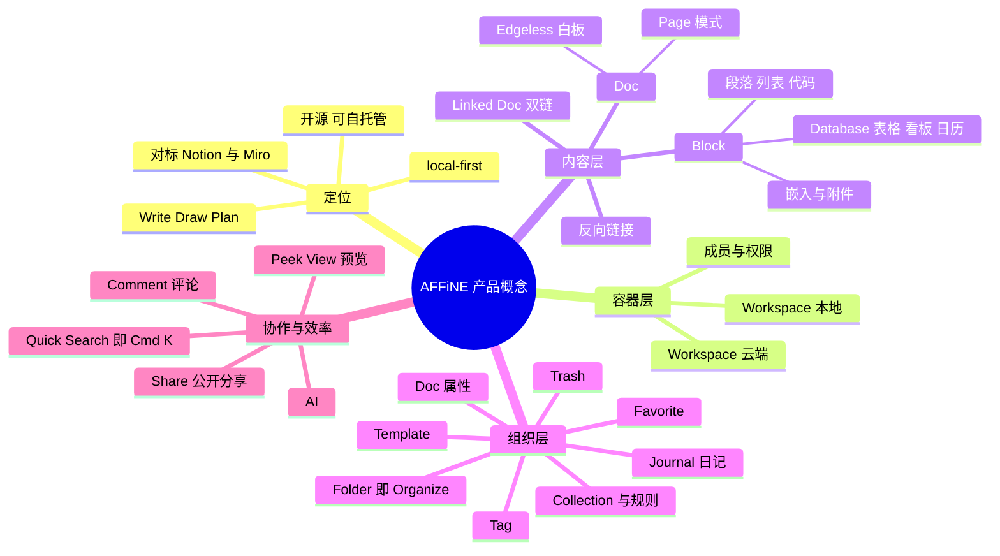
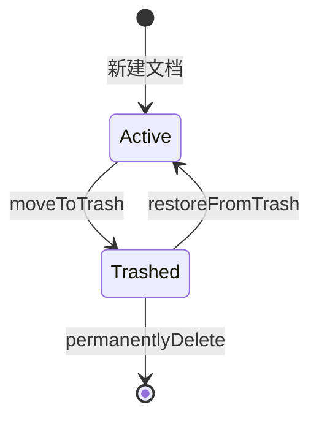
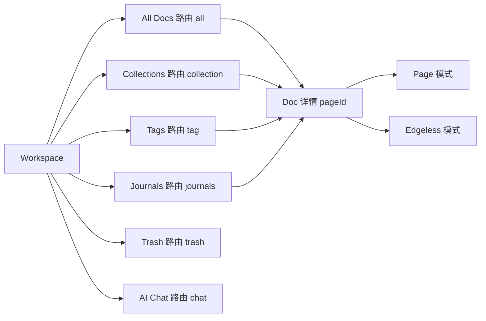

# 第 1 章 产品定位与核心概念

> **所属部分**：第 1 部分 · 产品认知 ｜ **难度**：★☆☆☆☆ ｜ **建议学时**：4 小时 ｜ **前置章节**：无

## 本章导读

学习一个大型开源项目，最常见的误区是一上来就扎进 `packages/` 读代码，结果看到 `Workspace`、`DocRecord`、`Collection`、`flavour`、`Edgeless` 这些词时一头雾水。AFFiNE 的代码组织高度"以产品概念为中心"——几乎每个用户能感知到的功能，都在 `packages/frontend/core/src/modules/` 下有一个同名模块，或在 `blocksuite/affine/` 下有一个同名块/组件。**先理解产品，再读代码，事半功倍。**

本章是整本教材的起点，目标是让你：

1. 用一句话讲清 AFFiNE 是什么、和 Notion/Miro/Obsidian/Logseq 有何不同；
2. 理解 local-first（本地优先）这一贯穿整个架构的核心理念；
3. 逐个认识 Workspace、Doc、Page/Edgeless、Block、双链、Collection、Tag、Journal、Database 等 20 余个核心概念，并知道它们"住"在仓库的哪个目录；
4. 产出一张"产品概念 → 代码目录"对照表，作为后续 29 章的导航索引。

本章代码片段都比较短，只用来印证"这个概念在代码里长什么样"，不要求你看懂所有实现细节。

## 学习目标

- [ ] 能够用自己的话复述 AFFiNE 的产品定位 "Write, Draw and Plan All at Once" 及其含义
- [ ] 能够解释 local-first 理念，并说出本地工作区与云工作区在存储层上的差别
- [ ] 能够区分 Doc 的 Page 模式与 Edgeless 模式，并指出 `DocMode` 类型定义所在文件
- [ ] 能够说明 Block、Linked Doc、反向链接、Collection、Tag、Folder、Favorite 之间的关系
- [ ] 能够描述 Journal、Template、Trash、Doc 属性在数据层是如何存储的
- [ ] 能够在仓库中为任意一个产品概念快速定位到对应的代码目录
- [ ] 能够独立完成一轮完整的产品体验任务，并记录对架构的初步猜想

## 知识地图



## 1.1 AFFiNE 是什么：从 README 读产品定位

打开仓库根目录的 `README.md`，第一屏就是产品的 slogan 和一句话定位：

来源：`README.md`

```html
<h1 style="border-bottom: none">
    <b><a href="https://affine.pro">AFFiNE.Pro</a></b><br />
    Write, Draw and Plan All at Once
    <br>
</h1>
<!-- ... -->
<p align="center">
  A privacy-focused, local-first, open-source, and ready-to-use alternative for Notion & Miro. <br />
  One hyper-fused platform for wildly creative minds.
</p>
```

拆解这段定位，可以得到 5 个关键词：

| 关键词 | 含义 | 在代码中的体现（后续章节详解） |
| --- | --- | --- |
| Write | 文档写作，块编辑器 | `blocksuite/affine/blocks/` 下的段落、列表、代码等块 |
| Draw | 无限画布白板 | Edgeless 模式，`blocksuite/affine/gfx/`、`blocksuite/affine/blocks/surface/` |
| Plan | 规划、数据库、看板 | `blocksuite/affine/blocks/database/`、`blocksuite/affine/data-view/` |
| privacy-focused / local-first | 数据首先存在本地 | `packages/common/nbstore/`、`packages/frontend/core/src/modules/workspace-engine/` |
| open-source | 开源、可自托管、可 fork | 根目录 `LICENSE`、`packages/backend/server/` |

README 中还有一句很好地解释了品牌名：

> Docs, canvas and tables are hyper-merged with AFFiNE - just like the word affine (əˈfʌɪn | a-fine).

"affine" 在数学里是"仿射"，暗示文档、画布、表格之间可以像仿射变换一样自由转换。这不是营销噱头，而是架构的核心约束：**同一份文档数据，必须能同时以线性文档和二维画布两种形态渲染**。这个约束直接决定了 BlockSuite 的设计（详见第 16–18 章）。

README 的 Features 一节进一步列出四大卖点：

1. **A true canvas for blocks in any form**：任何块（富文本、便签、网页嵌入、多视图数据库、链接页面、形状甚至幻灯片）都能放在白板上；
2. **Multimodal AI partner**：AFFiNE AI，可写报告、大纲转幻灯片、文章转思维导图；
3. **Local-first & Real-time collaborative**：本地优先，同时支持实时同步协作；
4. **Self-host & Shape your own AFFiNE**：可自托管、fork、二次开发。

README 的 Acknowledgement 一节也值得一读——它坦白承认借鉴了 Quip & Notion（一切皆块）、Trello（看板）、Airtable & Miro（可编程数据表）、Miro & Whimsical（无边界白板）、Capacities（基于对象的标签系统）。理解这些"灵感来源"，有助于你理解为什么 AFFiNE 的概念体系是现在这个样子。

**小结**：AFFiNE = 块编辑器 + 无限白板 + 多视图数据库 + AI，且数据本地优先、代码开源。

## 1.2 local-first 理念与竞品定位

### 1.2.1 什么是 local-first

local-first（本地优先）这一术语来自 Ink & Switch 2019 年的论文《Local-first software》。它提出理想软件应满足 7 个目标：快速（无需等待网络）、多设备、离线可用、协作、长期可用、隐私安全、用户拥有数据。核心思想是：

> **数据的"主副本"在用户设备上，云端只是同步与备份的通道，而不是唯一真相来源。**

与之对比的是传统云优先（cloud-first）应用（如早期 Notion）：数据主副本在服务器，客户端只是"视图"，断网就基本不可用。

### 1.2.2 AFFiNE 如何落地 local-first

README 原文："We love the idea of local-first that you always own your data on your disk, in spite of the cloud."

落到代码上，有三个关键支撑：

1. **CRDT 数据结构**：文档内容用 Yjs（以及 Rust 实现 y-octo）表示，多端并发编辑可自动合并，无需中心服务器仲裁（第 12 章）；
2. **本地存储引擎**：浏览器用 IndexedDB，桌面端/移动端用 SQLite（第 23 章 nbstore）；
3. **可选的云同步**：云工作区只是在本地存储之上额外挂一个远端同步通道。

我们可以在本地工作区实现中直观看到"按平台选择本地存储"的逻辑：

来源：`packages/frontend/core/src/modules/workspace-engine/impls/local.ts`

```ts
  readonly flavour = 'local';
  readonly notifyChannel = new BroadcastChannel(
    LOCAL_WORKSPACE_CHANGED_BROADCAST_CHANNEL_KEY
  );

  DocStorageType =
    BUILD_CONFIG.isElectron || BUILD_CONFIG.isIOS || BUILD_CONFIG.isAndroid
      ? SqliteDocStorage
      : IndexedDBDocStorage;
  DocStorageV1Type = BUILD_CONFIG.isElectron
    ? SqliteV1DocStorage
    : BUILD_CONFIG.isWeb || BUILD_CONFIG.isMobileWeb
      ? IndexedDBV1DocStorage
  // ...
```

逐行解读：

- `flavour = 'local'`：flavour（风味）是 AFFiNE 区分工作区类型的字段，本地工作区固定为 `'local'`；
- `DocStorageType`：Electron 桌面端、iOS、Android 使用 `SqliteDocStorage`（Rust 实现的 SQLite 存储，通过 NAPI 或原生桥接调用），纯 Web 端使用 `IndexedDBDocStorage`；
- `BroadcastChannel`：同一浏览器多个标签页之间广播"本地工作区列表变化"，这是 local-first 应用在 Web 上要处理的典型问题。

### 1.2.3 隐私优先意味着什么

- 本地工作区的数据**从不离开你的设备**（除非你主动开启云同步或导出）；
- 可以完全自托管服务端（`packages/backend/server/`），让云数据也只在你自己的服务器上；
- 埋点模块 `packages/frontend/track/` 是独立的包；用户可在"设置 → 关于"中关闭遥测（开关 `enableTelemetry`，见 `packages/frontend/core/src/desktop/dialogs/setting/general-setting/about/index.tsx`，第 2 章会讲）。

### 1.2.4 设计取舍

| 收益 | 代价 |
| --- | --- |
| 秒开、离线可用、无网络抖动 | 需要处理多端合并冲突，引入 CRDT 复杂度 |
| 数据归用户所有 | 本地数据丢失风险需要用户自己承担（备份模块 `modules/backup`） |
| 服务器压力小 | 权限控制、全文检索等"中心化能力"实现更困难（索引需要在本地也跑一份，见 `modules/docs-search`） |

**小结**：local-first 不是一个功能点，而是一种架构立场；它解释了为什么 AFFiNE 前端如此"重"——大量本该在后端的逻辑（存储、索引、搜索）都在客户端也有一份。

### 1.2.5 竞品定位对比：Notion / Miro / Obsidian / Logseq

理解竞品是产品认知的捷径。下表从产品经理视角做定性对比（以各产品公开定位为准，具体功能细节请以各自官网为准）：

| 维度 | AFFiNE | Notion | Miro | Obsidian | Logseq |
| --- | --- | --- | --- | --- | --- |
| 核心形态 | 文档 + 白板 + 数据库融合 | 块文档 + 数据库 | 在线白板 | Markdown 笔记 + 双链 | 大纲笔记 + 双链 |
| 数据位置 | 本地优先，可选云同步 | 云端 | 云端 | 本地 Markdown 文件 | 本地文件 |
| 开源 | 是 | 否 | 否 | 否（插件生态开放） | 是 |
| 实时协作 | 支持（CRDT） | 支持 | 支持 | 需第三方方案 | 有限 |
| 白板 | 原生 Edgeless，与文档同源 | 无原生无限画布 | 核心能力 | Canvas 插件/核心插件 | 有白板功能 |
| 自托管 | 支持 Docker 自托管 | 不支持 | 不支持 | 不涉及 | 不涉及 |
| 底层格式 | Yjs CRDT 二进制 | 私有 | 私有 | Markdown 纯文本 | Markdown/数据库 |

从对比中可以提炼 AFFiNE 的差异化：

1. **"文档 = 白板"同源**：Notion 没有原生无限画布，Miro 不擅长长文档；AFFiNE 让同一个 Doc 在两种模式间切换，数据不复制；
2. **开源 + 协作**：Obsidian 本地优先但闭源且协作弱；Notion 协作强但闭源云端；AFFiNE 试图同时拿到两者的好处；
3. **CRDT 而非 Markdown**：这是与 Obsidian/Logseq 最本质的技术分歧。Markdown 便于人类阅读和 Git 管理，但难以表达白板坐标、数据库视图等结构化数据，也难以做无冲突实时合并。AFFiNE 选择了 CRDT，代价是需要专门的导入导出适配器（`blocksuite/affine/shared/src/adapters/`，第 2 章）。

**小结**：AFFiNE 的生态位是"开源的、本地优先的 Notion + Miro"。

## 1.3 容器层：Workspace（本地 vs 云）

### 1.3.1 概念

**Workspace（工作区）** 是 AFFiNE 中最大的数据容器，类似 Notion 的 Workspace 或 Obsidian 的 Vault。一个工作区包含若干 Doc、标签、集合、文件夹、附件、自定义属性定义等。一个用户可以拥有多个工作区，并在左上角的工作区选择器中切换。

### 1.3.2 两种工作区

| 类型 | flavour 值 | 存储 | 协作 | 使用前提 |
| --- | --- | --- | --- | --- |
| 本地工作区 Local | `'local'` | IndexedDB 或 SQLite | 仅本机 | 无需登录 |
| 云工作区 Cloud | 服务器 id，如官方云 | 本地存储 + 服务器同步 | 多人实时 | 需登录某个服务器账号 |

工作区的元信息结构非常精简：

来源：`packages/frontend/core/src/modules/workspace/metadata.ts`

```ts
export type WorkspaceMetadata = {
  id: string;
  flavour: string;
  initialized?: boolean;
};

export const workspaceMetadataKey = (metadata: WorkspaceMetadata) =>
  `${metadata.flavour}:${metadata.id}`;
```

注意 `flavour` 的类型是 `string` 而非 `'local' | 'cloud'` 枚举。为什么？看云工作区实现：

来源：`packages/frontend/core/src/modules/workspace-engine/impls/cloud.ts`

```ts
  constructor(
    private readonly globalState: GlobalState,
    private readonly server: Server
  ) {
    // ... 从 server.scope 取 AuthService、GraphQLService、NbstoreService
  }

  readonly flavour = this.server.id;
```

云工作区的 flavour 等于**服务器 id**。这是一个巧妙的设计：AFFiNE 客户端可以同时连接官方 AFFiNE Cloud 和若干自托管服务器（`packages/frontend/core/src/components/server-selector/`），每个服务器就是一种 flavour。`workspaceMetadataKey` 用 `flavour:id` 拼接，确保不同服务器上同 id 的工作区不冲突。

此外，产品上有"Enable AFFiNE Cloud"操作可把本地工作区迁移到云端——本地是默认态，云是增强态，这正是 local-first 的体现。

**小结**：Workspace 是数据和权限的边界；flavour 区分存储来源，云 flavour = 服务器 id。代码入口：`packages/frontend/core/src/modules/workspace/`（抽象）与 `packages/frontend/core/src/modules/workspace-engine/`（local/cloud 具体实现）。

## 1.4 内容层：Doc、Page/Edgeless 双模式与 Block

### 1.4.1 Doc（文档）

**Doc** 是工作区内的基本内容单元，在 UI 上也常被称为 Page（历史原因，很多代码变量仍叫 `pageId`）。每个 Doc 在底层是一个独立的 Yjs 子文档（subdoc），包含一棵块树。

前端用 `DocRecord` 表示"无需打开文档就能拿到的信息"：

来源：`packages/frontend/core/src/modules/doc/entities/record.ts`

```ts
export class DocRecord extends Entity<{ id: string }> {
  // ...
  meta$ = LiveData.from<Partial<DocMeta>>(
    this.docsStore.watchDocMeta(this.id),
    {}
  );
  properties$ = LiveData.from<DocProperties>(
    this.docPropertiesStore.watchDocProperties(this.id),
    { id: this.id }
  );
  // ...
  primaryMode$: LiveData<DocMode> = LiveData.from(
    this.docsStore.watchDocPrimaryModeSetting(this.id),
    'page' as DocMode
  ).map(mode => (mode === 'edgeless' ? 'edgeless' : 'page') as DocMode);
```

这里出现了两类数据：

- `meta$`：标题、创建时间、标签、是否在回收站等，存在工作区根文档的 `meta` 中（BlockSuite 的 `DocMeta`）；
- `properties$`：AFFiNE 应用层扩展的属性，如主模式、日记日期、是否模板等，存在工作区 DB 中（见 1.6 节）。

`Entity`、`LiveData` 是 AFFiNE 自研的 DI 与响应式基础设施，第 20 章详解。现在你只需知道 `xxx$` 结尾的字段是"可订阅的值"。

### 1.4.2 Page 模式与 Edgeless 模式

同一个 Doc 有两种呈现模式，类型定义极其简洁：

来源：`blocksuite/affine/model/src/consts/doc.ts`

```ts
export type DocMode = 'edgeless' | 'page';

export const DocModes = ['edgeless', 'page'] as const;
```

| 模式 | 体验 | 根组件 |
| --- | --- | --- |
| Page | 线性文档，类似 Notion/Word | `blocksuite/affine/blocks/root/src/page/page-root-block.ts` |
| Edgeless | 无限画布白板，可放形状、画笔、连线、思维导图、Frame | `blocksuite/affine/blocks/root/src/edgeless/edgeless-root-block.ts` |

关键点：**两种模式共享同一棵块树**。Page 模式下你看到的每一段文字都属于某个 `affine:note` 块；切到 Edgeless 时，这些 note 块变成画布上的"卡片"，而形状、连线、画笔笔迹等图形元素则存在 `affine:surface` 块中（`blocksuite/affine/blocks/surface/`）。白板专属的图形能力分布在 `blocksuite/affine/gfx/` 下：`brush`（画笔）、`connector`（连线）、`mindmap`（思维导图）、`shape`（形状）、`text`、`note`、`group`、`template` 等。

`primaryMode$` 记录的是用户为该文档选择的"默认打开模式"，用户切换后通过 `setPrimaryMode` 写回 `docProperties.primaryMode`。

### 1.4.3 Block（块）

"一切皆块"是 Notion 普及的理念。在 AFFiNE 中每个块有一个全局唯一的 **flavour**（注意与工作区 flavour 不是一回事），如 `affine:paragraph`、`affine:list`、`affine:database`。块通过 schema 声明：

来源：`blocksuite/affine/model/src/blocks/paragraph/paragraph-model.ts`

```ts
export const ParagraphBlockSchema = defineBlockSchema({
  flavour: 'affine:paragraph',
  props: (internal): ParagraphProps => ({
    type: 'text',
    text: internal.Text(),
    // ...
    comments: undefined,
  }),
  metadata: {
    version: 1,
    role: 'content',
    parent: [
      'affine:note',
      'affine:database',
      'affine:paragraph',
      'affine:list',
      // ... edgeless-text、callout、transcription
    ],
  },
  toModel: () => new ParagraphBlockModel(),
});
```

从这一段就能读出很多产品信息：

- 段落有 `text/quote/h1~h6` 等类型（`ParagraphType`），即正文、引用、各级标题；
- `parent` 约束了段落可以出现在 note、database、list、callout 等块内部——这就是"块嵌套规则"；
- `comments` 字段说明评论是挂在块上的。

`blocksuite/affine/blocks/` 下的目录名就是一份"块清单"：`attachment`、`bookmark`、`callout`、`code`、`data-view`、`database`、`divider`、`edgeless-text`、`embed`、`embed-doc`、`frame`、`image`、`latex`、`list`、`note`、`paragraph`、`root`、`surface`、`surface-ref`、`table`。建议你打开 AFFiNE 输入 `/` 唤起斜杠菜单（`blocksuite/affine/widgets/slash-menu/`），对照这份清单逐个插入体验。

**小结**：Doc 是内容单元，Block 是内容原子，DocMode 决定渲染形态；Page 与 Edgeless 是"同一份数据的两种视图"。

## 1.5 链接网络：Linked Doc、双链与反向链接

### 1.5.1 概念

- **Linked Doc（链接文档）**：在文档中输入 `@` 或 `[[` 可以引用另一个文档。引用有三种展示形态：
  - 行内引用（Inline）：`blocksuite/affine/inlines/reference/`，在一行文字中显示为可点击的文档标题；
  - 卡片（Card）：`blocksuite/affine/blocks/embed-doc/src/embed-linked-doc-block/`；
  - 嵌入同步（Embed/Synced）：`blocksuite/affine/blocks/embed-doc/src/embed-synced-doc-block/`，直接在当前文档中渲染并编辑另一个文档内容。
- **双链（Bi-directional Link）**：A 引用 B 时，B 自动知道"谁引用了我"，即**反向链接（Backlinks）**。

引用信息的数据结构定义在：

来源：`blocksuite/affine/model/src/consts/doc.ts`

```ts
export const ReferenceParamsSchema = z
  .object({
    mode: z.enum(DocModes),
    blockIds: z.string().array(),
    elementIds: z.string().array(),
    databaseId: z.string().optional(),
    databaseRowId: z.string().optional(),
    xywh: SerializedXYWHSchema.optional(),
    commentId: z.string().optional(),
  })
  .partial();

export const ReferenceInfoSchema = z
  .object({
    pageId: z.string(),
    params: ReferenceParamsSchema.optional(),
  })
  .merge(AliasInfoSchema);
```

可以看出，一个引用不仅能指向某个文档（`pageId`），还能精确到：以哪种模式打开（`mode`）、定位到哪些块（`blockIds`）、白板上哪些元素（`elementIds`）、哪个视口区域（`xywh`）、甚至哪条评论（`commentId`）。`AliasInfoSchema` 允许为引用设置别名标题和描述。

### 1.5.2 反向链接如何计算

反向链接不是在写入时维护的"双向指针"，而是**通过本地索引查询**得到的：

来源：`packages/frontend/core/src/modules/doc-link/entities/doc-backlinks.ts`

```ts
export interface Backlink {
  docId: string;
  blockId: string;
  title: string;
  // ...
  markdownPreview?: string;
}

export class DocBacklinks extends Entity {
  // ...
  backlinks$ = new LiveData<Backlink[] | undefined>(undefined);
  // ...
        const aggregate = (prefer: 'local' | 'remote') =>
          this.docsSearchService.indexer.aggregate(
            'block',
  // ...
```

设计意图：如果在写入时同时修改被引用文档来记录"被谁引用"，会产生跨文档写入和并发冲突；改为由索引器（`modules/docs-search`）扫描所有块中的引用，再按目标 docId 聚合，既无冲突又能附带上下文预览（`markdownPreview`）。

**小结**：Linked Doc 有三种展示形态；反向链接靠索引聚合实现。代码：`modules/doc-link/`、`blocksuite/affine/inlines/reference/`、`blocksuite/affine/blocks/embed-doc/`。

## 1.6 组织层：Collection、Tag、Folder、Favorite、Doc 属性

文档多了以后需要组织。AFFiNE 提供了五种互补的组织方式，初学者最容易混淆，先看对比：

| 方式 | 本质 | 一个文档可属于多个吗 | 自动化 | 代码模块 |
| --- | --- | --- | --- | --- |
| Tag 标签 | 文档的多值属性 | 是 | 否 | `modules/tag` |
| Collection 集合 | 按规则动态筛选 + 手动白名单 | 是 | 是（规则） | `modules/collection`、`modules/collection-rules` |
| Folder 文件夹（Organize） | 侧栏中的树形目录，可放文档、标签、集合、子文件夹 | 是（同一文档可出现在多个文件夹中） | 否 | `modules/organize` |
| Favorite 收藏 | 个人快捷入口 | — | 否 | `modules/favorite` |
| Doc 属性 | 自定义字段（文本、数字、日期、复选框等） | — | 可作为集合规则条件 | `modules/workspace-property` |

### 1.6.1 工作区 DB：组织数据存在哪里

这些组织信息多数存在一个"工作区内置数据库"中，其 schema 定义如下：

来源：`packages/frontend/core/src/modules/db/schema/schema.ts`

```ts
export const AFFiNE_WORKSPACE_DB_SCHEMA = {
  folders: {
    id: f.string().primaryKey().optional().default(nanoid),
    parentId: f.string().optional(),
    data: f.string(),
    type: f.string(),
    index: f.string(),
  },
  docProperties: t.document({
    // { [`custom:{customPropertyId}`]: any }
    id: f.string().primaryKey(),
    primaryMode: f.string().optional(),
    edgelessColorTheme: f.string().optional(),
    journal: f.string().optional(),
    pageWidth: f.string().optional(),
    isTemplate: f.boolean().optional(),
    integrationType: integrationType.optional(),
    createdBy: f.string().optional(),
    updatedBy: f.string().optional(),
  }),
  // ... docCustomPropertyInfo、pinnedCollections、explorerIcon
} as const satisfies DBSchemaBuilder;
```

同文件还定义了 `AFFiNE_WORKSPACE_USERDATA_DB_SCHEMA`，其中有 `favorite` 表——**收藏是"用户级"数据**（每个成员各自的收藏不同），而文件夹、文档属性是"工作区级"共享数据。这是一个重要的产品设计：团队共享一套文件夹结构，但每人有自己的收藏夹。

这个 DB 底层同样是 Yjs 文档（`@toeverything/infra` 提供的 ORM），所以同样享受离线与同步能力。

### 1.6.2 Collection 与规则

Collection（集合）是 AFFiNE 中最"智能"的组织方式：

来源：`packages/frontend/core/src/modules/collection/entities/collection.ts`

```ts
  watch() {
    return this.info$.pipe(
      switchMap(info => {
        return this.rulesService
          .watch({
            filters: info.rules.filters,
            extraAllowList: info.allowList,
            extraFilters: [
              { type: 'system', key: 'trash', method: 'is', value: 'false' },
              { type: 'system', key: 'empty-journal', method: 'is', value: 'false' },
            ],
          })
          .pipe(map(result => result.groups.flatMap(group => group.items)));
      })
    );
  }
```

解读：

- 集合 = `rules.filters`（规则筛选）∪ `allowList`（手动加入的文档）；
- 系统总会追加两个隐式过滤器：排除回收站文档、排除空日记；
- `addDoc`/`removeDoc` 方法只是修改 `allowList`。

规则的结构是 `{ type, key, method, value }`（见 `packages/frontend/core/src/modules/collection-rules/types.ts`），可用的过滤器实现全部在 `packages/frontend/core/src/modules/collection-rules/impls/filters/` 下：`tags.ts`、`created-at.ts`、`updated-at.ts`、`doc-primary-mode.ts`、`journal.ts`、`favorite.ts`、`trash.ts`、`template.ts`、`property.ts`（自定义属性）等。同目录下还有 `group-by/` 和 `order-by/`，对应文档列表的"分组"与"排序"功能。

例如回收站过滤器 `packages/frontend/core/src/modules/collection-rules/impls/filters/trash.ts` 中的 `TrashFilterProvider.filter$(params)`：当 `params.value === 'true'` 时返回 `docsService.allTrashDocIds$()`，否则返回 `allNonTrashDocIds$()`，结果都被包装成 `Set<string>`。

每个过滤器返回一个"文档 id 集合"的 Observable，规则引擎再对多个集合做交集运算。这是典型的**策略模式 + 响应式流**设计，便于扩展新过滤条件。

### 1.6.3 Tag 标签

标签选项存在工作区根文档 meta 的 `properties.tags.options` 路径下：

来源：`packages/frontend/core/src/modules/tag/stores/tag.ts`

```ts
export type Tag = {
  value: string;
  id: string;
  color: string;
  createDate?: number | Date | undefined;
  updateDate?: number | Date | undefined;
  parentId?: string | undefined;
};

// ... TagStore 中：
    yjsGetPath(
      this.workspaceService.workspace.rootYDoc.getMap('meta'),
      'properties.tags.options'
    )
```

标签有 `color`，还有 `parentId` 字段，暗示了层级标签的可能性。

### 1.6.4 Folder（Organize）与 Favorite

侧栏中的"Organize"区就是文件夹树，节点类型可以是 `folder`、`doc`、`tag`、`collection`：

来源：`packages/frontend/core/src/modules/organize/entities/folder-node.ts`

```ts
export class FolderNode extends Entity<{ id: string | null }> {
  // ...
  info$ = LiveData.from<{
    data: string;
    type: (string & {}) | 'folder' | 'doc' | 'tag' | 'collection';
    index: string;
    id: string;
    parentId?: string | null;
  } | null>(this.store.watchNodeInfo(this.id ?? ''), null);
  // ...
```

`index` 字段使用**分数索引（fractional indexing）**排序（同文件引入了 `generateFractionalIndexingKeyBetween`），这样拖拽排序时只需改一个节点的 index，不必重排所有兄弟节点——在 CRDT 场景下能显著减少冲突。

收藏支持的类型：

来源：`packages/frontend/core/src/modules/favorite/constant.ts`

```ts
export const FavoriteSupportType = ['collection', 'doc', 'tag', 'folder'] as const;
```

侧栏的这几个分区 UI 在 `packages/frontend/core/src/desktop/components/navigation-panel/sections/` 下：`favorites`、`organize`、`tags`、`collections`，一一对应。

### 1.6.5 Doc 属性（workspace-property）

文档顶部的"Info / 属性"面板允许添加自定义字段。支持的属性类型定义在：

来源：`packages/frontend/core/src/modules/workspace-property/types.ts`

```ts
export type WorkspacePropertyTypes = {
  tags: { /* filter: 'include-all' | 'include-any-of' | ... */ };
  text: {
    filter: 'is' | 'is-not' | 'is-not-empty' | 'is-empty';
  };
  number: {
    filter: '=' | '≠' | '>' | '<' | '≥' | '≤' | 'is-not-empty' | 'is-empty';
  };
  checkbox: {
    filter: 'is' | 'is-not';
  };
  date: {
    filter: DateFilters | 'is-not-empty' | 'is-empty';
  };
  createdBy: { filter: 'include' };
  // ... updatedBy、updatedAt、createdAt
  docPrimaryMode: { filter: 'is' | 'is-not' };
  journal: { filter: 'is' | 'is-not' };
  // ... edgelessTheme、pageWidth、template、unknown
};
```

这张类型表把"属性类型"与"它支持哪些过滤操作"绑定在一起，正是它让 Collection 规则可以基于任意属性筛选。上面的片段对 `tags` 一项做了压缩展示，完整内容请阅读原文件。属性的 UI 渲染在 `packages/frontend/core/src/components/workspace-property-types/` 下（`checkbox.tsx`、`date.tsx`、`tags.tsx` 等）。自定义属性值以 `custom:{propertyId}` 为键存在 `docProperties` 中（见 `DocRecord.customProperty$`）。

**小结**：Tag 是标签，Collection 是"智能文件夹"，Folder 是手工目录，Favorite 是个人快捷方式，Doc 属性是可筛选的结构化字段。前四者解决"找得到"，属性解决"可计算"。

## 1.7 时间与生命周期：Journal、Template、Trash

### 1.7.1 Journal 日记

Journal 是"按日期自动创建的文档"，类似 Logseq 的每日笔记。它其实就是一个普通 Doc，只是 `docProperties.journal` 字段被设为 `YYYY-MM-DD` 格式的日期：

来源：`packages/frontend/core/src/modules/journal/services/journal.ts`

```ts
export const JOURNAL_DATE_FORMAT = 'YYYY-MM-DD';

export class JournalService extends Service {
  // ...
  private createJournal(maybeDate: MaybeDate) {
    const day = dayjs(maybeDate);
    const title = day.format(JOURNAL_DATE_FORMAT);
    const docRecord = this.docsService.createDoc({ title });
    // ... 设置 createDate、读取模板设置
    if (journalTemplateDocId) {
      this.docsService
        .duplicateFromTemplate(journalTemplateDocId, docRecord.id)
        .catch(console.error);
    }
    // journal template not configured, use page template
    else if (enablePageTemplate && pageTemplateDocId) {
      // ...
    }
    this.setJournalDate(docRecord.id, title);
    return docRecord;
  }

  ensureJournalByDate(maybeDate: MaybeDate) {
    // ...
    const docs = this.journalsByDate$(title).value;
    if (docs.length) return docs[0];
    return this.createJournal(maybeDate);
  }
}
```

产品逻辑一目了然：

1. 点击侧栏"Journals"或日历某天 → 调用 `ensureJournalByDate`；
2. 若当天已有日记则直接返回，否则创建；
3. 创建时优先应用"日记模板"，其次是"通用页面模板"；
4. 写入 `journal` 属性标记它是日记。

路由在 `packages/frontend/core/src/desktop/workbench-router.ts` 中注册为 `/journals`。

### 1.7.2 Template 模板

任何文档都可以被标记为模板（`docProperties.isTemplate`）。用户可在设置中指定"新建页面模板"和"日记模板"。模板模块 `packages/frontend/core/src/modules/template-doc/` 的服务（`services/template-doc.ts`）只暴露两个实体：`list`（模板列表）与 `setting`（模板设置，即上文 Journal 读取的 `journalTemplateDocId$` 等）。

另有官方模板库（affine.pro/templates）与内置模板资源（`packages/frontend/templates/`，第 2 章讲），以及从链接导入模板的 `modules/import-template`。

### 1.7.3 Trash 回收站

删除文档默认是"移入回收站"，可恢复或永久删除。三种生命周期动作的实现：

来源：`packages/frontend/core/src/modules/doc/stores/docs.ts`

```ts
  async applyDocLifecycle(
    id: string,
    lifecycle: 'trash' | 'restore' | 'delete'
  ) {
    const workspace = this.workspaceService.workspace;
    if (workspace.flavour === 'local') {
      if (lifecycle === 'delete') {
        workspace.docCollection.removeDoc(id);
      } else {
        this.setDocMeta(id, lifecycle === 'trash'
          ? { trash: true, trashDate: Date.now() }
          : { trash: false, trashDate: undefined });
      }
      return;
    }
    const result = await workspace.engine.doc.applyDocLifecycle(id, lifecycle);
    applyUpdate(workspace.rootYDoc, result.rootUpdate, 'server-lifecycle');
    if (lifecycle === 'delete') {
      await workspace.engine.doc.storage.deleteDoc(id);
    }
  }
```

这段代码完美展示了 local 与 cloud 的分野：

- **本地工作区**：直接在 meta 上打 `trash: true` 标记（软删除），永久删除则移除子文档；
- **云工作区**：交给服务端处理生命周期（服务端需要同时处理权限、索引、存储清理），再把服务端返回的根文档更新 `applyUpdate` 到本地。

回收站页面：`packages/frontend/core/src/desktop/pages/workspace/trash-page.tsx`，路由 `/trash`。



**小结**：Journal 和 Template 都是"带特殊属性的普通 Doc"，这种"不增加新实体、只加属性"的设计让过滤、搜索、同步全部复用现有机制。

## 1.8 数据与表格：Database 块与多视图

### 1.8.1 概念

AFFiNE 有两种"表格"：

| 名称 | flavour 所在目录 | 定位 |
| --- | --- | --- |
| Database 数据库块 | `blocksuite/affine/blocks/database/` | 类 Notion/Airtable 的结构化数据，有列类型、多视图、筛选排序 |
| Table 简单表格块 | `blocksuite/affine/blocks/table/` | 类 Word 的纯排版表格 |

Database 块支持哪些视图？直接看源码：

来源：`blocksuite/affine/blocks/database/src/views/index.ts`

```ts
export const databaseBlockViews: ViewMeta[] = [
  viewPresets.tableViewMeta,
  viewPresets.kanbanViewMeta,
  viewPresets.calendarViewMeta,
];
```

即**表格（Table）、看板（Kanban）、日历（Calendar）**三种视图。视图实现位于独立的 `blocksuite/affine/data-view/src/view-presets/` 下（`table/`、`kanban/`、`calendar/`），列（属性）类型位于 `blocksuite/affine/data-view/src/property-presets/`：`checkbox`、`date`、`image`、`multi-select`、`number`、`progress`、`select`、`text` 等。

### 1.8.2 设计意图：data-view 为何独立成包

`data-view` 被拆成一个与 database 块解耦的通用"数据视图引擎"。这样做的好处是：同一套表格/看板 UI 既可以渲染 Database 块里的行，也可以渲染其他数据源。Database 块只需实现一个数据源适配（`blocksuite/affine/blocks/database/src/data-source.ts`）。这是"视图与数据源分离"的经典架构。

**小结**：要做"计划（Plan）"，用 Database 块；它的多视图能力来自通用的 data-view 引擎。

## 1.9 协作与效率：Share、Comment、Peek View、Quick Search、AI

### 1.9.1 Share 公开分享

云工作区的文档可以生成公开链接，访客无需登录即可阅读（可选择以 Page 或 Edgeless 模式分享）。分享状态实体：

来源：`packages/frontend/core/src/modules/share-doc/entities/share-info.ts`

```ts
type ShareInfoType = Omit<DocShareStateSnapshot, 'defaultRole' | 'mode'> & {
  defaultRole: DocRole;
  mode: PublicDocMode;
};
export class ShareInfo extends Entity {
  info$ = new LiveData<ShareInfoType | undefined | null>(null);
  isShared$ = this.info$.map(info => info?.public);
  sharedMode$ = this.info$.map(info => (info !== null ? info?.mode : null));
  // ...
```

`PublicDocMode`、`DocRole` 来自 `@affine/graphql`，说明分享是一个**依赖后端的能力**——本地工作区无法公开分享。访客看到的页面在 `packages/frontend/core/src/desktop/pages/workspace/share/share-page.tsx`。相关模块还有 `modules/share-menu`（分享菜单 UI）和 `modules/share-setting`（工作区级分享设置）。

### 1.9.2 Comment 评论

可以对选中的文字或块发起评论，支持回复、@提及、附件、标记解决：

来源：`packages/frontend/core/src/modules/comment/types.ts`

```ts
export interface DocComment extends BaseComment {
  resolved: boolean;
  mentions: string[];
  replies?: DocCommentReply[];
}
export type DocCommentContent = {
  snapshot: DocSnapshot; // blocksuite snapshot
  attachments?: CommentAttachment[];
  mode?: DocMode;
  preview?: string; // text preview of the target
};
```

有趣的是评论内容本身也是一个 BlockSuite `DocSnapshot`——评论框是一个迷你编辑器，支持富文本。评论的行内高亮标记在 `blocksuite/affine/inlines/comment/`。

### 1.9.3 Peek View 预览

按住修饰键点击（或在某些场景直接点击）文档引用、图片、附件时，会弹出一个浮层预览，而不跳转页面，这就是 Peek View。它支持的预览类型以联合类型的形式定义在 `packages/frontend/core/src/modules/peek-view/entities/peek-view.ts` 中：`DocPeekViewInfo`（`type: 'doc'`）、`ImageListPeekViewInfo`（`'image-list'`）、`ImagePeekViewInfo`（`'image'`）、`AttachmentPeekViewInfo`（`'attachment'`）、`AIChatBlockPeekViewInfo`（`'ai-chat-block'`）、`CustomTemplatePeekViewInfo`（`'template'`），即文档、图片、图片列表、附件、AI 对话块、自定义模板六类。

### 1.9.4 Quick Search（Cmd+K）

`Cmd+K`（Windows 为 `Ctrl+K`）唤起全局快速搜索面板。快捷键注册：

来源：`packages/frontend/core/src/components/hooks/use-register-workspace-commands.ts`

```ts
function registerCMDKCommand(service: CMDKQuickSearchService) {
  return registerAffineCommand({
    id: 'affine:show-quick-search',
    preconditionStrategy: PreconditionStrategy.Never,
    category: 'affine:general',
    keyBinding: { binding: '$mod+K' },
    // ... label、icon
    run() {
      service.toggle();
    },
  });
}
```

`$mod` 是跨平台修饰键抽象（Mac 为 Cmd，其他为 Ctrl）。面板打开后同时启动多个"搜索会话"：

来源：`packages/frontend/core/src/modules/quicksearch/services/cmdk.ts`

```ts
      this.quickSearchService.quickSearch.show(
        [
          this.framework.createEntity(RecentDocsQuickSearchSession),
          this.framework.createEntity(CollectionsQuickSearchSession),
          this.framework.createEntity(CommandsQuickSearchSession),
          this.framework.createEntity(CreationQuickSearchSession),
          this.framework.createEntity(DocsQuickSearchSession),
          this.framework.createEntity(LinksQuickSearchSession),
          this.framework.createEntity(TagsQuickSearchSession),
        ],
```

所以 Cmd+K 不只是搜文档：它同时搜最近文档、集合、命令（如切换主题、新建文档）、标签，还能识别粘贴的链接。每类搜索的实现在 `packages/frontend/core/src/modules/quicksearch/impls/` 下一一对应。这是"命令面板"模式（类似 VS Code 的 Cmd+Shift+P）。

### 1.9.5 AI

AFFiNE AI 嵌入在编辑器各处：选中文本后的 AI 菜单、白板上的 AI 生成思维导图/幻灯片、侧边栏 AI Chat、独立的 `/chat` 路由页面（见 `packages/frontend/core/src/desktop/workbench-router.ts`）。前端 AI 代码集中在 `packages/frontend/core/src/blocksuite/ai/`，下有 `chat-panel`、`actions`、`slides`、`mini-mindmap`、`blocks`（AI 对话块）等子目录；AI 按钮与模型选择等配置在 `packages/frontend/core/src/modules/ai-button/`；后端能力在 `packages/backend/server/src/plugins/copilot/`（第 2、28 章）。

**小结**：这五项能力把 AFFiNE 从"个人笔记"拓展到"团队协作 + 智能助手"，其中 Share、Comment、AI 依赖后端，是云服务的价值点（第 2 章商业模式的基础）。

## 1.10 产品概念 → 代码目录对照表与体验清单（核心产出）

下表中所有路径均已在当前仓库中确认存在。前端模块统一位于 `packages/frontend/core/src/modules/`，表中简写为 `modules/`；编辑器部分位于 `blocksuite/affine/`。

| 产品概念 | 前端应用层（packages/frontend/core/src/） | 编辑器层（blocksuite/affine/） | 说明 |
| --- | --- | --- | --- |
| Workspace 抽象 | `modules/workspace/` | — | 工作区实体、列表、元信息 |
| 本地/云工作区实现 | `modules/workspace-engine/impls/local.ts`、`cloud.ts` | — | flavour 区分 |
| Doc 文档 | `modules/doc/` | `model/src/consts/doc.ts` | DocRecord、DocsService |
| Page 模式 | `desktop/pages/workspace/detail-page/` | `blocks/root/src/page/` | 线性文档根块 |
| Edgeless 白板 | 同上 | `blocks/root/src/edgeless/`、`blocks/surface/`、`gfx/` | 画布、图形元素 |
| Block 块模型 | — | `model/src/blocks/`、`blocks/` | 各种块 schema 与组件 |
| 斜杠菜单 | — | `widgets/slash-menu/` | `/` 插入块 |
| Linked Doc 行内引用 | — | `inlines/reference/` | `@` 引用 |
| Linked Doc 卡片/嵌入 | — | `blocks/embed-doc/` | linked-doc 与 synced-doc |
| 双链与反向链接 | `modules/doc-link/` | — | doc-links、doc-backlinks |
| Collection 集合 | `modules/collection/` | — | 集合实体与置顶 |
| 集合规则 | `modules/collection-rules/` | — | filters、group-by、order-by |
| Tag 标签 | `modules/tag/` | — | 存于 meta.properties.tags |
| Favorite 收藏 | `modules/favorite/` | — | 用户级数据 |
| Organize 文件夹 | `modules/organize/` | — | 分数索引排序 |
| 侧栏导航 | `desktop/components/navigation-panel/`、`modules/navigation-panel/` | — | favorites、organize、tags、collections 分区 |
| Journal 日记 | `modules/journal/`、`desktop/pages/workspace/journals/` | — | journal 属性 |
| Doc 属性 | `modules/workspace-property/`、`components/workspace-property-types/` | — | 自定义字段 |
| 工作区内置 DB | `modules/db/` | — | folders、docProperties、favorite 等表 |
| Database 数据库 | — | `blocks/database/`、`data-view/` | 表格、看板、日历视图 |
| 简单表格 | — | `blocks/table/` | 排版用表格 |
| Template 模板 | `modules/template-doc/`、`modules/import-template/` | `gfx/template/` | 文档模板与白板模板 |
| Trash 回收站 | `modules/doc/stores/docs.ts`、`desktop/pages/workspace/trash-page.tsx` | — | 软删除 |
| Share 公开分享 | `modules/share-doc/`、`modules/share-menu/`、`modules/share-setting/`、`desktop/pages/workspace/share/` | — | 依赖后端 |
| Comment 评论 | `modules/comment/` | `inlines/comment/` | 评论与高亮 |
| Peek View 预览 | `modules/peek-view/` | — | 浮层预览 |
| Quick Search | `modules/quicksearch/`、`components/hooks/use-register-workspace-commands.ts` | — | Cmd+K |
| 全文搜索索引 | `modules/docs-search/` | — | 反向链接也依赖它 |
| AI | `blocksuite/ai/`、`modules/ai-button/` | — | 后端见 `packages/backend/server/src/plugins/copilot/` |
| 路由总表 | `desktop/workbench-router.ts` | — | /all、/collection、/tag、/trash、/journals 等 |
| 模块注册入口 | `modules/index.ts` | — | 所有 configureXxxModule |

建议把这张表打印或钉在笔记里，后续每章都会回到这里"查地图"。

### 1.10.1 从路由看产品信息架构

`packages/frontend/core/src/desktop/workbench-router.ts` 是理解产品信息架构的最佳入口，它用 `lazy: () => import(...)` 按需加载每个页面：

这些路由都挂在 `/workspace/:workspaceId/` 之下（第 21 章详解），每条路由对应侧栏的一个入口。



### 1.10.2 产品体验任务清单

在读代码之前，请完整体验一遍产品。可以使用官方在线版 https://app.affine.pro （无需登录即可创建本地工作区），或下载桌面客户端 https://affine.pro/download 。本地运行方式见第 15 章。

| 序号 | 体验任务 | 观察要点 | 对应代码 |
| --- | --- | --- | --- |
| 1 | 不登录，创建一个本地工作区 | 刷新后数据仍在吗？打开浏览器 DevTools → Application → IndexedDB 看看 | `workspace-engine/impls/local.ts` |
| 2 | 新建文档，用 `/` 插入标题、列表、代码、待办、引用、Callout | 每种块的交互差异 | `blocksuite/affine/blocks/` |
| 3 | 切换到 Edgeless，画形状、连线、便签、思维导图 | 文档中的内容变成了什么 | `blocks/root/src/edgeless/`、`gfx/` |
| 4 | 在文档中 `@` 另一个文档，再打开被引用文档查看反向链接 | 反向链接出现在哪里 | `modules/doc-link/` |
| 5 | 把引用切换成卡片和嵌入视图 | 嵌入视图能否直接编辑 | `blocks/embed-doc/` |
| 6 | 插入 Database，分别切换表格、看板、日历视图 | 增加 select、date 列 | `blocks/database/`、`data-view/` |
| 7 | 给文档打标签、添加自定义属性 | 属性面板位置 | `modules/tag/`、`modules/workspace-property/` |
| 8 | 创建一个规则集合，如"标签包含 X 且最近 7 天更新" | 新文档满足条件时是否自动出现 | `modules/collection-rules/` |
| 9 | 在侧栏 Organize 中建文件夹并拖入文档、标签、集合 | 同一文档能否出现在两个文件夹 | `modules/organize/` |
| 10 | 打开今天的 Journal，设置一个日记模板 | 第二天的日记是否套用模板 | `modules/journal/`、`modules/template-doc/` |
| 11 | 删除文档并到 Trash 中恢复 | 被删文档是否还出现在集合中 | `modules/doc/stores/docs.ts` |
| 12 | 按 Cmd+K 搜索文档、执行命令 | 有哪些分组 | `modules/quicksearch/` |
| 13 | 修饰键点击引用打开 Peek View | 与直接跳转的区别 | `modules/peek-view/` |
| 14 | 登录后开启云同步，在两个浏览器同时编辑 | 光标与实时同步 | 第 23、27 章 |
| 15 | 生成公开分享链接，用无痕窗口访问 | 访客能做什么 | `modules/share-doc/` |
| 16 | 选中文字添加评论并回复 | 评论侧栏 | `modules/comment/` |
| 17 | 使用 AI：续写、总结、生成思维导图 | 是否需要登录 | `blocksuite/ai/` |

## 源码导读清单

| 优先级 | 路径 | 阅读重点 |
| --- | --- | --- |
| P0 | `README.md` | 产品定位、Features、Acknowledgement、License Editions |
| P0 | `packages/frontend/core/src/desktop/workbench-router.ts` | 产品信息架构 |
| P0 | `blocksuite/affine/model/src/consts/doc.ts` | DocMode 与引用参数结构 |
| P0 | `packages/frontend/core/src/modules/doc/entities/record.ts` | DocRecord 能提供哪些文档级数据 |
| P0 | `packages/frontend/core/src/modules/db/schema/schema.ts` | 工作区级与用户级数据表 |
| P1 | `packages/frontend/core/src/modules/workspace-engine/impls/local.ts` | 本地工作区按平台选择存储 |
| P1 | `packages/frontend/core/src/modules/workspace-engine/impls/cloud.ts` | flavour 等于服务器 id |
| P1 | `packages/frontend/core/src/modules/collection/entities/collection.ts` | 规则加白名单的集合语义 |
| P1 | `packages/frontend/core/src/modules/collection-rules/impls/filters/` | 过滤器策略实现 |
| P1 | `packages/frontend/core/src/modules/journal/services/journal.ts` | 日记创建与模板 |
| P1 | `blocksuite/affine/model/src/blocks/paragraph/paragraph-model.ts` | 块 schema 的写法 |
| P1 | `blocksuite/affine/blocks/database/src/views/index.ts` | 数据库视图种类 |
| P2 | `packages/frontend/core/src/modules/doc-link/entities/doc-backlinks.ts` | 反向链接如何通过索引聚合 |
| P2 | `packages/frontend/core/src/modules/quicksearch/services/cmdk.ts` | 命令面板多会话设计 |
| P2 | `packages/frontend/core/src/modules/index.ts` | 前端所有业务模块的注册入口 |

## 动手实践

### 练习 1：产品体验报告（入门）

- **目标**：建立直观的产品认知。
- **步骤**：完成 1.10.2 节体验任务 1–13（不需要登录），每项记录一句观察。
- **验收标准**：产出一份不少于 13 条的体验笔记，至少包含 3 个"我猜它在代码里是这样实现的"的假设。

### 练习 2：用 IndexedDB 验证 local-first

- **目标**：亲眼看到本地数据。
- **步骤**：
  1. 在 Web 版创建本地工作区并写一段文字；
  2. 打开 DevTools → Application → IndexedDB，展开 AFFiNE 相关数据库；
  3. 关闭网络（DevTools Network 选 Offline），继续编辑并刷新页面。
- **验收标准**：能说出数据库名称和大致的表结构；能证明离线刷新后数据未丢失。

### 练习 3：概念到代码的定位挑战

- **目标**：熟练使用对照表与搜索工具。
- **步骤**：不看 1.10 节对照表，仅用 `ls` 和全局搜索，找到以下概念的实现：Favorite 支持的类型、Database 支持的视图、Peek View 支持的类型、Cmd+K 的快捷键注册位置。
- **验收标准**：给出 4 个文件路径与行号，且与本章一致。

### 练习 4：追踪一条集合规则

- **目标**：理解规则引擎的扩展方式。
- **步骤**：
  1. 阅读 `packages/frontend/core/src/modules/collection-rules/impls/filters/favorite.ts`；
  2. 阅读 `packages/frontend/core/src/modules/collection-rules/index.ts`，找到它是如何被注册的；
  3. 写一段文字说明：若要新增一个"字数大于 N"的过滤器，需要改哪些文件。
- **验收标准**：说明中至少列出过滤器实现文件、注册位置、属性类型定义（`workspace-property/types.ts`）三处。

### 练习 5：绘制个人版概念关系图

- **目标**：内化概念关系。
- **步骤**：用 Mermaid 画出 Workspace、Doc、Block、Tag、Collection、Folder、Favorite、Journal、Template 之间的关系（包含"一对多""多对多""用户级/工作区级"标注）。
- **验收标准**：图能在 Mermaid Live Editor 中正确渲染，且关系与 1.6 节表格一致。

## 自测题

1. AFFiNE README 中的一句话定位是什么？包含哪几个关键属性？
2. 本地工作区在 Electron 和纯 Web 环境下分别使用什么文档存储？
3. 为什么 `WorkspaceMetadata.flavour` 的类型是 `string` 而不是枚举？
4. Page 模式和 Edgeless 模式的数据是两份吗？白板上的形状存在哪个块里？
5. 反向链接是在写入引用时维护的吗？
6. Collection 的文档集合由哪两部分组成？系统会额外追加什么过滤条件？
7. 收藏数据和文件夹数据，哪个是"用户级"的？依据是什么？
8. Journal 与普通 Doc 在数据上有什么区别？
9. 本地工作区与云工作区在"移入回收站"时处理逻辑有何不同？
10. Database 块支持哪三种视图？为什么 data-view 要独立成包？

<details><summary>参考答案</summary>

1. "A privacy-focused, local-first, open-source, and ready-to-use alternative for Notion & Miro."，关键属性：隐私优先、本地优先、开源、开箱即用、对标 Notion 与 Miro；slogan 为 "Write, Draw and Plan All at Once"。
2. Electron（以及 iOS、Android）使用 `SqliteDocStorage`，纯 Web 使用 `IndexedDBDocStorage`，见 `workspace-engine/impls/local.ts`。
3. 云工作区的 flavour 等于服务器 id，客户端可同时连接多个服务器（官方云与自托管），因此 flavour 是开放集合。
4. 不是两份，同一棵块树两种渲染；形状、连线、画笔等图形元素存于 `affine:surface` 块（`blocksuite/affine/blocks/surface/`）。
5. 不是。反向链接通过 `docs-search` 索引器聚合所有块中的引用得到，见 `doc-backlinks.ts`。
6. `rules.filters` 规则筛选结果与 `allowList` 手动白名单；系统额外追加"不在回收站"和"非空日记"两个 system 过滤器。
7. 收藏是用户级，定义在 `AFFiNE_WORKSPACE_USERDATA_DB_SCHEMA.favorite`；文件夹在 `AFFiNE_WORKSPACE_DB_SCHEMA.folders`，是工作区共享的。
8. Journal 就是普通 Doc，只是 `docProperties.journal` 被设为 `YYYY-MM-DD` 日期字符串，并可能套用日记模板。
9. 本地工作区直接在 DocMeta 上写 `trash: true, trashDate`；云工作区调用 `engine.doc.applyDocLifecycle` 交由服务端处理，再把返回的根文档更新应用到本地。
10. Table、Kanban、Calendar；data-view 将视图与数据源解耦，同一套视图可复用于不同数据源，Database 块只需提供 data-source 适配。

</details>

## 常见坑与排错

| 现象/困惑 | 原因 | 建议 |
| --- | --- | --- |
| 代码里 Page、Doc、pageId 混用 | 历史命名演进，早期叫 Page，后来统一为 Doc | 把 `pageId` 理解为 `docId`；`DocMode` 里的 `'page'` 才特指 Page 模式 |
| 工作区 flavour 和块 flavour 分不清 | 两处都叫 flavour | 工作区 flavour 是 `'local'` 或服务器 id；块 flavour 形如 `affine:paragraph` |
| 清空浏览器数据后本地工作区消失 | 本地工作区数据就在 IndexedDB 中 | 重要数据请开启云同步、使用桌面端或定期导出 |
| 本地工作区找不到分享和评论入口 | 这些能力依赖后端 | 登录并把工作区升级为云工作区 |
| 删了文档但集合里还能看到 | 可能缓存或你看的是 Trash 视图 | Collection 默认排除回收站文档，确认 `trash` 过滤器逻辑 |
| 以为 Tag 和 Folder 是一回事 | 两者都能"归类" | Tag 是文档属性，Folder 是侧栏树形结构，Folder 内可以放 Tag |
| 在 app.affine.pro 上看到的功能本地 dev 版没有 | 部分功能受 feature flag 或服务端配置控制 | 查看 `modules/feature-flag/` 与第 2 章 |

## 延伸阅读

- AFFiNE 官网：https://affine.pro
- AFFiNE 官方文档：https://docs.affine.pro/
- AFFiNE 在线体验：https://app.affine.pro
- Local-first software（Ink & Switch 论文）：https://www.inkandswitch.com/local-first/
- BlockSuite 官网：https://blocksuite.io
- Yjs 官方文档：https://docs.yjs.dev/
- y-octo 仓库：https://github.com/y-crdt/y-octo
- awesome-affine 社区资源：https://github.com/toeverything/awesome-affine

## 学时拆分

| 内容 | 建议时长 |
| --- | --- |
| 1.1–1.3 产品定位、local-first、竞品对比 | 0.5 小时 |
| 1.4–1.6 Workspace、Doc、Block、双链 | 0.75 小时 |
| 1.7–1.9 组织层、生命周期、Database | 0.75 小时 |
| 1.10–1.11 协作能力与对照表 | 0.5 小时 |
| 1.12 产品体验任务 | 1 小时 |
| 动手实践与自测 | 0.5 小时 |
| **合计** | **4 小时** |

---
上一章：无 ｜ 下一章：[第 2 章 功能全景与商业模式](./02-功能全景与商业模式.md) ｜ [返回目录](../README.md)
