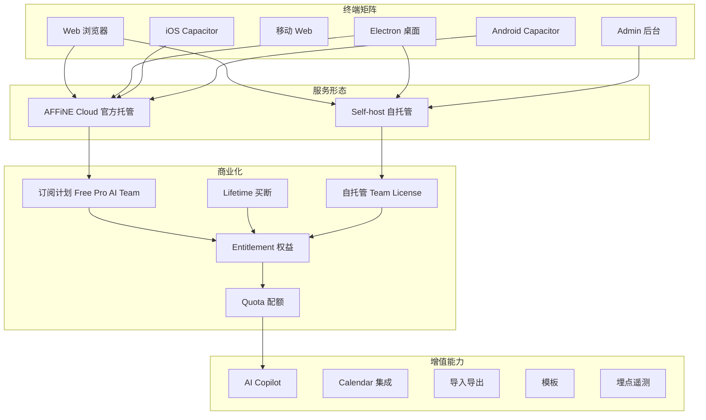
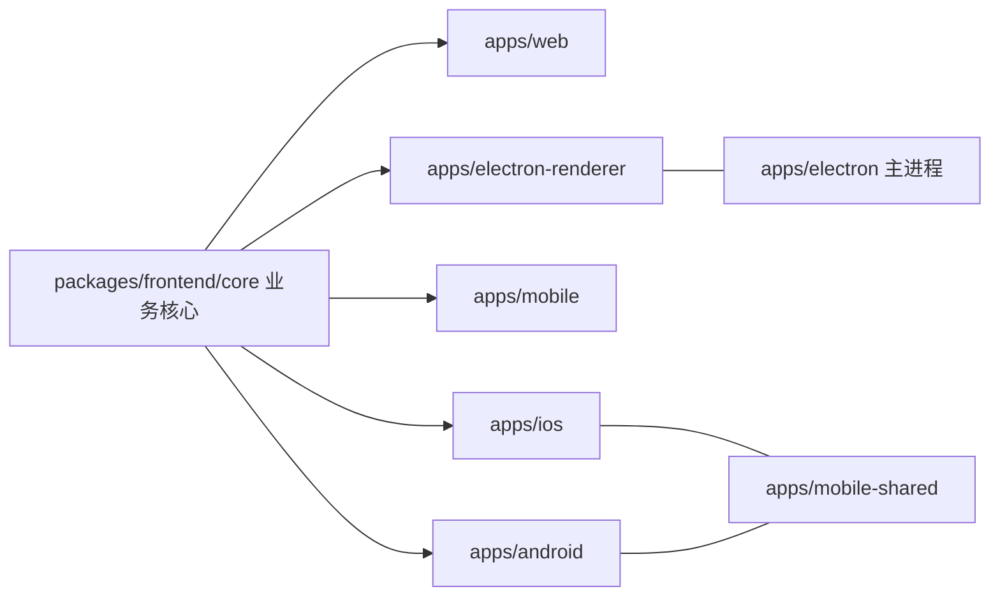
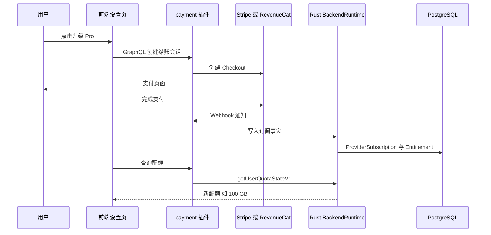
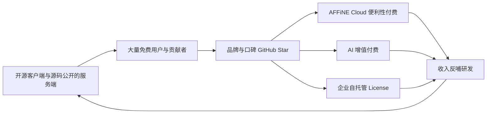

# 第 2 章 功能全景与商业模式

> **所属部分**：第 1 部分 · 产品认知 ｜ **难度**：★☆☆☆☆ ｜ **建议学时**：3 小时 ｜ **前置章节**：[第 1 章 产品定位与核心概念](./01-产品定位与核心概念.md)

## 本章导读

第 1 章我们从"用户能看到的概念"出发认识了 AFFiNE。本章把视角拉远，回答三个问题：

1. **AFFiNE 跑在哪些终端上？** Web、桌面、移动 Web、iOS、Android，以及给运维人员用的 Admin 后台。
2. **AFFiNE 怎么赚钱？** 一个以 MIT 为主、服务端源码公开的开源项目，如何通过 AFFiNE Cloud 订阅、AI 订阅、自托管团队 License 获得收入？这些计划和配额在代码里如何表达？
3. **除了编辑器，还有哪些"外围能力"？** AI Copilot、日历集成、导入导出、模板、埋点。

读完本章，你应该能像产品经理一样画出 AFFiNE 的"功能地图 + 收费地图"，并能在代码里找到每一项付费权益的判定位置。这对后续阅读后端（第 25–28 章）尤其重要：很多看似复杂的后端逻辑，本质上都是在回答"这个用户/工作区有没有权利做这件事"。

> 提示：本章涉及大量后端目录，你暂时不需要理解 NestJS、Prisma 的细节，把它们当作"带注释的产品文档"来读即可。

## 学习目标

- [ ] 能够列出 `packages/frontend/apps/` 下各端应用的包名、平台与构建标识（distribution）
- [ ] 能够解释 AFFiNE Cloud 与 Self-host 的区别，并指出 `DeploymentType` 的判定逻辑
- [ ] 能够准确说出代码中定义的订阅计划枚举与付费周期，以及配额包含哪些维度
- [ ] 能够说明"订阅 → 权益 Entitlement → 配额 Quota"的数据链路及其关键表
- [ ] 能够列举 AI Copilot 的主要能力面（工具、嵌入检索、转录、MCP、BYOK）及其代码位置
- [ ] 能够定位导入导出、模板、Admin 后台、埋点的代码入口
- [ ] 能够从产品经理视角分析"开源 + 云服务"商业模式的护城河与风险

## 知识地图



## 2.1 多端矩阵：一套核心，六种外壳

### 2.1.1 目录与包名

`packages/frontend/apps/` 下的每个子目录都是一个可独立构建发布的应用：

| 目录 | 包名 | 平台 | 技术方案 | 本地存储 |
| --- | --- | --- | --- | --- |
| `packages/frontend/apps/web` | `@affine/web` | 桌面浏览器 | React SPA | IndexedDB |
| `packages/frontend/apps/electron` | `@affine/electron` | Windows/macOS/Linux 桌面主进程 | Electron + Rust NAPI | SQLite |
| `packages/frontend/apps/electron-renderer` | `@affine/electron-renderer` | 桌面渲染进程 | React | 通过主进程访问 SQLite |
| `packages/frontend/apps/mobile` | `@affine/mobile` | 移动浏览器 | React 移动布局 | IndexedDB |
| `packages/frontend/apps/ios` | `@affine/ios` | iOS 原生 App | Capacitor + Swift | SQLite |
| `packages/frontend/apps/android` | `@affine/android` | Android 原生 App | Capacitor + Kotlin | SQLite |
| `packages/frontend/apps/mobile-shared` | `@affine/mobile-shared` | — | iOS/Android 共享代码 | — |
| `packages/frontend/admin` | `@affine/admin` | 浏览器 | React + Tailwind | — |

注意 `packages/frontend/admin` 不在 `apps/` 下，但它同样是一个独立应用（2.7 节）。

### 2.1.2 用 distribution 统一区分平台

构建系统通过"包名 → distribution"映射为每个应用注入编译期常量：

来源：`tools/utils/src/distribution.ts`

```ts
export const PackageToDistribution = new Map<
  PackageName,
  BUILD_CONFIG_TYPE['distribution']
>([
  ['@affine/admin', 'admin'],
  ['@affine/web', 'web'],
  ['@affine/electron-renderer', 'desktop'],
  ['@affine/electron', 'desktop'],
  ['@affine/mobile', 'mobile'],
  ['@affine/ios', 'ios'],
  ['@affine/android', 'android'],
]);
```

再由 `getBuildConfig` 派生出一组布尔开关：

来源：`tools/utils/src/build-config.ts`

```ts
    get stable() {
      return {
        debug: buildFlags.mode === 'development',
        distribution,
        isDesktopEdition: (
          ['web', 'desktop', 'admin'] as BUILD_CONFIG_TYPE['distribution'][]
        ).includes(distribution),
        isMobileEdition: (
          ['mobile', 'ios', 'android'] as BUILD_CONFIG_TYPE['distribution'][]
        ).includes(distribution),
        isElectron: distribution === 'desktop',
        isWeb: distribution === 'web',
        isMobileWeb: distribution === 'mobile',
        isIOS: distribution === 'ios',
        isAndroid: distribution === 'android',
        isNative:
          distribution === 'desktop' ||
          distribution === 'ios' ||
          distribution === 'android',
        isAdmin: distribution === 'admin',
        // ...
        pricingUrl: 'https://affine.pro/pricing',
        // ...
      };
    },
```

还记得第 1 章 `local.ts` 中的 `BUILD_CONFIG.isElectron || BUILD_CONFIG.isIOS || BUILD_CONFIG.isAndroid ? SqliteDocStorage : IndexedDBDocStorage` 吗？那些 `BUILD_CONFIG.xxx` 就来自这里。它们是**编译期常量**，打包工具会做死代码消除，因此 Web 包里不会带上 SQLite 相关代码。

### 2.1.3 设计意图：外壳薄、核心厚



几乎所有业务代码都在 `packages/frontend/core/`，各 app 只负责：入口与路由壳、平台能力注入（文件系统、原生分享、内购）、存储实现选择。这让 AFFiNE 以较小团队维护五个平台成为可能，代价是 core 中需要大量 `BUILD_CONFIG` 分支和依赖注入"接口 + 平台实现"（第 20、24 章）。

例如桌面主进程 `packages/frontend/apps/electron/src/main/` 下有 `updater`（自动更新，第 4 章）、`tray`（托盘）、`recording`（会议录音，与 AI 转录配合）、`deep-link.ts`（`affine://` 协议唤起）、`byok-storage`（本地保存用户自带 AI Key）等纯桌面能力。

**小结**：六种外壳共享同一个 core；`distribution` 是区分平台的唯一事实来源。

## 2.2 AFFiNE Cloud 与 Self-host

### 2.2.1 两种服务形态

| 维度 | AFFiNE Cloud | Self-host |
| --- | --- | --- |
| 运营方 | 官方（app.affine.pro） | 你自己 |
| 部署 | 官方集群 | Docker 镜像、Render、Sealos 等（见 README Self-Host 一节） |
| 收费 | 按用户/工作区订阅（Stripe、App Store/Play Store 内购） | 软件免费；团队高级能力需购买 License |
| 配置 | 官方运维 | `config.json` + Admin 后台 |
| 数据 | 官方存储 | 自己的 PostgreSQL、Redis、对象存储 |

README 的 License 一节写得很清楚：

> AFFiNE Community Edition (CE) is the current available version, it's free for self-host under the MIT license.

### 2.2.2 代码如何区分：DeploymentType

来源：`packages/backend/server/src/env.ts`

```ts
export enum DeploymentType {
  Affine = 'affine',
  Selfhosted = 'selfhosted',
}
// ...
export class Env implements AppEnv {
  // ...
  DEPLOYMENT_TYPE = this.dev
    ? DeploymentType.Affine
    : DeploymentType.Selfhosted;
  // ...
  get selfhosted() {
    return this.DEPLOYMENT_TYPE === DeploymentType.Selfhosted;
  }
```

构造函数中还有一段覆盖逻辑：

来源：`packages/backend/server/src/env.ts`

```ts
    const appPath = join(this.projectRoot, 'config.json');
    const homePath = join(homedir(), '.affine/config/config.json');
    if (configPath || existsSync(appPath) || existsSync(homePath)) {
      this.DEPLOYMENT_TYPE =
        this.serverConfigHandle.deploymentType === 'selfhosted'
          ? DeploymentType.Selfhosted
          : DeploymentType.Affine;
    } else {
      this.DEPLOYMENT_TYPE = readEnv(
        'DEPLOYMENT_TYPE',
        this.DEPLOYMENT_TYPE,
        Object.values(DeploymentType)
      );
    }
```

判定规则可以归纳为：

1. 默认值：开发环境（`NODE_ENV=development`）视为 `affine`，生产环境默认视为 `selfhosted`——**默认安全**：别人拿镜像部署，自动是自托管模式；
2. 若存在配置文件，则以配置文件中的 `deploymentType` 为准（解析交给 Rust 侧 `ServerConfigHandle`）；
3. 否则读取环境变量 `DEPLOYMENT_TYPE`。

同文件还定义了 `Namespace`（`dev`/`beta`/`production`，对应 canary/beta/stable 环境）、`Flavor`（`allinone`/`graphql`/`sync`/`renderer`/`front`/`worker`/`script`，同一镜像拆成多种服务角色），这些在第 25、31 章展开。

### 2.2.3 自托管模式下的差异

`env.selfhosted` 在后端多处被用作开关。例如模块装配：

来源：`packages/backend/server/src/app.module.ts`

```ts
    // graphql server only
    .useIf(
      () => env.flavors.graphql,
      GqlModule,
      // ...
      LicenseModule,
      PaymentModule,
      CopilotModule,
      CaptchaModule,
      OAuthModule,
      CalendarModule,
      TelemetryModule,
      CommentModule
    )
    // worker for and self-hosted API only for self-host and local development only
    .useIf(
      () => !workerOnly && (env.dev || env.selfhosted),
      WorkerModule,
      SelfhostModule
    )
```

`SelfhostModule`（`packages/backend/server/src/core/selfhost/`）提供首次安装引导（`setup.ts`）、静态资源托管（`static.ts`）等仅自托管需要的能力。又如权益服务：

来源：`packages/backend/server/src/core/entitlement/service.ts`

```ts
  async upsertAdminGrant(input: {
    targetType: TargetType;
    targetId: string;
    plan: string;
    quantity?: number | null;
  }) {
    if (env.selfhosted)
      throw new BadRequest(
        'Self-hosted commercial entitlements require a signed license.'
      );
    // ...
  }
```

即：**自托管管理员不能直接给自己"发"商业权益，必须通过签名 License**。这是开源商业模式中非常关键的一道防线。

**小结**：同一份服务端代码，通过 `DeploymentType` 切换成官方云或自托管两种产品形态。

## 2.3 订阅计划与权益：代码里的"价目表"

### 2.3.1 计划与周期枚举

来源：`packages/backend/server/src/plugins/payment/types.ts`

```ts
export enum SubscriptionRecurring {
  Monthly = 'monthly',
  Yearly = 'yearly',
  Lifetime = 'lifetime',
}

export enum SubscriptionPlan {
  Free = 'free',
  Pro = 'pro',
  AI = 'ai',
  Team = 'team',
  Enterprise = 'enterprise',
  SelfHosted = 'selfhosted',
  SelfHostedTeam = 'selfhostedteam',
}

export enum SubscriptionVariant {
  Onetime = 'onetime',
}
```

| 计划 | 订阅对象 | 说明 |
| --- | --- | --- |
| Free | 用户 | 默认计划 |
| Pro | 用户 | 个人/小团队云服务增强（存储、成员数、历史版本） |
| AI | 用户 | AFFiNE AI 订阅，与 Pro 独立叠加 |
| Team | 工作区 | 按席位计费的团队工作区 |
| Enterprise | — | 企业版，README 称 EE 尚未发布 |
| SelfHosted / SelfHostedTeam | 工作区 | 自托管 License 对应的计划 |

付费周期有月付、年付、终身（Lifetime）。`SubscriptionVariant.Onetime` 表示一次性购买。是否展示终身价格由配置项控制：

来源：`packages/backend/server/src/plugins/payment/config.ts`

```ts
defineNativeModuleConfig(
  'payment',
  serverNativeModule.appConfigDescriptors('payment'),
  serverNativeModule.validateAppConfigValue,
  {
    showLifetimePrice: {
      desc: 'Whether enable lifetime price and allow user to pay for it.',
      default: true,
    },
  }
);
```

同文件的 `AppConfigSchema.payment` 还声明了两个支付渠道：`stripe`（Web/桌面信用卡支付）和 `revenuecat`（移动端 App Store / Play Store 内购聚合），对应 `controller.ts` 中的 `StripeWebhookController` 和 `revenuecat-controller.ts`。数据库中的 `Provider` 枚举也只有 `stripe`、`revenuecat` 两个值（`packages/backend/server/schema.prisma`）。

### 2.3.2 配额维度

配额（Quota）的接口定义：

来源：`packages/backend/server/src/models/common/feature.ts`

```ts
export interface UserQuota {
  name: string;
  blobLimit: number;
  businessBlobLimit?: number;
  storageQuota: number;
  historyPeriod: number;
  memberLimit: number;
  copilotActionLimit?: number;
}

export interface WorkspaceQuota extends UserQuota {
  seatQuota: number;
}
```

| 字段 | 产品含义 |
| --- | --- |
| `blobLimit` | 单个文件（附件/图片）最大体积 |
| `storageQuota` | 云存储总空间 |
| `historyPeriod` | 历史版本保留时长（秒） |
| `memberLimit` | 工作区成员上限 |
| `copilotActionLimit` | AI 调用次数上限，`undefined` 表示不限 |
| `seatQuota` | 工作区席位数（Team） |

值得注意的是，同文件中 `FeatureConfigs` 现在只剩一项 `administrator`：

来源：`packages/backend/server/src/models/common/feature.ts`

```ts
export const FeatureConfigs = {
  administrator: {
    type: FeatureType.Feature,
    configs: {},
  },
} satisfies Record<
  FeatureName,
  { type: FeatureType; configs: FeatureConfig<FeatureName> }
>;
```

这说明 AFFiNE 已把"计划 → 配额数值"的定义从早期的 feature 表配置迁移走了。迁到了哪里？看下一节。

### 2.3.3 计划名映射与配额来源

来源：`packages/backend/server/src/core/quota/service.ts`

```ts
@Injectable()
export class QuotaService {
  constructor(private readonly runtime: BackendRuntimeProvider) {}

  async getUserQuota(userId: string): Promise<UserQuota> {
    const state = await this.runtime.getUserQuotaStateV1(userId);
    return this.userQuotaFromState(state);
  }
  // ...
  private planName(plan: string) {
    switch (plan) {
      case 'pro':
      case 'selfhost_free':
        return 'Pro';
      case 'lifetime_pro':
        return 'Lifetime Pro';
      case 'ai':
        return 'AI';
      case 'team':
      case 'selfhost_team':
        return 'Team';
      default:
        return 'Free';
    }
  }
}
```

两个重要发现：

1. **配额计算在 Rust 侧**：`QuotaService` 只是薄薄一层，真正的状态来自 `BackendRuntimeProvider`（`packages/backend/server/src/core/backend-runtime/provider.ts`，它从 `../../native` 引入 `BackendRuntime`，即 `packages/backend/native/` 编译出的 NAPI 模块）。Rust 侧的权益解析入口在 `packages/backend/native/src/entitlement.rs`，它依赖 crates.io 上的 `affine_core` crate（`packages/backend/native/Cargo.toml` 中 `affine_core = "0.0.8"`），具体的计划目录与配额数值定义在该外部 crate 中，**本仓库内看不到具体数值**。
2. **内部计划 id 与展示名不同**：内部有 `selfhost_free`、`lifetime_pro`、`selfhost_team` 等 id；自托管默认（`selfhost_free`）显示为 "Pro"——意味着自托管用户默认就享受 Pro 级个人配额，这是对自托管社区的友好设计。

由于具体数值不在仓库中，产品层面的权益最可靠的参考是前端文案：

来源：`packages/frontend/i18n/src/resources/en.json`（节选）

```json
  "com.affine.payment.cloud.free.benefit.g2-1": "10 GB of cloud storage.",
  "com.affine.payment.cloud.free.benefit.g2-2": "10 MB of maximum file size.",
  "com.affine.payment.cloud.free.benefit.g2-3": "Up to 3 members per workspace.",
  "com.affine.payment.cloud.free.benefit.g2-4": "7-days cloud time machine file version history.",
  "com.affine.payment.cloud.pro.benefit.g1-2": "100 GB of cloud storage.",
  "com.affine.payment.cloud.pro.benefit.g1-3": "100 MB of maximum file size.",
  "com.affine.payment.cloud.pro.benefit.g1-4": "Up to 10 members per workspace.",
  "com.affine.payment.cloud.pro.benefit.g1-5": "30-days cloud time machine file version history.",
  "com.affine.payment.cloud.team-workspace.benefit.g1-2": "100 GB initial storage + 20 GB per seat.",
  "com.affine.payment.cloud.team-workspace.benefit.g1-3": "500 MB of maximum file size.",
  "com.affine.payment.cloud.team-workspace.benefit.g1-4": "Unlimited team members (10+ seats).",
  "com.affine.payment.start-free-trial": "Start 14-day free trial",
```

整理成表（以文案为准，实际以官网 https://affine.pro/pricing 与服务端计算为准）：

| 维度 | Free | Pro | Team |
| --- | --- | --- | --- |
| 云存储 | 10 GB | 100 GB | 100 GB + 每席位 20 GB |
| 单文件上限 | 10 MB | 100 MB | 500 MB |
| 每工作区成员 | 3 | 10 | 不限（10+ 席位） |
| 历史版本 | 7 天 | 30 天 | 文案未单列，继承 Pro |
| 评论、精细权限 | — | 有（Pro 文案 g1-6、g1-9） | 有，另有多管理员角色 |

另外，AI 计划的文案（`com.affine.payment.ai.benefit.*`）按 "Write / Draw / Plan with you" 三组描述，与产品 slogan 呼应。

> 小知识：`packages/backend/server/src/core/quota/__tests__/service.spec.ts` 中的 `memberLimit` 等数字是**测试桩数据**（例如 `blobLimit: 10n`），不要把它们当成真实配额。

### 2.3.4 订阅 → 权益 → 配额 的数据链路

`packages/backend/server/schema.prisma` 中与商业化相关的核心表：

| 表（model） | 作用 |
| --- | --- |
| `ProviderSubscription` | 来自 Stripe/RevenueCat 的订阅事实（plan、recurring、status、周期、金额） |
| `Invoice`、`PaymentEvent`、`PaymentFinancialFact`、`PaymentOperation` | 账单、支付事件与财务事实 |
| `SubscriptionTrialUsage` | 试用使用记录（防止重复试用） |
| `Entitlement` | **权益**：某目标（user/workspace）在某时段拥有某计划，可来自订阅、管理员授予或签名 License |
| `EffectiveUserQuotaState`、`EffectiveWorkspaceQuotaState` | 计算后的有效配额投影 |
| `License`、`InstalledLicense` | 自托管 License |

来源：`packages/backend/server/schema.prisma`

```prisma
model Entitlement {
  id            String    @id @default(uuid()) @db.VarChar
  targetType    String    @map("target_type") @db.Text
  targetId      String?   @map("target_id") @db.VarChar
  source        String    @db.Text
  plan          String    @db.Text
  status        String    @db.Text
  // ...
  quantity      Int?      @db.Integer
  signedPayload Bytes?    @map("signed_payload") @db.ByteA
  // ...
  expiresAt     DateTime? @map("expires_at") @db.Timestamptz(3)
  graceUntil    DateTime? @map("grace_until") @db.Timestamptz(3)
  // ...
  @@map("entitlements")
}
```

`EffectiveUserQuotaState` 上方有一行注释 "TODO(gc-convergence): drop this v0.27.4 projection after old readers and predeploy retire"，说明这套链路仍在演进中——当前读取路径是"规范事实 + 内存缓存"，投影表计划下线。



**小结**：计划枚举在 TS，计算在 Rust，展示文案在 i18n。这种"三处分布"是读商业化代码时最容易迷路的地方。

## 2.4 前端的付费墙与配额感知

### 2.4.1 相关模块

| 模块 | 路径 | 作用 |
| --- | --- | --- |
| quota | `packages/frontend/core/src/modules/quota/` | 工作区配额实体与超额检查视图（`views/quota-check.tsx`） |
| paywall | `packages/frontend/core/src/modules/paywall/` | 原生端付费墙抽象 |
| cloud 订阅 | `packages/frontend/core/src/modules/cloud/services/subscription.ts`、`entities/subscription-prices.ts` | 订阅状态、价格 |
| cloud 用户配额 | `packages/frontend/core/src/modules/cloud/entities/user-quota.ts`、`user-copilot-quota.ts` | 用户存储与 AI 配额 |
| 自托管 License | `packages/frontend/core/src/modules/cloud/services/selfhost-license.ts` | 自托管工作区 License |
| 超额提示组件 | `packages/frontend/core/src/components/over-capacity/` | 超出容量时的提示 |

### 2.4.2 原生付费墙：依赖倒置的典型

来源：`packages/frontend/core/src/modules/paywall/providers/native-paywall.ts`

```ts
import { createIdentifier } from '@toeverything/infra';

export interface NativePaywallProvider {
  showPaywall(type: 'Pro' | 'AI'): Promise<void>;
}

export const NativePaywallProvider = createIdentifier<NativePaywallProvider>(
  'NativePaywallProvider'
);
```

core 只声明"我需要一个能弹出 Pro 或 AI 付费墙的东西"，由 iOS/Android 外壳注入实现（调用 App Store / Play Store 内购界面）。Web/桌面端则走网页定价页（`BUILD_CONFIG.pricingUrl`）。这种 `createIdentifier` + 平台实现的模式会在第 20 章系统讲解。

为什么移动端要走原生付费墙？因为苹果和谷歌的商店政策要求数字订阅走应用内购买，这正是后端接入 RevenueCat 的原因。

### 2.4.3 前端与后端的计划名一致性

前端 `packages/frontend/core/src/modules/cloud/entities/user-quota.ts` 中也有一个 `planName` 函数，映射规则与后端 `QuotaService.planName` 基本一致（`pro`/`selfhost_free` → Pro，`lifetime_pro` → Lifetime Pro，`ai` → AI），且通过 `RealtimeLiveQuery` 订阅 `UserQuotaStateSnapshot`，配额变化可实时推送到前端。由于用户级配额不涉及 Team，前端这里没有 `team` 分支。这种前后端重复的映射是潜在的一致性风险点，修改时需两边同步。

**小结**：前端不计算配额，只感知配额；移动端付费墙必须走原生内购。

## 2.5 自托管团队授权：license 插件

### 2.5.1 产品逻辑

自托管 CE 免费，但若企业希望在自托管环境中使用 Team 级能力（席位、多管理员等），需要从官方购买 License：

1. 在官方购买自托管 Team 计划（对应 `SubscriptionPlan.SelfHostedTeam`）；
2. 获得 License Key 或 License 文件；
3. 在自托管实例的工作区设置中激活；
4. 服务端验证签名，生成 `Entitlement`。

### 2.5.2 代码

来源：`packages/backend/server/src/plugins/license/service.ts`

```ts
@Injectable()
export class LicenseService {
  // ...
  async installLicense(workspaceId: string, license: Buffer) {
    const installed = installedLicense(
      await this.runtime
        .installTeamLicenseFileV1(workspaceId, license)
        .catch(throwNativeLicenseInstallError)
    );
    await this.event.emitAsync('workspace.subscription.activated', {
      workspaceId,
      plan: SubscriptionPlan.SelfHostedTeam,
      recurring: installed.recurring as SubscriptionRecurring,
      quantity: installed.quantity,
    });
    return installed;
  }
  // ... activateTeamLicense(workspaceId, licenseKey)
  // ... removeTeamLicense(workspaceId)
```

两种激活方式：

- `installLicense`：上传离线 License 文件（适合内网环境）；
- `activateTeamLicense`：在线输入 License Key。

签名与校验都交给 Rust：`packages/backend/native/src/entitlement.rs` 中有 `issue_license_v1`（官方签发）、`resolve_entitlement_v1`（解析权益，`ValidatedEntitlement::SignedLicense` 分支走自托管 License 校验）。Rust 侧还有 `packages/backend/native/src/runtime/backend_runtime/entitlement/` 目录，包含 `license_offline.rs`、`license_client.rs`、`license_worker.rs` 等，分别对应离线校验、与官方 License 服务通信、后台定期校验。

官方云侧的 `packages/backend/server/src/plugins/payment/license-controller.ts` 则负责"卖 License"——这形成了一个闭环：**官方云卖 License，自托管实例验 License**。

**小结**：License 用非对称签名实现"可离线验证的付费授权"，是开源软件商业化的经典手段。

## 2.6 AI Copilot 能力面

AI 是 AFFiNE 最重要的增值服务之一。后端代码集中在 `packages/backend/server/src/plugins/copilot/`：

| 子目录/文件 | 能力 | 说明 |
| --- | --- | --- |
| `providers/` | 模型提供方 | `CopilotProviderType` 枚举：anthropic、anthropicVertex、cloudflareWorkersAi、fal、gemini、geminiVertex、openai |
| `prompt/` | 提示词管理 | 各类 AI 动作的提示词 |
| `session.ts`、`conversation/` | 会话 | 对话上下文与历史 |
| `tools/` | Agent 工具 | `doc-read`、`doc-search`、`doc-write`、`doc-compose`、`section-edit`、`doc-canvas-read`、`exa-search`、`exa-crawl`、`code-artifact`、`artifact` 等 |
| `embedding/`、`retrieval/` | 向量嵌入与检索 | 工作区文档语义检索（RAG），含 `rerank.ts` 重排 |
| `transcript/` | 音频转录 | 会议录音转文字与总结（配合桌面端 `recording`） |
| `mcp/` | MCP 服务 | 把工作区暴露为 MCP 服务，供外部 AI 客户端读写 |
| `byok/` | 自带密钥 | 用户使用自己的 OpenAI/Anthropic/Gemini/fal Key |
| `workspace/` | 工作区级 AI 配置 | 如忽略文档、嵌入设置 |

### 2.6.1 MCP：让外部 AI 访问你的知识库

来源：`packages/backend/server/src/plugins/copilot/mcp/provider.ts`

```ts
export type WorkspaceMcpToolDefinition = {
  name: string;
  title: string;
  description: string;
  inputSchema: Record<string, unknown>;
  execute: (
    args: Record<string, unknown>,
    options: { signal: AbortSignal }
  ) => Promise<WorkspaceMcpToolResult>;
};

export type WorkspaceMcpServer = {
  name: string;
  version: string;
  tools: WorkspaceMcpToolDefinition[];
};
```

同文件中注册的工具名包括 `read_document`、`doc_search`、`create_document`、`update_document`、`update_document_meta`。访问凭证由 `McpCredential` 表管理，`McpAccessMode` 有 `READ_ONLY` 和 `READ_WRITE` 两种（`packages/backend/server/schema.prisma`）。这意味着你可以让 Claude Desktop、Cursor 等支持 MCP 的客户端直接检索、编辑 AFFiNE 文档。

### 2.6.2 BYOK：自带密钥

来源：`packages/backend/server/src/plugins/copilot/byok/types.ts`

```ts
export enum ByokProvider {
  openai = 'openai',
  anthropic = 'anthropic',
  gemini = 'gemini',
  fal = 'fal',
}

export enum ByokKeyStorage {
  server = 'server',
  local = 'local',
}
// ...
export enum ByokProviderSource {
  Server = 'byok_server',
  Local = 'byok_local',
  AffinePlan = 'affine_plan',
}
```

`ByokProviderSource` 很好地揭示了商业逻辑：AI 调用的"算力来源"可以是 AFFiNE 官方计划（`affine_plan`，消耗配额），也可以是用户自己的 Key（存在服务器或本地）。BYOK 对自托管用户尤其重要——他们没有官方 AI 订阅，但可以接入自己的模型服务。是否允许 BYOK、允许哪些 provider、是否允许自定义 endpoint，都在 `packages/backend/server/src/plugins/copilot/config.ts` 的 `copilot.byok` 配置下。

### 2.6.3 前端入口

- 编辑器内 AI：`packages/frontend/core/src/blocksuite/ai/`；
- AI 按钮、模型选择、推理模式、工具配置：`packages/frontend/core/src/modules/ai-button/`；
- 独立 AI Chat 页面：路由 `/chat`（`packages/frontend/core/src/desktop/pages/workspace/chat/`）；
- 工作区嵌入设置：`packages/frontend/core/src/modules/workspace-indexer-embedding/`。

**小结**：AFFiNE AI 已从"文本续写"发展为"Agent + RAG + MCP + BYOK"的完整能力面，同时兼顾官方订阅和自托管自带模型两种模式。

## 2.7 外围能力：日历、导入导出、模板、Admin、埋点

### 2.7.1 Calendar 日历集成

- 后端：`packages/backend/server/src/plugins/calendar/`，`providers/factory.ts` 中 `CalendarProviderName` 目前有 `google` 与 `caldav` 两种；
- 数据表：`CalendarAccount`、`CalendarSubscription`、`WorkspaceCalendar`、`CalendarEvent`、`CalendarEventInstance` 等（`packages/backend/server/schema.prisma`）；
- 前端：`packages/frontend/core/src/modules/integration/entities/calendar.ts`、`store/calendar.ts`。

日历事件可与 Journal 结合，在日记页面显示当天日程。同一个 `integration` 模块还承载了 Readwise 集成（`entities/readwise.ts`），第 1 章 `docProperties.integrationType` 字段就是为此设计的。

### 2.7.2 导入导出

导入服务支持的来源一目了然：

来源：`packages/frontend/core/src/modules/import/services/service.ts`

```ts
import {
  BearTransformer,
  type ImportWarning,
  MarkdownTransformer,
  NotionHtmlTransformer,
  ObsidianTransformer,
  Unzip,
} from '@blocksuite/affine/widgets/linked-doc';
// ...
export class ImportService extends Service {
  // ...
  async importMarkdownZip(file: File, context?: ImportRunContext) {
    const collection = this.workspaceService.workspace.docCollection;
    const commitService = this.createCommitService({ organize: true });
    if (BUILD_CONFIG.isElectron) {
      return commitNativeImport('markdownZip', file, commitService, context);
    }
    // ... Web 端：预检大小 → 解析 → 批量提交
  }
```

同文件的方法列表：`importMarkdownZip`、`importNotionZip`、`importObsidianVault`、`importBearBackup`、`importOneNote`。注意桌面端会走 `commitNativeImport`（Rust 原生导入，更快更省内存），Web 端在浏览器中解析。

底层的格式转换器（Adapter）在 `blocksuite/affine/shared/src/adapters/`：`markdown/`、`html/`、`notion-html/`、`plain-text/`、`pdf/`、`clipboard/`、`mix-text.ts`、`notion-text.ts` 等。导出（Markdown、HTML、PDF、PNG、快照）同样依赖这些 Adapter。

相关模块还有：`modules/import-clipper`（网页剪藏导入）、`modules/import-template`（从链接导入模板）。

### 2.7.3 模板

`packages/frontend/templates/` 包含：

- `onboarding/onboarding.zip`：新用户首次进入时的引导工作区内容；
- `edgeless/`：白板模板 JSON，如 `Flowchart.json`、`Gantt Chart.json`、`SWOT.json`、`Project Tracking Kanban.json`、`User Journey Map.json` 等，由 `build-edgeless.mjs` 生成 `edgeless-templates.gen.ts`；
- `stickers/`：贴纸资源，由 `build-stickers.mjs` 生成 `stickers-templates.gen.ts`。

其 `README.md` 坦言"For now we only support onboarding templates"，并给出了在 dev 模式下导出模板 zip 的手工步骤。更丰富的文档模板在官网模板库（README 中的 Templates 一节），通过 `modules/import-template` 导入。

### 2.7.4 Admin 管理后台

`packages/frontend/admin/` 是给自托管管理员用的后台（也用于官方运营）：

| 目录 | 功能 |
| --- | --- |
| `src/modules/setup` | 首次安装引导，创建管理员账号 |
| `src/modules/accounts` | 用户管理 |
| `src/modules/workspaces` | 工作区管理 |
| `src/modules/settings` | 服务器配置（对应 `AppConfigSchema`，如 payment、copilot） |
| `src/modules/dashboard` | 仪表盘统计（对应 `WorkspaceAdminStats` 等表） |
| `src/modules/about` | 版本信息 |

技术栈与主应用不同：使用 Tailwind（`tailwind.config.js`）和 shadcn 风格组件（`components.json`）。管理员身份由第 2.3.2 节看到的 `administrator` feature 判定。

### 2.7.5 埋点与遥测

`packages/frontend/track/` 是独立的埋点包：

来源：`packages/frontend/track/src/index.ts`

```ts
import { enableAutoTrack, makeTracker } from './auto';
import { type EventArgs, type Events } from './events';
import { sentry } from './sentry';
// ...
export const track = makeTracker((event, props) => {
  tracker.track(event, props);
});
```

- `events.ts`（800 多行）用 TypeScript 类型穷举了所有事件，如 `PaymentEvents` 包含 `viewPlans`、`checkout`、`subscribe`、`cancelSubscription` 等——**事件名有类型检查，写错会编译失败**；
- `sentry.ts`：错误监控；
- `telemetry.ts`：自有遥测通道，`TelemetryContext` 含 `isSelfHosted`、`channel` 等字段，前端 `packages/frontend/core/src/modules/telemetry/services/telemetry.ts` 负责设置上下文。用户可在"设置 → 关于"中通过 `enableTelemetry` 开关关闭遥测（`packages/frontend/core/src/desktop/dialogs/setting/general-setting/about/index.tsx`）。

从产品角度，`PaymentEvents` 恰好覆盖了一条完整的付费漏斗：查看计划 → 结账 → 订阅 → 变更周期 → 取消 → 恢复。这些埋点是增长团队优化转化率的数据基础。

**小结**：日历、导入、模板降低"迁移成本与上手成本"，Admin 降低"自托管运维成本"，埋点支撑"数据驱动迭代"。

## 2.8 产品经理视角：开源 + 云服务的商业模式

### 2.8.1 收入来源全景

| 收入来源 | 目标客户 | 代码证据 |
| --- | --- | --- |
| Pro 订阅（月/年） | 个人、家庭、小团队 | `SubscriptionPlan.Pro` |
| Lifetime Pro 买断 | 早期支持者 | `SubscriptionRecurring.Lifetime`、`lifetime_pro`、`showLifetimePrice` |
| AI 订阅 | 所有需要 AI 的用户 | `SubscriptionPlan.AI` |
| Team 席位订阅 | 团队 | `SubscriptionPlan.Team`、`WorkspaceQuota.seatQuota` |
| 自托管 Team License | 有数据合规要求的企业 | `SubscriptionPlan.SelfHostedTeam`、`plugins/license` |
| Enterprise（规划中） | 大型企业：SSO、审计、品牌定制 | `SubscriptionPlan.Enterprise`、README EE 描述 |

### 2.8.2 开源核心（Open Core）模式分析



**护城河在哪里？**

1. **便利性**：local-first 意味着不付费也能用，但跨设备同步、协作、分享、评论需要服务端。自托管虽免费，但需要运维 PostgreSQL、Redis、对象存储，多数个人用户宁愿付费；
2. **AI 成本**：AI 调用有真实的算力成本，天然适合订阅制；BYOK 则让"不想付 AI 订阅"的用户也能留在生态内；
3. **签名 License**：自托管实例的团队能力需要官方签名，`upsertAdminGrant` 在自托管模式下直接抛错，防止"改个数据库字段就解锁"；
4. **移动端分发**：App Store / Play Store 的官方 App 默认连接官方云。

**风险与取舍**：

| 风险 | AFFiNE 的应对 |
| --- | --- |
| 用户全部转向自托管 | 自托管默认 `selfhost_free` 即享 Pro 级个人配额，示好社区；但团队能力需 License |
| 竞争对手 fork | 品牌、云服务、AI 能力与生态（模板、社区）难以复制 |
| 许可证变更引发社区担忧 | README 称 CE 自托管免费；但根 `LICENSE` 规定 `packages/backend` 与 `packages/common/native` 适用 `packages/backend/server/LICENSE`（EE License），细节见第 3 章 |
| 计划与配额逻辑复杂易出错 | 将关键计算下沉到 Rust（`affine_core`），前后端共用同一事实来源 |

### 2.8.3 从功能分层看"免费与付费的边界"

| 能力 | 本地工作区 | 云工作区 Free | 付费 |
| --- | --- | --- | --- |
| 文档、白板、数据库编辑 | 有 | 有 | 有 |
| 本地无限工作区 | 有（文案 "Unlimited local workspaces"） | — | — |
| 跨设备同步、实时协作 | 无 | 有，受成员数限制 | 成员数、存储更多 |
| 公开分享 | 无 | 有 | 有 |
| 评论、精细权限 | 无 | 以服务端判定为准 | Pro 文案列出 |
| 历史版本 | 无云端版本 | 7 天 | 30 天或更多 |
| AI | 需登录 | 有限次数 | AI 订阅或 BYOK |

可以看到，AFFiNE 把"核心生产力"（编辑能力）完全免费开放，而把"协作、容量、智能"作为付费点——这是 local-first 产品最自然的商业化切分。

**小结**：AFFiNE 的商业模式 = 开源获客 + 云服务便利性 + AI 算力 + 企业 License，四条腿支撑。

## 源码导读清单

| 优先级 | 路径 | 阅读重点 |
| --- | --- | --- |
| P0 | `tools/utils/src/distribution.ts` | 包名到平台的映射 |
| P0 | `tools/utils/src/build-config.ts` | `BUILD_CONFIG` 各开关与渠道预设 |
| P0 | `packages/backend/server/src/env.ts` | `DeploymentType`、`Namespace`、`Flavor` |
| P0 | `packages/backend/server/src/plugins/payment/types.ts` | 订阅计划与周期枚举 |
| P0 | `packages/backend/server/src/core/quota/service.ts` | 计划名映射、配额来自 Rust runtime |
| P1 | `packages/backend/server/src/models/common/feature.ts` | 配额字段定义 |
| P1 | `packages/backend/server/schema.prisma` | Entitlement、ProviderSubscription、License 等表 |
| P1 | `packages/backend/server/src/app.module.ts` | 插件按角色与部署类型装配 |
| P1 | `packages/backend/server/src/plugins/license/service.ts` | 自托管 License 安装与激活 |
| P1 | `packages/backend/server/src/plugins/copilot/config.ts` | AI provider、BYOK 配置 |
| P1 | `packages/frontend/i18n/src/resources/en.json` | 计划权益文案，搜索 `com.affine.payment` |
| P2 | `packages/backend/native/src/entitlement.rs` | Rust 权益解析与 License 签发 |
| P2 | `packages/backend/server/src/plugins/copilot/mcp/provider.ts` | MCP 工具定义 |
| P2 | `packages/frontend/core/src/modules/import/services/service.ts` | 导入来源与桌面端原生导入 |
| P2 | `packages/frontend/track/src/events.ts` | 埋点事件类型 |

## 动手实践

### 练习 1：绘制多端矩阵

- **目标**：熟悉各端应用。
- **步骤**：
  1. 依次打开 `packages/frontend/apps/` 下每个应用的 `package.json`，记录 `name` 与 `scripts`；
  2. 对照 `tools/utils/src/distribution.ts` 填写 distribution；
  3. 在 `packages/frontend/apps/electron/src/main/` 中挑 3 个子目录，用一句话说明其桌面专属能力。
- **验收标准**：产出一张包含 7 行以上的表格，每行有包名、distribution、平台、存储方式。

### 练习 2：追踪一个计划名

- **目标**：理解"计划 id → 展示名"在前后端的分布。
- **步骤**：
  1. 全局搜索字符串 `lifetime_pro`；
  2. 分别记录它在 TypeScript 与 Rust 文件中的出现位置；
  3. 对比后端 `QuotaService.planName` 与前端 `user-quota.ts` 中 `planName` 的差异。
- **验收标准**：列出至少 4 个文件路径，并指出前端缺少 `team` 分支的原因。

### 练习 3：自托管判定推演

- **目标**：掌握 `DeploymentType` 的判定规则。
- **步骤**：阅读 `packages/backend/server/src/env.ts`，推演以下三种情况下 `env.selfhosted` 的值：
  1. `NODE_ENV=development`，无配置文件，无环境变量；
  2. `NODE_ENV=production`，无配置文件，`DEPLOYMENT_TYPE=affine`；
  3. `NODE_ENV=production`，存在 `~/.affine/config/config.json`。
- **验收标准**：给出三个结论，第 3 种情况能说明"取决于配置文件中的 deploymentType"。

### 练习 4：体验付费漏斗

- **目标**：把埋点与产品流程对应起来。
- **步骤**：
  1. 在 app.affine.pro 登录后打开设置中的计划页面（不必真正付款）；
  2. 记录你经过的每一步页面；
  3. 在 `packages/frontend/track/src/events.ts` 中找到对应的 `PaymentEvents` 事件名。
- **验收标准**：至少对应上 `viewPlans`、`checkout` 两个事件，并说明它们可能在哪个交互触发。

### 练习 5：撰写一页商业模式分析

- **目标**：训练产品经理视角。
- **步骤**：基于 2.8 节，写一页"如果你是 AFFiNE 的 PM，下一季度最该优化的付费点是什么"的分析，需引用至少 3 处代码证据。
- **验收标准**：观点明确、证据可追溯到真实文件路径。

## 自测题

1. `@affine/electron` 与 `@affine/electron-renderer` 的 distribution 分别是什么？
2. `BUILD_CONFIG.isNative` 在哪些平台为 true？
3. 生产环境下没有任何配置时，服务端默认是哪种 `DeploymentType`？这样设计的好处是什么？
4. 代码中定义了哪些 `SubscriptionPlan`？哪些周期？
5. 为什么在本仓库中找不到 Pro 计划的具体存储数值？产品层面应参考哪里？
6. 自托管实例的管理员能否直接给工作区授予 Team 权益？为什么？
7. `ByokProviderSource` 的三个取值分别代表什么？
8. AFFiNE 的 MCP 服务暴露了哪些工具？访问模式有哪些？
9. 导入服务支持哪些来源？桌面端与 Web 端导入有何不同？
10. 为什么移动端需要 `NativePaywallProvider`，后端又为何接入 RevenueCat？

<details><summary>参考答案</summary>

1. 两者都是 `desktop`，见 `tools/utils/src/distribution.ts`。
2. `desktop`、`ios`、`android`。
3. `selfhosted`。默认安全：任何人拿镜像部署都自动进入自托管模式，不会误用官方云的商业逻辑。
4. 计划：free、pro、ai、team、enterprise、selfhosted、selfhostedteam；周期：monthly、yearly、lifetime；另有变体 onetime。
5. 配额由 Rust `BackendRuntime` 计算，计划目录与数值定义在 crates.io 的 `affine_core` crate 中；产品层面参考 i18n 文案 `com.affine.payment.cloud.*.benefit.*` 与官网定价页。
6. 不能。`EntitlementService.upsertAdminGrant` 在 `env.selfhosted` 时抛出 `BadRequest`，自托管商业权益必须来自签名 License。
7. `affine_plan`：使用官方计划额度；`byok_server`：用户 Key 存在服务器；`byok_local`：用户 Key 存在本地。
8. `read_document`、`doc_search`、`create_document`、`update_document`、`update_document_meta`；访问模式 `READ_ONLY`、`READ_WRITE`。
9. Markdown zip、Notion 导出 zip、Obsidian vault、Bear 备份、OneNote；桌面端走 `commitNativeImport` 原生导入，Web 端在浏览器内预检并解析。
10. 应用商店政策要求数字订阅走应用内购买，core 通过依赖注入让原生外壳实现付费墙；RevenueCat 聚合 App Store 与 Play Store 的订阅事件并通过 webhook 通知后端。

</details>

## 常见坑与排错

| 现象/困惑 | 原因 | 建议 |
| --- | --- | --- |
| 在 TS 中找不到配额数值 | 计算已下沉到 Rust 与外部 crate `affine_core` | 以 `BackendRuntimeProvider` 为边界理解；数值看 i18n 与官网 |
| 测试文件里 `memberLimit` 为 3、10 就当真 | 那是测试桩数据 | 区分 `__tests__` 中的 stub 与真实逻辑 |
| 本地 dev 启动后端看不到 Self-host 引导 | dev 模式默认 `DeploymentType.Affine`，但 `SelfhostModule` 在 `env.dev` 时也会加载 | 阅读 `app.module.ts` 中 `useIf` 条件，按需设置 `DEPLOYMENT_TYPE` |
| 计划显示名前后端不一致 | 前后端各有一份 `planName` | 修改计划时同时修改 `core/quota/service.ts` 与 `modules/cloud/entities/user-quota.ts` |
| 混淆 Flavor 与 DeploymentType | 前者是服务角色，后者是部署形态 | Flavor 决定"这个进程跑哪些模块"，DeploymentType 决定"是官方云还是自托管" |
| 混淆后端 `Flavor` 与前端工作区 `flavour` | 同名不同义 | 后端 Flavor 是进程角色；前端 flavour 是工作区来源 |
| 在 `packages/frontend/apps/` 下找不到 admin | admin 位于 `packages/frontend/admin` | 记住 admin 不在 apps 目录中 |

## 延伸阅读

- AFFiNE 定价页：https://affine.pro/pricing
- AFFiNE 自托管文档：https://docs.affine.pro/self-host-affine
- AFFiNE AI 介绍：https://affine.pro/ai
- Stripe Subscriptions 文档：https://docs.stripe.com/billing/subscriptions/overview
- RevenueCat 文档：https://www.revenuecat.com/docs
- Model Context Protocol 规范：https://modelcontextprotocol.io
- Capacitor 文档：https://capacitorjs.com/docs
- Electron 文档：https://www.electronjs.org/docs/latest

## 学时拆分

| 内容 | 建议时长 |
| --- | --- |
| 2.1–2.2 多端矩阵、Cloud 与 Self-host | 0.5 小时 |
| 2.3–2.5 计划、权益、配额、付费墙、License | 1 小时 |
| 2.6–2.7 AI 与外围能力 | 0.5 小时 |
| 2.8 商业模式分析 | 0.25 小时 |
| 动手实践与自测 | 0.75 小时 |
| **合计** | **3 小时** |

---
上一章：[第 1 章 产品定位与核心概念](./01-产品定位与核心概念.md) ｜ 下一章：[第 3 章 开源治理与协作流程](../02-项目管理与开源协作/03-开源治理与协作流程.md) ｜ [返回目录](../README.md)
