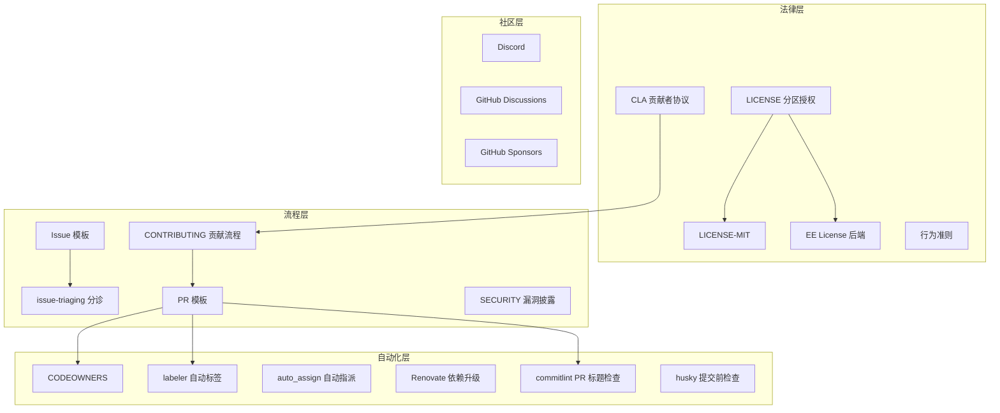
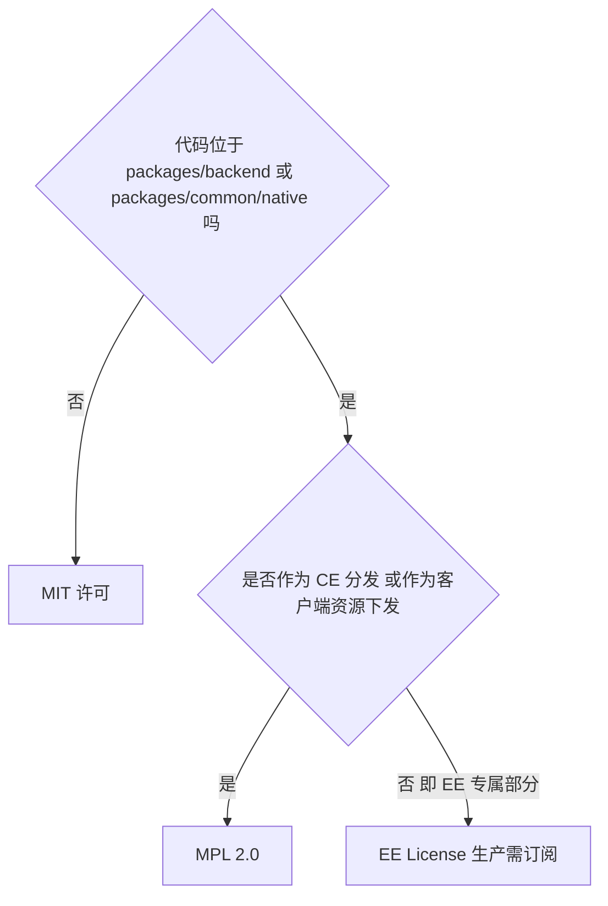
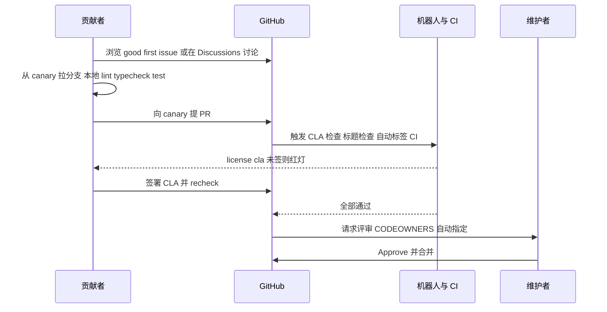
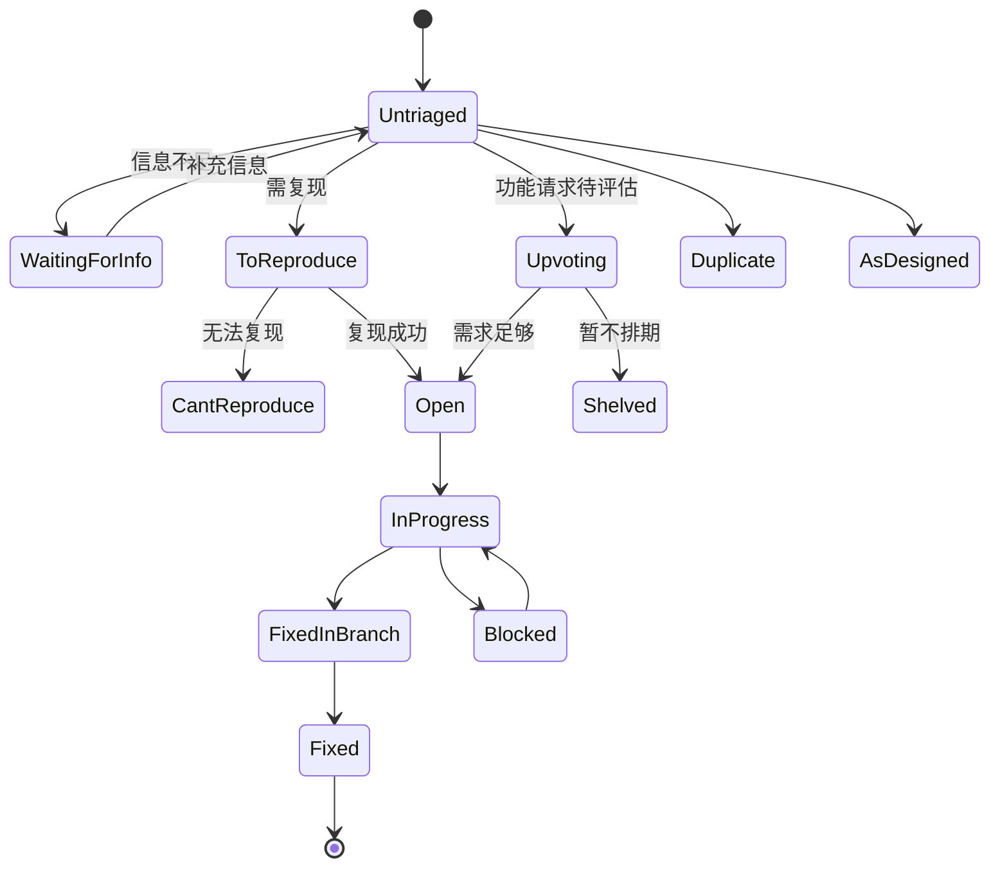
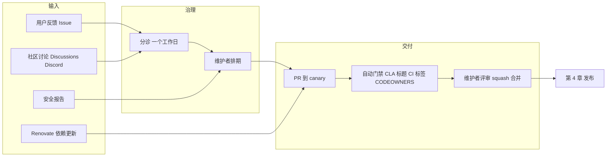

# 第 3 章 开源治理与协作流程

> **所属部分**：第 2 部分 · 项目管理与开源协作 ｜ **难度**：★★☆☆☆ ｜ **建议学时**：3 小时 ｜ **前置章节**：[第 1 章 产品定位与核心概念](../01-产品认知/01-产品定位与核心概念.md)

## 本章导读

很多开发者第一次给大型开源项目提 PR 时会遇到这些情况：PR 一直卡着无法合并（因为没签 CLA）、CI 报 "subject may not be empty"（PR 标题格式不对）、被机器人打了一堆标签、自己的 Issue 被标记为 "Untriaged" 后石沉大海……这些都不是技术问题，而是**治理与协作规则**问题。

本章带你系统梳理 AFFiNE 仓库中所有与"人如何协作"相关的文件与自动化：

- **法律层**：LICENSE 的分区授权、CLA 贡献者许可协议、行为准则；
- **流程层**：贡献指南、Issue 分诊状态机、Issue/PR 模板；
- **自动化层**：CODEOWNERS、自动打标签、自动指派、Renovate 依赖升级、commitlint 与 PR 标题检查、husky 提交钩子；
- **数据层**：用 `git log` 统计真实的提交习惯。

最后，我们从项目管理角度总结 AFFiNE 的协作模型。读完本章，你将能"一次通过"地提交第一个 PR。

## 学习目标

- [ ] 能够准确说明根目录 `LICENSE`、`LICENSE-MIT`、`packages/backend/server/LICENSE` 各自覆盖的目录与核心约束
- [ ] 能够解释 CLA 的作用、签署方式及 `license/cla` 检查失败的常见原因
- [ ] 能够描述 Issue 从提交到关闭的分诊状态流转
- [ ] 能够写出符合 commitlint 规则（类型与 scope 枚举）的 PR 标题
- [ ] 能够说明 CODEOWNERS、labeler、auto_assign、Renovate 各自自动化了什么
- [ ] 能够使用 `git log`/`git shortlog` 分析一个仓库的提交类型分布与贡献结构
- [ ] 能够从项目管理视角总结 AFFiNE "核心团队主导 + 社区贡献 + 机器人辅助"的协作模型

## 知识地图



## 3.1 许可证：一个仓库，两种授权

### 3.1.1 根 LICENSE 是"路由表"

很多人看到 `package.json` 里 `"license": "MIT"` 就以为整个仓库都是 MIT，这是**错误**的。根目录 `LICENSE` 的开头是一张"许可证路由表"：

来源：`LICENSE`

```text
Copyright (c) 2022-present TOEVERYTHING PTE. LTD. and its affiliates.

Portions of this software are licensed as follows:

- All content that resides under the "packages/backend" and "packages/common/native" directory of this repository, if that directory exists, is licensed under the license defined in "packages/backend/server/LICENSE".
- All third party components incorporated into the AFFiNE Software are licensed under the original license provided by the owner of the applicable component.
- Content outside of the above mentioned directories or restrictions above is available under the "MIT" license as defined in "LICENSE-MIT".
```

可以整理为：

| 范围 | 适用许可证 | 文件 |
| --- | --- | --- |
| `packages/backend/**`（含 `packages/backend/server`、`packages/backend/native`） | AFFiNE Enterprise Edition License | `packages/backend/server/LICENSE` |
| `packages/common/native/**` | 同上 | `packages/backend/server/LICENSE` |
| 第三方组件 | 各自原始许可证 | 各依赖自带 |
| 其他所有内容（前端、BlockSuite、工具链、文档等） | MIT | `LICENSE-MIT` |

### 3.1.2 LICENSE-MIT

`LICENSE-MIT` 是标准 MIT 文本，版权方为 "TOEVERYTHING PTE. LTD. and its affiliates"。MIT 是最宽松的许可证之一：允许使用、复制、修改、合并、发布、分发、再许可、销售，唯一条件是**保留版权声明和许可声明**，且软件"按原样"提供、不附带担保。

这意味着 `blocksuite/`、`packages/frontend/` 下的代码，你可以在商业闭源产品中使用，只要保留声明。

### 3.1.3 packages/backend/server/LICENSE：EE License

这是本章最需要读仔细的文件，全文 44 行。核心条款摘录：

来源：`packages/backend/server/LICENSE`

```text
The AFFiNE Enterprise Edition (EE) license (the “EE License”)
Copyright (c) 2022-present TOEVERYTHING PTE. LTD. and its affiliates.

With regard to the AFFiNE Software:

This software and associated documentation files (the "Software") may only be
used in production, if you (and any entity that you represent) have agreed to,
and are in compliance with, the AFFiNE Subscription Terms of Service, available
at https://affine.pro/terms/#subscription (the “EE Terms”), or other
agreement governing the use of the Software, as agreed by you and AFFiNE,
and otherwise have a valid AFFiNE Enterprise Edition subscription for the
correct number of user seats. Subject to the foregoing sentence, you are free to
modify this Software and publish patches to the Software. 
// ...
Notwithstanding the foregoing, you may copy and modify
the Software for development and testing purposes, without requiring a
subscription.
// ...
This EE License applies only to the part of this Software that is not
distributed as part of AFFiNE Community Edition (CE). Any part of this Software
distributed as part of AFFiNE CE or is served client-side as an image, font,
cascading stylesheet (CSS), file which produces or is compiled, arranged,
augmented, or combined into client-side JavaScript, in whole or in part, is
copyrighted under the MPL2.0 license.
```

逐条理解（以下为学习性解读，不构成法律意见，实际使用请以原文和官方条款为准）：

| 条款 | 含义 |
| --- | --- |
| 生产使用需订阅 | EE 部分在生产环境使用，需同意订阅条款并持有对应席位数的 EE 订阅 |
| 可修改、可发布补丁 | 但修改与补丁的权利归 AFFiNE，且同样只能在有效订阅下使用 |
| 开发测试豁免 | 开发和测试目的可以复制、修改，无需订阅 |
| 禁止再分发 | 除上述外，禁止复制、合并、发布、分发、再许可、销售 |
| **CE 部分例外** | 作为 CE 分发的部分，以及以图片、字体、CSS、客户端 JS 形式下发的部分，适用 **MPL 2.0** |

关键在最后一段：EE License **只约束"不属于 CE 分发"的部分**。结合 README 中 "AFFiNE Community Edition (CE) is the current available version, it's free for self-host under the MIT license" 与 "AFFiNE Enterprise Edition (EE) is yet to be published"，可以这样理解当前状态：



> 注意：README 写 CE 是 "MIT license"，而 EE License 文本中写 CE 部分 "copyrighted under the MPL2.0 license"，两处表述存在差异。若你要在商业场景中使用后端代码，**建议自行阅读原文并咨询法律意见**，不要仅凭本教材判断。

### 3.1.4 设计意图

这种"前端 MIT + 后端源码公开但分层授权"的结构，是 Open Core（开源核心）商业模式的典型做法（第 2 章 2.8 节）：

- 前端与编辑器 MIT：最大化社区采用与生态（BlockSuite 可被其他项目复用）；
- 后端保留商业授权空间：为未来 EE 版本（SSO、审计、品牌定制）留出法律基础；
- `Cargo.toml` 中 `packages/backend/native` 的 `license-file = "LICENSE"` 也指向该目录自身的许可文件。

**小结**：读许可证要先读根 `LICENSE` 的路由规则，再看具体目录；`package.json` 的 `license` 字段只是包管理元数据，不代表全仓库授权。

## 3.2 CLA 与行为准则

### 3.2.1 为什么需要 CLA

CLA（Contributor License Agreement，贡献者许可协议）解决的问题是：**项目方能否合法地以任意许可证（包括商业许可证）分发你贡献的代码？** 对于采用分层授权、需要商业化的项目，CLA 几乎是必需品。

来源：`.github/CLA.md`

```markdown
3. Grant of Copyright License. Subject to the terms and conditions of this Agreement, You hereby grant to AFFiNE and to recipients of software distributed by AFFiNE a perpetual, worldwide, non-exclusive, no-charge, royalty-free, irrevocable copyright license to use, copy, reproduce, prepare derivative works of, distribute, sublicense, and publicly perform and display the Contribution and such derivative works on any licensing terms, including without limitation open source licenses and binary, proprietary, or commercial licenses.
```

要点：

| 条款 | 要点 |
| --- | --- |
| 1. Parties | AFFiNE 指运营方 TOEVERYTHING PTE. LTD（新加坡） |
| 3. 版权许可 | 永久、全球、非独占、免费、不可撤销；可在**任意许可条款**下使用，包括商业/专有许可 |
| 4. 专利许可 | 授予相关专利许可 |
| 5. 保留权利 | 除授权外，你仍拥有贡献的全部权利（非独占，你可以把同样代码用在别处） |
| 6. 承诺 | 原创、不侵权、若雇主有知识产权需获得许可 |
| 9. 管辖法律 | 新加坡法律 |

这与"版权转让"不同：你没有把版权交出去，只是授予了一个非常宽泛的许可。

### 3.2.2 签署流程与常见坑

来源：`.github/CLA.md`

```markdown
## How To Sign

Visit **<https://cla-assistant.io/toeverything/AFFiNE>**, sign in with your GitHub account, and agree.

Once signed, the `license/cla` check on your pull requests passes automatically. If you signed after opening a PR, click the **recheck** link in the CLA bot's comment on the PR (or push a new commit) to refresh the check. Note that every committer on a PR must sign, and each commit's author email must be linked to a GitHub account.
```

`docs/BUILDING.md` 的 "Sign the CLA first" 一节补充了排错要点：每个 committer（含 co-author）都要签；commit 的作者邮箱必须关联到 GitHub 账号，可用 `git log --format='%an %ae'` 检查。

文件第一行注释 `<!-- Do NOT edit this file to sign. -->` 也很有意思：早期项目曾在 CLA.md 中维护签署人列表，后来改为在线签署以减少噪音——`git log -- .github/CLA.md` 可以看到 2024-01-08 的提交 "docs: replace CLA.md contributor list by online url to reduce noise (#5538)"。

### 3.2.3 行为准则

`docs/CODE_OF_CONDUCT.md` 采用 Contributor Covenant 1.4 版本（文件末尾注明 "adapted from the Contributor Covenant, version 1.4"），包含承诺、行为标准、维护者责任、适用范围、执行等标准章节。注意它位于 `docs/` 下而非根目录，GitHub 仍能通过 `docs/CONTRIBUTING.md` 的链接找到它。

**小结**：CLA 是 PR 能否合并的第一道硬门槛；先签 CLA 再写代码。

## 3.3 贡献流程与贡献类型

### 3.3.1 五步贡献流程

`docs/CONTRIBUTING.md` 是"五分钟版"贡献指南，完整手册在 https://docs.affine.pro/contributing 。核心流程：

来源：`docs/CONTRIBUTING.md`

```markdown
## Contribution flow

1. **Find something to work on.** Browse [good first issues](https://github.com/toeverything/AFFiNE/contribute) or the [issue tracker](https://github.com/toeverything/AFFiNE/issues). Issues that are still in triage haven't been reviewed yet — better not to start work on those. For bigger changes, open a [discussion](...) or talk to us on [Discord](...) first.
2. **Set up your environment.** Follow [BUILDING.md](./BUILDING.md) for the web app. For the server (cloud features) see [developing-server.md](./developing-server.md); for the desktop client see [building-desktop-client-app.md](./building-desktop-client-app.md).
3. **Make your change** on a branch created from `canary`. Add tests where it makes sense, and run `yarn lint`, `yarn typecheck` and the relevant tests locally.
4. **Open a PR to `canary`** with a [Conventional Commits](https://www.conventionalcommits.org/) title, e.g. `fix(editor): keep selection after paste` — the title format is enforced by CI.
5. **Get it merged.** A PR merges once the `license/cla` check is green, CI passes, and a maintainer approves the review.
```



几个关键约定：

- **目标分支是 `canary`**，不是 `main` 或 `master`（第 4 章详解分支策略）；
- **不要碰"仍在分诊中"的 Issue**：`docs/types-of-contributions.md` 也强调 "If an issue has a triage label, we haven't reviewed it yet, and you shouldn't begin work on it"；
- **大改动先讨论**：先开 Discussion 或在 Discord 沟通，避免方向性返工。

### 3.3.2 贡献类型

`docs/types-of-contributions.md` 列出五种贡献方式：

| 类型 | 渠道 | 说明 |
| --- | --- | --- |
| Discussions | GitHub Discussions | 想法、求助、分享 |
| Issues | GitHub Issues + 模板 | 跟踪可协作的任务 |
| Pull requests | GitHub PR | 代码与文档修改，合并后 24 小时内上线到 live site |
| Support | 社交媒体与社区 | 团队小、文档跟不上，社区互助 |
| Translations | 外部本地化平台，经 Discord 联系 | 源语言为英文 |

**小结**：AFFiNE 鼓励"先沟通、后编码"，并把翻译、文档、反馈都视为一等贡献。

## 3.4 Issue 分诊与模板

### 3.4.1 分诊状态机

`docs/issue-triaging.md` 定义了 21 种 Issue 状态，承诺"通常一个工作日内完成分诊"。我们按语义把它们分组：

| 阶段 | 状态 | 含义 |
| --- | --- | --- |
| 待处理 | Untriaged | 团队尚未查看 |
| 信息收集 | Waiting for Info、Incomplete、To Reproduce、Can't Reproduce、Under Investigation | 需要更多信息或复现 |
| 决策中 | To be Discussed、Upvoting | 讨论中或收集投票 |
| 已接受 | Open、In Progress、Blocked | 计划做、正在做、被阻塞 |
| 已完成 | Fixed、Fixed In Branch | 已修复（后者在分支中尚未合入默认分支） |
| 关闭-不做 | As designed、Declined、Shelved、Obsolete | 设计如此、拒绝、搁置、已过时 |
| 关闭-其他 | Duplicate、Third Party Problem、Answered | 重复、第三方问题、已解答 |



从项目管理角度看，这套状态非常像 JetBrains YouTrack 等成熟产品团队的 Issue 工作流：它让提交者清楚"我的 Issue 会怎样"，降低沟通成本。实际 GitHub 上这些状态通常以标签或 Project 字段的形式存在，具体以仓库 Issues 页面为准。

### 3.4.2 Issue 模板

`.github/ISSUE_TEMPLATE/` 下有三个文件：

| 文件 | 作用 |
| --- | --- |
| `BUG-REPORT.yml` | Bug 报告表单，标题前缀 `[Bug]: `，自动加 `bug` 标签 |
| `FEATURE-REQUEST.yml` | 功能请求表单，标题前缀 `[Feature Request]: `，自动加 `feat`、`story` 标签 |
| `config.yml` | 允许空白 Issue，并提供 Discussions 与 Discord 两个外链 |

Bug 模板的字段设计值得学习：

来源：`.github/ISSUE_TEMPLATE/BUG-REPORT.yml`

```yaml
  - type: dropdown
    id: distribution
    attributes:
      label: Distribution version
      description: What distribution of AFFiNE are you using?
      options:
        - macOS x64 (Intel)
        - macOS ARM 64 (Apple Silicon)
        - Windows x64
        - Linux
        - Web (https://app.affine.pro)
        - Beta Web (https://insider.affine.pro)
        - Canary Web (https://affine.fail)
    validations:
      required: true
  # ... App Version、browsers、selfhost、selfhost-version、logs
  - type: checkboxes
    attributes:
      label: Is your content generated by AI?
      # ...
      options:
        - label: I confirm that the content I submitted was **not** generated by AI / **merely contained minimal** AI edits.
```

亮点：

1. **发行渠道必填**：一眼可知是 stable（app.affine.pro）、beta（insider.affine.pro）还是 canary（affine.fail）——这三个域名就是第 4 章发布通道在用户侧的体现；
2. **是否自托管**：自托管问题常与部署配置相关，需区别对待；
3. **AI 生成内容声明**：在 AI 时代，这是减少低质量 Issue 的新做法。`SECURITY.md` 也明确 "we do not accept and will not review any AI-generated security reports"，PR 模板也有类似条款（3.5 节）。

注意 README 中 Bug 报告链接带有 `labels=bug%2Cproduct-review`，而模板本身只声明 `labels: ['bug']`，两者略有差异，以实际创建的 Issue 为准。

**小结**：模板把"分诊所需信息"前置到提交时收集，是提高分诊效率的关键。

## 3.5 PR 模板与 Conventional Commits

### 3.5.1 PR 模板

来源：`.github/PULL_REQUEST_TEMPLATE.md`

```markdown
<!--
Thank you for contributing to AFFiNE!

The PR title must follow Conventional Commits (enforced by CI):
  type(scope): description      e.g.  fix(editor): keep selection after paste
Types: feat fix docs style refactor perf test build ci chore revert
-->

## Description

<!-- What does this PR do? Link related issues, e.g. "Closes #1234". Screenshots or recordings are welcome for UI changes. -->

## Checklist

- [ ] I have signed the [AFFiNE Contributor License Agreement](...) — required before merge; the `license/cla` check must be green (...)
- [ ] The PR targets the `canary` branch and its title follows [Conventional Commits](...)
- [ ] Tests are added or updated where it makes sense
- [ ] `yarn lint` and `yarn typecheck` pass locally
- [ ] If the PR code includes AI-generated edits, I have carefully reviewed it to ensure that the scope of the PR is consistent with what is claimed in the title and description, and that there are no redundant or invalid implementations.
- [ ] I agree that maintainers may close the PR without discussion if they consider the code quality to be too low.
```

最后两条清单很有时代特色：允许 AI 辅助编码，但要求贡献者**亲自审查**范围与冗余；并授权维护者直接关闭低质量 PR。这是应对 AI 生成 PR 激增的治理手段。

### 3.5.2 commitlint 规则

规则文件在 `tools/commitlint/.commitlintrc.json`：

来源：`tools/commitlint/.commitlintrc.json`

```json
{
  "extends": ["@commitlint/config-conventional"],
  "rules": {
    "scope-enum": [
      2,
      "always",
      [
        "admin", "electron", "server", "core", "web", "mobile", "ios",
        "android", "mobile-native", "docs", "component", "env", "graphql",
        "hooks", "i18n", "native", "templates", "debug", "nbstore",
        "infra", "editor", "tools", "y-octo", "client"
      ]
    ]
  }
}
```

（原文每个 scope 占一行，此处为排版合并。）

- `extends: @commitlint/config-conventional`：标准 Conventional Commits 规则，类型限定为 `build`、`chore`、`ci`、`docs`、`feat`、`fix`、`perf`、`refactor`、`revert`、`style`、`test`；
- `scope-enum` 级别 `2`（error）、`always`：**如果写了 scope，必须是这 24 个之一**；scope 本身可省略；
- 该包 `tools/commitlint/package.json` 名为 `@affine/commitlint-config`，只依赖 `@commitlint/cli` 等，其 `README.md` 说明"单独成包是为了在 CI 中最小化安装时间"。

scope 与目录的对应关系（推断，便于你选 scope）：

| scope | 主要对应目录 |
| --- | --- |
| `editor` | `blocksuite/` |
| `core` | `packages/frontend/core/` |
| `server` | `packages/backend/server/` |
| `native` | `packages/frontend/native/`、`packages/backend/native/` |
| `electron` | `packages/frontend/apps/electron/` |
| `ios` / `android` / `mobile` | `packages/frontend/apps/ios/`、`android/`、`mobile/` |
| `component` | `packages/frontend/component/` |
| `i18n` | `packages/frontend/i18n/` |
| `nbstore` | `packages/common/nbstore/` |
| `infra` | `packages/common/infra/` |
| `admin` | `packages/frontend/admin/` |
| `tools` | `tools/` |

### 3.5.3 PR 标题检查工作流

来源：`.github/workflows/pr-title-lint.yml`

```yaml
name: PR Title Lint

on:
  pull_request:
    types:
      - opened
      - edited
      - synchronize
    branches:
      - canary
# ...
jobs:
  check-pull-request-title:
    name: Check pull request title
    runs-on: ubuntu-latest
    if: ${{ github.event.action != 'edited' || github.event.changes.title != null }}
    steps:
      # ... checkout、setup-node
      - name: Install dependencies
        run: yarn workspaces focus @affine/commitlint-config
      - name: Check PR title
        env:
          TITLE: ${{ github.event.pull_request.title }}
        run: echo "$TITLE" | yarn workspace @affine/commitlint-config commitlint -g ./.commitlintrc.json
```

设计细节：

1. **只检查 PR 标题，不检查每个 commit**：因为 AFFiNE 采用 squash merge（合并后的 commit 标题 = PR 标题 + `(#PR号)`），只要标题合规，主干历史就合规；你分支上的中间 commit 可以随意写；
2. **`if` 条件**：编辑 PR 时只有标题变化才重新检查，避免改描述也触发；
3. **`yarn workspaces focus`**：只安装 commitlint 这一个 workspace 的依赖，而非整个 monorepo，几秒完成；
4. **标题通过环境变量 `TITLE` 传入**，而不是直接内联 `${{ }}` 到 shell 中——这是防止 PR 标题注入 shell 命令的安全写法（第 32 章安全）。

**合规与不合规示例**：

| 标题 | 结果 | 原因 |
| --- | --- | --- |
| `fix(editor): keep selection after paste` | 通过 | 类型、scope 合法 |
| `feat: add calendar view` | 通过 | scope 可省略 |
| `Fix bug` | 失败 | 缺少类型 |
| `fix(blocksuite): xxx` | 失败 | `blocksuite` 不在 scope-enum 中，应使用 `editor` |
| `feature(core): xxx` | 失败 | 类型应为 `feat` |

**小结**：记住公式 `type(scope): description`，scope 从 24 个枚举中选，拿不准就省略 scope。

## 3.6 代码所有权与自动化机器人

### 3.6.1 CODEOWNERS

来源：`.github/CODEOWNERS`

```text
/blocksuite/ @toeverything/blocksuite-core
/packages/frontend/core/src/blocksuite @toeverything/blocksuite-core
```

只有两行，但含义明确：

| 路径 | 所有者团队 | 含义 |
| --- | --- | --- |
| `/blocksuite/` | `@toeverything/blocksuite-core` | 编辑器内核 |
| `/packages/frontend/core/src/blocksuite` | `@toeverything/blocksuite-core` | 应用层对编辑器的集成（含 AI 编辑器扩展） |

修改这些路径的 PR 会**自动请求 blocksuite-core 团队评审**（若仓库开启了"Require review from Code Owners"分支保护，还会成为合并必要条件）。历史上 CODEOWNERS 曾包含 `en.json` 的所有者，2023 年被移除（`git log -- .github/CODEOWNERS` 可见 "chore: remove en.json code owner (#2740)"）；2024-12 BlockSuite 合入主仓库后新增了 blocksuite 规则（"ci: add code owners for blocksuite (#9234)"）。

设计意图：编辑器内核是最复杂、最易引入回归的部分，需要专门团队把关；其他目录不设所有者，降低评审瓶颈。

### 3.6.2 labeler：按改动路径自动打标签

`.github/workflows/auto-labeler.yml` 在 `pull_request_target` 的 opened/reopened/synchronize 事件上运行 `actions/labeler@v7`，规则来自 `.github/labeler.yml`：

| 标签 | 触发路径 |
| --- | --- |
| `docs` | `docs/**`、任意 `README.md`、`packages/frontend/templates/**` |
| `test` | `tests/**`、`**/tests/**`、`**/__tests__/**` |
| `mod:dev` | `scripts/**`、`tools/cli/**`、`packages/common/debug/**` |
| `mod:infra` | `packages/common/infra/**` |
| `mod:i18n` | `packages/frontend/i18n/**` |
| `mod:component` | `packages/frontend/component/**` |
| `mod:server-native` | `packages/backend/native/**` |
| `mod:native` | `packages/frontend/native/**` |
| `mod:store` | `**/atoms/**` |
| `rust` | `**/*.rs`、`Cargo.toml`、`Cargo.lock`、`rust-toolchain(.toml)`、`rustfmt.toml` |
| `app:core` | `packages/frontend/core/**` |
| `app:electron` | `packages/frontend/apps/electron/**` |
| `app:server` | `packages/backend/server/**` |

另有 `mod:env`（`packages/common/env/**`）与 `mod:plugin-cli`（`tools/plugin-cli/**`）两条规则。其中 `tools/plugin-cli` 目录在当前仓库中已不存在，该规则属于历史遗留配置——这是一个小小的"配置漂移"案例。

为什么用 `pull_request_target` 而不是 `pull_request`？因为来自 fork 的 PR 在 `pull_request` 事件中拿不到写权限，无法打标签；`pull_request_target` 在目标仓库上下文中运行、有写权限。代价是必须注意不要在该工作流中执行 PR 中的代码（这里只用 labeler 读取改动文件列表，是安全的）。工作流也显式声明了最小权限 `contents: read`、`pull-requests: write`。

### 3.6.3 auto_assign：自动指派

来源：`.github/auto_assign.yml`

```yaml
# This is used for tracking in GitHub project.
# See https://github.com/marketplace/actions/auto-assign-action

# Set to true to add reviewers to pull requests
addReviewers: false

# Set to true to add assignees to pull requests
addAssignees: author

runOnDraft: true
```

把 PR 作者设为 assignee（`addAssignees: author`），不自动添加评审人，草稿 PR 也执行。目的写在注释里："used for tracking in GitHub project"——便于在 GitHub Project 看板中按负责人追踪。值得注意的是，`.github/workflows/` 中没有任何工作流引用它，推测由 GitHub App 形式的 Auto Assign 读取，或已不再生效，**建议自行在仓库 PR 页面观察确认**。

**小结**：CODEOWNERS 管"谁评审"，labeler 管"属于哪个模块"，auto_assign 管"谁负责"。

## 3.7 Renovate 依赖升级与 husky 本地钩子

### 3.7.1 Renovate 策略

`.github/renovate.json` 是一份成熟的依赖治理配置，核心策略：

来源：`.github/renovate.json`

```json
{
  "extends": ["config:recommended", ":disablePeerDependencies"],
  "labels": ["dependencies"],
  "packageRules": [
    // ... linter、oxlint 分组
    {
      "groupName": "all non-major npm dependencies",
      "groupSlug": "all-minor-patch",
      "matchUpdateTypes": ["minor", "patch"],
      "matchManagers": ["npm"],
      "excludePackagePatterns": ["^@blocksuite/", "^oxlint$"]
    },
    // ... rust、docker、github-actions、gradle、cocoapods 等分组
    {
      "groupName": "nestjs",
      "matchPackageNames": ["/^@nestjs/"]
    }
  ],
  "commitMessagePrefix": "chore: ",
  "commitMessageAction": "bump up",
  "commitMessageTopic": "{{depName}} version",
  "postUpdateOptions": ["yarnDedupeHighest"],
  "lockFileMaintenance": {
    "enabled": true,
    "extends": ["schedule:weekly"]
  }
}
```

（JSON 不支持注释，片段中的 `// ...` 仅为删减标记。）

| 策略 | 配置 | 目的 |
| --- | --- | --- |
| 分组合并 minor/patch | npm、cargo、其他生态各一组 `all-minor-patch` | 减少 PR 数量，一次升级一批 |
| 主版本单独 PR | 未匹配分组规则的 major 升级 | 破坏性变更逐个评估 |
| 生态专属分组 | `nestjs`、`opentelemetry`、`linter`、`oxlint` | 强耦合的包一起升级避免版本错配 |
| 排除 `@blocksuite/` | `excludePackagePatterns` | BlockSuite 已在仓库内，无需从 npm 升级 |
| Rust 工具链自动升级 | `customManagers` 用正则匹配 `rust-toolchain.toml` 中的 `channel` | 让 rustc 版本也受管控 |
| 统一提交信息 | `chore: bump up {{depName}} version` | 符合 commitlint，且易于统计 |
| 锁文件维护 | 每周一次 | 刷新间接依赖 |
| 去重 | `yarnDedupeHighest` | 控制 yarn.lock 膨胀 |
| 忽略路径 | `**/examples/**`、`**/__tests__/**` 等 | 不升级示例和测试夹具依赖 |

可以用真实数据验证：最近 500 次提交中，包含 "bump up" 的提交有 124 次，其中 37 次标题带 `[SECURITY]`（Renovate 对安全公告的自动标记），例如：

```text
chore: bump up nodemailer version to v10.1.4 [SECURITY] (#15738)
chore: bump up multer version to v2.5.0 [SECURITY] (#15737)
```

### 3.7.2 husky 与 lint-staged

根 `package.json` 中：

来源：`package.json`

```json
  "scripts": {
    // ...
    "lint:ox": "oxlint --deny-warnings",
    "lint": "yarn lint:ox && yarn lint:format",
    // ...
    "postinstall": "yarn affine init && yarn husky"
  },
  "lint-staged": {
    "*": "oxfmt --write --no-error-on-unmatched-pattern",
    "*.{ts,tsx,mjs,js,jsx}": [
      "oxlint --fix --no-error-on-unmatched-pattern"
    ],
    "*.toml": [
      "taplo format"
    ],
    "*.rs": [
      "cargo fmt --"
    ]
  },
```

钩子文件 `.husky/pre-commit` 只有一行：

```sh
yarn lint-staged && yarn lint:ox
```

流程：`yarn install` → `postinstall` 执行 `yarn husky` 安装 Git 钩子（`.husky/_/` 下生成钩子脚本）→ 每次 `git commit` 时对**暂存文件**执行格式化（oxfmt、taplo、cargo fmt）与 lint 修复（oxlint）→ 再对全仓库跑一次 `oxlint --deny-warnings`。

注意：仓库**没有 commit-msg 钩子做 commitlint**（`.husky/` 下只有 `pre-commit`），commit 信息规范完全靠 PR 标题检查保证，这与 3.5.3 节"只检查 PR 标题"的策略一致。工具链本身（oxlint、oxfmt）详见第 14 章。

**小结**：Renovate 让依赖"持续小步升级"，husky 让格式问题"在本地就被消灭"。

## 3.8 安全披露、资助与社区渠道

### 3.8.1 SECURITY.md

来源：`SECURITY.md`

```markdown
## Supported Versions

We recommend users to always use the latest major version. Security updates will be provided for the current major version until the next major version is released.

| Version         | Supported          |
| --------------- | ------------------ |
| 0.27.x (stable) | :white_check_mark: |
| < 0.27.x        | :x:                |
```

要点：

- **只支持当前 0.27.x 稳定线**，与根 `package.json` 版本 `0.27.5` 一致；
- 报告渠道：邮件 security@toeverything.info 或 GitHub Security Advisories，**推荐后者**；
- 报告需包含平台与版本、复现视频或截图、可选的分析；版本号示例 `0.12.0-canary-202402220729-0868ac6` 也透露了早期 canary 版本号格式（第 4 章对比）；
- 欢迎附带修复 PR，按评估结果给予奖励；
- 明确**不接受 AI 生成的安全报告**。

### 3.8.2 FUNDING.yml

```yaml
github: [toeverything]
```

启用 GitHub Sponsors 按钮。README 的贡献者头像墙则来自 Open Collective（`opencollective.com/affine`）。

### 3.8.3 社区渠道

| 渠道 | 用途 | 来源 |
| --- | --- | --- |
| GitHub Issues | Bug 与功能请求 | `.github/ISSUE_TEMPLATE/` |
| GitHub Discussions | 问答、想法（Ideas 分类收集功能请求） | README、`config.yml` |
| Discord | 社区交流、翻译协作 | README、`docs/types-of-contributions.md` |
| Blog / Docs | 官方内容 | README 顶部链接 |
| awesome-affine | 社区项目、模板、工具汇总 | README Contributors 一节 |

**小结**：安全问题走私密渠道，一般问题走公开渠道，翻译与闲聊走 Discord。

## 3.9 用 git 数据看真实协作习惯

规则是"应然"，提交历史是"实然"。下面用只读 git 命令分析当前仓库（统计于 HEAD `8cef09e1dd`，提交时间 2026-10-27）。

### 3.9.1 提交类型分布

```bash
git log -500 --format='%s' \
  | sed -nE 's/^([a-z]+)(\([^)]*\))?(!)?:.*/\1/p' \
  | sort | uniq -c | sort -rn
```

最近 500 次提交（时间跨度 2026-02-23 至 2026-10-27）的结果：

| 类型 | 次数 | 占比 |
| --- | --- | --- |
| fix | 190 | 38% |
| chore | 172 | 34.4% |
| feat | 131 | 26.2% |
| refactor | 2 | 0.4% |
| docs | 2 | 0.4% |
| test | 1 | 0.2% |
| perf | 1 | 0.2% |
| 不符合规范 | 1 | 0.2%（一次 `Merge commit ... into canary`） |

解读：

- `chore` 中约 124 次是 Renovate 依赖升级，说明依赖治理是日常工作的重要组成；
- `fix` 多于 `feat`，处于"稳定打磨期"；
- `refactor`、`test`、`docs` 极少——并非不做，而是习惯把重构和测试归入 `fix`/`feat`/`chore` 中一并提交。

### 3.9.2 scope 分布

```bash
git log -500 --format='%s' \
  | sed -nE 's/^[a-z]+\(([^)]*)\)!?:.*/\1/p' \
  | sort | uniq -c | sort -rn | head -20
```

| scope | 次数 |
| --- | --- |
| server | 109 |
| editor | 60 |
| core | 43 |
| i18n | 15 |
| ios | 10 |
| native | 9 |
| mobile | 7 |
| client | 5 |
| docs | 4 |
| nbstore、latex、electron、android | 各 2 |
| tools、test、selfhost、playground、oidc、infra、data-view | 各 1 |

另有 222 次提交未写 scope（主要是 Renovate 的 `chore: bump up ...`）。

**一个有趣的发现**：`latex`、`selfhost`、`playground`、`oidc`、`data-view`、`test` 这些 scope **并不在** `scope-enum` 中，却出现在主干历史里，例如：

```text
fix(latex): keep inline math that starts with a digit (#15588) (#15596)
fix(selfhost): set correct deployment type for services (#15566)
fix(data-view): preserve filtering on hidden properties (#14500)
```

可能原因包括：维护者在合并时手动修改了 squash 标题、PR 通过管理员权限合并、或 scope 规则曾经调整过。具体原因无法仅从仓库推断，**建议自行查看对应 PR 的 Checks 记录确认**。这提醒我们：自动化规则是"默认约束"，不是绝对约束。

### 3.9.3 PR 号与 squash merge

```bash
git log -500 --format='%s' | grep -cE '\(#[0-9]+\)$'
```

500 次中有 442 次标题以 `(#PR号)` 结尾——这是 GitHub squash merge 的默认格式，印证了"PR 标题即主干 commit 标题"的工作方式。还有形如 `(#15588) (#15596)` 的双编号，通常意味着这是一次 cherry-pick/backport（先合入一个 PR，再通过另一个 PR 移植到其他分支），第 4 章会讲到。

### 3.9.4 贡献者结构

```bash
git shortlog -sn -500 HEAD | head -12
```

| 排名 | 提交者 | 次数 |
| --- | --- | --- |
| 1 | 核心维护者 DarkSky | 259 |
| 2 | renovate[bot] | 125 |
| 3–12 | 其他贡献者 | 2–10 次不等 |

结论：**核心维护者 + 机器人贡献了约 77% 的提交**，长尾社区贡献者数量多但单人提交少。这是典型的"核心团队主导型"开源项目。

### 3.9.5 提交节奏

```bash
git log --format='%ad' --date=format:'%Y-%m' --since=2026-01-01 | sort | uniq -c
```

2026 年 1–10 月每月提交数分别约为 55、97、87、52、87、51、79、57、29、36。月度波动明显，可结合第 4 章的版本发布节奏一起观察。

**小结**：数据显示 AFFiNE 以 `fix`/`chore`/`feat` 三类为主，`server` 与 `editor` 是最活跃的模块，机器人承担了大量依赖维护工作。

## 3.10 项目管理视角：AFFiNE 的协作模型

### 3.10.1 模型总结



| 维度 | AFFiNE 的做法 | 对应文件 |
| --- | --- | --- |
| 决策模式 | 公司主导（TOEVERYTHING），社区参与 | CLA、LICENSE |
| 法律保障 | CLA + 分区许可证 | `.github/CLA.md`、`LICENSE` |
| 准入门槛 | 低：任何人可提 Issue/PR；高质量要求通过清单表达 | PR 模板 |
| 质量门禁 | 自动化优先：CLA 机器人、标题 lint、CI、pre-commit | `pr-title-lint.yml`、`.husky/pre-commit` |
| 评审分工 | 只对编辑器设 CODEOWNERS，其余由维护者灵活分配 | `CODEOWNERS` |
| 可观测性 | 自动标签 + Project 追踪 | `labeler.yml`、`auto_assign.yml` |
| 依赖治理 | 机器人持续小步升级 | `renovate.json` |
| 透明度 | 分诊状态公开定义 | `issue-triaging.md` |

### 3.10.2 优点与可改进点

| 优点 | 可改进点 |
| --- | --- |
| 门禁高度自动化，维护者精力集中于评审 | `labeler.yml` 存在已删除目录 `tools/plugin-cli` 的规则 |
| CLA 流程文档化、排错指引详尽 | scope-enum 与实际使用不完全一致 |
| 主干历史整洁、可统计 | README 与 EE License 对 CE 许可的表述不一致 |
| 显式应对 AI 生成内容 | `auto_assign.yml` 无工作流引用，生效方式不透明 |

### 3.10.3 给新贡献者的"一次通过"清单

1. 先签 CLA，并确认 `git config user.email` 已关联 GitHub；
2. 选 good first issue，避开仍在分诊中的 Issue；
3. 从 `canary` 拉分支；
4. 提交前让 husky 跑完 lint-staged，不要用 `--no-verify` 跳过；
5. PR 标题使用 `type(scope): description`，scope 从枚举中选；
6. 填写 PR 模板清单，UI 改动附截图；
7. 等待 CI 与 CODEOWNERS 评审，按意见修改。

**小结**：AFFiNE 的协作模型可概括为"公司主导、社区参与、机器人守门、维护者把关"。

## 源码导读清单

| 优先级 | 路径 | 阅读重点 |
| --- | --- | --- |
| P0 | `LICENSE` | 许可证分区路由规则 |
| P0 | `packages/backend/server/LICENSE` | EE License 条款与 CE 例外 |
| P0 | `.github/CLA.md` | 授权范围与签署流程 |
| P0 | `docs/CONTRIBUTING.md` | 五步贡献流程 |
| P0 | `tools/commitlint/.commitlintrc.json` | scope 枚举 |
| P1 | `.github/workflows/pr-title-lint.yml` | 只检查 PR 标题、安全传参 |
| P1 | `.github/PULL_REQUEST_TEMPLATE.md` | PR 清单与 AI 条款 |
| P1 | `docs/issue-triaging.md` | 分诊状态定义 |
| P1 | `.github/ISSUE_TEMPLATE/BUG-REPORT.yml` | 表单字段与发行渠道 |
| P1 | `.github/CODEOWNERS` | 代码所有权 |
| P1 | `.github/renovate.json` | 依赖分组与升级策略 |
| P2 | `.github/labeler.yml`、`.github/workflows/auto-labeler.yml` | 路径到标签映射、`pull_request_target` |
| P2 | `.husky/pre-commit`、`package.json` | lint-staged 本地钩子 |
| P2 | `SECURITY.md` | 支持版本与漏洞披露 |
| P2 | `docs/BUILDING.md` | CLA 排错与 PR 提交流程 |

## 动手实践

### 练习 1：许可证判定

- **目标**：能对任意文件判断适用许可证。
- **步骤**：对以下路径给出许可证判定：`blocksuite/affine/blocks/database/src/database-block.ts`、`packages/backend/server/src/env.ts`、`packages/common/native/Cargo.toml`、`packages/common/nbstore/package.json`、`packages/frontend/core/src/modules/journal/services/journal.ts`。
- **验收标准**：前端、BlockSuite、`packages/common/nbstore` 判为 MIT；`packages/backend/**` 与 `packages/common/native/**` 判为 EE License 管辖，并能引用 `LICENSE` 原文说明理由。

### 练习 2：本地复现 PR 标题检查

- **目标**：理解 commitlint 的判定。
- **步骤**：
  1. 若已安装依赖，执行 `echo "fix(blocksuite): test" | yarn workspace @affine/commitlint-config commitlint -g ./.commitlintrc.json`；
  2. 再执行 `echo "fix(editor): test" | ...` 对比；
  3. 若未安装依赖，则仅阅读 `.commitlintrc.json` 与 `@commitlint/config-conventional` 文档，手工判定 3.5.3 节表格中的 5 个标题。
- **验收标准**：能解释第一条失败、第二条通过的原因。

### 练习 3：复刻提交统计

- **目标**：掌握 git 数据分析方法。
- **步骤**：
  1. 运行 3.9 节的命令，把 `-500` 改为 `-1000`；
  2. 对比类型与 scope 分布的变化；
  3. 用 `git log --author='renovate' -200 --format='%s' | head` 观察机器人提交格式。
- **验收标准**：产出一张你自己的统计表，并写出 2 条与本章结论一致或不一致的观察。

### 练习 4：标签预测

- **目标**：理解 labeler 规则。
- **步骤**：假设一个 PR 修改了 `packages/frontend/core/src/modules/journal/services/journal.ts`、`packages/frontend/i18n/src/resources/en.json`、`packages/backend/native/src/entitlement.rs`，预测它会被打上哪些标签。
- **验收标准**：答案为 `app:core`、`mod:i18n`、`mod:server-native`、`rust`；能说明 `rust` 来自 `**/*.rs` 规则。

### 练习 5：模拟一次完整贡献（不提交）

- **目标**：串联全流程。
- **步骤**：在本地新建分支，修改 `learning-guide` 外任意一处文档中的错别字（仅本地，不推送），写出你将使用的 PR 标题与 PR 描述，并逐项勾选 PR 模板清单。完成后用 `git checkout` 丢弃修改。
- **验收标准**：PR 标题合规（如 `docs: fix typo in building guide`），描述包含关联 Issue 或说明，清单项均有对应动作。

## 自测题

1. 根目录 `package.json` 的 `"license": "MIT"` 能否代表整个仓库的授权？为什么？
2. `packages/common/native` 适用哪个许可证？
3. EE License 中，哪些部分例外地适用 MPL 2.0？
4. CLA 是版权转让吗？贡献者保留哪些权利？
5. 签了 CLA 但 `license/cla` 仍然红灯，最常见的两个原因是什么？
6. PR 标题 `fix(blocksuite): xxx` 能通过检查吗？应该怎么改？
7. 为什么 AFFiNE 只检查 PR 标题，而不检查每个 commit 信息？
8. auto-labeler 为什么使用 `pull_request_target` 事件？有什么安全注意事项？
9. Renovate 为什么要把 `@blocksuite/` 排除在 npm 分组升级之外？
10. Issue 状态 "Fixed In Branch" 与 "Fixed" 有何区别？

<details><summary>参考答案</summary>

1. 不能。`package.json` 的 license 是包元数据；真正的授权以根 `LICENSE` 为准，它规定 `packages/backend` 与 `packages/common/native` 适用 `packages/backend/server/LICENSE`，其余为 MIT。
2. `packages/backend/server/LICENSE` 定义的 AFFiNE EE License（其中作为 CE 分发的部分依该文件说明适用 MPL 2.0）。
3. 作为 AFFiNE CE 分发的部分，以及以图片、字体、CSS、编译进客户端 JavaScript 的形式下发到客户端的部分。
4. 不是。CLA 授予 AFFiNE 及其分发对象一个永久、全球、非独占、免费、不可撤销的许可；贡献者保留其贡献的所有权和其他权利。
5. PR 中有其他 committer（含 co-author）未签；commit 作者邮箱未关联到签署者的 GitHub 账号。
6. 不能，`blocksuite` 不在 `scope-enum` 中；应改为 `fix(editor): xxx`，或省略 scope。
7. 采用 squash merge，主干上的 commit 标题就是 PR 标题；检查标题即可保证主干历史规范，同时不打扰贡献者的中间提交。
8. fork 来的 PR 在 `pull_request` 事件中没有写权限，无法打标签；`pull_request_target` 在目标仓库上下文运行、可写。注意不得在其中检出并执行 PR 中的不可信代码，并只授予最小权限。
9. BlockSuite 已作为源码位于仓库 `blocksuite/` 目录中，通过 workspace 引用，不应从 npm 升级。
10. Fixed In Branch 表示已在某个分支中修复但尚未合入默认分支；Fixed 表示已完成修复。

</details>

## 常见坑与排错

| 现象 | 原因 | 解决 |
| --- | --- | --- |
| `license/cla` 一直红 | 未签或邮箱未关联 | 在 cla-assistant 签署；`git log --format='%an %ae'` 检查邮箱并在 GitHub 设置中添加 |
| PR Title Lint 失败 "scope must be one of" | scope 不在枚举中 | 改用枚举中的 scope 或省略 |
| PR Title Lint 失败 "type may not be empty" | 标题缺少 `type:` | 按 `type(scope): description` 修改标题，无需改 commit |
| 提交时卡在 pre-commit 很久 | `yarn lint:ox` 对全仓库运行 | 正常现象；不要用 `--no-verify` 绕过，可先确保依赖已安装 |
| `cargo fmt` 报错导致提交失败 | 修改了 `.rs` 文件但未安装 Rust 工具链 | 按 `rust-toolchain.toml` 安装对应 Rust 版本 |
| 提交后 husky 未生效 | 未执行 `yarn install` 的 postinstall | 重新运行安装或检查 `.husky/_/` 是否存在 |
| 开始做的 Issue 被告知"不做" | Issue 仍处于 Untriaged 或 Upvoting | 先在 Issue 下确认，或选择已标记可做的 Issue |
| PR 被直接关闭 | 质量过低或范围与描述不符 | 遵守 PR 模板最后两条清单，自查 AI 生成内容 |

## 延伸阅读

- Conventional Commits 规范：https://www.conventionalcommits.org/
- commitlint 文档：https://commitlint.js.org/
- GitHub CODEOWNERS 文档：https://docs.github.com/en/repositories/managing-your-repositorys-settings-and-features/customizing-your-repository/about-code-owners
- actions/labeler：https://github.com/actions/labeler
- Renovate 配置文档：https://docs.renovatebot.com/configuration-options/
- CLA assistant：https://cla-assistant.io/
- Contributor Covenant：https://www.contributor-covenant.org/
- MIT License（OSI）：https://opensource.org/license/mit
- MPL 2.0（Mozilla）：https://www.mozilla.org/en-US/MPL/2.0/
- GitHub 关于 pull_request_target 的安全说明：https://securitylab.github.com/resources/github-actions-preventing-pwn-requests/
- AFFiNE 贡献者手册：https://docs.affine.pro/contributing

## 学时拆分

| 内容 | 建议时长 |
| --- | --- |
| 3.1–3.2 许可证、CLA、行为准则 | 0.75 小时 |
| 3.3–3.5 贡献流程、分诊、模板、commitlint | 0.75 小时 |
| 3.6–3.8 自动化机器人、Renovate、husky、安全与社区 | 0.5 小时 |
| 3.9–3.10 git 数据分析与协作模型 | 0.5 小时 |
| 动手实践与自测 | 0.5 小时 |
| **合计** | **3 小时** |

---
上一章：[第 2 章 功能全景与商业模式](../01-产品认知/02-功能全景与商业模式.md) ｜ 下一章：[第 4 章 分支版本与发布节奏](./04-分支版本与发布节奏.md) ｜ [返回目录](../README.md)
