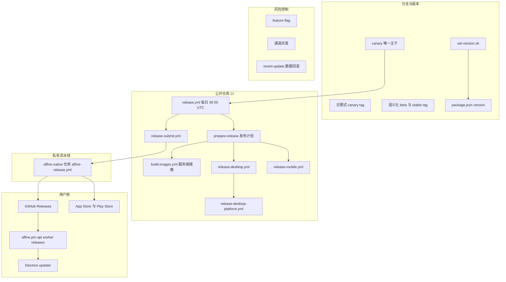
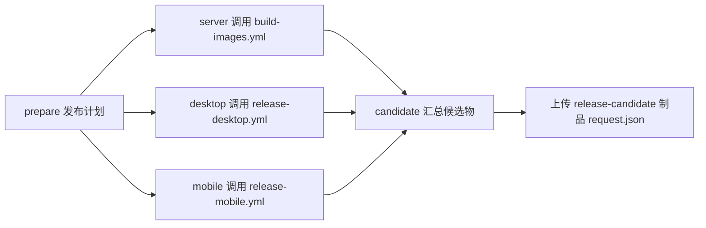
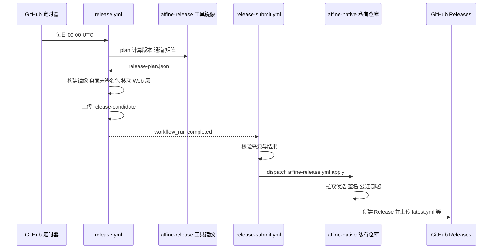
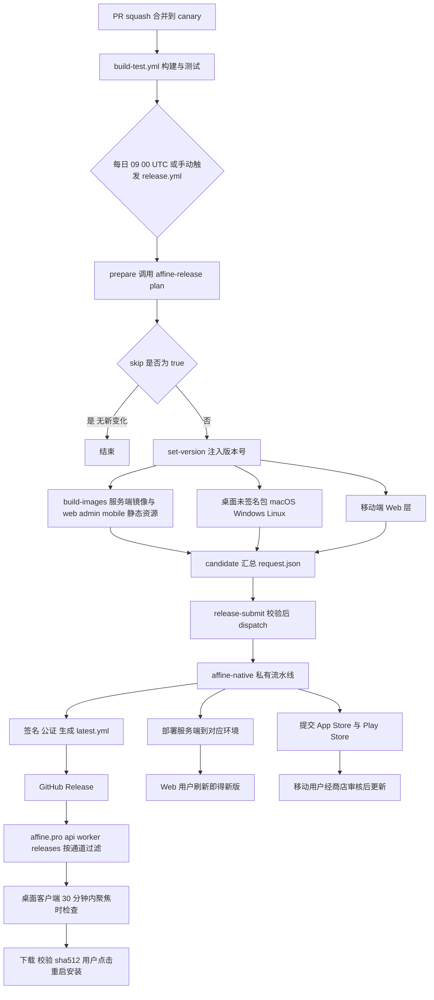

# 第 4 章 分支版本与发布节奏

> **所属部分**：第 2 部分 · 项目管理与开源协作 ｜ **难度**：★★☆☆☆ ｜ **建议学时**：3 小时 ｜ **前置章节**：[第 3 章 开源治理与协作流程](./03-开源治理与协作流程.md)

## 本章导读

第 3 章我们走到了"PR 被 squash 合并进 `canary`"这一步。但合并之后呢？一行代码要经过哪些环节，才会出现在用户电脑上的 AFFiNE 桌面端、出现在 app.affine.pro 上、出现在 App Store 里？

本章回答以下问题：

1. AFFiNE 为什么只有一个长期分支 `canary`？stable、beta 版本从哪里来？
2. `v2026.10.27-canary.909` 和 `v0.27.5-beta.2` 这两种 tag 命名分别意味着什么？
3. 每天定时运行的 `release.yml` 做了什么？为什么构建出的是"未签名候选包（candidate）"？
4. 桌面端是如何自动检测、下载、安装更新的？
5. 出了问题如何灰度、如何回滚？`tools/revert-update` 到底"回滚"的是什么？

特别提醒：AFFiNE 的发布体系在 **2026-10-26 的提交 `b2e56529ee`（"chore: improve ci (#15743)"）** 中刚刚经历了一次大调整——签名、部署、Helm Chart 等环节被移出公开仓库，交给私有仓库 `toeverything/affine-native` 中的发布流水线完成。因此本章会明确区分"公开仓库里能看到的部分"和"只能从接口推断的部分"。

## 学习目标

- [ ] 能够说明 AFFiNE 的 canary 主干开发模型，以及 stable/beta 版本与 canary 提交的关系
- [ ] 能够解读日期式 canary tag 与语义化 beta/stable tag 的命名规则，并能用 git 命令查证
- [ ] 能够描述 `scripts/set-version.sh` 修改了哪些文件、iOS 版本号为何采用日期格式
- [ ] 能够画出 `release.yml` → 各构建子工作流 → `release-submit.yml` → 私有发布流水线的调用链
- [ ] 能够解释 Electron 自动更新的 feed 地址、通道参数与文件筛选逻辑
- [ ] 能够区分功能级灰度（feature flag）、通道级灰度（canary/beta/stable）与数据级回滚（revert-update）
- [ ] 能够从项目管理角度评价 AFFiNE 的版本规划与发布节奏

## 知识地图



## 4.1 canary 主干分支策略

### 4.1.1 只有一个长期分支

查看远程默认分支：

```bash
git branch -a | grep HEAD
# remotes/origin/HEAD -> origin/canary
```

AFFiNE 的默认分支是 `canary`，所有 PR 都向它提交（第 3 章 `docs/CONTRIBUTING.md` 与 `pr-title-lint.yml` 中的 `branches: [canary]`）。远程虽然有大量分支，但它们基本是个人功能分支（如 `origin/darksky/...`、`origin/codex/...`）。远程上还有一个 `origin/release` 分支，但其最新提交停留在 2025-04，已不再活跃。

这是典型的 **Trunk-Based Development（主干开发）**：

| 模型 | 特点 | 代表 |
| --- | --- | --- |
| Git Flow | `develop` + `release/*` + `hotfix/*` + `main` 多条长期分支 | 传统版本化软件 |
| GitHub Flow | 一个 `main` + 短期功能分支 | 持续部署的 Web 服务 |
| Trunk-Based | 一个主干，频繁小步合入，发布从主干切出 | Google、AFFiNE |

### 4.1.2 stable 与 beta 版本就"长在" canary 上

用 git 验证 stable/beta tag 与 canary 的关系：

```bash
for t in v0.27.5-beta.2 v0.27.4 v0.27.3; do
  git merge-base --is-ancestor $t canary && echo "$t on canary"
done
# v0.27.5-beta.2 on canary
# v0.27.4 on canary
# v0.27.3 on canary
```

更有说服力的是同一个提交上同时打着多种 tag：

```bash
git log --oneline v0.27.4 -3
# b4c8548c09 (tag: v2026.8.17-canary.914, tag: v0.27.4) feat(server): normalize timestamp
# 81fb82761c (tag: v0.27.4-beta.2) feat(server): improve stability for long records
# 047db0fa3e (tag: v2026.8.16-canary.906) fix(core): audio block job

git tag --points-at v0.27.3
# v0.27.3
# v0.27.3-beta.2
# v2026.7.23-canary.948
```

结论：**一个 canary 提交经过验证后，可以被直接"晋升（promote）"为 beta、再晋升为 stable**，三个 tag 指向同一个提交，不需要单独的 release 分支。

### 4.1.3 但 CI 仍为"维护分支"留了口子

来源：`.github/workflows/build-test.yml`

```yaml
name: Build & Test

on:
  push:
    branches:
      - canary
      - beta
      - stable
      - v[0-9]+.[0-9]+.x-staging
      - v[0-9]+.[0-9]+.x
    paths-ignore:
      - README.md
  pull_request:
  merge_group:
```

`beta`、`stable`、`v0.27.x`、`v0.27.x-staging` 这些分支模式说明：当需要对旧版本做补丁（hotfix/backport）而 canary 已经前进太多时，团队可以临时拉出维护分支。第 3 章 3.9.3 节看到的 `(#15588) (#15596)` 双 PR 号提交，就是这种 backport 留下的痕迹。`merge_group` 则表示仓库可能启用了 GitHub Merge Queue。

### 4.1.4 设计意图与取舍

| 收益 | 代价 |
| --- | --- |
| 没有长期分支间的合并冲突 | 主干必须时刻保持可发布，依赖强 CI |
| 每天都有可测版本（canary） | 未完成功能需要 feature flag 隐藏（4.7 节） |
| stable 与 canary 同源，问题易追踪 | 旧版本补丁需临时维护分支 + cherry-pick |

**小结**：canary 既是开发主干，也是发布源头；stable/beta 是 canary 上被"选中"的提交。

## 4.2 版本号与 tag 命名

### 4.2.1 两套 tag 体系

```bash
git tag --sort=-creatordate | head -6
# v2026.10.27-canary.909
# v2026.10.26-canary.915
# v2026.10.25-canary.907
# v0.27.5-beta.2
# v2026.10.23-canary.908
# v2026.10.22-canary.909
```

| 通道 | 命名格式 | 样例 | 含义 |
| --- | --- | --- | --- |
| canary | `vYYYY.M.D-canary.N` | `v2026.10.27-canary.909` | 日期式，每日构建 |
| beta | `vX.Y.Z-beta.N` | `v0.27.5-beta.2` | 语义化版本 + 预发布序号 |
| stable | `vX.Y.Z` | `v0.27.4` | 语义化版本 |

canary 的 `N`（如 909、915、907、928）都集中在 900 左右。结合 `release.yml` 的定时 `cron: '0 9 * * *'`（UTC 09:00），推测 `N` 与构建计划的生成时刻有关；版本号由外部发布工具 `affine-release` 计算（4.4 节），**具体规则建议自行查阅该工具或观察更多样本确认**。

### 4.2.2 命名演进史

| 时期 | canary 格式 | 证据 |
| --- | --- | --- |
| 早期（约 0.12） | `0.12.0-canary-202402220729-0868ac6` | `SECURITY.md` 中的版本示例 |
| 0.2x 时期 | `v0.20.0-canary.1` … `v0.23.0-canary.2` | `git tag -l 'v0.2[0-9]*canary*'` |
| 2026-03 起 | `v2026.3.1-canary.906` | `git tag -l 'v20*-canary.*' --sort=creatordate` 最早一条 |

为什么改成日期式？语义化版本适合表达"兼容性承诺"，但 canary 每天都发、本身不承诺兼容，用日期更直观——用户一看就知道"这是哪天的构建"。stable/beta 继续用语义化版本，便于用户与自托管管理员判断升级风险。

### 4.2.3 发布节奏的真实数据

```bash
git tag -l 'v2026.*-canary.*' \
  | sed -E 's/^v([0-9]+)\.([0-9]+)\..*/\1-\2/' | sort | uniq -c
```

本地仓库中 2026 年 3–10 月每月 canary tag 数分别为 12、3、1、2、10、17、13、11。stable 版本的时间线（`git for-each-ref` 读取 tag 时间）：

| stable 版本 | 日期 | 前置 beta |
| --- | --- | --- |
| v0.26.6 | 2026-04-05 | beta.0 同日 |
| v0.26.7 | 2026-05-30 | beta.0–beta.2 同日 |
| v0.27.0 | 2026-07-15 | beta.0（06-25）至 beta.7（07-15），历时约 3 周 |
| v0.27.1 | 2026-07-15 | 与 0.27.0 同日的快速补丁 |
| v0.27.2 | 2026-07-19 | beta.0–beta.1 |
| v0.27.3 | 2026-07-23 | beta.0–beta.2 |
| v0.27.4 | 2026-08-17 | beta.0（07-28）至 beta.2（08-17） |
| 0.27.5 | 尚未发布 stable | beta.0（08-22）、beta.1（08-26）、beta.2（10-25） |

> 注意：本地 tag 取决于你上次 `git fetch --tags` 的时间，也可能有 canary 被清理（4.6.2 节），所以月度数字只代表本地快照。

可以读出的节奏：**minor 版本（0.26 → 0.27）有较长的 beta 期（约 3 周、8 个 beta），patch 版本 beta 期从当天到数周不等**；0.27.0 发布当天紧跟 0.27.1，说明 stable 发布后发现问题会迅速补丁。当前根 `package.json` 的 `version` 为 `0.27.5`，`SECURITY.md` 也只支持 0.27.x，与此一致。

**小结**：canary 用日期、beta/stable 用 SemVer；看 tag 就能还原项目的发布节奏。

## 4.3 package.json version 与 set-version.sh

### 4.3.1 统一版本号

AFFiNE monorepo 中所有 workspace 包的 `version` 字段保持一致（例如 `tools/commitlint/package.json`、`tools/revert-update/package.json` 都是 `0.27.5`）。改版本靠脚本批量完成：

来源：`scripts/set-version.sh`

```bash
#!/bin/bash
set -e

for DIR_ITEM in $(yarn workspaces list --json | jq -r '.location'); do
  DIR=$(echo -n "$DIR_ITEM" | tr -d '\r\n')
  if [ -f "$DIR/package.json" ]; then
    echo "Setting version for $DIR"
    jq ".version = \"$1\"" "$DIR"/package.json > tmp.json && mv tmp.json "$DIR"/package.json
  else
    echo "No package.json found in: $DIR"
  fi
done
# ... update_app_stream_version、update_ios_marketing_version、get_ios_version_from_git
update_app_stream_version "packages/frontend/apps/electron/resources/affine.metainfo.xml" "$new_version"

update_ios_marketing_version "packages/frontend/apps/ios/App/App.xcodeproj/project.pbxproj" "$ios_new_version"
```

脚本做了三件事：

1. 遍历 `yarn workspaces list` 得到的所有包，用 `jq` 改写 `version`；
2. 更新 Linux AppStream 元数据 `packages/frontend/apps/electron/resources/affine.metainfo.xml` 中的 `<release version=... date=...>` 与 release URL（Flatpak 等 Linux 商店读取）；
3. 更新 iOS 工程 `project.pbxproj` 中的 `MARKETING_VERSION`。

### 4.3.2 iOS 为什么用日期作版本号

来源：`scripts/set-version.sh`

```bash
# Derive a date-based iOS MARKETING_VERSION from the latest stable/beta tag.
# Apple requires CFBundleShortVersionString to increase monotonically. Using
# date-based versions (YYYY.M.D) derived from the last stable/beta release tag
# ensures this. The user-facing App Store version is set separately in
# App Store Connect.
# ...
if [ -n "$IOS_APP_VERSION" ]; then
  # Manual override via environment variable
  ios_new_version=$IOS_APP_VERSION
elif echo "$new_version" | grep -qE '(canary|nightly)'; then
  # Canary/nightly: use the date of the last stable/beta tag
  ios_new_version=$(get_ios_version_from_git)
else
  # Stable/beta release: use today's date
  ios_new_version=$(date +"%Y.%-m.%-d")
fi
```

苹果要求 `CFBundleShortVersionString` 单调递增，而 `0.27.5-beta.2` 这种带预发布后缀的版本无法直接用。于是：

- stable/beta：用当天日期；
- canary/nightly：用"最近一个 stable/beta tag 的日期"（`git describe --exclude '*canary*'`），避免 canary 版本号超过下一个正式版；
- 可用 `IOS_APP_VERSION` 环境变量手动覆盖（`.github/actions/setup-version/action.yml` 的 `ios-app-version` 输入即传给它）。

Android 的 `versionCode` 则由 `tools/playstore-auto-bump` 处理（4.6.3 节）。

### 4.3.3 CI 中的调用：setup-version

来源：`.github/actions/setup-version/action.yml`

```yaml
name: Setup Version
description: 'Setup Version'
inputs:
  app-version:
    description: 'App Version'
    required: true
  ios-app-version:
    description: 'iOS App Store Version (Optional, use App version if empty)'
    required: false
runs:
  using: 'composite'
  steps:
    - name: 'Write Version'
      shell: bash
      env:
        IOS_APP_VERSION: ${{ inputs.ios-app-version }}
      run: ./scripts/set-version.sh ${{ inputs.app-version }}
```

所有构建工作流（桌面、移动、镜像）的第一步都会调用它，**版本号在构建时注入，而不是提交到仓库**。这就是为什么 canary 版本号不会出现在 `package.json` 的提交历史里。

### 4.3.4 文档与现实的偏差

`docs/contributing/releases.md` 描述的流程是"手动运行 `./scripts/set-version.sh 0.5.4-canary.5` → 提交并推送到 canary → 触发 Release Desktop App 工作流 → 编辑并发布 draft release"。但：

- 文档中链接的 `release-desktop-app.yml` 在当前 `.github/workflows/` 中不存在；
- 当前版本号由 `release.yml` 中的发布计划工具计算并在构建时注入；
- 发布动作已移交私有流水线。

因此 `releases.md` 更像是一份**历史流程文档**，其中"需要获得 AFFiNE 测试团队授权才能发布 stable/beta""发布者需有仓库提交权限和 Actions 权限"等治理要求仍有参考价值。这是一个典型的"文档漂移"案例，阅读开源项目文档时要始终与代码交叉验证。

**小结**：版本号是"构建时参数"，`set-version.sh` 负责把它同步到 npm 包、Linux 元数据和 iOS 工程三处。

## 4.4 release.yml：每日候选构建

### 4.4.1 触发方式

来源：`.github/workflows/release.yml`

```yaml
name: Release Candidates

on:
  schedule:
    - cron: '0 9 * * *'
  workflow_dispatch:
    inputs:
      targets:
        description: 'Targets (comma-separated; append ? for optional platforms)'
        required: true
        default: 'server,desktop-macos,desktop-windows,desktop-linux?'
        type: string

permissions:
  contents: read
  actions: read
  packages: write
```

- **定时**：每天 UTC 09:00（北京时间 17:00）自动运行，这就是每日 canary 的来源；
- **手动**：维护者可指定目标平台列表，`?` 后缀表示"可选目标"（构建失败不阻塞整体，例如默认的 `desktop-linux?`）；
- **权限最小化**：顶层只给读权限和 `packages: write`（推送镜像到 GHCR），没有 `contents: write`——**这个工作流本身不能创建 Release，也不能打 tag**。

### 4.4.2 五个 Job



**prepare**：生成发布计划。

1. 读取当前 run 的创建时间；若本 run 已有成功提交过的 `release-candidate` 制品则报错——**候选物不可变（immutable）**，重跑必须新开 run；
2. 遍历 GitHub Releases，找到最近一个带 `affine-release-completed.json` 资产、且通道为 canary 的发布，保存为 `release-previous.json`（用于判断"这次是否有新提交、是否可跳过"）；
3. 调用 `.github/actions/prepare-release` 计算计划。

来源：`.github/actions/prepare-release/action.yml`

```yaml
    - name: Resolve release plan
      id: plan
      shell: bash
      env:
        TOOL_IMAGE: ${{ inputs.tool-image }}
        TARGETS: ${{ inputs.targets }}
        RUN_CREATED_AT: ${{ inputs.created-at }}
      run: |
        set -euo pipefail
        previous=()
        if [ -f release-previous.json ]; then previous=(--previous /work/release-previous.json); fi
        docker run --rm --user "$(id -u):$(id -g)" -v "$GITHUB_WORKSPACE:/work" "$TOOL_IMAGE" plan \
          --ref "$GITHUB_REF" --sha "$GITHUB_SHA" --targets "$TARGETS" \
          --request-id "$GITHUB_REPOSITORY_ID-$GITHUB_RUN_ID" --created-at "$RUN_CREATED_AT" --out /work/release-plan.json "${previous[@]}"
        {
          echo "APP_VERSION=$(jq -r .version release-plan.json)"
          echo "GIT_SHORT_HASH=${GITHUB_SHA:0:9}"
          echo "BUILD_TYPE=$(jq -r .channel release-plan.json)"
          echo "SKIP=$(jq -r ' .skip // false' release-plan.json)"
          echo "SERVER=$(jq 'any(.targets[]; .name == "server")' release-plan.json)"
          echo "DESKTOP_MATRIX=$(jq -c '{include: [.buildMatrix.include[] | select(.target | startswith("desktop-"))]}' release-plan.json)"
          echo "MOBILE_MATRIX=$(jq -c '{include: [.buildMatrix.include[] | select(.target | startswith("mobile-"))]}' release-plan.json)"
        } >> "$GITHUB_OUTPUT"
```

关键点：**版本号（`version`）、通道（`channel`）、是否跳过（`skip`）、构建矩阵（`buildMatrix`）全部由 Docker 镜像 `ghcr.io/toeverything/affine-release`（可由仓库变量 `AFFINE_RELEASE_TOOL_IMAGE` 覆盖）中的 `plan` 命令决定**。该工具的源码不在本仓库，所以"canary.909 中的 909 怎么算""何时出 beta"等规则无法在此查证。这体现了"发布策略与业务代码解耦"的思路：发布规则可以独立迭代，不需要改动主仓库。

**server / desktop / mobile**：通过 `uses: ./.github/workflows/xxx.yml` 复用子工作流（reusable workflow），并把 `app-version`、`git-short-hash`、`build-type`（即通道）、`matrix` 传下去。`if` 条件确保 `skip` 为 true 或矩阵为空时不构建。

**candidate**：汇总所有平台的产物——把 `candidate-desktop-darwin-*` 合并为 `candidate-desktop-macos`、`candidate-desktop-win32-*` 合并为 `candidate-desktop-windows` 等；收集 web/admin/mobile 静态资源（排除 HTML）为 `static-assets`；最后生成 `request.json`，记录仓库、runId、sha、镜像地址、各制品 id 及其阶段（桌面包为 `unsigned`，静态资源为 `ready`），上传为 `release-candidate` 制品。

### 4.4.3 桌面端两级构建

`release-desktop.yml` 的 `before-make` job 先生成 Web 资源：

来源：`.github/workflows/release-desktop.yml`

```yaml
  before-make:
    runs-on: ubuntu-latest
    steps:
      - uses: actions/checkout@v7
      - name: Setup Version
        uses: ./.github/actions/setup-version
        with:
          app-version: ${{ inputs.app-version }}
      # ... setup-node、setup-sentry
      - name: generate-assets
        run: yarn affine @affine/electron generate-assets
      - name: Upload web artifact
        uses: actions/upload-artifact@v4
        with:
          overwrite: true
          name: desktop-web
          path: packages/frontend/apps/electron/resources/web-static
    continue-on-error: ${{ !contains(inputs.matrix, '"required":true') }}
```

然后 `release-desktop-platform.yml` 按矩阵在各平台 runner 上：编译 Rust 原生模块（`.github/actions/build-rust`，`@affine/native`）→ 下载 `desktop-web` → `yarn affine @affine/electron build` → `package --platform --arch` 打包 → Linux 上额外用 `node -e require(...)` 验证 `.node` 原生模块可加载 → 打成 `candidate-<platform>-<arch>.tar.gz` 上传。注意环境变量 `AFFINE_UNSIGNED_PACKAGE: '1'`——**公开仓库只产出未签名包**。

签名脚本 `packages/frontend/apps/electron/scripts/sign-macos.ts`、`sign-windows.ts` 是在 `b2e56529ee` 中新增的，推测由私有流水线调用；`.github/actionlint.yaml` 中登记的自托管 runner 标签 `win-signer` 也印证了 Windows 签名在专用机器上完成（`scripts/check-windows-signer.mjs` 可能与此相关，建议自行阅读确认）。

### 4.4.4 移动端

来源：`.github/workflows/release-mobile.yml`

```yaml
      - name: Build Mobile
        run: yarn affine bundle -p ${{ matrix.platform }}
        env:
          PUBLIC_PATH: /
          # ... SENTRY_*
          RELEASE_VERSION: ${{ inputs.app-version }}
      - name: Upload ios artifact
        uses: actions/upload-artifact@v4
        with:
          overwrite: true
          name: candidate-mobile-${{ matrix.platform }}
          path: packages/frontend/apps/${{ matrix.platform }}/dist
          if-no-files-found: error
```

这里只打包 iOS/Android 的 **Web 层**（Capacitor 中运行的前端资源）。原生工程的编译、签名与上架（iOS 用 `packages/frontend/apps/ios/App/fastlane/`，Android 用 `tools/playstore-auto-bump`）在私有流水线中进行。

**小结**：`release.yml` 是"候选物工厂"——它每天产出一份带完整身份信息、不可变、未签名的候选物清单。

## 4.5 release-submit.yml：跨仓库交接

### 4.5.1 工作流

来源：`.github/workflows/release-submit.yml`

```yaml
name: Submit Release Candidate
on:
  workflow_run:
    workflows: [Release Candidates]
    types: [completed]
permissions:
  contents: read
  actions: read
jobs:
  submit:
    if: >-
      ${{ github.event.workflow_run.conclusion == 'success' &&
          github.event.workflow_run.head_repository.full_name == 'toeverything/AFFiNE' &&
          contains(fromJSON('["workflow_dispatch","schedule"]'), github.event.workflow_run.event) }}
    runs-on: ubuntu-latest
    steps:
      # ... 确认 run.path 为 .github/workflows/release.yml 且存在未过期的 release-candidate
      - uses: actions/create-github-app-token@v2
        if: ${{ steps.candidate.outputs.present == 'true' }}
        id: token
        with:
          app-id: ${{ secrets.AFFINE_RELEASE_APP_ID }}
          private-key: ${{ secrets.AFFINE_RELEASE_APP_PRIVATE_KEY }}
          owner: toeverything
          repositories: affine-native
      - name: Submit candidate identity
        # ...
          script: |
            await github.rest.actions.createWorkflowDispatch({
              owner:'toeverything',repo:'affine-native',workflow_id:'affine-release.yml',ref:'master',
              inputs:{'candidate-run-id':String(context.payload.workflow_run.id),command:'apply'},
            });
```

### 4.5.2 安全设计解读

| 设计 | 作用 |
| --- | --- |
| `workflow_run` 触发 | 与候选构建解耦，构建 run 本身不持有发布密钥 |
| 检查 `conclusion == 'success'` | 只有完整成功的候选才会提交 |
| 检查 `head_repository.full_name` | 防止 fork 仓库触发 |
| 检查事件只能是 `schedule` 或 `workflow_dispatch` | 防止 PR 等事件伪造候选 |
| 校验 `run.path` | 确保候选来自 `release.yml` 而非其他同名工作流 |
| GitHub App 短期 token，仅授权 `affine-native` 仓库 | 最小权限、可审计、可轮换 |
| 只传 `candidate-run-id` | 私有流水线根据 run id 自行拉取并校验制品，而非信任传入的内容 |

这是一个"**两段式发布（build → promote）**"架构：公开仓库负责"可复现地构建"，私有仓库负责"受控地签名与发布"。签名证书、商店凭据、生产集群凭据都不出现在公开仓库中，大幅降低了供应链攻击面（第 32 章安全）。



**小结**：从 `release-submit.yml` 开始，发布流程进入公开仓库不可见的领域，我们只能根据接口推断后续步骤。

## 4.6 发布辅助工具：release yml、清理、changelog、商店版本

### 4.6.1 generate-release-yml.mjs：自动更新的"清单"

来源：`scripts/generate-release-yml.mjs`

```js
const filenamesMapping = {
  all: 'latest.yml',
  macos: 'latest-mac.yml',
  linux: 'latest-linux.yml',
};

const releaseFiles = ['zip', 'exe', 'dmg', 'appimage', 'deb', 'flatpak'];
// ...
  files.forEach(fileName => {
    const filePath = path.join(releaseDir, fileName);
    try {
      const fileData = fs.readFileSync(filePath);
      const hash = crypto
        .createHash('sha512')
        .update(fileData)
        .digest('base64');
      const size = fs.statSync(filePath).size;

      yml.files.push({
        url: fileName,
        sha512: hash,
        size: size,
      });
    } catch {}
  });
  // ...
  yml.files.sort(a => (a.url.includes('windows-arm64') ? 1 : -1));
```

它扫描当前工作目录下 release 子目录中的安装包（运行时产物目录，由发布流水线准备），为每个文件计算 SHA-512 与大小，生成 electron-updater 标准格式的 `latest.yml`（全平台）、`latest-mac.yml`、`latest-linux.yml`，以及汇总的 `release-metadata.json`。排序那一行把 `windows-arm64` 放到最后，注释说明是为了"让旧的 Windows x64 客户端不会默认下载 arm64 包"——这是一个**向后兼容**的细节：老版本客户端的文件筛选逻辑不够精确，新发布必须照顾它们。

### 4.6.2 cleanup-canary-releases.sh：清理每日构建

每天一个 canary Release，一年就是数百个，GitHub Releases 页面会被淹没。该脚本基于 `gh` CLI，支持的参数（见脚本内 `usage()`）包括：`--repo`（默认从 `remote.origin.url` 推导）、`--keep N`（保留最新 N 个，默认 30）、`--limit N`（最多拉取 500 个）、`--pattern`（默认匹配 `-canary\.?`）、`--dedupe-by-commit`（同一提交只保留最新一个）、`--no-cleanup-tag`（只删 Release 不删 tag）、`--yes`（真正执行）。

几个值得学习的工程实践：

- **默认 dry-run**：不加 `--yes` 只打印将删除的列表——破坏性脚本的标准写法；
- **按提交去重**：同一提交若被多次发布为 canary（例如手动重跑），只保留最新的；
- **解析失败则保留**：查不到 tag 对应提交时 "keeping it to be safe"；
- **默认同时删 tag**：这也解释了为什么本地 canary tag 数量与 GitHub 上看到的可能不一致。

> 该脚本具有破坏性且作用于远程仓库，学习时**只阅读，不要执行**（即使 dry-run 也需要对应仓库权限）。

### 4.6.3 tools/changelog 与 tools/playstore-auto-bump

**`tools/changelog`**（`@affine/changelog`）：用 `@napi-rs/simple-git` 遍历 `PREV_VERSION` 到 HEAD 的提交，交给 `changelogithub` 按 Conventional Commits 分类生成 Markdown，再渲染为 Slack Block Kit 消息发送到内部频道（环境变量 `SLACK_BOT_TOKEN`、`CHANNEL_ID`）。消息头区分 "Server deployed in {NAMESPACE}" 与 "AFFiNE Client {FLAVOR} released"。这是**面向内部团队**的发布通知，也说明了为什么第 3 章强调 Conventional Commits——它是自动生成 changelog 的前提。

**`tools/playstore-auto-bump`**（`@affine/playstore-auto-bump`）：

来源：`tools/playstore-auto-bump/index.ts`

```ts
const packageName = 'app.affine.pro';
// ...
async function bump() {
  const gradlePath = new Package('@affine/android').join(
    'App/app/build.gradle'
  ).value;
  const gradle = fs.readFileSync(gradlePath, 'utf8');
  const pattern = /(versionCode(?:\s|=)*)(\d+)/;
  const local = Number(gradle.match(pattern)?.[2] ?? 0);
  const versionCode = Math.max(local, await fetchVersionCode(packageName)) + 1;
  fs.writeFileSync(gradlePath, gradle.replace(pattern, `$1${versionCode}`));
  // ... 写出 store-build.json
}
```

Google Play 要求每次上传的 `versionCode` 严格递增。该工具通过 Google Play Developer API 查询已上传 bundle 的最大 `versionCode`，与本地 `build.gradle` 取较大值再 +1，避免"本地忘了改版本号导致上传失败"。它还有 `submit` 子命令处理提交，并要求 `STORE_OPERATION_RUN_ID` 等参数做幂等校验。

### 4.6.4 CHANGELOG.md

来源：`CHANGELOG.md`

```markdown
# Changelog

See the [AFFiNE CHANGELOG](https://affine.pro/blog?tag=Release%20Note)
```

仓库内不维护逐版本变更记录，**面向用户的 Release Note 在官网博客发布**；`tools/utils/src/build-config.ts` 中 stable 构建的 `changelogUrl` 为 `https://affine.pro/what-is-new`，而 beta/internal/canary 构建指向 `https://github.com/toeverything/AFFiNE/releases`——不同通道的用户被引导到不同深度的变更说明。

上述脚本与工具在本仓库的 `.github/workflows/` 中均无引用，推测由私有发布流水线检出本仓库后调用，或由维护者手动执行。

**小结**：发布不只是"打包"，还包括更新清单、版本号单调性、清理历史、通知团队、对外说明五件事。

## 4.7 Electron 自动更新

### 4.7.1 通道来自构建时

来源：`packages/frontend/apps/electron/src/main/config.ts`

```ts
export const ReleaseTypeSchema = z.enum([
  'stable',
  'beta',
  'canary',
  'internal',
]);

declare global {
  // THIS variable should be replaced during the build process
  const REPLACE_ME_BUILD_ENV: string;
}

export const envBuildType = (process.env.BUILD_TYPE || REPLACE_ME_BUILD_ENV)
  .trim()
  .toLowerCase();
// ...
export const buildType = ReleaseTypeSchema.parse(envBuildType);
```

`BUILD_TYPE` 就是 `release.yml` 中 prepare 输出的 `channel`，构建时被替换进主进程代码。一个 canary 包只会更新到 canary，beta 包只会更新到 beta——**通道即用户分群**。

### 4.7.2 更新器配置

来源：`packages/frontend/apps/electron/src/main/updater/electron-updater.ts`

```ts
// skip auto update in dev mode & internal
const disabled = buildType === 'internal' || isDev;

export const autoUpdater =
  process.platform === 'win32' ? new WindowsUpdater() : defaultAutoUpdater;
// ...
export const registerUpdater = async () => {
  if (disabled) {
    return;
  }
  // ...
  autoUpdater.autoDownload = false;
  autoUpdater.allowPrerelease = buildType !== 'stable';
  autoUpdater.autoInstallOnAppQuit = false;
  autoUpdater.autoRunAppAfterInstall = true;

  const feedUrl = AFFiNEUpdateProvider.configFeed({
    channel: buildType,
  });

  autoUpdater.setFeedURL(feedUrl);
  // ... 监听 update-available、download-progress、update-downloaded 等事件
```

| 配置 | 值 | 含义 |
| --- | --- | --- |
| `disabled` | internal 或 dev | 内部版和开发模式不自动更新 |
| `autoDownload` | false | 由代码根据用户设置 `autoDownloadUpdate` 决定是否下载 |
| `allowPrerelease` | 非 stable 时为 true | beta/canary 允许更新到预发布版本 |
| `autoInstallOnAppQuit` | false | 不在退出时静默安装，由用户点击"重启以更新" |
| Windows | `WindowsUpdater extends NsisUpdater` | 自定义下载缓存目录到 `sessionData` |

检查时机：`setConfig` 时若 `autoCheckUpdate` 为 true 立即检查；之后每当窗口获得焦点，且距上次检查超过 30 分钟（`1000 * 1800` 毫秒）时再次检查。

### 4.7.3 自定义更新源

来源：`packages/frontend/apps/electron/src/main/updater/affine-update-provider.ts`

```ts
export class AFFiNEUpdateProvider extends Provider<GithubUpdateInfo> {
  static configFeed(options: UpdateProviderOptions): CustomPublishOptions {
    return {
      provider: 'custom',
      feedUrl: 'https://affine.pro/api/worker/releases',
      updateProvider: AFFiNEUpdateProvider,
      ...options,
    };
  }
  // ...
  get feedUrl(): URL {
    const url = new URL(this.options.feedUrl);
    url.searchParams.set('channel', this.options.channel);
    url.searchParams.set('minimal', 'true');

    return url;
  }

  async getLatestVersion(): Promise<GithubUpdateInfo> {
    // ... 请求 feedUrl，取 releases[0]
    const channelFileName = 'latest.yml';
    const channelFileAsset = latestRelease.assets.find(
      ({ name }) => name === channelFileName
    );
    // ... 找不到 latest.yml 则报 ERR_UPDATER_CHANNEL_FILE_NOT_FOUND
```

文件头注释说明它"migrated from electron-builder 的 GitHubProvider"。工作原理：

1. 请求 `https://affine.pro/api/worker/releases?channel=<通道>&minimal=true`，官网 worker 返回该通道的 Release 列表（GitHub Release 格式）；
2. 取最新一条，找到资产 `latest.yml`（由 4.6.1 节脚本生成），下载解析；
3. 用 `availableForMyPlatformAndInstaller` 按文件名 `affine-${build}-${suffix}-${distribution}-${platform}-${arch}.${installer}` 解析出通道、平台、架构、安装器类型，过滤出适合本机的安装包（还会区分 Windows Squirrel 与 NSIS 安装方式，见 `utils.ts` 中的 `isSquirrelBuild`）。

为什么不直接用 GitHub Provider？中间加一层官网 worker，可以**在不改客户端的前提下控制"哪个版本对哪个通道可见"**——例如暂时撤下有问题的版本、按通道过滤，这正是灰度与回滚的抓手。

### 4.7.4 app-update.yml 与 dev-app-update.yml

`packages/frontend/apps/electron/resources/app-update.yml` 与 `packages/frontend/apps/electron/dev-app-update.yml` 内容相同：

```yaml
owner: toeverything
repo: AFFiNE
provider: custom
private: false
```

前者随安装包分发，后者用于开发调试——`electron-updater.ts` 中 `autoUpdater.forceDevUpdateConfig = isDev`，开发模式下强制读取 `dev-app-update.yml`。不过由于 `disabled` 在 dev 模式下为 true，`registerUpdater` 会提前返回，若要本地调试更新流程，需要自行调整这些条件（仅限本地实验，不要提交）。

### 4.7.5 渲染进程 UI

主进程通过 `updaterHandlers`（`packages/frontend/apps/electron/src/main/updater/index.ts`）暴露 `checkForUpdates`、`downloadUpdate`、`quitAndInstall`、`getConfig`、`setConfig` 等 IPC 方法；事件通过 `updaterSubjects`（`event.ts`）推送。前端对应位置：

- `packages/frontend/core/src/components/hooks/use-app-updater.ts`：更新状态 hook；
- `packages/frontend/core/src/components/root-app-sidebar/updater-button.tsx`：侧栏"重启以更新"按钮；
- `packages/frontend/core/src/desktop/dialogs/setting/general-setting/about/update-check-section.tsx`：设置 → 关于中的检查更新；
- `packages/frontend/core/src/commands/affine-updates.tsx`：Cmd+K 中的更新命令。

**小结**：桌面端自动更新 = 构建时通道 + 官网 worker 过滤 + `latest.yml` 清单 + 平台/架构/安装器筛选 + 用户确认安装。

## 4.8 从合并 PR 到用户收到更新：全流程



不同终端的"到达时间"差异很大：

| 终端 | 到达路径 | 时延特征 |
| --- | --- | --- |
| Web（app.affine.pro 等） | 服务端部署 + 静态资源更新 | 最快，部署后刷新即生效 |
| 桌面端 | GitHub Release → worker → updater | 取决于用户是否打开应用、是否点击重启 |
| iOS / Android | 商店审核 | 最慢，受审核周期影响 |
| 自托管 | 管理员拉取新镜像 | 完全由管理员决定 |

第 3 章 Bug 模板中的三个 Web 域名正好对应三个通道环境：stable → `app.affine.pro`，beta → `insider.affine.pro`，canary → `affine.fail`；后端 `packages/backend/server/src/env.ts` 中的 `Namespace` 枚举（`dev`/`beta`/`production`）与之对应，`env.namespaces.canary` 即 `NAMESPACE === 'dev'`。

**小结**：一个 PR 最快当天就能出现在 canary 用户面前，进入 stable 则要经过 beta 验证与晋升。

## 4.9 项目管理视角：版本规划、灰度与回滚

### 4.9.1 版本规划

| 层级 | 节奏 | 目的 |
| --- | --- | --- |
| canary | 每日（有变化才发） | 内部与尝鲜用户快速验证，暴露问题 |
| beta | patch 版本数天到数周，minor 版本约 3 周多个 beta | 更大范围验证，冻结功能 |
| stable | patch 约 1–4 周一次，minor 数月一次（0.26.6 → 0.27.0 约 3 个月） | 面向全体用户 |
| SECURITY 支持 | 仅当前 0.27.x | 集中资源维护最新线 |

### 4.9.2 三层灰度

| 灰度层级 | 机制 | 代码位置 |
| --- | --- | --- |
| 功能级 | feature flag，可按构建通道设默认值 | `packages/frontend/core/src/modules/feature-flag/constant.ts` |
| 通道级 | canary → beta → stable 逐级晋升 | `release.yml`、`ReleaseTypeSchema` |
| 分发级 | 官网 worker 控制各通道可见版本 | `affine-update-provider.ts` 中的 `feedUrl` |

功能级灰度示例：

来源：`packages/frontend/core/src/modules/feature-flag/constant.ts`

```ts
// const isNotStableBuild = BUILD_CONFIG.appBuildType !== 'stable';
const isCanaryBuild = BUILD_CONFIG.appBuildType === 'canary';
// ...
export const AFFINE_FLAGS = {
  // ...
  enable_ai_playground: {
    category: 'affine',
    displayName:
      'com.affine.settings.workspace.experimental-features.enable-ai-model-switch.name',
    // ...
    configurable: isCanaryBuild,
    defaultState: isCanaryBuild,
  },
```

`enable_ai_playground` 只在 canary 构建中默认开启且可配置，beta/stable 用户看不到。`tools/utils/src/build-config.ts` 中 canary 预设的注释 "canary will be aggressive and enable all features" 也表达了同样的意图。主干开发模型下，**未完成的功能通过 flag 合入主干而不影响稳定用户**，这是 Trunk-Based 能成立的前提。

### 4.9.3 回滚的三个层面

| 层面 | 手段 | 说明 |
| --- | --- | --- |
| 代码回滚 | `git revert` 提交（Conventional Commits 中的 `revert` 类型） | 下一个 canary 即生效 |
| 版本回滚 | 让 worker 不再返回问题版本、发布更高版本号的修复版 | electron-updater 默认只升不降，客户端回退通常靠"发布更新的修复版"实现，具体以私有发布流程为准 |
| **数据回滚** | `tools/revert-update` | 针对文档内容的 CRDT 回滚 |

重点说明 `tools/revert-update`——它的名字容易让人误以为是"回滚应用更新"，其实**它回滚的是文档数据**：

来源：`tools/revert-update/index.ts`

```ts
function generateRevertUpdate(
  fromNewerBin: Uint8Array,
  toOlderBin: Uint8Array
): Uint8Array {
  const newerDoc = new Doc();
  applyUpdate(newerDoc, fromNewerBin);
  const olderDoc = new Doc();
  applyUpdate(olderDoc, toOlderBin);

  const newerState = encodeStateVector(newerDoc);
  const olderState = encodeStateVector(olderDoc);

  const diff = encodeStateAsUpdate(newerDoc, olderState);
  const undoManager = new UndoManager(Array.from(olderDoc.share.values()));

  applyUpdate(olderDoc, diff);
  undoManager.undo();

  return encodeStateAsUpdate(olderDoc, newerState);
}
```

其 `package.json` 描述为 "Generate a revert update from two Yjs snapshot binaries"。原理：

1. 加载新、旧两个 Yjs 快照；
2. 计算"旧 → 新"的增量 `diff`；
3. 在旧文档上用 `UndoManager` 跟踪并应用这段增量，然后 `undo()`——得到"抵消这段增量"的操作；
4. 输出相对于新版本状态向量的 update。

为什么不能直接用旧快照覆盖？因为 CRDT 是**只增不减**的：各端都持有新状态，直接下发旧快照会被合并而不是替换。正确做法是生成一个"反向操作"的 update，让所有端合并后内容回到旧状态。这在"某个版本 bug 导致用户文档被错误修改"的事故中非常关键——**应用可以回滚，但用户数据的修复必须用 CRDT 的方式完成**。CRDT 原理见第 12 章。

用法（只读学习，无需执行）：

```bash
r ./tools/revert-update/index.ts --from ./from.bin --to ./to.bin --out ./revert.bin
```

### 4.9.4 发布体系的演进与启示

`b2e56529ee`（2026-10-26）一次性删除了部署 action、集群认证 action、Helm Chart 以及 tools/cli 中的 S3 上传插件等文件（共 106 个文件、删除 5264 行，可用 `git show --stat b2e56529ee` 查看完整列表），同时新增签名脚本、修改 `prepare-release`。这说明：

- 公开仓库正在收敛为"源码 + 可复现构建"，生产部署细节转入私有仓库；
- 自托管用户与贡献者无需关心官方集群的 Helm 配置；
- 学习第 30、31 章 CI/CD 与部署时，需要以当前 HEAD 为准，网上较早的教程可能还在介绍已删除的 Helm Chart。

**小结**：AFFiNE 用"日更 canary + 功能开关 + 通道晋升 + 分发层控制 + CRDT 数据回滚"构成了完整的风险控制链条。

## 源码导读清单

| 优先级 | 路径 | 阅读重点 |
| --- | --- | --- |
| P0 | `.github/workflows/release.yml` | 定时触发、五个 job、候选物不可变 |
| P0 | `.github/actions/prepare-release/action.yml` | 外部发布工具 plan 输出 |
| P0 | `.github/workflows/release-submit.yml` | 跨仓库交接与来源校验 |
| P0 | `scripts/set-version.sh` | 版本同步三处、iOS 日期版本 |
| P0 | `packages/frontend/apps/electron/src/main/updater/electron-updater.ts` | 更新器配置与检查时机 |
| P1 | `packages/frontend/apps/electron/src/main/updater/affine-update-provider.ts` | feed 地址与文件筛选 |
| P1 | `.github/workflows/release-desktop.yml`、`release-desktop-platform.yml` | 两级构建与未签名包 |
| P1 | `.github/workflows/release-mobile.yml` | 移动端 Web 层构建 |
| P1 | `scripts/generate-release-yml.mjs` | `latest.yml` 生成 |
| P1 | `tools/revert-update/index.ts` | CRDT 数据回滚原理 |
| P1 | `.github/workflows/build-test.yml` | 分支触发模式 |
| P2 | `scripts/cleanup-canary-releases.sh` | 默认 dry-run 的清理脚本 |
| P2 | `tools/changelog/index.js` | 基于 Conventional Commits 的内部通知 |
| P2 | `tools/playstore-auto-bump/index.ts` | Android versionCode 单调递增 |
| P2 | `docs/contributing/releases.md` | 历史发布流程与授权要求 |

## 动手实践

### 练习 1：还原发布时间线

- **目标**：用 git 数据理解发布节奏。
- **步骤**：
  1. 执行 `git fetch --tags`（只读拉取，若不便联网可跳过）；
  2. 执行 `git tag --sort=-creatordate | grep -v canary | head -30`，并用 `git for-each-ref --format='%(creatordate:short)' refs/tags/<tag>` 查日期；
  3. 画出 0.27.x 各 beta 与 stable 的时间轴。
- **验收标准**：时间轴包含至少 5 个 stable 版本，并能指出最长的 beta 周期。

### 练习 2：验证"晋升"模型

- **目标**：确认 stable 来自 canary 提交。
- **步骤**：任选 3 个 stable tag，执行 `git tag --points-at <tag>` 与 `git merge-base --is-ancestor <tag> canary`。
- **验收标准**：能找到至少一个与 canary tag 指向同一提交的 stable tag，并解释其含义。

### 练习 3：推演 iOS 版本号

- **目标**：理解 `set-version.sh` 的分支逻辑。
- **步骤**：阅读 `get_ios_version_from_git`，在不执行脚本的前提下，手工推算当前 HEAD 若以 canary 版本构建，`MARKETING_VERSION` 会是多少（提示：`git describe --tags --match 'v[0-9]*' --exclude '*canary*' --exclude '*nightly*' --abbrev=0 HEAD`，这是只读命令可以运行，当前 HEAD 输出为 `v0.27.5-beta.2`）。
- **验收标准**：给出推算结果，并说明为何 canary 不使用当天日期。

### 练习 4：模拟更新文件筛选

- **目标**：理解 `availableForMyPlatformAndInstaller`。
- **步骤**：阅读该函数完整实现，判断以下文件名对 macOS arm64 是否可用：`affine-0.27.5-beta.2-beta-macos-arm64.zip`、`affine-0.27.5-beta.2-beta-windows-x64.nsis.exe`、`affine-0.27.4-stable-macos-x64.dmg`。可对照测试文件 `packages/frontend/apps/electron/test/main/updater.spec.ts` 验证你的判断。
- **验收标准**：给出三个判断及依据（平台、架构、安装器类型）。

### 练习 5：画出你自己的发布流程图

- **目标**：综合本章内容。
- **步骤**：以"修复一个编辑器 bug"为例，画出从提 PR 到 stable 用户收到更新的完整流程，标注每一步的触发者（人、定时器、机器人）与可见性（公开仓库或私有流水线）。
- **验收标准**：流程图能在 Mermaid Live Editor 渲染，且至少包含 10 个节点、明确标注公开与私有边界。

## 自测题

1. AFFiNE 的默认分支是什么？属于哪种分支模型？
2. 如何用一条 git 命令证明 `v0.27.4` 与某个 canary tag 指向同一提交？
3. `v2026.10.27-canary.909` 与 `v0.27.5-beta.2` 分别属于哪个通道？命名规则有何不同？
4. `scripts/set-version.sh` 会修改哪三类文件？
5. 为什么 `release.yml` 顶层权限中没有 `contents: write`？
6. `release-submit.yml` 做了哪些校验来防止伪造候选物？
7. 版本号和通道是在哪里计算出来的？为什么本仓库无法查证 canary 号的生成规则？
8. Electron 客户端从哪个地址检查更新？如何区分通道？
9. 为什么 beta 和 canary 客户端设置 `allowPrerelease = true`？
10. `tools/revert-update` 回滚的是什么？为什么不能直接下发旧快照？

<details><summary>参考答案</summary>

1. `canary`；Trunk-Based Development（主干开发）。
2. `git tag --points-at v0.27.4`，输出中同时出现 `v0.27.4` 与 `v2026.8.17-canary.914`；或 `git log --oneline v0.27.4 -1` 查看 decorations。
3. 前者为 canary，日期式 `vYYYY.M.D-canary.N`；后者为 beta，语义化版本加预发布序号 `vX.Y.Z-beta.N`。
4. 所有 workspace 的 `package.json`；Linux AppStream 元数据 `affine.metainfo.xml`；iOS 工程 `project.pbxproj` 中的 `MARKETING_VERSION`。
5. 该工作流只负责构建候选物，不创建 Release 或 tag；发布动作交由私有流水线完成，遵循最小权限原则。
6. 上游 run 必须成功；来源仓库必须是 `toeverything/AFFiNE`；事件只能是 `schedule` 或 `workflow_dispatch`；工作流路径必须是 `.github/workflows/release.yml`；必须存在未过期的 `release-candidate` 制品；使用仅授权 `affine-native` 的 GitHub App 短期 token。
7. 由 `.github/actions/prepare-release` 运行的 `ghcr.io/toeverything/affine-release` 镜像中的 `plan` 命令计算；该工具源码不在本仓库。
8. `https://affine.pro/api/worker/releases`，通过查询参数 `channel=<buildType>` 区分通道，并带 `minimal=true`。
9. beta/canary 版本号带预发布后缀，electron-updater 默认不更新到预发布版本，需显式允许；stable 则只更新到正式版。
10. 回滚的是文档的 Yjs 数据。CRDT 只增不减，旧快照下发后会与新状态合并而非替换；必须生成抵消增量的反向 update，所有端合并后才能回到旧内容。

</details>

## 常见坑与排错

| 现象 | 原因 | 建议 |
| --- | --- | --- |
| 按 `docs/contributing/releases.md` 找不到 `release-desktop-app.yml` | 文档未随发布体系演进更新 | 以 `.github/workflows/release.yml` 为准 |
| 本地看到的 canary tag 比 GitHub 少或多 | 未 fetch tags，或远程 canary 被清理脚本删除 | `git fetch --tags --prune-tags`（只读同步）后再统计 |
| 本地运行桌面端看不到自动更新 | dev 模式与 internal 构建下 `disabled` 为 true | 属于预期行为；调试需本地临时修改，勿提交 |
| 在仓库里找 Helm Chart 与 deploy action 失败 | `b2e56529ee` 已将其移除 | 部署相关请看第 31 章与当前 HEAD；旧教程可能过时 |
| 以为 `revert-update` 能回滚客户端版本 | 名字误导 | 它是 Yjs 文档数据回滚工具 |
| 手动修改 `package.json` 版本号并提交 | 版本应在构建时注入 | 不要手动提交版本号变更，除非维护者要求 |
| 试图执行 `cleanup-canary-releases.sh` 学习 | 该脚本会删除远程 Release 与 tag | 只阅读源码；即使 dry-run 也需要仓库权限 |
| iOS 版本号与应用内显示版本不一致 | iOS `MARKETING_VERSION` 是日期式，商店展示版本在 App Store Connect 另行设置 | 以脚本注释为准 |

## 延伸阅读

- Trunk Based Development：https://trunkbaseddevelopment.com/
- Semantic Versioning 2.0.0：https://semver.org/
- GitHub Actions 可复用工作流：https://docs.github.com/en/actions/sharing-automations/reusing-workflows
- GitHub Actions `workflow_run` 事件：https://docs.github.com/en/actions/writing-workflows/choosing-when-your-workflow-runs/events-that-trigger-workflows#workflow_run
- electron-updater 文档：https://www.electron.build/auto-update
- Apple CFBundleShortVersionString 说明：https://developer.apple.com/documentation/bundleresources/information-property-list/cfbundleshortversionstring
- Google Play versionCode 说明：https://developer.android.com/studio/publish/versioning
- Yjs UndoManager 文档：https://docs.yjs.dev/api/undo-manager
- changelogithub：https://github.com/antfu/changelogithub
- AFFiNE Release Note：https://affine.pro/blog?tag=Release%20Note

## 学时拆分

| 内容 | 建议时长 |
| --- | --- |
| 4.1–4.3 分支策略、tag 命名、版本号脚本 | 0.75 小时 |
| 4.4–4.5 release.yml 与跨仓库交接 | 0.75 小时 |
| 4.6–4.7 发布辅助工具与 Electron 自动更新 | 0.5 小时 |
| 4.8–4.9 全流程与灰度回滚 | 0.5 小时 |
| 动手实践与自测 | 0.5 小时 |
| **合计** | **3 小时** |

---
上一章：[第 3 章 开源治理与协作流程](./03-开源治理与协作流程.md) ｜ 下一章：[第 9 章 TypeScript在AFFiNE中的应用](../03-编程语言与基础技术/09-TypeScript在AFFiNE中的应用.md) ｜ [返回目录](../README.md)
