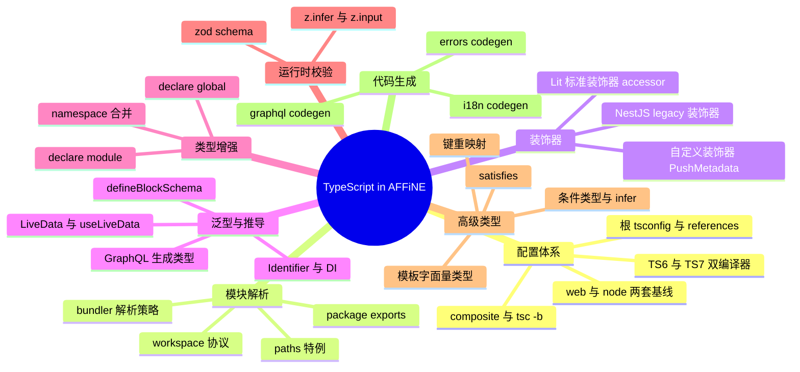
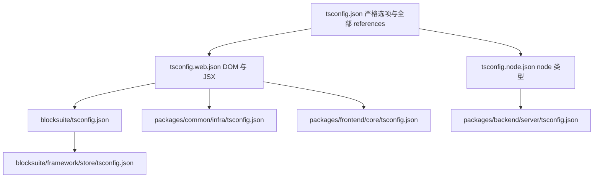
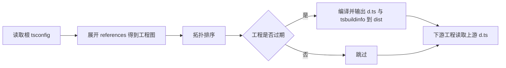
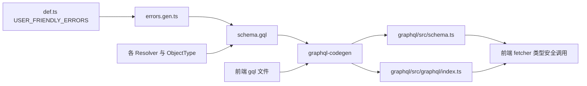

# 第 5 章 TypeScript 在 AFFiNE 中的应用

> **所属部分**：第 3 部分 · 编程语言与基础技术 ｜ **难度**：★★★☆☆ ｜ **建议学时**：8 小时 ｜ **前置章节**：第 1 章

## 本章导读

AFFiNE 是一个"几乎全栈 TypeScript"的项目：前端 React 应用、BlockSuite 编辑器内核（Lit Web Components）、NestJS 后端、Electron 主进程、构建脚本与 CLI 工具，统统用 TypeScript 编写。打开仓库后你首先会被三类东西"劝退"：

1. **配置层**：根目录下有 4 个 `tsconfig*.json`，`tsconfig.json` 里有一百多条 `references`，每个包还各有一份 `tsconfig.json`；`package.json` 里 `typescript` 依赖被写成了 `npm:@typescript/typescript6@6.0.2` 这种奇怪的别名。
2. **语法层**：后端满屏 `@Module`、`@Resolver`、`@Field`，编辑器满屏 `@property accessor model!`，两者居然还是两套不同的装饰器标准。
3. **类型体操层**：`TypesToDeps<ConstructorParameters<Arg1>>`、`` `${P}$` `` 键重映射、`Extract<Queries, { name: Q['id'] }>['response']`……

本章采用"**语法速成 + AFFiNE 真实用法**"双线并行的方式：每个 TypeScript 知识点先用一两句话讲清楚原理，再立刻挂到仓库里的真实代码上。读完本章，你应当能无障碍地读懂项目中 90% 的类型代码，并知道遇到类型报错时去哪里找原因。

## 学习目标

- [ ] 能够说清根 `tsconfig.json`、`tsconfig.web.json`、`tsconfig.node.json` 与各包 `tsconfig.json` 的继承/引用关系，并解释 `yarn typecheck`（`tsc -b`）的增量构建原理
- [ ] 能够解释 `typescript` → `@typescript/typescript6`、`@typescript/native` → `typescript@7` 两个别名的含义，并知道 `node_modules/.bin/tsc` 实际指向哪个编译器
- [ ] 能够根据 `package.json` 的 `exports` 字段推断出 `import ... from '@blocksuite/affine/store'` 最终解析到哪个源文件
- [ ] 能够区分 NestJS 使用的 legacy 装饰器（`experimentalDecorators`）与 Lit 使用的 TC39 标准装饰器（`accessor` 写法），并解释为什么两者能在同一仓库共存
- [ ] 能够读懂 `createIdentifier<T>`、`LiveData<T>`、`defineBlockSchema`、`SignaledProps`、GraphQL `QueryResponse<Q>` 等泛型与条件类型
- [ ] 能够使用 `declare global` / `declare module` 为项目扩展全局接口（如后端 `Events`、`AppConfigSchema`）
- [ ] 能够识别项目中的代码生成文件（`schema.ts`、`i18n.gen.ts`、`errors.gen.ts`），知道它们的"源头"和再生方式
- [ ] 能够在 `enum`、联合类型、`as const satisfies` 之间做出符合项目惯例的选择

## 知识地图



## 5.1 tsconfig 体系：一棵"继承树"加一张"引用图"

### 5.1.1 两个正交的概念：extends 与 references

初学者最容易混淆的是 `extends` 和 `references`：

| 机制 | 作用 | 类比 |
| --- | --- | --- |
| `extends` | **继承编译选项**（strict、target、lib…），子配置覆盖父配置 | CSS 继承 |
| `references` | **声明工程间依赖**，`tsc -b` 据此按拓扑顺序增量构建 | package.json 的 dependencies |

AFFiNE 的配置用 `extends` 形成一棵"三层继承树"，再用 `references` 织出一张"依赖图"。



### 5.1.2 根 tsconfig.json：严格模式基线 + 引用清单

来源：`tsconfig.json`

```jsonc
{
  "compilerOptions": {
    // Strictness
    "strict": true,
    "verbatimModuleSyntax": true,
    "exactOptionalPropertyTypes": false,
    "noFallthroughCasesInSwitch": true,
    "noImplicitOverride": true,
    "noImplicitReturns": true,
    "noUnusedLocals": true,
    "noUnusedParameters": true,
    "noPropertyAccessFromIndexSignature": false,
    "noUncheckedIndexedAccess": false,
    "skipLibCheck": true,
    // Modules
    "module": "ESNext",
    "moduleResolution": "bundler",
    "resolveJsonModule": true,
    "typeRoots": ["./tools/@types", "./node_modules/@types"],
    // Emit
    "lib": ["ES2024"],
    "target": "ES2024",
    "useDefineForClassFields": false,
    "declaration": true,
    // ...
    "composite": true,
    "paths": {
      "@affine/core/*": ["./packages/frontend/core/src/*"]
    }
  },
  "include": [],
  "files": [],
  // ...
  "references": [
    { "path": "./blocksuite/affine/all" },
    // ... 一百多个包
    { "path": "./tools/utils" }
  ]
}
```

逐项解读关键选项（这是你日后看到报错时"查字典"的依据）：

| 选项 | 取值 | 含义与在 AFFiNE 中的影响 |
| --- | --- | --- |
| `strict` | `true` | 打开 `strictNullChecks`、`noImplicitAny`、`strictFunctionTypes` 等全家桶。项目中大量 `!`（非空断言，如 `accessor model!: ParagraphBlockModel`）正是 strict 下"我保证运行时会赋值"的写法 |
| `verbatimModuleSyntax` | `true` | "所写即所得"：不带 `type` 的 import 一律保留到产物。因此**纯类型必须写 `import type`**，否则报 TS1484 |
| `noImplicitOverride` | `true` | 覆写父类成员必须写 `override`，这就是 Lit 组件里 `override render()`、`static override styles` 随处可见的原因 |
| `noUnusedLocals/Parameters` | `true` | 未使用的变量/参数报错；需要占位的参数用 `_` 前缀（如后端 `error(@Args(...) _name: ErrorNames)`） |
| `noUncheckedIndexedAccess` | `false` | `arr[0]` 的类型是 `T` 而不是 `T \| undefined`，写起来轻松但要自己留神越界 |
| `exactOptionalPropertyTypes` | `false` | 可选属性 `a?: string` 允许显式赋 `undefined`（`ParagraphBlockSchema` 的 props 里 `textAlign: undefined` 依赖于此） |
| `moduleResolution` | `bundler` | 按打包器（Vite/Rspack）的规则解析：支持 `exports`，**不要求**相对路径写扩展名 |
| `useDefineForClassFields` | `false` | 类字段编译为构造函数内的 `this.x = ...` 赋值，而不是 `Object.defineProperty`。这对 Lit 至关重要，见 5.4.4 |
| `typeRoots` | `tools/@types` 优先 | 自定义全局类型包（`BUILD_CONFIG` 等）放在这里，见 5.6 |
| `include`/`files` | `[]` | 根配置**自己不编译任何文件**，它只是一个"解决方案（solution）配置"，把所有子工程串起来 |

> 注意 `references` 上方的注释：`The references are generated by the cli, do not modify it manually. COMMAND: yarn affine init`。这张一百多项的清单是自动生成的，见 5.1.5。

### 5.1.3 web 与 node 两套基线

来源：`tsconfig.web.json`

```json
{
  "extends": "./tsconfig.json",
  "compilerOptions": {
    "types": ["assets", "build-config", "affine__env"],
    "lib": ["ESNext", "DOM", "DOM.Iterable"],
    "jsx": "react-jsx",
    "composite": true
  }
}
```

来源：`tsconfig.node.json`

```json
{
  "extends": "./tsconfig.json",
  "compilerOptions": {
    "types": ["node", "build-config"],
    "composite": true
  }
}
```

- **web 基线**增加了 `DOM` 库和 `jsx: react-jsx`（React 17+ 的自动 JSX 运行时，不再需要 `import React`），并通过 `types` 白名单只加载 `@types/assets`、`@types/build-config`、`@types/affine__env` 三个全局类型包——这三个包就是 `tools/@types/` 下的本地 workspace 包。
- **node 基线**只加载 `@types/node` 与 `build-config`，**没有 DOM**。所以如果你在后端代码里写 `window.xxx`，会直接得到类型错误，这是一种"用类型系统隔离运行环境"的手段。

`blocksuite/tsconfig.json` 是 BlockSuite 包的中间层：

来源：`blocksuite/tsconfig.json`

```jsonc
{
  // exists for easier extending in blocksuite packages
  "extends": "../tsconfig.web.json",
  "compilerOptions": {
    "types": ["assets", "node"]
  }
}
```

它把 `types` 覆盖为 `["assets", "node"]`——BlockSuite 作为独立的编辑器框架，**刻意不依赖** AFFiNE 应用层的 `BUILD_CONFIG` 等全局变量，这体现了"内核与应用解耦"的边界。

### 5.1.4 包级 tsconfig：composite + rootDir/outDir + references

以 `@toeverything/infra` 为例：

来源：`packages/common/infra/tsconfig.json`

```json
{
  "extends": "../../../tsconfig.web.json",
  "include": ["./src"],
  "compilerOptions": {
    "types": ["build-config", "affine__env", "node"],
    "rootDir": "./src",
    "outDir": "./dist",
    "tsBuildInfoFile": "./dist/tsconfig.tsbuildinfo"
  },
  "references": [
    { "path": "../debug" },
    { "path": "../env" },
    { "path": "../error" }
  ]
}
```

后端则有自己的特殊需求：

来源：`packages/backend/server/tsconfig.json`

```json
{
  "extends": "../../../tsconfig.node.json",
  "compilerOptions": {
    "jsx": "react-jsx",
    "emitDecoratorMetadata": true,
    "experimentalDecorators": true,
    "allowSyntheticDefaultImports": true,
    "verbatimModuleSyntax": false,
    "rootDir": "./src",
    "outDir": "./dist",
    "tsBuildInfoFile": "./dist/tsconfig.tsbuildinfo"
  },
  "include": ["./src"],
  "references": [
    { "path": "../../common/s3-compat" },
    { "path": "../native" },
    // ...
    { "path": "../../common/graphql" },
    { "path": "../../common/realtime" }
  ]
}
```

三处值得注意：

1. **`jsx: react-jsx`**：后端也写 JSX——邮件模板（`packages/backend/server/src/mails`）是用 React 组件渲染的。
2. **`experimentalDecorators` + `emitDecoratorMetadata`**：NestJS 依赖注入需要，见 5.4。
3. **`verbatimModuleSyntax: false`**：后端代码里常见 `import { RedisOptions } from 'ioredis'` 这种"把纯类型当值导入"的写法（见 `packages/backend/server/src/base/redis/config.ts`），在 verbatim 模式下会报 TS1484；另外 `emitDecoratorMetadata` 需要构造函数参数类型在运行时可引用，后端关闭此选项以兼容这种风格。

### 5.1.5 references 由 CLI 自动生成

`references` 不是手写的，而是由 `tools/cli/src/init.ts` 根据 workspace 依赖关系生成。`postinstall` 钩子（根 `package.json`：`"postinstall": "yarn affine init && yarn husky"`）会在每次安装依赖后自动执行它。

来源：`tools/cli/src/init.ts`

```ts
  genProjectTsConfig = (prev: string) => {
    return applyEdits(
      prev,
      modify(
        prev,
        ['references'],
        this.workspace.packages
          .filter(p => p.isTsProject)
          .map(p => ({ path: p.path.relativePath })),
        {}
      )
    );
  };

  genPackageTsConfig = (pkg: Package, prev: string) => {
    // TODO(@forehalo):
    //   currently electron-api => electron => nbstore => electron-api
    //   this is a circular dependency, we need to fix it
    // ...
    if (pkg.name === '@affine/electron-api') {
      return prev;
    }

    return applyEdits(
      prev,
      modify(
        prev,
        ['references'],
        pkg.deps
          .filter(p => p.isTsProject)
          .map(d => ({ path: pkg.path.relative(d.path.value) })),
        {}
      )
    );
  };
```

要点：

- 根 `references` = 所有 TS 工程；包级 `references` = 该包 `package.json` 中声明的 workspace 依赖里属于 TS 工程的那些。
- 使用 `jsonc-parser` 的 `modify/applyEdits` 做"外科手术式"修改，**保留注释与其他字段**。
- 特例 `@affine/electron-api` 被跳过，因为存在循环依赖（`tsc -b` 不允许工程引用成环）。

**结论**：给某个包新增 workspace 依赖后，运行 `yarn affine init` 让 references 同步，否则 `tsc -b` 可能因构建顺序错误而报"找不到模块类型"。

### 5.1.6 `yarn typecheck` = `tsc -b`：增量构建的原理

根 `package.json`：

```json
"typecheck": "tsc -b tsconfig.json --verbose",
```

`tsc -b`（build mode）的工作流程：



- `composite: true` 是参与 `-b` 的前提：它强制开启 `declaration`，并要求所有源文件都被 `include` 覆盖。
- `tsBuildInfoFile` 记录每个文件的哈希与依赖，下次只重编改动过的工程。
- 下游工程（如 `core`）**读取上游工程（如 `infra`）的 `dist/*.d.ts`** 而不是重新检查上游源码，这是大型 monorepo 类型检查能在可接受时间内完成的关键。
- `--verbose` 会打印每个工程"为什么需要/不需要重建"，排查增量失效时非常有用。

## 5.2 两个 TypeScript：TS6 与 TS7 native 并存

### 5.2.1 package.json 里的别名

根 `package.json` 的 `devDependencies`：

```json
"@typescript/native": "npm:typescript@7.0.2",
// ...
"oxlint-tsgolint": "7.0.2001",
// ...
"typescript": "npm:@typescript/typescript6@6.0.2",
```

这里用到了 Yarn 的 **npm 别名协议** `"<本地名>": "npm:<真实包名>@<版本>"`。拆开看：

| 本地名（node_modules 下的目录） | 真实包 | 是什么 |
| --- | --- | --- |
| `node_modules/typescript` | `@typescript/typescript6@6.0.2` | 用 JS 实现的传统 TypeScript 编译器（6.x 线），提供 `typescript` 的 **JS API**（`lib/typescript.js`） |
| `node_modules/@typescript/native` | `typescript@7.0.2` | 用 Go 重写的原生编译器（TypeScript 7，社区常称 tsgo），速度显著更快 |

为什么要这样"反着起名"？因为生态里大量工具（打包插件、`ts-node` 类工具、vanilla-extract、IDE 插件……）会 `require('typescript')` 调用 **JS API**，而 TS7 原生版不再提供与 6.x 兼容的同步 JS API。于是：

- 把 `typescript` 这个名字留给 **TS6**，让依赖 JS API 的工具继续工作；
- 把 TS7 装到 `@typescript/native` 这个名字下，专门用来跑命令行类型检查。

### 5.2.2 `tsc` 命令到底是哪个？

查看二进制链接（在仓库中实际执行 `ls -la node_modules/.bin | grep tsc` 的结果）：

```text
tsc -> ../@typescript/native/bin/tsc
tsc6 -> ../typescript/bin/tsc6
```

也就是说：

- `@typescript/typescript6` 包把自己的 bin 命名为 **`tsc6`**；
- TS7 包的 bin 仍叫 **`tsc`**。

因此 `yarn typecheck`（`tsc -b tsconfig.json`）以及各包 `"build": "yarn run -T tsc"` 实际上运行的是 **TS7 原生编译器**；而依赖 JS API 的构建工具仍然拿到 TS6。另外 `oxlint-tsgolint` 是 oxlint 的类型感知规则后端，同样基于 Go 版 TypeScript。

> 实践提示：如果你发现编辑器（VS Code 内置 TS 服务）与命令行 `yarn typecheck` 的报错不一致，第一个要怀疑的就是"两边用的不是同一个编译器版本"。

## 5.3 模块解析：exports 字段与 workspace 包导入

### 5.3.1 workspace 协议

根 `package.json` 的 `workspaces` 字段声明了哪些目录是包：

```json
"workspaces": [
  ".",
  "blocksuite/**/*",
  "packages/*/*",
  "packages/frontend/apps/*",
  "tools/*",
  "docs/reference",
  "tools/@types/*",
  "tests/*"
],
```

包之间用 `"workspace:*"` 互相依赖（例如 `packages/common/infra/package.json` 中 `"@affine/debug": "workspace:*"`）。Yarn 会在 `node_modules` 下创建指向源码目录的符号链接，于是 `import '@affine/debug'` 与导入普通 npm 包无异。

### 5.3.2 source-first 的 exports

AFFiNE 的内部包几乎都**直接导出 `src/*.ts` 源文件**，而不是编译产物：

来源：`packages/common/infra/package.json`

```json
{
  "name": "@toeverything/infra",
  "type": "module",
  "private": true,
  "sideEffects": false,
  "exports": {
    "./storage": "./src/storage/index.ts",
    "./utils": "./src/utils/index.ts",
    "./app-config-storage": "./src/app-config-storage.ts",
    "./op": "./src/op/index.ts",
    "./atom": "./src/atom/index.ts",
    ".": "./src/index.ts"
  },
  // ...
}
```

`moduleResolution: bundler` 下，TypeScript 会读取 `exports`：

- `import { LiveData } from '@toeverything/infra'` → `./src/index.ts`
- `import { ... } from '@toeverything/infra/op'` → `./src/op/index.ts`
- `import '@toeverything/infra/src/foo'` → **解析失败**（`exports` 未暴露的路径一律不可访问）

这种"源码直出"的好处是：开发时无需先构建依赖包，Vite/Rspack 直接编译源码，改动即时生效；跳转定义直接到 `.ts` 源文件。代价是 `tsc -b` 仍需按引用图生成 `.d.ts`。

### 5.3.3 一个"门面包"：@blocksuite/affine

`blocksuite/affine/all/package.json` 有 **207** 个 `exports` 条目（可用 `python3 -c "import json;print(len(json.load(open('blocksuite/affine/all/package.json'))['exports']))"` 验证），前几项如下：

```text
.                      ./src/index.ts
./effects              ./src/effects.ts
./std                  ./src/std/index.ts
./std/gfx              ./src/std/gfx.ts
./global/types         ./src/global/types.ts
./store                ./src/store/index.ts
./blocks/attachment    ./src/blocks/attachment/index.ts
...
```

每个子路径文件只是一行再导出：

来源：`blocksuite/affine/all/src/store/index.ts`

```ts
/* oxlint-disable no-restricted-imports */

export * from '@blocksuite/store';
```

于是应用层只需依赖一个 `@blocksuite/affine`，用 `@blocksuite/affine/store`、`@blocksuite/affine/model` 之类的子路径按需导入，而不用关心底层被拆成了几十个小包。这是典型的 **Facade（门面）模式**。

### 5.3.4 lint 层面的"防线"与 paths 特例

`.oxlintrc.json` 的 `no-restricted-imports` 禁止从 `**/dist` 和 `**/src` 导入：

```json
"no-restricted-imports": [
  "error",
  {
    "patterns": [
      { "group": ["**/dist"], "message": "Don't import from dist", "allowTypeImports": false },
      { "group": ["**/src"], "message": "Don't import from src", "allowTypeImports": false }
    ]
  }
]
```

即使 `exports` 已经限制了路径，lint 再加一道保险，强迫大家走包的公开入口。唯一的例外是根 tsconfig 的 `paths`：`"@affine/core/*": ["./packages/frontend/core/src/*"]`，注释说明 core 的导出比较复杂（`packages/frontend/core/package.json` 中 `"./*": "./src/*"`），暂时保留 paths 映射。

### 5.3.5 Import Attributes

后端用到了较新的 ES 语法 import attributes 导入 JSON：

来源：`packages/backend/server/src/env.ts`

```ts
import pkg from '../package.json' with { type: 'json' };
```

这依赖 `resolveJsonModule: true` 与 ES2024+ 目标。

## 5.4 装饰器：同一仓库里的两套标准

### 5.4.1 语法速成：装饰器是什么

装饰器本质是"在类定义阶段运行的函数"，可以修改或标注类、方法、字段。历史上存在两套规范：

| | Legacy（实验性）装饰器 | TC39 标准装饰器（Stage 3，TS 5.0+） |
| --- | --- | --- |
| 开关 | `experimentalDecorators: true` | 默认即可（不开 experimental） |
| 参数装饰器 | 支持 `@Args() x` | **不支持** |
| 元数据 | 配合 `emitDecoratorMetadata` + `reflect-metadata` 输出 `design:paramtypes` | 不输出 design 元数据 |
| 字段装饰 | 直接装饰普通字段 | 推荐装饰 `accessor` 自动访问器 |
| AFFiNE 中的使用者 | **后端 NestJS** | **BlockSuite / 前端 Lit 组件** |

由于后端的 `packages/backend/server/tsconfig.json` 单独打开了 `experimentalDecorators`，而根配置没有，**两套规范被 tsconfig 隔离在不同工程里**，各取所需。

### 5.4.2 NestJS 装饰器：@Module / @Injectable / @Resolver

**模块声明**——来源：`packages/backend/server/src/core/doc/index.ts`

```ts
import { Module } from '@nestjs/common';
// ...
@Module({
  imports: [BackendRuntimeModule, QuotaModule, PermissionModule, StorageModule],
  providers: [
    DocStorageOptions,
    PgWorkspaceDocStorageAdapter,
    PgUserspaceDocStorageAdapter,
    DocReaderProvider,
    DatabaseDocReader,
    DocEventsListener,
    DocWriter,
  ],
  exports: [
    DatabaseDocReader,
    DocReader,
    DocWriter,
    // ...
  ],
})
export class DocStorageModule {}
```

**可注入服务 + zod**——来源：`packages/backend/server/src/models/user-settings.ts`

```ts
@Injectable()
export class UserSettingsModel extends BaseModel {
  @Transactional()
  async set(userId: string, setting: UserSettingsInput) {
    const existsSetting = await this.get(userId);
    const payload = UserSettingsSchema.parse({
      ...existsSetting,
      ...setting,
    });
    // ...
  }
}
```

**GraphQL Resolver 与参数装饰器**——来源：`packages/backend/server/src/core/user/resolver.ts`

```ts
@Resolver(() => UserType)
export class UserResolver {
  constructor(
    private readonly storage: AvatarStorage,
    private readonly models: Models
  ) {}

  @Throttle('strict')
  @Query(() => UserOrLimitedUser, {
    name: 'user',
    description: 'Get user by email',
    nullable: true,
  })
  @Public()
  async user(
    @Args('email') email: string,
    @CurrentUser() currentUser?: CurrentUser
  ): Promise<typeof UserOrLimitedUser | null> {
    validators.assertValidEmail(email);
    // ...
  }
```

读这段代码要抓住三点：

1. **构造函数注入**：`constructor(private readonly storage: AvatarStorage, ...)` 没有任何 `@Inject()`，NestJS 是怎么知道要注入 `AvatarStorage` 的？答案是 `emitDecoratorMetadata`：编译器会为被装饰的类生成 `Reflect.metadata('design:paramtypes', [AvatarStorage, Models])`，Nest 读取它完成注入。这也是为什么构造参数类型必须是**运行时存在的类**，而不能是 `interface`。
2. **参数装饰器**：`@Args('email')`、`@CurrentUser()` 只有 legacy 装饰器支持。
3. **装饰器叠加顺序**：多个方法装饰器**自下而上**执行（`@Public` → `@Query` → `@Throttle`），但它们大多只是写元数据，顺序通常无关紧要。

**GraphQL 对象类型**——来源：`packages/backend/server/src/core/user/types.ts`

```ts
@ObjectType()
export class UserType implements CurrentUser {
  @Field(() => ID)
  id!: string;

  @Field({ description: 'User name' })
  name!: string;

  @Field(() => String, { description: 'User avatar url', nullable: true })
  avatarUrl!: string | null;
  // ...
}
```

`@Field(() => String, { nullable: true })` 中显式写出 `() => String`，是因为 `design:type` 元数据对 `string | null` 这种联合类型只能得到 `Object`，Nest 无法推断，需要手工告知。这里的 `!` 是**确定赋值断言**：告诉 strict 模式"这个字段会被框架赋值"。

### 5.4.3 自定义装饰器：PushMetadata

后端还基于 `reflect-metadata` 写了自己的装饰器工厂：

来源：`packages/backend/server/src/base/nestjs/decorator.ts`

```ts
export function PushMetadata<T>(key: string | symbol, value: T) {
  const decorator: ClassDecorator | MethodDecorator = (
    target,
    _,
    descriptor
  ) => {
    const metadataTarget = descriptor?.value ?? target;

    const metadataArray = Reflect.getMetadata(key, metadataTarget) || [];
    metadataArray.push(value);
    Reflect.defineMetadata(key, metadataArray, metadataTarget);
  };

  return decorator;
}
```

它被 `@OnEvent` 使用（`packages/backend/server/src/base/event/def.ts`）：把"监听哪个事件"写进方法的元数据，事件总线启动时扫描所有 provider 收集监听器。这就是"装饰器 = 声明式元数据"的典型用法。

### 5.4.4 Lit 标准装饰器：`@property accessor`

来源：`blocksuite/affine/blocks/paragraph/src/heading-icon.ts`

```ts
import { SignalWatcher, WithDisposable } from '@blocksuite/global/lit';
import { ShadowlessElement } from '@blocksuite/std';
import { css, html, nothing, unsafeCSS } from 'lit';
import { property } from 'lit/decorators.js';
// ...
export class ParagraphHeadingIcon extends SignalWatcher(
  WithDisposable(ShadowlessElement)
) {
  static override styles = css`/* ... */`;

  override render() {
    const type = this.model.props.type$.value;
    if (!type.startsWith('h')) return nothing;
    // ...
  }

  @property({ attribute: false })
  accessor model!: ParagraphBlockModel;
}

export function effects() {
  customElements.define('affine-paragraph-heading-icon', ParagraphHeadingIcon);
}
```

`accessor` 是 TC39 装饰器提案引入的**自动访问器**关键字：`accessor model` 等价于生成一个私有存储 + getter/setter。Lit 的标准装饰器版本拦截这个 getter/setter，在 setter 中调用 `requestUpdate()` 触发重新渲染。同类用法还有：

- `@state() private accessor _filteredItems ...`（`blocksuite/affine/widgets/slash-menu/src/slash-menu-popover.ts`）——内部响应式状态，不反映为 attribute；
- `@query('rich-text') private accessor _richTextElement`（`blocksuite/affine/blocks/paragraph/src/paragraph-block.ts`）——查询渲染根中的元素。

**为什么 `useDefineForClassFields: false` 很重要？** 看这个**不用装饰器**的 Lit 组件：

来源：`packages/frontend/component/src/lit-react/to-react-node.ts`

```ts
export
@customElement('affine-lit-template-wrapper')
class LitTemplateWrapper extends LitElement {
  static override get properties() {
    return {
      template: { type: Object },
    };
  }
  template: TemplateResult | null = null;
  // do not enable shadow root
  override createRenderRoot() {
    return this;
  }
  // ...
}
```

Lit 通过 `static properties` 在**原型上**定义 `template` 的响应式 getter/setter。如果类字段使用 define 语义（`Object.defineProperty(this, 'template', ...)`），实例上的同名属性会**遮蔽**原型上的访问器，导致赋值不再触发更新——这是 Lit 官方文档明确警告的坑。设为 `false` 后，`template = null` 编译为 `this.template = null`，走的正是原型 setter。

另外注意 `export @customElement(...) class` 这种"装饰器写在 export 之后"的写法，只有标准装饰器才允许。仓库中 `@customElement` 主要出现在这类少数文件与测试中（如 `blocksuite/framework/std/src/__tests__/test-block.ts`），BlockSuite 业务组件普遍采用 `effects()` 函数里显式 `customElements.define(...)` 的方式，便于控制注册时机、避免重复注册。

## 5.5 泛型与类型推导：四个项目级实例

### 5.5.1 语法速成

教学示例：

```ts
// 教学示例：泛型函数、约束、infer、条件类型
function first<T>(arr: T[]): T | undefined { return arr[0]; }

type ElementOf<A> = A extends (infer E)[] ? E : never; // 条件类型 + infer
type X = ElementOf<string[]>; // string

type Getters<T> = {
  [K in keyof T & string as `get${Capitalize<K>}`]: () => T[K]; // 键重映射
};
type G = Getters<{ name: string }>; // { getName: () => string }
```

### 5.5.2 实例一：DI 标识符 `createIdentifier<T>`

前端依赖注入框架（第 16 章详解）需要一种"既是值又携带类型"的标识符。

来源：`packages/common/infra/src/framework/core/types.ts`

```ts
export type Type<T = any> = abstract new (...args: any) => T;

export type Identifier<T> = {
  identifierName: string;
  variant: ComponentVariant;
  __TYPE__: T;
};

export type IdentifierType<T> =
  T extends Identifier<infer R> ? R : T extends Type<infer R> ? R : never;

export type TypesToDeps<T> = {
  [index in keyof T]:
    | GeneralIdentifier<T[index]>
    | (T[index] extends (infer I)[] ? [GeneralIdentifier<I>] : never);
};
```

来源：`packages/common/infra/src/framework/core/identifier.ts`

```ts
export function createIdentifier<T>(
  name: string,
  variant: ComponentVariant = DEFAULT_VARIANT
): Identifier<T> & ((variant: ComponentVariant) => Identifier<T>) {
  return Object.assign(
    (variant: ComponentVariant) => {
      return createIdentifier<T>(name, variant);
    },
    {
      identifierName: name,
      variant,
    }
  ) as any;
}
```

技巧拆解：

- **幽灵类型（phantom type）**：`__TYPE__: T` 在运行时根本不存在，只是让类型系统"记住" `T`，`IdentifierType` 再用 `infer R` 把它取出来。
- **函数与对象的交叉类型**：返回值既能当对象读 `identifierName`，又能当函数调用 `Storage('local')` 生成变体。
- **`TypesToDeps` 映射元组**：对构造函数参数元组的每一项，要求依赖数组对应位置提供一个"能产出该类型"的标识符；若参数是数组 `I[]`，则写成 `[Identifier<I>]` 表示"注入所有实现"。

`FrameworkEditor.service` 把它们组合起来：

来源：`packages/common/infra/src/framework/core/framework.ts`

```ts
  service = <
    Arg1 extends Type<Service>,
    Arg2 extends Deps | ComponentFactory<ServiceType> | ServiceType,
    ServiceType = IdentifierType<Arg1>,
    Deps = Arg1 extends Type<ServiceType>
      ? TypesToDeps<ConstructorParameters<Arg1>>
      : [],
  >(
    service: Arg1,
    ...[arg2]: Arg2 extends [] ? [] : [Arg2]
  ): this => {
    // ...
  };
```

真实调用——来源：`packages/frontend/core/src/modules/doc/index.ts`

```ts
export function configureDocModule(framework: Framework) {
  framework
    .scope(WorkspaceScope)
    .service(DocsService, [
      DocsStore,
      DocPropertiesStore,
      [DocCreateMiddleware],
    ])
    .store(DocPropertiesStore, [WorkspaceService, WorkspaceDBService])
    .store(DocsStore, [WorkspaceService, DocPropertiesStore])
    .entity(DocRecord, [DocsStore, DocPropertiesStore])
    // ...
    .service(DocService);
}
```

而 `DocsStore` 的构造函数是 `constructor(private readonly workspaceService: WorkspaceService, private readonly docPropertiesStore: DocPropertiesStore)`（`packages/frontend/core/src/modules/doc/stores/docs.ts`）。如果你把 `.store(DocsStore, [WorkspaceService, DocPropertiesStore])` 中两项写反，`TypesToDeps<ConstructorParameters<typeof DocsStore>>` 会立刻报错——**依赖顺序错误在编译期就被发现**，这正是前端 DI 不依赖 `emitDecoratorMetadata` 也能做到类型安全的秘诀。

### 5.5.3 实例二：`LiveData<T>` 与 `useLiveData`

`LiveData<T>` 继承自 RxJS 的 `Observable<T>`（第 6 章详解其运行机制），这里只看类型设计。

来源：`packages/common/infra/src/livedata/livedata.ts`

```ts
export class LiveData<T = unknown>
  extends Observable<T>
  implements InteropObservable<T>
{
  static computed<T>(
    compute: (get: <L>(data: LiveData<L>) => L) => T
  ): LiveData<T> {
    // ...
  }
  // ...
}

export type Unwrap<T> =
  T extends LiveData<infer Z>
    ? Unwrap<Z>
    : T extends readonly [...infer Elements]
      ? { [K in keyof Elements]: Unwrap<Elements[K]> }
      : T;

export type Flat<T> = T extends LiveData<infer P> ? LiveData<Unwrap<P>> : T;
```

- `computed` 的参数 `get` 本身是一个**泛型函数类型** `<L>(data: LiveData<L>) => L`：每次调用 `get(a)` 都会独立推导 `L`。
- `Unwrap` 是**递归条件类型**：`LiveData<LiveData<number>>` 递归剥成 `number`；对元组则逐项映射。`flat()` 方法的返回类型 `Flat<this>` 就靠它推导。

React 侧的 hook 把可空性"透传"出来：

来源：`packages/common/infra/src/livedata/react.ts`

```ts
export function useLiveData<Input extends LiveData<any> | null | undefined>(
  liveData: Input
): NonNullable<Input> extends LiveData<infer T>
  ? Input extends undefined
    ? T | undefined
    : Input extends null
      ? T | null
      : T
  : never {
  return useSyncExternalStore(
    liveData ? liveData.reactSubscribe : noopSubscribe,
    // ...
  );
}
```

传入 `LiveData<string> | null` 时返回 `string | null`，传入 `LiveData<string>` 时返回 `string`。注意 `Input extends undefined ? ...` 是**分配式条件类型**：当 `Input` 是联合类型时，会对每个成员分别求值再合并。

### 5.5.4 实例三：`defineBlockSchema` 与 `SignaledProps`

来源：`blocksuite/framework/store/src/model/block/zod.ts`

```ts
export function defineBlockSchema<
  Flavour extends string,
  Role extends RoleType,
  Props extends object,
  Metadata extends Readonly<{
    version: number;
    role: Role;
    parent?: string[];
    children?: string[];
    isFlatData?: boolean;
  }>,
  Model extends BlockModel<Props>,
  Transformer extends BaseBlockTransformer<Props>,
>(options: {
  flavour: Flavour;
  metadata: Metadata;
  props?: (internalPrimitives: InternalPrimitives) => Props;
  toModel?: () => Model;
  transformer?: (transformerConfig: Map<string, unknown>) => Transformer;
}): {
  version: number;
  model: {
    props: PropsGetter<Props>;
    flavour: Flavour;
  } & Metadata;
  transformer?: (transformerConfig: Map<string, unknown>) => Transformer;
};
```

这里用了**函数重载**：上面是对外暴露的"精确类型签名"，下面紧跟着一个参数类型宽松的实现签名（用 `BlockSchemaType` 返回）。调用方只看得到上面那个。

当你写：

来源：`blocksuite/affine/model/src/blocks/paragraph/paragraph-model.ts`

```ts
export const ParagraphBlockSchema = defineBlockSchema({
  flavour: 'affine:paragraph',
  props: (internal): ParagraphProps => ({
    type: 'text',
    text: internal.Text(),
    // ...
  }),
  metadata: {
    version: 1,
    role: 'content',
    parent: [ 'affine:note', 'affine:database', /* ... */ ],
  },
  toModel: () => new ParagraphBlockModel(),
});
```

`Flavour` 被推导为字面量类型 `'affine:paragraph'`（因为约束 `extends string` 会让 TS 保留字面量），`Props` 推导为 `ParagraphProps`。

模型类上还有更精彩的**键重映射 + 模板字面量**：

来源：`blocksuite/framework/store/src/model/block/block-model.ts`

```ts
type SignaledProps<Props> = Props & {
  [P in keyof Props & string as `${P}$`]: Signal<Props[P]>;
};
// ...
export class BlockModel<Props extends object = object> {
  // This is used to avoid https://stackoverflow.com/questions/55886792/infer-typescript-generic-class-type
  [modelLabel]: Props = 'type_info_label' as never;
  // ...
  _props!: SignaledProps<Props>;
```

于是 `ParagraphBlockModel` 的 `props` 既有 `type: ParagraphType`，又自动多出 `type$: Signal<ParagraphType>`——这正是 `heading-icon.ts` 里 `this.model.props.type$.value` 能被类型检查的原因。`[modelLabel]: Props` 这个 symbol 字段则是为了让 TS 在结构类型比较时能"看见" `Props`，从而 `PropsOfModel<T> = T extends BlockModel<infer P> ? P : never`（`blocksuite/framework/store/src/model/block/types.ts`）可以正确推导。

### 5.5.5 实例四：GraphQL 生成类型与 `QueryResponse<Q>`

前端的 GraphQL 类型是从后端 schema **生成**的：

来源：`packages/common/graphql/codegen.yml`

```yaml
config:
  strict: true
  maybeValue: T | null
  declarationKind: interface
  # ...
schema: ../../backend/server/src/schema.gql
documents: ./src/**/*.gql
generates:
  ./src/schema.ts:
    plugins:
      - typescript
      - typescript-operations
      - ./export-gql-plugin.cjs:
          output: ./src/graphql/index.ts
```

一条查询 `packages/common/graphql/src/graphql/get-current-user.gql` 会生成两样东西：

```ts
// 来源：packages/common/graphql/src/graphql/index.ts（自定义插件生成）
export const getCurrentUserQuery = {
  id: 'getCurrentUserQuery' as const,
  op: 'getCurrentUser',
  query: `query getCurrentUser {
  currentUser {
    id
    // ...
```

```ts
// 来源：packages/common/graphql/src/schema.ts（graphql-codegen 生成）
export type GetCurrentUserQuery = {
  __typename?: 'Query';
  currentUser: {
    __typename?: 'UserType';
    id: string;
    name: string;
    email: string;
    emailVerified: boolean;
    avatarUrl: string | null;
    hasPassword: boolean | null;
    features: Array<FeatureType>;
  } | null;
};
```

`schema.ts` 末尾还有一个巨大的可辨识联合 `Queries` / `Mutations`，每一项形如 `{ name: 'xxxQuery'; variables: ...; response: ... }`。`fetcher.ts` 用条件类型把它们"查表"出来：

来源：`packages/common/graphql/src/fetcher.ts`

```ts
export type _QueryVariables<Q extends GraphQLQuery> =
  Q['id'] extends Queries['name']
    ? Extract<Queries, { name: Q['id'] }>['variables']
    : Q['id'] extends Mutations['name']
      ? Extract<Mutations, { name: Q['id'] }>['variables']
      : undefined;

export type QueryResponse<Q extends GraphQLQuery> = Extract<
  Queries | Mutations,
  { name: Q['id'] }
>['response'];

type NullableKeys<T> = {
  [K in keyof T]: null extends T[K] ? K : never;
}[keyof T];
```

关键在 `id: 'getCurrentUserQuery' as const`：`as const` 让 `id` 的类型是字面量而非 `string`，`Extract<..., { name: Q['id'] }>` 才能精确命中。最终效果：`gqlFetcherFactory`（同文件）返回的 `gqlFetch<Query extends GraphQLQuery>(options): Promise<QueryResponse<Query>>` 在传入 `{ query: getCurrentUserQuery }` 时，返回值自动是 `GetCurrentUserQuery`，变量类型也自动校验——**前后端类型以 `schema.gql` 为唯一真相源**。

`NullableKeys<T>` 则展示了一个常用技巧："映射类型 + 索引访问 `[keyof T]`"把对象类型转为键的联合。

## 5.6 声明合并与全局类型增强

### 5.6.1 语法速成

TypeScript 中同名的 `interface` 会**自动合并**，这是"可扩展注册表"模式的基础：

教学示例：

```ts
// 教学示例
interface Registry { a: number }
interface Registry { b: string }
// 等价于 interface Registry { a: number; b: string }

// 在模块文件中扩展全局
declare global { interface Window { myFlag: boolean } }
// 扩展某个第三方模块
declare module 'some-lib' { interface Options { extra?: true } }
```

### 5.6.2 全局类型包：tools/@types

`tools/@types/` 下的三个本地包通过 `typeRoots` + `types` 被加载：

来源：`tools/@types/build-config/__all.d.ts`

```ts
declare interface BUILD_CONFIG_TYPE {
  debug: boolean;
  distribution: 'web' | 'desktop' | 'admin' | 'mobile' | 'ios' | 'android';
  isDesktopEdition: boolean;
  isMobileEdition: boolean;
  isElectron: boolean;
  // ...
  appBuildType: 'stable' | 'beta' | 'internal' | 'canary';
  // ...
}

declare var BUILD_CONFIG: BUILD_CONFIG_TYPE;
```

`BUILD_CONFIG` 在构建时由打包器的 define 插件替换为常量（详见第 10 章），所以代码里可以直接写 `BUILD_CONFIG.isElectron` 而无需 import。

来源：`tools/@types/env/__all.d.ts`

```ts
import '@affine/env/constant';
import '@blocksuite/affine/global/types'

declare module '@blocksuite/affine/store' {
  interface DocMeta {
    /**
     * @deprecated
     */
    favorite?: boolean;
    trash?: boolean;
    trashDate?: number;
    updatedDate?: number;
    mode?: 'page' | 'edgeless';
    // todo: support `number` in the future
    isPublic?: boolean;
  }
}
```

这是**模块增强（module augmentation）**：AFFiNE 应用层给 BlockSuite 的 `DocMeta` 加上 `trash`、`mode` 等业务字段，而 BlockSuite 内核本身对这些字段一无所知——又一次体现内核/应用解耦。文件顶部的 `import` 不可省：一个 `.d.ts` 只有包含 import/export 才被视为模块，`declare module` 才是"增强"而非"声明新模块"。

### 5.6.3 后端：可扩展的事件与配置注册表

**事件注册表**——来源：`packages/backend/server/src/base/event/def.ts`

```ts
declare global {
  /**
   * Event definitions can be extended by
   * ...
   */
  interface Events {}
}

export type EventName = keyof Events;
```

各业务模型在自己的文件里"认领"事件——来源：`packages/backend/server/src/models/doc.ts`

```ts
declare global {
  interface Events {
    'doc.created': {
      workspaceId: string;
      docId: string;
      editor?: string;
    };
    'doc.updated': {
      workspaceId: string;
      docId: string;
    };
    // ...
  }
}
```

全仓库所有 `interface Events` 合并成一张表，`EventBus.emit('doc.created', payload)` 的事件名和 payload 都能被精确检查。新增事件无需修改任何中心文件。

**配置注册表**——来源：`packages/backend/server/src/base/config/types.ts`

```ts
declare global {
  type ConfigItem<T> = Leaf<T>;
  interface AppConfigSchema {}
  type AppConfig = DeeplyEraseLeaf<AppConfigSchema>;
}
```

来源：`packages/backend/server/src/base/redis/config.ts`

```ts
declare global {
  interface AppConfigSchema {
    redis: {
      host: string;
      port: number;
      db: number;
      username: string;
      password: string;
      ioredis: ConfigItem<
        Omit<RedisOptions, 'host' | 'port' | 'db' | 'username' | 'password'>
      >;
    };
  }
}
```

`Leaf<T> = T & { __leaf: true }`（定义在 `packages/backend/server/src/global.d.ts`）是一个"品牌"标记，告诉类型工具"这里是叶子配置，别再往下拆"。`DeeplyEraseLeaf` 再把品牌擦掉得到真正的配置值类型。配套的 `LeafPaths` 用模板字面量生成 `'redis.host' | 'redis.ioredis' | ...` 这样的路径联合：

来源：`packages/backend/server/src/base/utils/types.ts`

```ts
export type PathType<T, Path extends string> =
  T extends Record<string, any>
    ? string extends Path
      ? unknown
      : Path extends keyof T
        ? T[Path]
        : Path extends `${infer K}.${infer R}`
          ? K extends keyof T
            ? PathType<T[K], R>
            : unknown
          : unknown
    : unknown;

export type Join<Prefix, Suffixes> = Prefix extends string | number
  ? Suffixes extends string | number
    ? Prefix extends ''
      ? Suffixes
      : `${Prefix}.${Suffixes}`
    : never
  : never;
```

`` Path extends `${infer K}.${infer R}` `` 是**模板字面量类型中的 infer**：把 `'redis.host'` 拆成 `K='redis'`、`R='host'` 递归求值。

### 5.6.4 namespace 合并与第三方模块增强

来源：`packages/backend/server/src/global.d.ts`

```ts
declare namespace Express {
  interface Request {
    session?: import('./core/auth/session').Session;
    authType?: 'jwt' | 'session';
  }
}
```

`@types/express` 把 `Request` 放在全局命名空间 `Express` 下，同名 `namespace` 会合并，于是 `req.session` 在整个后端都有类型。注意这里用 `import('...')` **类型导入表达式**，因为该文件是全局脚本（无顶层 import），不能写普通 import。

前端也有类似用法：

- `packages/frontend/track/src/auto.ts` 中 `declare module 'react' { interface HTMLAttributes<T> { 'data-event-props'?: EventsUnion; ... } }`——给所有 JSX 元素增加埋点属性；
- `packages/frontend/i18n/src/i18next.ts` 中 `declare module 'i18next' { interface CustomTypeOptions {} }`——注释特别说明**故意不启用** resources 类型，因为会让整个代码库类型检查变得非常慢。这是一个"类型安全 vs 编译性能"取舍的真实案例。

### 5.6.5 BlockSuite 中的全局增强

在 BlockSuite 中搜索 `namespace BlockSuite`，你只会在文档 `blocksuite/docs-site/guide/command.md`、`blocksuite/docs-site/guide/selection.md` 里找到——**当前源码已不再使用** `namespace BlockSuite { interface Commands }` 这种旧写法。现行做法有两种：

1. **`HTMLElementTagNameMap` 增强**（几乎每个 Lit 组件都有）——来源：`blocksuite/affine/blocks/paragraph/src/effects.ts`

```ts
export function effects() {
  ParagraphHeadingIconEffects();
  customElements.define('affine-paragraph', ParagraphBlockComponent);
}

declare global {
  interface HTMLElementTagNameMap {
    'affine-paragraph': ParagraphBlockComponent;
  }
}
```

之后 `document.querySelector('affine-paragraph')` 的返回类型就是 `ParagraphBlockComponent | null`。

2. **自定义全局注册表**——来源：`blocksuite/framework/std/src/event/base.ts` 与 `blocksuite/framework/std/src/event/state/keyboard.ts`

```ts
// base.ts
declare global {
  interface BlockSuiteUIEventState {
    defaultState: UIEventState;
  }

  type UIEventStateType = keyof BlockSuiteUIEventState;
}

// keyboard.ts
declare global {
  interface BlockSuiteUIEventState {
    keyboardState: KeyboardEventState;
  }
}
```

与后端 `Events` 一模一样的套路：各事件状态文件分别"注册"自己，`UIEventStateContext.get('keyboardState')` 就能返回 `KeyboardEventState`。

## 5.7 zod：编译期类型与运行时校验的桥梁

### 5.7.1 为什么需要运行时校验

TypeScript 类型在编译后**完全擦除**。来自网络、数据库 JSON 列、本地存储、用户输入的数据，类型系统无法保证。zod 让你"写一次 schema，同时得到运行时校验器和静态类型"。

### 5.7.2 后端：设置项的解析与默认值

来源：`packages/backend/server/src/models/user-settings.ts`

```ts
export const UserSettingsSchema = z.object({
  receiveInvitationEmail: z.boolean().default(true),
  receiveMentionEmail: z.boolean().default(true),
  receiveCommentEmail: z.boolean().default(true),
});

export type UserSettingsInput = z.input<typeof UserSettingsSchema>;
export type UserSettings = z.infer<typeof UserSettingsSchema>;
// ...
  async get(userId: string): Promise<UserSettings> {
    const row = await this.db.userSettings.findUnique({
      where: { userId },
    });
    return UserSettingsSchema.parse(row?.payload ?? {});
  }
```

- `z.input` 是**解析前**的类型：带 `.default()` 的字段是可选的；
- `z.infer`（= `z.output`）是**解析后**的类型：所有字段必有值。
- 数据库里存的是 JSON（Prisma 的 `Json` 列），`parse` 一步完成"校验 + 填默认值 + 收窄类型"。

### 5.7.3 BlockSuite：用 zod 校验 schema 本身

`defineBlockSchema` 的实现最后一步是 `BlockSchema.parse(schema)`（见 5.5.4），在**注册 Block 时**就发现配置错误。同文件中还有：

```ts
// 来源：blocksuite/framework/store/src/model/block/zod.ts
export const BlockSchema = z.object({
  version: z.number(),
  model: z.object({
    role: RoleSchema,
    flavour: FlavourSchema,
    // ...
    props: z
      .function()
      .args(z.custom<InternalPrimitives>())
      .returns(z.record(z.any()))
      .optional(),
  }),
  // ...
});

export type BlockSchemaType = z.infer<typeof BlockSchema>;
```

`z.custom<T>()` 用于无法用 zod 原语描述的类型（这里是一个接口），只提供类型、不做实质校验。

### 5.7.4 zod 与 enum 联用

来源：`blocksuite/affine/model/src/consts/note.ts`

```ts
export enum NoteDisplayMode {
  DocAndEdgeless = 'both',
  DocOnly = 'doc',
  EdgelessOnly = 'edgeless',
}

export enum StrokeStyle {
  Dash = 'dash',
  None = 'none',
  Solid = 'solid',
}

export const StrokeStyleSchema = z.nativeEnum(StrokeStyle);

export const NoteDisplayModeSchema = z.nativeEnum(NoteDisplayMode);
```

`z.nativeEnum` 把 TS enum 变成校验器，常用于白板元素属性的校验与反序列化。

> 版本提示：项目中 `zod` 依赖为 `^3.25.76`（见 `blocksuite/framework/store/package.json`），本章示例均为 zod 3 API。

## 5.8 enum、联合类型、satisfies、模板字面量：项目惯例

### 5.8.1 enum vs 联合类型

| 写法 | 项目实例 | 特点 |
| --- | --- | --- |
| 字符串联合 | `ParagraphType = 'text' \| 'quote' \| 'h1' ...`（`paragraph-model.ts`）、`UserFriendlyErrorBaseType`（`packages/backend/server/src/base/error/def.ts`） | 零运行时开销；存到 Yjs/JSON 里就是普通字符串，序列化友好 |
| 字符串 enum | `PointStyle`、`NoteDisplayMode`（`blocksuite/affine/model/src/consts/`）、后端 `Flavor`（`packages/backend/server/src/env.ts`） | 有运行时对象，可遍历（`Object.values`）、可配合 `z.nativeEnum`、`registerEnumType` |
| 数字 enum | `ConnectorMode { Straight, Orthogonal, Curve }`（`blocksuite/affine/model/src/consts/connector.ts`） | 存储紧凑，但有反向映射，调试时不直观 |
| GraphQL 生成 enum | `DocMode { edgeless = 'edgeless', page = 'page' }`（`packages/common/graphql/src/schema.ts`） | 与后端 `registerEnumType` 对应 |

`enum` 既是类型又是值，可以被遍历——项目里有个小工具专门做反向映射：

来源：`blocksuite/affine/model/src/utils/enum.ts`

```ts
export function createEnumMap<T extends Record<string, string | number>>(
  EnumObject: T
) {
  return Object.entries(EnumObject).reduce(
    (acc, [key, value]) => {
      acc[value as T[keyof T]] = key as keyof T;
      return acc;
    },
    {} as Record<T[keyof T], keyof T>
  );
}
```

注意：由于 `isolatedModules: true`，**跨文件的 `const enum` 无法被单文件编译器（SWC/esbuild）内联**，项目中几乎看不到 `const enum`。

**选型经验**：纯类型约束、需要持久化到 CRDT 的字段用联合类型；需要在 UI 中遍历选项、做 GraphQL 枚举或 zod 校验时用字符串 enum。

### 5.8.2 `satisfies`：校验但不拓宽

`satisfies`（TS 4.9+）检查值是否满足某类型，但**保留值本身更精确的推导类型**。

来源：`packages/backend/server/src/base/error/def.ts`

```ts
export const USER_FRIENDLY_ERRORS = {
  // Internal uncaught errors
  internal_server_error: {
    type: 'internal_server_error',
    message: 'An internal error occurred.',
  },
  // ...
  graphql_bad_request: {
    type: 'bad_request',
    args: { code: 'string', message: 'string' },
    message: ({ code, message }) =>
      `GraphQL bad request, code: ${code}, ${message}`,
  },
  // ... 约 800 行
} satisfies Record<string, UserFriendlyErrorOptions>;
```

如果写成 `const X: Record<string, UserFriendlyErrorOptions> = {...}`，`keyof typeof X` 只是 `string`；用 `satisfies` 后，`keyof typeof USER_FRIENDLY_ERRORS` 是所有错误码的字面量联合（`def.ts` 第 87 行 `name: keyof typeof USER_FRIENDLY_ERRORS` 就依赖这一点），同时每一项仍被校验必须有 `type` 和 `message`。

`as const satisfies` 组合更进一步，连嵌套值都保持只读字面量：

来源：`packages/frontend/core/src/modules/db/schema/schema.ts`

```ts
export const AFFiNE_WORKSPACE_DB_SCHEMA = {
  folders: {
    id: f.string().primaryKey().optional().default(nanoid),
    parentId: f.string().optional(),
    // ...
  },
  // ...
} as const satisfies DBSchemaBuilder;
export type AFFiNEWorkspaceDbSchema = typeof AFFiNE_WORKSPACE_DB_SCHEMA;

export type DocProperties = ORMEntity<AFFiNEWorkspaceDbSchema['docProperties']>;
```

这是 infra 中轻量 ORM 的用法：schema 本身是值，`ORMEntity<...>` 从中推导出实体类型。另一个例子是特性开关表 `packages/frontend/core/src/modules/feature-flag/constant.ts` 末尾的 `} satisfies { [key in string]: FlagInfo };`，随后 `export type AFFINE_FLAGS = typeof AFFINE_FLAGS;` 拿到精确的键集合。

### 5.8.3 模板字面量类型

| 项目实例 | 来源 | 作用 |
| --- | --- | --- |
| `` SerializedXYWH = `[${number},${number},${number},${number}]` `` | `blocksuite/framework/global/src/gfx/xywh.ts` | 白板元素位置以字符串存进 Yjs，类型上仍保证格式 |
| `` BaseFlavour<T extends string> = `affine:${T}` `` | `packages/common/reader/src/doc-parser/types.ts` | 约束 Block flavour 必须带 `affine:` 前缀 |
| `` URLCursor = `url(${string})` `` | `blocksuite/framework/std/src/gfx/cursor.ts` | CSS cursor 值 |
| `` AudioMediaKey = `${string}/${string}/${string}/${string}` `` | `packages/common/infra/src/media/types.ts` | 多段路径键 |
| `` [P in keyof Props & string as `${P}$`] `` | `blocksuite/framework/store/src/model/block/block-model.ts` | 键重映射生成 `xxx$` 信号属性 |
| `'meta:createdAt'` 等字面量键 | `blocksuite/affine/model/src/utils/types.ts` 的 `BlockMeta` | 带命名空间前缀的 props |

### 5.8.4 条件类型小合集

- `IdentifierType<T>`、`PropsOfModel<T>`：`infer` 提取泛型参数；
- `NullableKeys<T>` / `NonNullableKeys<T>`：映射 + 索引访问取键；
- `UnionToIntersection<T>`（`packages/backend/server/src/global.d.ts`）：利用函数参数的逆变把联合转交叉，是经典类型体操；
- `DeepPartial<T>` / `DeepReadonly<T>`：递归映射类型。

## 5.9 代码生成的类型文件

大型项目会把"重复且必须与外部源一致"的类型交给生成器。AFFiNE 中三个最重要的生成文件：

| 文件 | 行数（约） | 真相源 | 生成方式 |
| --- | --- | --- | --- |
| `packages/common/graphql/src/schema.ts` | 8600+ | 后端 `packages/backend/server/src/schema.gql` + 前端 `src/**/*.gql` | graphql-codegen，配置 `packages/common/graphql/codegen.yml` |
| `packages/frontend/i18n/src/i18n.gen.ts` | 11000+ | `packages/frontend/i18n/src/resources/en.json` | `@magic-works/i18n-codegen`，配置 `packages/frontend/i18n/.i18n-codegen.json` |
| `packages/backend/server/src/base/error/errors.gen.ts` | 1300+ | `packages/backend/server/src/base/error/def.ts` 的 `USER_FRIENDLY_ERRORS` | 开发模式下 `ErrorModule.onModuleInit` 调用 `generateUserFriendlyErrors()` 写出 |

### 5.9.1 i18n：把翻译键变成方法签名

来源：`packages/frontend/i18n/src/i18n.gen.ts`

```ts
// @ts-nocheck
/* oxlint-disable */
// ...
export function useAFFiNEI18N(): {
    /**
      * `Back to my Content`
      */
    ["404.back"](): string;
    // ...
    /**
      * `Heading {{number}}`
      */
    Heading(options: {
        readonly number: string;
    }): string;
```

翻译文本中的 `{{number}}` 插值被生成为必填参数 `options.number`，拼错键名或漏传参数都会在编译期报错，并且 JSDoc 让你悬停即可看到英文原文。

### 5.9.2 errors.gen.ts：一份定义，三处使用

来源：`packages/backend/server/src/base/error/errors.gen.ts`

```ts
/* oxlint-disable */
// AUTO GENERATED FILE
import { createUnionType, Field, ObjectType, registerEnumType } from '@nestjs/graphql';

import { UserFriendlyError } from './def';
// ...
@ObjectType()
class GraphqlBadRequestDataType {
  @Field() code!: string
  @Field() message!: string
}

export class GraphqlBadRequest extends UserFriendlyError {
  constructor(args: GraphqlBadRequestDataType, message?: string | ((args: GraphqlBadRequestDataType) => string)) {
    super('bad_request', 'graphql_bad_request', message, args);
  }
}
```

`def.ts` 里的一条 `graphql_bad_request: { type, args, message }` 被生成为：
1. 可 `throw new GraphqlBadRequest({...})` 的错误类；
2. GraphQL 对象类型 `GraphqlBadRequestDataType`；
3. 枚举 `ErrorNames` 的一项，并进入 `schema.gql` → 再生成前端 `schema.ts` 中的 `ErrorNames`。

于是**一个错误码的定义贯穿后端抛出、GraphQL 传输、前端识别全链路**。

### 5.9.3 生成文件的共同约定

- 文件头带 `AUTO GENERATED` / `do not manipulate this file manually` 注释，以及 `oxlint-disable` 或 `@ts-nocheck`；
- **永远修改真相源，然后重新生成**，而不是手改生成文件；
- 这些文件被提交进仓库，因此 PR 中如果改了 `.gql` 或 `en.json` 却没有更新生成文件，CI 会报差异（详见第 26 章）。



## 5.10 本章小结

1. **配置层**：根 `tsconfig.json` 是只做引用的 solution 配置；`web`/`node` 两套基线隔离运行环境；`references` 由 `yarn affine init` 生成；`yarn typecheck` 用 `tsc -b` 增量构建。
2. **编译器**：`typescript` 名下是 TS6（给工具链用 JS API），`@typescript/native` 名下是 TS7（`tsc` 命令实际指向它）。
3. **模块**：source-first 的 `exports` + `moduleResolution: bundler`，`@blocksuite/affine` 是 207 个子路径的门面包。
4. **装饰器**：后端 legacy + 元数据，前端/BlockSuite 用标准装饰器 `accessor`；`useDefineForClassFields: false` 保护 Lit 响应式属性。
5. **类型设计**：幽灵类型、递归条件类型、键重映射、`as const` + `Extract` 查表，是读懂 infra / BlockSuite / GraphQL 层的钥匙。
6. **可扩展注册表**：`declare global { interface Events / AppConfigSchema / BlockSuiteUIEventState }` 是贯穿前后端的核心套路。
7. **运行时边界**：用 zod 校验外部数据，`z.input` 与 `z.infer` 区分解析前后。
8. **代码生成**：改真相源，再生成；生成文件不要手改。

## 源码导读清单

| 优先级 | 路径 | 阅读重点 |
| --- | --- | --- |
| P0 | `tsconfig.json` | 严格选项、`useDefineForClassFields`、`references` |
| P0 | `tsconfig.web.json` / `tsconfig.node.json` | 两套基线的 `lib` 与 `types` 差异 |
| P0 | `packages/backend/server/tsconfig.json` | 为何开启 legacy 装饰器、关闭 verbatimModuleSyntax |
| P0 | `packages/common/infra/src/framework/core/types.ts` | `Identifier`、`IdentifierType`、`TypesToDeps` |
| P0 | `blocksuite/framework/store/src/model/block/zod.ts` | `defineBlockSchema` 重载与 zod 校验 |
| P0 | `blocksuite/framework/store/src/model/block/block-model.ts` | `SignaledProps` 键重映射 |
| P1 | `tools/cli/src/init.ts` | references 的生成逻辑 |
| P1 | `packages/common/infra/src/livedata/livedata.ts` | `Unwrap`/`Flat` 递归条件类型 |
| P1 | `packages/common/graphql/src/fetcher.ts` | `QueryResponse`、`NullableKeys` |
| P1 | `packages/backend/server/src/base/error/def.ts` | `satisfies` 与生成器 |
| P1 | `tools/@types/env/__all.d.ts` | 模块增强 `DocMeta` |
| P1 | `packages/backend/server/src/base/config/types.ts` 与 `src/base/utils/types.ts` | `AppConfigSchema`、`LeafPaths`、`PathType` |
| P2 | `packages/backend/server/src/global.d.ts` | namespace 合并与全局工具类型 |
| P2 | `blocksuite/framework/std/src/event/base.ts` | `BlockSuiteUIEventState` 注册表 |
| P2 | `packages/frontend/i18n/src/i18next.ts` | 刻意关闭 resources 类型的性能取舍 |

## 动手实践

### 练习 1：画出某个包的引用链（入门）

- **目标**：理解 `extends` 与 `references`。
- **步骤**：
  1. 打开 `packages/frontend/core/tsconfig.json`，列出它 `extends` 的文件链直至根配置。
  2. 列出它的全部 `references`，对照 `packages/frontend/core/package.json` 的 `dependencies`，确认 references 是否恰好等于"workspace 依赖中的 TS 工程"。
  3. 执行 `ls -la node_modules/.bin | grep tsc`，记录 `tsc` 与 `tsc6` 的指向。
- **验收标准**：能写出 `core → tsconfig.web.json → tsconfig.json` 的继承链，并说出 `yarn typecheck` 实际使用的编译器版本。

### 练习 2：解析一条 import（入门）

- **目标**：掌握 `exports` 解析。
- **步骤**：
  1. 在 `packages/frontend/core/src` 中任找一条 `from '@blocksuite/affine/model'` 的 import。
  2. 依次查 `blocksuite/affine/all/package.json` 的 `exports["./model"]` → 对应源文件 → 它再导出的包 → 该包的 `exports["."]`。
- **验收标准**：写出从 import 字符串到最终 `.ts` 源文件的完整路径链。

### 练习 3：给后端加一个类型安全事件（进阶）

- **目标**：掌握 `declare global` 声明合并。
- **步骤**：
  1. 在本地新建一个草稿分支，在任意后端 model 文件中仿照 `packages/backend/server/src/models/doc.ts` 添加 `declare global { interface Events { 'demo.hello': { name: string } } }`。
  2. 在某个 service 中调用 `EventBus` 的 `emit('demo.hello', { name: 1 })`（签名见 `packages/backend/server/src/base/event/eventbus.ts` 的 `emit<T extends EventName>(event: T, payload: Events[T])`）（故意传错类型）。
  3. 运行 `yarn tsc -b packages/backend/server --verbose`（或在 IDE 中观察报错）。
- **验收标准**：看到 `name` 类型不匹配的报错；改为字符串后报错消失。完成后丢弃改动。

### 练习 4：类型体操复现（进阶）

- **目标**：独立写出 `SignaledProps`。
- **步骤**：新建一个临时 `.ts` 文件（仓库外），写出 `type SignaledProps<P>`，用 `{ text: string; count: number }` 测试，借助 IDE 悬停确认结果包含 `text$` 与 `count$`。再写一个 `Unsignal<T>`，把 `xxx$` 键去掉还原回原类型（提示：`as K extends \`${string}$\` ? never : K`）。
- **验收标准**：两个类型的悬停结果符合预期。

### 练习 5：追踪一个错误码的全链路（挑战）

- **目标**：理解代码生成链路。
- **步骤**：选择 `doc_not_found`，依次在 `packages/backend/server/src/base/error/def.ts`、`errors.gen.ts`、`packages/backend/server/src/schema.gql`、`packages/common/graphql/src/schema.ts` 中 Grep 它的不同形态（`doc_not_found` / `DocNotFound` / `DOC_NOT_FOUND` / `DocNotFoundDataType`）。
- **验收标准**：画出一张"定义 → 生成类 → GraphQL 枚举与类型 → 前端类型"的链路图，并标注每一步的生成工具。

## 自测题

1. 根 `tsconfig.json` 的 `include` 和 `files` 都是空数组，它为什么还能检查整个仓库？

<details><summary>参考答案</summary>

根配置是一个 solution 配置，自身不编译文件，而是通过 `references` 列出所有子工程。`tsc -b` 会展开引用图，按拓扑顺序构建每个子工程。

</details>

2. 执行 `yarn typecheck` 时运行的是 TypeScript 6 还是 7？依据是什么？

<details><summary>参考答案</summary>

TypeScript 7。`typescript` 别名指向 `@typescript/typescript6`，其 bin 名为 `tsc6`；`@typescript/native` 别名指向 `typescript@7.0.2`，其 bin 名为 `tsc`，因此 `node_modules/.bin/tsc` 链接到 `@typescript/native/bin/tsc`。

</details>

3. 为什么后端可以使用 `@Args()` 参数装饰器，而 BlockSuite 组件里看不到参数装饰器？

<details><summary>参考答案</summary>

参数装饰器只存在于 legacy 装饰器规范。后端 tsconfig 单独开启了 `experimentalDecorators`；BlockSuite 使用根配置（未开启），走 TC39 标准装饰器，标准规范不支持参数装饰器。

</details>

4. 如果把根配置的 `useDefineForClassFields` 改成 `true`，`packages/frontend/component/src/lit-react/to-react-node.ts` 里的 `LitTemplateWrapper` 会出现什么问题？

<details><summary>参考答案</summary>

`template: TemplateResult | null = null;` 会以 `Object.defineProperty` 在实例上定义自有属性，遮蔽 Lit 通过 `static properties` 在原型上创建的响应式访问器，之后赋值 `template` 不会触发 `requestUpdate`，组件不再重新渲染。

</details>

5. `framework.store(DocsStore, [DocPropertiesStore, WorkspaceService])` 会报类型错误吗？为什么？

<details><summary>参考答案</summary>

会。`DocsStore` 构造函数参数顺序是 `(WorkspaceService, DocPropertiesStore)`，`TypesToDeps<ConstructorParameters<typeof DocsStore>>` 要求依赖数组逐位置匹配，顺序颠倒导致类型不兼容。

</details>

6. `USER_FRIENDLY_ERRORS` 为什么用 `satisfies` 而不是类型注解？

<details><summary>参考答案</summary>

类型注解会把对象拓宽为 `Record<string, UserFriendlyErrorOptions>`，`keyof typeof` 只能得到 `string`；`satisfies` 既校验每项结构，又保留字面量键，使 `keyof typeof USER_FRIENDLY_ERRORS` 成为所有错误码的联合类型。

</details>

7. `tools/@types/env/__all.d.ts` 顶部的 `import '@affine/env/constant'` 能删掉吗？

<details><summary>参考答案</summary>

不能随意删除。.d.ts 文件含有顶层 import/export 才是模块，`declare module '@blocksuite/affine/store'` 才会被视为对已有模块的增强；若文件变成全局脚本，同样的写法可能变成声明一个新的环境模块，从而覆盖而非合并原模块类型。另外该 import 也负责引入 `@affine/env/constant` 中的 `declare global` 声明。

</details>

8. `z.input<typeof UserSettingsSchema>` 与 `z.infer<typeof UserSettingsSchema>` 有何差别？

<details><summary>参考答案</summary>

`z.input` 是解析前的输入类型，带 `.default()` 的字段可选；`z.infer` 是解析后的输出类型，默认值已填充，字段为必填 `boolean`。

</details>

9. 前端用 `gqlFetcherFactory` 得到的 `gqlFetch({ query: getCurrentUserQuery })` 是如何自动得到返回类型的？

<details><summary>参考答案</summary>

`getCurrentUserQuery.id` 用 `as const` 声明为字面量 `'getCurrentUserQuery'`；`schema.ts` 中 `Queries` 是 `{ name; variables; response }` 的可辨识联合；`QueryResponse<Q>` 通过 `Extract<Queries | Mutations, { name: Q['id'] }>['response']` 查出对应的 `GetCurrentUserQuery`。

</details>

10. 为什么项目中几乎没有 `const enum`？

<details><summary>参考答案</summary>

根配置开启了 `isolatedModules`，项目使用 SWC/esbuild 等单文件转译器，它们无法跨文件内联 `const enum` 的值；而且常规 enum 可在运行时遍历、配合 `z.nativeEnum`、`createEnumMap`、`registerEnumType` 使用。

</details>

## 常见坑与排错

| 现象 | 原因 | 处理 |
| --- | --- | --- |
| `TS1484: 'Xxx' is a type and must be imported using a type-only import` | `verbatimModuleSyntax: true` 下导入纯类型未加 `type` | 改为 `import type { Xxx }` 或 `import { type Xxx }` |
| 新增 workspace 依赖后 `tsc -b` 报找不到声明文件 | 包级 `references` 未更新，构建顺序不对 | 运行 `yarn affine init` 重新生成 references |
| IDE 不报错但 `yarn typecheck` 报错（或相反） | IDE 用的 TS 版本与命令行 TS7 不一致；或 IDE 缓存了旧 d.ts | 让 IDE 使用工作区 TS 版本；删除对应包的 `dist/tsconfig.tsbuildinfo` 后重跑 |
| Lit 组件属性赋值后界面不更新 | 字段未用 `@property`/`@state` 装饰，或缺少 `accessor` 关键字 | 按 `@property({ attribute: false }) accessor x!: T` 写法 |
| `This member must have an 'override' modifier` | `noImplicitOverride` | 在覆写的方法/属性前加 `override` |
| NestJS 启动报 `Nest can't resolve dependencies of XxxService (?)` | 构造参数类型是 interface 或用了 `import type`，运行时元数据为 `Object`/undefined | 构造参数使用具体类并以值方式导入，或显式 `@Inject(token)` |
| 手改 `schema.ts` / `i18n.gen.ts` 后被覆盖 | 生成文件会被再生成 | 修改 `.gql` / `en.json` / `def.ts` 等真相源 |
| `import 'xxx/src/foo'` 报 lint 错误或解析失败 | `exports` 未暴露 + `no-restricted-imports` 规则 | 从包的公开子路径导入；确需新增入口则修改该包 `exports` |
| `noUnusedParameters` 报未使用参数 | 回调签名必须保留参数位 | 参数名加 `_` 前缀 |

## 延伸阅读

- TypeScript 工程引用：https://www.typescriptlang.org/docs/handbook/project-references.html
- tsconfig 全部选项参考：https://www.typescriptlang.org/tsconfig
- TypeScript 原生移植（TS 7）公告：https://devblogs.microsoft.com/typescript/typescript-native-port/
- TypeScript 5.0 标准装饰器：https://devblogs.microsoft.com/typescript/announcing-typescript-5-0/
- TC39 装饰器提案：https://github.com/tc39/proposal-decorators
- Lit 装饰器文档：https://lit.dev/docs/components/decorators/
- Lit 关于类字段遮蔽的说明：https://lit.dev/docs/components/properties/
- Node.js 包 exports 规范：https://nodejs.org/api/packages.html#exports
- NestJS 官方文档：https://docs.nestjs.com/
- zod 文档：https://zod.dev/
- GraphQL Code Generator：https://the-guild.dev/graphql/codegen
- TypeScript Handbook：条件类型 https://www.typescriptlang.org/docs/handbook/2/conditional-types.html ；模板字面量类型 https://www.typescriptlang.org/docs/handbook/2/template-literal-types.html ；声明合并 https://www.typescriptlang.org/docs/handbook/declaration-merging.html

## 学时拆分

| 内容 | 建议时长 |
| --- | --- |
| 5.1–5.2 tsconfig 体系与双编译器 | 1.5 小时 |
| 5.3 模块解析与 exports | 0.5 小时 |
| 5.4 装饰器两套标准 | 1 小时 |
| 5.5 泛型与类型推导四个实例 | 1.5 小时 |
| 5.6 声明合并与全局增强 | 1 小时 |
| 5.7–5.8 zod 与类型惯例 | 0.5 小时 |
| 5.9 代码生成链路 | 0.5 小时 |
| 动手实践 | 1 小时 |
| 自测与复盘 | 0.5 小时 |
| **合计** | **8 小时** |

---
上一章：[第 4 章 分支版本与发布节奏](../02-项目管理与开源协作/04-分支版本与发布节奏.md) ｜ 下一章：[第 6 章 前端技术栈：React、Lit、Signals、RxJS](06-前端技术栈-React-Lit-Signals-RxJS.md) ｜ [返回目录](../README.md)
