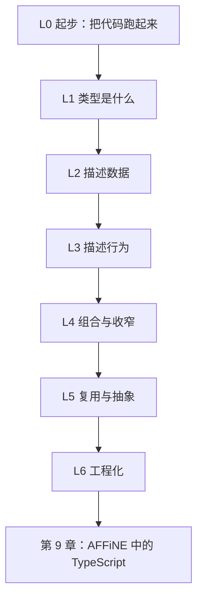

# 第 5 章 TypeScript 基础入门

> **所属部分**：第 3 部分 · 编程语言与基础技术 ｜ **难度**：★★☆☆☆ ｜ **建议学时**：12 小时（零基础路线）／6 小时（已有 JavaScript 基础） ｜ **前置章节**：无，完全零基础可直接开始 ｜ **后续**：<a href="./09-TypeScript在AFFiNE中的应用.md#ch-9">第 9 章</a> TypeScript 在 AFFiNE 中的应用

---

## 本章导读

AFFiNE 几乎全部用 TypeScript 写成。<a href="./09-TypeScript在AFFiNE中的应用.md#ch-9">第 9 章</a>会直接讲它在 AFFiNE 里的进阶用法——`tsconfig` 项目引用、DI 标识符里的泛型、声明合并、代码生成类型。如果你**没系统学过 TypeScript**，直接读<a href="./09-TypeScript在AFFiNE中的应用.md#ch-9">第 9 章</a>会很吃力。

本章就是那块垫脚石。与同部分其他基础章不同，本章**额外照顾完全没有写过代码的读者**：第「零」节从"什么是变量、什么是函数"讲起，把跑起第一段代码、看懂第一条报错都走一遍；已有的八节则一路铺到<a href="./09-TypeScript在AFFiNE中的应用.md#ch-9">第 9 章</a>的起点。读完你应当能看懂 AFFiNE 里绝大多数类型标注，并知道"为什么要这么写"。

TypeScript 的一句话定位：**JavaScript + 静态类型**。它在编译期检查类型、给你自动补全与重构能力，最终**擦除类型、编译回普通 JavaScript** 运行——运行时没有类型。记住这条，很多"为什么类型不影响运行"的疑惑就迎刃而解。

本章不讲框架、不讲 DOM、不讲异步编程，也不讲 AFFiNE 的具体源码（那是<a href="./09-TypeScript在AFFiNE中的应用.md#ch-9">第 9 章</a>的事）。它只做一件事：**把"用类型描述数据与行为"这件事，从零开始讲透**。

### 三条学习路线

| 你的起点 | 怎么读 | 建议学时 |
| --- | --- | --- |
| **完全没写过代码** | 从「零」开始，按顺序读完八节，每节的随堂小练都动手做 | 约 12 小时 |
| **写过 JavaScript，没系统学 TypeScript** | 跳过「零」，每节重点看「这一节要解决什么」「最小例子」「规则小结」 | 约 6 小时 |
| **会其他语言，只想查 TypeScript 语法** | 直接看每节的「规则小结」和[常见坑](#常见坑)，遇到不懂再回看例子 | 约 2 小时 |

> 表格里的"跳过"是真的可以跳过：正文八节**不依赖**第「零」节的任何记号，第「零」节只负责把读者带到"能读懂第一行代码"的位置。

### 每一节的结构

八节正文都按同一节奏推进，方便你判断自己该细读还是略读：

1. **这一节要解决什么**——先说清动机，不先抛语法；
2. **最小例子 + 逐行看**——一段能跑的代码，逐行解释，不跳步；
3. **规则小结**——把例子里的规律收敛成可查的表；
4. **最容易误解的点**——初学者最常卡住的那一两处；
5. **随堂小练**——30 秒能做完的小题，答案折叠，先自己想再展开。

代码约定：`❌` 表示这行会编译报错，`// 输出：…` 表示运行后看到的结果，注释里的 `→` 表示"推断为"。

---

## 学习目标

**L0 · 起步**（第「零」节）

- [ ] 能说清值、变量、表达式、语句分别是什么，能读懂一段 5 行的 JavaScript
- [ ] 能解释"类型"是对值的分类，知道 `1` 与 `'1'` 为什么不能混用
- [ ] 能读懂函数、对象、数组这三种结构，看懂箭头函数与 `reduce`
- [ ] 能自己装好 Node 与 `tsc`，把 `.ts` 编译成 `.js` 并跑起来
- [ ] 看到一条编译报错，能指出它说的是哪个文件、哪一行、什么问题

**L1–L2 · 认识类型、描述数据**（第一、二、三节）

- [ ] 能够说清 TypeScript 与 JavaScript 的关系，以及"类型擦除"意味着什么
- [ ] 能够使用基础类型、数组、元组、`interface` 与 `type` 描述数据结构，并说清两者区别
- [ ] 理解**结构化类型**（按形状而非按名字匹配），能解释"多余属性检查"

**L3–L4 · 描述行为、组合与精确化**（第四、五节）

- [ ] 能够写出带类型的函数（参数、返回值、可选/默认/剩余参数、重载）
- [ ] 能够用联合类型、字面量类型与类型窄化表达"多选一"
- [ ] 能区分 `any` / `unknown` / `void` / `never`，知道外部输入为什么该用 `unknown`

**L5–L6 · 复用与工程化**（第六、七、八节）

- [ ] 能够读写泛型函数、泛型接口与约束（`extends`），理解它"类型的参数"这一本质
- [ ] 能够使用常见工具类型，并知道它们大致是怎么用映射类型造出来的
- [ ] 能够看懂 `tsconfig.json` 的关键选项与模块/声明文件机制，为<a href="./09-TypeScript在AFFiNE中的应用.md#ch-9">第 9 章</a>打底

---

## 知识地图

本章是一条**阶梯**，不是并列的知识清单：后一级建立在前一级之上。



| 阶梯 | 对应小节 | 回答的问题 | 学完你能做什么 |
| --- | --- | --- | --- |
| L0 | 零 | 代码是什么？怎么跑？ | 独立运行 `.ts`、读懂报错 |
| L1 | 一 | 为什么需要类型？ | 说清静态类型与类型擦除 |
| L2 | 二、三 | 一份数据长什么样？ | 用类型描述对象、数组、元组 |
| L3 | 四 | 一个行为长什么样？ | 给函数与回调写上类型 |
| L4 | 五 | "可能是多种之一"怎么表达？ | 用联合与收窄写安全分支 |
| L5 | 六、七 | 相似的类型要不要重复写？ | 泛型与工具类型 |
| L6 | 八 | 多个文件怎么协作？ | 模块、`import type`、`tsconfig` |

---

## 5.1 零基础起步（会 JavaScript 可跳过）

> **对应阶梯**：L0 ｜ **预计**：3 小时 ｜ 这一节不出现任何 AFFiNE 源码，只建立最小共识。

### 5.1.1 程序、值、变量：最小的一段代码

**这一节要解决什么**：先能读懂"一行代码在说什么"。程序本质上就是**给计算机一串带顺序的指令**；指令操作的对象叫**值（value）**；给值起个名字方便后面再用，这个带名字的位置叫**变量（variable）**。

```js
let price = 10;
let count = 2;
let total = price * count;
console.log(total); // 输出：20
```

**逐行看**：

| 行 | 代码 | 在做什么 |
| --- | --- | --- |
| 1 | `let price = 10;` | 声明一个叫 `price` 的变量，把值 `10` 放进去 |
| 2 | `let count = 2;` | 同上，放 `2` |
| 3 | `let total = price * count;` | 取出两个变量的值相乘，把结果 `20` 放进新变量 `total` |
| 4 | `console.log(total);` | 把 `total` 打印到屏幕上 |

几个词先分清楚：

- **值**：`10`、`2`、`20`、`'AFFiNE'`、`true` 都是值。值有不同的**种类**，比如数字、文字、真假。
- **表达式**：会"算出一个值"的式子。`price * count` 是表达式，算出 `20`；`1 + 2` 也是。
- **语句**：做一件事的一整行。`let price = 10;` 是语句，末尾的分号相当于句号。
- **`=` 不是数学等号**：在代码里它表示"把右边的值放进左边的变量"，叫**赋值**。`count = count + 1` 完全合法，意思是"取旧值加 1，再放回去"。
- **`console.log(...)`** 是一个别人写好的函数，作用是把括号里的内容显示出来，是我们零基础阶段唯一的"输出窗口"。

> **类比**：变量像贴了标签的盒子，`let price = 10` 就是"拿一个盒子、贴上 `price` 标签、放进 10"。之后写 `price` 就是"去拿这个盒子里的东西"。

<div class="tip custom-block">
<p class="custom-block-title">最容易误解的点</p>
<p><code>let</code> 与 <code>const</code> 都能声明变量，区别是 <code>const</code> 声明后<strong>不能再赋值</strong>。初学一律先用 <code>let</code>，等第二节讲"推断"时再回头看 <code>const</code> 的特殊之处。另外，<code>console.log</code> 不是"计算结果"，它只是把结果打印出来——真正算出 20 的是第 3 行。</p>
</div>

<details><summary>随堂小练 · 读出结果</summary>

下面这段打印什么？

```js
let a = 3;
a = a + 4;
console.log(a * 2);
```

先把 `3` 放进 `a`；第 2 行把 `3 + 4 = 7` 放回 `a`；第 3 行打印 `7 * 2`，输出 `14`。注意第 2 行的 `=` 是赋值，不是"两边相等"。

</details>

### 5.1.2 类型到底是什么

**这一节要解决什么**：上节说"值有不同的种类"，这个**种类就是类型**。类型不是 TypeScript 发明的，JavaScript 的值本来就有类型；TypeScript 做的是**让这件事在写代码时就能被检查**。

JavaScript 里可以用 `typeof` 亲自看一个值的类型：

```js
console.log(typeof 42);        // 输出：number
console.log(typeof 'AFFiNE');  // 输出：string
console.log(typeof true);      // 输出：boolean
console.log(typeof undefined); // 输出：undefined
```

**逐行看**：`typeof` 是一个运算符，把右边的值"是什么种类"以文字的形式返回。`42` 是数字 → `'number'`；`'AFFiNE'`（带引号）是文字 → `'string'`；`true` 是真假 → `'boolean'`。

| 值 | 写法特征 | `typeof` 结果 | 生活类比 |
| --- | --- | --- | --- |
| 数字 | `42`、`3.14` | `'number'` | 可以加减乘除的量 |
| 字符串 | `'AFFiNE'`、`"20"` | `'string'` | 一段文字，**引号是它的一部分标记** |
| 布尔 | `true`、`false` | `'boolean'` | 是/否 |
| 未定义 | `undefined` | `'undefined'` | 盒子还没放东西 |
| 空值 | `null` | `'object'` | 有意表示"这里没有值"（JS 的历史遗留，见下方提示） |
| 对象 | `{ name: 'AFFiNE' }` | `'object'` | 一组带名字的值 |
| 函数 | `() => {}` | `'function'` | 一段可重复执行的操作 |

关键点：**`42` 和 `'42'` 是完全不同的两个值**。前者是数字，能做乘法；后者是三个字符的文字，做"加法"时会被当成拼接：

```js
console.log(42 + 1);   // 输出：43
console.log('42' + 1); // 输出：421  ← 文字拼接，不是加法
```

这正是本章第一节那个 bug 的温床：**JavaScript 不会阻止你把文字当数字用**，它只是尽力猜、猜错就悄悄给出奇怪结果。

再进一步，JavaScript 是**动态类型**：类型跟着**值**走，不跟着变量走。同一个变量可以这会儿装数字、过会儿装文字：

```js
let x = 42;      // 现在 x 里是 number
x = 'AFFiNE';    // 完全合法：现在 x 里是 string
console.log(x + 1); // 输出：AFFiNE1，不会报错
```

TypeScript 要改变的正是这一点：它让变量在写下的那一刻就**约定好只能装哪一类值**，之后不守约就在编译期拦住你。这就是「静态类型」四个字的全部含义——**约定提前，检查提前**。

<div class="tip custom-block">
<p class="custom-block-title">最容易误解的点</p>
<p>① <code>typeof null</code> 返回 <code>'object'</code> 是 JavaScript 诞生时留下的著名 bug，<strong>不是</strong>说 null 是对象，记住即可。② 「动态类型」不等于「没有类型」——值一直有类型，只是变量的类型不受约束、也不提前检查。③ TypeScript 的 <code>number</code> 不区分整数和小数，<code>42</code> 与 <code>3.14</code> 都是 <code>number</code>。</p>
</div>

<details><summary>随堂小练 · 判断类型</summary>

`'20'`、`20`、`false`、`{ count: 2 }` 分别是什么类型？`typeof '20' + 1` 会打印什么？

前四个依次是 `string`、`number`、`boolean`、`object`。`typeof '20'` 先算出文字 `'string'`，再 `+ 1` 变成文字拼接，输出 `string1`。

</details>

### 5.1.3 函数、对象、数组：本章后面会用到的全部 JS 语法

**这一节要解决什么**：正文八节的例子只用三种结构——函数、对象、数组。这里一次性认识完，后面不必再回头查。

#### 函数：把一串操作打包、起名字、反复调用

```js
function add(a, b) {
  return a + b;
}
console.log(add(2, 3)); // 输出：5
```

| 部件 | 位置 | 含义 |
| --- | --- | --- |
| `function` | 开头 | 声明"我要定义一个函数" |
| `add` | 函数名 | 以后用这个名字调用它 |
| `(a, b)` | 参数 | 调用时传进来的两个值，在函数内部叫 `a`、`b` |
| `{ ... }` | 函数体 | 每次调用要执行的语句 |
| `return` | 函数体内 | 把结果交回给调用者；执行到它就结束函数 |

调用 `add(2, 3)` 时，`a` 拿到 `2`、`b` 拿到 `3`，执行 `return 2 + 3`，整个 `add(2, 3)` 表达式的值就是 `5`。

**箭头函数**是函数的简写，把 `function (a, b) { return ... }` 压成一行：

```js
const add = (a, b) => a + b; // 与上面的 add 等价
console.log(add(2, 3));      // 输出：5
```

`=>` 左边是参数，右边是要返回的值。它常出现在"把一段操作交给别人去调用"的场合，也就是**回调**——下一小节的 `reduce` 就是。

#### 对象：一组「名字: 值」

```js
const item = { price: 10, count: 2 };
console.log(item.price);      // 输出：10
console.log(item['count']);   // 输出：2
```

`price`、`count` 叫**属性名**，右边是属性值。取值用点号 `item.price`，也可以用方括号加文字 `item['count']`。访问一个不存在的属性不会报错，会得到 `undefined`：

```js
console.log(item.cuont); // 输出：undefined ← 拼错了也不吭声，这是第一节 bug 的根源
```

**请记住这一行**：它就是全章的起点。拼错属性名，JavaScript 一声不吭地给你 `undefined`。

#### 数组：有顺序的一串值

```js
const items = [10, 20, 30];
console.log(items[0]);   // 输出：10 ← 下标从 0 开始
console.log(items.length); // 输出：3
```

数组用方括号写，取值用 `items[下标]`，**第一个元素的下标是 0**。`length` 是数组自带的属性，表示元素个数。对象与数组常常嵌套：

```js
const cart = {
  items: [
    { price: 10, count: 2 },
    { price: 5, count: 3 }
  ]
};
console.log(cart.items[0].price); // 输出：10
```

读法是从左往右一层层拆：`cart` 的 `items` → 第 0 个元素 → 它的 `price`。

<div class="tip custom-block">
<p class="custom-block-title">最容易误解的点</p>
<p>① 下标从 <strong>0</strong> 开始，<code>items[3]</code> 是第 4 个元素，上面那个数组里它是 <code>undefined</code>。② <code>{ }</code> 是对象（靠名字取值），<code>[ ]</code> 是数组（靠位置取值），别混。③ 箭头函数 <code>(a, b) =&gt; a + b</code> 的 <code>=&gt;</code> 不是"大于等于"，它只是函数简写的记号。</p>
</div>

### 5.1.4 拆开 `reduce`：第一节例子的唯一门槛

**这一节要解决什么**：第一节会用一行 `reduce` 算购物车总价。它其实是"循环累加"的简写，先看清循环版，简写版就不再神秘。

需求：把 `cart.items` 里每个商品的 `price * count` 加起来。用最朴素的 `for` 循环写：

```js
let sum = 0;
for (const it of cart.items) {
  sum = sum + it.price * it.count;
}
console.log(sum); // 输出：35
```

| 行 | 含义 |
| --- | --- |
| 1 | 准备一个"累加盒" `sum`，从 0 开始 |
| 2 | 依次取出 `cart.items` 里的每个元素，这一轮叫它 `it` |
| 3 | 把当前商品的 `price * count` 加到 `sum` 上 |
| 5 | 循环结束，`sum` 就是总价 |

`reduce` 做的事一模一样，只是把「累加盒」和「循环」交给数组自己管理：

```js
const sum = cart.items.reduce((s, it) => s + it.price * it.count, 0);
//                             ↑  ↑        ↑                      ↑
//                             │  │        │                      └ 累加盒的初始值 0
//                             │  │        └ 这一轮要累加的值
//                             │  └ 当前遍历到的商品
//                             └ 上一轮结束时的累加盒（第一次是初始值 0）
```

对照着看：

| 循环版 | `reduce` 版 |
| --- | --- |
| `let sum = 0` | 第二个参数 `, 0` |
| `for (const it of …)` | 由 `reduce` 内部遍历，把当前元素交给 `it` |
| `sum = sum + …` | 箭头函数 `return` 的结果自动成为下一轮的 `s` |
| 循环结束后的 `sum` | 整个 `reduce(...)` 表达式的值 |

一句话记法：**`reduce(怎么把当前元素并进累加盒, 累加盒初始值)`**。

现在回头看第一节开头那个 bug：`{ price: 10, cuont: 2 }` 里 `it.count` 是 `undefined`，`10 * undefined` 得到 `NaN`（Not a Number，不是数字），累加进去后整个结果都变成 `NaN`。这就是"静默失败"的完整链条。

<details><summary>随堂小练 · 手算 reduce</summary>

`[1, 2, 3].reduce((s, n) => s + n, 10)` 的结果是多少？

累加盒从 `10` 开始，依次加 1、2、3，结果 `16`。把初始值改成 `0` 则得到 `6`。

</details>

### 5.1.5 把代码跑起来：Node、编辑器与 `tsc`

**这一节要解决什么**：光读不动手，类型检查的体会会少一大半。这一小节用最小成本把环境搭起来，全程不需要碰 AFFiNE 仓库。

**第 1 步 · 装 Node.js**：到 nodejs.org 下载 LTS 版本安装。打开终端验证：

```bash
node --version   # 例如 v22.x.x
npm --version    # 例如 10.x.x
```

Node 是"让 JavaScript 脱离浏览器、直接在电脑上跑"的程序；`npm` 是随它附带的包管理器。

**第 2 步 · 装编辑器**：推荐 VS Code，装好官方 TypeScript 插件（通常自带）。它的价值是**在你打字时就把红线画出来**，不必等编译。

**第 3 步 · 跑第一段 JS**：新建文件夹 `learn-ts`，在里面写 `hello.js`：

```js
let price = 10;
let count = 2;
console.log(price * count);
```

在终端里执行：

```bash
node hello.js
# 输出：20
```

**第 4 步 · 装 TypeScript 编译器**：

```bash
npm install -g typescript
tsc --version   # 例如 Version 5.x.x
```

`tsc` 就是 TypeScript 编译器：它读 `.ts`，先**检查类型**，再**擦除类型**、产出 `.js`。项目里更常见的用法是 `npx tsc --noEmit`（只检查、不产出文件，交给打包器编译）。

**第 5 步 · 亲眼看见"类型擦除"**：把 `hello.js` 改名成 `hello.ts`，加一处类型标注：

```ts
let price: number = 10;
let count: number = 2;
console.log(price * count);
```

编译并运行：

```bash
tsc --target esnext hello.ts   # 生成 hello.js
node hello.js                  # 输出：20
```

打开生成的 `hello.js`，你会看到：

```js
let price = 10;
let count = 2;
console.log(price * count);
```

`: number` **不见了**。这就是全章最重要的一句话——类型只在开发期存在，运行时一行都不剩。

### 5.1.6 读懂一条报错

**这一节要解决什么**：初学者最容易被满屏红字劝退。其实一条报错的信息是固定的几段，会拆就不再害怕。

把 `hello.ts` 第 1 行故意改错：

```ts
let price: number = '十'; // ❌
```

执行 `tsc --noEmit --target esnext hello.ts`，会看到类似：

```
hello.ts:1:5 - error TS2322: Type 'string' is not assignable to type 'number'.

1 let price: number = '十';
      ~~~~~

Found 1 error in hello.ts:1
```

| 片段 | 含义 | 你该做什么 |
| --- | --- | --- |
| `hello.ts:1:5` | 文件名 : 第 1 行 : 第 5 列 | 先定位到这一行，`~~~~~` 标出出问题的词 |
| `error TS2322` | 错误码，`TS` 开头代表编译期类型错误 | 想查细节可按码搜索，初学可先忽略 |
| `Type 'string' is not assignable to type 'number'` | 人话：你给了文字，但这里约定要数字 | 这是真正要读的一句 |
| `Found 1 error in hello.ts:1` | 本次检查共 1 个错 | 从上往下改，改完重新跑 |

**三步法**：① 看文件名行号找到位置 → ② 读最后那句英语，找出"给了什么 / 需要什么" → ③ 改值或改约定，重跑。红线不是"你写错了代码"，而是"你写的与你自己声明的约定不一致"。

<div class="tip custom-block">
<p class="custom-block-title">最容易误解的点</p>
<p>① <code>tsc</code> 报的是<strong>类型</strong>错误，不是语法写错；语法错误通常以 <code>SyntaxError</code> 出现。② 报错里的 "is not assignable to" 一律理解成"不能当作……用"。③ 编译报错时 <code>tsc</code> 默认<strong>仍会生成 .js</strong>（除非开 <code>noEmitOnError</code>），所以"能跑"不代表"类型是对的"。</p>
</div>

<details><summary>随堂小练 · 改掉这条报错</summary>

要保留 `price` 这个变量，有几种改法？

两种：① 把值改成数字 `let price: number = 10;`（按约定给值）；② 把约定改成文字 `let price: string = '十';`（按值改约定）。**选哪个取决于这个变量在业务上代表什么**——这正是"写类型"需要动脑的地方，类型不是随便贴的标签。

</details>

### 5.1.7 起步自检

进入正文前，确认这五件事都能做到：

1. 能解释 `let total = price * count;` 里哪部分是表达式、哪部分是赋值；
2. 能说出 `42` 和 `'42'` 的区别，以及为什么 `'42' + 1` 得到 `421`；
3. 能徒手写出一个对象 `{ price: 10, count: 2 }` 并取出 `price`；
4. 能说清 `reduce` 的第二个参数 `0` 是干什么的；
5. 能在终端跑 `tsc --noEmit hello.ts`，并从报错里找出行号与原因。

任何一条卡住，回看对应小节即可；五条都顺畅，就可以从第一节正式开始。

---

## 5.2 为什么要类型：从一个 bug 说起

> **对应阶梯**：L1 认识类型 ｜ **预计**：40 分钟

**这一节要解决什么**：把第「零」节那句"拼错也不吭声"变成看得见的代价，再说明 TypeScript 是在**哪个时间点**、用**什么方式**拦住它。

### 5.2.1 最小例子：先看纯 JavaScript

```js
function total(cart) {
  return cart.items.reduce((s, it) => s + it.price * it.count, 0);
}
total({ items: [{ price: 10, cuont: 2 }] }); // 得到 NaN，拼错了 count
```

**逐行看**：

| 行 | 含义 |
| --- | --- |
| 1 | 定义函数 `total`，参数 `cart` 里装着购物车 |
| 2 | 用第 <a href="./05-TypeScript基础入门.md#sec-5-1-4">5.1.4 节</a>的 `reduce` 累加每个商品的 `price * count` |
| 3 | 调用它；对象里把 `count` 拼成了 `cuont` |

错误链条：`it.count` → `undefined` → `10 * undefined` → `NaN` → 累加结果 `NaN`。全程**没有任何报错**，只有当这个数字显示到界面上、或者写进数据库时才可能被人发现。这类问题的共同点是：**错误发生的地方和被发现的地方隔了很远**。

### 5.2.2 加上类型之后

```ts
interface CartItem {
  price: number;
  count: number;
}
function total(cart: { items: CartItem[] }): number {
  return cart.items.reduce((s, it) => s + it.price * it.count, 0);
}
total({ items: [{ price: 10, cuont: 2 }] });
// ❌ 对象字面量只能指定已知属性，“cuont”不存在于类型“CartItem”中
```

**逐行看**：

| 行 | 新增的东西 | 含义 |
| --- | --- | --- |
| 1–4 | `interface CartItem` | 约定"一个商品必须有 `price: number` 和 `count: number`" |
| 5 | `cart: { items: CartItem[] }` | 约定参数形状；`CartItem[]` 读作"CartItem 组成的数组" |
| 5 | `: number`（在括号后） | 约定返回值是数字 |
| 8 | — | 编译器发现传进来的对象多了 `cuont`、少了 `count`，**当场报错** |

注意报错位置：它出现在你**敲下这行代码的那一刻**（编辑器红线 / `tsc` 输出），而不是等程序跑起来。这就是「把一类运行时错误提前到编译期」。

**规则小结**：

| 概念 | 说明 |
| --- | --- |
| 静态类型 | 变量/参数的取值约定在写代码时确定，编译期检查 |
| 类型擦除 | 编译成 JS 后 `interface`、`: number` 全部消失，运行时没有类型 |
| 检查时机 | 编译期（编辑器红线、`tsc`），不占用运行时 |
| 附带收益 | 自动补全、跳转到定义、重命名重构都依赖类型信息 |

<div class="tip custom-block">
<p class="custom-block-title">类型擦除：最容易误解的点</p>
<p>上面的 <code>interface</code>、<code>: number</code> 在编译后<strong>全部消失</strong>，生成的 JS 与手写版几乎一样（可回看 <a href="./05-TypeScript基础入门.md#sec-5-1-5">5.1.5 节</a>的产物对照）。类型只服务于"开发期检查"，不进入运行时。所以你<strong>不能</strong>在运行时写 <code>if (x is CartItem)</code>——运行时根本没有这个类型，只能用 <code>typeof</code>、<code>in</code>、自定义类型守卫这类<strong>运行时真的存在</strong>的判断（第五节讲）。另一个常见误会：类型检查通过 ≠ 程序逻辑正确，它只保证"没违反你自己写下的约定"。</p>
</div>

<details><summary>随堂小练 · 报错会变吗</summary>

把第 8 行的 `cuont` 改回 `count`，但把 `10` 改成 `'10'`，会报什么？

会报"不能把 `string` 赋给 `number`"——因为 `CartItem.price` 约定了 `number`。类型检查同时管住了**属性名**和**属性值的种类**，这两件事纯 JS 都不管。

</details>

---

## 5.3 类型基础与推断

> **对应阶梯**：L2 描述数据 ｜ **预计**：60 分钟

**这一节要解决什么**：上一节已经见过 `: number` 的写法，这里把"能写哪些类型、什么时候不必写"系统讲清。

### 5.3.1 最小例子：标注语法与基础类型

`变量: 类型 = 值` 读作"声明一个变量，约定它只能装这类值，初始值放这个"。

```ts
let title: string = 'AFFiNE';
let count: number = 42;
let ok: boolean = true;
let nothing: null = null;
let undef: undefined = undefined;
let ids: string[] = ['a', 'b'];        // 数组：若干个 string
let pair: [string, number] = ['x', 1]; // 元组：定长、每位类型固定
```

**逐行看**（重点是后两行的区别）：

| 写法 | 怎么读 | 约束 |
| --- | --- | --- |
| `string[]` | "string 数组" | 长度随意，但每个元素都得是 `string` |
| `[string, number]` | "第一项 string、第二项 number 的二元组" | **长度固定为 2**，且第 0 项与第 1 项类型不同 |

```ts
ids.push('c');        // ✅ 数组可增长
ids.push(1);          // ❌ 元素必须是 string
pair[0] = 'y';        // ✅
pair[0] = 2;          // ❌ 第 0 位约定是 string
pair.push(3);         // 运行时能加，但类型上不鼓励——元组长度已约定为 2
```

**规则小结**：

| TypeScript 类型 | 对应的 JS `typeof` | 例子 | 备注 |
| --- | --- | --- | --- |
| `string` | `'string'` | `'AFFiNE'` | — |
| `number` | `'number'` | `42`、`3.14` | 不分整数/小数 |
| `boolean` | `'boolean'` | `true`、`false` | — |
| `null` / `undefined` | `'object'` / `'undefined'` | — | 严格模式下需显式写出 |
| `T[]` 或 `Array<T>` | `'object'` | `[1, 2]` | 两种写法等价 |
| `[T1, T2]` | `'object'` | `['x', 1]` | 元组 |
| `object` | `'object'` | `{ a: 1 }` | 太宽泛，通常改用第三节的形状 |

### 5.3.2 让编译器替你推断

大多数时候**不用手写类型**，TypeScript 会看右边的值自动推断：

```ts
let title = 'AFFiNE';   // → string
const mode = 'page';    // → 字面量类型 'page'（不是宽泛的 string）
const list = [1, 2, 3]; // → number[]
```

为什么 `let` 与 `const` 结果不同？`let` 意味着"以后可能改成别的文字"，所以推断成宽泛的 `string` 才安全；`const` 永远不会变，编译器就敢记到最精确的那一个值 `'page'`。这个"精确到具体值"的类型叫**字面量类型**，第五节会靠它做"只能取这几个值"的约束。

推断也发生在函数返回值、回调参数上：

```ts
function double(n: number) {
  return n * 2; // 返回值 → number，不必写 `: number`
}
const nums = [1, 2, 3].map(n => n * 2); // n → number，nums → number[]
```

**规则小结**：**变量初始化、函数返回值通常让它自动推断；函数参数、对象结构、公共 API 显式标注**。参数没有初始值可推断，不写就会被当成 `any`（严格模式下直接报错）；显式标注既是检查也是文档。

<div class="tip custom-block">
<p class="custom-block-title">最容易误解的点</p>
<p>① "推断"不是"不检查"——推断出来的类型同样严格，<code>let x = 1; x = 'a';</code> 照样报错。② <code>const</code> 不等于"类型不可变"：<code>const obj = { a: 1 }</code> 里的 <code>obj.a</code> 仍可改，只是不能给 <code>obj</code> 整个重新赋值。③ 写太多显式标注反而让代码难读，能用推断就别写。</p>
</div>

### 5.3.3 `any` 与 `unknown`：什么时候"我不知道"

- `any`：放弃类型检查，"任何操作都允许"。是逃生舱，**能不用就不用**——它会像病毒一样扩散：把 `any` 赋给别的变量，那个变量也失去保护。
- `unknown`：安全版的 any，"我也不知道是什么"，但**用之前必须先收窄**，否则报错。接收外部输入（`JSON.parse`、网络响应、第三方库）时优先用它。

```ts
function parse(json: string): unknown {
  return JSON.parse(json); // JSON.parse 本身返回 any，这里主动收窄成 unknown
}
const data = parse('{}');
// data.foo;        // ❌ unknown 不能直接用
if (typeof data === 'object' && data) {
  /* 收窄后才能用 */
}
```

<div class="tip custom-block">
<p class="custom-block-title">为什么外部输入要用 unknown</p>
<p><code>JSON.parse</code>、<code>fetch().json()</code> 的返回值在编译期无法预知，TypeScript 默认给 <code>any</code>。若直接当对象用，拼错字段又回到第一节的静默失败。显式标成 <code>unknown</code> 等于告诉编译器"这里我不保证任何事，逼我后面自己检查"——把不可信边界圈出来，是大型项目里最重要的习惯之一。</p>
</div>

<details><summary>随堂小练 · 该推断还是该标注</summary>

下面三处，哪些必须显式写类型？

```ts
const version = 7;
function greet(name) { return 'Hi, ' + name; }
const config = { debug: true };
```

只有 `greet` 的**参数 `name`** 必须写（`: string`）——它没有初始值可供推断，严格模式下会报"隐式 any"。`version` 推断为字面量 `7`，`config` 推断为 `{ debug: boolean }`，都不必写。

</details>

---

## 5.4 描述对象：interface 与 type

> **对应阶梯**：L2 描述数据 ｜ **预计**：70 分钟

**这一节要解决什么**：第二节只能描述"一个数字""一串文字"，可真实数据（一个用户、一篇文档、一个商品）是**一组带名字的值**。这一节解决"怎么把一组值的形状写下来"。

### 5.4.1 先看看不写形状会怎样

```js
function printName(user) {
  console.log(user.nmae.toUpperCase()); // 拼错了 name，运行时才炸
}
```

`user` 里到底有什么？读代码的人只能去翻调用处。写下形状，等于给这个函数**一份契约**：

```ts
interface User {
  id: string;
  name: string;
  email?: string;        // 可选属性：可以没有
  readonly createdAt: number; // 只读：创建后不可改
}
function printName(user: User) {
  console.log(user.name.toUpperCase());
}
```

### 5.4.2 最小例子：两种写法

```ts
interface User {
  id: string;
  name: string;
}

type User2 = {
  id: string;
  name: string;
};
```

**逐行看**：`interface 名字 { 属性名: 类型; ... }` 与 `type 名字 = { ... }` 在这里完全等价，都描述"必须有 `id` 和 `name` 两个字符串属性"。属性之间用分号或换行分隔；`?` 表示可选，`readonly` 表示只读。

用起来是这样：

```ts
const u: User = { id: '1', name: 'AFFiNE', createdAt: 0 };
u.name = 'Blocksuite'; // ✅
// u.createdAt = 1;   // ❌ 只读属性不可赋值
```

### 5.4.3 结构化类型：按形状，不按名字

TypeScript 判断"能不能用"，看的是**形状是否对得上**，不是"是不是同一个名字声明的"：

```ts
type Point = { x: number; y: number };
function print(p: Point) { console.log(p.x, p.y); }

const a = { x: 1, y: 2 };
print(a); // ✅ 形状对得上，即使 a 从没声明过 Point

const b = { x: 1, y: 2, z: 3 };
print(b);              // ✅ 变量：多一个属性不影响
print({ x: 1, y: 2, z: 3 }); // ❌ 字面量：多余属性检查
```

最后两行的差别非常重要：直接**当场写的对象字面量**会触发额外的「多余属性检查」（因为多写的字段极可能是拼错）；先放进变量再传，就不检查多余字段了。第一节那个 `cuont` 正是靠这条规则被抓住的。

### 5.4.4 两者的区别（第 9 章会用到）

| 维度 | `interface` | `type` |
| --- | --- | --- |
| 描述对象/类的"契约" | ✅ 首选 | ✅ 也可以 |
| 联合 / 交叉 / 元组 / 映射类型 | ❌ 不行 | ✅ 只能用 type |
| 声明合并（同名自动合并） | ✅ 支持 | ❌ 不支持 |
| 扩展 | `extends` | `&` 交叉 |

```ts
interface Base { id: string; }
interface Base { name: string; }   // 同名自动合并
// 等价于 { id: string; name: string }

type Point3D = { x: number } & { y: number } & { z: number }; // 交叉组合
interface Admin extends Base { role: string; }                 // 继承
```

**规则小结**：

| 需求 | 用谁 |
| --- | --- |
| 描述对象/类的形状，可能被扩展或合并 | `interface` |
| 联合、交叉、元组、映射、工具类型等"类型运算" | `type` |
| 属性名不固定，但值类型统一 | 索引签名：`type Dict = { [key: string]: number }` |

<div class="tip custom-block">
<p class="custom-block-title">最容易误解的点</p>
<p>① <code>interface</code> 和 <code>type</code> 不是"新旧两代语法"，是<strong>能力不同</strong>的两种工具，长期共存。② <code>readonly</code> 只在<strong>编译期</strong>约束，运行时对象属性照样可改（类型擦除）。③ <a href="./09-TypeScript在AFFiNE中的应用.md#ch-9">第 9 章</a> AFFiNE 用<strong>声明合并</strong>给全局接口挂扩展（如后端的 <code>Events</code>、<code>AppConfigSchema</code>），靠的就是 interface 这个能力——这是本章与源码最直接的一处连接。</p>
</div>

<details><summary>随堂小练 · 挑工具</summary>

要表达"一个值要么是 `{ ok: true; data: string }`，要么是 `{ ok: false; error: string }`"，用 `interface` 还是 `type`？

用 `type`：这是**联合类型**，只有 `type` 能表达。写成 `type Result = { ok: true; data: string } | { ok: false; error: string };`，正好引出第五节。

</details>

---

## 5.5 函数类型

> **对应阶梯**：L3 描述行为 ｜ **预计**：60 分钟

**这一节要解决什么**：数据有了形状，操作数据的**函数**也需要约定——它收什么、返回什么。这样调用处写错参数时，错误会停在调用处，而不是函数深处。

### 5.5.1 最小例子：给参数与返回值写约定

```ts
// 参数与返回值
function add(a: number, b: number): number {
  return a + b;
}

// 可选参数、默认值、剩余参数
function greet(name: string, greeting = 'Hi', ...rest: string[]): string {
  return `${greeting}, ${name}`;
}

// 函数类型作为值（回调）
type Handler = (event: string) => void;
const onClick: Handler = e => console.log(e);
```

**逐行看**：

| 写法 | 怎么读 | 约束 |
| --- | --- | --- |
| `(a: number, b: number): number` | 收两个数字，返回一个数字 | 调用时少传、传错类型都报错 |
| `greeting = 'Hi'` | 有默认值的参数，可省略 | 类型由默认值推断为 `string` |
| `name?: string` | 可选参数，可省略 | 与默认值二选一，不能同时用 |
| `...rest: string[]` | 剩余参数，把多出来的实参收成数组 | 必须是最后一个参数 |
| `type Handler = (event: string) => void` | "函数"本身也能作为一种类型 | `void` 表示不关心返回值 |

注意 `Handler` 那一行：**函数也是值**（第 <a href="./05-TypeScript基础入门.md#sec-5-1-3">5.1.3 节</a>的箭头函数就是证明），所以也能被赋给变量、当参数传递。把函数当参数传，就是常说的"回调"。`: void` 表示"调用它的人不该依赖返回值"，不是"这个函数什么都不做"。

### 5.5.2 重载：同一个名字，几种用法

有时一个函数对不同类型的输入有**不同的返回类型**，用联合写会丢掉这层对应关系：

```ts
function toArray(x: string | number): (string | number)[] { return [x]; }
toArray('a'); // 类型被推断成 (string | number)[]，不够精确
```

重载让你把对应关系写清楚：

```ts
function toArray(x: string): string[];
function toArray(x: number): number[];
function toArray(x: string | number): unknown[] {
  return [x];
}
toArray('a'); // → string[]
toArray(1);   // → number[]
```

**逐行看**：前两行是**对外可见的签名**（调用者按它们检查），最后一行是**唯一的实现**（必须能兼容上面所有签名，且外部不能直接调用它）。编译器从上往下找第一个匹配的签名。

**规则小结**：

| 场景 | 写法 |
| --- | --- |
| 普通函数 | `function f(a: T): R { ... }` |
| 可选 / 默认 / 剩余 | `a?: T` / `a: T = v` / `...rest: T[]` |
| 函数作为类型 | `type F = (a: T) => R` |
| 返回值不用管 | `: void` |
| 绝不返回（抛错/死循环） | `: never` |
| 多种入参对应多种返回 | 重载签名 + 一个实现 |

<div class="tip custom-block">
<p class="custom-block-title">最容易误解的点</p>
<p>① <code>void</code> 与 <code>never</code> 别混：<code>void</code> 是"正常返回，只是没有有用的值"；<code>never</code> 是"根本走不到函数末尾"（永远抛异常、死循环，或第五节穷尽检查里的兜底分支）。② 重载的实现签名<strong>对外不可见</strong>，写了三个签名不代表有三个函数体。③ 能用联合或泛型解决时，优先别用重载——签名越多越难维护。</p>
</div>

<details><summary>随堂小练 · 挑出错误的一行</summary>

```ts
function f(a: string = 'x', b?: number): void {}
f();
f('y');
f('y', 1);
f(1);
```

`f(1)` 错：第一个位置约定 `string`，传数字不匹配。`f()` 可用默认值，`f('y', 1)` 正常——但注意本例里 `a` 有默认值、同时 `b` 可选，是允许的（同一个参数不能既 `?` 又给默认值）。

</details>

---

## 5.6 联合类型与收窄（narrowing）

> **对应阶梯**：L4 组合与精确化 ｜ **预计**：80 分钟

**这一节要解决什么**：现实里一个值常常"可能是几种之一"——文档模式可能是 `page` 或 `edgeless`，请求可能处于加载中/成功/失败。这一节把"多选一"写进类型，并解决随之而来的问题：**既然可能是多种，用的时候怎么知道到底是哪一种**。

### 5.6.1 最小例子：联合与字面量

**联合类型 `A | B`** 读作"是 A **或** B"；配合**字面量类型**（第二节 `const` 推断出的那种精确到具体值的类型），可以精确枚举取值：

```ts
type DocMode = 'page' | 'edgeless'; // 只能是这两个字符串之一
function open(mode: DocMode) {}
open('page');
open('wrong'); // ❌ 不能把 'wrong' 赋给 DocMode
```

> 这正是<a href="../01-产品认知/01-产品定位与核心概念.md#ch-1">第 1 章</a>见过的 `DocMode`——AFFiNE 大量用"字符串字面量联合"代替枚举，因为擦除后它就是普通字符串，不产生运行时代码。

### 5.6.2 为什么必须"收窄"

联合类型只保证"是其中之一"，所以**只有所有分支都具备的操作才被允许**：

```ts
function format(v: string | number): string {
  // v.toUpperCase();  ❌ number 没有 toUpperCase
  if (typeof v === 'number') return v.toFixed(2); // 这个分支里 v 是 number
  return v.toUpperCase();                        // 这个分支里 v 是 string
}
```

编译器会沿着 `if` 的两个分支，把 `v` 的类型**分别收窄**成对应分支。这种"根据运行时判断，让编译器在某个代码块里用更窄的类型"的机制，就叫**收窄（narrowing）**。它也是类型擦除之后我们唯一能用的办法：判断本身是真实存在的 JS 代码，类型知识只是编译器据此做出的推理。

**规则小结 · 常见收窄手段**：

| 手段 | 例子 | 收窄成什么 |
| --- | --- | --- |
| `typeof` | `typeof v === 'string'` | 对应的基础类型 |
| `instanceof` | `x instanceof Date` | `Date` |
| `in` | `'data' in result` | 含该属性的分支 |
| 字面量比较 | `if (mode === 'page')` | 对应字面量 |
| 真值判断 | `if (user)` | 去掉 `null` / `undefined` |
| 可辨识字段 | `switch (s.kind)` | 对应的联合分支 |
| 自定义类型守卫 | `function isUser(x: unknown): x is User` | 由你声明的类型 |

### 5.6.3 可辨识联合：给每个分支挂一个"标签"

这是 TypeScript 里最实用的建模手法：**每个分支都带一个共同的字面量字段**（叫 discriminant），判断它就能自动收窄。

```ts
type Shape =
  | { kind: 'circle'; r: number }
  | { kind: 'rect'; w: number; h: number };

function area(s: Shape): number {
  switch (s.kind) {
    case 'circle':
      return Math.PI * s.r ** 2; // 自动收窄为 circle 分支，可访问 r
    case 'rect':
      return s.w * s.h;          // 自动收窄为 rect 分支，可访问 w/h
  }
}
```

**逐行看**：`kind` 的值在两个分支里分别是 `'circle'` 和 `'rect'`，编译器因此在 `case 'circle':` 之后知道 `s` 一定有 `r`、一定没有 `w`。如果在这里写 `s.w`，会立刻报错。

再加一个兜底，就能让**新增分支时编译器主动提醒你漏处理**：

```ts
function assertNever(x: never): never {
  throw new Error('未处理的状态：' + x);
}
function area2(s: Shape): number {
  switch (s.kind) {
    case 'circle': return Math.PI * s.r ** 2;
    case 'rect':   return s.w * s.h;
    default:       return assertNever(s); // 若将来加了 'triangle' 且没补 case，这里报错
  }
}
```

原理：两个 `case` 都处理完后，`default` 里的 `s` 已被收窄成 `never`（"不可能还有别的值"）；一旦给 `Shape` 加了新分支，`s` 就不再是 `never`，传不进 `assertNever`，编译期立刻报错。这就是**穷尽检查**。

### 5.6.4 四个"空/未知"类型放一起看

| 类型 | 含义 | 典型用途 |
| --- | --- | --- |
| `any` | 放弃检查，什么都能做 | 逃生舱，应尽量避免 |
| `unknown` | 什么都不知道，用前必须收窄 | 外部输入、不可信边界 |
| `void` | 函数正常返回，但没有有用的返回值 | 回调、事件处理器 |
| `never` | 永远不会到达这里 | 抛错函数、穷尽检查兜底 |

<div class="tip custom-block">
<p class="custom-block-title">最容易误解的点</p>
<p>① 收窄是<strong>编译器的推理</strong>，不是运行时转换——代码里必须有真实的 <code>if</code>/<code>switch</code> 才行。② <code>typeof null === 'object'</code>（第 <a href="./05-TypeScript基础入门.md#sec-5-1-2">5.1.2 节</a>的 JS 遗留），所以判空请用 <code>if (x !== null)</code> 而不是只看 <code>typeof</code>。③ <code>|</code> 是"或"，<code>&amp;</code> 是"且/交叉"，两者方向别记反：<code>{a:1} &amp; {b:2}</code> 要求两个属性都有。</p>
</div>

<details><summary>随堂小练 · 写一次收窄</summary>

`function len(x: string | string[]): number` 要分别返回字符串长度和数组长度，怎么写？

两者都有 `.length`，其实可以**不收窄**直接 `return x.length;`。这提醒我们：先找所有分支的公共能力，实在没有再收窄。若改成 `string | number`（数字没有 `length`），就必须 `typeof x === 'string'` 分支处理了。

</details>

---

## 5.7 泛型：类型的"参数"

> **对应阶梯**：L5 复用与抽象 ｜ **预计**：90 分钟

**这一节要解决什么**：先看一个真实的重复劳动，再引出泛型。泛型不是新语法花样，而是**把"类型"也变成可以传入的参数**——就像第 <a href="./05-TypeScript基础入门.md#sec-5-1-3">5.1.3 节</a>把变化的值抽成函数参数一样。

### 5.7.1 先从"不用泛型会怎样"开始

需求：写一个函数，原样返回传进来的值。

```ts
function identityString(x: string): string { return x; }
function identityNumber(x: number): number { return x; }
function identityBoolean(x: boolean): boolean { return x; }
// …每多一种类型就复制一遍
```

三条路都有问题：① 按类型复制，逻辑一模一样却要维护 N 份；② 全用 `any`，能少写代码但丢掉了"传什么返回什么"这个最重要的事实；③ 用联合 `string | number | boolean`，返回类型也被撑宽，调用者拿到的不再是自己传进去的那个类型。

换个角度：**函数之所以能复用，是因为把"会变的值"抽成了参数；类型层面要做同样的事，就得把"会变的类型"也抽成参数**。

### 5.7.2 最小例子：给类型传参

```ts
function identity<T>(x: T): T {
  return x;
}
identity<string>('a'); // 显式传：T = string，返回 string
identity(42);          // 更多时候让编译器推断：T = number，返回 number

interface Box<T> {
  value: T;
}
const b: Box<number> = { value: 1 };
```

**逐行看**：

| 记号 | 含义 |
| --- | --- |
| `<T>`（函数名后） | 声明"这个函数有一个类型参数，代号 T" |
| `x: T` / `: T` | 参数与返回值都用这个占位类型 |
| `identity<string>('a')` | 像调用函数一样，把 `string` 传给 T |
| `identity(42)` | 不写 `<...>` 时，编译器从实参反推 T |
| `Box<T>` | 接口也能带类型参数，`Box<number>` 才是可用的具体类型 |

`T` 只是习惯命名（Type），叫 `Item`、`Value` 都行。**泛型 = 类型的函数**：普通函数 `(x) => 结果`，泛型 `类型参数 => 类型`。

多个参数、默认类型也可以：

```ts
function pair<A, B>(a: A, b: B): [A, B] { return [a, b]; }
pair('x', 1); // → [string, number]

type Response<T = unknown> = { data: T; ok: boolean }; // 不传时 T 取 unknown
```

### 5.7.3 泛型约束 `extends`

不约束时，函数体内对 `T` 一无所知，几乎什么操作都不能做。约束就是"至少得具备某些结构"：

```ts
function longest<T extends { length: number }>(a: T, b: T): T {
  return a.length >= b.length ? a : b; // 约束保证了 .length 一定存在
}
longest('ab', 'abc'); // 字符串有 length ✅，返回 string
longest([1], [1, 2]); // 数组有 length ✅，返回 number[]
longest(1, 2);        // ❌ number 没有 length
```

**规则小结**：

| 写法 | 作用 |
| --- | --- |
| `<T>` | 声明一个类型参数 |
| `<T, U>` | 多个类型参数 |
| `<T = X>` | 默认类型参数 |
| `<T extends Constraint>` | 约束：T 至少满足 `Constraint` 的形状 |
| `keyof T` | 取出 T 的所有属性名，组成联合类型（下一节要用） |

<div class="tip custom-block">
<p class="custom-block-title">最容易误解的点</p>
<p>① 泛型里的 <code>extends</code> 是"约束"，第三节 <code>interface Admin extends Base</code> 里的 <code>extends</code> 是"继承"，同名不同义，别混。② 泛型<strong>不是</strong>"任意类型"——<code>T</code> 在一次调用里是<strong>一个确定的具体类型</strong>，只是写函数时还不知道是哪个。③ 泛型同样会被擦除，<code>identity&lt;string&gt;</code> 编译后就是普通函数调用，没有运行时开销。④ <a href="./09-TypeScript在AFFiNE中的应用.md#ch-9">第 9 章</a> AFFiNE 的依赖注入用 <code>createIdentifier&lt;T&gt;()</code>、响应式用 <code>LiveData&lt;T&gt;</code>、块定义用 <code>defineBlockSchema</code> 配合泛型推断——把"泛型 = 给类型传参"记牢，这些 API 就能读。</p>
</div>

<details><summary>随堂小练 · 推断 T</summary>

`function first<T>(arr: T[]): T { return arr[0]; }`，`first(['a', 'b'])` 的返回类型是什么？

`string`。编译器从 `string[]` 反推出 `T = string`，返回值因此被精确记为 `string`，而不是宽泛的 `any` 或联合。这正是泛型相较 `any` 的价值。

</details>

---

## 5.8 工具类型：对类型做"运算"

> **对应阶梯**：L5 复用与抽象 ｜ **预计**：70 分钟

**这一节要解决什么**：有了泛型，就能**由已有类型自动派生新类型**，不再手工抄一遍。TypeScript 内置的一批这样的派生工具，统称工具类型。

先看没有它们时的重复：

```ts
interface User {
  id: string;
  name: string;
  email: string;
}
// "更新用户"时三个字段都可选，只好再抄一遍
interface UserUpdate {
  id?: string;
  name?: string;
  email?: string;
}
// 以后 User 加一个字段，UserUpdate 极可能忘记同步 → 隐蔽的不一致
```

工具类型把后者变成一行，**改 `User` 时自动跟着变**：

```ts
type PartialUser = Partial<User>;      // 所有属性变可选
type NameOnly    = Pick<User, 'name'>; // 只挑 name
type NoEmail     = Omit<User, 'email'>;// 去掉 email
type ReadonlyUser= Readonly<User>;     // 全部只读
type UserMap     = Record<string, User>; // { [k: string]: User }
type R           = ReturnType<() => number>; // 取函数返回值类型 = number
```

### 5.8.1 它们不是魔法：映射类型

`Partial` 的简化实现只有一行，用的都是本章已学过的东西：

```ts
type MyPartial<T> = { [K in keyof T]?: T[K] };
```

**逐行看**：`keyof T` 得到 T 的所有属性名组成的联合（对 `User` 是 `'id' | 'name' | 'email'`）；`K in ...` 逐个遍历这些名字；`T[K]` 取出该属性原来的类型；`?` 把它变成可选。于是 `{ id?: string; name?: string; email?: string }` 就被**算出来**了。

"对类型的每个属性做一遍同样操作"叫**映射类型**，工具类型大多由它 + 泛型实现。再进一步还有**条件类型**（`T extends U ? X : Y`，类型层面的 if），`Exclude`、`ReturnType`、`Awaited` 都基于它，<a href="./09-TypeScript在AFFiNE中的应用.md#ch-9">第 9 章</a>读代码生成结果时会遇到，这里只需知道"类型也能做运算"即可。

**规则小结 · 常用工具类型**：

| 工具类型 | 作用 | 常见场景 |
| --- | --- | --- |
| `Partial<T>` | 所有属性变可选 | 更新参数（PATCH） |
| `Required<T>` | 所有属性变必填 | 补全后的完整配置 |
| `Readonly<T>` | 所有属性变只读 | 不可变状态 |
| `Pick<T, K>` | 只保留指定属性 | 对外只暴露部分字段 |
| `Omit<T, K>` | 去掉指定属性 | 创建时排除自动生成的 id |
| `Record<K, V>` | 构造键值映射 | 字典、按 id 索引 |
| `Exclude<T, U>` / `Extract<T, U>` | 从联合里排除 / 取出 | 过滤事件类型 |
| `ReturnType<F>` / `Parameters<F>` | 取函数返回值 / 参数类型 | 从实现反推类型 |
| `Awaited<T>` | 取出 Promise 内的类型 | 异步返回值 |

它们是"类型层面的 DRY"：数据结构改一处，派生类型自动跟着变。AFFiNE 源码里这类工具类型随处可见。

<div class="tip custom-block">
<p class="custom-block-title">最容易误解的点</p>
<p>① 工具类型作用于<strong>类型</strong>，不是值：<code>Partial(user)</code> 是非法的，只能 <code>Partial&lt;User&gt;</code>。② <code>Partial&lt;T&gt;</code> 只把<strong>第一层</strong>属性变可选，嵌套对象不会递归变（需要自己写递归映射类型）。③ 工具类型同样在编译后被擦除，不产生任何运行时代码，也没有性能开销。</p>
</div>

<details><summary>随堂小练 · 选工具类型</summary>

`User` 有 `id / name / email`，创建用户时由服务端生成 `id`，前端提交的数据该用什么类型？

`Omit<User, 'id'>`：从 `User` 派生、去掉 `id`。比重新写一遍接口更安全——将来 `User` 加了 `avatar`，提交类型自动带上，不会漏。

</details>

---

## 5.9 模块、声明文件与 tsconfig

> **对应阶梯**：L6 工程化 ｜ **预计**：70 分钟

**这一节要解决什么**：前面所有代码都在一个文件里。真实项目有成千上万个文件，需要回答三个问题：**怎么拆文件**、**怎么给没有类型的 JS 补类型**、**怎么告诉编译器按什么规则检查**。

### 5.9.1 模块：用 `export` / `import` 拆文件

TypeScript 用标准 ES 模块语法：一个文件就是一个模块，想给别人用的东西要 `export`，要用别人的就 `import`。

```ts
// user.ts
export interface User { id: string; name: string; }
export const bar = 1;

// main.ts
import { bar } from './user';
import type { User } from './user'; // 只导入类型
```

`import type` 很关键：明确"这是类型导入"，**编译后整行消失**（因为类型已被擦除，运行时根本没有 `User` 这个东西可导入）。好处有二：不产生多余的运行时依赖，也不会因类型引用造成循环依赖。AFFiNE 源码里 `import type` 出现频率极高。

<div class="tip custom-block">
<p class="custom-block-title">一条实用判断</p>
<p>如果导入的东西<strong>只出现在类型位置</strong>（冒号后面、泛型尖括号里），就写 <code>import type</code>；如果既要当值用又要当类型用（比如 <code>class</code>），用普通 <code>import</code>。开 <code>verbatimModuleSyntax</code> 后编译器会强制你区分。</p>
</div>

### 5.9.2 声明文件 `.d.ts`：给"没有类型的东西"补类型

`.d.ts` 只含类型、不含实现，用来给纯 JS 库或全局对象"补一份说明书"：

```ts
// math.d.ts
export declare function add(a: number, b: number): number;
```

`declare` 的意思是"实现在别处，这里只声明形状"。AFFiNE 的代码生成（`i18n.gen.ts`、GraphQL codegen）产出的也多是类型，供全局使用。你安装的 `@types/xxx` 包，本质就是别人替某个 JS 库写好的 `.d.ts` 集合。

### 5.9.3 tsconfig.json：告诉编译器怎么检查

把下面这份存成 `tsconfig.json`，之后在该目录直接跑 `tsc --noEmit` 即可，不必每次敲一长串参数：

```jsonc
{
  "compilerOptions": {
    "strict": true,          // 打开所有严格检查（强烈建议）
    "target": "ESNext",      // 输出的 JS 语法版本
    "module": "ESNext",      // 模块格式
    "moduleResolution": "Bundler",
    "noEmit": true,          // 只检查、不产出（交给打包器编译）
    "skipLibCheck": true     // 跳过 node_modules 里 .d.ts 的检查，加速
  },
  "include": ["src"]
}
```

**逐项看 `strict` 到底开了什么**（这是初学时最该弄清的一组开关）：

| 子选项 | 关掉它时会放过的错误 |
| --- | --- |
| `noImplicitAny` | 参数没写类型 → 悄悄变成 `any`（第二节的"必须显式标注"就来自它） |
| `strictNullChecks` | `null` / `undefined` 能赋给任何类型（第一节那类空值 bug） |
| `strictFunctionTypes` | 函数参数类型的协变/逆变检查 |
| `strictPropertyInitialization` | 类属性声明了却没初始化 |
| `noImplicitThis` | `this` 类型不明确 |
| `alwaysStrict` | 输出 JS 时加 `"use strict"` |

**规则小结 · 一条完整的检查链路**：

```
.ts 源码 → tsc 读 tsconfig → 类型检查（报错/红线）→ 擦除类型 → .js
                                                   ↑
                          编辑器补全、跳转、重构也复用这份类型信息
```

<div class="tip custom-block">
<p class="custom-block-title">最容易误解的点 · 也是通往<a href="./09-TypeScript在AFFiNE中的应用.md#ch-9">第 9 章</a>的桥</p>
<p>① <code>noEmit: true</code> 时 <code>tsc</code> <strong>只做检查</strong>，真正把 TS 变成可运行 JS 的是打包器（Vite / Rspack / SWC）——所以"类型没错"和"能打包"是两件事。② <code>target</code> 只管<strong>语法降级</strong>，不管 API 是否存在（用了 <code>Array.prototype.at</code> 仍要自己配 polyfill）。③ <a href="./09-TypeScript在AFFiNE中的应用.md#ch-9">第 9 章</a>会看到 AFFiNE 把 tsconfig 拆成 <code>tsconfig.json</code> / <code>tsconfig.web.json</code> / <code>tsconfig.node.json</code> 并用<strong>项目引用（project references）</strong>做增量构建，还会发现 <code>tsc</code> 其实是 TS 7 的原生版本。本章把单个 tsconfig 看懂，到那里就只是"规模放大"而已。</p>
</div>

<details><summary>随堂小练 · 该用哪种导入</summary>

`main.ts` 里只写了 `let u: User;` 和 `console.log(bar)`，两个导入分别怎么写？

`User` 只出现在类型位置 → `import type { User } from './user';`；`bar` 被当值打印 → 普通 `import { bar } from './user';`。两者可合并写在一行：`import { bar, type User } from './user';`。

</details>

---

## 动手实践

按阶梯递进，前两题零基础也能做。**建议每做完一题再往下走**。

1. **（L0）跑通并故意犯错**：按 <a href="./05-TypeScript基础入门.md#sec-5-1-5">5.1.5 节</a>建好 `hello.ts`，先让它正常输出，再把 `let price: number = 10;` 改成 `'十'`，完整读一遍报错，改回去。**验收**：能口头指出报错里的文件名、行号与"给了什么 / 需要什么"。
2. **（L1–L2）给现成代码补类型**：把下面这段 JS 补成 TS，声明 `Item` 接口并给两处参数/返回值标注，然后故意把 `count` 拼错，观察红线。
   ```js
   function total(items) {
     return items.reduce((s, it) => s + it.price * it.count, 0);
   }
   ```
   **验收**：拼写错误在编译期被拦下，且 `tsc --noEmit` 通过时能说清每个标注在约束什么。
3. **（L3–L4）用可辨识联合建模**：为"加载中 / 成功 / 失败"三态设计 `type RequestState<T>`，写一个 `switch` 穷尽处理，并加 `assertNever` 兜底。**验收**：删掉任一分支时编译器报错；新增第四态时也会报错。
4. **（L5）写自己的工具类型**：不查资料，手写 `MyPartial<T>` 与 `MyPick<T, K>`（提示：`[K in keyof T]`），并与内置 `Partial`/`Pick` 对照。**验收**：改 `User` 的字段后派生类型自动更新，能解释 `keyof` 与 `T[K]` 各起什么作用。
5. **（L6）验证类型擦除**：写一个含 `interface`、`import type`、泛型函数的小例子，编译后打开生成的 `.js`。**验收**：能逐处指认"哪些代码消失了、哪些留下了"。
6. **（贯通）读 AFFiNE 的类型**：在仓库里打开 `packages/common/infra` 任意一个 `.ts`，找出其中的泛型、联合类型、`import type`、工具类型各一处，用本章术语解释它。**验收**：能说清每处"在表达什么约束"，并指出它属于 L2–L6 的哪一级。

---

## 自测题

<details><summary>Q1（L0）. `42` 与 `'42'` 有什么区别？`'42' + 1` 得到什么？</summary>

`42` 是 `number`，`'42'` 是 `string`。`+` 遇到字符串会做拼接，故得到文字 `'421'`。JavaScript 不会阻止这种混用，TypeScript 会在编译期拦下。

</details>

<details><summary>Q2（L0）. `reduce((s, it) => s + it.price * it.count, 0)` 里末尾的 `0` 是什么？</summary>

累加盒的初始值。第一次调用箭头函数时 `s` 是 0，之后每轮的返回值成为下一轮的 `s`；整个 `reduce` 的返回值就是最后一轮的累加结果。

</details>

<details><summary>Q3（L0）. 一条 `hello.ts:1:5 - error TS2322: ...` 报错，各部分分别说明什么？</summary>

`hello.ts:1:5` 定位到文件第 1 行第 5 列；`error TS2322` 是错误码；后面那句英语说明"给了什么类型、这里需要什么类型"。按「定位 → 读懂差异 → 改值或改约定」三步处理。

</details>

<details><summary>Q4（L1）. "类型擦除"是什么意思？它带来什么限制？</summary>

TypeScript 的类型信息只在编译期存在，编译为 JS 后全部被擦除，运行时没有类型。因此不能在运行时直接判断"某值是不是某接口类型"，需要靠 `typeof`/`in`/自定义类型守卫等运行时可用的手段收窄。附带推论：类型检查通过不代表逻辑正确。

</details>

<details><summary>Q5（L2）. `interface` 与 `type` 最关键的两个区别是什么？</summary>

① 只有 `type` 能表达联合、交叉、元组、映射类型等"类型运算"；② 只有 `interface` 支持声明合并（同名自动合并），AFFiNE 用它扩展全局接口。描述对象/类形状两者都行。

</details>

<details><summary>Q6（L2）. 为什么 `print({ x:1, y:2, z:3 })` 报错，而先赋值给变量再传就不报？</summary>

TypeScript 是结构化类型，按形状匹配、允许多余字段；但对**直接写出的对象字面量**额外做「多余属性检查」，因为多写的字段很可能是拼写错误。先放进变量就绕过了这项检查——第一节的 `cuont` 正是这样被抓住的。

</details>

<details><summary>Q7（L4）. 为什么 `unknown` 比 `any` 更安全？`void` 与 `never` 又差在哪？</summary>

`any` 关闭类型检查并会扩散；`unknown` 表示"未知类型"，使用前必须先收窄，编译器会强制你做类型判断。接收外部/不可信输入应优先用 `unknown`。`void` 表示函数正常返回但没有有用的值；`never` 表示根本不会走到返回（抛错、死循环、穷尽检查兜底）。

</details>

<details><summary>Q8（L5）. 泛型约束 &lt;T extends { length: number }&gt; 表达了什么？为什么不用 any？</summary>

类型参数 T 可以是任意类型，但**必须至少具备 `length: number` 这个结构**，这样函数体内能安全访问 `.length`。同时保留"返回值类型与传入类型一致"的能力——`any` 会把这层对应关系彻底丢掉，调用者只能拿回 `any`。

</details>

<details><summary>Q9（L5）. Partial&lt;User&gt; 大致是怎么实现的？它为什么不会增加运行时开销？</summary>

用映射类型：`type MyPartial<T> = { [K in keyof T]?: T[K] }`，遍历 `keyof T` 得到的属性名联合，把每个属性设为可选、类型保持 `T[K]`。它只在编译期参与类型计算，编译后随所有类型一起被擦除。

</details>

<details><summary>Q10（L6）. `noEmit: true` 时谁来产出可运行的 JS？`import type` 为什么能避免循环依赖？</summary>

`tsc` 只负责类型检查，实际编译交给 Vite / Rspack / SWC 等打包器。`import type` 声明的绑定只用于类型位置，编译后整行消失，因此不会在运行时建立模块引用，也就切断了纯类型引用造成的循环依赖。

</details>

---

## 常见坑

| 现象 | 为什么 | 怎么改 | 对应小节 |
| --- | --- | --- | --- |
| 拼错属性名却不报错，结果 `NaN` / `undefined` | 纯 JS 访问不存在的属性得到 `undefined` | 给对象写 `interface` 形状，让字面量的多余属性检查拦下 | 零、一 |
| `'42' + 1` 得到 `421` | 字符串与数字混用触发拼接 | 统一类型，用 `Number('42')` 显式转换 | 零 |
| 以为能在运行时判断接口类型 | 类型已擦除 | 用 `typeof`/`in`/类型守卫，或运行时 schema（如 zod） | 一、五 |
| `any` 到处蔓延，报错全消失 | `any` 会扩散、让类型保护失效 | 用 `unknown` + 收窄替代；开 `noImplicitAny` | 二、八 |
| 参数不写类型，严格模式下报错 | 参数无初始值可推断 | 显式标注参数类型 | 二、四 |
| 对象字面量报"多余属性" | 字面量有额外检查 | 确认拼写；确需中转就先赋给变量 | 三 |
| 联合类型不能直接用某属性 | 并非所有分支都有该属性 | 先 `typeof`/`switch` 收窄到具体分支 | 五 |
| 加了新状态却忘了处理 | 没有穷尽检查 | 可辨识联合 + `assertNever` 兜底 | 五 |
| 泛型里对 `T` 做任何操作都报错 | 未约束时 T 的形状未知 | 用 `extends` 声明最小所需结构 | 六 |
| `Partial` 改不动嵌套对象 | 映射类型只作用于第一层 | 自己写递归映射类型 | 七 |
| 改了数据结构、很多地方要同步改 | 类型被重复抄写 | 用工具类型派生，保持单一真相源 | 七 |
| 类型没错但打包失败 | `noEmit` 下 `tsc` 不产出 JS | 区分"类型检查"与"打包编译"两条链路 | 八 |

---

## 延伸阅读

- **零基础补齐**：MDN《JavaScript 第一步》——变量、数据类型、数组、对象、函数；本章第「零」节只覆盖读懂后续章节所需的最小子集
- **TypeScript 官方手册（Handbook）**：Everyday Types、Narrowing、More on Functions、Generics、Utility Types、Modules
- **练习场**：TypeScript Playground（在线即时看编译产物，验证类型擦除最方便）
- <a href="./09-TypeScript在AFFiNE中的应用.md#ch-9">第 9 章</a>：TypeScript 在 AFFiNE 中的应用（tsconfig 项目引用、装饰器、DI 泛型、声明合并、代码生成）
- <a href="./06-前端框架基础入门-React-Lit-Signals-RxJS.md#ch-6">第 6 章</a>：前端框架基础入门（会用到这里的泛型与联合类型）

---

## 本章学时拆分

零基础路线**全程动手**约 12 小时；已有 JS 基础可跳过 L0 与每节的「最小例子」，约 6 小时。

| 内容 | 阶梯 | 零基础路线 | 有 JS 基础 |
| --- | --- | --- | --- |
| 起步：值与类型、函数对象数组、`reduce`、环境与报错 | L0 | 3h | 跳过 |
| 为什么要类型、类型擦除 | L1 | 0.5h | 0.5h |
| 基础类型与推断、`any`/`unknown`；interface 与 type | L2 | 2h | 1.5h |
| 函数类型 | L3 | 1h | 1h |
| 联合类型与收窄、可辨识联合 | L4 | 1.5h | 1h |
| 泛型与约束、工具类型 | L5 | 2h | 1.5h |
| 模块、声明文件与 tsconfig | L6 | 1h | 0.5h |
| 动手实践与自测 | 贯通 | 1h | 0.5h |
| **合计** | | **12h** | **6h** |

---

上一章：[第 4 章 分支版本与发布节奏](../02-项目管理与开源协作/04-分支版本与发布节奏.md) ｜ 下一章：[第 6 章 前端框架基础入门：React、Lit、Signals、RxJS](06-前端框架基础入门-React-Lit-Signals-RxJS.md) ｜ [返回目录](../README.md)
