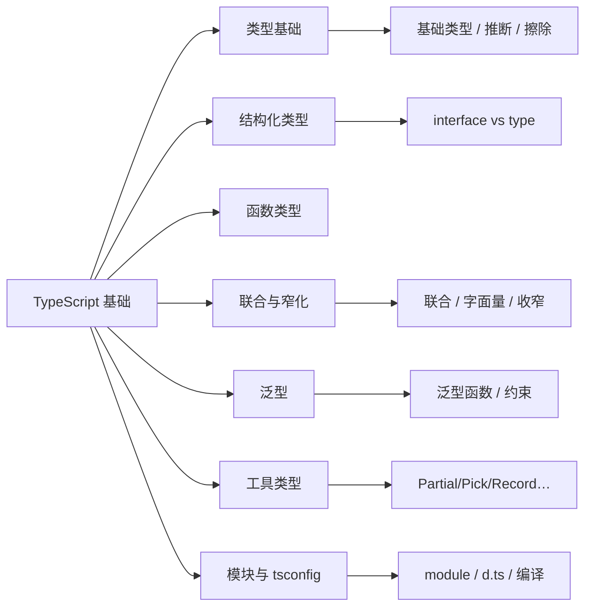

# 第 5 章 TypeScript 基础入门

> **所属部分**：第 3 部分 · 编程语言与基础技术 ｜ **难度**：★★☆☆☆ ｜ **建议学时**：6 小时 ｜ **前置章节**：第 1 章 ｜ **后续**：第 9 章 TypeScript 在 AFFiNE 中的应用

---

## 本章导读

AFFiNE 几乎全部用 TypeScript 写成。第 9 章会直接讲它在 AFFiNE 里的进阶用法——`tsconfig` 项目引用、DI 标识符里的泛型、声明合并、代码生成类型。如果你**懂编程、但没系统学过 TypeScript**，直接读第 9 章会很吃力。

本章就是那块垫脚石：假设你会 JavaScript（变量、函数、对象、`async/await`），**从类型系统的核心概念讲起**，一路铺到第 9 章的起点。读完你应当能看懂 AFFiNE 里绝大多数类型标注，并知道"为什么要这么写"。

TypeScript 的一句话定位：**JavaScript + 静态类型**。它在编译期检查类型、给你自动补全与重构能力，最终**擦除类型、编译回普通 JavaScript**运行——运行时没有类型。记住这条，很多"为什么类型不影响运行"的疑惑就迎刃而解。

---

## 学习目标

- [ ] 能够说清 TypeScript 与 JavaScript 的关系，以及"类型擦除"意味着什么
- [ ] 能够使用基础类型、数组、元组、`interface` 与 `type` 描述数据结构，并说清两者区别
- [ ] 能够写出带类型的函数（参数、返回值、可选/默认/剩余参数、重载）
- [ ] 能够用联合类型、字面量类型与类型窄化（narrowing）表达"多选一"
- [ ] 能够读写泛型函数、泛型接口与约束（`extends`），理解它"类型的参数"这一本质
- [ ] 能够使用常见工具类型（`Partial`、`Pick`、`Record`、`ReturnType` 等）
- [ ] 能够看懂 `tsconfig.json` 的关键选项与模块/声明文件机制，为第 9 章打底

---

## 知识地图



---

## 一、为什么要类型：从一个 bug 说起

看一段纯 JavaScript：

```js
function total(cart) {
  return cart.items.reduce((s, it) => s + it.price * it.count, 0);
}
total({ items: [{ price: 10, cuont: 2 }] }); // NaN，拼错了 count
```

`cuont` 拼错，运行时静默得到 `NaN`，可能到线上才被发现。TypeScript 让你**在写代码时**就得到报错：

```ts
interface CartItem {
  price: number;
  count: number;
}
function total(cart: { items: CartItem[] }): number {
  return cart.items.reduce((s, it) => s + it.price * it.count, 0);
}
total({ items: [{ price: 10, cuont: 2 }] });
// ❌ 对象字面量只能指定已知属性，“cuont”不存在于类型“CartItem”中
```

<div class="tip custom-block">
<p class="custom-block-title">类型擦除</p>
<p>上面的 <code>interface</code>、<code>: number</code> 在编译后<strong>全部消失</strong>，生成的 JS 与手写版几乎一样。类型只服务于"开发期检查"，不进入运行时。所以你<strong>不能</strong>在运行时 <code>if (x is CartItem)</code>——运行时根本没有这个类型。</p>
</div>

---

## 二、类型基础与推断

### 基础类型

```ts
let title: string = 'AFFiNE';
let count: number = 42;
let ok: boolean = true;
let nothing: null = null;
let undef: undefined = undefined;
let ids: string[] = ['a', 'b']; // 数组
let pair: [string, number] = ['x', 1]; // 元组：定长、每位类型固定
```

### 让编译器替你推断

大多数时候**不用手写类型**，TypeScript 会自动推断：

```ts
let title = 'AFFiNE'; // 推断为 string
const mode = 'page'; // 推断为字面量类型 'page'（const 更"窄"）
const list = [1, 2, 3]; // number[]
```

经验法则：**变量初始化、函数返回值通常让它自动推断；函数参数、对象结构、公共 API 显式标注**。显式标注既是检查也是文档。

### `any` 与 `unknown`

- `any`：放弃类型检查，"任何操作都允许"。是逃生舱，**能不用就不用**——它会像病毒一样扩散、让类型保护失效。
- `unknown`：安全版的 any，"我也不知道是什么"，但**用之前必须先收窄**，否则报错。接收外部输入时优先用它。

```ts
function parse(json: string): unknown {
  return JSON.parse(json);
}
const data = parse('{}');
// data.foo;        // ❌ unknown 不能直接用
if (typeof data === 'object' && data) {
  /* 收窄后才能用 */
}
```

---

## 三、描述对象：interface 与 type

两种方式都能描述对象结构，日常可互换：

```ts
interface User {
  id: string;
  name: string;
  email?: string; // 可选属性
  readonly createdAt: number; // 只读
}

type User2 = {
  id: string;
  name: string;
};
```

### 两者的区别（第 9 章会用到）

| 维度 | `interface` | `type` |
| --- | --- | --- |
| 对象/类的"契约" | ✅ 首选 | ✅ 也可以 |
| 联合 / 交叉 / 元组 / 映射类型 | ❌ 不行 | ✅ 只能用 type |
| 声明合并（同名自动合并） | ✅ 支持 | ❌ 不支持 |
| 扩展 | `extends` | `&` 交叉 |

```ts
interface Base {
  id: string;
}
interface Base {
  // 同名 interface 自动合并（声明合并）
  name: string;
}
// 等价于 { id: string; name: string }

type Point = { x: number } & { y: number }; // 交叉组合
```

<div class="tip custom-block">
<p class="custom-block-title">经验</p>
<p>描述"对象/类的形状、需要被扩展或合并"用 <code>interface</code>；需要联合、交叉、映射、工具类型等"类型运算"用 <code>type</code>。第 9 章 AFFiNE 用 <strong>声明合并</strong>给全局接口挂载扩展（如后端的 <code>Events</code>、<code>AppConfigSchema</code>），靠的就是 interface 这个能力。</p>
</div>

---

## 四、函数类型

```ts
// 参数与返回值
function add(a: number, b: number): number {
  return a + b;
}

// 可选参数、默认值、剩余参数
function greet(name: string, greeting = 'Hi', ...rest: string[]): string {
  return `${greeting}, ${name}`;
}

// 函数类型作为值（回调）
type Handler = (event: string) => void;
const onClick: Handler = e => console.log(e);
```

函数重载：同名多签名，实现只有一个：

```ts
function toArray(x: string): string[];
function toArray(x: number): number[];
function toArray(x: string | number): unknown[] {
  return [x];
}
```

---

## 五、联合类型与收窄（narrowing）

**联合类型 `A | B`** 表示"是 A 或 B"，是 TypeScript 最常用的建模方式之一。配合**字面量类型**可以精确枚举取值：

```ts
type DocMode = 'page' | 'edgeless'; // 只能是这两个字符串之一
function open(mode: DocMode) {}
open('page');
open('wrong'); // ❌
```

> 这正是第 1 章见过的 `DocMode`——AFFiNE 大量用"字符串字面量联合"代替枚举。

用联合类型后，使用前常需**收窄**到具体分支。收窄手段：

```ts
function format(v: string | number): string {
  if (typeof v === 'number') return v.toFixed(2); // 这里 v 是 number
  return v.toUpperCase(); // 这里 v 是 string
}
```

常见收窄：`typeof`、`instanceof`、`in`、字面量比较、以及**可辨识联合**（每个分支带一个共同的字面量字段）：

```ts
type Shape =
  | { kind: 'circle'; r: number }
  | { kind: 'rect'; w: number; h: number };

function area(s: Shape): number {
  switch (s.kind) {
    case 'circle':
      return Math.PI * s.r ** 2; // 自动收窄为 circle 分支
    case 'rect':
      return s.w * s.h;
  }
}
```

---

## 六、泛型：类型的"参数"

泛型让类型像函数一样**接收参数**，写出"对多种类型都成立"的可复用代码：

```ts
function identity<T>(x: T): T {
  return x;
}
identity<string>('a'); // T = string
identity(42); // T 推断为 number

interface Box<T> {
  value: T;
}
const b: Box<number> = { value: 1 };
```

### 泛型约束 `extends`

限制类型参数"至少具备某些结构"：

```ts
function longest<T extends { length: number }>(a: T, b: T): T {
  return a.length >= b.length ? a : b;
}
longest('ab', 'abc'); // 字符串有 length ✅
longest([1], [1, 2]); // 数组有 length ✅
longest(1, 2); // ❌ number 没有 length
```

<div class="tip custom-block">
<p class="custom-block-title">为什么重要</p>
<p>第 9 章 AFFiNE 的依赖注入用 <code>createIdentifier&lt;T&gt;()</code>、响应式用 <code>LiveData&lt;T&gt;</code>、块定义用 <code>defineBlockSchema</code> 配合泛型推断——泛型是看懂这些 API 的前提。把"泛型 = 给类型传参"这句话记牢。</p>
</div>

---

## 七、工具类型：对类型做"运算"

TypeScript 内置了一批由泛型+映射类型实现的"工具类型"，用来由已有类型派生新类型：

```ts
interface User {
  id: string;
  name: string;
  email: string;
}

type PartialUser = Partial<User>; // 所有属性变可选
type NameOnly = Pick<User, 'name'>; // 只挑 name
type NoEmail = Omit<User, 'email'>; // 去掉 email
type ReadonlyUser = Readonly<User>; // 全部只读
type UserMap = Record<string, User>; // { [k: string]: User }
type R = ReturnType<() => number>; // 取函数返回值类型 = number
```

它们是"类型层面的 DRY"：数据结构改一处，派生类型自动跟着变。AFFiNE 源码里这类工具类型随处可见。

---

## 八、模块、声明文件与 tsconfig

### 模块

TypeScript 用标准 ES 模块语法：

```ts
export interface Foo {}
export const bar = 1;
import { Foo, bar } from './foo';
import type { Foo } from './foo'; // 只导入类型，编译后整行消失
```

`import type` 很关键：明确"这是类型导入"，编译后不产生任何运行时代码，也避免循环依赖——第 9、20 章会反复见到。

### 声明文件 `.d.ts`

只含类型、不含实现的文件，用来给纯 JS 库或全局对象"补类型"。AFFiNE 的代码生成（`i18n.gen.ts`、GraphQL codegen）产出的也多是类型，供全局使用。

### tsconfig.json 关键项

```jsonc
{
  "compilerOptions": {
    "strict": true, // 打开所有严格检查（强烈建议）
    "target": "ESNext", // 编译目标语法
    "module": "ESNext", // 模块格式
    "moduleResolution": "Bundler",
    "noEmit": true, // 只检查、不产出（交给打包器编译）
    "skipLibCheck": true
  },
  "include": ["src"]
}
```

<div class="tip custom-block">
<p class="custom-block-title">通往第 9 章</p>
<p>第 9 章会看到 AFFiNE 把 tsconfig 拆成 <code>tsconfig.json</code> / <code>tsconfig.web.json</code> / <code>tsconfig.node.json</code> 并用"项目引用（project references）"做增量构建，还会发现 <code>tsc</code> 其实是 TS 7 的原生版本。本章把单个 tsconfig 看懂，到那里就只是"规模放大"而已。</p>
</div>

---

## 动手实践

1. **给一段 JS 加类型**：找一个你写过的小工具函数，加上参数/返回值类型并打开 `strict`，记录编译器报出的每一个潜在 bug。**验收**：至少发现 1 个此前没注意到的隐患。
2. **用可辨识联合建模**：为"加载中/成功/失败"三态设计一个 `type RequestState<T>`，并写一个 `switch` 穷尽处理。**验收**：删掉任一分支时编译器能报"未覆盖"。
3. **读 AFFiNE 的类型**：在仓库里打开 `packages/common/infra` 任意一个 `.ts`，找出其中的泛型、联合类型、`import type` 各一处，用本章术语解释它。**验收**：能说清每处"在表达什么约束"。
4. **工具类型练习**：给定一个 `interface Config`，用工具类型派生出"全部可选的更新参数类型"和"只含布尔字段的子类型"。**验收**：改 `Config` 后派生类型自动更新。

---

## 自测题

<details><summary>Q1. “类型擦除”是什么意思？它带来什么限制？</summary>

TypeScript 的类型信息只在编译期存在，编译为 JS 后全部被擦除，运行时没有类型。因此不能在运行时直接判断"某值是不是某接口类型"，需要靠 `typeof`/`in`/自定义类型守卫等运行时可用的手段收窄。

</details>

<details><summary>Q2. interface 与 type 最关键的两个区别是什么？</summary>

① 只有 `type` 能表达联合、交叉、元组、映射类型等"类型运算"；② 只有 `interface` 支持声明合并（同名自动合并），AFFiNE 用它扩展全局接口。描述对象/类形状两者都行。

</details>

<details><summary>Q3. 为什么 unknown 比 any 更安全？</summary>

`any` 关闭类型检查并会扩散；`unknown` 表示"未知类型"，但使用前必须先收窄，编译器会强制你做类型判断，从而保留类型安全。接收外部/不可信输入应优先用 `unknown`。

</details>

<details><summary>Q4. 泛型约束 &lt;T extends { length: number }&gt; 表达了什么？</summary>

类型参数 T 可以是任意类型，但**必须至少具备 `length: number` 这个结构**。这样函数体内就能安全访问 `.length`，同时保留"返回值类型与传入类型一致"的能力。

</details>

---

## 常见坑

| 现象 | 原因与处理 |
| --- | --- |
| 以为能在运行时判断接口类型 | 类型已擦除；用 `typeof`/`in`/类型守卫或运行时 schema（如 zod） |
| `any` 到处蔓延，报错全消失 | 用 `unknown` + 收窄替代；开 `noImplicitAny` |
| 对象字面量报"多余属性" | TS 对字面量有额外检查；确认拼写或用变量中转 |
| 联合类型不能直接用某属性 | 需要先收窄到具体分支 |
| 改了数据结构、很多地方要同步改 | 用工具类型（Partial/Pick/Record…）派生，避免重复定义 |

---

## 延伸阅读

- TypeScript 官方手册（Handbook）：类型收窄、泛型、工具类型章节
- 第 9 章：TypeScript 在 AFFiNE 中的应用（tsconfig 项目引用、装饰器、DI 泛型、声明合并、代码生成）
- 第 6 章：前端框架基础入门（会用到这里的泛型与联合类型）

---

## 本章学时拆分（建议 6 小时）

| 内容 | 时长 |
| --- | --- |
| 类型基础与推断、any/unknown | 1h |
| interface 与 type、函数类型 | 1.5h |
| 联合类型与收窄 | 1h |
| 泛型与约束 | 1.5h |
| 工具类型、模块与 tsconfig | 1h |

---

| [← 第 4 章 分支版本与发布节奏](../02-项目管理与开源协作/04-分支版本与发布节奏.md) | [第 6 章 前端框架基础入门 →](./06-前端框架基础入门-React-Lit-Signals-RxJS.md) |
| --- | --- |
