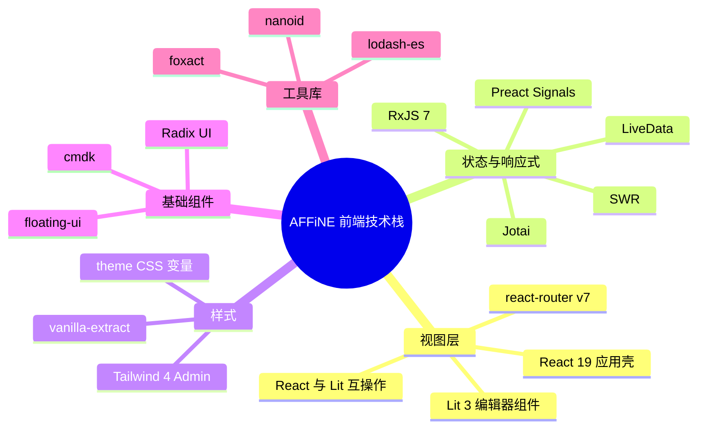
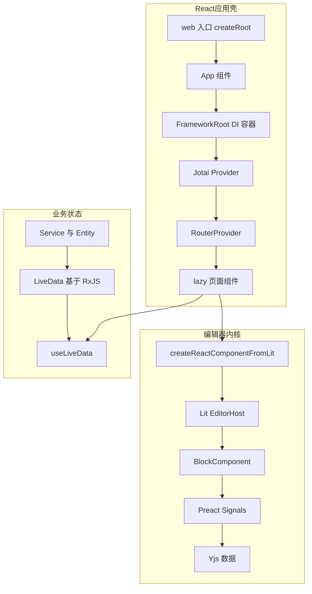
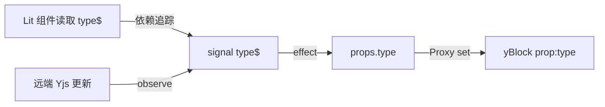
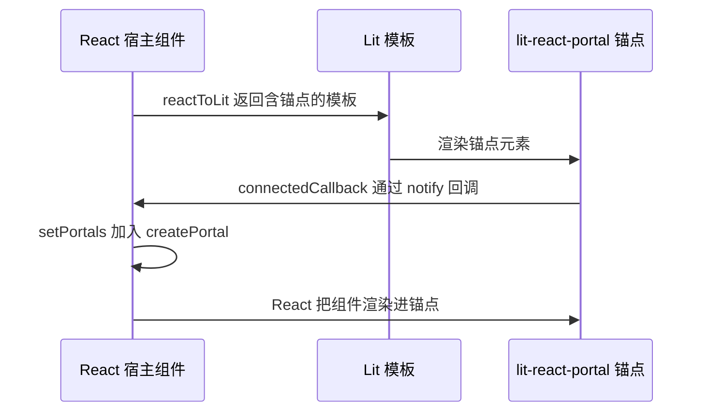

# 第 6 章 前端技术栈：React、Lit、Signals、RxJS

> **所属部分**：第 3 部分 · 编程语言与基础技术 ｜ **难度**：★★★☆☆ ｜ **建议学时**：10 小时 ｜ **前置章节**：第 5 章

## 本章导读

很多前端同学第一次打开 AFFiNE 前端代码都会困惑：**为什么一个项目里同时有 React 组件和 Lit Web Components？为什么既有 RxJS 的 Observable，又有 Preact 的 Signal，还有 Jotai 的 atom 和自研的 LiveData？**

答案藏在 AFFiNE 的分层架构里：

- **应用壳（App Shell）**：侧边栏、设置页、文档列表、弹窗……由 **React 19** 编写，位于 `packages/frontend/core` 与 `packages/frontend/component`。
- **编辑器内核（BlockSuite）**：段落、列表、表格、白板……由 **Lit 3** 编写的 Web Components，位于 `blocksuite/`。编辑器需要对 DOM 有精细控制、并且希望框架无关，因此没有用 React。
- **响应式数据**：BlockSuite 用 **@preact/signals-core** 让 Yjs 数据变成细粒度信号；应用层用基于 **RxJS 7** 的 **LiveData** 管理业务状态与异步流程；少量全局 UI 状态用 **Jotai**；GraphQL 请求缓存用 **SWR**。
- **样式**：应用层用 **vanilla-extract**（`*.css.ts`）零运行时 CSS-in-TS；Admin 后台用 **Tailwind CSS 4** + shadcn/ui 风格组件。
- **交互基础件**：**Radix UI**（无样式可访问组件）、**@floating-ui/dom**（浮层定位）、**cmdk**（命令面板）、**foxact**（React hooks 工具集）、**lodash-es**、**nanoid**。

本章对每一项技术都按"**核心概念速成 → AFFiNE 真实例子 → 为什么选它**"三步展开，最后给出一张"技术选型 → 使用位置"总表。

## 学习目标

- [ ] 能够说明 React 应用壳从 `createRoot` 到 `RouterProvider` 的启动链路，以及 react-router v7 的 `lazy` 路由写法
- [ ] 能够区分 Jotai、SWR、LiveData 三种状态方案在 AFFiNE 中各自负责的场景
- [ ] 能够读懂 RxJS 的 `Observable/Subject/BehaviorSubject` 与 `switchMap/combineLatest/share/throttleTime` 等操作符在 nbstore 与 infra 中的用法
- [ ] 能够解释 Preact Signals 的 `signal/computed/effect`，以及 BlockSuite 如何把 Yjs 属性同步为 `xxx$` 信号
- [ ] 能够写出一个带 `@property`/`@state`、使用 `SignalWatcher` 的 Lit 组件，并说清 BlockSuite 中哪些组件使用/不使用 Shadow DOM
- [ ] 能够使用 `createReactComponentFromLit`、`toReactNode`、`useLitPortalFactory` 在 React 与 Lit 之间双向嵌入
- [ ] 能够用 vanilla-extract 的 `style/createVar/selectors` 编写主题化样式，并理解 Admin 端 Tailwind 4 的配置方式
- [ ] 能够根据需求在 Radix、floating-ui、cmdk 等基础件之间做出与项目一致的选择

## 知识地图



## 6.1 全景：一次页面渲染涉及哪些技术



一个"打开文档"的页面，React 负责外层布局与路由，`useLiveData` 订阅业务状态，`LitDocEditor`（React 包装的 Lit 组件）承载编辑器，编辑器内部每个 Block 通过 Signals 订阅 Yjs 数据变化。理解了这张图，后面每一节就是在放大其中某一块。

## 6.2 React 19 与 react-dom：应用壳

### 6.2.1 核心概念速成

| 概念 | 一句话 | 本仓库中的体现 |
| --- | --- | --- |
| `createRoot` | React 18+ 的并发渲染根 | `packages/frontend/apps/web/src/index.tsx` |
| `StrictMode` | 开发期双调用副作用以暴露问题 | web 入口包裹整个应用 |
| `Suspense` | 子树"挂起"时显示 fallback | `App` 外层 `Suspense fallback={<AppContainer fallback />}`，SWR 也开启 suspense |
| `useSyncExternalStore` | 订阅外部可变数据源的官方 hook | `useLiveData` 的实现基础 |
| `createPortal` | 渲染到任意 DOM 节点 | Lit 与 React 互操作的关键 |

版本：`packages/frontend/core/package.json` 中 `"react": "^19.2.1"`、`"react-dom": "^19.2.1"`。

### 6.2.2 真实启动链路

来源：`packages/frontend/apps/web/src/index.tsx`

```tsx
import './setup';

import { Telemetry } from '@affine/core/components/telemetry';
import { StrictMode } from 'react';
import { createRoot } from 'react-dom/client';

import { App } from './app';

function mountApp() {
  // oxlint-disable-next-line typescript/no-non-null-assertion
  const root = document.getElementById('app')!;
  createRoot(root).render(
    <StrictMode>
      <Telemetry />
      <App />
    </StrictMode>
  );
}
```

来源：`packages/frontend/apps/web/src/app.tsx`

```tsx
const framework = new Framework();
configureCommonModules(framework);
configureBrowserWorkbenchModule(framework);
configureLocalStorageStateStorageImpls(framework);
configureBrowserWorkspaceFlavours(framework);
// ...
const frameworkProvider = framework.provider();
// ...
export function App() {
  return (
    <Suspense fallback={<AppContainer fallback />}>
      <FrameworkRoot framework={frameworkProvider}>
        <CacheProvider value={cache}>
          <I18nProvider>
            <AffineContext store={getCurrentStore()}>
              <RouterProvider router={router} />
            </AffineContext>
          </I18nProvider>
        </CacheProvider>
      </FrameworkRoot>
    </Suspense>
  );
}
```

从外到内的 Provider 层次：

1. `Suspense`：兜底加载态；
2. `FrameworkRoot`：注入 DI 容器（第 16 章），之后组件内可 `useService(XxxService)`；
3. `CacheProvider`：Emotion 的样式缓存（`packages/frontend/core/src/utils/create-emotion-cache.ts`），为组件库中遗留的 `@emotion/styled` 样式服务；
4. `I18nProvider`：国际化；
5. `AffineContext`：内部组合了 Jotai `Provider`、主题、确认框/输入框 Provider（`packages/frontend/core/src/components/context/index.tsx`）；
6. `RouterProvider`：交给路由。

注意 DI 容器是在**组件树之外**创建并配置好的（模块级代码），React 只是"挂载"它。这让业务逻辑不依赖 React 生命周期，Electron、移动端可以复用同一套 `configureXxxModule`。

### 6.2.3 为什么选 React

- **生态**：Radix、cmdk、react-virtuoso、Storybook（`packages/frontend/component` 有大量 `*.stories.tsx`）等成熟组件生态；
- **人才与心智**：应用层是典型的表单/列表/弹窗型 UI，React 的声明式组件模型最为高效；
- **边界清晰**：React 只负责"壳"，复杂的富文本编辑交给 Lit，避免 React 的虚拟 DOM 与 contenteditable 打架。

> 代码规范提示：`.oxlintrc.json` 中启用了 `react-hooks-js/purity`、`react-hooks-js/preserve-manual-memoization`、`react-hooks-js/set-state-in-render` 等规则（来自 `eslint-plugin-react-hooks` v7），它们会检查组件纯度与 memo 用法，写 React 代码时要留意这些报错。

## 6.3 react-router-dom v7：路由与懒加载

### 6.3.1 核心概念速成

react-router v6.4+ 引入了 **Data Router**：用 `createBrowserRouter(routes)` 定义路由对象数组，每个路由可带 `loader`（导航前取数/重定向）、`lazy`（按需加载模块）、`errorElement`（错误边界）。v7 延续这一 API，并把很多 future flag 变为默认。

`lazy` 返回的模块需要导出约定名称：`Component`、`loader`、`ErrorBoundary` 等。

### 6.3.2 AFFiNE 中的路由表

来源：`packages/frontend/core/src/desktop/router.tsx`

```tsx
export const topLevelRoutes = [
  {
    element: <RootRouter />,
    errorElement: <AffineErrorComponent />,
    children: [
      {
        path: '/',
        lazy: () => import('./pages/index'),
      },
      {
        path: WORKSPACE_ROUTE_PATH,
        lazy: () => import('./pages/workspace/index'),
      },
      {
        path: SHARE_ROUTE_PATH,
        loader: ({ params }) => {
          return redirect(
            getWorkspaceDocPath(params.workspaceId ?? '', params.pageId ?? '')
          );
        },
      },
      // ...
      {
        path: '/auth/:authType',
        lazy: () => import(/* webpackChunkName: "auth" */ './pages/auth/auth'),
      },
      // ...
      {
        path: CATCH_ALL_ROUTE_PATH,
        lazy: () => import('./pages/404'),
      },
    ],
  },
] satisfies [RouteObject, ...RouteObject[]];
```

```tsx
// 同文件末尾
const createBrowserRouter = wrapCreateBrowserRouterV6(
  reactRouterCreateBrowserRouter
);
export const router = (
  window.SENTRY_RELEASE ? createBrowserRouter : reactRouterCreateBrowserRouter
)(topLevelRoutes, {
  basename: environment.subPath,
  future: {
    v7_normalizeFormMethod: true,
  },
});
```

要点：

- **懒加载 + 魔法注释**：`/* webpackChunkName: "auth" */` 让 Rspack 把多个认证页打进同一个 chunk。
- **约定导出**：`packages/frontend/core/src/desktop/pages/404/index.tsx` 末尾 `export const Component = () => { return <PageNotFound />; };`，正是 `lazy` 所要求的。
- **`loader` 做重定向**：旧的分享链接、`/try-cloud`、`/template/preview` 都在导航前用 `redirect()` 转换，组件层无需关心。
- **`satisfies [RouteObject, ...RouteObject[]]`**：第 5 章讲过的 `satisfies`，确保至少一项路由且保留字面量推导。
- **Sentry 包装**：生产环境 `window.SENTRY_RELEASE` 存在时，用 Sentry 的包装函数记录路由性能。
- **`basename: environment.subPath`**：支持自托管部署在子路径下。

`RootRouter` 中把 `useNavigate()` 的结果放进 `NavigateContext`，供非路由组件使用导航能力（`packages/frontend/core/src/components/hooks/use-navigate-helper.ts`）。

Admin 端则用了另一种写法——JSX 声明式 `<Routes>/<Route>` 配合 `@affine/routes` 包里的路由常量（`packages/frontend/admin/src/app.tsx`、`packages/frontend/routes/src/routes.ts`），两种风格在 v7 中都受支持。

### 6.3.3 为什么选它

react-router 是 React 生态事实标准；Data Router 的 `lazy` 天然契合"大应用按页拆包"；`loader` 处理重定向避免了组件里写 `useEffect + navigate` 的闪烁。

## 6.4 RxJS 7：异步与事件流的统一语言

### 6.4.1 核心概念速成

| 概念 | 类比 | 特点 |
| --- | --- | --- |
| `Observable` | 可多次 `resolve` 的 Promise | **惰性**：没人订阅就不执行；可取消（返回 teardown） |
| `Subject` | EventEmitter | 多播；订阅前发出的值会丢失 |
| `BehaviorSubject` | 带当前值的 Subject | 订阅时立即收到最新值；`.value` 同步读取 |
| `ReplaySubject(n)` | 带缓存的 Subject | 新订阅者回放最近 n 个值 |
| 操作符 | 数组方法的流版本 | `pipe(map, filter, switchMap, ...)` |

最常用的高阶映射操作符对比（教学示例）：

```ts
// 教学示例：四种"把值映射成新流"的策略
source$.pipe(switchMap(v => req(v)));  // 新值到来 → 取消旧请求（搜索框）
source$.pipe(mergeMap(v => req(v)));   // 并发执行全部
source$.pipe(concatMap(v => req(v)));  // 排队串行
source$.pipe(exhaustMap(v => req(v))); // 忙时忽略新值（防重复提交）
```

### 6.4.2 nbstore：用流聚合多端同步状态

来源：`packages/common/nbstore/src/sync/doc/index.ts`

```ts
export class DocSyncImpl implements DocSync {
  private readonly peers$ = new BehaviorSubject<DocSyncPeer[]>([]);
  // ...
  private readonly _state$ = this.peers$.pipe(
    switchMap(peers =>
      peers.length ? combineLatest(peers.map(peer => peer.peerState$)) : of([])
    ),
    map(allPeers =>
      allPeers.length === 0
        ? { total: 0, syncing: 0, synced: true, retrying: false, errorMessage: null }
        : {
            total: allPeers.reduce((acc, peer) => Math.max(acc, peer.total), 0),
            syncing: allPeers.reduce((acc, peer) => Math.max(acc, peer.syncing), 0),
            synced: allPeers.every(peer => peer.synced),
            retrying: allPeers.some(peer => peer.retrying),
            errorMessage:
              allPeers.find(peer => peer.errorMessage)?.errorMessage ?? null,
          }
    ),
    share({
      connector: () => new ReplaySubject(1),
    })
  ) as Observable<DocSyncState>;

  state$ = this._state$.pipe(
    // throttle the state to 1 second to avoid spamming the UI
    throttleTime(1000, undefined, {
      leading: true,
      trailing: true,
    })
  );
```

逐行拆解：

1. `peers$` 是 `BehaviorSubject`：远端列表（云端、其他存储）可能动态变化；
2. `switchMap`：每当远端列表变了，**丢弃旧的订阅**，对新列表重新 `combineLatest`；
3. `combineLatest`：任一 peer 的状态变化，都输出"所有 peer 的最新状态数组"；
4. `map`：聚合为一个总体状态；
5. `share({ connector: () => new ReplaySubject(1) })`：多个订阅者共享一条上游，并为后来者回放最新值——避免每个 UI 组件都触发一遍 `combineLatest`；
6. `throttleTime(1000, ..., { leading, trailing })`：最多每秒推送一次 UI，但保证首尾值不丢。

### 6.4.3 nbstore 的两个小工具：Promise ↔ Observable 与 AbortSignal

来源：`packages/common/nbstore/src/utils/from-promise.ts`

```ts
export function fromPromise<T>(
  promise: Promise<T> | ((signal: AbortSignal) => Promise<T>)
): Observable<T> {
  return new Observable(subscriber => {
    const abortController = new AbortController();

    const rawPromise =
      promise instanceof Function ? promise(abortController.signal) : promise;

    rawPromise
      .then(value => {
        subscriber.next(value);
        subscriber.complete();
      })
      .catch(error => {
        subscriber.error(error);
      });

    return () => abortController.abort(MANUALLY_STOP);
  });
}
```

与 RxJS 自带的 `from(promise)` 相比，它在**取消订阅时调用 `abort()`**，把 RxJS 的取消语义传递给 `fetch` 等支持 `AbortSignal` 的 API。配套的 `takeUntilAbort(signal)`（`packages/common/nbstore/src/utils/take-until-abort.ts`）则反向：外部 `AbortSignal` 触发时让流以错误结束。这是"RxJS 与 Web 平台取消机制互通"的范式。infra 包也导出了同名 `fromPromise`，供业务层使用。

### 6.4.4 infra 的 effect：把 RxJS 管道变成可调用函数

来源：`packages/frontend/core/src/modules/permissions/entities/permission.ts`

```ts
export class WorkspacePermission extends Entity {
  private readonly cache$ = LiveData.from(
    this.store.watchWorkspacePermissionCache(),
    undefined
  );
  isOwner$ = this.cache$.map(cache => cache?.isOwner ?? null);
  // ...
  isRevalidating$ = new LiveData(false);

  revalidate = effect(
    exhaustMapWithTrailing(() => {
      return fromPromise(async signal => {
        // ...
        const info = await this.store.fetchWorkspaceInfo(
          this.workspaceService.workspace.id,
          signal
        );
        // ...
      }).pipe(
        backoffRetry({
          count: Infinity,
        }),
        tap(({ isOwner, isAdmin, isTeam }) => {
          this.store.setWorkspacePermissionCache({ isOwner, isAdmin, isTeam });
        }),
        onStart(() => this.isRevalidating$.setValue(true)),
        onComplete(() => this.isRevalidating$.setValue(false))
      );
    })
  );
```

`effect(...)`（`packages/common/infra/src/livedata/effect/index.ts`）内部创建一个 `Subject`，把参数传入的操作符串成管道；调用 `this.revalidate()` 就相当于 `subject.next()`。于是：

- `exhaustMapWithTrailing`：请求进行中再次调用会被合并，结束后补跑一次最新的；
- `fromPromise(async signal => ...)`：可取消的异步请求；
- `backoffRetry`：指数退避重试；
- `onStart/onComplete`（`packages/common/infra/src/livedata/ops.ts`）：维护 loading 状态。

这种写法把"防抖、取消、重试、loading"全部声明式地放进一条管道，是 AFFiNE 业务层最常见的模式之一，第 16 章会更系统地讲。

### 6.4.5 为什么选 RxJS

编辑器同步、网络重连、多存储对齐这类问题本质是**多源异步事件的组合与取消**，用 Promise + 回调写会迅速失控；RxJS 提供了成熟的组合与取消语义，且 TS 类型推导完善。代价是学习曲线陡峭，所以 AFFiNE 在其上包了一层更易用的 LiveData。

## 6.5 LiveData：RxJS 与 React/Signals 之间的桥梁

### 6.5.1 设计要点

`LiveData<T>`（`packages/common/infra/src/livedata/livedata.ts`）的类型设计已在第 5 章分析过，这里关注**运行机制**：

```ts
// 来源：packages/common/infra/src/livedata/livedata.ts（节选）
export class LiveData<T = unknown>
  extends Observable<T>
  implements InteropObservable<T>
{
  private readonly raw$: BehaviorSubject<T>;
  private readonly ops$ = new Subject<LiveDataOperation>();
  // ...
  get value(): T {
    return this.getValue();
  }
  // ...
  get signal(): ReadonlySignal<T> {
    if (!this._signal) {
      this._signal = signal(this.value);
      this._signalSubscription = this.subscribe(v => {
        // oxlint-disable-next-line no-non-null-assertion
        this._signal!.value = v;
      });
    }
    return this._signal;
  }
  // ...
}

export type LiveDataOperation = 'set' | 'get' | 'watch' | 'unwatch';
```

- **内部是 `BehaviorSubject`**：总有当前值，可同步读 `.value`；
- **`ops$` 记录"有没有人在看"**：`LiveData.from(upstream$, initial)` 会统计 `watch/unwatch` 次数，**只有存在订阅者时才订阅上游**（见 `from` 中的 `scan` 计数 + `switchMap(op => op === 'watch' ? upstream$ : EMPTY)`）。这让"数据库查询流"之类的上游在 UI 卸载后自动停止；
- **`.signal`**：按需把 LiveData 转为 Preact Signal，便于在 Lit 组件中使用；反方向有 `LiveData.fromSignal(signal)`；
- **`poisoned` 状态**：上游抛错会让 LiveData 进入不可恢复状态——规范要求 LiveData 上游不要抛错，错误应通过 `catchErrorInto(error$)` 导入另一个 LiveData。

### 6.5.2 在 React 中使用

来源：`packages/common/infra/src/livedata/react.ts`

```ts
export function useLiveData<Input extends LiveData<any> | null | undefined>(
  liveData: Input
): /* ...条件类型略... */ {
  return useSyncExternalStore(
    liveData ? liveData.reactSubscribe : noopSubscribe,
    liveData
      ? liveData.reactGetSnapshot
      : liveData === undefined
        ? undefinedGetSnapshot
        : nullGetSnapshot
  );
}
```

真实组件——来源：`packages/frontend/core/src/desktop/dialogs/doc-info/time-row.tsx`

```tsx
export const TimeRow = ({ docId, className }: { docId: string; className?: string }) => {
  const t = useI18n();
  const docsService = useService(DocsService);
  const docRecord = useLiveData(docsService.list.doc$(docId));
  const docMeta = useLiveData(docRecord?.meta$);
  // ...
  const dTimestampElement = useDebouncedValue(timestampElement, 500);

  return (
    <div className={clsx(styles.container, className)}>{dTimestampElement}</div>
  );
};
```

一个组件同时用到了 DI（`useService`）、LiveData（`useLiveData`，注意第二次传入的可能是 `undefined`，返回类型自动带 `| undefined`）、foxact（`useDebouncedValue`）和 vanilla-extract（`styles.container`）——这就是 AFFiNE 应用层组件的典型面貌。

把 BlockSuite 信号接入 React 也走 LiveData——来源：`packages/frontend/core/src/blocksuite/attachment-viewer/pdf/pdf-viewer-embedded.tsx`

```tsx
  const name = useLiveData(
    useMemo(() => LiveData.fromSignal(model.props.name$), [model])
  );
  const blobId = useLiveData(
    useMemo(() => LiveData.fromSignal(model.props.sourceId$), [model])
  );
```

## 6.6 Jotai 与 SWR：两个"轻量补充"

### 6.6.1 Jotai：原子化全局 UI 状态

**速成**：`atom(initial)` 定义一个状态原子；组件里 `useAtom(a)` 读写、`useAtomValue(a)` 只读、`useSetAtom(a)` 只写；派生 atom 可用 `atom(get => ..., (get, set, arg) => ...)` 定义读写逻辑；`atomWithStorage` 自动持久化到 localStorage。

**真实例子**——来源：`packages/common/infra/src/atom/settings.ts`

```ts
const appSettingBaseAtom = atomWithStorage<AppSetting>(
  APP_SETTINGS_STORAGE_KEY,
  {
    clientBorder: BUILD_CONFIG.isElectron && !environment.isWindows,
    windowFrameStyle: 'frameless',
    // ...
  },
  undefined,
  { getOnInit: true }
);
// ...
export const appSettingAtom = atom<
  AppSetting,
  [SetStateAction<Partial<AppSetting>>],
  void
>(
  get => {
    get(appSettingEffect);
    return get(appSettingBaseAtom);
  },
  (_get, set, apply) => {
    set(appSettingBaseAtom, prev => {
      const next = typeof apply === 'function' ? apply(prev) : apply;
      return { ...prev, ...next };
    });
  }
);
```

使用方——来源：`packages/frontend/core/src/components/hooks/affine/use-app-setting-helper.ts`

```ts
export function useAppSettingHelper() {
  const [appSettings, setAppSettings] = useAtom(appSettingAtom);

  const updateSettings = useCallback(
    <K extends keyof AppSetting>(key: K, value: AppSetting[K]) => {
      setAppSettings(prevSettings => ({ ...prevSettings, [key]: value }));
    },
    [setAppSettings]
  );
  // ...
}
```

`atomEffect`（来自 `jotai-effect`）在设置变化时把部分配置同步给 Electron 主进程。Jotai 的 store 由 `getCurrentStore()`（`packages/common/infra/src/atom/root-store.ts`，即 `getDefaultStore()`）提供，并通过 `AffineContext` 注入。

**定位**：Jotai 在 AFFiNE 里主要承担**历史遗留与少量纯 UI 全局状态**（如 `packages/frontend/core/src/components/atoms/index.ts` 中的 `allPageFilterSelectAtom`，该文件里还有标注 `@deprecated` 的 atom）。新的业务状态推荐放进 DI 体系的 Service/Entity + LiveData。

### 6.6.2 SWR：GraphQL 查询缓存

**速成**：`useSWR(key, fetcher, config)` 按 key 缓存请求结果，提供去重、聚焦重验证、`mutate` 等能力；`suspense: true` 时未就绪会抛出 Promise 交给 `Suspense`。

**真实例子**——来源：`packages/frontend/core/src/components/hooks/use-query.ts`

```ts
const createUseQuery =
  (immutable: boolean): useQueryFn =>
  (options, config) => {
    const configWithSuspense: SWRConfiguration = useMemo(
      () => ({
        suspense: true,
        ...config,
      }),
      [config]
    );
    const graphqlService = useService(GraphQLService);

    const useSWRFn = immutable ? useSWRImmutable : useSWR;
    return useSWRFn(
      options ? () => ['cloud', options.query.id, options.variables] : null,
      options ? () => graphqlService.gql(options) : null,
      configWithSuspense
    );
  };

export const useQuery = createUseQuery(false);
export const useQueryImmutable = createUseQuery(true);
```

- **缓存 key** = `['cloud', 查询 id, 变量]`，同一查询同一变量自动去重；
- **类型**：`QueryResponse<Query>` 直接复用第 5 章讲的 GraphQL 生成类型；
- **Admin 端**有几乎相同的 `packages/frontend/admin/src/use-query.ts`，但直接用 `gqlFetcherFactory` 而非 DI 服务——Admin 是一个更简单的独立 SPA。

**定位**：SWR 用于"请求-展示"型的服务端数据（设置页、历史版本 `packages/frontend/core/src/components/affine/page-history-modal/data.ts` 等）；需要复杂编排的则走 Service + effect。

## 6.7 @preact/signals-core：BlockSuite 的细粒度响应式

### 6.7.1 核心概念速成

教学示例：

```ts
// 教学示例
import { signal, computed, effect, batch } from '@preact/signals-core';

const count = signal(0);                       // 可写信号
const double = computed(() => count.value * 2); // 派生信号，自动追踪依赖
const dispose = effect(() => {                  // 副作用：读到的信号变化就重跑
  console.log('double =', double.value);
});
count.value = 1;      // 打印 double = 2
batch(() => {         // 批量更新只触发一次 effect
  count.value = 2;
  count.value = 3;
});
count.peek();         // 读取但不建立依赖
dispose();
```

与 RxJS 的区别：Signal **是同步的、拉取式的、自动追踪依赖**，非常适合"某个值变了 → 精确更新某处 UI"；RxJS 擅长**时间维度上的事件编排**（节流、重试、取消）。

### 6.7.2 Yjs → Signal：Block 属性为何有 `xxx$`

BlockSuite 的文档数据存在 Yjs 里（第 8 章），但 UI 需要的是"能被追踪的响应式值"。`SyncController` 负责双向桥接：

来源：`blocksuite/framework/store/src/model/block/sync-controller.ts`

```ts
    const model = schema.model.toModel?.() ?? new BlockModel<object>();
    model.schema = schema;
    const signalWithProps = Object.entries(props).reduce(
      (acc, [key, value]) => {
        const data = signal(value);
        const dispose = effect(() => {
          const value = data.value;
          if (!this.model) return;
          _mutex(() => {
            // @ts-expect-error allow magic props
            this.model.props[key] = value;
          });
        });
        const subscription = model.deleted.subscribe(() => {
          subscription.unsubscribe();
          dispose();
        });
        return {
          ...acc,
          [`${key}$`]: data,
          [key]: value,
        };
      },
      {} as Record<string, unknown>
    );
```

每个属性 `key` 都生成一对：普通值 `key` 和信号 `key$`。再加上一个 `Proxy`：

- 写 `model.props.type = 'h1'` → Proxy 的 `set` 把值写进 `yBlock.set('prop:type', ...)` 并更新 `type$`；
- 写 `model.props.type$.value = 'h1'` → 上面的 `effect` 把值写回 `props.type`，再经 Proxy 写入 Yjs；
- 远端协作者改了 Yjs → `_observeYBlockChanges` 中 `this.model.props[signalKey].value = y2Native(value)` 更新信号；
- `_mutex` 防止上述环路无限递归。



对于 `isFlatData` 的 Block（目前为表格块，见 `blocksuite/affine/model/src/blocks/table/table-model.ts` 中的 `isFlatData: true`），使用 `blocksuite/framework/store/src/reactive/flat-native-y/` 下的 `ReactiveFlatYMap`，原理类似：`signal-updater.ts` 更新信号、`y-map-updater.ts` 把对象拆平为 `prop:a.b.c` 键写回 Y.Map，并在 `yMap.doc?.transact(..., { proxy: true })` 中批量提交。

### 6.7.3 在 Block 组件里用 effect

来源：`blocksuite/affine/blocks/paragraph/src/paragraph-block.ts`

```ts
  override connectedCallback() {
    super.connectedCallback();
    // ...
    this.disposables.add(
      effect(() => {
        const type = this.model.props.type$.value;
        if (!type.startsWith('h') && this.model.props.collapsed) {
          this.model.props.collapsed = false;
        }
      })
    );

    this.disposables.add(
      effect(() => {
        if (this.store.readonly$.value) {
          this._setReadonlyCollapsed(this.model.props.collapsed$.value);
        }
      })
    );
    // ...
    let beforeType = this.model.props.type$.peek();
```

- 每个 `effect` 返回的 dispose 函数交给 `this.disposables`（`WithDisposable` 混入提供），组件断开时统一清理，防止内存泄漏；
- `peek()` 读取初值而不建立依赖；
- 组件类上的 `focused$ = computed(() => ...)` 则是派生信号。

### 6.7.4 为什么选 Signals

编辑器里可能同时存在成千上万个 Block，每次按键只应重渲染**一个**段落。Signals 的依赖追踪是"属性级"的，配合 Lit 的局部更新，可以把重渲染范围压到最小；且 `@preact/signals-core` 框架无关、体积小。

## 6.8 Lit 3 Web Components：编辑器的视图层

### 6.8.1 核心概念速成

| 概念 | 说明 |
| --- | --- |
| `LitElement` | 基类，继承自 `ReactiveElement` + lit-html 渲染 |
| 响应式属性 | `@property()`（对外，可映射 attribute）、`@state()`（内部）；变化后异步批量调用 `render()` |
| 模板 | `` html`<div class=${cls} .prop=${v} ?hidden=${b} @click=${fn}>` `` —— 普通绑定是 attribute，`.` 是 property，`?` 是布尔 attribute，`@` 是事件 |
| 样式 | `static styles = css\`...\``，默认作用于 Shadow DOM 内 |
| 生命周期 | `connectedCallback` → `willUpdate` → `update/render` → `firstUpdated`（首次）→ `updated` → `disconnectedCallback`；`updateComplete` 是一个 Promise |
| 指令 | `repeat`、`classMap`、`styleMap` 等（`lit/directives/*`） |
| Context | `@lit/context` 的 `@provide` / `@consume`，类似 React Context |

### 6.8.2 BlockSuite 的组件基类与 Shadow DOM

查看 `blocksuite/framework/std/src/view/element/` 可以得到明确结论：

| 基类 | 继承链 | 是否使用 Shadow DOM |
| --- | --- | --- |
| `ShadowlessElement` | `LitElement` | **否**：`createRenderRoot() { return this; }` |
| `BlockComponent` | `SignalWatcher(WithDisposable(ShadowlessElement))` | **否** |
| `EditorHost`（`lit-host.ts`） | `SignalWatcher(WithDisposable(ShadowlessElement))` | **否** |
| `WidgetComponent` | `SignalWatcher(WithDisposable(LitElement))` | **是**（未覆写 `createRenderRoot`，沿用 LitElement 默认的 Shadow Root） |

来源：`blocksuite/framework/std/src/view/element/shadowless-element.ts`

```ts
export class ShadowlessElement extends LitElement {
  // ...
  // styles registered in ShadowlessElement will be available globally
  // even if the element is not being rendered
  protected static override finalizeStyles(
    styles?: CSSResultGroup
  ): CSSResultOrNative[] {
    const elementStyles = super.finalizeStyles(styles);
    // XXX: This breaks component encapsulation and applies styles to the document.
    // These styles should be manually scoped.
    elementStyles.forEach((s: CSSResultOrNative) => {
      if (s instanceof CSSResult && typeof document !== 'undefined') {
        const styleRoot = document.head;
        const style = document.createElement('style');
        style.textContent = s.cssText;
        styleRoot.append(style);
      }
    });
    return elementStyles;
  }
  // ...
  override createRenderRoot() {
    return this;
  }
```

**为什么 Block 不用 Shadow DOM？** 富文本编辑依赖浏览器原生的 `contenteditable`、Selection、Range 与 IME 输入法。Shadow DOM 边界会让跨 Block 的选区、复制粘贴、`document.getSelection()` 变得复杂且各浏览器行为不一。因此 Block 渲染在 Light DOM 中，样式则由 `finalizeStyles` 注入 `document.head`（注释坦言"打破了封装，需要手动加作用域"——所以你会看到 `heading-icon.ts` 的样式写成 `affine-paragraph-heading-icon .heading-icon {...}`，用标签名做前缀）。若元素位于某个 ShadowRoot 内，`connectedCallback` 会把样式按引用计数注入到该 ShadowRoot。

而 Widget（工具栏、拖拽手柄、斜杠菜单等浮层）不参与文本选区，用 Shadow DOM 获得样式隔离更划算。

### 6.8.3 SignalWatcher：让 Lit 自动追踪信号

来源：`blocksuite/framework/global/src/lit/signal-watcher.ts`

```ts
export function SignalWatcher<T extends ReactiveElementConstructor>(
  Base: T
): T {
  abstract class SignalWatcher extends Base {
    private __dispose?: () => void;
    // ...
    override performUpdate() {
      if (this.isUpdatePending === false || this.isConnected === false) {
        return;
      }
      // If we have a previous effect, dispose it
      this.__dispose?.();

      let updateFromLit = true;

      this.__dispose = effect(() => {
        if (updateFromLit) {
          updateFromLit = false;
          super.performUpdate();
        } else {
          // This branch is an effect run from Preact signals.
          this.requestUpdate();
        }
      });
    }
  }
  return SignalWatcher;
}
```

这是一个**类混入（Mixin）**：函数接收一个类、返回其子类。原理是把整个 `performUpdate`（包含 `render`）包进一个 Preact `effect`，渲染过程中读到的所有 `signal.value` 都成为依赖；任何依赖变化时，effect 重跑并调用 `requestUpdate()` 触发 Lit 的下一次渲染。文件头的 License 显示它源自 Google 的 `@lit-labs/preact-signals`，AFFiNE 将其内置。同目录的 `watch.ts` 提供 `watch(signal)` 指令，可以只更新模板中的某一个绑定点而不重渲染整个组件。

于是 `ParagraphHeadingIcon` 的 `render()` 里写 `this.model.props.type$.value`，标题级别变化时图标会自动刷新，不需要手动订阅。

### 6.8.4 一个完整的 Block 组件

来源：`blocksuite/framework/std/src/view/element/block-component.ts`

```ts
export class BlockComponent<
  Model extends BlockModel = BlockModel,
  Service extends BlockService = BlockService,
  WidgetName extends string = string,
> extends SignalWatcher(WithDisposable(ShadowlessElement)) {
  @consume({ context: stdContext })
  accessor std!: BlockStdScope;
  // ...
  override render() {
    return this._renderers.reduce(
      (acc, cur) => cur.call(this, acc),
      nothing as unknown
    );
  }

  renderBlock(): unknown {
    return nothing;
  }
  // ...
  @provide({ context: modelContext as never })
  @state()
  private accessor _model: Model | null = null;
  // ...
  @property({ attribute: false })
  accessor viewType: BlockViewType = 'display';
```

- `@consume({ context: stdContext })`：从上层 `EditorHost` 拿到 `std`（编辑器标准库作用域，第 13 章）；
- `@provide({ context: modelContext })`：把自己的 model 提供给子组件；
- `render()` 是一条"渲染器管道"：`renderBlock` → 版本不匹配提示 → 视图类型处理，子类只需覆写 `renderBlock()`。

段落块的 `renderBlock` 使用了 `repeat` 和 `styleMap` 指令——来源：`blocksuite/affine/blocks/paragraph/src/paragraph-block.ts`

```ts
  override renderBlock(): TemplateResult<1> {
    const widgets = html`${repeat(
      Object.entries(this.widgets),
      ([id]) => id,
      ([_, widget]) => widget
    )}`;

    const { type$ } = this.model.props;
    // ...
    const textAlignStyle = styleMap({
      textAlign: this.model.props.textAlign$?.value,
    });
    // ...
```

`repeat(items, keyFn, templateFn)` 是带 key 的列表渲染，相当于 React 的 `key`；`styleMap` 把对象安全地转为内联样式。

### 6.8.5 注册与类型

BlockSuite 组件普遍不用 `@customElement`，而是在 `effects()` 中统一注册（`blocksuite/affine/blocks/paragraph/src/effects.ts`），并通过 `declare global { interface HTMLElementTagNameMap }` 增强类型（第 5 章 5.6.5）。这样做的好处是：注册时机由应用控制（`packages/frontend/core/src/blocksuite/editors/index.ts` 中的 `editorEffects()` 同理），避免模块被多次加载时 `customElements.define` 重复注册报错。

### 6.8.6 为什么选 Lit

- **标准 Web Components**：编辑器可以被任何框架（甚至纯 HTML）使用，BlockSuite 本身是可独立发布的编辑器框架；
- **无虚拟 DOM、精细 DOM 控制**：对 contenteditable 场景更友好；
- **体积小、更新粒度细**：lit-html 只更新模板中的动态绑定点；结合 Signals 后可做到属性级更新；
- **代价**：生态不及 React，因此应用层 UI 仍用 React，两者需要互操作（下一节）。

## 6.9 Lit 与 React 互操作

AFFiNE 自带一套互操作工具，位于 `packages/frontend/component/src/lit-react/`，`readme.md` 写明了原因：

> The official @lit/react createComponent has an issue with properties that accessed in `connectedCallback` lifecycle hook in lit.

即官方实现会在元素挂载**之后**才设置 property，而 BlockSuite 组件常在 `connectedCallback` 里就读取 `this.std`、`this.model`，因此 AFFiNE fork 了一份 `create-component.ts`。

### 6.9.1 方向一：在 React 中使用 Lit 组件

来源：`packages/frontend/core/src/blocksuite/editors/index.ts`

```ts
import { createReactComponentFromLit } from '@affine/component';
import { DocTitle } from '@blocksuite/affine/fragments/doc-title';
import React from 'react';

import { EdgelessEditor } from './edgeless-editor';
import { PageEditor } from './page-editor';
// ...
export const LitDocEditor = createReactComponentFromLit({
  react: React,
  elementClass: PageEditor,
});
// ...
export function editorEffects() {
  customElements.define('page-editor', PageEditor);
  customElements.define('edgeless-editor', EdgelessEditor);
}
```

`createReactComponentFromLit` 返回一个 `forwardRef` React 组件，React props 会被设置为元素的 **property**（而不是 attribute），从而可以传对象、函数。类型上 `ReactWebComponent<I, E>` 会从元素类推导 props（`create-component.ts` 中 `ElementProps<I> = Partial<Omit<I, keyof HTMLElement>>`）。

### 6.9.2 方向二：在 Lit 中嵌入 React 节点

**简单情形：把 Lit 模板放进 React**——来源：`packages/frontend/component/src/lit-react/to-react-node.ts`

```ts
export const toReactNode = (template?: TemplateResult | string): ReactNode => {
  if (!template) return null;
  return typeof template === 'string'
    ? template
    : createElement(TemplateWrapper, { template });
};
```

**复杂情形：把 React 组件放进 Lit 模板**（比如 BlockSuite 的工具栏里要渲染 AFFiNE 的 React 菜单）——来源：`packages/frontend/component/src/lit-react/lit-portal/lit-portal.tsx`

```tsx
function createLitPortalAnchor(callback: (event: PortalEvent) => void) {
  return html`<lit-react-portal
    .notify=${callback}
    portalId=${nanoid()}
  ></lit-react-portal>`;
}
// ...
export const useLitPortalFactory = () => {
  const [portals, setPortals] = useState<LitPortal[]>([]);

  const reactToLit: ReactToLit = useCallback(
    (elementOrFactory, rerendering) => {
      const element =
        typeof elementOrFactory === 'function' ? elementOrFactory() : elementOrFactory;
      return createLitPortalAnchor(event => {
        setPortals(portals => {
          // ... connectedCallback 时：ReactDOM.createPortal(element, target)
          // ... disconnectedCallback 时：移除已断开的 portal
        });
      });
    },
    []
  );

  return [reactToLit, portals] as const;
};
```

工作原理：



React 宿主组件需要把返回的 `portals` 渲染出来（`{portals.map(p => p.portal)}`），React 组件就会"穿越"到 Lit 树中的锚点里，同时仍处在 React 的上下文中（能用 `useService` 等 hook）。注意模板中 `.notify=${callback}` 是 **property 绑定**，`portalId=${...}` 是 attribute 绑定。

## 6.10 vanilla-extract：零运行时 CSS-in-TS

### 6.10.1 核心概念速成

vanilla-extract 让你在 `*.css.ts` 文件里用 TypeScript 写样式，**构建期**就提取成静态 CSS 文件，运行时没有样式注入开销。

| API | 作用 |
| --- | --- |
| `style({...})` | 生成一个带哈希的类名 |
| `createVar()` | 生成作用域化的 CSS 变量 |
| `selectors: { '&:hover': {...} }` | 复杂选择器（必须以 `&` 指向当前类） |
| `globalStyle(selector, {...})` | 全局样式 |
| `@vanilla-extract/dynamic` 的 `assignInlineVars` | 运行时给 CSS 变量赋值 |

仓库中 `packages` 与 `blocksuite` 下共有 400 余个 `*.css.ts` 文件（可用 `find packages blocksuite -name "*.css.ts" -not -path "*/node_modules/*" | wc -l` 统计），其中绝大部分在应用层，BlockSuite 内只有少数几个（编辑器主要用 Lit 的 `css`）。

### 6.10.2 最简单的例子

来源：`packages/frontend/core/src/desktop/dialogs/doc-info/time-row.css.ts`

```ts
import { style } from '@vanilla-extract/css';

export const container = style({
  display: 'flex',
  flexDirection: 'column',
});
```

组件中 `import * as styles from './time-row.css';` 后用 `className={styles.container}`。

### 6.10.3 用 CSS 变量做"可覆盖的变体"

来源：`packages/frontend/component/src/ui/button/button.css.ts`

```ts
import { cssVar } from '@toeverything/theme';
import { cssVarV2 } from '@toeverything/theme/v2';
import { createVar, globalStyle, style } from '@vanilla-extract/css';

// Using variables can override externally, without considering the priority of selectors.
export const hVar = createVar('height');
// ...
const bgVar = createVar('bg');
const textVar = createVar('fg');

export const button = style({
  vars: {
    [gapVar]: '4px',
    // ...
  },
  // ...
  backgroundColor: bgVar,
  color: textVar,
  height: hVar,
  // ...
  selectors: {
    '&:hover:before': { opacity: 1 },
    '&[data-size="default"]': {
      vars: {
        [hVar]: '28px',
        [fontSizeVar]: cssVar('fontXs'),
        // ...
      },
    },
    '&[data-variant="primary"]': {
      vars: {
        [bgVar]: cssVarV2('button/primary'),
        [textVar]: cssVarV2('button/pureWhiteText'),
        // ...
      },
    },
```

设计亮点：

- **变体用 `data-*` 属性 + CSS 变量**表达：`<button data-variant="primary" data-size="large">`。组件 `button.tsx` 中 `ButtonProps` 甚至用模板字面量索引签名 `` [key: `data-${string}`]: string `` 允许任意 data 属性；
- 外部想覆盖高度，只需设置 `hVar`，**不用和选择器优先级搏斗**（源码注释原话）；
- 颜色全部来自 `@toeverything/theme` 的 `cssVar` / `cssVarV2`，它们返回 `var(--affine-...)` 字符串，切换明暗主题时只需改根节点变量（第 18 章）。

### 6.10.4 为什么选 vanilla-extract

- **类型安全**：属性名、值有 TS 提示，主题 token 是函数调用而不是魔法字符串；
- **零运行时**：比 Emotion 等运行时 CSS-in-JS 更快，适合大应用；
- **与 Rspack 集成**：`tools/cli/src/rspack/index.ts` 中 `new VanillaExtractPlugin()`；Vitest 侧根 `package.json` 引入了 `@vanilla-extract/vite-plugin`。

仓库里仍保留 Emotion（`@emotion/react`、`@emotion/styled` 在 `packages/frontend/component/package.json` 中），属于历史遗留，新代码应使用 vanilla-extract。

## 6.11 Radix UI、floating-ui、cmdk：交互基础件

### 6.11.1 Radix UI：无样式、可访问的原语

**速成**：Radix 提供 Dialog、Popover、Tooltip、DropdownMenu 等组件的**行为与无障碍（a11y）语义**（焦点管理、键盘导航、ARIA 属性、Portal），但不带样式，由你决定外观。典型结构是 `Root/Trigger/Portal/Content` 组合，`asChild` 让 Radix 把行为"合并"到你的子元素上而不额外包一层 DOM。

来源：`packages/frontend/component/src/ui/tooltip/tooltip.tsx`

```tsx
import * as TooltipPrimitive from '@radix-ui/react-tooltip';
// ...
export const Tooltip = ({ children, content, side = 'top', align = 'center', shortcut, options, rootOptions, portalOptions, shortcutClassName }: TooltipProps) => {
  if (!content) {
    return children;
  }
  const { className, ...contentOptions } = options || {};
  const { style: contentStyle, ...restContentOptions } = contentOptions;
  return (
    <TooltipPrimitive.Provider>
      <TooltipPrimitive.Root delayDuration={500} {...rootOptions}>
        <TooltipPrimitive.Trigger asChild>{children}</TooltipPrimitive.Trigger>

        <TooltipPrimitive.Portal {...portalOptions}>
          <TooltipPrimitive.Content
            className={clsx(styles.tooltipContent, className)}
            side={side}
            align={align}
            sideOffset={5}
            style={{ zIndex: cssVar('zIndexPopover'), ...contentStyle }}
            {...restContentOptions}
          >
            {/* ... */}
          </TooltipPrimitive.Content>
        </TooltipPrimitive.Portal>
      </TooltipPrimitive.Root>
    </TooltipPrimitive.Provider>
  );
};
```

`@affine/component` 在 Radix 之上加了 AFFiNE 的样式（vanilla-extract）和功能（快捷键展示），对外暴露统一的 `Tooltip`、`Menu`、`Modal` 等。`packages/frontend/component/package.json` 中依赖了 avatar、dialog、dropdown-menu、popover、tooltip、tabs、toast 等十多个 Radix 包。

### 6.11.2 @floating-ui/dom：框架无关的浮层定位

**速成**：`computePosition(reference, floating, { placement, middleware })` 计算浮层坐标；middleware 如 `offset`（间距）、`flip/autoPlacement`（自动换边）、`shift`（防溢出平移）、`size`（根据可用空间调整尺寸）；`autoUpdate` 在滚动/尺寸变化时自动重算。

因为 Lit 组件不能用 React 版本的定位库，BlockSuite 直接使用 DOM 版本。`@floating-ui/dom` 在 `blocksuite/` 下被几十个文件导入（工具栏、斜杠菜单、链接弹窗、数据库视图等），以及 `packages/frontend/core/src/blocksuite/ai/` 下的 AI 浮层。

来源：`blocksuite/affine/shared/src/utils/button-popper.ts`

```ts
  function compute() {
    const overflowOptions = {
      rootBoundary:
        typeof rootBoundary === 'function' ? rootBoundary() : rootBoundary,
    };

    computePosition(reference, popperElement, {
      strategy: useTopLayer ? 'fixed' : 'absolute',
      middleware: [
        offset({ mainAxis: mainAxis ?? 14, crossAxis: crossAxis ?? 0 }),
        autoPlacement({ allowedPlacements, ...overflowOptions }),
        shift(overflowOptions),
        size({
          ...overflowOptions,
          apply({ availableHeight }) {
            popperElement.style.maxHeight =
              originMaxHeight && originMaxHeight !== 'none'
                ? `min(${originMaxHeight}, ${availableHeight}px)`
                : `${availableHeight - (offsetHeight ?? 0)}px`;
          },
        }),
      ],
    })
      .then(({ x, y }) => {
        Object.assign(popperElement.style, {
          position: useTopLayer ? 'fixed' : 'absolute',
          zIndex: 1,
          left: `${x}px`,
          top: `${y}px`,
        });
      })
      .catch(console.error);
  }
```

同文件还用到了浏览器较新的 **Popover API**（`popperElement.popover = 'manual'`、`showPopover()`）把浮层提升到 Top Layer，避免被父级 `overflow: hidden` 裁剪。

### 6.11.3 cmdk：命令面板

**速成**：cmdk 提供 `Command`、`Command.Input`、`Command.List`、`Command.Group`、`Command.Item` 等组件，内置键盘上下选择、过滤与可访问性。

来源：`packages/frontend/core/src/modules/quicksearch/views/cmdk.tsx`

```tsx
    <Command
      data-testid="cmdk-quick-search"
      shouldFilter={false}
      className={clsx(className, styles.root, styles.panelContainer)}
      value={selectedValue}
      onValueChange={handleSelectChange}
      loop
    >
      {/* ... */}
        <Command.Input
          placeholder={placeholder}
          ref={inputRef}
          value={query}
          onValueChange={handleValueChange}
          className={clsx(className, styles.searchInput)}
        />
      {/* ... */}
      <Command.List ref={listRef} data-opening={opening ? true : undefined}>
        {error && <p className={styles.errorMessage}>{error}</p>}
        {groups.map(({ group, items }) => {
          return (
            <CMDKGroup key={group?.id ?? ''} onSubmit={onSubmit} query={query} group={{ group, items }} />
          );
        })}
      </Command.List>
    </Command>
```

`shouldFilter={false}` 关闭 cmdk 自带的模糊过滤——AFFiNE 的搜索结果来自索引器（文档全文搜索、命令、最近访问等多来源），过滤与排序在 quicksearch 模块里完成，cmdk 只负责交互。这就是 `Cmd/Ctrl + K` 快速搜索面板。Admin 端 `packages/frontend/admin/src/components/ui/command.tsx` 也封装了 cmdk。

## 6.12 工具库：foxact、lodash-es、nanoid

| 库 | 用途 | 项目中的例子 |
| --- | --- | --- |
| foxact | 一组高质量 React hooks，按子路径导入以利于 tree-shaking | `import { useDebouncedValue } from 'foxact/use-debounced-value'`（`packages/frontend/core/src/desktop/dialogs/doc-info/time-row.tsx`、`packages/frontend/component/src/ui/lottie/animated-play-icon.tsx`） |
| lodash-es | ESM 版 lodash，支持 tree-shaking | `import { isNil, isObject, merge } from 'lodash-es'`（`packages/common/graphql/src/fetcher.ts`）；后端 `omitBy`（`packages/backend/server/src/core/user/resolver.ts`） |
| nanoid | 短小、URL 安全的唯一 ID | 新建文档 `const id = docId ?? nanoid();`（`packages/frontend/core/src/modules/doc/stores/docs.ts`）；数据库表主键默认值 `f.string().primaryKey().optional().default(nanoid)`；portal id |
| clsx | 拼接 className | 几乎所有 React 组件 |

注意：`nanoid` 5.x 是纯 ESM 包；用 `lodash-es` 而非 `lodash` 是为了让打包器只打入用到的函数。

## 6.13 Admin 端：Tailwind CSS 4 + shadcn/ui

### 6.13.1 为什么 Admin 不一样

Admin（`packages/frontend/admin`）是自托管管理后台，页面多为表格、表单、仪表盘，对编辑器无依赖、对设计一致性要求不同。它选择了社区流行的 **Tailwind 4 + shadcn/ui** 组合：`packages/frontend/admin/components.json` 正是 shadcn CLI 的配置文件，`src/components/ui/` 下的 `button.tsx`、`dialog.tsx`、`command.tsx` 等都是 shadcn 风格的"复制进项目"的组件。

### 6.13.2 Tailwind 4 的配置方式

来源：`packages/frontend/admin/src/global.css`

```css
@config '../tailwind.config.js';

@layer properties, theme, base, components, utilities;

@import 'tailwindcss';
@import 'tailwindcss/utilities';
@import '@toeverything/theme/style.css';

@plugin 'tailwindcss-animate';

@custom-variant dark (&:is(.dark *, [data-theme='dark'] *));

@theme {
  --color-border: var(--border);
  --color-background: var(--background);
  --color-primary: var(--primary);
  // ...
  /* Selfhost sidebar tokens */
  --color-sidebar-bg: var(
    --affine-v2-selfhost-layer-background-sidebarBg-sidebarBg
  );
  // ...
}
```

Tailwind 4 的变化：

- **CSS-first 配置**：用 `@import 'tailwindcss'`、`@theme { --color-xxx }`、`@custom-variant`、`@plugin` 在 CSS 中声明，而不是全部写在 JS 配置里；
- **兼容旧配置**：`@config '../tailwind.config.js'` 仍可引入 JS 配置（`packages/frontend/admin/tailwind.config.js` 用 `@toeverything/theme` 的 `themeToVar` 生成字体等 token）；
- **主题打通**：`@theme` 里把 Tailwind 颜色映射到 AFFiNE 设计系统的 CSS 变量，于是 Admin 与主应用共享同一套配色。

构建侧：`tools/cli/src/rspack/index.ts` 检测到包内存在 `tailwind.config.js` 时，会在 PostCSS 中启用 `@tailwindcss/postcss` 插件。

### 6.13.3 cva + cn：shadcn 的变体模式

来源：`packages/frontend/admin/src/components/ui/button.tsx`

```tsx
const buttonVariants = cva(
  'inline-flex items-center justify-center whitespace-nowrap rounded-lg text-sm font-medium /* ... */',
  {
    variants: {
      variant: {
        default:
          'bg-primary text-primary-foreground shadow-1 hover:bg-primary/90 active:translate-y-px',
        destructive: 'bg-destructive text-destructive-foreground /* ... */',
        outline: 'border border-border bg-background text-foreground hover:bg-accent hover:text-accent-foreground',
        // ...
      },
      size: { default: 'h-9 px-4', sm: 'h-8 px-3 text-xs', lg: 'h-10 px-6', icon: 'h-9 w-9' },
    },
    defaultVariants: { variant: 'default', size: 'default' },
  }
);
// ...
const Button = React.forwardRef<HTMLButtonElement, ButtonProps>(
  ({ className, variant, size, asChild = false, ...props }, ref) => {
    const Comp = asChild ? Slot : 'button';
    return (
      <Comp className={cn(buttonVariants({ variant, size, className }))} ref={ref} {...props} />
    );
  }
);
```

- `cva`（class-variance-authority）：把"变体 → 类名组合"声明化，`VariantProps<typeof buttonVariants>` 自动推导 props 类型；
- `cn`（`packages/frontend/admin/src/utils.ts`）= `twMerge(clsx(inputs))`：拼接类名并消除 Tailwind 冲突（后写的 `px-2` 覆盖 `px-4`）；
- `Slot`（`@radix-ui/react-slot`）：实现 `asChild`。

对比主应用的 vanilla-extract 按钮：一个用**原子类 + 变体函数**，一个用**哈希类 + CSS 变量 + data 属性**，殊途同归。

## 6.14 技术选型 → 使用位置总表

| 技术 | 版本（package.json） | 主要使用位置 | 解决的问题 | 为什么选它 |
| --- | --- | --- | --- | --- |
| React / react-dom | ^19.2.1 | `packages/frontend/core`、`component`、`apps/*`、`admin` | 应用壳 UI | 生态成熟、声明式组件 |
| react-router-dom | ^7.18.4 | `packages/frontend/core/src/desktop/router.tsx`、`admin/src/app.tsx` | 路由、懒加载、重定向 | 事实标准，Data Router `lazy/loader` |
| RxJS | ^7.8.2 | `packages/common/infra/src/livedata`、`packages/common/nbstore`、BlockSuite slots | 异步事件编排、取消、重试 | 组合与取消语义完备 |
| LiveData（自研） | workspace | `packages/common/infra/src/livedata`，业务 Service/Entity | 业务状态 + React 订阅 | RxJS 能力 + 同步取值 + 惰性上游 |
| @preact/signals-core | ^1.8.0 | `blocksuite/framework/store`、`std`、各 Block 组件 | 细粒度响应式 | 同步、自动依赖追踪、框架无关 |
| Lit | ^3.2.x | `blocksuite/**`、`packages/frontend/core/src/blocksuite` | 编辑器视图 | 标准 Web Components、精细 DOM 控制 |
| @lit/context | ^1.1.2 | `blocksuite/framework/std/src/view/element` | 组件间依赖传递 | Lit 官方 Context |
| Jotai | ^2.10.3 | `packages/common/infra/src/atom`、`packages/frontend/core/src/components/atoms` | 少量全局 UI 状态、本地设置 | 原子化、`atomWithStorage` |
| SWR | ^2.3.7 | `packages/frontend/core/src/components/hooks/use-query.ts`、`admin/src/use-query.ts` | GraphQL 请求缓存 | 简单、支持 Suspense |
| vanilla-extract | ^1.17.0 | 400+ 个 `*.css.ts`，主要在 `packages/frontend` | 样式 | 零运行时、类型安全 |
| @toeverything/theme | ^1.1.23 | 样式与 Tailwind 配置 | 设计 token / CSS 变量 | 主题统一 |
| Radix UI | 多个 `@radix-ui/react-*` | `packages/frontend/component/src/ui`、`admin/src/components/ui` | 弹窗/菜单/提示的行为与 a11y | 无样式、可访问 |
| @floating-ui/dom | ^1.6.13 | `blocksuite/affine/**` 浮层、AI 浮层 | 浮层定位 | 框架无关，Lit 可用 |
| cmdk | ^1.0.4 | `packages/frontend/core/src/modules/quicksearch/views/cmdk.tsx`、admin | 命令面板 | 交互完善、可关闭内置过滤 |
| foxact | ^0.2.49 | 少量 React hooks | 防抖等通用 hook | 子路径导入、体积小 |
| lodash-es | ^4.17.23 | 前后端通用 | 工具函数 | ESM、可 tree-shaking |
| nanoid | ^5.1.6 | 文档 ID、主键、portal id | 唯一 ID | 短、URL 安全 |
| Tailwind CSS | ^4.1.17 | `packages/frontend/admin` | Admin 样式 | 配合 shadcn 快速搭后台 |
| Emotion | ^11.14.0 | `packages/frontend/component`（遗留） | 旧样式 | 历史原因，新代码不推荐 |

## 源码导读清单

| 优先级 | 路径 | 阅读重点 |
| --- | --- | --- |
| P0 | `packages/frontend/apps/web/src/app.tsx` | Provider 层次、DI 容器与 React 的关系 |
| P0 | `packages/frontend/core/src/desktop/router.tsx` | `lazy`、`loader`、`errorElement` |
| P0 | `packages/common/infra/src/livedata/livedata.ts` | `from` 的惰性订阅、`signal`、`reactSubscribe` |
| P0 | `blocksuite/framework/global/src/lit/signal-watcher.ts` | Lit 与 Signals 的结合原理 |
| P0 | `blocksuite/framework/std/src/view/element/block-component.ts` | Block 基类、context、渲染管道 |
| P0 | `blocksuite/framework/store/src/model/block/sync-controller.ts` | Yjs ↔ Signal 双向同步 |
| P1 | `blocksuite/framework/std/src/view/element/shadowless-element.ts` | 为何不用 Shadow DOM、样式注入 |
| P1 | `packages/common/nbstore/src/sync/doc/index.ts` | `switchMap/combineLatest/share/throttleTime` |
| P1 | `packages/frontend/core/src/modules/permissions/entities/permission.ts` | `effect` + 重试 + loading 管道 |
| P1 | `packages/frontend/component/src/lit-react/lit-portal/lit-portal.tsx` | React 进入 Lit 的 portal 机制 |
| P1 | `packages/frontend/component/src/ui/button/button.css.ts` | vanilla-extract 变量化变体 |
| P2 | `blocksuite/affine/shared/src/utils/button-popper.ts` | floating-ui middleware 与 Popover API |
| P2 | `packages/frontend/core/src/modules/quicksearch/views/cmdk.tsx` | cmdk 组合方式 |
| P2 | `packages/frontend/admin/src/global.css` 与 `src/components/ui/button.tsx` | Tailwind 4 CSS-first 配置、cva |
| P2 | `packages/common/infra/src/atom/settings.ts` | Jotai 读写派生 atom 与 atomEffect |

## 动手实践

### 练习 1：画出 Provider 树（入门）

- **目标**：熟悉应用壳启动。
- **步骤**：阅读 `packages/frontend/apps/web/src/index.tsx`、`app.tsx` 与 `packages/frontend/core/src/components/context/index.tsx`，画出从 `createRoot` 到 `RouterProvider` 的完整组件嵌套，标注每层提供了什么能力。
- **验收标准**：图中至少包含 `StrictMode`、`Suspense`、`FrameworkRoot`、`CacheProvider`、`I18nProvider`、Jotai `Provider`、`ThemeProvider`、`RouterProvider`。

### 练习 2：RxJS 与 Signals 对照实验（入门）

- **目标**：亲手体会两种响应式模型的差别。
- **步骤**：在仓库外新建目录，`npm i rxjs @preact/signals-core`，编写教学脚本：
  1. 用 `BehaviorSubject` + `combineLatest` + `map` 计算 `a + b`；
  2. 用 `signal` + `computed` + `effect` 计算同样的结果；
  3. 连续修改 `a` 三次，分别用 `throttleTime` 和 `batch` 观察输出次数。
- **验收标准**：能用自己的话解释"RxJS 是推送式时间流，Signals 是同步依赖图"。

### 练习 3：读懂一个 Block 的响应链（进阶）

- **目标**：串起 Yjs → Signal → Lit。
- **步骤**：
  1. 从 `blocksuite/affine/blocks/paragraph/src/heading-icon.ts` 的 `this.model.props.type$.value` 出发；
  2. 在 `sync-controller.ts` 中找到 `type$` 的创建位置；
  3. 在 `signal-watcher.ts` 中确认 `render()` 被 `effect` 包裹；
  4. 运行 `yarn dev` 打开编辑器，在 DevTools 中找到 `affine-paragraph-heading-icon`，确认它没有 `#shadow-root`；再找到任意 widget 元素，确认它有 `#shadow-root`。
- **验收标准**：写出"把段落从正文改为 H2 时，heading-icon 重新渲染"的完整调用链。

### 练习 4：用 vanilla-extract 写一个主题化徽章（进阶）

- **目标**：掌握 `createVar` + `selectors` + 主题变量。
- **步骤**：参考 `button.css.ts`，在本地草稿分支的 `packages/frontend/component/src/ui/` 下新建 `badge/badge.css.ts` 与 `badge.tsx`，支持 `data-variant="info|danger"`，颜色使用 `cssVarV2(...)`。在 Storybook（`packages/frontend/component` 下的 stories）或任意页面中引用。
- **验收标准**：切换明暗主题时徽章颜色随之变化；外部通过设置 CSS 变量可覆盖背景色。完成后丢弃改动。

### 练习 5：React 组件嵌入 Lit（挑战）

- **目标**：掌握 `useLitPortalFactory`。
- **步骤**：阅读 `lit-portal.tsx` 全文，找到仓库中调用 `useLitPortalFactory` 的位置（Grep `useLitPortalFactory`），分析宿主组件是如何把 `portals` 渲染出来、又是如何把 `reactToLit` 传给 BlockSuite 配置的。
- **验收标准**：画出时序图并说明：如果宿主组件忘记渲染 `portals`，会出现什么现象。

## 自测题

1. AFFiNE 为什么在同一个应用里同时使用 React 和 Lit？

<details><summary>参考答案</summary>

React 用于应用壳（布局、设置、列表、弹窗），生态成熟、开发效率高；BlockSuite 编辑器使用 Lit Web Components，以获得框架无关性、对 contenteditable 与 DOM 的精细控制和更细粒度的更新。两者通过 `packages/frontend/component/src/lit-react` 互操作。

</details>

2. `LiveData.from(upstream$, initial)` 什么时候订阅上游？这样设计有什么好处？

<details><summary>参考答案</summary>

只有当 LiveData 存在订阅者（watch 计数大于 0）或被 `getValue` 读取时才订阅上游，计数归零时通过 `switchMap` 切换到 `EMPTY` 取消上游订阅。好处是 UI 卸载后数据库监听、网络流等上游自动停止，节省资源。

</details>

3. `DocSyncImpl._state$` 中为什么要用 `share({ connector: () => new ReplaySubject(1) })`？

<details><summary>参考答案</summary>

让多个订阅者共享同一条上游 `combineLatest` 管道，避免重复计算与重复订阅各 peer 的状态；`ReplaySubject(1)` 让后来的订阅者立即拿到最近一次聚合状态。

</details>

4. `SignalWatcher` 是如何让 Lit 组件在信号变化时自动重渲染的？

<details><summary>参考答案</summary>

它覆写 `performUpdate`，把 `super.performUpdate()`（含 `render`）包在 Preact 的 `effect` 中，渲染时读取的所有 `signal.value` 都被追踪为依赖；依赖变化时 effect 重跑，走 `requestUpdate()` 分支触发 Lit 的下一次更新，下一次 `performUpdate` 再重新建立依赖。

</details>

5. BlockSuite 中哪些组件不使用 Shadow DOM？原因是什么？

<details><summary>参考答案</summary>

继承自 `ShadowlessElement` 的组件，包括 `BlockComponent` 和 `EditorHost`，通过 `createRenderRoot() { return this; }` 渲染到 Light DOM。原因是富文本编辑依赖原生 Selection/Range/contenteditable/IME，Shadow DOM 边界会让跨块选区和复制粘贴变得复杂。`WidgetComponent` 继承 `LitElement`，保留 Shadow DOM 以获得样式隔离。

</details>

6. 写 `model.props.type = 'h1'` 后，数据是如何进入 Yjs 并更新 `type$` 的？

<details><summary>参考答案</summary>

`model.props` 是 `SyncController` 创建的 Proxy，其 `set` 拦截器把值经 `native2Y` 转换后执行 `this.yBlock.set('prop:type', yValue)`，并调用 `setValue` 在 `_mutex` 保护下更新 `target['type$'].value`。

</details>

7. AFFiNE 为什么 fork 了一份 `createComponent` 而不直接用 `@lit/react`？

<details><summary>参考答案</summary>

`packages/frontend/component/src/lit-react/readme.md` 说明官方实现对于在 Lit `connectedCallback` 中访问的 properties 存在问题（属性设置时机晚于挂载），而 BlockSuite 组件常在 `connectedCallback` 中读取 `std`、`model` 等属性。

</details>

8. vanilla-extract 按钮样式为什么用 CSS 变量 + `data-*` 属性来表达变体？

<details><summary>参考答案</summary>

变体切换只需改 data 属性，样式通过选择器为 CSS 变量赋值；外部覆盖时只需设置变量而不必与选择器优先级竞争（源码注释原意）；同时颜色变量来自主题 token，主题切换自然生效。

</details>

9. quicksearch 中 `<Command shouldFilter={false}>` 的含义是什么？

<details><summary>参考答案</summary>

关闭 cmdk 内置的客户端过滤与排序，因为 AFFiNE 的搜索结果来自索引器等多数据源，过滤排序由 quicksearch 模块完成，cmdk 仅负责键盘交互与渲染结构。

</details>

10. Admin 端 Tailwind 4 的颜色是如何与 AFFiNE 主题保持一致的？

<details><summary>参考答案</summary>

`packages/frontend/admin/src/global.css` 引入 `@toeverything/theme/style.css`，并在 `@theme` 块中把 `--color-*` 映射到主题提供的 CSS 变量（如 `--affine-v2-selfhost-...`）；`tailwind.config.js` 也用 `themeToVar` 生成字体等 token。

</details>

## 常见坑与排错

| 现象 | 原因 | 处理 |
| --- | --- | --- |
| `PoisonedError: The livedata is poisoned` | LiveData 上游 Observable 抛错 | 在上游用 `catchErrorInto(error$)` 或 `catchError` 捕获，不要让错误到达 LiveData |
| React 组件卸载后网络请求仍在进行 | 用了 `from(promise)` 而非可取消的 `fromPromise(signal => ...)` | 使用 infra/nbstore 的 `fromPromise` 并把 `signal` 传给 fetch |
| Lit 组件读了信号但不刷新 | 组件未混入 `SignalWatcher`，或在 `render` 外读取信号 | 继承 `SignalWatcher(...)`；在 `connectedCallback` 中用 `effect` 并加入 `disposables` |
| effect 导致内存泄漏 | 未保存/调用 dispose | `this.disposables.add(effect(...))` |
| Block 样式影响到页面其他元素 | `ShadowlessElement` 的样式注入到 `document.head`，选择器未加作用域 | 样式选择器以组件标签名为前缀 |
| `customElements.define` 报 "has already been used" | 重复注册同名元素 | 统一在 `effects()` 中注册，避免模块级重复执行 |
| React 传给 Lit 组件的对象 prop 变成 `[object Object]` | 以 attribute 而非 property 传递 | 使用 `createReactComponentFromLit` 包装，或在 Lit 模板中用 `.prop=${}` |
| vanilla-extract 报 "Styles can only be registered in .css.ts files" | 在普通 `.ts/.tsx` 中调用了 `style()` | 样式定义必须放在 `*.css.ts` 文件 |
| Tooltip/Popover 被父容器裁剪 | 浮层未走 Portal 或 Top Layer | Radix 使用 `Portal`；BlockSuite 浮层考虑 `topLayer` 选项 |
| SWR 查询组件一直白屏 | `suspense: true` 下没有外层 `Suspense` | 确保上层存在 `Suspense` 边界，或在 config 中关闭 suspense |

## 延伸阅读

- React 官方文档：https://react.dev/
- React Router 文档：https://reactrouter.com/
- RxJS 官方文档：https://rxjs.dev/ ；操作符决策树：https://rxjs.dev/operator-decision-tree
- Preact Signals：https://preactjs.com/guide/v10/signals/
- Lit 官方文档：https://lit.dev/docs/ ；Lit Context：https://lit.dev/docs/data/context/ ；Lit Mixins：https://lit.dev/docs/composition/mixins/
- Lit 与 Signals（@lit-labs/preact-signals）：https://github.com/lit/lit/tree/main/packages/labs/preact-signals
- Jotai：https://jotai.org/
- SWR：https://swr.vercel.app/
- vanilla-extract：https://vanilla-extract.style/
- Radix Primitives：https://www.radix-ui.com/primitives
- Floating UI：https://floating-ui.com/
- cmdk：https://github.com/pacocoursey/cmdk
- foxact：https://foxact.skk.moe/
- Tailwind CSS v4：https://tailwindcss.com/docs ；shadcn/ui：https://ui.shadcn.com/
- MDN Popover API：https://developer.mozilla.org/en-US/docs/Web/API/Popover_API

## 学时拆分

| 内容 | 建议时长 |
| --- | --- |
| 6.1–6.3 全景、React 与路由 | 1 小时 |
| 6.4 RxJS 速成与 nbstore/infra 实例 | 1.5 小时 |
| 6.5–6.6 LiveData、Jotai、SWR | 1 小时 |
| 6.7 Preact Signals 与 Yjs 桥接 | 1 小时 |
| 6.8 Lit 组件体系与 Shadow DOM | 1.5 小时 |
| 6.9 Lit 与 React 互操作 | 0.5 小时 |
| 6.10–6.13 样式与交互基础件、Admin | 1 小时 |
| 动手实践 | 2 小时 |
| 自测与复盘 | 0.5 小时 |
| **合计** | **10 小时** |

---
上一章：[第 5 章 TypeScript 在 AFFiNE 中的应用](05-TypeScript在AFFiNE中的应用.md) ｜ 下一章：[第 7 章 Rust 与 NAPI-rs](07-Rust与NAPI-rs.md) ｜ [返回目录](../README.md)
