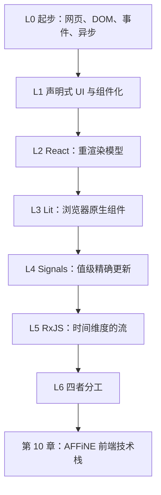
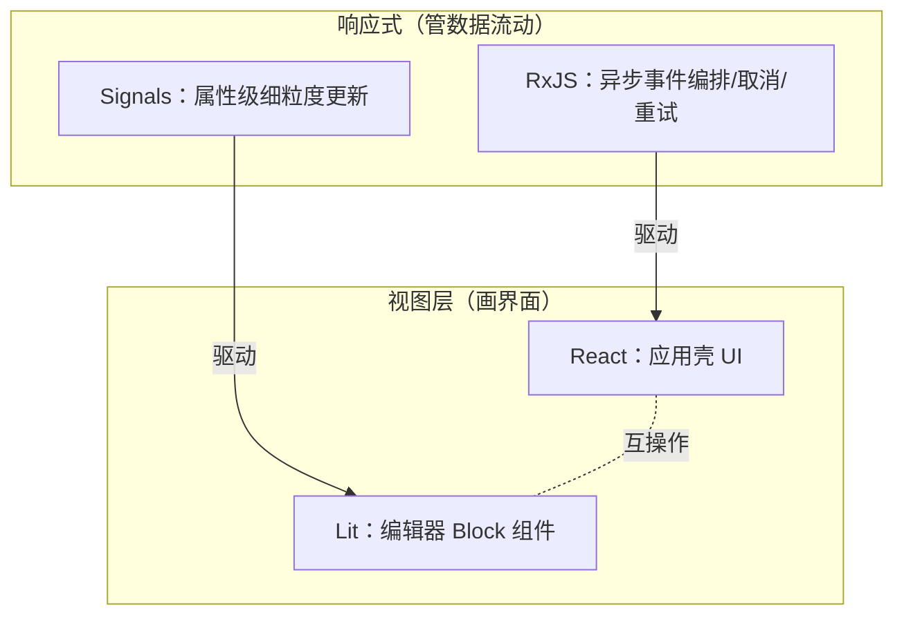

# 第 6 章 前端框架基础入门：React、Lit、Signals、RxJS

> **所属部分**：第 3 部分 · 编程语言与基础技术 ｜ **难度**：★★★☆☆ ｜ **建议学时**：14 小时（零基础路线）／8 小时（已有 JavaScript 与 DOM 基础） ｜ **前置章节**：<a href="./05-TypeScript基础入门.md#ch-5">第 5 章</a> 的起步节（会写 5 行 JavaScript 即可）；完全没写过代码的读者可从本章起步节接入 ｜ **后续**：<a href="./10-前端技术栈-React-Lit-Signals-RxJS.md#ch-10">第 10 章</a> 前端技术栈在 AFFiNE 中的应用

---

## 本章导读

<a href="./10-前端技术栈-React-Lit-Signals-RxJS.md#ch-10">第 10 章</a>一上来就会抛给你一个困惑：**为什么 AFFiNE 一个项目里同时有 React 组件和 Lit Web Components？为什么既有 RxJS 的 Observable，又有 Preact 的 Signal？** 直接读会被名词淹没。

本章就是那块垫脚石。与同部分其他基础章一样，本章**额外照顾完全没有写过前端代码的读者**：起步节从「一个网页到底由什么组成」讲起，把 DOM、事件、异步、`import` 这些从没被解释过的前提先铺好；后面的正文再一路铺到<a href="./10-前端技术栈-React-Lit-Signals-RxJS.md#ch-10">第 10 章</a>的起点。读完你应当能看懂它们各自「在解决什么问题」，以及「为什么一个大型编辑器项目需要四者并存」。

一句话先把四者的分工钉死：

- **React / Lit** 是**视图层框架**——把「数据」变成「界面」，回答「界面长什么样」。
- **Signals / RxJS** 是**响应式状态方案**——管理「数据什么时候变、怎么传播」，回答「数据怎么流动」。

视图层负责「画」，响应式负责「通知谁该重画」。本章只讲这些框架的**通用基础**，不深挖 AFFiNE 源码——源码细节留给<a href="./10-前端技术栈-React-Lit-Signals-RxJS.md#ch-10">第 10 章</a>。

### 三条学习路线

| 你的起点 | 怎么读 | 建议学时 |
| --- | --- | --- |
| **完全没写过代码** | 先走<a href="./05-TypeScript基础入门.md#ch-5">第 5 章</a>的起步节（值、变量、函数），再按顺序读完本章起步节与全部正文，每节的随堂小练都动手做 | 约 14 小时 |
| **会 JavaScript，没碰过 DOM / 框架** | 跳过起步节的前三小节，但务必读起步节里的「异步最小共识」，再按顺序读正文 | 约 8 小时 |
| **写过 React，只想补 Lit / Signals / RxJS** | 直接看正文各节的「规则小结」和[常见坑](#常见坑)，遇到不懂再回看例子 | 约 3 小时 |

> 表格里的「跳过」是真的可以跳过：正文各节**不依赖**起步节里的任何记号，起步节只负责把读者带到「能看懂第一行前端代码」的位置。

### 每一节的结构

正文各节都按同一节奏推进，方便你判断自己该细读还是略读：

1. **这一节要解决什么**——先说清动机，不先抛语法；
2. **最小例子 + 逐行看**——一段能跑的代码，逐行解释，不跳步；
3. **规则小结**——把例子里的规律收敛成可查的表；
4. **最容易误解的点**——初学者最常卡住的那一两处；
5. **随堂小练**——30 秒能做完的小题，答案折叠，先自己想再展开。

代码约定：`// 输出：…` 表示运行后看到的结果，`❌` 表示该行会报错，代码块语言标记里的 `html` / `jsx` / `ts` 只是为了方便高亮。

---

## 学习目标

**L0 · 起步**（起步节）

- [ ] 能说清 HTML、CSS、JavaScript 在一个网页里各管什么，能写一个最小网页并在浏览器里打开
- [ ] 能解释 DOM 是什么、`querySelector` 拿到的到底是什么，能读出一段 5 行的 DOM 操作
- [ ] 能说清事件与回调的关系，能写一个点击后改变文字的按钮
- [ ] 知道 `import` / npm / 「框架」分别是什么，为什么现代前端需要它们
- [ ] 能说清「同步 / 异步」「回调 / Promise」的最小区别，为 RxJS 铺路

**L1–L2 · 声明式 UI 与 React**（声明式 UI、React 两节）

- [ ] 能够说清「命令式 UI」与「声明式 UI」的区别，以及组件化为什么是现代前端的基石
- [ ] 能够用 React 的组件、JSX、`props`/`state` 搭出界面，并说清单向数据流的含义
- [ ] 能够正确使用 `useState`、`useEffect`、`useMemo`，并理解「重渲染」这一 React 核心模型

**L3 · Lit 与原生标准**（Lit 一节）

- [ ] 能够写出一个 Lit 自定义元素，使用响应式属性与 `html` 模板
- [ ] 能够说清 Lit 与 React 在「组件形式、模板、更新粒度、跨框架复用」上的根本差异

**L4–L5 · 响应式状态**（Signals、RxJS 两节）

- [ ] 能够解释 Signals 的 `signal`/`computed`/`effect`，并与 React 的重渲染模型做对比
- [ ] 能够读写 RxJS 的 `Observable`、订阅与 `map`/`filter`/`switchMap`，并说清它与 `Promise` 的区别
- [ ] 能判断「同步值派生」与「时间维度的异步事件」分别该用哪一个

**L6 · 合流**（四者合一）

- [ ] 能够为<a href="./10-前端技术栈-React-Lit-Signals-RxJS.md#ch-10">第 10 章</a>回答「为什么 AFFiNE 需要 React + Lit + Signals + RxJS 四者并存」

---

## 知识地图

本章是一条**阶梯**，不是四份并列的工具清单：后一级建立在前一级之上。



| 阶梯 | 对应小节 | 回答的问题 | 学完你能做什么 |
| --- | --- | --- | --- |
| L0 | 零基础起步 | 网页是什么？代码怎么跑起来？ | 独立打开一个网页、改一段 DOM |
| L1 | 声明式 UI 与组件化 | 为什么不能一直手写 DOM 操作？ | 说清 `UI = f(state)` 与组件化 |
| L2 | React | 状态变了，界面怎么跟着变？ | 用组件 + Hooks 写出交互界面 |
| L3 | Lit | 能不能不绑定某个框架？ | 写浏览器原生自定义元素 |
| L4 | Signals | 改一个字为什么要重跑一大片？ | 用信号做精确更新 |
| L5 | RxJS | 连续到来的事件怎么编排、取消？ | 用流与操作符写搜索框 |
| L6 | 四者合一 | 四者为什么要并存？ | 看懂<a href="./10-前端技术栈-React-Lit-Signals-RxJS.md#ch-10">第 10 章</a>的分工图 |

---

## 6.1 零基础起步：网页、DOM 与事件（写过前端可跳过）

> **对应阶梯**：L0 ｜ **预计**：3 小时 ｜ 这一节不出现任何 AFFiNE 源码，也不出现任何框架，只建立最小共识。

如果你从没写过前端代码，直接看 `document.querySelector('#btn')` 会像看外语。这一节把「网页到底是什么」讲清楚。需要的工具只有一个浏览器和一个文本编辑器，**不需要装 Node、不需要 npm、不需要构建工具**。

### 6.1.1 一个网页由什么组成：HTML、CSS、JavaScript 各管什么

网页不是一张图片，而是浏览器读取一份**文本文件**后画出来的结果。这份文本文件叫 HTML，另外两样东西负责「好不好看」和「能不能动」。

**最小例子**：在你电脑上新建一个文件 `hello.html`，写入下面 6 行，然后双击用浏览器打开。

```html
<!DOCTYPE html>
<html>
  <body>
    <p id="msg">你好</p>
    <script>document.querySelector('#msg').textContent = '你好，AFFiNE';</script>
  </body>
</html>
```

**逐行看**：

| 行 | 内容 | 它在做什么 |
| --- | --- | --- |
| 1 | `<!DOCTYPE html>` | 告诉浏览器「按现代 HTML 规则读我」，不是页面内容 |
| 2 | `<html>` | 整份文档的根，所有内容都装在它里面 |
| 3 | `<body>` | 「看得见的部分」都放在这里 |
| 4 | `<p id="msg">你好</p>` | 一个段落；`id="msg"` 是给它贴的**唯一门牌号**，方便代码找到它 |
| 5 | `<script>…</script>` | 里面写的是 JavaScript，浏览器读到这一行就**立刻执行** |
| 5（内） | `document.querySelector('#msg')` | 让浏览器把「门牌号为 msg 的那个元素」交给我 |
| 5（内） | `.textContent = '你好，AFFiNE'` | 把这个元素显示的文字改掉 |

打开后你看到的是「你好，AFFiNE」，而不是「你好」——因为 `<script>` 在浏览器画出段落后把它改了。

三者的分工记成一句话：

| 语言 | 管什么 | 类比 |
| --- | --- | --- |
| **HTML** | 页面上**有**什么（段落、按钮、输入框） | 房子的结构：墙、门、窗 |
| **CSS** | 这些东西**长什么样**（颜色、大小、位置） | 装修：刷什么颜色、家具摆哪 |
| **JavaScript** | 用户操作后**发生什么**（点击、输入、请求） | 水电与开关：按下去灯会亮 |

> 本章后面所有框架，本质上都在帮你写「JavaScript 该如何根据数据改变 HTML」。CSS 不参与这套逻辑，所以本章不再提它。

<details><summary>随堂小练 1：把「你好，AFFiNE」改成你自己的名字，需要动哪一行？</summary>

只改第 5 行 `<script>` 里单引号中的文字。HTML 第 4 行的「你好」是**初始值**，会被脚本覆盖；如果你只改第 4 行，页面最终仍显示脚本里写的那个值。这正好说明「初始内容」和「代码改后的内容」是两回事。

</details>

### 6.1.2 DOM：浏览器把标签变成一棵可以操作的对象树

浏览器读到 HTML 后，不会一直存着文本，而是把它**解析成一棵对象树**，这棵树叫 **DOM（Document Object Model，文档对象模型）**。每个标签变成树上的一个「节点对象」，JavaScript 拿到的就是这个对象，可以读它、改它。

```js
// 在浏览器控制台（F12 → Console）里逐行输入
const p = document.querySelector('#msg');
console.log(p);                  // 输出：<p id="msg">…</p> 这样一个对象
console.log(p.textContent);      // 输出：你好，AFFiNE
p.textContent = '又改了一次';     // 页面上那行字立刻变了
```

**逐行看**：

| 行 | 关键词 | 含义 |
| --- | --- | --- |
| 1 | `document` | 浏览器提供的全局对象，代表**当前整个页面** |
| 1 | `querySelector('#msg')` | 按 CSS 选择器找元素；`#` 表示按 `id` 找 |
| 1 | `const p = …` | 把找到的对象存进变量 `p`，后面反复用 |
| 3 | `.textContent` | 对象上的一个属性，读它就是读「这段显示的文字」 |
| 4 | 给属性赋值 | **不需要任何额外步骤**，页面立刻更新 |

这就是后面所有「框架帮你做的事」的原始版本：找到节点 → 改它。请记住这个动作，因为<a href="./06-前端框架基础入门-React-Lit-Signals-RxJS.md#sec-6-2">6.2 节</a>会告诉你为什么它在复杂界面里会失控。

<details><summary>随堂小练 2：`document.querySelector('#msg')` 如果找不到会返回什么？随后读 `.textContent` 会怎样？</summary>

返回 `null`（表示「没有这个对象」），再读 `null.textContent` 会报错 `Cannot read properties of null`。这是前端最常见的第一条报错：**选择器写错了，或者脚本执行时那个元素还没被浏览器读出来**。把 `<script>` 放在 `</body>` 之前就是为了避开后者。

</details>

### 6.1.3 事件：让代码在「用户做了什么」时运行

上一小节的代码是浏览器一加载就跑完的。真实界面要等用户点一下才动，这靠**事件**与**回调**。

```html
<button id="btn">点我</button>
<p id="out">还没点过</p>
<script>
  const btn = document.querySelector('#btn');
  btn.addEventListener('click', () => {
    document.querySelector('#out').textContent = '你点了一下';
  });
</script>
```

**逐行看**：

| 行 | 关键词 | 含义 |
| --- | --- | --- |
| 2 | `addEventListener('click', …)` | 登记一句话：「这个按钮被**点击**时，请执行后面这个函数」 |
| 2 | `'click'` | 事件名，浏览器定义好的字符串；同类还有 `'input'`、`'keydown'` |
| 2 | `() => { … }` | **箭头函数**，也就是「把一段代码打包成一个值，先不执行」 |
| 3 | 函数体 | 真正被点击时才运行，所以叫**回调**（回头再调用） |

关键点：`addEventListener` 这一行**只是登记**，登记完代码就往下走了；函数体在用户点击那一刻才被浏览器调用。这种「先把函数交给别人、将来某个时刻再调用」的写法，是本章后面 `useEffect`、Observable 订阅、`@click` 绑定的共同底色。

<div class="tip custom-block">
<p class="custom-block-title">最小共识：回调不是新语法</p>
<p>回调只是「把函数当参数传出去」。你在<a href="./05-TypeScript基础入门.md#ch-5">第 5 章</a>见过「函数也是值」，这里就是它的第一个真实用途。看到 <code>() =&gt; { … }</code> 时，先问「这段代码**什么时候**会跑」，比纠结语法更重要。</p>
</div>

<details><summary>随堂小练 3：把 `click` 改成 `input`，点击按钮还会变文字吗？</summary>

不会。`input` 事件是输入框内容变化时才触发，按钮不产生它。事件名必须和「用户实际做的动作」对得上——这也是后面 RxJS 里 `fromEvent(el, 'input')` 为什么要写对事件名的原因。

</details>

### 6.1.4 把代码跑起来：一个 HTML 文件 + 浏览器控制台

本章起步节和「命令式 vs 声明式」一节的所有原生例子，用下面这套流程就能验证，**零安装**：

1. 新建 `try.html`，写入代码并保存；
2. 双击文件，用浏览器打开；
3. 按 `F12`（macOS 可用 `Command + Option + I`）打开开发者工具，切到 **Console（控制台）**；
4. 在 Console 里可以直接输入 JavaScript 并回车，立刻看到结果；`console.log(x)` 的输出也出现在这里；
5. 改了文件就回到浏览器按 `Command/Ctrl + R` 刷新。

> 起步节不需要 Node、npm、TypeScript 编译器。到了 React / Lit / RxJS 的例子，才需要真正的工程环境；那些地方我们会明确标注「需要安装」，你不必现在就装。

<div class="tip custom-block">
<p class="custom-block-title">最容易误解的点</p>
<p>① 浏览器里直接写的 <code>&lt;script&gt;</code> 是最原始的玩法，真实项目会由构建工具把很多文件打包成浏览器能读的形式——这不是「换了门语言」。② 控制台里报的错不是「电脑坏了」，它通常会告诉你文件名、行号和问题，读法与<a href="./05-TypeScript基础入门.md#ch-5">第 5 章</a>拆编译报错一样。</p>
</div>

### 6.1.5 `import`、npm 与「框架」到底是什么

看本章后面的例子，你会反复见到 `import { useState } from 'react'`。三句话解释清楚：

| 名词 | 是什么 | 为什么存在 |
| --- | --- | --- |
| **模块（module）** | 一个可以「导出」变量/函数、供别的文件「导入」的文件 | 代码不能全塞进一个文件 |
| **包（package）/ npm** | 别人写好并发布的一堆模块；`npm i react` 就是把它下载到项目里 | 不用重复造轮子 |
| **库 vs 框架** | 库是「你调用它」；框架是「它规定结构、在合适时机调用你写的代码」 | React 组件、Lit 的 `render()` 都是「框架回过头来调用你」 |

所以 `import { useState } from 'react'` 的意思只是：**从已经装好的 react 包里，把名为 `useState` 的那个函数拿过来用**。它没有魔法，也不会联网。

「框架」这件事本身也不是新语言：React、Lit、RxJS 全部是 JavaScript 写出来的代码。它们存在的唯一理由是——复杂界面里，手工「找节点 → 改它」太容易漏改。下一节就从这个痛点讲起。

<details><summary>随堂小练 4：`import` 是浏览器原生能力，还是必须装构建工具？</summary>

现代浏览器原生支持 `import`（配合 `<script type="module">`），但「从包名 `react` 导入」需要工具把包名解析成实际文件路径，这一步由构建工具或 import map 完成。所以结论是：**语法是原生的，包解析需要工程环境**。本章正文的例子默认你已有这套环境。

</details>

### 6.1.6 异步最小共识：定时器、回调、Promise

RxJS 整节都建立在「事情不是立刻发生」之上。先建立三个最小概念：

```js
console.log('A：先执行');
setTimeout(() => console.log('C：1 秒后才执行'), 1000);
console.log('B：紧接着执行');
// 输出顺序：A → B → C
```

`setTimeout` 的意思是「把这段函数交给浏览器，1000 毫秒后再调用」。它**不会停在这里等**，所以 `B` 反而先打印。这种「先排上队、结果将来再给」的做法叫**异步**；上面那种「从上到下一行行立刻做完」叫**同步**。

| 写法 | 结果什么时候给 | 能给几次 | 能取消吗 |
| --- | --- | --- | --- |
| 同步 `return` | 立刻 | 1 次 | 不涉及 |
| 回调 / `setTimeout` | 将来某个时刻 | 可以多次 | 要自己记着清理 |
| `Promise` | 将来 | **1 次**（resolve 后结束） | 不能直接取消 |
| `Observable`（见 RxJS 一节） | 将来，订阅后才开始 | **0 到多次** | 能 `unsubscribe()` |

`Promise` 是「一张未来会兑现一张结果的凭据」：`fetch(url).then(res => …)` 里的函数就是结果到了以后才跑的回调。请只记住它最要紧的两个特点——**只给一个值、创建后马上开始**。后面的 RxJS 一节会拿它和 Observable 逐项对比。

<div class="tip custom-block">
<p class="custom-block-title">最容易误解的点</p>
<p>「异步」不等于「多线程」，也不等于「更快」。它只是说「结果不会在这一行立刻出现」。初学者最常见的 bug 是：在异步结果回来之前就去读它，读到 <code>undefined</code>。判断方法很简单——问一句「这行代码执行时，那个值已经到了吗？」</p>
</div>

<details><summary>随堂小练 5：把 `setTimeout` 的 1000 改成 0，输出顺序会变成 A → C → B 吗？</summary>

不会，仍是 A → B → C。延迟 0 表示「尽快，但也要等当前这段代码跑完再排到队里」。这正说明异步的关键不是等多久，而是**不会打断当前这段同步代码**。

</details>

### 6.1.7 起步自检

能用自己的话回答这五问，就可以进入正文了：

1. HTML、CSS、JavaScript 分别管什么？
2. `querySelector('#msg')` 返回的是文本、标签字符串，还是对象？
3. `addEventListener` 里的函数，是在登记时就执行，还是点击时才执行？
4. `import { useState } from 'react'` 里的 `react` 是什么？
5. `Promise` 与「一串陆续到来的值」有什么区别？

> 答不上第 5 问很正常，后面的 RxJS 一节会专门回来解释。前四问答得上，正文所有例子的「外壳」你就都认识了。

---

## 6.2 声明式 UI 与组件化：所有现代框架的共同起点

> **这一节要解决什么**：上一节你学会了「找到节点 → 改它」。界面一旦复杂，这个动作会散落在十几个回调里，任何一个分支忘了改某处，就会出现「数据变了、界面没变」。这一节要回答：**能不能让界面自动跟着数据走？**

### 6.2.1 命令式：你亲手操作 DOM

不借助框架，用原生 DOM 更新一个计数器要这样写：

```js
const btn = document.querySelector('#btn');
const label = document.querySelector('#count');
let count = 0;
btn.addEventListener('click', () => {
  count += 1;
  label.textContent = `当前：${count}`; // 你必须亲手同步 DOM
});
```

**逐行看**（对照起步节的表格，这里只多两样东西）：

| 行 | 内容 | 含义 |
| --- | --- | --- |
| 1–2 | 两个 `querySelector` | 拿到按钮和显示文字的那个元素 |
| 3 | `let count = 0` | 用一个变量记「当前点了几次」 |
| 4 | `addEventListener('click', …)` | 点击时执行回调 |
| 5 | `count += 1` | 改**数据** |
| 6 | `` label.textContent = `当前：${count}` `` | 改**界面**；反引号里的 `${…}` 是把变量嵌进字符串 |

问题在于：**状态（`count`）和界面（`label.textContent`）是两份东西，你要手动保持它们一致**。现在只有一个地方会改，看起来还好；如果再加上「重置」「撤销」「从服务器恢复」，就会有三四个地方都要记得写第 6 行——漏一个就是 bug。

### 6.2.2 声明式：你只描述「界面应该长什么样」

React、Lit 这类框架让你换一种思路：**写一个从状态到界面的函数**，状态一变，框架**自动**算出新界面并更新 DOM。

```jsx
// 伪代码：你只描述「给定 count，界面是什么样」
function Counter(count) {
  return `当前：${count}`;
}
// 你改 count，框架负责把 DOM 更新成 Counter(count) 的样子
```

<div class="tip custom-block">
<p class="custom-block-title">核心口诀</p>
<p><strong>UI = f(state)</strong>。界面是状态的一个「纯函数投影」。你的职责是维护 state 并写好这个 f，「怎么把旧 DOM 改成新 DOM」交给框架。命令式关心「怎么做」，声明式关心「要什么」。</p>
</div>

**规则小结**：

| | 命令式 | 声明式 |
| --- | --- | --- |
| 你写什么 | 一步步的 DOM 操作 | 从 state 到 UI 的映射 |
| 谁负责同步 | 你，且每处都要记得 | 框架，统一处理 |
| 状态存几份 | 数据 + DOM 各一份 | 只有 state 一份 |
| 随界面变复杂 | 操作点线性增长、易漏 | 描述不变，框架承担复杂度 |

### 6.2.3 组件化：把界面切成可复用的积木

现代框架还共享另一个思想：**组件**。把「一段界面 + 它的状态 + 它的行为」打包成一个独立单元，像搭积木一样组合、复用、嵌套。按钮是组件、对话框是组件、整个页面也是组件。本章的 React 和 Lit 都是「组件框架」，区别只在于**组件怎么定义、更新粒度多细**。

<div class="tip custom-block">
<p class="custom-block-title">最容易误解的点</p>
<p>「声明式」<strong>不是</strong>「不用 DOM」，而是「你不再亲手改 DOM」——框架最终仍然调用类似 <code>textContent = …</code> 的原生操作，只是替你做了。另外 <code>UI = f(state)</code> 里的 f 要「纯」：同样的 state 必须给出同样的界面，不要在算界面时顺手改数据、发请求。</p>
</div>

<details><summary>随堂小练：待办列表有「新增」「删除」「全部完成」三个操作，命令式写法需要几处 DOM 同步？声明式呢？</summary>

命令式要三处（每个操作后都要重新拼出列表 HTML）；声明式只要维护一个 `items` 数组，三个操作都只改这个数组，界面由同一个描述自动重算。差别不在代码行数，而在「**需要记住的同步点**」从 3 个降到 1 个。

</details>

---

## 6.3 React：声明式组件的主流答案

> **这一节要解决什么**：知道「UI = f(state)」之后，还差一个能落地实现的方案：state 存在哪、变了以后谁去重算、界面怎么拆成可复用的块。React 给出的答案是**函数组件 + Hooks**。

React 是目前最主流的视图层库。它的世界观只有一句：**组件是返回 UI 的函数，状态变了就重新调用这个函数**。

### 6.3.1 组件与 JSX

React 组件就是一个**返回 UI 的 JavaScript 函数**，函数名首字母大写。它返回的 `JSX`——一种「长得像 HTML 的 JavaScript 表达式」——最终被编译成 `React.createElement(...)` 调用。

```jsx
function Hello() {
  return <h1 className="title">Hello AFFiNE</h1>;
}
// 用大括号在 JSX 里嵌入任意 JS 表达式
function Greeting() {
  const name = 'AFFiNE';
  return <p>欢迎 {name.toUpperCase()}</p>;
}
```

**逐行看**：`function Hello()` 定义一个普通函数；`<h1 …>` 不是字符串也不是 HTML 文件，而是 **JSX 表达式**（编译后是 JS 对象）；`{}` 里可以放任意 JavaScript 表达式，所以 `{name.toUpperCase()}` 会算出 `AFFiNE`。

注意 JSX 的几个「和 HTML 不一样」的点：属性用 `className` 而非 `class`（`class` 是 JS 关键字）、事件用驼峰 `onClick`、`{}` 里放 JS 表达式。

### 6.3.2 props：父给子传数据（只读）

`props` 是父组件传给子组件的参数，**在子组件里是只读的**。这是「组件可复用」的关键——同一个组件传不同 props 就渲染出不同结果。

```tsx
interface ButtonProps {
  text: string;
  onClick: () => void;
}
function Button({ text, onClick }: ButtonProps) {
  return <button onClick={onClick}>{text}</button>;
}
// 父组件使用
<Button text="保存" onClick={() => console.log('saved')} />;
```

> 这里的 `ButtonProps` 正是<a href="./05-TypeScript基础入门.md#ch-5">第 5 章</a>的 `interface`——React 组件的 props 几乎都用 TypeScript 接口描述。`{ text, onClick }` 是解构：直接从传进来的对象里取出这两个字段。

### 6.3.3 state 与 useState：组件自己的、会变的数据

props 由外部传入且只读；**组件自己的、会随交互变化的数据叫 state**，用 `useState` 这个「Hook」声明。

```tsx
import { useState } from 'react';

function Counter() {
  const [count, setCount] = useState(0); // 初始值 0
  return (
    <button onClick={() => setCount(count + 1)}>
      点击了 {count} 次
    </button>
  );
}
```

**逐行看**：

| 行 | 内容 | 含义 |
| --- | --- | --- |
| 1 | `import { useState }` | 从 react 包里取这个函数（见起步节） |
| 4 | `useState(0)` | 声明一份 state，初值 `0`；返回一个长度为 2 的数组 |
| 4 | `const [count, setCount] = …` | 数组解构：第一项是**当前值**，第二项是**更新函数** |
| 6 | `onClick={() => setCount(count + 1)}` | 点击时调用更新函数，把新值交给 React |

关键理解：

- 你**不能**写 `count = count + 1` 去改它——必须调用 `setCount`。
- 调用 `setCount` 不只是改一个变量，而是**通知 React「这个组件的状态变了，请重新渲染我」**。
- 重渲染时，`Counter()` 函数被**再次调用**，`useState(0)` 这次返回的是最新的 `count`；`0` 只在第一次挂载时当初始值用。

<div class="tip custom-block">
<p class="custom-block-title">React 的核心模型：重渲染</p>
<p>React 的更新单位是<strong>整个组件函数</strong>。state 一变，组件函数从头到尾重新执行一遍，算出新的 JSX，React 再用「虚拟 DOM diff」找出最小的真实 DOM 改动。记住这点——它正是后面理解 Signals「细粒度更新」的对照物。</p>
</div>

### 6.3.4 单向数据流

React 规定数据**自上而下单向流动**：父组件通过 props 把数据传给子组件；子组件想「改」父的数据，不能直接改，而是调用父传下来的**回调函数**，由父自己去 `setState`。

```tsx
function Parent() {
  const [text, setText] = useState('');
  return <Input value={text} onChange={setText} />; // 数据往下、事件往上
}
function Input({ value, onChange }: {
  value: string;
  onChange: (v: string) => void;
}) {
  return (
    <input value={value} onChange={e => onChange(e.target.value)} />
  );
}
```

数据向下流、事件向上冒，状态只有一个「权威来源」（这里是 `Parent` 的 `text`）。这让数据流向可预测、好调试——这就是**单向数据流**。

### 6.3.5 受控组件

上面的 `Input` 就是**受控组件**的典型：表单元素的值**完全由 React state 决定**（`value={text}`），用户每次输入都触发 `onChange` 回写 state，再由 state 决定显示什么。界面与状态始终同步，是「UI = f(state)」在表单上的体现。

```tsx
// 非受控：DOM 自己存值，React 不知道 —— 少用
<input defaultValue="x" />
// 受控：值由 state 掌控，可随时校验/格式化
<input value={text} onChange={e => setText(e.target.value)} />
```

### 6.3.6 useEffect：处理「渲染之外」的副作用

组件函数应当是「纯」的——给定 props/state 就返回 UI，不干别的。但真实应用需要**副作用**：订阅事件、发请求、操作非 React 管理的资源。这些放进 `useEffect`。

```tsx
import { useEffect, useState } from 'react';

function Clock() {
  const [now, setNow] = useState(() => Date.now());
  useEffect(() => {
    const id = setInterval(() => setNow(Date.now()), 1000);
    return () => clearInterval(id); // 清理函数：组件卸载或依赖变化前调用
  }, []); // 依赖数组：[] 表示只在挂载时跑一次
  return <span>{new Date(now).toLocaleTimeString()}</span>;
}
```

**逐行看**：`setInterval` 就是起步节见过的定时器；`useEffect` 的第一个参数是「挂载后要执行的函数」，第二个参数 `[]` 是**依赖数组**；`return () => clearInterval(id)` 是清理函数，组件消失或依赖变化前调用，防止定时器一直跑下去（内存泄漏）。

三个要点，按重要性排序：

1. **依赖数组**决定何时重跑：`[]` 只在挂载时跑一次；`[a, b]` 在 `a` 或 `b` 变化后重跑；不写数组则每次渲染都跑。
2. **返回的清理函数**用来「收尾」——取消订阅、清除定时器。
3. effect 在**渲染提交到 DOM 之后**才执行，不要在渲染期间做副作用。

<div class="tip custom-block">
<p class="custom-block-title">别把 useEffect 当万金油</p>
<p>很多「要在 useEffect 里做」的事其实不需要它：能由现有 state/props 直接算出来的值，应当在渲染时算（必要时用 <code>useMemo</code>），而不是用 effect 写进另一个 state。effect 只用于「与外部系统同步」（订阅、定时器、手动 DOM、网络）。</p>
</div>

### 6.3.7 useMemo：缓存昂贵计算

因为 state 一变组件就**整个重跑**，每次渲染里的计算都会重来一遍。若某个计算很贵，用 `useMemo` 把结果**缓存**起来，只在依赖变化时才重算。

```tsx
import { useMemo } from 'react';

function List({ items, keyword }: { items: Item[]; keyword: string }) {
  // 只有 items 或 keyword 变时才重新过滤，否则复用上次结果
  const filtered = useMemo(
    () => items.filter(it => it.name.includes(keyword)),
    [items, keyword]
  );
  return <ul>{filtered.map(it => <li key={it.id}>{it.name}</li>)}</ul>;
}
```

注意 `map` 出来的列表每项要有稳定的 `key`，React 靠它在重渲染时识别「哪一项是哪一项」。`useMemo` 的近亲 `useCallback` 则是缓存函数本身，避免每次渲染都生成新函数引用。

**规则小结**：

| 概念 | 一句话 | 常见误用 |
| --- | --- | --- |
| 组件 / JSX | 返回 UI 的函数；JSX 是表达式 | 把 `<div>` 当字符串拼 |
| `props` | 父给子、只读 | 在子组件里直接改 props |
| `state` / `useState` | 组件自己的、会变的数据，必须用更新函数改 | 写 `count = count + 1` |
| 重渲染 | state 变 → 组件函数整体重跑 → diff | 以为 React 只改了那一处 DOM |
| `useEffect` | 渲染之后与外部系统同步 | 用它「把 A 算出来存进 B」 |
| `useMemo` | 依赖不变就复用上次计算结果 | 到处乱加，反而增加心智负担 |

<div class="tip custom-block">
<p class="custom-block-title">最容易误解的点</p>
<p>① <code>setCount</code> 之后<strong>同一函数里</strong>读 <code>count</code> 仍是旧值——新值要等下一次渲染。② 「重渲染」不是「把整个页面重画」，React 会 diff 出最小 DOM 改动；代价是<strong>组件函数被重新执行</strong>，这正是后面的 Signals 一节要优化的地方。③ 依赖数组不是「性能优化参数」，而是「这个 effect 依赖哪些值」的声明，漏写会读到过期值。</p>
</div>

<details><summary>随堂小练：一个计数器里，`setCount(count + 1); console.log(count);` 会打印新值还是旧值？为什么？</summary>

打印旧值。`count` 是**本次渲染**的变量，调用 `setCount` 只是排了一次「请重新渲染」，新的 `count` 要到下一次执行 `Counter()` 时才存在。想基于「上一次的值」连续自增，应写 `setCount(c => c + 1)`（函数式更新）。

</details>

<div class="tip custom-block">
<p class="custom-block-title">通往<a href="./10-前端技术栈-React-Lit-Signals-RxJS.md#ch-10">第 10 章</a></p>
<p><a href="./10-前端技术栈-React-Lit-Signals-RxJS.md#ch-10">第 10 章</a>会看到 AFFiNE 的 React 应用壳：从 <code>createRoot</code> 到层层 <code>Provider</code>，再到 <code>useLiveData</code>（它内部用的是官方 <code>useSyncExternalStore</code>——订阅外部数据源的标准 Hook）。本节把 <code>useState/useEffect/useMemo</code> 和重渲染模型吃透，到那里只是「换个数据源」。</p>
</div>

---

## 6.4 Lit：直接用浏览器原生的 Web Components

> **这一节要解决什么**：React 自成体系，写出来的组件只能在 React 里用。可 AFFiNE 的编辑器内核要能独立发布、被任何框架嵌入。有没有一种组件**就是浏览器原生的 HTML 标签**？有，这就是 Lit 的出发点。

React 把组件做成了「自己的一套体系」。Lit 走的是另一条路：**站在浏览器原生标准 Web Components 之上**做一层薄薄的封装。这决定了它和 React 的根本差异。

### 6.4.1 Web Components 与自定义元素

Web Components 是浏览器**原生**支持的一组标准，核心是**自定义元素（Custom Elements）**：你可以定义自己的 HTML 标签（如 `<my-counter>`），像用 `<div>` 一样用它。Lit 提供基类 `LitElement` 让定义自定义元素变得简单。

```ts
import { LitElement, html } from 'lit';
import { customElement } from 'lit/decorators.js';

@customElement('my-hello') // 注册标签名，之后可写 <my-hello></my-hello>
export class MyHello extends LitElement {
  render() {
    return html`<h1>Hello AFFiNE</h1>`;
  }
}
```

**逐行看**：`@customElement('my-hello')` 是**装饰器**——给类贴一张标签，作用等价于在别处写 `customElements.define('my-hello', MyHello)`；`extends LitElement` 表示继承 Lit 提供的基类；`render()` 是框架**回过头来调用**的方法（对照起步节「框架在合适时机调用你」）；`` html`…` `` 是带标签的模板字符串，返回 Lit 能识别的模板对象。

因为它是**原生标签**，`<my-hello>` 可以被任何框架甚至纯 HTML 页面使用——这就是 AFFiNE 编辑器内核选 Lit 的首要原因：**框架无关，可独立发布**。

### 6.4.2 响应式属性：@property 与 @state

Lit 的「状态」叫**响应式属性**，用装饰器声明。属性变化后，Lit **自动、异步、批量**地调用 `render()`。

```ts
import { LitElement, html } from 'lit';
import { customElement, property, state } from 'lit/decorators.js';

@customElement('my-counter')
export class MyCounter extends LitElement {
  @property({ type: Number }) start = 0; // 对外：可从 HTML attribute 传入
  @state() private count = 0;            // 内部：私有状态

  render() {
    return html`
      <button @click=${() => (this.count += 1)}>
        ${this.start + this.count}
      </button>
    `;
  }
}
```

- `@property()`：**对外**的属性，可通过 HTML attribute（`<my-counter start="5">`）或 JS property 传入，类似 React 的 props。
- `@state()`：**内部**私有状态，类似 React 的 state。
- 关键差异：这里直接写 `this.count += 1` 就能触发更新，**不需要 `setState`**——Lit 用属性的 setter 侦测变化。

### 6.4.3 html`` 模板与绑定语法

Lit 用**带标签的模板字符串** `` html`...` `` 写模板（底层是 lit-html），不需要 JSX 编译。它的绑定语法要记住四种前缀：

```ts
html`
  <div class=${cls}>普通绑定 → 设置 attribute</div>
  <input .value=${text} />          <!-- . 前缀 → 设置 DOM property -->
  <button ?disabled=${isBusy}>      <!-- ? 前缀 → 布尔 attribute -->
  <a @click=${this.onClick}>        <!-- @ 前缀 → 事件监听 -->
`;
```

| 前缀 | 绑定目标 | 对应起步节的概念 |
| --- | --- | --- |
| 无 | HTML attribute（写进标签里的字符串） | `<p id="msg">` 里的 `id` |
| `.` | DOM property（对象上的属性） | `p.textContent` |
| `?` | 布尔 attribute（true 就存在、false 就移除） | `disabled` 这类开关 |
| `@` | 事件监听 | `addEventListener` |

与 React 不同，lit-html **只更新模板里发生变化的那几个绑定点**，不会「重新执行整个组件函数」。这是比 React 更细的更新粒度。

### 6.4.4 Lit 与 React 的根本差异

<div class="tip custom-block">
<p class="custom-block-title">一句话抓住区别</p>
<p>React 的更新单位是<strong>整个组件函数重跑 + 虚拟 DOM diff</strong>；Lit 的更新单位是<strong>模板里的单个绑定点</strong>，没有虚拟 DOM。React 是「自成体系的库」，Lit 是「原生标准的封装」。</p>
</div>

| 维度 | React | Lit |
| --- | --- | --- |
| 底层 | 自有虚拟 DOM 体系 | 浏览器原生 Web Components |
| 组件形式 | 函数组件 | 继承 `LitElement` 的类 + 自定义标签 |
| 模板 | JSX（需编译） | `` html`` `` 标签模板（运行时） |
| 状态 | `useState`，改值用 `setState` | `@property`/`@state`，直接赋值 |
| 更新粒度 | 组件级重渲染 + diff | 模板绑定点级 |
| 跨框架复用 | 否（React 专用） | 是（原生标签，任何框架可用） |
| 样式隔离 | 无内置（靠 CSS 方案） | 可选 Shadow DOM 隔离 |

> <a href="./10-前端技术栈-React-Lit-Signals-RxJS.md#ch-10">第 10 章</a>会看到：AFFiNE 的**应用壳**（侧边栏、设置页、弹窗）用 React，**编辑器内核 BlockSuite**（段落、表格、白板）用 Lit，因为富文本编辑需要对 `contenteditable`、Selection 做精细的原生 DOM 控制，不希望和 React 的虚拟 DOM 打架。

<div class="tip custom-block">
<p class="custom-block-title">最容易误解的点</p>
<p>① 自定义元素标签名<strong>必须含连字符</strong>（<code>my-counter</code> 合法、<code>counter</code> 不合法），这是浏览器标准的规定，不是 Lit 的癖好。② 装饰器 <code>@property</code> 需要编译（TypeScript 配置或构建工具），起步节那个「零安装 HTML 文件」玩不了这一节；但用 CDN 版 Lit 时可以改用静态 <code>properties</code> 字段，语义完全一致。③ 「直接赋值就能更新」只适用于<strong>替换整个属性值</strong>；改对象内部字段（<code>this.data.x = 1</code>）不会被侦测到，要整体重新赋值。</p>
</div>

<details><summary>随堂小练：把 `&lt;my-counter start="5"&gt;` 改成 `start="10"`，需要改 JS 代码吗？</summary>

不需要。`start` 用 `@property` 声明，是从 HTML attribute 传进来的对外属性，浏览器会把 `"10"` 按 `type: Number` 转成数字 10 再交给组件。这正是「对外 props / 对内 state」的分工：外部只改标签，组件内部逻辑不动。

</details>

---

## 6.5 Signals：细粒度响应式

> **这一节要解决什么**：React 的「state 一变就重跑整个组件函数」很好用，但一个编辑器里有成千上万个段落，改一个字不该牵动一大片。能不能让更新**精确到某个值**？

React 的重渲染模型简单好用，但有个代价：**state 一变，整个组件函数重跑**。当一个界面里有成千上万个独立单元（比如编辑器里的每个段落），「改一个字就重跑一大片」就太浪费了。**Signals** 就是为「精确更新」而生的响应式原语。

### 6.5.1 signal / computed / effect

Signals 的 API 极简，只有三个核心：

```ts
import { signal, computed, effect } from '@preact/signals-core';

const count = signal(0);                        // ① 可写信号，用 .value 读写
const double = computed(() => count.value * 2); // ② 派生信号，自动追踪依赖
const dispose = effect(() => {                  // ③ 副作用，读到的信号变了就重跑
  console.log('double =', double.value);
});

count.value = 1; // 打印 "double = 2"，double 和 effect 自动跟着变
dispose();       // 停止这个 effect
```

**逐行看**：`signal(0)` 造出一个「盒子」，值放在 `.value` 里；`computed(fn)` 不立刻算，而是记下「这个 fn 读过哪些盒子」；`effect(fn)` 同理，并在依赖变化时**重新执行 fn**；`count.value = 1` 是一次赋值，但因为它走的是盒子的 setter，所有登记过的依赖者都被通知到。

- **`signal(initial)`**：一个「会变的值」，用 `.value` 读写。
- **`computed(fn)`**：从别的信号**派生**出的只读值，`fn` 里读了谁就**自动依赖谁**，依赖变了自动重算。
- **`effect(fn)`**：副作用。`fn` 里读到的信号一变，`fn` 就自动重跑；返回值是一个「停止函数」。

关键魔法是**自动依赖追踪**：你不用手动声明「我依赖 count」（对比 React 的 `useEffect` 依赖数组要手写），框架在 `fn` 执行时记录它读了哪些信号，从而建立一张**精确到单个值**的依赖图。

### 6.5.2 Signals vs React 重渲染

<div class="tip custom-block">
<p class="custom-block-title">两种模型的分水岭</p>
<p>React：<strong>推翻重来</strong>——state 变 → 组件函数整个重跑 → diff 找改动。粒度是「组件」。<br>Signals：<strong>精确制导</strong>——signal 变 → 只重跑依赖它的 computed/effect → 只更新那一处。粒度是「值」。</p>
</div>

| 维度 | React 重渲染 | Signals |
| --- | --- | --- |
| 更新单位 | 整个组件函数 | 单个依赖该信号的计算 |
| 依赖声明 | 手写依赖数组（`useEffect`/`useMemo`） | 运行时自动追踪 |
| 读取方式 | 直接读变量（闭包捕获） | 通过 `.value` 读 |
| 适合场景 | 常规表单/列表/页面 | 海量独立单元的精确更新 |
| 心智 | 「状态变了就重算界面」 | 「值变了就通知依赖者」 |

一段对照代码，感受「不重跑组件也能更新」：

```ts
const first = signal('AFFiNE');
const last = signal('App');
const full = computed(() => `${first.value} ${last.value}`);

effect(() => render(full.value)); // 只有这个 effect 会在名字变化时重跑
first.value = 'BlockSuite';        // 不触碰 last，也没有「组件重渲染」概念
```

### 6.5.3 batch 与 peek：两个常用补充

```ts
import { signal, effect, batch } from '@preact/signals-core';
const a = signal(1);
const b = signal(2);
effect(() => console.log(a.value + b.value));

batch(() => {   // 批量更新：内部多次改值只在结束后触发一次 effect
  a.value = 10;
  b.value = 20;
});             // 只打印一次 "30"，而不是 11、30 两次

a.peek();       // 读取当前值但【不建立依赖】——不想让某次读取触发重跑时用
```

**规则小结**：

| API | 作用 | 关键约束 |
| --- | --- | --- |
| `signal(v)` | 可写值 | 必须经 `.value` 读写才会被追踪 |
| `computed(fn)` | 派生只读值 | 依赖在 `fn` 执行时自动收集 |
| `effect(fn)` | 依赖变化就重跑 | 记得保存返回值并适时 `dispose()` |
| `batch(fn)` | 多次改值合并成一次通知 | 只是抑制中间通知，不改变最终结果 |
| `peek()` | 读值但不建立依赖 | 用于「只想看一眼」的调试/日志 |

<div class="tip custom-block">
<p class="custom-block-title">最容易误解的点</p>
<p>① 只有<strong>在 <code>computed</code>/<code>effect</code> 执行期间</strong>读 <code>.value</code> 才会建立依赖；在普通函数里读，什么都不会自动发生。② <code>effect</code> 名字像 <code>useEffect</code>，但两者不是一回事：前者是「依赖图上的节点」，后者是「渲染后同步外部系统」的 React Hook。③ Signals 是<strong>同步</strong>的「当前值」模型，不处理「一串随时间到来的值」——那是下一节 RxJS 的地盘。</p>
</div>

<details><summary>随堂小练：`const double = computed(() => count.value * 2)` 之后立刻读 `double.value`，会得到什么？它依赖 `count` 是谁告诉它的？</summary>

得到 0（初值 0 的两倍）。依赖不是你声明的，而是 <code>computed</code> 在**执行这个函数时**发现「你读了 count.value」，于是自动把 count 登记为依赖；此后 <code>count.value = 1</code> 才会让 double 变成 2。这也是为什么把 <code>count.value</code> 提前存进局部变量再传进去，依赖就可能丢掉。

</details>

<div class="tip custom-block">
<p class="custom-block-title">通往<a href="./10-前端技术栈-React-Lit-Signals-RxJS.md#ch-10">第 10 章</a></p>
<p><a href="./10-前端技术栈-React-Lit-Signals-RxJS.md#ch-10">第 10 章</a>会看到 BlockSuite 把存在 Yjs（CRDT 数据）里的 Block 属性同步成 <code>xxx$</code> 信号，并用一个叫 <code>SignalWatcher</code> 的 Lit 混入，把组件的 <code>render()</code> 包进一个 <code>effect</code>——于是「渲染时读了哪些信号就自动追踪哪些」，属性一变只刷新用到它的那个 Block。本节的 <code>signal/computed/effect</code> 正是那套机制的全部地基。</p>
</div>

---

## 6.6 RxJS：把「随时间发生的事件」当成流来处理

> **这一节要解决什么**：Signals 管「某个值现在是多少」，可网络请求、WebSocket 消息、用户连续输入、重试与取消，都是「随时间陆续到来的一串值」，还常常需要「新值来了就丢掉旧结果」。起步节那张表里的最后一行，就是这一节要展开的东西。

前面的 Signals 擅长「某个值变了→精确更新某处」，但它是**同步的、拉取式的**。还有一类问题是关于**时间**的：网络请求、WebSocket 消息、用户连续输入、重试与取消……这些是「随时间陆续到来的一串值」。**RxJS** 就是处理这类问题的语言，核心抽象是 **Observable（可观察的流）**。

### 6.6.1 Observable 与订阅

可以把 `Observable` 理解成「**一个会随时间推送 0 到多个值的数据源**」。它是**惰性**的——**没人订阅就什么都不发生**；订阅后才开始推送，推送通过三种回调：`next`（来了一个值）、`error`（出错终止）、`complete`（正常结束）。

```ts
import { Observable } from 'rxjs';

const clock$ = new Observable<number>(subscriber => {
  let n = 0;
  const id = setInterval(() => subscriber.next(n++), 1000);
  return () => clearInterval(id); // 退订时的清理（teardown）
});

const sub = clock$.subscribe(v => console.log('tick', v)); // 开始推送
// ...
sub.unsubscribe(); // 取消订阅 → 触发上面的清理
```

**逐行看**：`new Observable(fn)` 里的 `fn` 只是**一份说明书**，此刻不会执行；`subscribe` 时才执行说明书，并把一个 `subscriber` 交给它；`subscriber.next(n++)` 就是「往外推一个值」；说明书 `return` 的函数叫 teardown，退订时调用——和 React `useEffect` 的清理函数、起步节的 `clearInterval` 是同一个套路。

> 约定：Observable 变量名常以 `$` 结尾（如 `clock$`），一眼看出「这是一条流」。

### 6.6.2 操作符：流的「数组方法」

单个 Observable 没什么用，威力在**操作符**——用 `pipe()` 把流一级级变换，很像数组的 `map`/`filter`，只不过作用在「时间维度上的值」。

```ts
import { of } from 'rxjs';
import { map, filter } from 'rxjs';

of(1, 2, 3, 4)
  .pipe(
    filter(n => n % 2 === 0), // 只保留偶数：2, 4
    map(n => n * 10)          // 每个乘 10：20, 40
  )
  .subscribe(v => console.log(v)); // 20, 40
```

最能体现「流」价值的是 **`switchMap`** 这类「高阶映射」——把每个值映射成**一条新的流**，并自动管理新旧流的切换：

```ts
import { fromEvent } from 'rxjs';
import { map, debounceTime, switchMap } from 'rxjs';

const input = document.querySelector('input')!;
fromEvent(input, 'input')
  .pipe(
    map(e => (e.target as HTMLInputElement).value),
    debounceTime(300),              // 停止输入 300ms 后才继续，防抖
    switchMap(keyword => search(keyword)) // 新关键词到来 → 自动取消上一个请求
  )
  .subscribe(results => render(results));
```

**逐行看**：`fromEvent(input, 'input')` 把起步节的 `addEventListener` 包成一条流；`map` 把事件对象换成输入框文字；`debounceTime(300)` 表示「停手 300ms 才放行一个值」；`switchMap` 把每个关键词变成一次请求，并在新关键词到来时**自动放弃上一次还没回来的结果**。

`switchMap` 的「自动取消旧请求」正是搜索框的经典需求——这用 `Promise` 要手写一堆取消逻辑，用 RxJS 一个操作符就搞定。相关的还有 `mergeMap`（并发全部）、`concatMap`（排队串行）、`exhaustMap`（忙时忽略新值、防重复提交）。

### 6.6.3 Observable 与 Promise 的区别

<div class="tip custom-block">
<p class="custom-block-title">Promise 是「一次性」，Observable 是「流」</p>
<p>Promise 代表<strong>一个</strong>未来的值，一旦 <code>resolve</code> 就结束、不能取消、创建即执行。Observable 代表<strong>一串</strong>随时间到来的值，惰性（订阅才执行）、可发多次、可取消、可组合。一句话：Promise 是单发，Observable 是连发且可退订。</p>
</div>

| 维度 | Promise | Observable |
| --- | --- | --- |
| 值的数量 | 1 个 | 0 到多个 |
| 执行时机 | 创建即执行（急切） | 订阅才执行（惰性） |
| 可否取消 | 不可（需额外 AbortController） | 可，`unsubscribe()` |
| 可否多次 | 否 | 是 |
| 组合能力 | `then`/`async-await` | 几十种操作符 |

Observable 能表达 Promise，反之不行（Promise 只是「发一个值就 complete 的特例」）。RxJS 提供 `firstValueFrom(obs$)` 把流转成 Promise，`from(promise)` 把 Promise 转成流，两者可以互通。

### 6.6.4 「流」的思维

学 RxJS 真正的门槛不是 API，而是**换一种看问题的方式**：不再把「一次点击」「一个请求」当成孤立事件去写回调，而是把它们看成**一条可以被变换、过滤、合并、节流、取消的流**。一旦建立「万物皆流」的心智，很多原本要靠全局变量、标志位、手动取消才能解决的异步难题，就变成了几个操作符的组合。

**规则小结**：

| 概念 | 一句话 | 对应起步节 |
| --- | --- | --- |
| `Observable` | 一份「如何推送值」的说明书 | `addEventListener` 的登记动作 |
| `subscribe` | 真正开始执行说明书 | 用户真的点了按钮 |
| `next` / `error` / `complete` | 三种出站通知 | 回调被调用 / 出错 / 结束 |
| `pipe` + 操作符 | 在时间维度上变换值 | 数组的 `map`/`filter` |
| `unsubscribe` / teardown | 停止并清理 | `clearInterval`、effect 清理函数 |

<div class="tip custom-block">
<p class="custom-block-title">最容易误解的点</p>
<p>① 写了 <code>new Observable(…)</code> 却什么都没发生，<strong>不是 bug</strong>——它惰性，要 <code>subscribe()</code>。② 同一条「冷」流订阅两次，说明书会各执行一遍（两个独立定时器），需要共享时要用 <code>share()</code> 一类操作符。③ <code>switchMap</code> 取消的是「旧的内层流」，不等于取消了 HTTP 请求本身，是否真的中止请求取决于 <code>search()</code> 返回的流有没有在 teardown 里调用 <code>AbortController</code>。</p>
</div>

<details><summary>随堂小练：`of(1, 2, 3).pipe(map(n => n * 10))` 写完后不调用 `subscribe`，`map` 里的函数会执行吗？</summary>

不会。`of(1,2,3)` 造出来的也是惰性流，<code>pipe</code> 只是把说明书又包了一层；只有 <code>subscribe</code> 才触发值的推送，<code>map</code> 是对<strong>每个流过的值</strong>执行的。这点和数组的 <code>map</code>（立刻返回新数组）很不一样，是最常见的思维惯性错误。

</details>

<div class="tip custom-block">
<p class="custom-block-title">通往<a href="./10-前端技术栈-React-Lit-Signals-RxJS.md#ch-10">第 10 章</a></p>
<p><a href="./10-前端技术栈-React-Lit-Signals-RxJS.md#ch-10">第 10 章</a>会看到 AFFiNE 用 <code>BehaviorSubject</code>（带当前值的流）、<code>switchMap/combineLatest/share/throttleTime</code> 在 <code>nbstore</code> 里聚合多端同步状态，还会看到自研的 <code>LiveData</code>——它本质是「<strong>包了一层更好用外壳的 RxJS</strong>」，既有流的组合取消能力，又能像 signal 一样同步读当前值，并桥接到 React 的 <code>useSyncExternalStore</code>。本节把 Observable 和几个操作符吃透，就能看懂那些管道。</p>
</div>

---

## 6.7 四者合一：它们如何分工

把本章四样东西放回一张图，就是<a href="./10-前端技术栈-React-Lit-Signals-RxJS.md#ch-10">第 10 章</a>要展开的全景雏形：



- **React + RxJS（LiveData）**：应用壳用 React 画界面，业务状态与异步流程用基于 RxJS 的 LiveData 管理，`useLiveData` 把流接进 React。
- **Lit + Signals**：编辑器每个 Block 用 Lit 画，属性用 Signals 做属性级更新，改一个段落只刷新那一个。
- **互操作**：两套视图层需要互相嵌入（React 里放 Lit 编辑器、Lit 工具栏里放 React 菜单）——这是<a href="./10-前端技术栈-React-Lit-Signals-RxJS.md#ch-10">第 10 章</a>的重点之一。

从起步节的视角回看，这张图其实只回答了两件事：**谁负责把 state 画成 DOM（React / Lit）**，以及**谁负责在值变化时通知「该重画了」（Signals / RxJS）**。记住这张分工图，你就已经站在<a href="./10-前端技术栈-React-Lit-Signals-RxJS.md#ch-10">第 10 章</a>的起点了。

---

## 动手实践

> 从 L0 到 L5 递进。零基础读者请从第 1 题开始，不要跳。

1. **（L0）打开一个网页**：新建 `try.html`，放一个段落和一个按钮，用一个 `<script>` 让按钮点击后改段落文字，在浏览器控制台里用 `console.log` 打印被点击的次数。**验收**：能说清 `querySelector` 返回的是对象、`addEventListener` 里的函数什么时候才执行。
2. **（L1）命令式改声明式**：用原生 DOM 写一个待办列表（增删项），再用 React 重写一遍。**验收**：说清 React 版里你不再手动操作任何 DOM 节点，只维护了一个 `items` state；列出命令式版里有几处需要同步 DOM。
3. **（L2）React Hooks 三连**：写一个搜索框组件：`useState` 存关键词（受控输入）、`useMemo` 过滤列表、`useEffect` 在关键词变化时打印日志并带清理函数。**验收**：能解释依赖数组分别填 `[]`、`[keyword]`、不填时的行为差异，并说出 `setKeyword` 之后同一函数里 `keyword` 是新值还是旧值。
4. **（L3）Lit 自定义元素**：在一个空 HTML 页面里（CDN 引入 lit）写一个 `<my-counter start="5">`，用响应式属性接收 `start`、内部状态存点击次数、`@click` 自增。**验收**：改 HTML 里的 `start="10"` 能反映到初值；点击能自增且无需 `setState`；能说出标签名为什么必须带连字符。
5. **（L4）Signals 精确更新**：在仓库外 `npm i @preact/signals-core`，用 `signal`+`computed`+`effect` 计算 `a + b`，连续改 `a` 三次，再用 `batch` 包住多次改值，对比 effect 触发次数。**验收**：能说清「依赖是谁收集的」，以及 `peek()` 为什么不会让 effect 重跑。
6. **（L5）RxJS vs Signals 对照**：`npm i rxjs`，用 `BehaviorSubject`+`combineLatest`+`map` 实现同样的 `a + b`，并加一个 `debounceTime` 观察「流」与「同步值」的差别；再用 `fromEvent` + `switchMap` 写一个搜索框。**验收**：能用自己的话说清「Signals 是同步依赖图，RxJS 是推送式时间流」，并解释不 `subscribe` 为什么什么都不发生。

---

## 自测题

<details><summary>Q1（L0）. HTML、CSS、JavaScript 在一个网页里各管什么？</summary>

HTML 决定页面上有什么（结构与内容），CSS 决定长什么样（样式与布局），JavaScript 决定用户操作后发生什么（行为与数据）。本章所有框架都只属于第三类。

</details>

<details><summary>Q2（L0）. `document.querySelector('#msg')` 返回的是什么？改它为什么会立刻反映到页面上？</summary>

返回浏览器解析 HTML 后得到的 **DOM 节点对象**，不是字符串。DOM 是浏览器用来画页面的那棵对象树，给对象的 `textContent` 赋值就等于改了这棵树，浏览器随即重新绘制。

</details>

<details><summary>Q3（L0）. `import { useState } from 'react'` 里的 `react` 是什么？</summary>

是通过 npm 装到项目里的一个**包**：别人写好并发布的一堆 JavaScript 模块。`import` 只是从这个包里把名为 `useState` 的函数取出来用，语法本身没有魔法、也不会联网。

</details>

<details><summary>Q4（L0）. 回调、Promise、Observable 在「能给出几个结果」上有什么差别？</summary>

回调可以由调用方调用多次；Promise 只兑现**一个**结果，resolve 后结束；Observable 可以推送 **0 到多个**值，并且订阅才开始、可退订。这张对照表就是 RxJS 一节的出发点。

</details>

<details><summary>Q5（L1）.「声明式 UI」和「命令式 UI」的本质区别是什么？</summary>

命令式要你亲手找到 DOM 节点并修改它（关心「怎么做」），需要手动保持状态与界面一致；声明式让你只写「给定 state，界面长什么样」这个映射（`UI = f(state)`，关心「要什么」），状态变化后框架自动算出并应用 DOM 改动。

</details>

<details><summary>Q6（L2）. React 里为什么不能直接 `count = count + 1`，而要用 `setCount`？</summary>

直接改变量 React 感知不到，界面不会更新。`setCount` 不仅更新值，还**通知 React 重新渲染该组件**——组件函数重跑、算出新 JSX、diff 后更新 DOM。state 的更新必须经由更新函数，这是 React 重渲染模型的前提。另外 `setCount` 之后同一函数里读到的仍是本次渲染的旧值。

</details>

<details><summary>Q7（L2）. `useEffect` 的依赖数组填 `[]`、`[a]`、不填，分别是什么行为？</summary>

`[]`：只在组件挂载时执行一次；`[a]`：挂载时执行，之后每当 `a` 变化再执行；不填：每次渲染后都执行。返回的清理函数在「下次执行前」或「组件卸载时」调用。依赖数组是「这个 effect 依赖哪些值」的声明，不是性能开关。

</details>

<details><summary>Q8（L3）. Lit 和 React 更新粒度的根本差异？</summary>

React 的更新单位是整个组件函数（state 变就重跑函数 + 虚拟 DOM diff）；Lit 基于原生 Web Components，lit-html 只更新模板中发生变化的绑定点，没有虚拟 DOM，粒度更细。附带差异：Lit 组件是原生标签，可跨框架复用。

</details>

<details><summary>Q9（L3）. Lit 模板里 `.` / `?` / `@` 三种绑定前缀分别绑定什么？</summary>

`.` 绑定 DOM property（对象属性，如 `input.value`），`?` 绑定布尔 attribute（如 `disabled`，false 时移除），`@` 绑定事件监听（等价于 `addEventListener`）。不带前缀则设置普通 HTML attribute。

</details>

<details><summary>Q10（L4）. Signals 的「自动依赖追踪」相比 React 的依赖数组好在哪？</summary>

React 的 `useEffect`/`useMemo` 要你手写依赖数组，漏写/多写都会出 bug；Signals 在 `computed`/`effect` 执行时自动记录读取了哪些信号，建立精确到单个值的依赖图，不用手动声明，且更新只波及真正依赖该信号的计算。前提是必须通过 `.value` 读取。

</details>

<details><summary>Q11（L5）. Observable 和 Promise 最关键的三个区别？</summary>

① 数量：Promise 发一个值，Observable 发 0 到多个；② 执行时机：Promise 创建即执行，Observable 订阅才执行（惰性）；③ 取消：Promise 不可取消，Observable 可 `unsubscribe()`。此外 Observable 有丰富的操作符用于组合。

</details>

<details><summary>Q12（L5）. 搜索框为什么适合用 `switchMap`？</summary>

`switchMap` 把每个关键词映射成一条请求流，并在新值到来时**自动放弃上一条还没完成的内层流**。这正好满足「用户改了关键词，就不要旧关键词的结果了」的需求，避免过期结果覆盖最新结果，无需手写取消逻辑。注意它取消的是流，HTTP 请求是否真的中止还取决于请求流有没有实现 teardown。

</details>

---

## 常见坑

| 现象 | 原因 | 怎么处理 | 对应阶梯 |
| --- | --- | --- | --- |
| `Cannot read properties of null` | 选择器没找到元素，或脚本跑得比 HTML 解析早 | 检查 `id` 拼写；把 `<script>` 放在 `</body>` 前 | L0 |
| 异步结果读出来是 `undefined` | 在结果回来之前就去读它 | 把后续逻辑放进回调 / `.then` / `subscribe` | L0 |
| 改了变量界面不更新（React） | 直接改了 state 变量而非调用更新函数 | state 必须用 `setCount` 一类更新函数修改 | L2 |
| `setState` 之后立刻读到旧值 | 新值要到下一次渲染才存在 | 用 `setCount(c => c + 1)` 函数式更新 | L2 |
| `useEffect` 无限循环 | effect 里 `setState` 又把依赖改了 | 检查依赖数组、把不必要的依赖移除 | L2 |
| 列表渲染警告 "missing key" | `map` 出的元素缺 `key` | 给每项加稳定唯一的 `key`（不要用数组下标） | L2 |
| 以为 `useEffect` 什么都该放 | 派生值被误当成「副作用」 | 能由 props/state 直接算出的值在渲染期算，必要时 `useMemo` | L2 |
| Lit 组件不更新 | 改了对象内部字段而非替换整个属性 | 响应式属性要重新赋值才触发更新 | L3 |
| 自定义元素没生效 | 标签名不含连字符 | 改成 `my-counter` 这类带连字符的名字 | L3 |
| 把 Lit 当 React 写 | 误用 `setState` / JSX | Lit 无需 `setState`、无 JSX；注意 `.prop`/`?attr`/`@event` | L3 |
| `computed` / `effect` 不重跑 | 在它们执行之外读了 `.value`，或用了 `peek()` | 在 callback 内部读 `.value` 才会建立依赖 | L4 |
| RxJS 创建了流却不执行 | Observable 惰性，没 `subscribe` 就不运行 | 确认已订阅；`pipe` 本身不触发 | L5 |
| 订阅后内存泄漏 | 忘记 `unsubscribe()` | 长期存在的订阅务必在清理时退订，或用 `takeUntil` | L5 |
| 混淆 Signals 与 RxJS 适用场景 | 两者都叫「响应式」 | 同步值派生用 Signals，时间维度的异步事件编排用 RxJS | L4–L5 |

---

## 延伸阅读

- MDN Web Docs：HTML 基础、DOM 简介、事件入门（起步节的延伸）
- React 官方文档（react.dev）：Thinking in React、Hooks 章节
- Lit 官方文档（lit.dev）：Components、Templates、Reactive properties
- Preact Signals 指南：`signal`/`computed`/`effect` 与 `batch`
- RxJS 官方文档（rxjs.dev）：Observable、操作符决策树
- <a href="./05-TypeScript基础入门.md#ch-5">第 5 章</a>：TypeScript 基础入门（本章的 props/泛型/联合类型都建立在它之上）
- <a href="./10-前端技术栈-React-Lit-Signals-RxJS.md#ch-10">第 10 章</a>：前端技术栈在 AFFiNE 中的应用（React 应用壳、Lit 编辑器、Signals 桥接 Yjs、RxJS/LiveData）

---

## 本章学时拆分

| 内容 | 零基础路线 | 已有 JS / DOM 基础 |
| --- | --- | --- |
| 起步：网页、DOM、事件、包与异步 | 3h | 0h（跳过） |
| 声明式 UI 与组件化思想 | 1h | 0.5h |
| React：组件 / JSX / props / state / 单向数据流 | 2.5h | 2h |
| React Hooks：useState / useEffect / useMemo | 2h | 1.5h |
| Lit：Web Components、响应式属性、模板与差异 | 2h | 1.5h |
| Signals：signal / computed / effect 与对比 | 1.5h | 1h |
| RxJS：Observable / 操作符 / 流的思维 | 2h | 1.5h |
| **合计** | **14h** | **8h** |

> 与<a href="./05-TypeScript基础入门.md#ch-5">第 5 章</a>的口径一致：零基础多出的 6 小时只用于起步与逐节拆解，不计入总目录里「第 3 部分 60 小时」的标准学时。

---

上一章：[第 5 章 TypeScript 基础入门](05-TypeScript基础入门.md) ｜ 下一章：[第 7 章 Rust 基础入门](07-Rust基础入门.md) ｜ [返回目录](../README.md)
