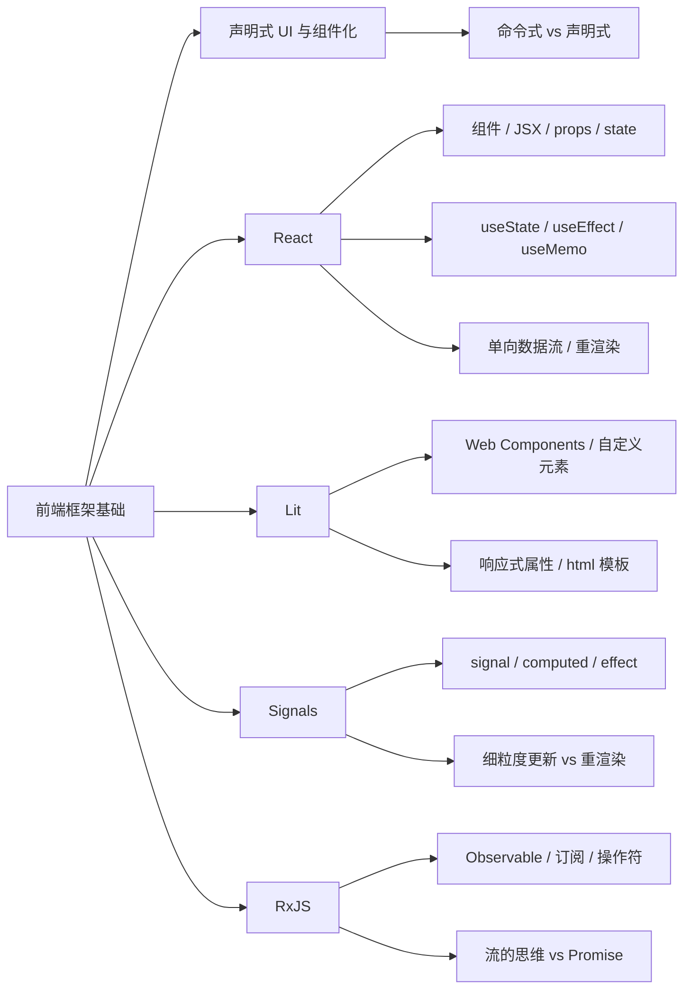
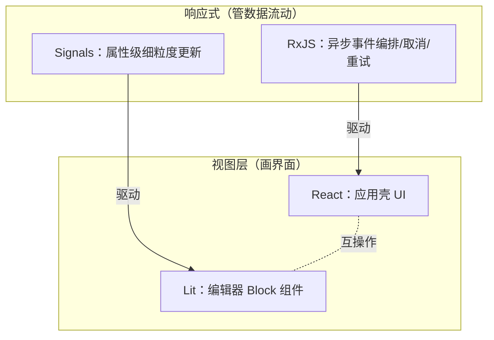

# 第 6 章 前端框架基础入门：React、Lit、Signals、RxJS

> **所属部分**：第 3 部分 · 编程语言与基础技术 ｜ **难度**：★★★☆☆ ｜ **建议学时**：8 小时 ｜ **前置章节**：第 5 章 ｜ **后续**：第 10 章 前端技术栈在 AFFiNE 中的应用

---

## 本章导读

第 10 章一上来就会抛给你一个困惑：**为什么 AFFiNE 一个项目里同时有 React 组件和 Lit Web Components？为什么既有 RxJS 的 Observable，又有 Preact 的 Signal？** 如果你**懂编程、但没系统学过这几样前端框架**，直接读第 10 章会被这些名词淹没。

本章就是那块垫脚石。假设你会 JavaScript 与第 5 章的 TypeScript（联合类型、泛型），本章**从"声明式 UI"这个共同思想讲起**，分别建立 React、Lit、Signals、RxJS 四者的核心心智，一路铺到第 10 章的起点。读完你应当能看懂它们各自"在解决什么问题"，以及"为什么一个大型编辑器项目需要四者并存"。

一句话先把四者的分工钉死：

- **React / Lit** 是**视图层框架**——把"数据"变成"界面"，回答"界面长什么样"。
- **Signals / RxJS** 是**响应式状态方案**——管理"数据什么时候变、怎么传播"，回答"数据怎么流动"。

视图层负责"画"，响应式负责"通知谁该重画"。本章只讲这些框架的**通用基础**，不深挖 AFFiNE 源码——源码细节留给第 10 章。

---

## 学习目标

- [ ] 能够说清"命令式 UI"与"声明式 UI"的区别，以及组件化为什么是现代前端的基石
- [ ] 能够用 React 的组件、JSX、`props`/`state` 搭出界面，并说清单向数据流的含义
- [ ] 能够正确使用 `useState`、`useEffect`、`useMemo`，并理解"重渲染"这一 React 核心模型
- [ ] 能够写出一个 Lit 自定义元素，使用响应式属性与 `html` 模板，并说清它与 React 的根本差异
- [ ] 能够解释 Signals 的 `signal`/`computed`/`effect`，并与 React 的重渲染模型做对比
- [ ] 能够读写 RxJS 的 `Observable`、订阅与 `map`/`filter`/`switchMap`，并说清它与 `Promise` 的区别
- [ ] 能够为第 10 章回答"为什么 AFFiNE 需要 React + Lit + Signals + RxJS 四者并存"

---

## 知识地图



---

## 一、声明式 UI 与组件化：所有现代框架的共同起点

### 命令式：你亲手操作 DOM

不借助框架，用原生 DOM 更新一个计数器要这样写：

```js
const btn = document.querySelector('#btn');
const label = document.querySelector('#count');
let count = 0;
btn.addEventListener('click', () => {
  count += 1;
  label.textContent = `当前：${count}`; // 你必须亲手同步 DOM
});
```

问题在于：**状态（`count`）和界面（`label.textContent`）是两份东西，你要手动保持它们一致**。界面一复杂，这种"找到节点→改它"的命令式代码就会散落各处、极易漏改，产生"数据变了界面没变"的 bug。

### 声明式：你只描述"界面应该长什么样"

React、Lit 这类框架让你换一种思路：**写一个从状态到界面的函数**，状态一变，框架**自动**算出新界面并更新 DOM。

```jsx
// 伪代码：你只描述"给定 count，界面是什么样"
function Counter(count) {
  return `当前：${count}`;
}
// 你改 count，框架负责把 DOM 更新成 Counter(count) 的样子
```

<div class="tip custom-block">
<p class="custom-block-title">核心口诀</p>
<p><strong>UI = f(state)</strong>。界面是状态的一个"纯函数投影"。你的职责是维护 state 并写好这个 f，"怎么把旧 DOM 改成新 DOM"交给框架。命令式关心"怎么做"，声明式关心"要什么"。</p>
</div>

### 组件化：把界面切成可复用的积木

现代框架还共享另一个思想：**组件**。把"一段界面 + 它的状态 + 它的行为"打包成一个独立单元，像搭积木一样组合、复用、嵌套。按钮是组件、对话框是组件、整个页面也是组件。本章的 React 和 Lit 都是"组件框架"，区别只在于**组件怎么定义、更新粒度多细**。

---

## 二、React：声明式组件的主流答案

React 是目前最主流的视图层库。它的世界观只有一句：**组件是返回 UI 的函数，状态变了就重新调用这个函数**。

### 2.1 组件与 JSX

React 组件就是一个**返回 UI 的 JavaScript 函数**，函数名首字母大写。它返回的 `JSX`——一种"长得像 HTML 的 JavaScript 表达式"——最终被编译成 `React.createElement(...)` 调用。

```jsx
function Hello() {
  return <h1 className="title">Hello AFFiNE</h1>;
}
// 用大括号在 JSX 里嵌入任意 JS 表达式
function Greeting() {
  const name = 'AFFiNE';
  return <p>欢迎 {name.toUpperCase()}</p>;
}
```

注意 JSX 的几个"和 HTML 不一样"的点：属性用 `className` 而非 `class`（`class` 是 JS 关键字）、事件用驼峰 `onClick`、`{}` 里放 JS 表达式。

### 2.2 props：父给子传数据（只读）

`props` 是父组件传给子组件的参数，**在子组件里是只读的**。这是"组件可复用"的关键——同一个组件传不同 props 就渲染出不同结果。

```tsx
interface ButtonProps {
  text: string;
  onClick: () => void;
}
function Button({ text, onClick }: ButtonProps) {
  return <button onClick={onClick}>{text}</button>;
}
// 父组件使用
<Button text="保存" onClick={() => console.log('saved')} />;
```

> 这里的 `ButtonProps` 正是第 5 章的 `interface`——React 组件的 props 几乎都用 TypeScript 接口描述。

### 2.3 state 与 useState：组件自己的、会变的数据

props 由外部传入且只读；**组件自己的、会随交互变化的数据叫 state**，用 `useState` 这个"Hook"声明。

```tsx
import { useState } from 'react';

function Counter() {
  const [count, setCount] = useState(0); // 初始值 0
  return (
    <button onClick={() => setCount(count + 1)}>
      点击了 {count} 次
    </button>
  );
}
```

`useState(0)` 返回一个数组：**当前值** `count` 和**更新函数** `setCount`。关键理解：

- 你**不能**写 `count = count + 1` 去改它——必须调用 `setCount`。
- 调用 `setCount` 不只是改一个变量，而是**通知 React"这个组件的状态变了，请重新渲染我"**。
- 重渲染时，`Counter()` 函数被**再次调用**，`useState(0)` 这次返回的是最新的 `count`。

<div class="tip custom-block">
<p class="custom-block-title">React 的核心模型：重渲染</p>
<p>React 的更新单位是<strong>整个组件函数</strong>。state 一变，组件函数从头到尾重新执行一遍，算出新的 JSX，React 再用"虚拟 DOM diff"找出最小的真实 DOM 改动。记住这点——它正是后面理解 Signals"细粒度更新"的对照物。</p>
</div>

### 2.4 单向数据流

React 规定数据**自上而下单向流动**：父组件通过 props 把数据传给子组件；子组件想"改"父的数据，不能直接改，而是调用父传下来的**回调函数**，由父自己去 `setState`。

```tsx
function Parent() {
  const [text, setText] = useState('');
  return <Input value={text} onChange={setText} />; // 数据往下、事件往上
}
function Input({ value, onChange }: {
  value: string;
  onChange: (v: string) => void;
}) {
  return (
    <input value={value} onChange={e => onChange(e.target.value)} />
  );
}
```

数据向下流、事件向上冒，状态只有一个"权威来源"（这里是 `Parent` 的 `text`）。这让数据流向可预测、好调试——这就是**单向数据流**。

### 2.5 受控组件

上面的 `Input` 就是**受控组件**的典型：表单元素的值**完全由 React state 决定**（`value={text}`），用户每次输入都触发 `onChange` 回写 state，再由 state 决定显示什么。界面与状态始终同步，是"UI = f(state)"在表单上的体现。

```tsx
// 非受控：DOM 自己存值，React 不知道 —— 少用
<input defaultValue="x" />
// 受控：值由 state 掌控，可随时校验/格式化
<input value={text} onChange={e => setText(e.target.value)} />
```

### 2.6 useEffect：处理"渲染之外"的副作用

组件函数应当是"纯"的——给定 props/state 就返回 UI，不干别的。但真实应用需要**副作用**：订阅事件、发请求、操作非 React 管理的资源。这些放进 `useEffect`。

```tsx
import { useEffect, useState } from 'react';

function Clock() {
  const [now, setNow] = useState(() => Date.now());
  useEffect(() => {
    const id = setInterval(() => setNow(Date.now()), 1000);
    return () => clearInterval(id); // 清理函数：组件卸载或依赖变化前调用
  }, []); // 依赖数组：[] 表示只在挂载时跑一次
  return <span>{new Date(now).toLocaleTimeString()}</span>;
}
```

三个要点，按重要性排序：

1. **依赖数组**决定何时重跑：`[]` 只在挂载时跑一次；`[a, b]` 在 `a` 或 `b` 变化后重跑；不写数组则每次渲染都跑。
2. **返回的清理函数**用来"收尾"——取消订阅、清除定时器，防止内存泄漏。
3. effect 在**渲染提交到 DOM 之后**才执行，不要在渲染期间做副作用。

<div class="tip custom-block">
<p class="custom-block-title">别把 useEffect 当万金油</p>
<p>很多"要在 useEffect 里做"的事其实不需要它：能由现有 state/props 直接算出来的值，应当在渲染时算（必要时用 <code>useMemo</code>），而不是用 effect 写进另一个 state。effect 只用于"与外部系统同步"（订阅、定时器、手动 DOM、网络）。</p>
</div>

### 2.7 useMemo：缓存昂贵计算

因为 state 一变组件就**整个重跑**，每次渲染里的计算都会重来一遍。若某个计算很贵，用 `useMemo` 把结果**缓存**起来，只在依赖变化时才重算。

```tsx
import { useMemo } from 'react';

function List({ items, keyword }: { items: Item[]; keyword: string }) {
  // 只有 items 或 keyword 变时才重新过滤，否则复用上次结果
  const filtered = useMemo(
    () => items.filter(it => it.name.includes(keyword)),
    [items, keyword]
  );
  return <ul>{filtered.map(it => <li key={it.id}>{it.name}</li>)}</ul>;
}
```

注意 `map` 出来的列表每项要有稳定的 `key`，React 靠它在重渲染时识别"哪一项是哪一项"。`useMemo` 的近亲 `useCallback` 则是缓存函数本身，避免每次渲染都生成新函数引用。

<div class="tip custom-block">
<p class="custom-block-title">通往第 10 章</p>
<p>第 10 章会看到 AFFiNE 的 React 应用壳：从 <code>createRoot</code> 到层层 <code>Provider</code>，再到 <code>useLiveData</code>（它内部用的是官方 <code>useSyncExternalStore</code>——订阅外部数据源的标准 Hook）。本章把 <code>useState/useEffect/useMemo</code> 和重渲染模型吃透，到那里只是"换个数据源"。</p>
</div>

---

## 三、Lit：直接用浏览器原生的 Web Components

React 把组件做成了"自己的一套体系"。Lit 走的是另一条路：**站在浏览器原生标准 Web Components 之上**做一层薄薄的封装。这决定了它和 React 的根本差异。

### 3.1 Web Components 与自定义元素

Web Components 是浏览器**原生**支持的一组标准，核心是**自定义元素（Custom Elements）**：你可以定义自己的 HTML 标签（如 `<my-counter>`），像用 `<div>` 一样用它。Lit 提供基类 `LitElement` 让定义自定义元素变得简单。

```ts
import { LitElement, html } from 'lit';
import { customElement } from 'lit/decorators.js';

@customElement('my-hello') // 注册标签名，之后可写 <my-hello></my-hello>
export class MyHello extends LitElement {
  render() {
    return html`<h1>Hello AFFiNE</h1>`;
  }
}
```

因为它是**原生标签**，`<my-hello>` 可以被任何框架甚至纯 HTML 页面使用——这就是 AFFiNE 编辑器内核选 Lit 的首要原因：**框架无关，可独立发布**。

### 3.2 响应式属性：@property 与 @state

Lit 的"状态"叫**响应式属性**，用装饰器声明。属性变化后，Lit **自动、异步、批量**地调用 `render()`。

```ts
import { LitElement, html } from 'lit';
import { customElement, property, state } from 'lit/decorators.js';

@customElement('my-counter')
export class MyCounter extends LitElement {
  @property({ type: Number }) start = 0; // 对外：可从 HTML attribute 传入
  @state() private count = 0;            // 内部：私有状态

  render() {
    return html`
      <button @click=${() => (this.count += 1)}>
        ${this.start + this.count}
      </button>
    `;
  }
}
```

- `@property()`：**对外**的属性，可通过 HTML attribute（`<my-counter start="5">`）或 JS property 传入，类似 React 的 props。
- `@state()`：**内部**私有状态，类似 React 的 state。
- 关键差异：这里直接写 `this.count += 1` 就能触发更新，**不需要 `setState`**——Lit 用属性的 setter 侦测变化。

### 3.3 html`` 模板与绑定语法

Lit 用**带标签的模板字符串** `` html`...` `` 写模板（底层是 lit-html），不需要 JSX 编译。它的绑定语法要记住四种前缀：

```ts
html`
  <div class=${cls}>普通绑定 → 设置 attribute</div>
  <input .value=${text} />          <!-- . 前缀 → 设置 DOM property -->
  <button ?disabled=${isBusy}>      <!-- ? 前缀 → 布尔 attribute -->
  <a @click=${this.onClick}>        <!-- @ 前缀 → 事件监听 -->
`;
```

与 React 不同，lit-html **只更新模板里发生变化的那几个绑定点**，不会"重新执行整个组件函数"。这是比 React 更细的更新粒度。

### 3.4 Lit 与 React 的根本差异

<div class="tip custom-block">
<p class="custom-block-title">一句话抓住区别</p>
<p>React 的更新单位是<strong>整个组件函数重跑 + 虚拟 DOM diff</strong>；Lit 的更新单位是<strong>模板里的单个绑定点</strong>，没有虚拟 DOM。React 是"自成体系的库"，Lit 是"原生标准的封装"。</p>
</div>

| 维度 | React | Lit |
| --- | --- | --- |
| 底层 | 自有虚拟 DOM 体系 | 浏览器原生 Web Components |
| 组件形式 | 函数组件 | 继承 `LitElement` 的类 + 自定义标签 |
| 模板 | JSX（需编译） | `` html`` `` 标签模板（运行时） |
| 状态 | `useState`，改值用 `setState` | `@property`/`@state`，直接赋值 |
| 更新粒度 | 组件级重渲染 + diff | 模板绑定点级 |
| 跨框架复用 | 否（React 专用） | 是（原生标签，任何框架可用） |
| 样式隔离 | 无内置（靠 CSS 方案） | 可选 Shadow DOM 隔离 |

> 第 10 章会看到：AFFiNE 的**应用壳**（侧边栏、设置页、弹窗）用 React，**编辑器内核 BlockSuite**（段落、表格、白板）用 Lit，因为富文本编辑需要对 `contenteditable`、Selection 做精细的原生 DOM 控制，不希望和 React 的虚拟 DOM 打架。

---

## 四、Signals：细粒度响应式

React 的重渲染模型简单好用，但有个代价：**state 一变，整个组件函数重跑**。当一个界面里有成千上万个独立单元（比如编辑器里的每个段落），"改一个字就重跑一大片"就太浪费了。**Signals** 就是为"精确更新"而生的响应式原语。

### 4.1 signal / computed / effect

Signals 的 API 极简，只有三个核心：

```ts
import { signal, computed, effect } from '@preact/signals-core';

const count = signal(0);                        // ① 可写信号，用 .value 读写
const double = computed(() => count.value * 2); // ② 派生信号，自动追踪依赖
const dispose = effect(() => {                  // ③ 副作用，读到的信号变了就重跑
  console.log('double =', double.value);
});

count.value = 1; // 打印 "double = 2"，double 和 effect 自动跟着变
dispose();       // 停止这个 effect
```

- **`signal(initial)`**：一个"会变的值"，用 `.value` 读写。
- **`computed(fn)`**：从别的信号**派生**出的只读值，`fn` 里读了谁就**自动依赖谁**，依赖变了自动重算。
- **`effect(fn)`**：副作用。`fn` 里读到的信号一变，`fn` 就自动重跑；返回值是一个"停止函数"。

关键魔法是**自动依赖追踪**：你不用手动声明"我依赖 count"（对比 React 的 `useEffect` 依赖数组要手写），框架在 `fn` 执行时记录它读了哪些信号，从而建立一张**精确到单个值**的依赖图。

### 4.2 Signals vs React 重渲染

<div class="tip custom-block">
<p class="custom-block-title">两种模型的分水岭</p>
<p>React：<strong>推翻重来</strong>——state 变 → 组件函数整个重跑 → diff 找改动。粒度是"组件"。<br>Signals：<strong>精确制导</strong>——signal 变 → 只重跑依赖它的 computed/effect → 只更新那一处。粒度是"值"。</p>
</div>

| 维度 | React 重渲染 | Signals |
| --- | --- | --- |
| 更新单位 | 整个组件函数 | 单个依赖该信号的计算 |
| 依赖声明 | 手写依赖数组（`useEffect`/`useMemo`） | 运行时自动追踪 |
| 读取方式 | 直接读变量（闭包捕获） | 通过 `.value` 读 |
| 适合场景 | 常规表单/列表/页面 | 海量独立单元的精确更新 |
| 心智 | "状态变了就重算界面" | "值变了就通知依赖者" |

一段对照代码，感受"不重跑组件也能更新"：

```ts
const first = signal('AFFiNE');
const last = signal('App');
const full = computed(() => `${first.value} ${last.value}`);

effect(() => render(full.value)); // 只有这个 effect 会在名字变化时重跑
first.value = 'BlockSuite';        // 不触碰 last，也没有"组件重渲染"概念
```

### 4.3 batch 与 peek：两个常用补充

```ts
import { signal, effect, batch } from '@preact/signals-core';
const a = signal(1);
const b = signal(2);
effect(() => console.log(a.value + b.value));

batch(() => {   // 批量更新：内部多次改值只在结束后触发一次 effect
  a.value = 10;
  b.value = 20;
});             // 只打印一次 "30"，而不是 11、30 两次

a.peek();       // 读取当前值但【不建立依赖】——不想让某次读取触发重跑时用
```

<div class="tip custom-block">
<p class="custom-block-title">通往第 10 章</p>
<p>第 10 章会看到 BlockSuite 把存在 Yjs（CRDT 数据）里的 Block 属性同步成 <code>xxx$</code> 信号，并用一个叫 <code>SignalWatcher</code> 的 Lit 混入，把组件的 <code>render()</code> 包进一个 <code>effect</code>——于是"渲染时读了哪些信号就自动追踪哪些"，属性一变只刷新用到它的那个 Block。本节的 <code>signal/computed/effect</code> 正是那套机制的全部地基。</p>
</div>

---

## 五、RxJS：把"随时间发生的事件"当成流来处理

前面的 Signals 擅长"某个值变了→精确更新某处"，但它是**同步的、拉取式的**。还有一类问题是关于**时间**的：网络请求、WebSocket 消息、用户连续输入、重试与取消……这些是"随时间陆续到来的一串值"。**RxJS** 就是处理这类问题的语言，核心抽象是 **Observable（可观察的流）**。

### 5.1 Observable 与订阅

可以把 `Observable` 理解成"**一个会随时间推送 0 到多个值的数据源**"。它是**惰性**的——**没人订阅就什么都不发生**；订阅后才开始推送，推送通过三种回调：`next`（来了一个值）、`error`（出错终止）、`complete`（正常结束）。

```ts
import { Observable } from 'rxjs';

const clock$ = new Observable<number>(subscriber => {
  let n = 0;
  const id = setInterval(() => subscriber.next(n++), 1000);
  return () => clearInterval(id); // 退订时的清理（teardown）
});

const sub = clock$.subscribe(v => console.log('tick', v)); // 开始推送
// ...
sub.unsubscribe(); // 取消订阅 → 触发上面的清理
```

> 约定：Observable 变量名常以 `$` 结尾（如 `clock$`），一眼看出"这是一条流"。

### 5.2 操作符：流的"数组方法"

单个 Observable 没什么用，威力在**操作符**——用 `pipe()` 把流一级级变换，很像数组的 `map`/`filter`，只不过作用在"时间维度上的值"。

```ts
import { of } from 'rxjs';
import { map, filter } from 'rxjs';

of(1, 2, 3, 4)
  .pipe(
    filter(n => n % 2 === 0), // 只保留偶数：2, 4
    map(n => n * 10)          // 每个乘 10：20, 40
  )
  .subscribe(v => console.log(v)); // 20, 40
```

最能体现"流"价值的是 **`switchMap`** 这类"高阶映射"——把每个值映射成**一条新的流**，并自动管理新旧流的切换：

```ts
import { fromEvent } from 'rxjs';
import { map, debounceTime, switchMap } from 'rxjs';

const input = document.querySelector('input')!;
fromEvent(input, 'input')
  .pipe(
    map(e => (e.target as HTMLInputElement).value),
    debounceTime(300),              // 停止输入 300ms 后才继续，防抖
    switchMap(keyword => search(keyword)) // 新关键词到来 → 自动取消上一个请求
  )
  .subscribe(results => render(results));
```

`switchMap` 的"自动取消旧请求"正是搜索框的经典需求——这用 `Promise` 要手写一堆取消逻辑，用 RxJS 一个操作符就搞定。相关的还有 `mergeMap`（并发全部）、`concatMap`（排队串行）、`exhaustMap`（忙时忽略新值、防重复提交）。

### 5.3 Observable 与 Promise 的区别

<div class="tip custom-block">
<p class="custom-block-title">Promise 是"一次性"，Observable 是"流"</p>
<p>Promise 代表<strong>一个</strong>未来的值，一旦 <code>resolve</code> 就结束、不能取消、创建即执行。Observable 代表<strong>一串</strong>随时间到来的值，惰性（订阅才执行）、可发多次、可取消、可组合。一句话：Promise 是单发，Observable 是连发且可退订。</p>
</div>

| 维度 | Promise | Observable |
| --- | --- | --- |
| 值的数量 | 1 个 | 0 到多个 |
| 执行时机 | 创建即执行（急切） | 订阅才执行（惰性） |
| 可否取消 | 不可（需额外 AbortController） | 可，`unsubscribe()` |
| 可否多次 | 否 | 是 |
| 组合能力 | `then`/`async-await` | 几十种操作符 |

Observable 能表达 Promise，反之不行（Promise 只是"发一个值就 complete 的特例"）。RxJS 提供 `firstValueFrom(obs$)` 把流转成 Promise，`from(promise)` 把 Promise 转成流，两者可以互通。

### 5.4 "流"的思维

学 RxJS 真正的门槛不是 API，而是**换一种看问题的方式**：不再把"一次点击""一个请求"当成孤立事件去写回调，而是把它们看成**一条可以被变换、过滤、合并、节流、取消的流**。一旦建立"万物皆流"的心智，很多原本要靠全局变量、标志位、手动取消才能解决的异步难题，就变成了几个操作符的组合。

<div class="tip custom-block">
<p class="custom-block-title">通往第 10 章</p>
<p>第 10 章会看到 AFFiNE 用 <code>BehaviorSubject</code>（带当前值的流）、<code>switchMap/combineLatest/share/throttleTime</code> 在 <code>nbstore</code> 里聚合多端同步状态，还会看到自研的 <code>LiveData</code>——它本质是"<strong>包了一层更好用外壳的 RxJS</strong>"，既有流的组合取消能力，又能像 signal 一样同步读当前值，并桥接到 React 的 <code>useSyncExternalStore</code>。本节把 Observable 和几个操作符吃透，就能看懂那些管道。</p>
</div>

---

## 六、四者合一：它们如何分工

把本章四样东西放回一张图，就是第 10 章要展开的全景雏形：



- **React + RxJS（LiveData）**：应用壳用 React 画界面，业务状态与异步流程用基于 RxJS 的 LiveData 管理，`useLiveData` 把流接进 React。
- **Lit + Signals**：编辑器每个 Block 用 Lit 画，属性用 Signals 做属性级更新，改一个段落只刷新那一个。
- **互操作**：两套视图层需要互相嵌入（React 里放 Lit 编辑器、Lit 工具栏里放 React 菜单）——这是第 10 章的重点之一。

记住这张分工图，你就已经站在第 10 章的起点了。

---

## 动手实践

1. **命令式改声明式**：用原生 DOM 写一个待办列表（增删项），再用 React 重写一遍。**验收**：说清 React 版里你不再手动操作任何 DOM 节点，只维护了一个 `items` state。
2. **React Hooks 三连**：写一个搜索框组件：`useState` 存关键词（受控输入）、`useMemo` 过滤列表、`useEffect` 在关键词变化时打印日志并带清理函数。**验收**：能解释依赖数组分别填 `[]`、`[keyword]`、不填时的行为差异。
3. **Lit 自定义元素**：在一个空 HTML 页面里（CDN 引入 lit）写一个 `<my-counter start="5">`，用 `@property` 接收 `start`、`@state` 存点击次数、`@click` 自增。**验收**：改 HTML 里的 `start="10"` 能反映到初值；点击能自增且无需 `setState`。
4. **RxJS vs Signals 对照**：在仓库外 `npm i rxjs @preact/signals-core`，分别用 ① `signal`+`computed`+`effect` 和 ② `BehaviorSubject`+`combineLatest`+`map` 计算 `a + b`，连续改 `a` 三次，用 `batch`/`throttleTime` 观察 effect 触发次数。**验收**：能用自己的话说清"Signals 是同步依赖图，RxJS 是推送式时间流"。

---

## 自测题

<details><summary>Q1. "声明式 UI" 和 "命令式 UI" 的本质区别是什么？</summary>

命令式要你亲手找到 DOM 节点并修改它（关心"怎么做"），需要手动保持状态与界面一致；声明式让你只写"给定 state，界面长什么样"这个映射（`UI = f(state)`，关心"要什么"），状态变化后框架自动算出并应用 DOM 改动。

</details>

<details><summary>Q2. React 里为什么不能直接 `count = count + 1`，而要用 `setCount`？</summary>

直接改变量 React 感知不到，界面不会更新。`setCount` 不仅更新值，还**通知 React 重新渲染该组件**——组件函数重跑、算出新 JSX、diff 后更新 DOM。state 的更新必须经由更新函数，这是 React 重渲染模型的前提。

</details>

<details><summary>Q3. `useEffect` 的依赖数组填 `[]`、`[a]`、不填，分别是什么行为？</summary>

`[]`：只在组件挂载时执行一次；`[a]`：挂载时执行，之后每当 `a` 变化再执行；不填：每次渲染后都执行。返回的清理函数在"下次执行前"或"组件卸载时"调用。

</details>

<details><summary>Q4. Lit 和 React 更新粒度的根本差异？</summary>

React 的更新单位是整个组件函数（state 变就重跑函数 + 虚拟 DOM diff）；Lit 基于原生 Web Components，lit-html 只更新模板中发生变化的绑定点，没有虚拟 DOM，粒度更细。

</details>

<details><summary>Q5. Signals 的"自动依赖追踪"相比 React 的依赖数组好在哪？</summary>

React 的 `useEffect`/`useMemo` 要你手写依赖数组，漏写/多写都会出 bug；Signals 在 `computed`/`effect` 执行时自动记录读取了哪些信号，建立精确到单个值的依赖图，不用手动声明，且更新只波及真正依赖该信号的计算。

</details>

<details><summary>Q6. Observable 和 Promise 最关键的三个区别？</summary>

① 数量：Promise 发一个值，Observable 发 0 到多个；② 执行时机：Promise 创建即执行，Observable 订阅才执行（惰性）；③ 取消：Promise 不可取消，Observable 可 `unsubscribe()`。此外 Observable 有丰富的操作符用于组合。

</details>

<details><summary>Q7. 搜索框为什么适合用 `switchMap`？</summary>

`switchMap` 把每个关键词映射成一条请求流，并在新值到来时**自动取消上一条还没完成的流**。这正好满足"用户改了关键词，就不要旧关键词的结果了"的需求，避免过期结果覆盖最新结果，无需手写取消逻辑。

</details>

---

## 常见坑

| 现象 | 原因与处理 |
| --- | --- |
| 改了变量界面不更新（React） | 直接改了 state 变量而非调用 `setState`；state 必须用更新函数修改 |
| `useEffect` 无限循环 | effect 里 `setState` 又把依赖改了导致反复触发；检查依赖数组、把不必要的依赖移除 |
| 列表渲染警告 "missing key" | `map` 出的元素缺 `key`；给每项加稳定唯一的 `key`（不要用数组下标） |
| 以为 `useEffect` 什么都该放 | 能由 props/state 直接算出的值用渲染期计算/`useMemo`，effect 只用于与外部系统同步 |
| Lit 组件不更新 | 直接改了对象内部字段而非替换属性；响应式属性要重新赋值才触发更新 |
| 把 Lit 当 React 写 | Lit 无需 `setState`、无 JSX、更新是绑定点级；注意 `.prop`/`?attr`/`@event` 前缀 |
| RxJS 创建了流却不执行 | Observable 惰性，没 `subscribe` 就不运行；确认已订阅 |
| 订阅后内存泄漏 | 忘记 `unsubscribe()`；长期存在的订阅务必在清理时退订 |
| 混淆 Signals 与 RxJS 适用场景 | 同步值派生用 Signals，时间维度的异步事件编排用 RxJS |

---

## 延伸阅读

- React 官方文档（react.dev）：Thinking in React、Hooks 章节
- Lit 官方文档（lit.dev）：Components、Templates、Reactive properties
- Preact Signals 指南：`signal`/`computed`/`effect` 与 `batch`
- RxJS 官方文档（rxjs.dev）：Observable、操作符决策树
- 第 5 章：TypeScript 基础入门（本章的 props/泛型/联合类型都建立在它之上）
- 第 10 章：前端技术栈在 AFFiNE 中的应用（React 应用壳、Lit 编辑器、Signals 桥接 Yjs、RxJS/LiveData）

---

## 本章学时拆分（建议 8 小时）

| 内容 | 时长 |
| --- | --- |
| 声明式 UI 与组件化思想 | 0.5h |
| React：组件/JSX/props/state/单向数据流 | 2h |
| React Hooks：useState/useEffect/useMemo | 1.5h |
| Lit：Web Components、响应式属性、模板与差异 | 1.5h |
| Signals：signal/computed/effect 与对比 | 1h |
| RxJS：Observable/操作符/流的思维 | 1.5h |

---

| [← 第 5 章 TypeScript 基础入门](./05-TypeScript基础入门.md) | [第 7 章 Rust 基础入门 →](./07-Rust基础入门.md) |
| --- | --- |
