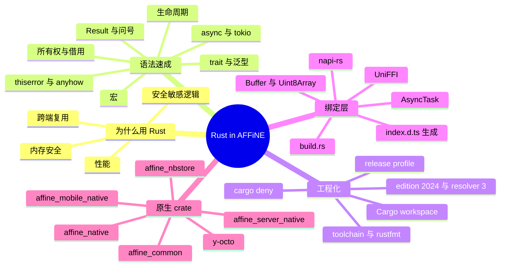
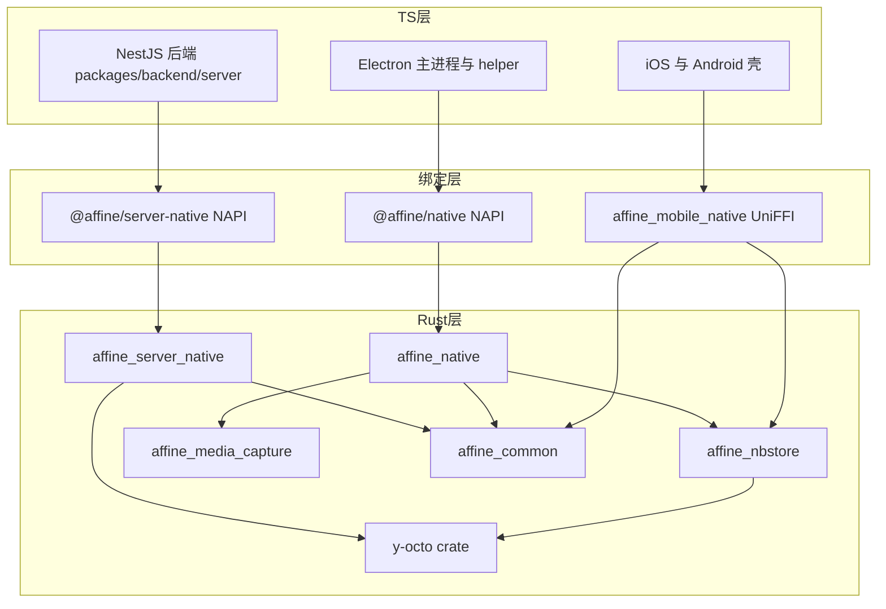
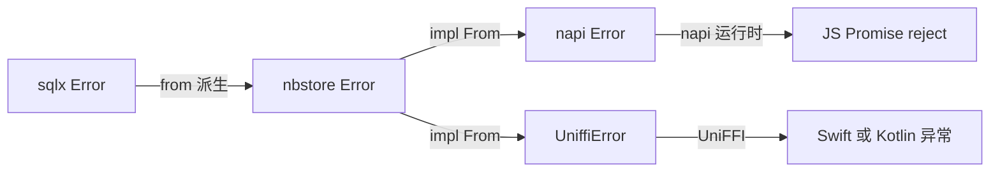
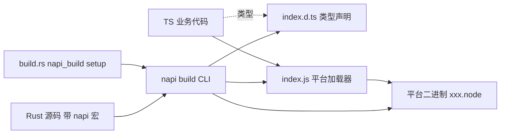
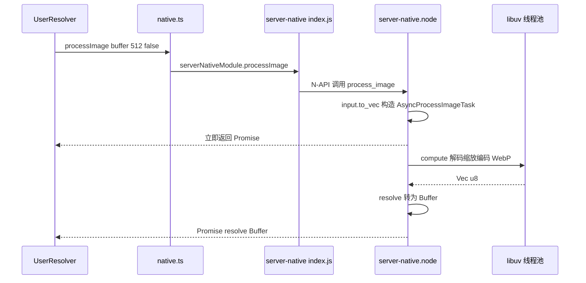

# 第 7 章 Rust 与 NAPI-rs

> **所属部分**：第 3 部分 · 编程语言与基础技术 ｜ **难度**：★★★★☆ ｜ **建议学时**：10 小时 ｜ **前置章节**：第 5 章

## 本章导读

打开 AFFiNE 仓库根目录，你会看到一个 `Cargo.toml`——这意味着在 TypeScript 之外，AFFiNE 还维护着一个 **Rust workspace**。它不是点缀：桌面端的本地数据库、录音、磁盘同步，后端的文档解析、搜索索引、图片处理、SSRF 防护、权限判定、LLM 请求构建，乃至 iOS/Android 的存储层，都由 Rust 实现，再通过 **NAPI-rs**（Node.js）或 **UniFFI**（Swift/Kotlin）暴露给上层。

对一名前端开发者来说，Rust 的学习曲线主要在**所有权与借用**。本章不追求系统讲完 Rust，而是采用"**语法速成 + AFFiNE 真实代码**"双线：每讲一个语法点，就立刻在仓库里找到它的用法；最后把视角拉到工程层面，弄清 Cargo workspace、napi-rs 绑定生成、各原生 crate 的职责以及 JS 如何调用它们。

学完本章，你应该能够打开 `packages/frontend/native/nbstore/src/doc.rs` 或 `packages/backend/native/src/url_policy.rs`，逐行读懂其含义，并能独立添加一个简单的 `#[napi]` 函数。

## 学习目标

- [ ] 能够说出 AFFiNE 使用 Rust 的四类典型场景及其收益
- [ ] 能够解释所有权、借用、生命周期、trait、泛型、`Result` 与 `?` 运算符，并在仓库中各指出一处真实用例
- [ ] 能够区分 `thiserror` 与 `anyhow` 的定位，读懂项目中的错误转换链
- [ ] 能够读懂根 `Cargo.toml` 的 workspace、`workspace.dependencies`、`profile.release` 配置，以及 `rust-toolchain.toml`、`rustfmt.toml`、`.cargo/config.toml`、`deny.toml` 的作用
- [ ] 能够使用 `#[napi]`、`#[napi(object)]`、`AsyncTask`、`async fn` 编写可被 JS 调用的 Rust 函数，理解 `Buffer`/`Uint8Array` 的映射
- [ ] 能够说明 `build.rs`、生成的 `index.d.ts`/`index.js` 在构建链中的位置
- [ ] 能够列出 `packages/common/native`、`packages/backend/native`、`packages/frontend/native`、`packages/frontend/mobile-native` 各自的职责
- [ ] 能够追踪一次从 TypeScript 调用到 Rust 实现的完整链路

## 知识地图



## 7.1 为什么 AFFiNE 选择 Rust

| 场景 | 代表实现 | 收益 |
| --- | --- | --- |
| **CPU 密集计算** | hashcash 工作量证明（`packages/common/native/src/hashcash.rs`）、图片缩放与 WebP 编码（`packages/backend/native/src/image.rs`）、Token 计数（`packages/backend/native/src/tiktoken.rs`）、音频解码与重采样（`packages/frontend/native/media_capture/src/audio_decoder.rs`） | 原生速度，且可放到线程池不阻塞 Node 事件循环 |
| **CRDT 与文档处理** | `y-octo`（Rust 版 Yjs 兼容 CRDT）用于合并更新、解析文档、生成 Markdown/搜索投影 | 服务端无需在 JS 中加载完整 Yjs 文档，合并更快、内存更省 |
| **本地存储引擎** | `affine_nbstore`（基于 sqlx + SQLite）被桌面端 `@affine/native` 与移动端 `affine_mobile_native` 共用 | **一份存储实现，三端复用**（Electron、iOS、Android） |
| **安全敏感逻辑** | URL 策略（`url_policy.rs`）、SSRF 安全抓取（`safe_fetch.rs`）、权限判定（`permission/`）、内容策略（`content_policy.rs`）、许可证校验（`license.rs`） | 类型系统 + 内存安全，逻辑集中、可被单测穷举 |
| **系统 API** | macOS ScreenCaptureKit / CoreAudio、Windows WASAPI 录音（`media_capture/src/macos`、`media_capture/src/windows`） | 直接调用平台 API，Node 本身无法做到 |

可以把 AFFiNE 的 Rust 层理解为一组"**高性能、强约束的底层库**"，TypeScript 负责编排与 UI。



## 7.2 Rust 速成一：所有权、借用与生命周期

### 7.2.1 所有权三原则

1. 每个值有且只有一个**所有者**（owner）；
2. 所有者离开作用域，值被释放（drop）；
3. 赋值或传参默认是**移动**（move），原变量随即失效；要保留就 `clone()`，或者只**借用**。

教学示例：

```rust
// 教学示例
fn takes(s: String) {}          // 获取所有权
fn borrows(s: &str) {}          // 不可变借用
fn mutates(v: &mut Vec<u8>) {}  // 可变借用

let s = String::from("hi");
borrows(&s);   // OK，s 仍可用
takes(s);      // s 被移动
// borrows(&s); // 编译错误：value borrowed after move
```

借用规则：**同一时刻，要么有任意多个不可变借用 `&T`，要么只有一个可变借用 `&mut T`**。这条规则在编译期消灭了数据竞争。

### 7.2.2 AFFiNE 中的所有权：从 JS 内存到 Rust 线程

来源：`packages/backend/native/src/image.rs`

```rust
pub struct AsyncProcessImageTask {
  input: Vec<u8>,
  max_edge: u32,
  keep_exif: bool,
}
// ...
#[napi]
pub fn process_image(input: Buffer, max_edge: u32, keep_exif: bool) -> AsyncTask<AsyncProcessImageTask> {
  AsyncTask::new(AsyncProcessImageTask {
    input: input.to_vec(),
    max_edge,
    keep_exif,
  })
}

fn process_image_inner(input: &[u8], max_edge: u32, keep_exif: bool) -> AnyResult<Vec<u8>> {
  if max_edge == 0 {
    bail!("max_edge must be greater than 0");
  }

  let format = image::guess_format(input).context("unsupported image format")?;
  // ...
```

- `input.to_vec()`：把 JS 传入的 `Buffer` **复制**成 Rust 自己拥有的 `Vec<u8>`，任务结构体获得所有权后，才能安全地被送到 libuv 线程池上执行；
- `process_image_inner(input: &[u8], ...)`：内部函数只**借用**字节切片，不需要所有权。`&[u8]` 是"指向一段连续字节的只读视图"，`&Vec<u8>` 可以自动转换为它（deref coercion）。

另一个经典技巧——来源：`packages/frontend/native/media_capture/src/audio_decoder.rs`

```rust
#[napi]
impl Task for DecodeAudioTask {
  type Output = Vec<f32>;
  type JsValue = Float32Array;

  fn compute(&mut self) -> Result<Self::Output> {
    decode(
      std::mem::replace(&mut self.buf, Uint8Array::new(vec![])),
      self.dest_sample_rate,
      self.filename.as_deref(),
    )
    // ...
  }
```

`compute` 只拿到 `&mut self`（可变借用），无法直接把 `self.buf` 移走。`std::mem::replace` 用一个空数组"换出"原值，从而在不违反借用规则的前提下**取得所有权**、避免一次大块内存拷贝。`self.filename.as_deref()` 则把 `Option<String>` 转为 `Option<&str>`——借用而非移动。

### 7.2.3 共享所有权：`Arc` 与锁

当多个任务需要共享同一个对象时，用引用计数智能指针 `Arc<T>`（原子引用计数，线程安全），配合 `RwLock`/`Mutex` 获得内部可变性。

来源：`packages/frontend/native/nbstore/src/pool.rs`

```rust
pub struct Ref<V> {
  inner: Arc<V>,
}

impl<V> Deref for Ref<V> {
  type Target = V;

  fn deref(&self) -> &Self::Target {
    self.inner.deref()
  }
}

#[derive(Default)]
pub struct SqliteDocStoragePool {
  inner: RwLock<HashMap<String, StorageState>>,
}

enum StorageState {
  Connecting(Arc<SqliteDocStorage>),
  Connected(Arc<SqliteDocStorage>),
}

impl SqliteDocStoragePool {
  pub async fn get(&self, universal_id: String) -> Result<Ref<SqliteDocStorage>> {
    let lock = self.inner.read().await;
    let Some(state) = lock.get(&universal_id) else {
      return Err(Error::InvalidOperation);
    };
    let StorageState::Connected(storage) = state else {
      return Err(Error::InvalidOperation);
    };
    Ok(Ref {
      inner: Arc::clone(storage),
    })
  }
```

这段代码浓缩了大量 Rust 惯用法：

| 语法 | 含义 |
| --- | --- |
| `tokio::sync::RwLock<HashMap<...>>` | 异步读写锁：多个读者并发、写者独占；`.read().await` 不会阻塞线程 |
| `enum StorageState { Connecting(..), Connected(..) }` | **带数据的枚举**（代数数据类型），比 TS 的可辨识联合更强 |
| `let Some(x) = ... else { return ... }` | **let-else**：模式不匹配就提前返回，避免层层嵌套 |
| `Arc::clone(storage)` | 只增加引用计数，不复制数据库连接 |
| `impl<V> Deref for Ref<V>` | 实现 `Deref` trait 后，`Ref<SqliteDocStorage>` 可以像 `&SqliteDocStorage` 一样调用方法 |

### 7.2.4 生命周期：借用活多久

生命周期标注 `'a` 告诉编译器"返回的引用与哪个输入活得一样久"，防止悬垂引用。大多数情况编译器能自动推断（生命周期省略规则），只有当返回引用来源不明确时才需要手写。

来源：`packages/backend/native/src/search_index/query.rs`

```rust
fn first_entry<'a>(value: &'a JsonValue, operator: &str) -> Result<(&'a str, &'a JsonValue)> {
  value
    .as_object()
    .and_then(|value| value.iter().next())
    .map(|(field, value)| (field.as_str(), value))
    .ok_or_else(|| IndexError::InvalidInput(format!("invalid {operator} query")))
}

fn required_string<'a>(value: &'a JsonValue, field: &str) -> Result<&'a str> {
  value
    .get(field)
    .and_then(JsonValue::as_str)
    .ok_or_else(|| IndexError::InvalidInput(format!("{field} must be a string")))
}
```

函数有两个引用参数，返回值里的 `&str` 到底借自 `value` 还是 `operator`？编译器无法猜，于是标注 `'a`：**返回的引用借自 `value`**，只要 `value` 还活着，返回值就有效。这样整个查询编译过程可以零拷贝地引用原始 JSON。

更高级的例子是 trait 中返回借用了 `self` 的 Future（`packages/backend/native/src/runtime/backend_runtime/invalidation.rs`）：

```rust
pub(super) trait InvalidationTarget: Send + Sync {
  fn invalidate<'a>(&'a self, hint: &'a InvalidationHintV1) -> Pin<Box<dyn Future<Output = ()> + Send + 'a>>;
}
```

意思是"返回一个在堆上的、可跨线程发送的 Future，它最多和 `self`、`hint` 活得一样久"。初学阶段能读懂即可。

## 7.3 Rust 速成二：trait、泛型、枚举与模式匹配

### 7.3.1 trait：Rust 的"接口"

trait 定义一组行为；类型通过 `impl Trait for Type` 实现它。与 TS interface 的关键区别：**可以为别人的类型实现自己的 trait，也可以为自己的类型实现标准库 trait**（孤儿规则限制二者至少有一方属于本 crate）。

来源：`packages/common/native/src/hashcash.rs`

```rust
impl TryFrom<&str> for Stamp {
  type Error = String;

  fn try_from(value: &str) -> Result<Self, Self::Error> {
    let stamp_vec = value.split(':').collect::<Vec<&str>>();
    if stamp_vec.len() != 7 || stamp_vec.iter().enumerate().any(|(i, s)| i != 4 && s.is_empty()) {
      return Err(format!("Malformed stamp, expected 6 parts, got {}", stamp_vec.len()));
    }
    Ok(Stamp {
      version: stamp_vec[0].to_string(),
      claim: stamp_vec[1].parse().map_err(|_| "Malformed stamp".to_string())?,
      ts: stamp_vec[2].to_string(),
      resource: stamp_vec[3].to_string(),
      ext: stamp_vec[4].to_string(),
      rand: stamp_vec[5].to_string(),
      counter: stamp_vec[6].to_string(),
    })
  }
}
```

实现标准库的 `TryFrom<&str>` 后，调用方即可写 `Stamp::try_from(self.response.as_str())`（见 `packages/frontend/native/src/hashcash.rs`）。`type Error = String;` 是**关联类型**，相当于 trait 的"类型参数输出"。

另一处常见 trait 是 `From`，用于类型转换与错误转换——来源：`packages/backend/native/src/doc.rs`

```rust
impl From<MarkdownResult> for NativeMarkdownResult {
  fn from(result: MarkdownResult) -> Self {
    Self {
      title: result.title,
      markdown: result.markdown,
      known_unsupported_blocks: result.known_unsupported_blocks,
      unknown_blocks: result.unknown_blocks,
    }
  }
}
```

实现 `From<A> for B` 后，自动获得 `A.into()` → `B`。项目里大量 `Ok(result.into())`、`.map(Into::into)` 正是依赖于此，把第三方库（`affine_doc_loader`）的结构体转成带 `#[napi(object)]` 的 JS 可见结构体。

### 7.3.2 泛型与 trait 约束

来源：`packages/frontend/native/nbstore/src/doc.rs`

```rust
  pub async fn push_update<Update: AsRef<[u8]>>(&self, doc_id: String, update: Update) -> Result<NaiveDateTime> {
    let mut timestamp = DateTime::from_timestamp_millis(chrono::Utc::now().timestamp_millis())
      .unwrap()
      .naive_utc();

    for attempt in 0..12 {
      match self
        .try_insert_update_with_timestamp(&doc_id, update.as_ref(), timestamp)
        .await
      {
        Ok(true) => return Ok(timestamp),
        Ok(false) => {}
        Err(err) if attempt == 11 => return Err(err.into()),
        Err(_) => {}
      }
      // ...
    }
    Err(Error::ConcurrentModification)
  }
```

- `<Update: AsRef<[u8]>>`：任何"能被看作字节切片"的类型都可以传入——`Vec<u8>`、`&[u8]`、napi 的 `Uint8Array` 都实现了 `AsRef<[u8]>`。这让同一个函数既能被 NAPI 层调用，也能被 UniFFI 层或测试代码调用；
- `match` 带**守卫** `Err(err) if attempt == 11`：最后一次失败才真正返回错误；
- Rust 泛型是**单态化**的：编译器为每个实际类型生成一份专用代码，零运行时开销（与 TS 泛型只做类型检查完全不同）。

同理，`Stamp::check<S: AsRef<str>>(&self, bits: u32, resource: S)` 同时接受 `String` 和 `&str`。

### 7.3.3 闭包与迭代器

来源：`packages/backend/native/src/url_policy.rs`

```rust
fn has_allowed_origin(url: &Url, allowed_origins: &[String]) -> bool {
  allowed_origins.iter().any(|origin| {
    Url::parse(origin)
      .ok()
      .is_some_and(|allowed| matches!(allowed.scheme(), "http" | "https") && url.origin() == allowed.origin())
  })
}

fn matches_trusted_domain(url: &Url, trusted_domains: &[String]) -> bool {
  let Some(hostname) = url.host_str() else {
    return false;
  };
  let hostname = hostname.trim_end_matches('.');
  trusted_domains.iter().any(|domain| {
    let domain = domain.trim_end_matches('.');
    !domain.is_empty() && (hostname.eq_ignore_ascii_case(domain) || hostname.ends_with(&format!(".{domain}")))
  })
}
```

读法与 JS 的 `arr.some(x => ...)` 几乎一致：`.iter().any(|x| ...)`。`Option` 上的 `.ok()`、`.is_some_and(...)`、`.and_then(...)`、`.map(...)` 构成链式处理。`matches!(expr, pattern)` 是一个宏，判断表达式是否匹配某个模式。

这段代码是**安全逻辑**：OAuth 回调地址必须在白名单 origin 内、域名匹配需防止 `evil-affine.pro` 这类后缀欺骗（要求以 `.domain` 结尾）。放在 Rust 中实现，配合 `packages/backend/native/src/tests/url_policy/tests.rs` 的单测，比散落在 TS 各处更可靠。

## 7.4 Rust 速成三：错误处理——Result、?、thiserror、anyhow

### 7.4.1 Result 与 ? 运算符

Rust 没有异常，可失败的函数返回 `Result<T, E>`：`Ok(T)` 或 `Err(E)`。`?` 运算符的语义是"**如果是 `Err` 就提前返回（并通过 `From` 自动转换错误类型），否则取出 `Ok` 里的值**"。

教学示例：

```rust
// 教学示例：? 的等价展开
let v = foo()?;
// 等价于
let v = match foo() {
  Ok(v) => v,
  Err(e) => return Err(From::from(e)),
};
```

### 7.4.2 thiserror：为库定义结构化错误

来源：`packages/frontend/native/nbstore/src/error.rs`

```rust
use affine_doc_loader::ParseError;

pub type Result<T> = std::result::Result<T, Error>;

#[derive(Debug, thiserror::Error)]
pub enum Error {
  #[error("Sqlite Error: {0}")]
  SqlxError(#[from] sqlx::Error),
  #[error("Migrate Error: {0}")]
  MigrateError(#[from] sqlx::migrate::MigrateError),
  #[error("Connection in progress")]
  ConnectionInProgress,
  #[error("Invalid operation")]
  InvalidOperation,
  #[error("Index is rebuilding")]
  IndexNotReady,
  #[error("Serialization Error: {0}")]
  Serialization(String),
  #[error("Document update has missing dependencies")]
  IncompleteDoc,
  #[error("Document changed during compaction")]
  ConcurrentModification,
  #[error(transparent)]
  Indexer(#[from] memory_indexer::Error),
  #[error(transparent)]
  Parse(#[from] ParseError),
}
```

- `#[derive(thiserror::Error)]` 是**派生宏**，自动实现 `std::error::Error` 与 `Display`；
- `#[error("...{0}")]` 定义错误信息；
- `#[from]` 自动生成 `impl From<sqlx::Error> for Error`，于是在 nbstore 里任何 sqlx 调用后面直接写 `?` 即可；
- `pub type Result<T> = ...` 是项目惯用的**类型别名**，让函数签名简洁为 `-> Result<Vec<DocClock>>`。

### 7.4.3 anyhow：应用层"兜底"错误

`thiserror` 适合**库**（调用方需要区分错误种类），`anyhow` 适合**应用/内部实现**（只关心"出错了 + 上下文"）。

来源：`packages/backend/native/src/image.rs`

```rust
use anyhow::{Context, Result as AnyResult, bail};
// ...
fn process_image_inner(input: &[u8], max_edge: u32, keep_exif: bool) -> AnyResult<Vec<u8>> {
  if max_edge == 0 {
    bail!("max_edge must be greater than 0");
  }

  let format = image::guess_format(input).context("unsupported image format")?;
```

- `bail!(...)`：立即返回 `Err(anyhow!(...))`；
- `.context("...")`：给底层错误附加一层可读上下文。

### 7.4.4 错误跨越 FFI：转换成 napi::Error

JS 只认识 `napi::Error`，所以每个 crate 都在边界处做一次转换。公共工具位于：

来源：`packages/common/native/src/napi_utils.rs`

```rust
use std::fmt::{Debug, Display};

use napi::{Error, Result, Status};

pub fn to_napi_error<E: Display + Debug>(err: E, status: Status) -> Error {
  Error::new(status, err.to_string())
}

pub fn map_napi_err<T, E: Display + Debug>(value: std::result::Result<T, E>, status: Status) -> Result<T> {
  value.map_err(|err| to_napi_error(err, status))
}
```

nbstore 用 `From` 一次性打通——来源：`packages/frontend/native/nbstore/src/lib.rs`

```rust
#[cfg(not(feature = "use-as-lib"))]
impl From<error::Error> for napi::Error {
  fn from(err: error::Error) -> Self {
    to_napi_error(err, napi::Status::GenericFailure)
  }
}
```

于是 `#[napi]` 方法里 `self.pool.connect(universal_id, path).await?;` 会自动把 `nbstore::Error` 转为 `napi::Error`，最终在 JS 中表现为一个被 reject 的 Promise / 抛出的 `Error`。完整的错误链：



移动端则把同一个 `nbstore::Error` 转成 `UniffiError`（`packages/frontend/mobile-native/src/error.rs`）——**一份错误定义，两种绑定**。

## 7.5 Rust 速成四：async、tokio 与宏

### 7.5.1 async/await 与 tokio

Rust 的 `async fn` 返回一个惰性的 `Future`，必须由**运行时（executor）**驱动——这与 JS 的 Promise 创建即执行不同。AFFiNE 使用 **tokio**（workspace 依赖 `tokio = "1.45"`）。

- napi-rs 开启 `async` feature 后，`#[napi] pub async fn` 会被放到 napi 内置的 tokio 运行时上执行，并在 JS 侧返回 `Promise`；
- CPU 密集的同步代码不应直接写在 async 里阻塞运行时，而应使用 `tokio::task::spawn_blocking`。

来源：`packages/backend/native/src/lib.rs`

```rust
/// Check whether a Yjs update binary can be decoded without applying it to a
/// document state.
#[napi(catch_unwind)]
pub async fn validate_doc_update(update: Buffer) -> Result<bool> {
  let update = update.to_vec();
  tokio::task::spawn_blocking(move || Update::decode_v1(update).is_ok())
    .await
    .map_err(|err| napi::Error::from_reason(format!("Doc update validation task failed: {err}")))
}
```

- `move ||` 闭包把 `update` 的所有权移入阻塞线程；
- `#[napi(catch_unwind)]`：Rust 若发生 panic，不会让整个 Node 进程崩溃，而是转换为 JS 异常——对于处理用户上传的二进制数据尤其重要。

### 7.5.2 宏：编译期代码生成

Rust 宏分两类：**声明宏**（`macro_rules!`，如 `format!`、`vec!`、`matches!`、`bail!`）与**过程宏**（`#[derive(...)]`、`#[napi]`、`#[uniffi::export]`、`sqlx::query_as!`）。AFFiNE 中最值得注意的是 sqlx 的**编译期 SQL 校验**：

来源：`packages/frontend/native/nbstore/src/doc.rs`

```rust
  pub async fn get_doc_snapshot(&self, doc_id: String) -> Result<Option<DocRecord>> {
    let result = sqlx::query_as!(
      DocRecord,
      "SELECT doc_id, data as bin, updated_at as timestamp FROM snapshots WHERE doc_id = ?",
      doc_id
    )
    .fetch_optional(&self.pool)
    .await?;

    Ok(result)
  }
```

`query_as!` 会在**编译时连接一个真实数据库**，检查 SQL 语法、表/列是否存在，并校验结果列能否映射到 `DocRecord` 的字段。那么编译时数据库从哪来？答案在 `build.rs`（见 7.7.4）。

## 7.6 Cargo workspace：工程配置逐项解读

### 7.6.1 根 Cargo.toml

来源：`Cargo.toml`

```toml
[workspace]
members = [
  "./packages/backend/native",
  "./packages/common/native",
  "./packages/frontend/mobile-native",
  "./packages/frontend/native",
  "./packages/frontend/native/nbstore",
  "./packages/frontend/native/schema",
  "./packages/frontend/native/sqlite_v1",
]
resolver = "3"

  [workspace.package]
  edition = "2024"

  [workspace.dependencies]
  aes-gcm = "0.10"
  affine_common = { path = "./packages/common/native" }
  # ...
  anyhow = "1"
  # ...
  napi = { version = "3.7.0", features = [
    "async",
    "chrono_date",
    "error_anyhow",
    "napi9",
    "serde",
  ] }
  napi-build = { version = "2" }
  napi-derive = { version = "3.4" }
  # ...
  thiserror = "2"
  tokio = "1.45"
  uniffi = "0.29"
  # ...
  y-octo = "0.1.1"
```

| 配置 | 含义 |
| --- | --- |
| `members` | workspace 成员。注意 `packages/frontend/native/media_capture` 不在列表中，但它作为 `affine_native` 的 path 依赖且位于 workspace 目录内，Cargo 会**自动把它视为成员** |
| `resolver = "3"` | Rust 1.84 引入的依赖解析器，在 2 的基础上增加 **MSRV 感知**的版本选择（优先选择与 `rust-version` 兼容的依赖版本） |
| `edition = "2024"` | Rust 2024 版次（Rust 1.85 稳定），带来 `let` 链、RPIT 生命周期捕获规则调整、`unsafe extern` 等变化；各 crate 的 `Cargo.toml` 中也都写了 `edition = "2024"` |
| `[workspace.dependencies]` | 统一声明依赖版本，成员 crate 写 `napi = { workspace = true }` 继承，避免版本漂移；可在成员处追加 features，如 `tokio = { workspace = true, features = ["full"] }` |
| napi features | `async`（支持 async fn）、`chrono_date`（`NaiveDateTime` ↔ JS `Date`）、`error_anyhow`（anyhow 错误自动转换）、`napi9`（使用 N-API v9）、`serde`（serde 值与 JS 对象互转） |

`Cargo.lock` 中实际解析版本：`napi 3.8.3`、`napi-derive 3.5.2`、`sqlx 0.8.6`、`uniffi 0.29.5`、`y-octo 0.1.1`。

### 7.6.2 profile：编译优化策略

来源：`Cargo.toml`

```toml
[profile.dev.package.sqlx-macros]
opt-level = 3

# hashcash minting runs a PoW hash loop that is infeasible at opt-level 0
[profile.dev.package.keccak]
opt-level = 3

[profile.dev.package.sha3]
opt-level = 3

[profile.release]
codegen-units = 1
lto           = "fat"
opt-level     = 3
strip         = "symbols"

  # android uniffi bindgen requires symbols
  [profile.release.package.affine_mobile_native]
  strip = "none"
```

- **dev 下对个别依赖开优化**：sqlx 宏要在编译期执行查询检查，hashcash 的 SHA3 工作量证明在 `opt-level = 0` 时慢得无法接受（注释原话）。只优化这几个包，既保证开发编译速度，又让关键路径可用；
- **release**：`codegen-units = 1` + `lto = "fat"`（全程序链接时优化）换取更小更快的二进制，代价是编译更慢；`strip = "symbols"` 去掉符号减小体积；
- **例外**：Android 的 UniFFI 绑定生成需要读取库中的符号元数据，所以 `affine_mobile_native` 不 strip。

### 7.6.3 rust-toolchain.toml 与 rustfmt.toml

来源：`rust-toolchain.toml`

```toml
[toolchain]
channel = "1.97.1"
profile = "default"
```

固定工具链版本：任何人在仓库内执行 `cargo` 时，rustup 都会自动切换到 1.97.1，保证 CI 与本地一致。

来源：`rustfmt.toml`

```toml
edition       = "2024"
max_width     = 120
style_edition = "2024"

hard_tabs  = false
tab_spaces = 2

format_strings    = true
unstable_features = true
wrap_comments     = true

group_imports       = "StdExternalCrate"
imports_granularity = "Crate"
```

- `tab_spaces = 2`：与前端代码风格统一（Rust 社区默认是 4）；
- `group_imports = "StdExternalCrate"`：import 分三组（std / 外部 crate / 本 crate），你在每个文件顶部都能看到这种分组；
- `unstable_features = true`：这些选项需要 nightly rustfmt。因此 CI（`.github/workflows/build-test.yml` 的 `lint-rust` 任务）执行的是 `cargo +nightly fmt --all -- --check`，随后 `cargo clippy ... -- -D warnings`。根 `package.json` 的 `lint-staged` 也配置了 `"*.rs": ["cargo fmt --"]`。

### 7.6.4 .cargo/config.toml：平台链接参数

来源：`.cargo/config.toml`

```toml
[target.x86_64-pc-windows-msvc]
rustflags = ["-C", "target-feature=+crt-static"]
[target.aarch64-pc-windows-msvc]
rustflags = ["-C", "target-feature=+crt-static"]
[target.'cfg(target_os = "linux")']
rustflags = ["-C", "link-args=-Wl,--warn-unresolved-symbols"]
[target.'cfg(target_os = "macos")']
rustflags = [
  "-C",
  "link-args=-Wl,-undefined,dynamic_lookup,-no_fixup_chains",
  "-C",
  "link-args=-all_load",
  "-C",
  "link-args=-weak_framework ScreenCaptureKit",
]
# ...
[target.'cfg(all(target_env = "gnu", not(target_os = "windows")))']
rustflags = ["-C", "link-args=-Wl,-z,nodelete"]
```

- Windows `+crt-static`：静态链接 C 运行时，用户机器无需安装 VC++ 运行库；
- macOS `-undefined dynamic_lookup`：Node 插件中的 `napi_*` 符号由宿主进程（Node/Electron）在运行时提供，链接期允许未定义；`-weak_framework ScreenCaptureKit` 让旧版 macOS 缺少该框架时也能加载；
- glibc 下 `-z nodelete`：注释链接了相关 bug，防止动态库卸载后线程局部存储析构导致段错误。

### 7.6.5 deny.toml：许可证合规

来源：`deny.toml`

```toml
[graph]
all-features = true
exclude-dev = true
targets = [
  "x86_64-unknown-linux-gnu",
  "aarch64-apple-darwin",
  # ...
  "aarch64-apple-ios-sim",
]

[licenses]
allow = [
  "0BSD",
  "Apache-2.0",
  # ...
  "MIT",
  "MPL-2.0",
  # ...
]
confidence-threshold = 0.93
# ...
  [[licenses.exceptions]]
  allow = ["AGPL-3.0-only"]
  crate = "llm_adapter"
```

这是 [cargo-deny](https://embarkstudios.github.io/cargo-deny/) 的配置，当前只启用了 **licenses** 检查：列出允许的开源许可证白名单，并对 `llm_adapter`、`memory-indexer`、`path-ext` 等个别 crate 单独放行 AGPL。仓库的 GitHub workflows 中未直接调用 cargo-deny，可在本地执行 `cargo deny check licenses` 验证（需先安装 cargo-deny）。许可证合规的更多内容见第 28 章。

## 7.7 napi-rs：让 Rust 成为 Node.js 模块

### 7.7.1 原理速览

Node-API（N-API）是 Node.js 提供的**ABI 稳定**的 C 接口；napi-rs 用 Rust 宏把你的函数/结构体包装成符合 N-API 的导出，并**自动生成 TypeScript 声明**。编译产物是一个动态库，改名为 `.node` 后可被 `require()` 加载。



### 7.7.2 #[napi] 的几种形态

| 写法 | 生成的 JS/TS | 项目例子 |
| --- | --- | --- |
| `#[napi] pub fn f(..) -> T` | 同步函数 | `html_sanitize`（`packages/backend/native/src/html_sanitize.rs`） |
| `#[napi] pub async fn f(..) -> Result<T>` | 返回 `Promise<T>` | `validate_doc_update`、`DocStoragePool::connect` |
| `#[napi] pub fn f(..) -> AsyncTask<Task>` | 返回 `Promise<JsValue>`，计算在 libuv 线程池执行 | `verify_challenge_response`、`process_image`、`decode_audio` |
| `#[napi(object)] pub struct S` | TS `interface`（按值拷贝） | `DocRecord`、`NativeMarkdownResult` |
| `#[napi] pub struct C` + `#[napi] impl C` | TS `class`（JS 持有 Rust 对象的句柄） | `DocStoragePool`、`Tokenizer` |
| `#[napi(constructor)]` | 构造函数 | `DocStoragePool::new` |
| `#[napi] pub const` | 常量 | `AFFINE_PRO_PUBLIC_KEY` |
| `#[napi(catch_unwind)]` | panic 转 JS 异常 | `merge_updates_in_apply_way` |

命名自动转换：Rust 的 `snake_case` → JS 的 `camelCase`（`verify_challenge_response` → `verifyChallengeResponse`，字段 `doc_id` → `docId`）。

### 7.7.3 AsyncTask：线程池中的计算

来源：`packages/frontend/native/src/hashcash.rs`

```rust
use affine_common::hashcash::Stamp;
use napi::{Env, Result, Task, bindgen_prelude::AsyncTask};
use napi_derive::napi;

pub struct AsyncVerifyChallengeResponse {
  response: String,
  bits: u32,
  resource: String,
}

#[napi]
impl Task for AsyncVerifyChallengeResponse {
  type Output = bool;
  type JsValue = bool;

  fn compute(&mut self) -> Result<Self::Output> {
    Ok(if let Ok(stamp) = Stamp::try_from(self.response.as_str()) {
      stamp.check(self.bits, &self.resource)
    } else {
      false
    })
  }

  fn resolve(&mut self, _: Env, output: bool) -> Result<Self::JsValue> {
    Ok(output)
  }
}

#[napi]
pub fn verify_challenge_response(
  response: String,
  bits: u32,
  resource: String,
) -> AsyncTask<AsyncVerifyChallengeResponse> {
  AsyncTask::new(AsyncVerifyChallengeResponse {
    response,
    bits,
    resource,
  })
}
```

`Task` trait 把一次异步计算拆成两步：

1. `compute`：在**工作线程**执行，不能访问 JS 对象（没有 `Env`），返回 Rust 值 `Output`；
2. `resolve`：回到**JS 主线程**，可以使用 `Env` 把 `Output` 转为 `JsValue`。

生成的声明——来源：`packages/frontend/native/index.d.ts`

```ts
export declare function mintChallengeResponse(resource: string, bits?: number | undefined | null): Promise<string>
// ...
export declare function verifyChallengeResponse(response: string, bits: number, resource: string): Promise<boolean>
```

注意 `bits: Option<u32>` 被映射成了 `bits?: number | undefined | null`。

`AsyncTask` 与 `async fn` 的选择：纯 CPU 计算、无需 await 其他 Future → `AsyncTask`（libuv 线程池）；需要 await 数据库/网络 → `async fn`（tokio）。`decode_audio` 还用了 `AsyncTask::with_optional_signal(task, signal)`，支持从 JS 传入 `AbortSignal` 取消——对应声明里的 `signal?: AbortSignal | undefined | null`。

### 7.7.4 class、object 与 Buffer/Uint8Array

来源：`packages/frontend/native/nbstore/src/lib.rs`

```rust
pub type Data = Uint8Array;

#[cfg_attr(not(feature = "use-as-lib"), napi(object))]
pub struct DocRecord {
  pub doc_id: String,
  #[cfg_attr(not(feature = "use-as-lib"), napi(ts_type = "Uint8Array"))]
  pub bin: Data,
  pub timestamp: NaiveDateTime,
}
// ...
#[cfg(not(feature = "use-as-lib"))]
#[napi]
impl DocStoragePool {
  #[napi(constructor)]
  pub fn new() -> Result<Self> {
    Ok(Self {
      pool: SqliteDocStoragePool::default(),
    })
  }
  // ...
  #[napi]
  pub async fn push_update(&self, universal_id: String, doc_id: String, update: Uint8Array) -> Result<NaiveDateTime> {
    Ok(self.get(universal_id).await?.push_update(doc_id, update).await?)
  }

  #[napi]
  pub async fn get_doc(&self, universal_id: String, doc_id: String) -> Result<Option<DocRecord>> {
    Ok(self.get(universal_id).await?.get_doc(doc_id).await?)
  }
```

要点：

- **条件编译** `#[cfg_attr(not(feature = "use-as-lib"), napi(object))]`：只有在**不作为普通库使用**时才加 napi 宏。移动端 `affine_mobile_native` 依赖 nbstore 时开启 `use-as-lib` feature（见 `packages/frontend/mobile-native/Cargo.toml`：`use-as-lib = ["affine_nbstore/use-as-lib"]`），从而去掉所有 N-API 相关代码，改由 UniFFI 包装；
- **类型映射**：`NaiveDateTime` ↔ `Date`（`chrono_date` feature）；`Option<T>` ↔ `T | null`；`Vec<T>` ↔ `Array<T>`；`Uint8Array` ↔ `Uint8Array`；`Buffer` ↔ Node `Buffer`；
- **前后端约定差异**：前端 crate 多用 `Uint8Array`（浏览器/Electron 渲染层通用），后端 crate 多用 `Buffer`（Node 习惯），二者在 JS 侧都基于 ArrayBuffer。

生成的 TS——来源：`packages/frontend/native/index.d.ts`

```ts
export declare class DocStoragePool {
  constructor()
  /** Initialize the database and run migrations. */
  connect(universalId: string, path: string): Promise<void>
  disconnect(universalId: string): Promise<void>
  // ...
  pushUpdate(universalId: string, docId: string, update: Uint8Array): Promise<Date>
  getDoc(universalId: string, docId: string): Promise<DocRecord | null>
  // ...
}
// ...
export interface DocRecord {
  docId: string
  bin: Uint8Array
  timestamp: Date
}
```

Rust 的 `///` 文档注释被原样搬进了 `.d.ts` 的 JSDoc。

### 7.7.5 build.rs：构建脚本

`build.rs` 在编译 crate 本体之前运行，可以生成代码、设置环境变量、链接参数。

最简单的形式——来源：`packages/backend/native/build.rs`

```rust
fn main() {
  napi_build::setup();
}
```

`napi_build::setup()` 为当前平台设置 N-API 所需的链接参数。

nbstore 的 build.rs 则大有文章——来源：`packages/frontend/native/nbstore/build.rs`

```rust
use std::fs;

use affine_schema::get_migrator;
use sqlx::sqlite::SqliteConnectOptions;

#[tokio::main]
async fn main() -> Result<(), std::io::Error> {
  napi_build::setup();

  // always start with a fresh database to have latest db schema
  let cwd = std::env::var("CARGO_MANIFEST_DIR").unwrap();
  let db_path = format!("{cwd}/affine.db");

  if fs::metadata(&db_path).is_ok() {
    fs::remove_file(&db_path)?;
  }

  let options = SqliteConnectOptions::new()
    .filename(&db_path)
    .journal_mode(sqlx::sqlite::SqliteJournalMode::Off)
    .locking_mode(sqlx::sqlite::SqliteLockingMode::Exclusive)
    .create_if_missing(true);
  let pool = sqlx::sqlite::SqlitePoolOptions::new()
    .max_connections(1)
    .connect_with(options)
    .await
    .unwrap();

  get_migrator().run(&pool).await.unwrap();

  println!("cargo::rustc-env=DATABASE_URL=sqlite://{db_path}");

  Ok(())
}
```

这就是 7.5.2 中 `sqlx::query_as!` 编译期校验的数据来源：

1. 每次构建先删掉旧库，新建 `affine.db`；
2. 用 `affine_schema` crate 中的迁移（`packages/frontend/native/schema/src/lib.rs` 的 `MIGRATIONS` 常量，包含 `meta`、`snapshots`、`updates`、`clocks`、`blobs`、`peer_clocks` 等表的建表 SQL）把它迁移到最新结构；
3. 通过 `cargo::rustc-env=DATABASE_URL=...` 把数据库路径注入到 crate 的编译环境，`query_as!` 宏读取它进行校验。

这也解释了 `packages/frontend/native/schema/README.md` 中"A temporary crate to share the schema between AFFiNE native and `build.rs`"的含义——迁移 SQL 需要同时被**运行时**和**构建脚本**使用，所以单独抽成一个 crate，并同时出现在 nbstore 的 `[dependencies]` 与 `[build-dependencies]` 中。

### 7.7.6 生成的 index.js：多平台加载器

来源：`packages/frontend/native/index.js`（节选）

```js
// prettier-ignore
/* oxlint-disable */
// @ts-nocheck
/* auto-generated by NAPI-RS */

const { readFileSync } = require('node:fs')
let nativeBinding = null
const loadErrors = []
// ...
function requireNative() {
  if (process.env.NAPI_RS_NATIVE_LIBRARY_PATH) {
    try {
      return require(process.env.NAPI_RS_NATIVE_LIBRARY_PATH);
    } catch (err) {
      loadErrors.push(err)
    }
  } else if (process.platform === 'android') {
    if (process.arch === 'arm64') {
      try {
        return require('./affine.android-arm64.node')
      } catch (e) {
        loadErrors.push(e)
      }
      // ... 再尝试 @affine/native-android-arm64 等平台包
```

它根据 `process.platform`、`process.arch`、是否 musl libc 等条件，依次尝试加载本地 `affine.<平台>.node` 或平台子包。文件名前缀 `affine` 来自 `packages/frontend/native/package.json` 的 `"napi": { "binaryName": "affine", ... }`。

后端的加载器更简单，且是手写的——来源：`packages/backend/native/index.js`

```js
/** @type {import('.')} */
let binding;
try {
  binding = require('./server-native.node');
} catch {
  binding =
    process.arch === 'arm64'
      ? require('./server-native.arm64.node')
      : process.arch === 'arm'
        ? require('./server-native.armv7.node')
        : require('./server-native.x64.node');
}

module.exports = binding;
```

`packages/backend/native/package.json` 中 `"dtsHeaderFile": "dts-header.d.ts"` 为生成的声明加上 `export default` 头，使 ESM 代码可以 `import serverNativeModule from '@affine/server-native'`。

### 7.7.7 构建命令

| 包 | 构建脚本（package.json） |
| --- | --- |
| `@affine/native` | `"build": "napi build -p affine_native --platform --release"`，调试版 `build:debug` |
| `@affine/server-native` | `"build": "napi build --release --no-const-enum"` |

`--platform` 让产物文件名带上平台后缀；`--no-const-enum` / `"constEnum": false` 让 Rust 枚举生成普通 TS `enum` 而不是 `const enum`（呼应第 5 章：`isolatedModules` 下 `const enum` 不友好）。按照本教材约定，学习阶段**不必**执行这些耗时构建，第 11 章会讲解本地开发环境如何获取原生模块。

## 7.8 各原生 crate 职责详解

### 7.8.1 总览

| crate 名 | 目录 | crate-type | 对外包名 | 主要职责 |
| --- | --- | --- | --- | --- |
| `affine_common` | `packages/common/native` | rlib（默认） | 无（被其他 crate 依赖） | hashcash、napi 错误工具；通过 feature 按需启用 |
| `affine_server_native` | `packages/backend/native` | cdylib | `@affine/server-native` | 服务端原生能力全集 |
| `affine_native` | `packages/frontend/native` | cdylib + rlib | `@affine/native` | 桌面端（Electron）原生能力 |
| `affine_nbstore` | `packages/frontend/native/nbstore` | cdylib + rlib | 经 `affine_native` 重导出 | SQLite 文档/Blob/索引存储 |
| `affine_schema` | `packages/frontend/native/schema` | rlib | — | SQLite 迁移 SQL 与导入校验 |
| `affine_sqlite_v1` | `packages/frontend/native/sqlite_v1` | rlib | 经 `affine_native` 重导出 | 旧版（v1）SQLite 数据库读取与迁移 |
| `affine_media_capture` | `packages/frontend/native/media_capture` | cdylib + rlib | 经 `affine_native` 重导出 | 系统音频/麦克风录制、音频解码 |
| `affine_mobile_native` | `packages/frontend/mobile-native` | cdylib + staticlib | UniFFI 生成 Swift/Kotlin | 移动端存储、hashcash、预览 |

### 7.8.2 affine_common：可选 feature 的公共库

来源：`packages/common/native/Cargo.toml`

```toml
[features]
default  = []
hashcash = ["chrono", "hex", "sha3", "rand"]
napi     = ["dep:napi"]

[dependencies]
chrono = { workspace = true, optional = true }
hex    = { workspace = true, optional = true }
napi   = { workspace = true, optional = true }
rand   = { workspace = true, optional = true }
sha3   = { workspace = true, optional = true }
```

来源：`packages/common/native/src/lib.rs`

```rust
#[cfg(feature = "hashcash")]
pub mod hashcash;
#[cfg(feature = "napi")]
pub mod napi_utils;
```

**feature 门控**让依赖方只为自己用到的功能付出编译成本：移动端只要 `hashcash`，后端两个都要。hashcash 是一种**工作量证明（PoW）**：客户端必须算出一个使 SHA3 哈希前若干位为 0 的计数器（`Stamp::mint` 中的 `loop`），服务端只需一次哈希即可验证（`Stamp::check`），用来抵御注册/登录接口的批量滥用。服务端 `packages/backend/server/src/native.ts` 的 `verifyChallengeResponse` 与桌面端 `packages/frontend/apps/electron/src/main/ui/challenge.ts` 的 `mintChallengeResponse` 分别对应两端。

### 7.8.3 affine_server_native：后端原生能力全集

来源：`packages/backend/native/src/lib.rs`

```rust
#![deny(clippy::all)]

mod audio_slice;
mod auth_session;
pub mod content_policy;
pub mod doc;
pub mod doc_loader;
pub mod entitlement;
pub mod file_type;
pub mod hashcash;
pub mod html_sanitize;
pub mod image;
pub mod license;
mod license_import;
pub mod llm;
pub mod permission;
pub mod runtime;
pub mod safe_fetch;
pub(crate) mod search_index;
pub mod tiktoken;
pub mod url_policy;
mod utils;
```

| 模块 | 职责（基于源码阅读） |
| --- | --- |
| `doc` / `doc_loader` | 基于 `affine_doc_loader` 解析 Y.Doc 二进制：标题/摘要（`parse_page_doc`）、工作区信息、转 Markdown（`parse_doc_to_markdown`）、搜索与画布投影、用 Markdown 创建/更新文档 |
| `search_index` | 基于 `memory-indexer` 的内存全文索引，含查询编译（`query.rs`）、结果高亮聚合 |
| `llm` | Copilot 的模型注册表匹配、内置 Prompt 渲染、规范化请求构建、BYOK（自带密钥）目录与校验、JSON Schema 校验 |
| `html_sanitize` | 实为 HTML **转义**：`v_htmlescape::escape(&input)` |
| `safe_fetch` / `url_policy` | 防 SSRF 的安全抓取（`safefetch` crate）、回调/重定向 URL 白名单校验 |
| `image` | 图片解码、按最长边缩放、EXIF 处理、WebP 编码，带尺寸/像素上限防"图片炸弹" |
| `tiktoken` | 基于 `tiktoken-rs` 的 Token 计数 `Tokenizer` 类 |
| `permission` | 基于 `affine_core::access_control` 的文档身份规范化、权限评估输出 |
| `hashcash` | 服务端 PoW 校验/生成 |
| `file_type` | 基于文件头嗅探 MIME（`get_mime`），对 Matroska/WebM 做额外判断 |
| `content_policy`、`entitlement`、`license` | 内容策略扫描、权益解析、自托管许可证签发与校验 |
| `runtime` | 较大的"后端运行时"：配置描述、对象存储客户端、Redis 失效通知、数据库迁移/SQL 等（导出 `BackendRuntime`、`StorageRuntime`、`ServerConfigHandle` 类） |

生成的 `packages/backend/native/index.d.ts` 约 1900 行，导出 60 余个函数与 `BackendRuntime`、`StorageRuntime`、`ServerConfigHandle`、`Tokenizer`、`CopilotStreamHandle` 等类。可见服务端正在把越来越多的"核心规则"下沉到 Rust。

lib.rs 中直接定义的 `merge_updates_in_apply_way` 是理解第 8 章的关键：

```rust
/// Merge updates in form like `Y.applyUpdate(doc, update)` way and return the
/// result binary.
#[napi(catch_unwind)]
pub fn merge_updates_in_apply_way(updates: Vec<Buffer>) -> Result<Buffer> {
  let mut doc = Doc::default();
  for update in updates {
    map_napi_err(doc.apply_update_from_binary_v1(update.as_ref()), Status::GenericFailure)?;
  }

  let buf = map_napi_err(doc.encode_update_v1(), Status::GenericFailure)?;

  Ok(buf.into())
}
```

用 y-octo 新建一个空文档，依次 apply 所有 update，再整体编码——这就是"把若干增量合并为一个快照"。

### 7.8.4 affine_native：桌面端的原生层

来源：`packages/frontend/native/src/lib.rs`

```rust
pub mod disk_sync;
pub mod hashcash;
mod import;
#[cfg(not(any(target_os = "android", target_os = "ios")))]
pub mod preview;

#[cfg(not(target_arch = "arm"))]
#[global_allocator]
static ALLOC: mimalloc::MiMalloc = mimalloc::MiMalloc;

#[allow(unused_imports)]
pub use affine_media_capture::*;
pub use affine_nbstore::*;
pub use affine_sqlite_v1::*;
pub use disk_sync::*;
pub use import::*;
```

- **聚合模式**：`pub use` 把子 crate 的 `#[napi]` 导出全部汇集到一个 `.node` 文件中，JS 侧只需 `import ... from '@affine/native'`；
- **全局分配器**：用 mimalloc 替换系统 malloc，提升多线程分配性能（后端 crate 同样如此）；
- **子模块**：
  - `affine_nbstore`：本地数据库（下一小节）；
  - `affine_sqlite_v1`：读取旧版 `.affine` 文件（`SqliteConnection`、`ValidationResult`，`packages/frontend/native/__tests__/db.spec.mts` 中有测试）；
  - `affine_media_capture`：macOS 用 ScreenCaptureKit/CoreAudio 捕获应用音频与麦克风，Windows 用 WASAPI/cpal；`audio_decoder.rs` 用 symphonia 解码、rubato 重采样，输出 `Float32Array` 供语音转写；
  - `disk_sync`：工作区与本地 Markdown 文件夹的双向同步（`frontmatter.rs` 处理 YAML 头、`state_db.rs` 记录同步状态，对应特性开关 `Enable Disk Markdown Sync`）；
  - `preview`：Mermaid / Typst 渲染为 SVG（依赖 `affine_preview`，移动端不编译此模块）；
  - `import`：导入会话（`nextImportBatch` 等）。

### 7.8.5 affine_nbstore：三端共用的 SQLite 存储

nbstore 是"No-Backend Store"的 Rust 实现之一（TS 侧的抽象在 `packages/common/nbstore`，第 19 章详解）。它用 **sqlx + SQLite** 实现文档更新、快照、时钟、Blob、同步对端时钟、索引同步等存储。

`get_doc` 的读取 + 压缩逻辑（来源：`packages/frontend/native/nbstore/src/doc.rs`，节选）：

```rust
      let mut segments = Vec::with_capacity(updates.len() + usize::from(snapshot.is_some()));
      if let Some(record) = &snapshot {
        segments.push(record.bin.to_vec());
      }
      segments.extend(updates.iter().map(|update| update.bin.to_vec()));
      let bin = if segments.len() == 1 {
        segments.pop().expect("one segment")
      } else {
        merge_updates_v1(segments)
          .map_err(|_| affine_doc_loader::ParseError::InvalidBinary)?
          .encode_v1()
          .map_err(|_| affine_doc_loader::ParseError::InvalidBinary)?
      };
      let mut doc = DocOptions::new().with_guid(doc_id.clone()).build();
      doc
        .apply_update_from_binary_v1(&bin)
        .map_err(|_| affine_doc_loader::ParseError::InvalidBinary)?;
      if doc.has_pending_updates() {
        return Err(Error::IncompleteDoc);
      }
```

读取一个文档时，把"快照 + 所有增量更新"用 y-octo 的 `merge_updates_v1` 合并成新快照，验证无缺失依赖后，在事务中以**乐观并发**方式（`UPDATE ... WHERE updated_at = ? AND data = ?`）写回快照并删除已合并的 updates；若期间有并发写入就重试，最多 8 次后返回 `ConcurrentModification`。这个"读时压缩"的设计在第 8 章还会从 CRDT 角度再分析一次。

Electron 侧的调用——来源：`packages/frontend/apps/electron/src/helper/nbstore/handlers.ts`

```ts
import { DocStoragePool } from '@affine/native';
import { parseUniversalId } from '@affine/nbstore';
import type { NativeDBApis } from '@affine/nbstore/sqlite';
// ...
const POOL = new DocStoragePool();
// ...
export const nbstoreHandlers: NativeDBApis = {
  connect: async (universalId: string) => {
    const { peer, type, id } = parseUniversalId(universalId);
    const dbPath = await getSpaceDBPath(peer, type, id);
    await fs.ensureDir(path.dirname(dbPath));
    await POOL.connect(universalId, dbPath);
    await POOL.setSpaceId(universalId, id);
  },
  disconnect: POOL.disconnect.bind(POOL),
  pushUpdate: POOL.pushUpdate.bind(POOL),
  getDoc: POOL.getDoc.bind(POOL),
  // ...
};
```

`NativeDBApis` 类型来自 TS 的 nbstore 包，Rust 生成的 `DocStoragePool` 方法签名与之一一对应——**Rust 生成的 `.d.ts` 与手写的 TS 接口在这里"对接"**，任何一边签名不一致都会被 `tsc` 捕获。

### 7.8.6 affine_mobile_native：UniFFI 绑定到 Swift/Kotlin

移动端不运行 Node，所以不能用 N-API。Mozilla 的 **UniFFI** 从 Rust 代码生成 Swift、Kotlin 绑定。

来源：`packages/frontend/mobile-native/src/lib.rs`

```rust
use affine_common::hashcash::Stamp;
pub(crate) use error::Result;
pub use error::UniffiError;
pub use ffi_types::{
  Blob, BlockInfo, CrawlResult, DocClock, DocIndexedClock, DocRecord, IndexAggregateResult, IndexBucket, IndexField,
  IndexHighlight, IndexHighlightValue, IndexHit, IndexSearchResult, IndexSpan, ListedBlob, SetBlob,
};
#[cfg(any(target_os = "android", target_os = "ios"))]
pub use preview::{render_mermaid_preview_svg, render_typst_preview_svg};
pub use storage::{DocStoragePool, new_doc_storage_pool};

uniffi::setup_scaffolding!("affine_mobile_native");

#[uniffi::export]
pub fn hashcash_mint(resource: String, bits: u32) -> String {
  Stamp::mint(resource, Some(bits)).format()
}
```

来源：`packages/frontend/mobile-native/src/storage/lifecycle.rs`（节选）

```rust
#[uniffi::export(async_runtime = "tokio")]
impl DocStoragePool {
  /// Initialize the database and run migrations.
  pub async fn connect(&self, universal_id: String, path: String) -> Result<()> {
    // ... 移动端额外的 blob 缓存注册
    if let Err(err) = self.inner.connect(universal_id.clone(), path).await {
      // ... 失败时回滚缓存
      return Err(err.into());
    }

    Ok(())
  }
```

napi 与 UniFFI 的对照：

| 概念 | napi-rs | UniFFI |
| --- | --- | --- |
| 导出函数 | `#[napi]` | `#[uniffi::export]` |
| 值对象 | `#[napi(object)]` | `#[derive(uniffi::Record)]` |
| 错误 | `napi::Error` | `#[derive(uniffi::Error)]` 的枚举 |
| 异步 | napi 内置 tokio | `async_runtime = "tokio"` |
| 产物 | `.node` + `index.d.ts` | `.so`/`.a` + `.swift`/`.kt` |
| 绑定生成 | `napi build` | `cargo run --bin uniffi-bindgen generate ...` |

生成的绑定已提交在仓库中：`packages/frontend/apps/ios/App/App/uniffi/affine_mobile_native.swift`、`packages/frontend/apps/android/App/app/src/main/java/uniffi/affine_mobile_native/affine_mobile_native.kt`。生成命令见 `packages/frontend/apps/ios/codegen.ts`、`packages/frontend/apps/ios/App/xc-universal-binary.sh` 与 `packages/frontend/apps/android/App/app/build.gradle`。`uniffi-bindgen` 这个二进制正是 crate 内的 `uniffi-bindgen.rs`（`fn main() { uniffi::uniffi_bindgen_main() }`）。

注意移动端的 `DocRecord.bin` 是 **base64 字符串**（`packages/frontend/mobile-native/src/ffi_types.rs` 注释 `// base64 encoded data`），从移动端架构推断，这是因为数据最终要经过 Capacitor 插件的 JS ↔ 原生桥传递，而该桥以 JSON 可序列化值为主，二进制需要编码为字符串。

### 7.8.7 y-octo：Rust 版 Yjs 兼容 CRDT

`y-octo` 是 AFFiNE 团队（toeverything）开发的、**与 Yjs 二进制格式兼容**的 Rust CRDT 实现。当前仓库通过 crates.io 依赖它（`Cargo.toml` 中 `y-octo = "0.1.1"`），源码不在本仓库内。在 AFFiNE 中它被用于：

| 位置 | 用法 |
| --- | --- |
| `packages/backend/native/src/lib.rs` | `merge_updates_in_apply_way`、`validate_doc_update`（`Update::decode_v1`） |
| `packages/frontend/native/nbstore/src/doc.rs` | `merge_updates_v1` 压缩、`DocOptions::new().with_guid(..).build()` 校验 |
| `affine_doc_loader`（外部 crate） | 解析文档内容（标题、Markdown、搜索投影） |

后端 crate 启用了 `y-octo = { workspace = true, features = ["large_refs"] }`。与 JS Yjs 的互操作是通过**相同的 update v1 二进制编码**实现的——前端 Yjs 产生的 update，可以直接交给 y-octo 合并；反之亦然。第 8 章将深入 CRDT 原理。

## 7.9 JS 如何调用：@affine/server-native 与 native.ts

后端并不让业务代码到处直接 import 原生模块，而是集中在一个"门面"文件里：

来源：`packages/backend/server/src/native.ts`（节选）

```ts
import serverNativeModule, {
  type AssertSafeUrlRequest,
  // ... 大量类型
  type Tokenizer,
} from '@affine/server-native';
// ...
export const mergeUpdatesInApplyWay = serverNativeModule.mergeUpdatesInApplyWay;
// ...
export const verifyChallengeResponse = async (
  response: any,
  bits: number,
  resource: string
) => {
  if (typeof response !== 'string' || !response || !resource) return false;
  return serverNativeModule.verifyChallengeResponse(response, bits, resource);
};
// ...
const ENCODER_CACHE = new Map<string, Tokenizer>();

export function getTokenEncoder(model?: string | null): Tokenizer | null {
  if (!model) return null;
  const cached = ENCODER_CACHE.get(model);
  if (cached) return cached;
  if (model.startsWith('gpt')) {
    const encoder = serverNativeModule.fromModelName(model);
    if (encoder) ENCODER_CACHE.set(model, encoder);
    return encoder;
  }
  // ...
}
// ...
export const parseDoc = serverNativeModule.parseDoc;
export const htmlSanitize = serverNativeModule.htmlSanitize;
export const processImage = serverNativeModule.processImage;
```

这一层做了三件事：

1. **统一入口**：业务代码 `import { processImage } from '../../native'`（如 `packages/backend/server/src/core/user/resolver.ts`），未来替换实现只需改这里；
2. **参数防御**：`verifyChallengeResponse` 在调用 Rust 之前先做类型检查——因为 napi 收到非字符串会直接抛类型错误；
3. **增强能力**：`validateDocUpdate` 在 Rust 的 async 函数外包了一层 `AbortSignal` / 超时支持；`getTokenEncoder` 做了缓存。

完整的调用链：



此外，后端的 Redis/Prisma/WebSocket 等配置模块也通过 `serverNativeModule.appConfigDescriptors('redis')` 从 Rust 获取配置描述（第 5 章看过的 `packages/backend/server/src/base/redis/config.ts`），说明**配置 schema 的真相源也在 Rust**。

## 7.10 测试与基准

| 类型 | 位置 | 运行方式 |
| --- | --- | --- |
| Rust 单元测试 | 各文件中的 `#[cfg(test)] mod tests`（如 `hashcash.rs`、`napi_utils.rs`、`tiktoken.rs`、后端 `lib.rs`） | `cargo test -p <crate>` |
| Rust 独立测试模块 | `packages/backend/native/src/tests/url_policy`、`src/tests/permission`、`packages/frontend/native/src/disk_sync/tests.rs` | 同上 |
| JS 侧集成测试 | `packages/frontend/native/__tests__/*.spec.mts`（ava） | `yarn workspace @affine/native test`（需先构建 .node） |
| Rust 基准 | `packages/common/native/benches/hashcash.rs`（criterion）、`packages/frontend/native/media_capture/benches/` | `cargo bench -p affine_common` |
| JS 基准 | `packages/backend/native/benchmark/index.js`（tinybench，与 JS 版 tiktoken 对比） | `yarn workspace @affine/server-native bench` |
| CI | `.github/workflows/build-test.yml`：`cargo nextest run --workspace --exclude affine_server_native --features use-as-lib`，后端 crate 单独 `--test-threads=1` | — |

基准示例——来源：`packages/common/native/benches/hashcash.rs`

```rust
use std::hint::black_box;

use affine_common::hashcash::Stamp;
use criterion::{BenchmarkId, Criterion, criterion_group, criterion_main};

fn bench_hashcash(c: &mut Criterion) {
  let mut group = c.benchmark_group("hashcash");

  group.bench_function(BenchmarkId::from_parameter("Generate"), |b| {
    b.iter(|| {
      black_box(Stamp::mint("test".to_string(), Some(20)).format());
    });
  });

  group.bench_function(BenchmarkId::from_parameter("Verify"), |b| {
    b.iter(|| {
      black_box(
        Stamp::try_from("1:20:20241114061212:test::RsRAAkoxjr4FattQ:292f0d")
          .unwrap()
          .check(20, "test"),
      );
    });
  });
}

criterion_group!(benches, bench_hashcash);
criterion_main!(benches);
```

`black_box` 防止编译器把"结果没被使用"的计算优化掉；`Cargo.toml` 中 `[[bench]] harness = false` 表示使用 criterion 自己的 main 而不是 libtest。

后端 crate 的测试用**表驱动**风格穷举权限边界——来源：`packages/backend/native/src/lib.rs`

```rust
  #[test]
  fn userdata_subject_is_owner_only_and_closed() {
    let cases = [
      ("user-a", "workspace-a", "ordinary-doc", true),
      ("user-a", "workspace-a", "db$workspace-a$docProperties", true),
      ("user-a", "workspace-a", "userdata$user-a$workspace-a$favorite", true),
      ("user-b", "workspace-a", "userdata$user-a$workspace-a$favorite", false),
      // ...
    ];
    for (user_id, workspace_id, doc_id, expected) in cases {
      assert_eq!(
        authorize_reserved_doc_subject(user_id.to_string(), workspace_id.to_string(), doc_id.to_string()),
        expected
      );
    }
  }
```

这类测试直接验证了"用户 B 不能访问用户 A 的 userdata 文档"等安全不变量。

## 7.11 本章小结

1. Rust 在 AFFiNE 中承担**计算密集、CRDT 处理、本地存储、安全规则、系统 API** 五类任务。
2. 所有权/借用让"把 JS 数据交给线程池"在编译期就被证明安全（`to_vec()`、`mem::replace`、`Arc::clone`）。
3. `thiserror` 定义库错误、`anyhow` 处理内部错误，`From` trait 把错误一路转换为 `napi::Error` 或 `UniffiError`。
4. Cargo workspace 用 `workspace.dependencies` 统一版本，release 用 fat LTO，工具链/格式化/链接参数都被固定在仓库内。
5. napi-rs 用 `#[napi]` 生成 `.node` + `index.d.ts` + `index.js`；`AsyncTask` 走线程池、`async fn` 走 tokio。
6. `build.rs` 为 sqlx 编译期 SQL 校验现场建库——这是读懂 nbstore 的钥匙。
7. nbstore 通过 `use-as-lib` feature 同时服务 napi（桌面）与 UniFFI（移动）。
8. 后端通过 `packages/backend/server/src/native.ts` 门面统一调用原生能力。

## 源码导读清单

| 优先级 | 路径 | 阅读重点 |
| --- | --- | --- |
| P0 | `Cargo.toml` | workspace 成员、依赖统一、profile |
| P0 | `packages/frontend/native/src/hashcash.rs` | 最小的 `AsyncTask` 范例 |
| P0 | `packages/frontend/native/nbstore/src/lib.rs` | `#[napi]` class/object、条件编译、错误转换 |
| P0 | `packages/frontend/native/nbstore/build.rs` | sqlx 编译期数据库 |
| P0 | `packages/backend/server/src/native.ts` | JS 侧门面 |
| P0 | `packages/backend/native/src/lib.rs` | 模块地图、y-octo 合并、catch_unwind |
| P1 | `packages/common/native/src/hashcash.rs` | `TryFrom`、泛型约束、PoW 算法 |
| P1 | `packages/frontend/native/nbstore/src/pool.rs` | `Arc`、`RwLock`、let-else、`Deref` |
| P1 | `packages/frontend/native/nbstore/src/doc.rs` | 泛型 `AsRef<[u8]>`、`query_as!`、读时压缩 |
| P1 | `packages/frontend/native/nbstore/src/error.rs` | thiserror |
| P1 | `packages/backend/native/src/image.rs` | anyhow、`bail!`、`context` |
| P1 | `packages/frontend/native/index.d.ts` | 生成的类型 |
| P2 | `packages/backend/native/src/url_policy.rs` | 闭包、迭代器、安全逻辑 |
| P2 | `packages/frontend/mobile-native/src/lib.rs` 与 `src/storage/lifecycle.rs` | UniFFI |
| P2 | `.cargo/config.toml`、`rustfmt.toml`、`deny.toml` | 平台链接、格式与合规 |

## 动手实践

> 以下练习需要本地安装 Rust（rustup 会根据 `rust-toolchain.toml` 自动安装 1.97.1）。练习 1、2 只编译小 crate，耗时可控；不要求执行 `yarn build` 或完整的 napi 构建。

### 练习 1：跑通 hashcash 单测与基准（入门）

- **目标**：熟悉 Cargo 基本命令与 feature。
- **步骤**：
  1. 执行 `cargo test -p affine_common --features hashcash`；
  2. 尝试去掉 `--features hashcash` 再执行，观察测试数量变化并解释原因；
  3. （可选）执行 `cargo bench -p affine_common --features hashcash`，记录 Generate 与 Verify 的耗时比。
- **验收标准**：能解释 `#[cfg(feature = "hashcash")]` 的作用，以及为什么"生成"比"验证"慢几个数量级。

### 练习 2：所有权改写实验（入门）

- **目标**：体会借用检查。
- **步骤**：在仓库外 `cargo new ownership-lab`，仿照 `DecodeAudioTask::compute` 写一个结构体 `Task { buf: Vec<u8> }`，在 `fn compute(&mut self) -> usize` 中分别尝试：
  1. 直接 `consume(self.buf)`（预期编译失败，记录错误信息）；
  2. 改为 `consume(std::mem::replace(&mut self.buf, vec![]))`；
  3. 改为 `consume(self.buf.clone())`，比较二者的内存开销差异。
- **验收标准**：能用自己的话解释 E0507 "cannot move out of ... which is behind a mutable reference"。

### 练习 3：读懂一次 TS → Rust 调用（进阶）

- **目标**：串起绑定链路。
- **步骤**：从 `packages/frontend/apps/electron/src/helper/nbstore/handlers.ts` 的 `pushUpdate` 出发，依次找到 `packages/frontend/native/index.d.ts` 中的声明、`packages/frontend/native/nbstore/src/lib.rs` 中的 `#[napi] push_update`、`src/pool.rs` 的 `get`、`src/doc.rs` 的 `push_update` 与 `try_insert_update_with_timestamp`。
- **验收标准**：画出时序图，并回答：为什么 `push_update` 最多重试 12 次？`clocks` 表在这里起什么作用？

### 练习 4：设计一个新的 #[napi] 函数（进阶）

- **目标**：掌握 napi 宏与类型映射。
- **步骤**：在本地草稿分支，仿照 `packages/backend/native/src/html_sanitize.rs` 新建 `word_count.rs`，实现 `#[napi] pub fn word_count(input: String) -> u32`，并在 `lib.rs` 中 `pub mod word_count;`。运行 `cargo test -p affine_server_native word_count`（为它写一个 `#[cfg(test)]` 单测）。思考：如果要支持超长文本且不阻塞事件循环，应改用哪种形态？
- **验收标准**：单测通过；能写出改造为 `AsyncTask` 的代码骨架。完成后丢弃改动。

### 练习 5：对比 napi 与 UniFFI 两套导出（挑战）

- **目标**：理解 `use-as-lib` 的设计。
- **步骤**：对比 `packages/frontend/native/nbstore/src/lib.rs` 的 `DocStoragePool` 与 `packages/frontend/mobile-native/src/storage/` 下的 `DocStoragePool`，列出二者在参数类型（`Uint8Array` vs base64 `String`、`NaiveDateTime` vs `i64`）、错误类型、异步运行时上的差异。执行 `cargo tree -p affine_mobile_native -e features -i affine_nbstore` 观察 feature 传递。
- **验收标准**：写一段 300 字以内的说明，解释为什么移动端要用 base64 与时间戳整数。

## 自测题

1. 为什么 `process_image` 要先 `input.to_vec()`，而不是直接把 `Buffer` 交给工作线程？

<details><summary>参考答案</summary>

`Buffer` 引用的是 JS 堆上的内存，受 JS 垃圾回收与主线程管理，不能安全地在工作线程中长期持有。复制为 Rust 拥有的 `Vec<u8>` 后，`AsyncProcessImageTask` 拥有数据的所有权，可以安全地在 libuv 线程池中执行 `compute`。

</details>

2. `first_entry<'a>(value: &'a JsonValue, operator: &str) -> Result<(&'a str, &'a JsonValue)>` 中的 `'a` 表达了什么？

<details><summary>参考答案</summary>

返回值中的引用借用自 `value` 参数，生命周期不长于 `value`，与 `operator` 无关。这样编译器能保证调用方在 `value` 有效期内使用返回值，避免悬垂引用。

</details>

3. nbstore 中写 `sqlx_call().await?` 时，`sqlx::Error` 是如何变成 JS 异常的？

<details><summary>参考答案</summary>

`nbstore::Error` 的 `SqlxError(#[from] sqlx::Error)` 由 thiserror 生成 `From<sqlx::Error>`，`?` 先把它转为 `nbstore::Error`；`lib.rs` 中 `impl From<error::Error> for napi::Error` 再把它转为 `napi::Error`（`GenericFailure`）；napi 运行时最终把它转成 JS Promise 的 reject。

</details>

4. `AsyncTask` 与 `#[napi] async fn` 分别适合什么场景？

<details><summary>参考答案</summary>

`AsyncTask` 适合纯 CPU 计算，`compute` 在 libuv 线程池执行、`resolve` 回到主线程转换结果，如 hashcash、图片处理、音频解码。`async fn` 适合需要 await 其他异步操作（数据库、网络）的场景，在 napi 内置的 tokio 运行时上执行，如 `DocStoragePool` 的各种方法。

</details>

5. `sqlx::query_as!` 在编译期需要什么？AFFiNE 如何提供？

<details><summary>参考答案</summary>

需要一个可连接的数据库（通过 `DATABASE_URL`）来校验 SQL 与结果映射。`packages/frontend/native/nbstore/build.rs` 在构建前新建 `affine.db`，用 `affine_schema::get_migrator()` 迁移到最新结构，并通过 `cargo::rustc-env=DATABASE_URL=sqlite://...` 注入编译环境。

</details>

6. 为什么 `profile.release.package.affine_mobile_native` 设置 `strip = "none"`？

<details><summary>参考答案</summary>

根配置 release 会 `strip = "symbols"`，但 Android 端的 UniFFI 绑定生成需要从库中读取符号/元数据（`uniffi-bindgen generate --library ...so`），因此该 crate 不能剥离符号（`Cargo.toml` 注释："android uniffi bindgen requires symbols"）。

</details>

7. `packages/frontend/native/media_capture` 不在 `members` 中，为什么仍属于 workspace？

<details><summary>参考答案</summary>

Cargo 规定：位于 workspace 根目录之内的 path 依赖会自动成为 workspace 成员。`affine_native` 通过 `affine_media_capture = { path = "./media_capture" }` 依赖它，因此它被自动纳入。

</details>

8. 为什么 CI 中 rustfmt 要用 nightly？

<details><summary>参考答案</summary>

`rustfmt.toml` 设置了 `unstable_features = true`，并使用 `group_imports`、`imports_granularity`、`format_strings`、`wrap_comments` 等不稳定选项，这些只有 nightly 版 rustfmt 支持，所以 CI 执行 `cargo +nightly fmt --all -- --check`。

</details>

9. `affine_nbstore` 的 `use-as-lib` feature 解决了什么问题？

<details><summary>参考答案</summary>

同一套存储逻辑要同时服务桌面（N-API）与移动端（UniFFI）。默认情况下 nbstore 带 `#[napi]` 导出；移动端开启 `use-as-lib` 后，通过 `#[cfg(not(feature = "use-as-lib"))]` / `cfg_attr` 去掉所有 napi 代码，由 `affine_mobile_native` 用 UniFFI 重新包装。

</details>

10. 后端为什么要通过 `packages/backend/server/src/native.ts` 而不是到处直接 import `@affine/server-native`？

<details><summary>参考答案</summary>

集中门面便于统一替换实现、在调用前做参数防御（如 `verifyChallengeResponse` 的类型检查）、增加 JS 侧能力（`validateDocUpdate` 的 AbortSignal/超时、`getTokenEncoder` 缓存），并让类型导出集中管理。

</details>

## 常见坑与排错

| 现象 | 原因 | 处理 |
| --- | --- | --- |
| `Error: Cannot find module './affine.darwin-arm64.node'` | 原生模块未构建或平台不匹配 | 按第 11 章获取/构建原生模块；检查 `NAPI_RS_NATIVE_LIBRARY_PATH` 是否误设 |
| 编译 nbstore 报 `error communicating with database` 或 `DATABASE_URL must be set` | build.rs 未成功建库，或在 IDE 中单独检查宏时缺少环境变量 | 通过 `cargo build -p affine_nbstore` 让 build.rs 运行；rust-analyzer 可配置运行构建脚本 |
| `cannot move out of self.xxx which is behind a mutable reference` | 在 `&mut self` 方法中试图移动字段 | 使用 `std::mem::replace` / `take`，或改为借用 |
| `borrowed value does not live long enough` | 返回了局部变量的引用 | 返回拥有所有权的值（`String`/`Vec`），或正确标注生命周期 |
| JS 侧收到 `Error: Failed to convert JavaScript value` | 传入参数类型与 Rust 签名不符 | 在 TS 门面层做参数校验（参照 `native.ts`） |
| Node 进程直接崩溃 | Rust panic 未被捕获 | 对处理外部输入的函数使用 `#[napi(catch_unwind)]`，避免 `unwrap()` |
| macOS 链接报 `Undefined symbols _napi_*` | 未使用 `.cargo/config.toml` 的 `dynamic_lookup` 参数 | 在仓库根目录执行 cargo，确保配置生效 |
| `cargo fmt` 报 unstable 选项警告 | 使用了 stable rustfmt | `rustup toolchain add nightly` 后执行 `cargo +nightly fmt` |
| 调试构建下 hashcash 极慢 | `opt-level = 0` | 已在 `Cargo.toml` 中对 sha3/keccak 开启 dev 优化；确认未被本地配置覆盖 |
| 改了 Rust 但 TS 类型没变 | `index.d.ts` 由 `napi build` 生成 | 重新构建该包以再生声明文件 |

## 延伸阅读

- The Rust Programming Language（官方书）：https://doc.rust-lang.org/book/ ；中文版：https://kaisery.github.io/trpl-zh-cn/
- Rust by Example：https://doc.rust-lang.org/rust-by-example/
- Rust 2024 Edition Guide：https://doc.rust-lang.org/edition-guide/rust-2024/index.html
- Cargo Book（workspace、profile、features、build scripts）：https://doc.rust-lang.org/cargo/
- Async Book：https://rust-lang.github.io/async-book/ ；Tokio 教程：https://tokio.rs/tokio/tutorial
- NAPI-RS 文档：https://napi.rs/
- Node-API 文档：https://nodejs.org/api/n-api.html
- UniFFI 用户指南：https://mozilla.github.io/uniffi-rs/
- sqlx：https://github.com/launchbadge/sqlx
- thiserror：https://docs.rs/thiserror ；anyhow：https://docs.rs/anyhow
- cargo-deny：https://embarkstudios.github.io/cargo-deny/
- y-octo：https://github.com/toeverything/y-octo
- criterion.rs：https://bheisler.github.io/criterion.rs/book/

## 学时拆分

| 内容 | 建议时长 |
| --- | --- |
| 7.1 动机与全景 | 0.5 小时 |
| 7.2 所有权、借用与生命周期 | 1.5 小时 |
| 7.3 trait、泛型与闭包 | 1 小时 |
| 7.4–7.5 错误处理、async 与宏 | 1 小时 |
| 7.6 Cargo workspace 与工程配置 | 1 小时 |
| 7.7 napi-rs 绑定机制 | 1.5 小时 |
| 7.8–7.9 原生 crate 职责与 JS 调用 | 1 小时 |
| 7.10 测试与基准 | 0.5 小时 |
| 动手实践 | 1.5 小时 |
| 自测与复盘 | 0.5 小时 |
| **合计** | **10 小时** |

---
上一章：[第 6 章 前端技术栈：React、Lit、Signals、RxJS](06-前端技术栈-React-Lit-Signals-RxJS.md) ｜ 下一章：[第 8 章 CRDT 与 Yjs 原理](08-CRDT与Yjs原理.md) ｜ [返回目录](../README.md)
