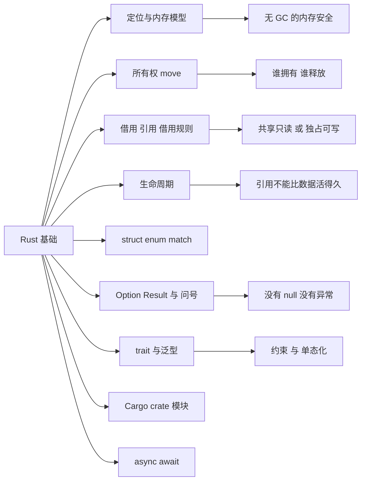

# 第 7 章 Rust 基础入门

> **所属部分**：第 3 部分 · 编程语言与基础技术 ｜ **难度**：★★★☆☆ ｜ **建议学时**：6 小时 ｜ **前置章节**：第 5 章 TypeScript 基础入门 ｜ **后续**：第 11 章 Rust 与 NAPI-rs

---

## 本章导读

打开 AFFiNE 仓库根目录，你会看到一个 `Cargo.toml`——除了 TypeScript，AFFiNE 还维护着一个 **Rust workspace**：本地数据库、CRDT 合并、图片处理、SSRF 防护、录音、权限判定都由 Rust 实现。第 11 章会带你逐行读懂这些真实源码并写出第一个 `#[napi]` 函数。但如果你**懂编程、却没学过 Rust**，直接读第 11 章会被所有权、借用、`'a`、`?` 这些符号劝退。

本章就是那块垫脚石：假设你会一门主流语言（JavaScript / Java / Python / Go 皆可），**从 Rust 最核心、也最反直觉的概念讲起**，一路铺到第 11 章的起点。本章只讲 **Rust 语言本身**，不深挖 AFFiNE 源码；读完你应当能看懂绝大多数 Rust 代码，并且知道"编译器为什么要这么管我"。

Rust 的一句话定位：**没有垃圾回收（GC），也没有手动 `free`，却依然内存安全的系统级语言**。它靠一套在**编译期**运行的规则——所有权与借用——在你运行程序之前就证明"不会出现悬垂指针、二次释放、数据竞争"。这套规则就是学习曲线的全部陡峭之处。把它想明白，Rust 的其余部分（类型、trait、泛型、错误处理）对一个有经验的程序员来说都相当顺滑。

---

## 学习目标

- [ ] 能够说清 Rust 为什么能"无 GC 又内存安全"，以及这对比 C/C++ 与带 GC 语言各自解决了什么
- [ ] 能够解释所有权三原则与 **move 语义**，判断一段代码里值在何处被移动、何处失效
- [ ] 能够区分 `&T` 与 `&mut T`，复述**借用规则**并说清它如何在编译期消灭数据竞争
- [ ] 能够说明生命周期**为什么存在**，读懂 `'a` 标注，并知道"生命周期省略"是怎么回事
- [ ] 能够用 `struct`、`enum` 建模数据，用 `match` 做穷尽的模式匹配
- [ ] 能够用 `Option`/`Result` 表达"可能没有"与"可能失败"，并用 `?` 运算符串联错误传播
- [ ] 能够读写简单的 `trait` 与泛型函数，理解 trait 约束与单态化
- [ ] 能够看懂 `Cargo.toml`、crate、模块（`mod`/`use`）的组织方式，并理解 `async/await` 的基本模型，为第 11 章打底

---

## 知识地图



---

## 一、Rust 定位：没有 GC，为什么还能内存安全

先看两条你已经熟悉的路线，Rust 走的是第三条。

| 路线 | 代表语言 | 内存谁来管 | 代价 |
| --- | --- | --- | --- |
| 手动管理 | C / C++ | 程序员自己 `malloc`/`free` | 快，但悬垂指针、二次释放、泄漏、数据竞争防不胜防 |
| 垃圾回收（GC） | JavaScript / Java / Go | 运行时定期扫描回收 | 省心，但有 GC 停顿、额外内存与运行时开销 |
| **编译期所有权** | **Rust** | **编译器按规则在编译期插入释放** | 既无 GC 开销，又在编译期堵住上面那些错误 |

Rust 的核心洞察是：**内存该在何时释放，其实在编译期是可以推断的**——只要给"谁拥有这块内存"定一套明确规则。编译器里负责检查这套规则的部分叫 **borrow checker（借用检查器）**。它在编译期就拒绝一切可能导致内存不安全的代码；**代码一旦编译通过，就不会有上述那类内存错误**。

<div class="tip custom-block">
<p class="custom-block-title">最重要的一句话</p>
<p>Rust 把"内存安全"从<strong>运行时问题</strong>（靠 GC 或祈祷）变成了<strong>编译期问题</strong>（靠类型系统与 borrow checker）。你和编译器"吵架"的那些时刻，本质上是它在帮你提前发现本会在 C 里半夜崩溃的 bug。初学最好的心态：<strong>不是编译器太严，是它在替你做证明</strong>。</p>
</div>

来感受一下最小的 Rust 程序：

```rust
fn main() {
    let name = "AFFiNE";
    let version = 7;
    println!("{name} v{version}"); // 字符串插值：AFFiNE v7
}
```

`fn` 定义函数，`main` 是入口；`let` 声明变量（**默认不可变**，想改要写 `let mut`）；`println!` 末尾的 `!` 表示它是**宏**不是普通函数（第八节再提）。注意无需手写类型——Rust 有强大的类型推断，但它是**静态强类型**，类型在编译期全程存在（这点和会"类型擦除"的 TypeScript 正好相反）。

---

## 二、所有权：Rust 的地基

所有权（ownership）是 Rust 区别于一切主流语言的核心。三条原则：

1. 每个值有且只有一个**所有者**（owner，通常是某个变量）；
2. 同一时刻只能有一个所有者；所有者**离开作用域**，值立即被释放（drop）；
3. 把值赋给别人、或当参数传进函数，默认是**移动（move）**——所有权转走，原变量随即**失效**。

第 1、2 条解决"何时释放"：不需要 GC，也不需要手写 `free`，编译器知道作用域结束就是释放点。第 3 条最反直觉，重点看它。

### move 语义：赋值不是拷贝

```rust
fn main() {
    let s1 = String::from("hello"); // s1 拥有这段堆内存
    let s2 = s1;                    // 所有权从 s1 移动到 s2，s1 失效
    // println!("{s1}");            // ❌ 编译错误：borrow of moved value: `s1`
    println!("{s2}");               // ✅ s2 是现在的所有者
}
```

在 JavaScript 里 `s2 = s1` 只是多一个引用指向同一对象；在 Rust 里，`String` 是拥有堆内存的类型，赋值会把所有权**移动**给 `s2`，`s1` 不再可用。为什么？因为若两者都"有效"，作用域结束时这块堆内存会被**释放两次**（二次释放，经典内存漏洞）。Rust 用 move 从根上杜绝了它。

传参同理——传进函数就把所有权交出去了：

```rust
fn takes(s: String) {
    println!("拿到了 {s}");
} // s 在这里离开作用域，被释放

fn main() {
    let msg = String::from("hi");
    takes(msg);        // msg 被移动进函数
    // println!("{msg}"); // ❌ msg 已失效
}
```

### Copy 类型是例外

像 `i32`、`bool`、`char`、`f64` 这些固定大小、完全放在栈上的类型，实现了 `Copy`——赋值时**按位复制**，原变量仍可用，不发生 move：

```rust
fn main() {
    let a = 5;
    let b = a;            // i32 是 Copy，复制一份
    println!("{a} {b}");  // ✅ a 仍可用，输出 5 5
}
```

### 想保留所有权？那就 clone

如果确实需要一份独立的数据，显式 `clone()`——它会深拷贝堆内存，代价可见：

```rust
fn main() {
    let s1 = String::from("hello");
    let s2 = s1.clone(); // 显式深拷贝，两者各自拥有一份
    println!("{s1} {s2}"); // ✅ 都能用
}
```

<div class="tip custom-block">
<p class="custom-block-title">经验</p>
<p>Rust 让"复制有多贵"变得<strong>显式</strong>：廉价的栈拷贝悄悄发生（Copy），昂贵的堆拷贝必须你亲手写 <code>clone()</code>。看到满屏 <code>clone()</code> 先别慌——但也别用它来"消除编译错误"，很多时候正确答案是下一节的<strong>借用</strong>，根本不需要拷贝。</p>
</div>

---

## 三、借用与引用：不夺走所有权地使用

每次用值都转移所有权显然不现实。Rust 的解法是**借用（borrow）**：通过**引用（reference）**临时访问一个值，而不获取它的所有权。引用用 `&` 创建。

引用分两种：

- `&T`：**不可变引用**（共享借用），只能读；
- `&mut T`：**可变引用**（独占借用），可以改。

```rust
fn length(s: &String) -> usize { // 借用，不拿所有权
    s.len()
} // s 离开作用域，但它只是引用，不释放底层数据

fn push_bang(s: &mut String) {   // 可变借用
    s.push('!');
}

fn main() {
    let mut text = String::from("hi");
    let n = length(&text);   // 借出只读引用，text 仍归自己
    push_bang(&mut text);    // 借出可变引用
    println!("{text} 长度曾是 {n}"); // hi! 长度曾是 2
}
```

`length` 用完后 `text` 依然可用——这正是借用相对 move 的价值。

### 借用规则：共享不可变，可变要独占

这是 Rust 最关键的一条规则，务必记牢：

> **在任意一段时间内，对同一个值，要么存在任意多个 `&T`（只读），要么只存在一个 `&mut T`（可写）——两者不能同时存在。**

```rust
fn main() {
    let mut v = vec![1, 2, 3];

    let r1 = &v;        // ✅ 只读借用
    let r2 = &v;        // ✅ 可以有多个只读借用
    println!("{r1:?} {r2:?}");

    let m = &mut v;     // ✅ 到这里 r1/r2 已不再使用，可以独占可变借用
    m.push(4);
    println!("{m:?}");

    // 下面这种"又读又写同时发生"会被拒绝：
    // let r = &v;
    // let w = &mut v; // ❌ cannot borrow `v` as mutable ... also borrowed as immutable
    // println!("{r:?} {w:?}");
}
```

为什么这么设计？因为"**多个读者 或 一个写者**"正是**数据竞争**的反面。在 C/C++ 里两个线程一个读一个写同一内存是未定义行为；Rust 把这条规则前移到编译期，**数据竞争在编译阶段就无法通过**。这也是 Rust 敢宣称"无畏并发（fearless concurrency）"的根基。

<div class="tip custom-block">
<p class="custom-block-title">类比第 5 章</p>
<p>TypeScript 的 <code>readonly</code> 只是"建议别改"，运行时依然能改；Rust 的 <code>&T</code> 是<strong>编译期强制</strong>的只读，且同一时刻的可变访问被独占保证。这就是"类型系统帮你证明线程安全"的含义——第 11 章会看到 AFFiNE 正是靠它把"把 JS 数据交给工作线程"证明为安全。</p>
</div>

---

## 四、生命周期：引用不能比数据活得久

借用引出一个新问题：**引用指向的数据，必须比引用本身活得更久**，否则引用就会变成指向已释放内存的"悬垂引用"。生命周期（lifetime）就是编译器用来追踪"每个引用能存活多久"的机制。

大多数时候你**根本不用写**生命周期——编译器自动推断。它只在"返回引用、而来源有歧义"时需要你标注。看这个会被拒绝的例子：

```rust
fn main() {
    let r;
    {
        let x = 5;
        r = &x;     // r 借用了 x
    }               // ❌ x 在这里被释放，r 成了悬垂引用
    // println!("{r}"); // 编译器报错：`x` does not live long enough
}
```

### `'a` 标注在说什么

当函数返回一个引用，而它可能借自多个参数时，编译器无法猜来源，需要你用生命周期参数 `'a` 把它们"绑在一起"：

```rust
// 返回两个字符串切片中较长的那个——返回的引用借自其中一个入参
fn longest<'a>(a: &'a str, b: &'a str) -> &'a str {
    if a.len() >= b.len() { a } else { b }
}

fn main() {
    let s1 = String::from("hello");
    let s2 = String::from("hi");
    let r = longest(&s1, &s2);
    println!("较长的是 {r}"); // 较长的是 hello
}
```

`<'a>` 声明一个生命周期参数，`a: &'a str`、`b: &'a str`、返回 `&'a str` 表示：**返回的引用，活得不会超过 `a` 和 `b` 中较短的那个**。`'a` 不是让数据活得更久，它只是**描述关系**，让编译器能据此检查调用方有没有在数据失效后还用返回值。

### 生命周期省略

你读真实代码时会发现很多返回引用的函数**没写** `'a`，比如 `fn first_word(s: &str) -> &str`。这是因为 Rust 有一套**生命周期省略规则（elision）**：对常见模式（如"只有一个引用入参，返回引用必然借自它"）编译器自动补全，省去你手写。**概念上理解到这一层即可**——第 11 章会在 AFFiNE 的 JSON 查询代码里见到真实的 `'a` 标注。

<div class="tip custom-block">
<p class="custom-block-title">初学心法</p>
<p>别被 <code>'a</code> 吓到。它不改变程序行为，只是把你脑子里"这个引用来自那个变量，所以别让变量先死"的直觉<strong>写给编译器看</strong>。看不懂某个复杂标注时，先问："返回的引用借自哪个参数？"答案通常就在标注里。</p>
</div>

---

## 五、用 struct、enum 与 match 建模数据

### struct：聚合字段

`struct` 和其他语言的结构体/类的"数据部分"类似：

```rust
struct User {
    id: String,
    name: String,
    active: bool,
}

impl User { // 方法写在 impl 块里
    fn greet(&self) -> String {        // &self：只读借用自身
        format!("Hi, {}", self.name)
    }
    fn deactivate(&mut self) {         // &mut self：可变借用自身
        self.active = false;
    }
}

fn main() {
    let mut u = User {
        id: "u1".to_string(),
        name: "Alice".to_string(),
        active: true,
    };
    println!("{}", u.greet());
    u.deactivate();
}
```

注意方法第一个参数 `&self` / `&mut self` 就是上一节的借用——方法默认**借用**而不是夺走实例所有权。

### enum：带数据的枚举（代数数据类型）

Rust 的 `enum` 远比 C 的枚举强大：**每个变体可以携带不同类型的数据**。这正对应第 5 章 TypeScript 的"可辨识联合"，但它是语言原生的：

```rust
enum Shape {
    Circle(f64),            // 携带半径
    Rect { w: f64, h: f64 }, // 携带宽高（具名字段）
    Unit,                    // 不带数据
}
```

### match：穷尽的模式匹配

`match` 对 enum 做分支处理，而且**必须穷尽**所有变体，漏掉一个就编译不过——这让"忘记处理某种情况"的 bug 不可能溜过去：

```rust
fn area(s: &Shape) -> f64 {
    match s {
        Shape::Circle(r) => std::f64::consts::PI * r * r, // 解构出半径 r
        Shape::Rect { w, h } => w * h,                    // 解构出宽高
        Shape::Unit => 0.0,
    }
}
```

如果你删掉 `Shape::Unit =>` 这一臂，编译器会直接报 `non-exhaustive patterns: \`Unit\` not covered`。这种**穷尽性检查**是 Rust 建模状态机、协议消息的利器，也是第 11 章 nbstore 大量用 `enum` 的原因。

<div class="tip custom-block">
<p class="custom-block-title">对照第 5 章</p>
<p>TypeScript 要靠"每个分支加一个 <code>kind</code> 字段 + <code>switch</code>"来模拟可辨识联合，还需要 <code>strict</code> 配合才报"未覆盖"。Rust 的 <code>enum</code> + <code>match</code> 把这一切做成了<strong>语言内建、默认强制穷尽</strong>——这就是"代数数据类型比可辨识联合更强"的含义。</p>
</div>

---

## 六、错误处理：Option、Result 与 `?`

Rust **没有 null，也没有异常**。两个"可能出问题"的情况用两个标准库 enum 表达。

### Option：可能没有值

```rust
enum Option<T> {  // 标准库定义（示意）
    Some(T),
    None,
}
```

想表达"可能找不到"，就返回 `Option<T>`，而不是像别的语言那样返回一个可能为 `null` 的值。调用方**被类型逼着处理 `None`**，于是"忘记判空导致的空指针"这类错误在 Rust 里几乎不存在：

```rust
fn first_char(s: &str) -> Option<char> {
    s.chars().next() // 空字符串时返回 None
}

fn main() {
    match first_char("hi") {
        Some(c) => println!("首字符是 {c}"),
        None => println!("空字符串"),
    }
}
```

### Result：可能失败

```rust
enum Result<T, E> { // 标准库定义（示意）
    Ok(T),
    Err(E),
}
```

可失败的操作返回 `Result<T, E>`：成功是 `Ok(值)`，失败是 `Err(错误)`。错误是**普通返回值**，必须显式处理，不会像异常那样"悄悄穿透"多层调用栈：

```rust
fn parse_port(s: &str) -> Result<u16, std::num::ParseIntError> {
    let n: u16 = s.parse()?; // parse 返回 Result，? 见下文
    Ok(n)
}
```

### `?` 运算符：优雅地传播错误

每次都写 `match` 处理 `Err` 很啰嗦。`?` 运算符是语法糖：**如果是 `Err` 就立刻从当前函数返回这个错误；如果是 `Ok` 就取出里面的值继续**。

```rust
use std::num::ParseIntError;

fn sum_two(a: &str, b: &str) -> Result<i64, ParseIntError> {
    let x: i64 = a.parse()?; // 失败就直接 return Err(...)
    let y: i64 = b.parse()?;
    Ok(x + y)
}

fn main() {
    println!("{:?}", sum_two("3", "4"));   // Ok(7)
    println!("{:?}", sum_two("3", "oops")); // Err(ParseIntError { .. })
}
```

`let x = a.parse()?;` 完全等价于：

```rust
let x = match a.parse() {
    Ok(v) => v,
    Err(e) => return Err(From::from(e)), // 注意：会自动做错误类型转换
};
```

那句 `From::from(e)` 很关键：`?` 在返回时会**自动把错误转换成当前函数签名要求的错误类型**（只要实现了 `From`）。第 11 章会看到 AFFiNE 用 `thiserror` 给 enum 加 `#[from]`，让一个 `?` 就把 `sqlx::Error` 自动转成自家的 `Error`，再转成 `napi::Error`——整条错误链都靠这个机制串起来。

<div class="tip custom-block">
<p class="custom-block-title">为什么比异常好</p>
<p>异常是"隐式控制流"：你看函数签名根本不知道它会抛什么。Rust 把错误写进<strong>返回类型</strong>，调用方一眼看到 <code>Result</code> 就知道"这里会失败、我必须处理"。<code>?</code> 则在不牺牲这种显式性的前提下，让错误传播写起来和异常一样简洁。</p>
</div>

---

## 七、trait 与泛型简介

### trait：Rust 的"接口"

`trait` 定义一组方法签名（行为），类型用 `impl Trait for Type` 来实现它——类似 TypeScript 的 `interface` 或 Java 的 interface，但更灵活：

```rust
trait Summary {
    fn summarize(&self) -> String;
}

struct Article {
    title: String,
}

impl Summary for Article {
    fn summarize(&self) -> String {
        format!("《{}》", self.title)
    }
}

fn main() {
    let a = Article { title: "Rust 入门".to_string() };
    println!("{}", a.summarize()); // 《Rust 入门》
}
```

标准库里一堆常用 trait 你迟早会遇到：`Clone`（可 `clone()`）、`Debug`（可用 `{:?}` 打印）、`From`/`Into`（类型转换）、`Display`（可用 `{}` 打印）。常用 `#[derive(...)]` 让编译器**自动实现**它们：

```rust
#[derive(Debug, Clone)] // 自动实现 Debug 和 Clone
struct Point { x: i32, y: i32 }

fn main() {
    let p = Point { x: 1, y: 2 };
    let q = p.clone();
    println!("{p:?} {q:?}"); // Point { x: 1, y: 2 } Point { x: 1, y: 2 }
}
```

### 泛型：对多种类型复用，且零开销

泛型让函数/结构体接收"类型参数"，和第 5 章 TypeScript 泛型的直觉一致。不同的是常配合 **trait 约束**（`T: Trait`）限定"这个类型必须具备某些能力"：

```rust
// T 可以是任意类型，但必须实现 PartialOrd（能比较大小）
fn largest<T: PartialOrd>(list: &[T]) -> &T {
    let mut biggest = &list[0];
    for item in list {
        if item > biggest { // 靠 PartialOrd 约束才能用 >
            biggest = item;
        }
    }
    biggest
}

fn main() {
    let nums = vec![3, 7, 2, 9, 4];
    println!("最大值 {}", largest(&nums)); // 最大值 9
}
```

约束 `T: PartialOrd` 的意义：没有它，编译器不知道任意 `T` 能不能用 `>` 比较，就会报错。约束就是"我需要这个类型至少会做这件事"的契约。

<div class="tip custom-block">
<p class="custom-block-title">单态化：和 TS 泛型的本质区别</p>
<p>TypeScript 泛型只在编译期做类型检查，运行时被擦除，一份代码跑所有类型。Rust 泛型是<strong>单态化（monomorphization）</strong>：编译器为每个实际用到的类型<strong>生成一份专用机器码</strong>，因此泛型<strong>零运行时开销</strong>，和手写具体类型一样快。代价是编译更慢、二进制更大。</p>
</div>

---

## 八、Cargo、crate 与模块

### Cargo：Rust 的官方工具链

Cargo 既是包管理器也是构建工具，相当于 Rust 世界的 `npm` + `tsc`。常用命令：

```bash
cargo new my_app      # 新建项目
cargo build           # 编译（debug）
cargo build --release # 优化编译
cargo run             # 编译并运行
cargo test            # 跑测试
cargo check           # 只做类型/借用检查，不生成产物，最快
```

### crate 与 Cargo.toml

**crate** 是 Rust 的编译单元与分发单元（约等于一个库或一个可执行程序）。依赖在 `Cargo.toml` 里声明，发布在 [crates.io](https://crates.io)：

```toml
[package]
name = "my_app"
version = "0.1.0"
edition = "2024"       # Rust 版次（语言的一组特性集合）

[dependencies]
serde = { version = "1", features = ["derive"] }
tokio = { version = "1.45", features = ["full"] }
```

第 11 章会讲到 AFFiNE 用 **workspace** 把多个 crate 组织在一起、用 `[workspace.dependencies]` 统一版本——那只是这里单个 `Cargo.toml` 的"规模放大"。

### 模块：mod 与 use

一个 crate 内部用**模块（module）**组织代码，`mod` 声明模块、`pub` 控制可见性、`use` 把路径引入当前作用域：

```rust
mod math {
    pub fn add(a: i32, b: i32) -> i32 { // pub 才能被外部访问
        a + b
    }
    pub mod geo { // 模块可嵌套
        pub fn square(x: i32) -> i32 { x * x }
    }
}

use math::geo::square;

fn main() {
    println!("{}", math::add(1, 2)); // 全路径调用
    println!("{}", square(4));       // use 之后可直接用
}
```

Rust 的默认可见性是**私有**：不写 `pub` 的项只能在本模块内访问。这和第 5 章 TypeScript 模块"默认不导出、需 `export`"的直觉一致，只是关键字不同。

---

## 九、async/await 基础概念

Rust 也有 `async`/`await`，写起来和 JavaScript 很像，但底层模型有一个**关键区别**，必须讲清。

```rust
async fn fetch_user(id: u32) -> String {
    // 真实场景里这里会 await 一次网络/数据库调用
    format!("user-{id}")
}

async fn run() {
    let name = fetch_user(1).await; // .await 是后缀语法
    println!("{name}");
}
```

关键区别：**JavaScript 的 Promise 一创建就开始执行；Rust 的 `async fn` 返回一个惰性的 `Future`，在被 `.await`（或交给运行时）之前什么都不会发生。** 换句话说，Rust 的 Future 是"待办事项"，需要一个**运行时（executor/runtime）**来真正驱动它跑。

而且 Rust 标准库**不自带**异步运行时——你要自己选一个 crate，社区事实标准是 **tokio**：

```rust
#[tokio::main] // 这个宏帮你建立 tokio 运行时并驱动 async main
async fn main() {
    run().await;
}
```

对初学阶段，记住这三点就够通往第 11 章了：

1. `async fn` 返回 **Future**，是**惰性**的，`.await` 才推进；
2. Future 需要**运行时**驱动，Rust 用第三方 crate（AFFiNE 用 **tokio**）；
3. **CPU 密集的同步计算不要直接塞进 async**（会卡住运行时），应放到专门的线程池——第 11 章会看到 AFFiNE 用 `tokio::task::spawn_blocking` 和 napi 的 `AsyncTask` 正是为此。

<div class="tip custom-block">
<p class="custom-block-title">通往第 11 章</p>
<p>第 11 章会看到 <code>#[napi] pub async fn</code> 被放到 napi 内置的 tokio 运行时上执行，并在 JS 侧返回一个 <code>Promise</code>——Rust 的 Future 与 JS 的 Promise 就在那条 FFI 边界上对接。把本节"惰性 Future + 需要运行时驱动"记牢，到那里就只剩工程细节了。</p>
</div>

---

## 动手实践

> 以下练习只需本地装好 Rust（装 [rustup](https://rustup.rs) 即可），全部用 `cargo new` 建小项目验证，不涉及 AFFiNE 仓库构建。

1. **让 move 报错，再修好它**：`cargo new move-lab`，写 `let s1 = String::from("x"); let s2 = s1; println!("{s1}");`，先观察 `borrow of moved value` 报错；再分别用 `s1.clone()` 和改成传引用 `&s1` 两种方式修好。**验收**：能说清两种修法各自的代价（深拷贝 vs 不拷贝）。
2. **撞一次借用规则**：建一个 `Vec<i32>`，同时持有一个 `&v` 和一个 `&mut v` 并都使用，记录编译器报错；再调整顺序让只读借用"用完"后再可变借用，使其通过。**验收**：能用自己的话复述"共享不可变 / 独占可变"规则。
3. **用 enum + match 建模**：定义 `enum Event { Click { x: i32, y: i32 }, Key(char), Close }`，写一个 `fn handle(e: &Event)` 用 `match` 穷尽处理；然后故意删掉一个分支，观察编译器的"non-exhaustive"报错。**验收**：解释穷尽性检查为什么能防 bug。
4. **用 Result 与 `?` 串错误**：写 `fn parse_point(s: &str) -> Result<(i32, i32), std::num::ParseIntError>`，把 `"3,4"` 按逗号切开后用 `?` 解析两个整数。**验收**：对 `"3,4"` 返回 `Ok((3,4))`，对 `"3,x"` 返回 `Err(...)`，并能说清 `?` 在失败时做了什么。

---

## 自测题

<details><summary>Q1. Rust 没有 GC 也没有手动 free，它靠什么保证内存安全？</summary>

靠**所有权 + 借用规则**在**编译期**检查（borrow checker）。每个值有唯一所有者，所有者离开作用域即释放；借用必须遵守"多个只读 或 单个可写"规则。这些规则让悬垂指针、二次释放、数据竞争在编译阶段就无法通过，因此既不需要 GC 的运行时开销，也不依赖程序员手动释放。

</details>

<details><summary>Q2. 什么是 move 语义？为什么 `let s2 = s1;`（s1 是 String）之后 s1 不能用了？</summary>

对拥有堆内存的类型（如 `String`），赋值/传参默认**转移所有权**（move），而非拷贝。`s2 = s1` 后所有权归 `s2`，`s1` 失效。这样做是为了保证"只有一个所有者负责释放"，避免这块内存在作用域结束时被释放两次。像 `i32` 这类实现了 `Copy` 的栈上类型则是复制，原变量仍可用。

</details>

<details><summary>Q3. 借用规则是什么？它和数据竞争有什么关系？</summary>

同一时间对同一个值，**要么有任意多个 `&T`（只读共享），要么只有一个 `&mut T`（可写独占）**，二者不能并存。数据竞争的本质正是"并发地读与写同一内存且至少一个是写"，借用规则从编译期禁止了这种组合，于是数据竞争在编译阶段就被排除。

</details>

<details><summary>Q4. 生命周期标注 `'a` 会改变程序运行行为吗？它到底在表达什么？</summary>

不会改变运行行为，`'a` 只是**描述引用之间的存活关系**，供编译器做借用检查。例如 `fn longest<'a>(a: &'a str, b: &'a str) -> &'a str` 表示返回的引用不会比 `a`、`b` 中较短者活得更久，从而保证调用方不会在数据失效后仍使用返回值。大多数情况编译器能自动推断（省略规则），无需手写。

</details>

<details><summary>Q5. Rust 为什么不用异常，而用 Option 和 Result？`?` 做了什么？</summary>

`Option<T>` 表达"可能没有值"（取代 null），`Result<T, E>` 表达"可能失败"（取代异常）。它们把"可能出问题"写进**返回类型**，调用方被类型强制处理，错误不会像异常那样隐式穿透调用栈。`?` 是语法糖：遇 `Err`（或 `None`）就立刻从当前函数返回该错误，遇 `Ok`/`Some` 就取出内部值继续，返回时还会通过 `From` 自动转换错误类型。

</details>

---

## 常见坑

| 现象 | 原因与处理 |
| --- | --- |
| `borrow of moved value: \`x\`` | 值已被 move 走还想用。改为借用 `&x`，或确有需要时 `x.clone()` |
| `cannot borrow \`v\` as mutable ... also borrowed as immutable` | 同时存在只读与可变借用。让只读借用先"用完"，或缩小作用域，再可变借用 |
| 满屏 `.clone()` 消除报错 | 把 clone 当"消错咒语"。多数时候正解是改用引用 `&T`，避免不必要的深拷贝 |
| `\`x\` does not live long enough` | 返回/保存了比数据活得更久的引用。返回拥有所有权的值（`String`/`Vec`），或修正生命周期 |
| `non-exhaustive patterns` | `match` 没覆盖所有 enum 变体。补齐分支，或用 `_ =>` 兜底（慎用，会关掉穷尽检查的保护） |
| `?` 报错 "the `?` operator can only be used in a function that returns Result/Option" | `?` 只能用在返回 `Result`/`Option` 的函数里。改函数签名，或在 `main` 里返回 `Result<(), E>` |
| async 函数"不执行" | Future 是惰性的，忘了 `.await` 或没有运行时驱动。加 `.await`，并用 `#[tokio::main]` 等建立运行时 |
| 把重 CPU 计算写进 async 里卡住整个服务 | async 不是用来跑同步重活的。放到 `spawn_blocking` 或线程池（见第 11 章） |

---

## 延伸阅读

- The Rust Programming Language（官方书，俗称 "the book"）：https://doc.rust-lang.org/book/ ；中文版：https://kaisery.github.io/trpl-zh-cn/
- Rust by Example（边看代码边学）：https://doc.rust-lang.org/rust-by-example/
- Rustlings（命令行练习，从编译错误里学）：https://github.com/rust-lang/rustlings
- 标准库文档中的 `Option`、`Result`、`Vec`、`String`：https://doc.rust-lang.org/std/
- Cargo Book（crate、workspace、依赖、构建脚本）：https://doc.rust-lang.org/cargo/
- Async Book 与 Tokio 教程：https://rust-lang.github.io/async-book/ 、https://tokio.rs/tokio/tutorial
- 第 11 章：Rust 与 NAPI-rs（本章概念在 AFFiNE 真实源码中的落地与绑定层）

---

## 本章学时拆分（建议 6 小时）

| 内容 | 时长 |
| --- | --- |
| 一、定位与无 GC 内存安全模型 | 0.5h |
| 二、所有权与 move 语义 | 1h |
| 三、借用、引用与借用规则 | 1h |
| 四、生命周期入门 | 0.5h |
| 五、struct / enum / match | 1h |
| 六、Option / Result 与 `?` | 1h |
| 七~九、trait 与泛型、Cargo 与模块、async/await | 1h |

---

| [← 第 6 章 前端框架基础入门](./06-前端框架基础入门-React-Lit-Signals-RxJS.md) | [第 8 章 CRDT 基础入门 →](./08-CRDT基础入门.md) |
| --- | --- |
