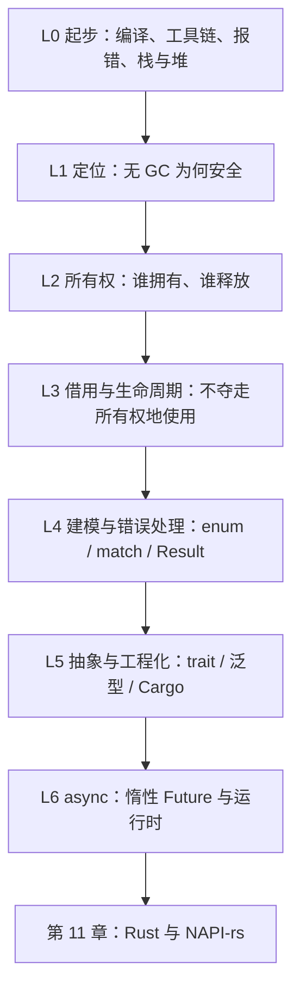

# 第 7 章 Rust 基础入门

> **所属部分**：第 3 部分 · 编程语言与基础技术 ｜ **难度**：★★★☆☆ ｜ **建议学时**：12 小时（零基础路线）／6 小时（已会一门主流语言） ｜ **前置章节**：<a href="./05-TypeScript基础入门.md#ch-5">第 5 章</a> 起步节（知道变量与函数即可）；完全没写过代码的读者可从本章起步节接入 ｜ **后续**：<a href="./11-Rust与NAPI-rs.md#ch-11">第 11 章</a> Rust 与 NAPI-rs

---

## 本章导读

打开 AFFiNE 仓库根目录，你会看到一个 `Cargo.toml`——除了 TypeScript，AFFiNE 还维护着一个 **Rust workspace**：本地数据库、CRDT 合并、图片处理、SSRF 防护、录音、权限判定都由 Rust 实现。<a href="./11-Rust与NAPI-rs.md#ch-11">第 11 章</a>会带你逐行读懂这些真实源码并写出第一个 `#[napi]` 函数。但直接读会被所有权、借用、`'a`、`?` 这些符号劝退。

本章就是那块垫脚石。与同部分其他基础章一样，本章**额外照顾没有系统学过编程、更没碰过编译型语言的读者**：起步节从「一份源代码怎么变成能跑的程序」讲起，把装工具链、在终端里敲命令、读懂一条 rustc 报错、栈与堆的直觉先铺好；后面的正文再从 Rust 最核心、也最反直觉的概念讲起，一路铺到<a href="./11-Rust与NAPI-rs.md#ch-11">第 11 章</a>的起点。本章只讲 **Rust 语言本身**，不深挖 AFFiNE 源码；读完你应当能看懂绝大多数 Rust 代码，并且知道「编译器为什么要这么管我」。

Rust 的一句话定位：**没有垃圾回收（GC），也没有手动 `free`，却依然内存安全的系统级语言**。它靠一套在**编译期**运行的规则——所有权与借用——在你运行程序之前就证明「不会出现悬垂指针、二次释放、数据竞争」。这套规则就是学习曲线的全部陡峭之处。把它想明白，Rust 的其余部分（类型、trait、泛型、错误处理）会相当顺滑。

### 三条学习路线

| 你的起点 | 怎么读 | 建议学时 |
| --- | --- | --- |
| **完全没写过代码** | 先走<a href="./05-TypeScript基础入门.md#ch-5">第 5 章</a>起步节（值、变量、函数），再按顺序读完本章起步节与全部正文，每节的随堂小练都动手做 | 约 12 小时 |
| **会一门主流语言（JS / Java / Python / Go），没学过 Rust** | 跳过起步节，按顺序读正文；重点看「这一节要解决什么」「最小例子」「规则小结」 | 约 6 小时 |
| **只想查 Rust 语法与报错** | 直接看每节的「规则小结」、[常见坑](#常见坑)和「最容易误解的点」 | 约 2 小时 |

> 表格里的「跳过」是真的可以跳过：正文各节**不依赖**起步节的任何记号，起步节只负责把读者带到「能自己编译并运行一个 Rust 程序」的位置。

### 每一节的结构

正文各节都按同一节奏推进，方便你判断自己该细读还是略读：

1. **这一节要解决什么**——先说清动机，不先抛规则；
2. **最小例子 + 逐行看**——一段能编译的代码，逐行解释，不跳步；
3. **规则小结**——把例子里的规律收敛成可查的表；
4. **最容易误解的点**——初学者最常卡住的那一两处；
5. **随堂小练**——30 秒能做完的小题，答案折叠，先自己想再展开。

代码约定：`❌` 表示该行会**编译失败**，`// 输出：…` 表示运行后看到的结果，`❌` 旁的注释是编译器会给出的报错。Rust 的报错本身就是教材，起步节会专门教你怎么读。

---

## 学习目标

**L0 · 起步**（起步节）

- [ ] 能说清「编译型语言」和「在浏览器里直接跑的脚本」有什么不同，知道源代码、编译器、可执行文件三者关系
- [ ] 能自己装好 rustup / cargo，用 `cargo new` 建项目、`cargo run` 跑起来
- [ ] 能逐行读懂一个 5 行的 Rust 程序，说清 `fn main`、`let`、`println!` 里的 `!`、分号与花括号
- [ ] 看到一条 rustc 报错，能指出它说的问题、位置和修复建议
- [ ] 能用自己的话解释「变量默认不可变」以及栈与堆的大致区别

**L1 · 定位与内存模型**（Rust 定位一节）

- [ ] 能够说清 Rust 为什么能「无 GC 又内存安全」，以及这对比 C/C++ 与带 GC 语言各自解决了什么

**L2 · 所有权与 move**（所有权一节）

- [ ] 能够解释所有权三原则与 **move 语义**，判断一段代码里值在何处被移动、何处失效
- [ ] 能区分 `Copy` 类型的按位复制与 `clone()` 的深拷贝，知道什么时候该改用借用

**L3 · 借用与生命周期**（借用、生命周期两节）

- [ ] 能够区分 `&T` 与 `&mut T`，复述**借用规则**并说清它如何在编译期消灭数据竞争
- [ ] 能够说明生命周期**为什么存在**，读懂 `'a` 标注，并知道「生命周期省略」是怎么回事

**L4 · 数据建模与错误处理**（struct / enum / match、Option / Result 两节）

- [ ] 能够用 `struct`、`enum` 建模数据，用 `match` 做穷尽的模式匹配
- [ ] 能够用 `Option`/`Result` 表达「可能没有」与「可能失败」，并用 `?` 运算符串联错误传播

**L5 · 抽象与工程化**（trait 与泛型、Cargo 与模块两节）

- [ ] 能够读写简单的 `trait` 与泛型函数，理解 trait 约束与单态化
- [ ] 能够看懂 `Cargo.toml`、crate、模块（`mod`/`use`）的组织方式

**L6 · 异步与衔接**（async / await 一节）

- [ ] 理解 `async/await` 的基本模型，能说清 Rust 的惰性 Future 与<a href="./06-前端框架基础入门-React-Lit-Signals-RxJS.md#ch-6">第 6 章</a> Promise 的区别，为<a href="./11-Rust与NAPI-rs.md#ch-11">第 11 章</a>打底

---

## 知识地图

本章是一条**阶梯**：每一级都在回答上一级留下的问题。



| 阶梯 | 对应小节 | 回答的问题 | 学完你能做什么 |
| --- | --- | --- | --- |
| L0 | 零基础起步 | 代码怎么变成能跑的程序？报错怎么读？ | 独立编译运行、看懂第一条报错 |
| L1 | Rust 定位 | 没有 GC，内存谁来管？ | 说清「编译期证明」这条路线 |
| L2 | 所有权 | 什么时候释放？赋值为什么会「失效」？ | 判断 move / Copy / clone |
| L3 | 借用与生命周期 | 不想交出所有权怎么办？引用能活多久？ | 写 `&T` / `&mut T`、读懂 `'a` |
| L4 | 建模与错误处理 | 状态怎么表达？失败怎么表示？ | 用 enum + match、Result + `?` |
| L5 | 抽象与工程化 | 多种类型怎么复用？多文件怎么组织？ | 写 trait 约束、看懂 Cargo.toml |
| L6 | async | 异步代码为什么没执行？ | 说清 Future 惰性、需要运行时 |

---

## 7.1 零基础起步：编译、工具链与报错（会一门语言可跳过）

> **对应阶梯**：L0 ｜ **预计**：3 小时 ｜ 这一节不出现任何 AFFiNE 源码，也不出现所有权，只建立最小共识。

如果之前只写 JavaScript，Rust 的第一道坎不是语法，而是**代码怎么跑起来**：JS 存成一个文件、浏览器打开就执行；Rust 必须先「翻译」成机器能直接执行的文件，多了一个叫**编译**的步骤。这一节把这件事从头走一遍。

### 7.1.1 编译型语言：源代码怎么变成能跑的程序

| 步骤 | 发生了什么 | 类比 |
| --- | --- | --- |
| 1. 写源代码 | 你编辑 `main.rs`，里面是人类可读的文本 | 写菜谱 |
| 2. 编译 | `rustc` / `cargo` 把文本翻译成 CPU 能执行的机器指令，同时**检查规则** | 把菜谱译成机器指令并检查配料是否齐全 |
| 3. 运行 | 得到可执行文件，双击或命令行执行 | 机器按指令做菜 |

关键差别在**第 2 步**：

- JavaScript（<a href="./06-前端框架基础入门-React-Lit-Signals-RxJS.md#ch-6">第 6 章</a>）是解释/即时编译：写错的地方要**运行到那一行**才暴露。
- Rust 是**编译型**：编译器在程序运行**之前**把整份代码检查一遍，规则不满足就**拒绝生成可执行文件**。

这解释了本章反复出现的一句话「编译期就堵住错误」——Rust 把大量原本会在运行时崩溃的问题，提前到了编译这一步。也解释了为什么学 Rust 会频繁看到报错：**编译器在帮你做证明**，不是在为难你。

<div class="tip custom-block">
<p class="custom-block-title">先建立一个预期</p>
<p>本章后面的练习里，<strong>看到编译错误是正常且必要的</strong>，有几道题甚至要求你「故意让编译器报错」。读 Rust 报错是一项要练的技能，下一小节就专门练它。</p>
</div>

### 7.1.2 装好工具链，把第一个程序跑起来

需要三个名字，别被绕晕：

| 名字 | 是什么 |
| --- | --- |
| `rustup` | 安装/切换 Rust 版本的工具，只装一次 |
| `rustc` | 编译器本体，一般不用直接调用 |
| `cargo` | 项目管家：建项目、装依赖、编译、运行、测试，日常只用它 |

**终端（命令行）最小操作**：打开「终端」应用（macOS 在「应用程序 → 实用工具」，Windows 用 PowerShell），依次输入：

```bash
curl --proto '=https' --tlsv1.2 -sSf https://sh.rustup.rs | sh   # 安装 rustup（按提示回车即可）
rustc --version          # 确认装好，会打印 rustc 1.xx.x
cargo new hello_rust     # 建一个名为 hello_rust 的项目
cd hello_rust            # 进入项目目录
cargo run                # 编译并运行
```

**逐行看**：

| 命令 | 作用 | 常见的坑 |
| --- | --- | --- |
| `curl … \| sh` | 下载并运行官方安装脚本 | 装完要重开终端，或按提示 `source` 一下环境变量 |
| `rustc --version` | 打印版本，用来确认安装成功 | 报 `command not found` 说明 PATH 没生效 |
| `cargo new hello_rust` | 生成 `Cargo.toml` 和 `src/main.rs` 两个文件 | 项目名用小写加下划线，别带空格 |
| `cd hello_rust` | 切换当前目录 | 忘了 `cd`，下一条命令会报「找不到 Cargo.toml」 |
| `cargo run` | 先编译再执行 | 第一次会慢一点，属正常 |

屏幕上出现 `Hello, world!` 就成功了。`cargo new` 生成的 `src/main.rs` 内容是：

```rust
fn main() {
    println!("Hello, world!");
}
```

> 终端里 `cd` 的意思是「把当前目录切到某处」，相当于在文件管理器里双击进入文件夹。命令要在正确的目录下执行，这是新手最常见的挫败来源。

<details><summary>随堂小练 1：`cargo run` 和「直接双击 `main.rs`」有什么区别？</summary>

`main.rs` 只是**源文本**，双击它不会执行任何代码。`cargo run` 会先调用编译器把文本翻译成可执行文件，再运行那个文件。所以 Rust 程序永远有「编译」这一步，区别只是 cargo 帮你把两步合成了一条命令。

</details>

### 7.1.3 逐行读懂最小的 Rust 程序

```rust
fn main() {
    let name = "AFFiNE";
    let version = 7;
    println!("{name} v{version}");
}
```

**逐行看**：

| 行 | 内容 | 含义 |
| --- | --- | --- |
| 1 | `fn main()` | 定义一个函数；`main` 是**程序入口**，可执行文件从这里开始跑 |
| 1 | `{` … `}` | 花括号圈出**函数体**，也圈出一段**作用域**（后面「所有权」全靠它） |
| 2 | `let name = "AFFiNE";` | 声明变量 `name`，值是字符串；`let` 是声明变量的关键字 |
| 3 | `let version = 7;` | 声明变量 `version`，值是整数 |
| 4 | `println!(…)` | 打印到终端；末尾的 `!` 表示它是**宏**而不是普通函数 |
| 4 | `"{name} v{version}"` | 字符串里用 `{}` 把变量填进去，输出 `AFFiNE v7` |
| 2–4 | 行尾 `;` | 语句结束符；**大部分行都要写**，漏了会编译报错 |

不需要手写类型——Rust 有类型推断。但它是**静态强类型**：类型在编译期全程存在、且不能随意混用（这和<a href="./05-TypeScript基础入门.md#ch-5">第 5 章</a>讲的「类型擦除」正好相反，TS 的类型在运行时会被擦掉，Rust 不会）。

<div class="tip custom-block">
<p class="custom-block-title">`!` 是什么</p>
<p><code>println!</code> 末尾的 <code>!</code> 表示「宏」：一种在编译期展开、能接受可变数量参数的代码生成机制。初学阶段只需记住「打印要带感叹号，普通函数调用不带」，不必深究。</p>
</div>

### 7.1.4 读懂一条 rustc 报错

Rust 的编译器以「报错写得很详细」著称。把 `main.rs` 改成下面这样，再 `cargo run`：

```rust
fn main() {
    let version = 7
    println!("{version}");
}
```

编译器会输出类似：

```text
error: expected `;`, found `println`
 --> src/main.rs:2:19
  |
2 |     let version = 7
  |                   ^ help: add `;` here
  |
```

**逐段读**：

| 片段 | 含义 |
| --- | --- |
| `error: expected ';', found 'println'` | **出了什么问题**：这里应该有个分号 |
| `--> src/main.rs:2:19` | **在哪**：文件 `src/main.rs` 第 2 行第 19 列 |
| `2 \| let version = 7` | 把那一行原文贴出来给你看 |
| `^ help: add ';' here` | 用 `^` 指到具体位置，并给出**修复建议** |
| `error: could not compile ...` | 总结：编译没通过，所以没有可执行文件 |

读 Rust 报错的固定三步：**看第一行知道问题 → 看 `-->` 定位文件和行号 → 看 `help` / `note` 找修复建议**。本章后面所有「❌ 编译错误」都可以这样拆。

> 有些报错带错误码（如 `E0382`），在终端里敲 `rustc --explain E0382` 会打印一段更详细的讲解和示例。

<details><summary>随堂小练 2：把分号补回去之后，编译通过了吗？如果又报「unused variable」呢？</summary>

分号补回去就能通过。`unused variable` 一类是**警告（warning）**不是错误（error）：程序仍会编译成功并运行，只是提醒你「这个变量没用到」。区分 `error`（拦住编译）和 `warning`（只提醒）是读输出的第一课。

</details>

### 7.1.5 变量默认不可变：let 与 let mut

这是从 JS / Python 转过来最容易懵的一处：

```rust
fn main() {
    let count = 1;
    // count = 2;              // ❌ 编译错误：cannot assign twice to immutable variable
    let mut total = 1;         // mut = mutable，允许修改
    total = 2;                 // ✅
    println!("{count} {total}");
}
```

| 写法 | 含义 |
| --- | --- |
| `let x = 1;` | 绑定一个**不可变**变量，之后不能改 |
| `let mut x = 1;` | 绑定一个**可变**变量 |
| `x = 2;` | 赋值（要求 `x` 是 `mut`） |

为什么默认不可变？因为 Rust 的核心规则（借用规则）建立在「同一时刻要么多个只读、要么一个可写」之上；默认不可变让「只读」成为常态，编译器更容易证明安全。看到 `mut` 就说明「这里明确允许改」。

<details><summary>随堂小练 3：想让 `let s = String::from("hi");` 里的 `s` 能被追加字符，声明时要加什么？</summary>

写 <code>let mut s = String::from("hi");</code>。只有变量绑定可变还不够，调用的方法本身也要匹配（<code>s.push('!')</code> 需要可变借用），这一点会在借用一节展开。

</details>

### 7.1.6 栈与堆：为什么需要「谁负责释放」

不用背定义，先记住一个够用的直觉：

| | 栈（stack） | 堆（heap） |
| --- | --- | --- |
| 放什么 | 大小固定、编译期就知道的值（如 `i32`、`bool`） | 大小会变、运行时才确定的值（如 `String`、`Vec`） |
| 特点 | 分配/回收极快，随作用域自动进出 | 需要单独申请一块内存，用完必须归还 |
| 复制成本 | 几乎为零（按位复制一份） | 可能很贵（要复制整块数据） |

问题来了：堆上的内存**谁负责归还**？

- C/C++：程序员手写 `free` —— 忘了就泄漏，多释放一次就崩溃。
- JavaScript / Java：运行时有个**垃圾回收器**定期扫描、自动回收 —— 省心但有额外开销。
- Rust：**编译器按规则在确定的位置插入释放代码** —— 既不用你写 `free`，也不需要 GC。

要让编译器知道「在哪个位置释放」，就必须明确**这块内存归谁**。这就是下一节「所有权」要回答的全部问题。

<div class="tip custom-block">
<p class="custom-block-title">最容易误解的点</p>
<p>「栈 / 堆」是<strong>直觉模型</strong>，不是要你记住内存布局。本章只需要一条结论：<strong>固定大小的值复制很便宜，大小会变的值需要有人负责释放</strong>。看到 <code>String</code>、<code>Vec</code> 就想到「它拥有一块堆内存」，后面 move / 借用 / clone 的取舍全都顺了。</p>
</div>

### 7.1.7 起步自检

能用自己的话回答这五问，就可以进入正文了：

1. `cargo run` 替你做了哪两件事？
2. `fn main()`、`let`、`println!` 里的 `!`、行尾 `;` 各是什么？
3. 一条 rustc 报错里的 `error:`、`--> src/main.rs:2:19`、`help:` 分别告诉你什么？
4. `let x = 1;` 之后能写 `x = 2;` 吗？要改哪里？
5. 为什么 `i32` 复制很便宜、`String` 复制可能很贵？

> 答不上第 5 问也没关系，正文「所有权」一节会带着这个直觉反复用。前四问答得上，本章所有例子的「外壳」你就都认识了。

---

## 7.2 Rust 定位：没有 GC，为什么还能内存安全

> **这一节要解决什么**：起步节留了个尾巴——堆内存要有人负责释放。这一节回答 Rust 选了哪条路线，以及为什么它敢说「既没有 GC 开销、又不会有内存错误」。

先看两条你已经熟悉的路线，Rust 走的是第三条。

| 路线 | 代表语言 | 内存谁来管 | 代价 |
| --- | --- | --- | --- |
| 手动管理 | C / C++ | 程序员自己 `malloc`/`free` | 快，但悬垂指针、二次释放、泄漏、数据竞争防不胜防 |
| 垃圾回收（GC） | JavaScript / Java / Go | 运行时定期扫描回收 | 省心，但有 GC 停顿、额外内存与运行时开销 |
| **编译期所有权** | **Rust** | **编译器按规则在编译期插入释放** | 既无 GC 开销，又在编译期堵住上面那些错误 |

Rust 的核心洞察是：**内存该在何时释放，其实在编译期是可以推断的**——只要给「谁拥有这块内存」定一套明确规则。编译器里负责检查这套规则的部分叫 **borrow checker（借用检查器）**。它在编译期就拒绝一切可能导致内存不安全的代码；**代码一旦编译通过，就不会有上述那类内存错误**。

<div class="tip custom-block">
<p class="custom-block-title">最重要的一句话</p>
<p>Rust 把「内存安全」从<strong>运行时问题</strong>（靠 GC 或祈祷）变成了<strong>编译期问题</strong>（靠类型系统与 borrow checker）。你和编译器「吵架」的那些时刻，本质上是它在帮你提前发现本会在 C 里半夜崩溃的 bug。初学最好的心态：<strong>不是编译器太严，是它在替你做证明</strong>。</p>
</div>

来感受一下最小的 Rust 程序（起步节已逐行拆过，这里看新东西）：

```rust
fn main() {
    let name = "AFFiNE";
    let version = 7;
    println!("{name} v{version}"); // 字符串插值：AFFiNE v7
}
```

`fn` 定义函数，`main` 是入口；`let` 声明变量（**默认不可变**，想改要写 `let mut`）；`println!` 末尾的 `!` 表示它是**宏**不是普通函数。注意无需手写类型——Rust 有强大的类型推断，但它是**静态强类型**，类型在编译期全程存在（这点和会「类型擦除」的 TypeScript 正好相反）。

**规则小结**：

| 概念 | 一句话 |
| --- | --- |
| 编译期检查 | 代码运行前，编译器先把整份代码的规则验一遍 |
| borrow checker | 编译器中负责检查所有权/借用规则的部分 |
| 无 GC 又安全 | 释放点由编译器在编译期确定并插入，无需运行时扫描 |
| 代价 | 学规则要花时间；编译器会拒绝「能跑但不安全」的写法 |

<details><summary>随堂小练：一段 C 代码可能「编译通过、运行到半夜崩溃」，同样逻辑的 Rust 代码会怎样？</summary>

Rust 版本大概率**编译不通过**——编译器在编译期就发现悬垂指针/二次释放/数据竞争的风险并拒绝生成可执行文件。这就是「把运行时问题变成编译期问题」的含义：错误出现得更早、更靠近写错的那一一行，也更容易修。

</details>

---

## 7.3 所有权：Rust 的地基

> **这一节要解决什么**：上一节说「编译器要确定释放点」，那它凭什么确定？答案是给每个值规定唯一的所有者。这一节把这套规则讲透，尤其是最反直觉的 move。

所有权（ownership）是 Rust 区别于一切主流语言的核心。三条原则：

1. 每个值有且只有一个**所有者**（owner，通常是某个变量）；
2. 同一时刻只能有一个所有者；所有者**离开作用域**，值立即被释放（drop）；
3. 把值赋给别人、或当参数传进函数，默认是**移动（move）**——所有权转走，原变量随即**失效**。

第 1、2 条解决「何时释放」：不需要 GC，也不需要手写 `free`，编译器知道作用域结束就是释放点。第 3 条最反直觉，重点看它。

### 7.3.1 move 语义：赋值不是拷贝

```rust
fn main() {
    let s1 = String::from("hello"); // s1 拥有这段堆内存
    let s2 = s1;                    // 所有权从 s1 移动到 s2，s1 失效
    // println!("{s1}");            // ❌ 编译错误：borrow of moved value: `s1`
    println!("{s2}");               // ✅ s2 是现在的所有者
}
```

**逐行看**：

| 行 | 内容 | 含义 |
| --- | --- | --- |
| 2 | `String::from("hello")` | 在堆上申请一块内存放字符串，`s1` 是它的所有者 |
| 3 | `let s2 = s1;` | 所有权**转给** `s2`；没有复制字符串，`s1` 从此失效 |
| 4 | 注释掉的那行 | 若取消注释，编译器报 `borrow of moved value` |
| 5 | `println!("{s2}")` | 现在只有 `s2` 能用 |

在 JavaScript 里 `s2 = s1` 只是多一个引用指向同一对象；在 Rust 里，`String` 是拥有堆内存的类型，赋值会把所有权**移动**给 `s2`，`s1` 不再可用。为什么？因为若两者都「有效」，作用域结束时这块堆内存会被**释放两次**（二次释放，经典内存漏洞）。Rust 用 move 从根上杜绝了它。

传参同理——传进函数就把所有权交出去了：

```rust
fn takes(s: String) {
    println!("拿到了 {s}");
} // s 在这里离开作用域，被释放

fn main() {
    let msg = String::from("hi");
    takes(msg);        // msg 被移动进函数
    // println!("{msg}"); // ❌ msg 已失效
}
```

### 7.3.2 Copy 类型是例外

像 `i32`、`bool`、`char`、`f64` 这些固定大小、完全放在栈上的类型，实现了 `Copy`——赋值时**按位复制**，原变量仍可用，不发生 move：

```rust
fn main() {
    let a = 5;
    let b = a;            // i32 是 Copy，复制一份
    println!("{a} {b}");  // ✅ a 仍可用，输出 5 5
}
```

### 7.3.3 想保留所有权？那就 clone

如果确实需要一份独立的数据，显式 `clone()`——它会深拷贝堆内存，代价可见：

```rust
fn main() {
    let s1 = String::from("hello");
    let s2 = s1.clone(); // 显式深拷贝，两者各自拥有一份
    println!("{s1} {s2}"); // ✅ 都能用
}
```

**规则小结**：

| 情形 | 发生什么 | 原变量还能用吗 | 代价 |
| --- | --- | --- | --- |
| `let b = a;`（`i32` 等 `Copy`） | 按位复制 | 能 | 极低 |
| `let s2 = s1;`（`String` 等） | move，所有权转移 | **不能** | 零 |
| `let s2 = s1.clone();` | 深拷贝一份新堆内存 | 能 | 可能很贵 |
| `takes(s1)` 传参 | move 进函数 | **不能** | 零 |

<div class="tip custom-block">
<p class="custom-block-title">经验与最容易误解的点</p>
<p>Rust 让「复制有多贵」变得<strong>显式</strong>：廉价的栈拷贝悄悄发生（Copy），昂贵的堆拷贝必须你亲手写 <code>clone()</code>。看到满屏 <code>clone()</code> 先别慌——但也别用它来「消除编译错误」，很多时候正确答案是下一节的<strong>借用</strong>，根本不需要拷贝。另一个常见误会：move 不是「把内存搬走了」，只是<strong>改了「谁负责释放」的登记</strong>，堆上的数据一个字节都没动。</p>
</div>

<details><summary>随堂小练：`let a = String::from("x"); let b = a; println!("{a}");` 有几种改法能让它编译通过？各自代价是什么？</summary>

至少三种：① <code>let b = a.clone();</code>（深拷贝，最贵）；② 把 <code>b</code> 改成借用 <code>let b = &amp;a;</code>（不拷贝，见下一节）；③ 只用 <code>b</code>、不再打印 <code>a</code>（承认所有权已转移）。三者的差别正是「要不要第二份数据」。

</details>

---

## 7.4 借用与引用：不夺走所有权地使用

> **这一节要解决什么**：每次用值都转移所有权显然不现实——只想读一下长度，为什么要把字符串送出去？这一节给出 Rust 最常用的答案：借用。

每次用值都转移所有权显然不现实。Rust 的解法是**借用（borrow）**：通过**引用（reference）**临时访问一个值，而不获取它的所有权。引用用 `&` 创建。

引用分两种：

- `&T`：**不可变引用**（共享借用），只能读；
- `&mut T`：**可变引用**（独占借用），可以改。

```rust
fn length(s: &String) -> usize { // 借用，不拿所有权
    s.len()
} // s 离开作用域，但它只是引用，不释放底层数据

fn push_bang(s: &mut String) {   // 可变借用
    s.push('!');
}

fn main() {
    let mut text = String::from("hi");
    let n = length(&text);   // 借出只读引用，text 仍归自己
    push_bang(&mut text);    // 借出可变引用
    println!("{text} 长度曾是 {n}"); // hi! 长度曾是 2
}
```

**逐行看**：`s: &String` 表示参数是一个引用；`-> usize` 是返回值类型；调用处写 `&text` 表示「借出只读引用」、`&mut text` 表示「借出可变引用」；`let mut text` 里的 `mut` 是起步节讲过的「允许修改」。

`length` 用完后 `text` 依然可用——这正是借用相对 move 的价值。

### 7.4.1 借用规则：共享不可变，可变要独占

这是 Rust 最关键的一条规则，务必记牢：

> **在任意一段时间内，对同一个值，要么存在任意多个 `&T`（只读），要么只存在一个 `&mut T`（可写）——两者不能同时存在。**

```rust
fn main() {
    let mut v = vec![1, 2, 3];

    let r1 = &v;        // ✅ 只读借用
    let r2 = &v;        // ✅ 可以有多个只读借用
    println!("{r1:?} {r2:?}");

    let m = &mut v;     // ✅ 到这里 r1/r2 已不再使用，可以独占可变借用
    m.push(4);
    println!("{m:?}");

    // 下面这种「又读又写同时发生」会被拒绝：
    // let r = &v;
    // let w = &mut v; // ❌ cannot borrow `v` as mutable ... also borrowed as immutable
    // println!("{r:?} {w:?}");
}
```

为什么这么设计？因为「**多个读者 或 一个写者**」正是**数据竞争**的反面。在 C/C++ 里两个线程一个读一个写同一内存是未定义行为；Rust 把这条规则前移到编译期，**数据竞争在编译阶段就无法通过**。这也是 Rust 敢宣称「无畏并发（fearless concurrency）」的根基。

**规则小结**：

| 写法 | 能做什么 | 同时能有几个 |
| --- | --- | --- |
| `&T` | 只读 | 任意多个 |
| `&mut T` | 可读可写 | 只能一个，且期间不能有任何 `&T` |
| 传 `T`（move） | 交出所有权 | 一次，原变量失效 |

<div class="tip custom-block">
<p class="custom-block-title">对照<a href="./05-TypeScript基础入门.md#ch-5">第 5 章</a>／最容易误解的点</p>
<p>TypeScript 的 <code>readonly</code> 只是「建议别改」，运行时依然能改；Rust 的 <code>&amp;T</code> 是<strong>编译期强制</strong>的只读。另一个高频误会：「同时」指的是<strong>借用的存活区间</strong>，不是「代码写在同一行」——只要只读引用后面不再被使用，编译器就允许随后出现可变借用（这叫非词法生命周期 NLL）。所以上面例子里 <code>r1/r2</code> 打印完就能写 <code>&amp;mut v</code>。<a href="./11-Rust与NAPI-rs.md#ch-11">第 11 章</a>会看到 AFFiNE 正是靠它把「把 JS 数据交给工作线程」证明为安全。</p>
</div>

<details><summary>随堂小练：`fn f(s: &String)` 调用时写 `f(text)` 还是 `f(&text)`？函数返回后 `text` 还在吗？</summary>

写 <code>f(&amp;text)</code>：参数类型已经是引用，调用处要显式用 <code>&amp;</code> 借出。返回后 <code>text</code> 仍然有效，因为所有权从头到尾没交出去——这正是借用与 move 的根本区别。

</details>

---

## 7.5 生命周期：引用不能比数据活得久

> **这一节要解决什么**：借用解决了「不夺走所有权」，但引出一个新问题——如果数据先被释放，引用不就指向空内存了吗？这一节讲编译器怎么防住这件事。

借用引出一个新问题：**引用指向的数据，必须比引用本身活得更久**，否则引用就会变成指向已释放内存的「悬垂引用」。生命周期（lifetime）就是编译器用来追踪「每个引用能存活多久」的机制。

大多数时候你**根本不用写**生命周期——编译器自动推断。它只在「返回引用、而来源有歧义」时需要你标注。看这个会被拒绝的例子：

```rust
fn main() {
    let r;
    {
        let x = 5;
        r = &x;     // r 借用了 x
    }               // ❌ x 在这里被释放，r 成了悬垂引用
    // println!("{r}"); // 编译器报错：`x` does not live long enough
}
```

**逐行看**：内层花括号是起步节说过的**作用域**；`x` 在作用域结束时被释放；`r` 声明在外部作用域，活得比 `x` 久；编译器发现「引用比数据活得久」，直接拒绝。

### 7.5.1 `'a` 标注在说什么

当函数返回一个引用，而它可能借自多个参数时，编译器无法猜来源，需要你用生命周期参数 `'a` 把它们「绑在一起」：

```rust
// 返回两个字符串切片中较长的那个——返回的引用借自其中一个入参
fn longest<'a>(a: &'a str, b: &'a str) -> &'a str {
    if a.len() >= b.len() { a } else { b }
}

fn main() {
    let s1 = String::from("hello");
    let s2 = String::from("hi");
    let r = longest(&s1, &s2);
    println!("较长的是 {r}"); // 较长的是 hello
}
```

`<'a>` 声明一个生命周期参数，`a: &'a str`、`b: &'a str`、返回 `&'a str` 表示：**返回的引用，活得不会超过 `a` 和 `b` 中较短的那个**。`'a` 不是让数据活得更久，它只是**描述关系**，让编译器能据此检查调用方有没有在数据失效后还用返回值。

### 7.5.2 生命周期省略

你读真实代码时会发现很多返回引用的函数**没写** `'a`，比如 `fn first_word(s: &str) -> &str`。这是因为 Rust 有一套**生命周期省略规则（elision）**：对常见模式（如「只有一个引用入参，返回引用必然借自它」）编译器自动补全，省去你手写。**概念上理解到这一层即可**——<a href="./11-Rust与NAPI-rs.md#ch-11">第 11 章</a>会在 AFFiNE 的 JSON 查询代码里见到真实的 `'a` 标注。

**规则小结**：

| 概念 | 一句话 |
| --- | --- |
| 悬垂引用 | 引用指向的数据已被释放 |
| 编译器做什么 | 追踪每个引用与数据的存活区间，发现「引用活得更久」就报错 |
| `'a` | 描述引用之间存活关系的标注，**不改变运行行为** |
| 省略规则 | 常见模式下编译器自动补全，不用手写 |

<div class="tip custom-block">
<p class="custom-block-title">初学心法／最容易误解的点</p>
<p>别被 <code>'a</code> 吓到。它不改变程序行为，只是把你脑子里「这个引用来自那个变量，所以别让变量先死」的直觉<strong>写给编译器看</strong>。看不懂某个复杂标注时，先问：「返回的引用借自哪个参数？」答案通常就在标注里。另一个常见误会：生命周期标注<strong>不会延长</strong>任何变量的寿命，它只是让编译器能检查；想让数据活得更久，要靠调整所有权（例如直接返回 <code>String</code>）。</p>
</div>

<details><summary>随堂小练：把 `longest` 的返回类型改成 `String`（返回 `a.to_string()`），还需要写 `&lt;'a&gt;` 吗？为什么？</summary>

不需要。返回值一旦是拥有所有权的 <code>String</code>，就不再是「借用别人的引用」，编译器无需追踪它借自哪个参数。这也解释了常见坑里那句「返回拥有所有权的值」为什么能解决 <code>does not live long enough</code>。

</details>

---

## 7.6 用 struct、enum 与 match 建模数据

> **这一节要解决什么**：规则讲完了，该写点像样的数据了。这一节回答「一份数据长什么样」「多种可能的状态怎么表达」，并顺带解释为什么 Rust 能防住「忘了处理某种情况」。

### 7.6.1 struct：聚合字段

`struct` 和其他语言的结构体/类的「数据部分」类似：

```rust
struct User {
    id: String,
    name: String,
    active: bool,
}

impl User { // 方法写在 impl 块里
    fn greet(&self) -> String {        // &self：只读借用自身
        format!("Hi, {}", self.name)
    }
    fn deactivate(&mut self) {         // &mut self：可变借用自身
        self.active = false;
    }
}

fn main() {
    let mut u = User {
        id: "u1".to_string(),
        name: "Alice".to_string(),
        active: true,
    };
    println!("{}", u.greet());
    u.deactivate();
}
```

**逐行看**：`struct User { … }` 声明字段与类型；`impl User` 是给这个类型写方法的块；`&self` / `&mut self` 正是上一节的借用——方法默认**借用**而不是夺走实例所有权；`let mut u` 里的 `mut` 是起步节讲过的「允许改」，没有它就调不了 `deactivate`。

### 7.6.2 enum：带数据的枚举（代数数据类型）

Rust 的 `enum` 远比 C 的枚举强大：**每个变体可以携带不同类型的数据**。这正对应<a href="./05-TypeScript基础入门.md#ch-5">第 5 章</a> TypeScript 的「可辨识联合」，但它是语言原生的：

```rust
enum Shape {
    Circle(f64),            // 携带半径
    Rect { w: f64, h: f64 }, // 携带宽高（具名字段）
    Unit,                    // 不带数据
}
```

### 7.6.3 match：穷尽的模式匹配

`match` 对 enum 做分支处理，而且**必须穷尽**所有变体，漏掉一个就编译不过——这让「忘记处理某种情况」的 bug 不可能溜过去：

```rust
fn area(s: &Shape) -> f64 {
    match s {
        Shape::Circle(r) => std::f64::consts::PI * r * r, // 解构出半径 r
        Shape::Rect { w, h } => w * h,                    // 解构出宽高
        Shape::Unit => 0.0,
    }
}
```

如果你删掉 `Shape::Unit =>` 这一臂，编译器会直接报 `non-exhaustive patterns: \`Unit\` not covered`。这种**穷尽性检查**是 Rust 建模状态机、协议消息的利器，也是<a href="./11-Rust与NAPI-rs.md#ch-11">第 11 章</a> nbstore 大量用 `enum` 的原因。

**规则小结**：

| 概念 | 一句话 | 关键约束 |
| --- | --- | --- |
| `struct` | 把若干字段聚合成一个类型 | 字段类型必须写清 |
| `impl` | 给类型写方法 | `&self` 只读、`&mut self` 可改 |
| `enum` | 多个变体，每个可带不同数据 | 一次只能是一个变体 |
| `match` | 按变体分支并解构数据 | **必须穷尽**，漏一个就编译失败 |

<div class="tip custom-block">
<p class="custom-block-title">对照<a href="./05-TypeScript基础入门.md#ch-5">第 5 章</a>／最容易误解的点</p>
<p>TypeScript 要靠「每个分支加一个 <code>kind</code> 字段 + <code>switch</code>」来模拟可辨识联合，还需要 <code>strict</code> 配合才报「未覆盖」。Rust 的 <code>enum</code> + <code>match</code> 把这一切做成了<strong>语言内建、默认强制穷尽</strong>。最容易踩的坑是用 <code>_ =&gt;</code> 兜底图省事——它能让代码编译通过，但也关掉了「以后新增变体时编译器提醒你」的保护，库代码里要慎用。</p>
</div>

<details><summary>随堂小练：给 `Shape` 新增一个 `Triangle(f64, f64)` 变体，`area` 会怎样？这是好事还是坏事？</summary>

编译直接失败，报 <code>non-exhaustive patterns</code>，指出 <code>Triangle</code> 未覆盖。这是<strong>好事</strong>：编译器把所有需要补部分支的地方一次性列出来，不会等运行时才在某个罕见形状上崩溃。

</details>

---

## 7.7 错误处理：Option、Result 与 `?`

> **这一节要解决什么**：别的语言用 `null` 和异常表达「可能没有」「可能失败」，两者都容易漏处理。Rust 换了个思路：把这两种情况写进类型里。

Rust **没有 null，也没有异常**。两个「可能出问题」的情况用两个标准库 enum 表达。

### 7.7.1 Option：可能没有值

```rust
enum Option<T> {  // 标准库定义（示意）
    Some(T),
    None,
}
```

想表达「可能找不到」，就返回 `Option<T>`，而不是像别的语言那样返回一个可能为 `null` 的值。调用方**被类型逼着处理 `None`**，于是「忘记判空导致的空指针」这类错误在 Rust 里几乎不存在：

```rust
fn first_char(s: &str) -> Option<char> {
    s.chars().next() // 空字符串时返回 None
}

fn main() {
    match first_char("hi") {
        Some(c) => println!("首字符是 {c}"),
        None => println!("空字符串"),
    }
}
```

### 7.7.2 Result：可能失败

```rust
enum Result<T, E> { // 标准库定义（示意）
    Ok(T),
    Err(E),
}
```

可失败的操作返回 `Result<T, E>`：成功是 `Ok(值)`，失败是 `Err(错误)`。错误是**普通返回值**，必须显式处理，不会像异常那样「悄悄穿透」多层调用栈：

```rust
fn parse_port(s: &str) -> Result<u16, std::num::ParseIntError> {
    let n: u16 = s.parse()?; // parse 返回 Result，? 见下文
    Ok(n)
}
```

### 7.7.3 `?` 运算符：优雅地传播错误

每次都写 `match` 处理 `Err` 很啰嗦。`?` 运算符是语法糖：**如果是 `Err` 就立刻从当前函数返回这个错误；如果是 `Ok` 就取出里面的值继续**。

```rust
use std::num::ParseIntError;

fn sum_two(a: &str, b: &str) -> Result<i64, ParseIntError> {
    let x: i64 = a.parse()?; // 失败就直接 return Err(...)
    let y: i64 = b.parse()?;
    Ok(x + y)
}

fn main() {
    println!("{:?}", sum_two("3", "4"));   // Ok(7)
    println!("{:?}", sum_two("3", "oops")); // Err(ParseIntError { .. })
}
```

**逐行看**：`a.parse()` 返回 `Result`；末尾的 `?` 表示「成功就取值继续，失败就立刻把错误返回出去」；因此 `sum_two` 的返回类型必须是 `Result`，否则 `?` 无处可去——这正是常见坑里那条报错的原因。

`let x = a.parse()?;` 完全等价于：

```rust
let x = match a.parse() {
    Ok(v) => v,
    Err(e) => return Err(From::from(e)), // 注意：会自动做错误类型转换
};
```

那句 `From::from(e)` 很关键：`?` 在返回时会**自动把错误转换成当前函数签名要求的错误类型**（只要实现了 `From`）。<a href="./11-Rust与NAPI-rs.md#ch-11">第 11 章</a>会看到 AFFiNE 用 `thiserror` 给 enum 加 `#[from]`，让一个 `?` 就把 `sqlx::Error` 自动转成自家的 `Error`，再转成 `napi::Error`——整条错误链都靠这个机制串起来。

**规则小结**：

| 类型 / 语法 | 表达什么 | 调用方必须做什么 |
| --- | --- | --- |
| `Option<T>` | 可能有、可能没有 | 处理 `Some` 与 `None` |
| `Result<T, E>` | 可能成功、可能失败 | 处理 `Ok` 与 `Err` |
| `?` | 失败就提前返回错误 | 所在函数返回值必须是 `Result`/`Option` |
| `unwrap()` | 「我保证一定有，否则崩溃」 | 原型阶段可用，生产代码慎用 |

<div class="tip custom-block">
<p class="custom-block-title">为什么比异常好／最容易误解的点</p>
<p>异常是「隐式控制流」：你看函数签名根本不知道它会抛什么。Rust 把错误写进<strong>返回类型</strong>，调用方一眼看到 <code>Result</code> 就知道「这里会失败、我必须处理」。<code>?</code> 则在不牺牲这种显式性的前提下，让错误传播写起来和异常一样简洁。最容易踩的坑是到处 <code>unwrap()</code>「先把编译错误消掉」——它把编译期的显式处理又变回了运行时崩溃，等于绕过了这一节的全部价值。</p>
</div>

<details><summary>随堂小练：在返回 `()` 的函数里写 `let n: i32 = "3".parse()?;` 会报什么？怎么修？</summary>

报 <code>the `?` operator can only be used in a function that returns Result/Option</code>。修法：把函数返回类型改成 <code>Result&lt;(), 具体错误类型&gt;</code>，或用 <code>match</code> / <code>unwrap_or</code> 就地处理，而不是用 <code>?</code> 往外抛。

</details>

---

## 7.8 trait 与泛型简介

> **这一节要解决什么**：写多了会发现很多函数逻辑相同、只是类型不同。这一节讲 Rust 怎么复用代码，以及为什么它「泛型零开销」。

### 7.8.1 trait：Rust 的「接口」

`trait` 定义一组方法签名（行为），类型用 `impl Trait for Type` 来实现它——类似 TypeScript 的 `interface` 或 Java 的 interface，但更灵活：

```rust
trait Summary {
    fn summarize(&self) -> String;
}

struct Article {
    title: String,
}

impl Summary for Article {
    fn summarize(&self) -> String {
        format!("《{}》", self.title)
    }
}

fn main() {
    let a = Article { title: "Rust 入门".to_string() };
    println!("{}", a.summarize()); // 《Rust 入门》
}
```

标准库里一堆常用 trait 你迟早会遇到：`Clone`（可 `clone()`）、`Debug`（可用 `{:?}` 打印）、`From`/`Into`（类型转换）、`Display`（可用 `{}` 打印）。常用 `#[derive(...)]` 让编译器**自动实现**它们：

```rust
#[derive(Debug, Clone)] // 自动实现 Debug 和 Clone
struct Point { x: i32, y: i32 }

fn main() {
    let p = Point { x: 1, y: 2 };
    let q = p.clone();
    println!("{p:?} {q:?}"); // Point { x: 1, y: 2 } Point { x: 1, y: 2 }
}
```

### 7.8.2 泛型：对多种类型复用，且零开销

泛型让函数/结构体接收「类型参数」，和<a href="./05-TypeScript基础入门.md#ch-5">第 5 章</a> TypeScript 泛型的直觉一致。不同的是常配合 **trait 约束**（`T: Trait`）限定「这个类型必须具备某些能力」：

```rust
// T 可以是任意类型，但必须实现 PartialOrd（能比较大小）
fn largest<T: PartialOrd>(list: &[T]) -> &T {
    let mut biggest = &list[0];
    for item in list {
        if item > biggest { // 靠 PartialOrd 约束才能用 >
            biggest = item;
        }
    }
    biggest
}

fn main() {
    let nums = vec![3, 7, 2, 9, 4];
    println!("最大值 {}", largest(&nums)); // 最大值 9
}
```

约束 `T: PartialOrd` 的意义：没有它，编译器不知道任意 `T` 能不能用 `>` 比较，就会报错。约束就是「我需要这个类型至少会做这件事」的契约。

**规则小结**：

| 概念 | 一句话 | 对照 TypeScript |
| --- | --- | --- |
| `trait` | 一组行为的契约 | 类似 `interface` |
| `impl Trait for Type` | 为某类型实现契约 | 类似 `implements` |
| `#[derive(…)]` | 让编译器自动实现常用 trait | 无对应 |
| `T: Bound` | 限定类型必须具备的能力 | 类似 `T extends …` |
| 单态化 | 为每种实际类型生成专用机器码 | TS 泛型被擦除，只有一份代码 |

<div class="tip custom-block">
<p class="custom-block-title">单态化：和 TS 泛型的本质区别／最容易误解的点</p>
<p>TypeScript 泛型只在编译期做类型检查，运行时被擦除，一份代码跑所有类型。Rust 泛型是<strong>单态化（monomorphization）</strong>：编译器为每个实际用到的类型<strong>生成一份专用机器码</strong>，因此泛型<strong>零运行时开销</strong>，和手写具体类型一样快。代价是编译更慢、二进制更大。另一个常见误会：写 <code>T: PartialOrd</code> 不是「限制类型」，而是<strong>告诉编译器可以对 T 用哪些操作</strong>——没有它，连 <code>&gt;</code> 都不让用。</p>
</div>

<details><summary>随堂小练：把 `largest` 的 `T: PartialOrd` 约束删掉，编译器会报什么？</summary>

报「无法对 <code>T</code> 使用 <code>&gt;</code> 比较」一类错误，因为编译器此刻对 <code>T</code> 一无所知。补回约束即可。这也说明泛型函数不是「什么类型都能传就什么都不用写」，能力必须显式声明。

</details>

---

## 7.9 Cargo、crate 与模块

> **这一节要解决什么**：起步节用 `cargo new` 建过项目了，但生成的 `Cargo.toml` 还没读过。这一节把项目怎么组织、依赖怎么声明、多文件怎么拆分讲清楚。

### 7.9.1 Cargo：Rust 的官方工具链

Cargo 既是包管理器也是构建工具，相当于 Rust 世界的 `npm` + `tsc`。常用命令：

```bash
cargo new my_app      # 新建项目
cargo build           # 编译（debug）
cargo build --release # 优化编译
cargo run             # 编译并运行
cargo test            # 跑测试
cargo check           # 只做类型/借用检查，不生成产物，最快
```

> 日常调试优先用 `cargo check`：它跑得快，又能把所有权/借用这类编译期错误全报出来，不必每次都生成可执行文件。

### 7.9.2 crate 与 Cargo.toml

**crate** 是 Rust 的编译单元与分发单元（约等于一个库或一个可执行程序）。依赖在 `Cargo.toml` 里声明，发布在 [crates.io](https://crates.io)：

```toml
[package]
name = "my_app"
version = "0.1.0"
edition = "2024"       # Rust 版次（语言的一组特性集合）

[dependencies]
serde = { version = "1", features = ["derive"] }
tokio = { version = "1.45", features = ["full"] }
```

**逐行看**：`[package]` 描述自己这个 crate；`[dependencies]` 列出要用的外部 crate；`features` 是可选功能开关。这和<a href="./06-前端框架基础入门-React-Lit-Signals-RxJS.md#ch-6">第 6 章</a>的 `package.json` / npm 是同一套思路，只是文件名与字段名不同。

<a href="./11-Rust与NAPI-rs.md#ch-11">第 11 章</a>会讲到 AFFiNE 用 **workspace** 把多个 crate 组织在一起、用 `[workspace.dependencies]` 统一版本——那只是这里单个 `Cargo.toml` 的「规模放大」。

### 7.9.3 模块：mod 与 use

一个 crate 内部用**模块（module）**组织代码，`mod` 声明模块、`pub` 控制可见性、`use` 把路径引入当前作用域：

```rust
mod math {
    pub fn add(a: i32, b: i32) -> i32 { // pub 才能被外部访问
        a + b
    }
    pub mod geo { // 模块可嵌套
        pub fn square(x: i32) -> i32 { x * x }
    }
}

use math::geo::square;

fn main() {
    println!("{}", math::add(1, 2)); // 全路径调用
    println!("{}", square(4));       // use 之后可直接用
}
```

Rust 的默认可见性是**私有**：不写 `pub` 的项只能在本模块内访问。这和<a href="./05-TypeScript基础入门.md#ch-5">第 5 章</a> TypeScript 模块「默认不导出、需 `export`」的直觉一致，只是关键字不同。

**规则小结**：

| 概念 | 作用 |
| --- | --- |
| `Cargo.toml` | 声明包信息与依赖，相当于 `package.json` |
| crate | 一个库或一个可执行文件，是编译单元 |
| `mod` / `pub` / `use` | 划分模块 / 对外开放 / 引入路径 |
| `cargo check` | 快速检查，不生成产物 |
| workspace | 多个 crate 放在一个仓库里统一管理 |

<div class="tip custom-block">
<p class="custom-block-title">最容易误解的点</p>
<p>① <code>cargo build --release</code> 和 <code>cargo build</code> 编译的是<strong>同一份源码</strong>，差别只在优化级别；调试时用默认的 debug 更快。② 不写 <code>pub</code> 不是「出错」，而是 Rust 的默认私有——新手常在模块里定义函数后从 <code>main</code> 调不到，多半是漏了 <code>pub</code>。③ <code>use</code> 只是「把路径引进来少打字」，不会复制或移动任何代码。</p>
</div>

<details><summary>随堂小练：`mod math` 里的 `fn add` 没有写 `pub`，在 `main` 里用 `math::add(1, 2)` 能调用吗？</summary>

不能，编译器会报该函数是私有的。Rust 默认私有，跨模块访问必须显式 <code>pub</code>。这点和 TypeScript「不 export 就导不出去」是同一种设计，只是关键字换成了 <code>pub</code>。

</details>

---

## 7.10 async/await 基础概念

> **这一节要解决什么**：<a href="./06-前端框架基础入门-React-Lit-Signals-RxJS.md#ch-6">第 6 章</a>讲过 JS 的 Promise「创建即执行」。Rust 写起来很像，但底层模型有个关键差别，不弄清就会遇到「async 函数好像没跑」。

Rust 也有 `async`/`await`，写起来和 JavaScript 很像，但底层模型有一个**关键区别**，必须讲清。

```rust
async fn fetch_user(id: u32) -> String {
    // 真实场景里这里会 await 一次网络/数据库调用
    format!("user-{id}")
}

async fn run() {
    let name = fetch_user(1).await; // .await 是后缀语法
    println!("{name}");
}
```

关键区别：**JavaScript 的 Promise 一创建就开始执行；Rust 的 `async fn` 返回一个惰性的 `Future`，在被 `.await`（或交给运行时）之前什么都不会发生。** 换句话说，Rust 的 Future 是「待办事项」，需要一个**运行时（executor/runtime）**来真正驱动它跑。

而且 Rust 标准库**不自带**异步运行时——你要自己选一个 crate，社区事实标准是 **tokio**：

```rust
#[tokio::main] // 这个宏帮你建立 tokio 运行时并驱动 async main
async fn main() {
    run().await;
}
```

对初学阶段，记住这三点就够通往<a href="./11-Rust与NAPI-rs.md#ch-11">第 11 章</a>了：

1. `async fn` 返回 **Future**，是**惰性**的，`.await` 才推进；
2. Future 需要**运行时**驱动，Rust 用第三方 crate（AFFiNE 用 **tokio**）；
3. **CPU 密集的同步计算不要直接塞进 async**（会卡住运行时），应放到专门的线程池——<a href="./11-Rust与NAPI-rs.md#ch-11">第 11 章</a>会看到 AFFiNE 用 `tokio::task::spawn_blocking` 和 napi 的 `AsyncTask` 正是为此。

**规则小结**：

| | JavaScript Promise | Rust Future |
| --- | --- | --- |
| 是否惰性 | 否，创建即执行 | **是**，要 `.await` 或交给运行时 |
| 谁驱动 | 语言运行时内置 | 标准库不自带，需 tokio 等 crate |
| await 写法 | `await f()`（前缀） | `f().await`（后缀） |

<div class="tip custom-block">
<p class="custom-block-title">通往<a href="./11-Rust与NAPI-rs.md#ch-11">第 11 章</a>／最容易误解的点</p>
<p><a href="./11-Rust与NAPI-rs.md#ch-11">第 11 章</a>会看到 <code>#[napi] pub async fn</code> 被放到 napi 内置的 tokio 运行时上执行，并在 JS 侧返回一个 <code>Promise</code>——Rust 的 Future 与 JS 的 Promise 就在那条 FFI 边界上对接。最容易踩的坑是把 <code>async</code> 当成「自动开个线程」：它只是把函数变成一张待办清单，<strong>不 await、没有运行时，就一个字节都不会执行</strong>。</p>
</div>

<details><summary>随堂小练：写了 `let f = fetch_user(1);` 却没打印任何东西，最可能的原因是什么？</summary>

<code>async fn</code> 返回的 Future 是惰性的：只创建、不 <code>.await</code>、也不交给运行时，就什么都不会发生。补上 <code>.await</code> 并确保处在 <code>#[tokio::main]</code> 之类的运行时里即可。

</details>

---

## 动手实践

> 以下练习只需本地装好 Rust（装 [rustup](https://rustup.rs) 即可），全部用 `cargo new` 建小项目验证，不涉及 AFFiNE 仓库构建。零基础读者请从第 1 题开始，不要跳。

1. **（L0）跑起来并读懂报错**：`cargo new hello_rust`，把 `main.rs` 改成含 `let name = "AFFiNE";` 与 `println!("{name}");` 的版本，用 `cargo run` 跑通；再故意删掉一个分号，按「错误内容 → 文件行号 → help 建议」三步抄下报错；最后加 `let mut n = 1; n = 2;` 验证 `mut`。**验收**：能说清 `cargo run` 做了哪两步、warning 与 error 的区别。
2. **（L2）让 move 报错，再修好它**：`cargo new move-lab`，写 `let s1 = String::from("x"); let s2 = s1; println!("{s1}");`，先观察 `borrow of moved value` 报错；再分别用 `s1.clone()` 和改成传引用 `&s1` 两种方式修好。**验收**：能说清两种修法各自的代价（深拷贝 vs 不拷贝）。
3. **（L3）撞一次借用规则**：建一个 `Vec<i32>`，同时持有一个 `&v` 和一个 `&mut v` 并都使用，记录编译器报错；再调整顺序让只读借用「用完」后再可变借用，使其通过。**验收**：能用自己的话复述「共享不可变 / 独占可变」规则。
4. **（L4）用 enum + match 建模**：定义 `enum Event { Click { x: i32, y: i32 }, Key(char), Close }`，写一个 `fn handle(e: &Event)` 用 `match` 穷尽处理；然后故意删掉一个分支，观察编译器的「non-exhaustive」报错；再给 enum 新增一个变体，看编译器列出几处要补。**验收**：解释穷尽性检查为什么能防 bug。
5. **（L4）用 Result 与 `?` 串错误**：写 `fn parse_point(s: &str) -> Result<(i32, i32), std::num::ParseIntError>`，把 `"3,4"` 按逗号切开后用 `?` 解析两个整数。**验收**：对 `"3,4"` 返回 `Ok((3,4))`，对 `"3,x"` 返回 `Err(...)`，并能说清 `?` 在失败时做了什么。
6. **（L5–L6）泛型 + 异步最小闭环**：写一个带 `T: PartialOrd` 约束的 `largest`，再在 `Cargo.toml` 里加 `tokio` 依赖，用 `#[tokio::main]` 跑一个 `async fn`，对比「不写 `.await`」与「写了 `.await`」的输出差异。**验收**：能说清约束为什么不能删、Future 为什么是惰性的。

---

## 自测题

<details><summary>Q1（L0）. 编译型语言和「浏览器里直接跑的脚本」最大的差别是什么？</summary>

编译型语言多了一个**编译**步骤：编译器先把整份源文本翻译成机器指令，并在运行之前检查全部规则；检查不通过就拒绝生成可执行文件。脚本语言则在执行到某一行时才暴露那一行的问题。Rust 把大量内存错误前移到编译期，正是建立在这个差别上。

</details>

<details><summary>Q2（L0）. `cargo run` 替你做了哪两件事？`rustc`、`cargo`、`rustup` 各是什么？</summary>

`cargo run` = 先编译、再运行。`rustup` 是安装/切换 Rust 版本的工具，`rustc` 是编译器本体，`cargo` 是项目管家（建项目、装依赖、编译、运行、测试），日常只用 cargo。

</details>

<details><summary>Q3（L0）. 一条 rustc 报错里的 `error:`、`--&gt; src/main.rs:2:19`、`help:` 分别告诉你什么？</summary>

`error:` 是「出了什么问题」；`-->` 后面是文件、行号、列号，用来定位；`help:`（或 `note:`）通常给出修复建议。读报错固定三步：看问题 → 看位置 → 看建议。另外要区分 `error`（拦住编译）与 `warning`（只提醒，仍会生成可执行文件）。

</details>

<details><summary>Q4（L0）. `let x = 1;` 之后能写 `x = 2;` 吗？栈与堆的粗略区别是什么？</summary>

不能，Rust 变量默认不可变，要写 `let mut x = 1;`。栈放大小固定、复制极便宜的值（如 `i32`）；堆放大小会变、需要有人负责释放的值（如 `String`、`Vec`）。这条直觉正是所有权规则的出发点。

</details>

<details><summary>Q5（L1）. Rust 没有 GC 也没有手动 free，它靠什么保证内存安全？</summary>

靠**所有权 + 借用规则**在**编译期**检查（borrow checker）。每个值有唯一所有者，所有者离开作用域即释放；借用必须遵守「多个只读 或 单个可写」规则。这些规则让悬垂指针、二次释放、数据竞争在编译阶段就无法通过，因此既不需要 GC 的运行时开销，也不依赖程序员手动释放。

</details>

<details><summary>Q6（L2）. 什么是 move 语义？为什么 `let s2 = s1;`（s1 是 String）之后 s1 不能用了？</summary>

对拥有堆内存的类型（如 `String`），赋值/传参默认**转移所有权**（move），而非拷贝。`s2 = s1` 后所有权归 `s2`，`s1` 失效。这样做是为了保证「只有一个所有者负责释放」，避免这块内存在作用域结束时被释放两次。像 `i32` 这类实现了 `Copy` 的栈上类型则是复制，原变量仍可用。

</details>

<details><summary>Q7（L2）. 遇到 `borrow of moved value` 有哪几种修法？代价分别是什么？</summary>

三种：① 改用借用 `&s`（不拷贝，最常用、代价最低）；② 显式 `s.clone()` 深拷贝一份（最贵，只在该真需要两份数据时用）；③ 承认所有权已转移，之后只用新变量。把 `clone()` 当消错咒语会掩盖本该用借用的设计问题。

</details>

<details><summary>Q8（L3）. 借用规则是什么？它和数据竞争有什么关系？</summary>

同一时间对同一个值，**要么有任意多个 `&T`（只读共享），要么只有一个 `&mut T`（可写独占）**，二者不能并存。数据竞争的本质正是「并发地读与写同一内存且至少一个是写」，借用规则从编译期禁止了这种组合，于是数据竞争在编译阶段就被排除。

</details>

<details><summary>Q9（L3）. 生命周期标注 `'a` 会改变程序运行行为吗？它到底在表达什么？</summary>

不会改变运行行为，`'a` 只是**描述引用之间的存活关系**，供编译器做借用检查。例如 `fn longest<'a>(a: &'a str, b: &'a str) -> &'a str` 表示返回的引用不会比 `a`、`b` 中较短者活得更久，从而保证调用方不会在数据失效后仍使用返回值。大多数情况编译器能自动推断（省略规则），无需手写。

</details>

<details><summary>Q10（L4）. `match` 为什么要穷尽？用 `_ =&gt;` 兜底有什么代价？</summary>

穷尽性检查保证「新增一种状态、却忘了处理」在编译期就暴露。`_` 能让代码编译通过，但也关掉了这层保护：以后给 enum 加变体，编译器不会再提醒你补分支。库代码和状态机里应慎用，尽量逐变体写明。

</details>

<details><summary>Q11（L4）. Rust 为什么不用异常，而用 Option 和 Result？`?` 做了什么？</summary>

`Option<T>` 表达「可能没有值」（取代 null），`Result<T, E>` 表达「可能失败」（取代异常）。它们把「可能出问题」写进**返回类型**，调用方被类型强制处理，错误不会像异常那样隐式穿透调用栈。`?` 是语法糖：遇 `Err`（或 `None`）就立刻从当前函数返回该错误，遇 `Ok`/`Some` 就取出内部值继续，返回时还会通过 `From` 自动转换错误类型。

</details>

<details><summary>Q12（L6）. Rust 的 Future 和<a href="./06-前端框架基础入门-React-Lit-Signals-RxJS.md#ch-6">第 6 章</a>的 Promise 最关键的差别是什么？</summary>

Promise **创建即执行**；Rust 的 `async fn` 返回一个**惰性 Future**，在 `.await` 或交给运行时之前什么都不做，而且标准库不自带运行时，需要 tokio 这类 crate 驱动。所以「async 函数没执行」通常不是 bug，而是忘了 await 或没建运行时。

</details>

---

## 常见坑

| 现象 | 原因 | 怎么处理 | 对应阶梯 |
| --- | --- | --- | --- |
| `command not found: cargo` | rustup 装完没重开终端，PATH 未生效 | 重开终端或按安装提示 `source` 环境变量 | L0 |
| `expected ';', found ...` | 漏了语句结束的分号 | 按报错的 `^` 位置补 `;` | L0 |
| `cannot assign twice to immutable variable` | 变量默认不可变 | 声明改成 `let mut x = …` | L0 |
| 分不清 warning / error | 两者都会打印，但只有 error 拦住编译 | 看行首关键字；warning 可稍后清理 | L0 |
| `borrow of moved value: \`x\`` | 值已被 move 走还想用 | 改为借用 `&x`，或确有需要时 `x.clone()` | L2 |
| 满屏 `.clone()` 消除报错 | 把 clone 当「消错咒语」 | 多数时候正解是改用引用 `&T`，避免不必要的深拷贝 | L2 |
| `cannot borrow \`v\` as mutable ... also borrowed as immutable` | 同时存在只读与可变借用 | 让只读借用先「用完」，或缩小作用域，再可变借用 | L3 |
| `\`x\` does not live long enough` | 返回/保存了比数据活得更久的引用 | 返回拥有所有权的值（`String`/`Vec`），或修正生命周期 | L3 |
| 以为 `'a` 能延长变量寿命 | 标注只是描述关系，不改变行为 | 调整所有权结构，而不是加标注 | L3 |
| `non-exhaustive patterns` | `match` 没覆盖所有 enum 变体 | 补齐分支；`_ =>` 兜底会关掉穷尽保护，慎用 | L4 |
| 到处 `unwrap()` | 把显式错误又变回运行时崩溃 | 用 `match` / `?` 处理，原型阶段才用 unwrap | L4 |
| `the ? operator can only be used in a function that returns Result/Option` | 所在函数返回值不是 Result/Option | 改函数签名，或在 `main` 里返回 `Result<(), E>` | L4 |
| 泛型函数里不能用 `>` / `clone()` | 缺 trait 约束，编译器不知道 T 有什么能力 | 加 `T: PartialOrd` 一类约束 | L5 |
| 模块里的函数从 `main` 调不到 | Rust 默认私有 | 给函数加 `pub` | L5 |
| async 函数「不执行」 | Future 是惰性的，忘了 `.await` 或没有运行时驱动 | 加 `.await`，并用 `#[tokio::main]` 等建立运行时 | L6 |
| 把重 CPU 计算写进 async 里卡住整个服务 | async 不是用来跑同步重活的 | 放到 `spawn_blocking` 或线程池（见<a href="./11-Rust与NAPI-rs.md#ch-11">第 11 章</a>） | L6 |

---

## 延伸阅读

- The Rust Programming Language（官方书，俗称 "the book"）：https://doc.rust-lang.org/book/ ；中文版：https://kaisery.github.io/trpl-zh-cn/
- Rust by Example（边看代码边学）：https://doc.rust-lang.org/rust-by-example/
- Rustlings（命令行练习，从编译错误里学）：https://github.com/rust-lang/rustlings
- 标准库文档中的 `Option`、`Result`、`Vec`、`String`：https://doc.rust-lang.org/std/
- Cargo Book（crate、workspace、依赖、构建脚本）：https://doc.rust-lang.org/cargo/
- Async Book 与 Tokio 教程：https://rust-lang.github.io/async-book/ 、https://tokio.rs/tokio/tutorial
- <a href="./05-TypeScript基础入门.md#ch-5">第 5 章</a>：TypeScript 基础入门（类型、泛型、模块的对照系）
- <a href="./06-前端框架基础入门-React-Lit-Signals-RxJS.md#ch-6">第 6 章</a>：前端框架基础入门（Promise 与异步直觉的对照系）
- <a href="./11-Rust与NAPI-rs.md#ch-11">第 11 章</a>：Rust 与 NAPI-rs（本章概念在 AFFiNE 真实源码中的落地与绑定层）

---

## 本章学时拆分

| 内容 | 零基础路线 | 已会一门语言 |
| --- | --- | --- |
| 起步：编译、工具链、报错、栈与堆 | 3h | 0h（跳过） |
| Rust 定位与无 GC 内存安全 | 0.5h | 0.5h |
| 所有权与 move 语义 | 1.5h | 1h |
| 借用、引用与生命周期 | 1.5h | 1.5h |
| struct / enum / match | 1h | 0.5h |
| Option / Result 与 `?` | 1h | 1h |
| trait 与泛型 | 1h | 0.5h |
| Cargo、crate 与模块 | 1h | 0.5h |
| async / await | 1h | 0.5h |
| **合计** | **约 12h** | **约 6h** |

> 与<a href="./05-TypeScript基础入门.md#ch-5">第 5 章</a>、<a href="./06-前端框架基础入门-React-Lit-Signals-RxJS.md#ch-6">第 6 章</a>口径一致：零基础多出的 6 小时只用于起步与逐节拆解，不计入总目录里「第 3 部分 60 小时」的标准学时。

---

上一章：[第 6 章 前端框架基础入门：React、Lit、Signals、RxJS](06-前端框架基础入门-React-Lit-Signals-RxJS.md) ｜ 下一章：[第 8 章 CRDT 基础入门](08-CRDT基础入门.md) ｜ [返回目录](../README.md)
