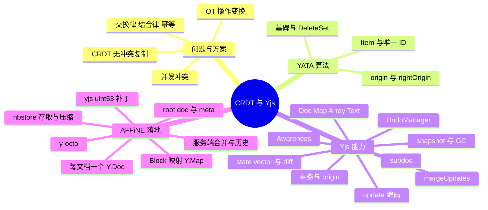
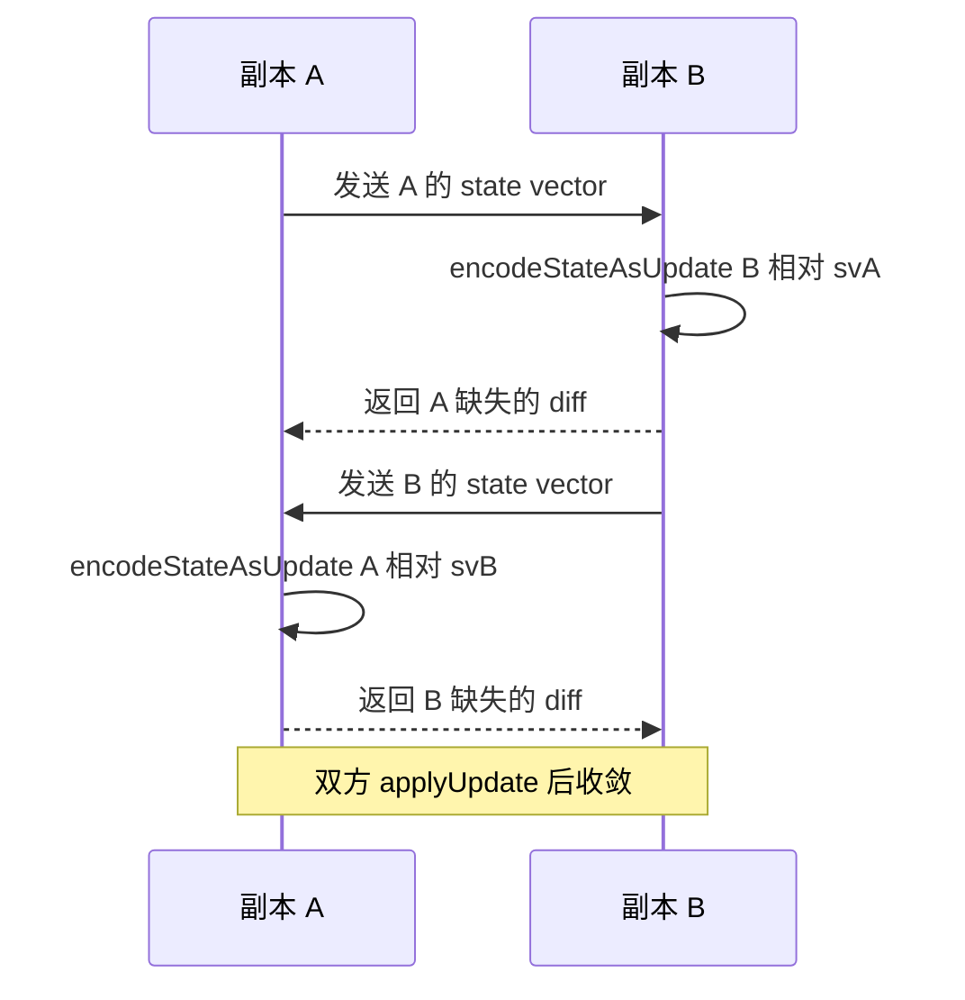
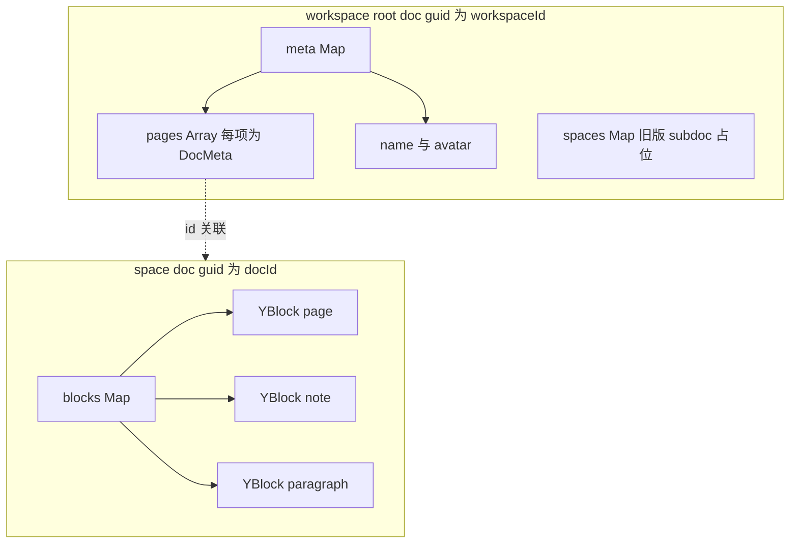
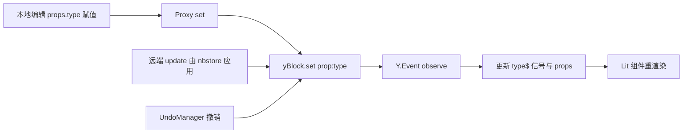
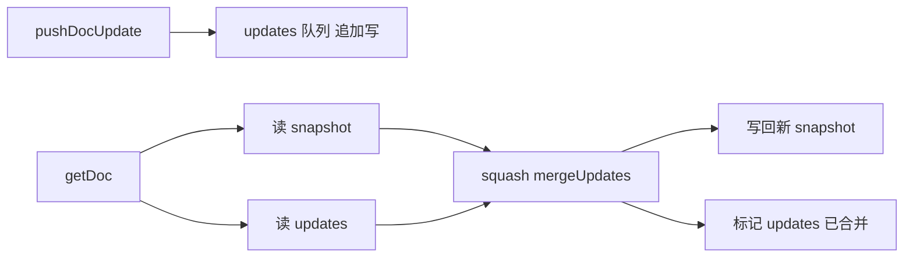
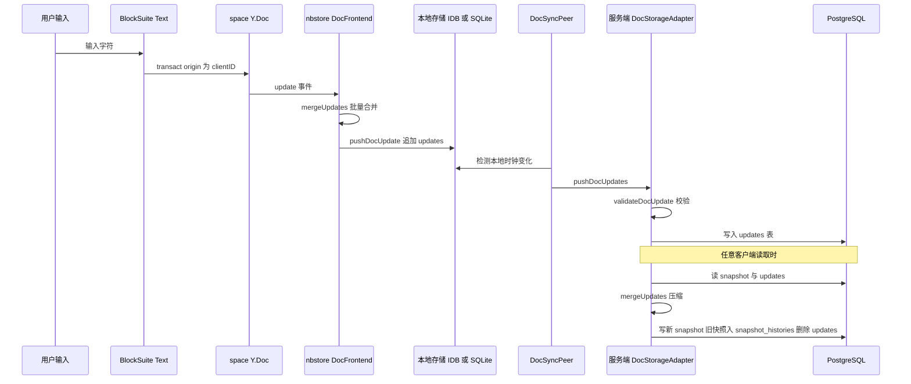

# 第 8 章 CRDT 与 Yjs 原理

> **所属部分**：第 3 部分 · 编程语言与基础技术 ｜ **难度**：★★★★☆ ｜ **建议学时**：8 小时 ｜ **前置章节**：第 6 章

## 本章导读

AFFiNE 宣称自己是 "local-first"：断网也能编辑，联网后与云端、其他设备、其他协作者的修改自动合并，且**不会出现"你的修改覆盖了我的修改"**。支撑这一切的核心技术是 **CRDT（Conflict-free Replicated Data Type，无冲突复制数据类型）**，具体实现是 JS 库 **Yjs** 与 AFFiNE 团队的 Rust 版本 **y-octo**。

在 AFFiNE 中，CRDT 不是一个"同步插件"，而是**唯一的数据真相源**：每个文档就是一个 `Y.Doc`，每个 Block 就是一个 `Y.Map`，段落文字就是一个 `Y.Text`；前端的 nbstore 把 Yjs 的二进制 update 存进 IndexedDB/SQLite，服务端把它们存进 PostgreSQL 的 `updates`/`snapshots` 表，并定期合并、生成历史版本。

本章分两条线展开：

1. **原理线**：协同编辑的冲突问题 → OT 与 CRDT 对比 → CRDT 的数学性质 → YATA 算法直觉 → Yjs 的数据类型、事务、update 编码、state vector、diff 同步、snapshot、GC、UndoManager、Awareness、subdoc。每个知识点都配有**可在 Node 中运行的教学小实验**。
2. **落地线**：BlockSuite 如何把 Block 映射到 Y.Map、workspace root doc 的结构、仓库对 yjs 的补丁、nbstore 中 update 的存取与合并、服务端的合并与历史版本、y-octo 的角色。

## 学习目标

- [ ] 能够用自己的话解释并发编辑中的冲突问题，并对比 OT 与 CRDT 的核心差异
- [ ] 能够说明 CRDT 需要满足的交换律、结合律、幂等性，并在 Yjs 实验中验证
- [ ] 能够直观描述 YATA 算法中 Item 的 `id`、`origin`、`rightOrigin` 与冲突排序规则
- [ ] 能够使用 `Y.Doc/Y.Map/Y.Array/Y.Text`、事务、`encodeStateAsUpdate`、`encodeStateVector`、`diffUpdate`、`mergeUpdates` 完成双端同步
- [ ] 能够解释 snapshot、GC、UndoManager 的 `trackedOrigins`、Awareness 与 subdoc 的用途与限制
- [ ] 能够画出 BlockSuite Block → `Y.Map` 的数据结构，以及 workspace root doc 与每个文档 space doc 的关系
- [ ] 能够追踪一次本地编辑从 `Y.Doc` → nbstore → 服务端 `updates` 表 → 合并为 `snapshots` → `snapshot_histories` 的全过程
- [ ] 能够说明仓库对 yjs 的 `uint53` 补丁的作用，以及服务端在 Yjs 与 y-octo 之间的合并策略

## 知识地图



## 8.1 协同编辑的核心难题

### 8.1.1 冲突是怎么产生的

假设 Alice 和 Bob 同时打开一段文字 `"AB"`：

- Alice 在位置 1 插入 `X` → 她本地变成 `"AXB"`，发出操作 `insert(1, "X")`；
- Bob 同时删除位置 1 的字符 → 他本地变成 `"A"`，发出操作 `delete(1)`。

如果双方**原样**应用对方的操作：

- Alice：`"AXB"` 执行 `delete(1)` → `"AB"`（错删了 X！）
- Bob：`"A"` 执行 `insert(1, "X")` → `"AX"`

两端结果不一致，而且都不是用户期望的 `"AX"`。根本原因在于：**基于"位置下标"的操作，在并发下语义会漂移**。

### 8.1.2 两大流派：OT 与 CRDT

| 维度 | OT（Operational Transformation） | CRDT（Conflict-free Replicated Data Type） |
| --- | --- | --- |
| 思路 | 收到并发操作时，按对方已执行的操作**变换**下标（如把 `delete(1)` 变换为 `delete(2)`） | 给每个字符/元素分配**全局唯一且不变的 ID**，操作引用 ID 而非下标，天然可交换 |
| 是否需要中心服务器 | 通常需要（定序、变换） | 不需要，任意拓扑（P2P、离线、多服务器）都能收敛 |
| 离线编辑 | 困难（长时间离线后变换代价高、易出错） | 天然支持 |
| 元数据开销 | 小 | 较大（每个元素带 ID、墓碑） |
| 代表 | Google Docs、早期 ShareDB | Yjs、Automerge、y-octo |

AFFiNE 的 "local-first" 定位决定了它必须选 CRDT：用户可能长时间离线编辑、在桌面与手机之间同步、在多个存储（本地 SQLite、IndexedDB、云端）之间来回，**不存在一个随时在线的权威定序者**。

## 8.2 CRDT 的性质：为什么能"无冲突"

### 8.2.1 三条代数性质

状态型 CRDT（state-based）可以抽象为一个集合 `S` 和一个合并函数 `merge(a, b)`。只要 `merge` 满足：

| 性质 | 公式 | 现实含义 |
| --- | --- | --- |
| **交换律** | `merge(a, b) = merge(b, a)` | 先收到谁的更新都一样 |
| **结合律** | `merge(merge(a, b), c) = merge(a, merge(b, c))` | 怎么分组合并都一样（可以先在本地压缩一批 update） |
| **幂等性** | `merge(a, a) = a` | 同一个 update 收到两次也无妨（网络重传安全） |

就构成一个**半格（semilattice）**，所有副本只要最终收到相同的更新集合，就一定收敛到相同状态——这叫**强最终一致性（Strong Eventual Consistency）**。

Yjs 的 update 恰好具备这三条性质：`Y.applyUpdate` 可以以任意顺序、任意分组、重复执行。这正是 nbstore 敢于"本地攒一批 update 合并后再推"、服务端敢于"把一堆 update 压缩成快照"的理论基础。

### 8.2.2 教学实验 1：验证交换律与幂等性

> 以下所有实验均为**教学示例**。准备方式：在任意目录新建文件夹，`npm init -y && npm i yjs y-protocols`，然后用 `node xxx.mjs` 运行；也可以在 AFFiNE 仓库外建一个目录，把仓库的 `node_modules` 软链过去复用其中的 `yjs`（仓库安装的是打过补丁的 13.6.21，见 8.7）。

```js
// 教学示例：lab-commutative.mjs
import * as Y from 'yjs';

const src = new Y.Doc();
const updates = [];
src.on('update', u => updates.push(u));   // 每次本地修改都会产生一个二进制 update
const arr = src.getArray('list');
arr.push(['a']);
arr.push(['b']);
arr.insert(0, ['c']);

const d1 = new Y.Doc();
updates.forEach(u => Y.applyUpdate(d1, u));            // 正序

const d2 = new Y.Doc();
[...updates].reverse().forEach(u => Y.applyUpdate(d2, u)); // 逆序
updates.forEach(u => Y.applyUpdate(d2, u));                 // 再重复应用一遍

console.log('updates 个数:', updates.length);
console.log('正序:', d1.getArray('list').toJSON(), '逆序+重复:', d2.getArray('list').toJSON());
```

实测输出：

```text
updates 个数: 3
正序: [ 'c', 'a', 'b' ] 逆序+重复: [ 'c', 'a', 'b' ]
```

逆序应用时，后面的 update 依赖前面的 Item，Yjs 会先把"缺少依赖"的结构暂存为 pending，等依赖到达后再整合——这也是 nbstore 中 `doc.has_pending_updates()` 检查（`packages/frontend/native/nbstore/src/doc.rs`）的意义：**若合并后仍有 pending，说明数据不完整**，必须报 `IncompleteDoc`，不能当成快照写回。

## 8.3 YATA 算法的直观理解

Yjs 基于 **YATA**（Yet Another Transformation Approach）算法，属于"序列型 CRDT"。抓住三个概念即可读懂：

### 8.3.1 每个 Item 有唯一 ID

文档中的每一段插入内容是一个 **Item**，ID 为 `(clientID, clock)`：

- `clientID`：每个 `Y.Doc` 实例随机生成的客户端编号；
- `clock`：该客户端自增的逻辑时钟，每插入一个字符/元素 +1。

例如 clientID=7 的用户连续输入 `"Hi"`，产生的 ID 是 `(7,0)`、`(7,1)`。Yjs 会把同一客户端连续插入的内容合并为一个 Item 存储（run-length），以减少开销。

### 8.3.2 插入时记录左右邻居

Item 除了内容，还记录**插入那一刻**的左邻居 `origin` 与右邻居 `rightOrigin`（都是 ID）。插入操作的语义从"插在下标 1"变成了"**插在 ID=(3,0) 之后、ID=(3,1) 之前**"——ID 永不改变，因此语义不会漂移。

### 8.3.3 并发冲突的确定性排序

当两个用户**在同一位置并发插入**（`origin` 相同）时，YATA 用一条所有副本都一致的规则决定先后：大致是**比较 clientID，较小者排在左边**（并结合 `rightOrigin` 处理更复杂的交错情形）。规则本身不重要，重要的是它是**确定性的**——所有副本对同一组 Item 排序结果相同，于是自然收敛。


上图：Alice（client 1）与 Bob（client 2）都在 `A` 之后插入，client 1 较小，于是 `X` 排在 `Y` 左边，两端都得到 `AXYB`。

### 8.3.4 删除：墓碑与 DeleteSet

删除并不真的移除 Item，而是把它标记为已删除（**墓碑 tombstone**），因为别人可能还以它为 `origin` 插入内容。已删除的 ID 以区间的形式记录在 **DeleteSet** 中（`clientID → [clock 区间]`），随 update 一起传输。这也是 CRDT 元数据开销的来源，需要 GC 来缓解（8.5.3）。

回到 8.1.1 的例子：Bob 删除的是 ID 为 `B(0,1)` 的 Item，Alice 插入的是 `origin=A(0,0)` 的 `X(1,0)`。两者引用的都是 ID，无论先后应用，结果都是 `"AX"`。

## 8.4 Yjs 核心 API 速成

### 8.4.1 数据类型

| 类型 | 类比 | 获取方式 | AFFiNE 中的用途 |
| --- | --- | --- | --- |
| `Y.Doc` | 一个数据库实例 | `new Y.Doc({ guid })` | workspace root doc、每个文档的 space doc |
| `Y.Map` | `Map` | `doc.getMap('blocks')` 或 `new Y.Map()` 嵌套 | `blocks` 表、每个 Block、`meta` |
| `Y.Array` | `Array` | `doc.getArray(name)` / `new Y.Array()` | `sys:children` 子块 ID 列表、`meta.pages` |
| `Y.Text` | 带格式的字符串（Quill Delta） | `new Y.Text()` | 段落文本 `prop:text`、页面标题 |
| `Y.XmlFragment` / `Y.XmlElement` | 类 DOM 树 | `doc.getXmlFragment(name)` | 常用于 ProseMirror 绑定；BlockSuite **未采用**，而是自建 Block 树 |

顶层类型（`doc.getMap('x')`）以名字区分，各副本中同名即同一对象；嵌套类型必须先插入到文档中才能使用（未"挂载"的 `Y.Text` 读不到 `doc`，这正是 BlockSuite `Text` 类中 `if (input.doc)` 判断的原因）。

### 8.4.2 事务与 origin

`doc.transact(fn, origin)`：把多次修改打包为一个事务，**只触发一次 `update` 事件**，并携带一个任意的 `origin` 标记，供监听者区分"这次变化是谁引起的"。

```js
// 教学示例：事务与 origin
const t = new Y.Doc();
let count = 0, lastOrigin;
t.on('update', (_u, origin) => { count++; lastOrigin = origin; });
t.transact(() => {
  t.getMap('blocks').set('sys:id', 'b1');
  t.getMap('blocks').set('prop:text', new Y.Text('hi'));
}, t.clientID);
console.log('update 事件次数:', count, 'origin === clientID:', lastOrigin === t.clientID);
// 实测输出：update 事件次数: 1 origin === clientID: true
```

`origin` 是 AFFiNE 中最重要的"暗号"之一，后面会看到它决定了：哪些修改进入撤销栈、哪些 update 需要回存、如何避免同步回环。

### 8.4.3 update、state vector 与 diff 同步

| API | 作用 |
| --- | --- |
| `Y.encodeStateAsUpdate(doc, sv?)` | 把整个文档（或相对 `sv` 缺失的部分）编码为二进制 update |
| `Y.applyUpdate(doc, update, origin?)` | 把 update 应用到文档 |
| `Y.encodeStateVector(doc)` | 编码**状态向量**：`Map<clientID, 下一个期望的 clock>`，即"我已经拥有每个客户端的前多少个操作" |
| `Y.encodeStateVectorFromUpdate(update)` | 不实例化文档，直接从 update 二进制算出状态向量 |
| `Y.diffUpdate(update, sv)` | 不实例化文档，从 update 中剪出对方（持有 `sv`）缺失的部分 |
| `Y.mergeUpdates(updates)` | 不实例化文档，把多个 update 合并为一个 |

**两步同步协议**（y-protocols 中 sync step1/step2 的思想）：



### 8.4.4 教学实验 2：离线并发编辑后的收敛

```js
// 教学示例：lab-sync.mjs
import * as Y from 'yjs';

const docA = new Y.Doc();
const docB = new Y.Doc();
console.log('clientID 示例:', docA.clientID, '是否超过 2^32:', docA.clientID > 2 ** 32);

const textA = docA.getText('t');
const textB = docB.getText('t');
textA.insert(0, 'Hello');
Y.applyUpdate(docB, Y.encodeStateAsUpdate(docA));   // 初始同步
console.log('同步后 B =', textB.toString());

// 双方"离线"各改一处
textA.insert(5, ' World');
textB.insert(0, 'Say: ');

// 交换增量：只发送对方缺的部分
const svA = Y.encodeStateVector(docA);
const svB = Y.encodeStateVector(docB);
const diffForB = Y.encodeStateAsUpdate(docA, svB);
const diffForA = Y.encodeStateAsUpdate(docB, svA);
Y.applyUpdate(docB, diffForB);
Y.applyUpdate(docA, diffForA);
console.log('A =', textA.toString());
console.log('B =', textB.toString());
console.log('收敛:', textA.toString() === textB.toString());
console.log('全量 update 字节:', Y.encodeStateAsUpdate(docA).byteLength, ' diff 字节:', diffForB.byteLength);
```

在 AFFiNE 仓库的 `node_modules`（打过补丁的 yjs）下实测输出：

```text
clientID 示例: 6043159610017570 是否超过 2^32: true
同步后 B = Hello
A = Say: Hello World
B = Say: Hello World
收敛: true
全量 update 字节: 54  diff 字节: 29
```

注意第一行：clientID 超过了 2³²，这就是 8.7 节要讲的补丁效果（原版 yjs 的 clientID 是 32 位）。每次运行 clientID 不同。

### 8.4.5 教学实验 3：二进制层面的合并与 diff

```js
// 教学示例：lab-merge.mjs（接在实验 1 的 updates 之后）
const merged = Y.mergeUpdates(updates);
const d3 = new Y.Doc();
Y.applyUpdate(d3, merged);
console.log('合并后:', d3.getArray('list').toJSON(), '合并字节:', merged.byteLength,
  '原始总字节:', updates.reduce((s, u) => s + u.byteLength, 0));

const sv = Y.encodeStateVectorFromUpdate(updates[0]);
const missing = Y.diffUpdate(merged, sv);
console.log('已有第1个 update 的副本还缺:', missing.byteLength, '字节');

// Y.Map 并发写同一个 key
const m1 = new Y.Doc(); const m2 = new Y.Doc();
m1.getMap('m').set('title', 'from-1');
m2.getMap('m').set('title', 'from-2');
const u1 = Y.encodeStateAsUpdate(m1), u2 = Y.encodeStateAsUpdate(m2);
Y.applyUpdate(m1, u2); Y.applyUpdate(m2, u1);
console.log('Map 冲突结果:', m1.getMap('m').get('title'), m2.getMap('m').get('title'));
```

一次实测输出：

```text
合并后: [ 'c', 'a', 'b' ] 合并字节: 51 原始总字节: 75
已有第1个 update 的副本还缺: 40 字节
Map 冲突结果: from-2 from-2
```

- `mergeUpdates` 让 3 个 update 合并后体积从 75 字节降到 51 字节，**且全程没有构造 `Y.Doc`**——这是服务端/存储层压缩的关键能力；
- `Y.Map` 对同一 key 的并发写入，最终**两端一定相同**，但谁胜出取决于随机的 clientID，所以多运行几次可能看到 `from-1`。这对 Block 属性意味着：**两个人同时改同一个 Block 的同一个属性，会有一个人的修改"消失"**——这是 CRDT 的语义，而不是 bug。BlockSuite 把文本放进 `Y.Text` 而不是字符串属性，正是为了让并发输入能逐字符合并而不是整体覆盖。

### 8.4.6 update 编码 v1 与 v2

Yjs 有两套二进制编码：v1（默认，`encodeStateAsUpdate`）与 v2（`encodeStateAsUpdateV2`，压缩率更高）。update 的结构可以粗略理解为：

```text
[按 clientID 分组的 structs 列表：每组 = clientID + 起始 clock + 若干 Item/GC/Skip]
[DeleteSet：clientID → 被删除的 clock 区间列表]
```

**AFFiNE 全链路使用 v1**：TS 侧调用的都是无后缀（v1）的 API；Rust 侧 y-octo 的函数名直接带 `_v1` 后缀（`apply_update_from_binary_v1`、`encode_update_v1`、`merge_updates_v1`，见第 7 章）。

空 update 有特殊的二进制形态，项目里专门写了判断函数——来源：`packages/common/nbstore/src/utils/is-empty-update.ts`

```ts
/**
 * Tell a binary is empty yjs binary or not.
 *
 * NOTE:
 *   `[0, 0]` is empty yjs update binary
 *   `[0]` is empty yjs state vector binary
 */
export function isEmptyUpdate(binary: Uint8Array) {
  return (
    binary.byteLength === 0 ||
    (binary.byteLength === 2 && binary[0] === 0 && binary[1] === 0)
  );
}
```

`[0, 0]` 表示"0 组 structs + 0 项 DeleteSet"。服务端 `DocStorageAdapter.isEmptyBin`（`packages/backend/server/src/core/doc/storage/doc.ts`）有同样的判断。

## 8.5 Yjs 进阶：snapshot、GC、UndoManager、Awareness、subdoc

### 8.5.1 UndoManager：只撤销"自己的"修改

协同场景下，Ctrl+Z 应该只撤销**我**做的修改，不能撤销刚同步过来的同事的修改。`Y.UndoManager` 通过 `trackedOrigins` 实现这一点：只有 origin 在集合中的事务才会进入撤销栈。

```js
// 教学示例：lab-undo.mjs
import * as Y from 'yjs';

const doc = new Y.Doc();
const blocks = doc.getMap('blocks');
const um = new Y.UndoManager([blocks], { trackedOrigins: new Set([doc.clientID]) });
doc.transact(() => blocks.set('a', 1), doc.clientID);   // 本地编辑
Y.applyUpdate(doc, (() => {                               // 模拟远端更新
  const remote = new Y.Doc();
  Y.applyUpdate(remote, Y.encodeStateAsUpdate(doc));
  remote.getMap('blocks').set('b', 2);
  return Y.encodeStateAsUpdate(remote, Y.encodeStateVector(doc));
})(), 'nbstore-frontend');
console.log('撤销前:', blocks.toJSON());
um.undo();
console.log('撤销后（远端的 b 保留）:', blocks.toJSON());
// 实测输出：
// 撤销前: { a: 1, b: 2 }
// 撤销后（远端的 b 保留）: { b: 2 }
```

BlockSuite 用的正是同一配置——来源：`blocksuite/framework/store/src/extension/history/history-extension.ts`

```ts
export class HistoryExtension extends StoreExtension {
  static override readonly key = 'history';

  private readonly _history!: Y.UndoManager;

  private readonly _canRedo = signal(false);

  private readonly _canUndo = signal(false);

  readonly onUpdated = new Subject<void>();

  constructor(store: Store) {
    super(store);

    this._history = new Y.UndoManager([this.store.doc.yBlocks], {
      trackedOrigins: new Set([this.store.doc.spaceDoc.clientID]),
    });
  }
```

与之配套，BlockSuite 的所有本地写入都用 `clientID` 作为 origin——来源：`blocksuite/framework/store/src/model/store/store.ts`

```ts
  transact(fn: () => void, shouldTransact: boolean = this._shouldTransact) {
    const spaceDoc = this._doc.spaceDoc;
    spaceDoc.transact(
      () => {
        try {
          fn();
        } catch (e) {
          console.error(
            `An error occurred while Y.doc ${spaceDoc.guid} transacting:`
          );
          console.error(e);
        }
      },
      shouldTransact ? this.spaceDoc.clientID : null
    );
  }
```

而 `withoutTransact(fn)` 会把 origin 置为 `null`，使这批修改**不进入撤销栈**（例如初始化文档时插入的默认块）；`captureSync()` 调用 `undoManager.stopCapturing()`，强制把后续操作分到新的撤销步骤。`blocksuite/framework/store/src/reactive/text/text.ts` 中 `Text._transact` 同样使用 `doc.clientID` 作为 origin。远端数据由 nbstore 以 `'nbstore-frontend'` 作为 origin 应用（8.8.3），自然不会被撤销。

### 8.5.2 Snapshot：Yjs 原生的版本快照

Yjs 的 `Y.snapshot(doc)` 记录"某一时刻的状态向量 + 删除集"，配合 `Y.createDocFromSnapshot` 可以还原历史版本——**前提是文档关闭了 GC**（否则被删除的内容已经被回收，无从还原）。

```js
// 教学示例：lab-snapshot.mjs
const hd = new Y.Doc({ gc: false });
const ht = hd.getText('t');
ht.insert(0, 'v1');
const snap = Y.snapshot(hd);
ht.insert(2, ' -> v2');
const restored = Y.createDocFromSnapshot(hd, snap);
console.log('当前:', ht.toString(), ' 快照还原:', restored.getText('t').toString());
// 实测输出：当前: v1 -> v2  快照还原: v1
```

**AFFiNE 并没有使用 Yjs 原生 snapshot 做历史版本**（在仓库 `.ts` 文件中搜索 `Y.snapshot`/`createDocFromSnapshot` 没有业务用例）。它采用的是"**定期把整份合并后的文档二进制存一份**"的服务端方案（8.9.4）。这样客户端可以保持 GC 开启、文档更小，代价是历史版本占用更多服务端存储。

> 术语提醒：AFFiNE 代码中的 "snapshot" 一词通常指"**合并后的完整文档二进制**"（nbstore 的 `snapshots` 表、服务端的 `Snapshot` 模型），而不是 `Y.snapshot`。

### 8.5.3 GC：回收已删除内容

`new Y.Doc()` 默认 `gc: true`：被删除且不再被需要的 Item 内容会被替换为轻量的 GC 结构，只保留 ID 范围。

```js
// 教学示例：lab-gc.mjs
function sizeAfterDelete(gc) {
  const d = new Y.Doc({ gc });
  const text = d.getText('t');
  text.insert(0, 'x'.repeat(10000));
  text.delete(0, 10000);
  return Y.encodeStateAsUpdate(d).byteLength;
}
console.log('gc=true:', sizeAfterDelete(true), ' gc=false:', sizeAfterDelete(false));
// 实测输出：gc=true: 30  gc=false: 10030
```

在仓库中搜索 `gc: false` 没有业务用例，说明 AFFiNE 的 `Y.Doc` 都保持默认的 GC 开启——与 8.5.2 的"服务端存整份历史"策略相互印证。

### 8.5.4 Awareness：不进入文档的临时状态

光标位置、选区、在线用户名这类信息**需要实时共享，但不应写入文档历史**。y-protocols 的 `Awareness` 为此设计：每个客户端维护一份本地状态，通过 `encodeAwarenessUpdate` / `applyAwarenessUpdate` 广播，状态带超时（客户端离线一段时间后自动移除）。

```js
// 教学示例：lab-awareness.mjs
import * as Y from 'yjs';
import { Awareness, encodeAwarenessUpdate, applyAwarenessUpdate } from 'y-protocols/awareness';

const a1 = new Awareness(new Y.Doc());
const a2 = new Awareness(new Y.Doc());
a1.setLocalStateField('user', { name: 'Alice' });
a1.setLocalStateField('selectionV2', { main: [{ type: 'text' }] });
applyAwarenessUpdate(a2, encodeAwarenessUpdate(a1, [a1.clientID]), 'remote');
console.log(JSON.stringify(a2.getStates().get(a1.clientID)));
// 实测输出：{"user":{"name":"Alice"},"selectionV2":{"main":[{"type":"text"}]}}
a1.destroy(); a2.destroy();
```

BlockSuite 的封装——来源：`blocksuite/framework/store/src/yjs/awareness.ts`

```ts
// Raw JSON state in awareness CRDT
export type RawAwarenessState = {
  user?: UserInfo;
  color?: string;
  selectionV2: Record<string, UserSelection>;
};
// ...
export class AwarenessStore {
  readonly awareness: Awareness;

  constructor(awareness: Awareness) {
    this.awareness = awareness;
    this.awareness.setLocalStateField('selectionV2', {});
  }
  // ...
  setLocalSelection(selectionManagerId: string, selection: UserSelection) {
    const oldSelection = this.awareness.getLocalState()?.selectionV2 ?? {};
    this.awareness.setLocalStateField('selectionV2', {
      ...oldSelection,
      [selectionManagerId]: selection,
    });
  }
}
```

`selectionV2` 按选区管理器 ID 存放每个用户的选区；`blocksuite/framework/store/src/extension/selection/selection-extension.ts` 读取各客户端的 `state.selectionV2` 还原远端选区，再由 `blocksuite/affine/widgets/remote-selection` 下的组件绘制协作者光标。nbstore 侧的 `AwarenessFrontend`（`packages/common/nbstore/src/frontend/awareness.ts`）监听 `awareness.on('change')`，把变化编码后交给同步层，并用一个 `nanoid()` 生成的 `uniqueId` 作为 origin 避免回环。

### 8.5.5 subdoc：文档里的文档

Yjs 允许把一个 `Y.Doc` 作为值放进另一个文档的 `Y.Map` 中（subdocument），用于"一个工作区包含多个可独立懒加载的文档"。AFFiNE 早期就是这样组织的：root doc 的 `spaces` Map 里放每个页面的 subdoc。

但现在已经不依赖它了——来源：`packages/frontend/core/src/modules/workspace/impls/doc.ts`

```ts
  private readonly _initSpaceDoc = () => {
    {
      // This is a piece of old version compatible code. The old version relies on the subdoc instance on `spaces`.
      // So if there is no subdoc on spaces, we will create it.
      // new version no longer needs subdoc on `spaces`.
      let subDoc = this.rootDoc.getMap('spaces').get(this.id);
      if (!subDoc) {
        subDoc = new Y.Doc({
          guid: this.id,
        });
        this.rootDoc.getMap('spaces').set(this.id, subDoc);
      }
    }

    const spaceDoc = new Y.Doc({ guid: this.id });
    spaceDoc.clientID = this.rootDoc.clientID;
    this._loaded = false;

    return spaceDoc;
  };
```

- 为兼容旧客户端，仍在 root doc 的 `spaces` 中写入一个占位 subdoc；
- 真正承载内容的是**一个独立的 `Y.Doc`（guid = 文档 ID）**，由存储层按 guid 单独加载、单独同步；
- `spaceDoc.clientID = this.rootDoc.clientID`：让同一用户在 root doc 与各 space doc 中使用相同的 clientID。

`blocksuite/framework/store/src/yjs/utils.ts` 中残留的 `SubdocEvent` 类型也是这段历史的痕迹。为什么放弃 subdoc？从代码结构推断：独立 `Y.Doc` 让存储与同步层只需面对"按 docId 存取二进制"这一个简单模型（nbstore、服务端的表都以 `(spaceId, docId)` 为键），无需处理 subdoc 的嵌套加载事件。

## 8.6 AFFiNE 的文档数据模型：Block 如何映射到 Y.Map

### 8.6.1 两层文档：root doc 与 space doc



- **root doc**：`packages/frontend/core/src/modules/workspace/entities/workspace.ts` 中 `readonly rootYDoc = new YDoc({ guid: this.openOptions.metadata.id });`。它的 `meta` Map 由 `WorkspaceMetaImpl`（`packages/frontend/core/src/modules/workspace/impls/meta.ts`）管理：`pages`（文档列表，每项含 `id`、`title`、`createDate`、`tags` 等）、`properties`、`name`、`avatar`；
- **space doc**：每个文档一个，`DocImpl`（`packages/frontend/core/src/modules/workspace/impls/doc.ts`）中 `this._yBlocks = this._ySpaceDoc.getMap('blocks');`。

来源：`packages/frontend/core/src/modules/workspace/impls/meta.ts`

```ts
export class WorkspaceMetaImpl implements WorkspaceMeta {
  // ...
  private readonly _id: string = 'meta';
  private readonly _doc: Y.Doc;
  private readonly _proxy: MetaState;
  private readonly _yMap: Y.Map<MetaState[keyof MetaState]>;
  // ...
  get yDocs() {
    return this._yMap.get('pages') as unknown as Y.Array<unknown>;
  }

  constructor(doc: Y.Doc) {
    this._doc = doc;
    const map = doc.getMap(this._id) as Y.Map<MetaState[keyof MetaState]>;
    this._yMap = map;
    this._proxy = createYProxy(map);
    this._yMap.observeDeep(this._handleDocCollectionMetaEvents);
  }
```

`createYProxy` 把 Y.Map 包装成普通 JS 对象的 Proxy（`this._proxy.name = name` 会写入 Y.Map）；`observeDeep` 监听 `pages` 变化，计算出新增/删除的文档并发出 `docMetaAdded` 等事件，`WorkspaceImpl` 据此创建/销毁 `DocImpl`（`packages/frontend/core/src/modules/workspace/impls/workspace.ts` 的 `_bindDocMetaEvents`）。

### 8.6.2 YBlock 的结构

来源：`blocksuite/framework/store/src/model/store/crud.ts`

```ts
    const yBlock = new Y.Map() as YBlock;
    this._yBlocks.set(id, yBlock);

    const version = schema.version;
    const children = (
      initialProps.children as undefined | (string | BlockModel)[]
    )?.map(child => (typeof child === 'string' ? child : child.id));

    yBlock.set('sys:id', id);
    yBlock.set('sys:flavour', flavour);
    yBlock.set('sys:version', version);
    yBlock.set('sys:children', Y.Array.from(children ?? []));

    const defaultProps = schema.model.props?.(internalPrimitives) ?? {};
    const props = {
      ...defaultProps,
      ...initialProps,
    };
    // ...
      Object.entries(props).forEach(([key, value]) => {
        if (value === undefined) return;

        yBlock.set(`prop:${key}`, native2Y(value));
      });
```

| 键 | 类型 | 含义 |
| --- | --- | --- |
| `sys:id` | string | Block ID |
| `sys:flavour` | string | Block 类型，如 `affine:paragraph` |
| `sys:version` | number | Schema 版本（对应 `defineBlockSchema` 的 `metadata.version`，不匹配时渲染"Block Version Mismatched"提示，见第 6 章） |
| `sys:children` | `Y.Array<string>` | 子 Block 的 ID 列表（**树形结构用 ID 引用表示，而非嵌套 Y.Map**） |
| `prop:xxx` | 由 `native2Y` 转换 | 业务属性 |

所有 Block **扁平地**存放在 `blocks` 这一个 Y.Map 中，树结构由 `sys:children` 中的 ID 引用表达。这样做的好处：

- 移动 Block 只需修改两个父节点的 `sys:children`，Block 本身（及其文本的 CRDT 历史）原封不动；
- 按 ID 查找 Block 是 O(1)；
- 并发移动同一 Block 时最多出现"同一 ID 出现在两个父节点"的异常，由上层校验处理，而不会丢失内容。

`isFlatData` 的 Block（目前为表格块 `affine:table`，见 `blocksuite/affine/model/src/blocks/table/table-model.ts`；运行时由 `blocksuite/framework/store/src/reactive/flat-native-y/` 支撑）会把嵌套对象拆平为 `prop:a.b.c` 形式的多个键，使并发修改不同子字段时不会互相覆盖（对比 8.4.5 中 Y.Map 同 key 覆盖的语义）。

### 8.6.3 值的转换：native2Y、Text、Boxed

来源：`blocksuite/framework/store/src/reactive/native-y.ts`

```ts
export function native2Y<T>(
  value: T,
  { deep = true, transform = x => x }: TransformOptions = {}
): Native2Y<T> {
  if (value instanceof Boxed) {
    return transform(value.yMap, value) as Native2Y<T>;
  }
  if (value instanceof Text) {
    if (value.yText.doc) {
      return transform(value.yText.clone(), value) as Native2Y<T>;
    }
    return transform(value.yText, value) as Native2Y<T>;
  }
  if (Array.isArray(value)) {
    const yArray: YArray<unknown> = new YArray<unknown>();
    const result = value.map(item => {
      return deep ? native2Y(item, { deep, transform }) : item;
    });
    yArray.insert(0, result);

    return transform(yArray, value) as Native2Y<T>;
  }
  if (isPureObject(value)) {
    const yMap = new YMap<unknown>();
    Object.entries(value).forEach(([key, value]) => {
      yMap.set(key, deep ? native2Y(value, { deep, transform }) : value);
    });

    return transform(yMap, value) as Native2Y<T>;
  }

  return transform(value, value) as Native2Y<T>;
}
```

| JS 值 | 存入 Yjs 的形态 | 并发语义 |
| --- | --- | --- |
| 原始值（string/number/boolean） | 直接作为 Y.Map 的值 | 整体覆盖（LWW 式） |
| 普通数组 | `Y.Array`（深转换） | 元素级合并 |
| 普通对象 | `Y.Map`（深转换） | 键级合并 |
| `Text`（BlockSuite 包装） | `Y.Text`（已挂载的会 `clone()`） | 字符级合并 |
| `Boxed` | 一个内部 `Y.Map`，原始对象整体存在其 `value` 键中 | 整体覆盖，用于"不希望被拆成 CRDT 的不可分对象" |

`Boxed` 的注释说得很清楚（`blocksuite/framework/store/src/reactive/boxed.ts`）："By default, store will try to convert a object to a Y.Map. If you want to store a raw object ... you can use Boxed."——选择哪种形态，决定了这个属性在协同时的冲突粒度，是设计自定义 Block 时必须考虑的问题（第 15 章）。

`Text` 类把 `Y.Text` 与 Signals 连接起来——来源：`blocksuite/framework/store/src/reactive/text/text.ts`

```ts
    this._length$ = signal(length);
    this._deltas$ = signal(this._yText.doc ? this._yText.toDelta() : []);
    this._yText.observe(event => {
      const isLocal =
        !event.transaction.origin ||
        !this._yText.doc ||
        event.transaction.origin instanceof Y.UndoManager ||
        event.transaction.origin.proxy
          ? true
          : event.transaction.origin === this._yText.doc.clientID;
      this._length$.value = this._yText.length;
      this._deltas$.value = this._yText.toDelta();
      this._onChange?.(this._yText, isLocal);
    });
```

注意 `isLocal` 的判断逻辑：origin 为空、来自 UndoManager、来自 proxy 写入、或等于本端 clientID，都算"本地修改"——**origin 再次成为区分数据来源的关键**。

### 8.6.4 CRDT-Native 数据流

BlockSuite 官方博客 `blocksuite/docs-site/blog/crdt-native-data-flow.md` 阐述了这一设计哲学：

> As an alternative, BlockSuite chooses to directly use the CRDT model as the single source of truth ... This means that regardless of whether the update comes from local or remote sources, the same process will be performed:
> 1. Firstly modify YModel, triggering the corresponding `Y.Event` ...
> 2. Update the model nodes in the block tree based on the `Y.Event`.
> 3. Send corresponding slot events after updating the block model, so as to update UI components accordingly.

结合第 6 章看过的 `SyncController`（`blocksuite/framework/store/src/model/block/sync-controller.ts`），整条链路是：



**本地、远端、撤销三种来源走同一条管道**。应用层只需订阅模型变化，无须区分数据从哪来——这就是 BlockSuite "从第一天起就是协同的"底气。

`blocksuite/docs-site/guide/data-synchronization.md` 进一步提出 `ui = f(data)` 的心智模型：服务端存储的不是 JSON，而是 CRDT 二进制；加载文档就是"新建空 doc + 连接 provider，让数据流入"。需要提醒的是，该文档中的示例代码（`DocCollection`、`@blocksuite/blocks`、`IndexeddbPersistence`、`Job`）来自较早的 BlockSuite 版本，在当前仓库中已被 `WorkspaceImpl`/`DocImpl` 与 nbstore 取代，**理解思想即可，不要照抄 API**。

## 8.7 仓库对 yjs 的补丁

### 8.7.1 补丁内容

根 `package.json` 的 `resolutions`：

```json
"yjs": "patch:yjs@npm%3A13.6.21#~/.yarn/patches/yjs-npm-13.6.21-c9f1f3397c.patch",
```

这条 resolution 有两层效果：

1. **锁定版本**：尽管各包 `package.json` 写的是 `"yjs": "^13.6.27"`（如 `blocksuite/framework/store/package.json`、`packages/common/infra/package.json`），实际安装的是 **13.6.21**（`yarn.lock` 中 `yjs@patch:yjs@npm%3A13.6.21...` 条目、`node_modules/yjs/package.json` 均为 13.6.21）；
2. **打补丁**：Yarn 安装时自动应用 `.yarn/patches/yjs-npm-13.6.21-c9f1f3397c.patch`。

补丁全文只改了一行逻辑（在 `dist/yjs.cjs`、`dist/yjs.mjs`、`src/utils/Doc.js` 三处各改一次）：

来源：`.yarn/patches/yjs-npm-13.6.21-c9f1f3397c.patch`

```diff
diff --git a/src/utils/Doc.js b/src/utils/Doc.js
index d5165426f2314fc3c2388e64841e7cd6498a92a9..4bb2e5a8b79bb59f08a011af77e69af862312292 100644
--- a/src/utils/Doc.js
+++ b/src/utils/Doc.js
@@ -20,7 +20,7 @@ import * as map from 'lib0/map'
 import * as array from 'lib0/array'
 import * as promise from 'lib0/promise'
 
-export const generateNewClientId = random.uint32
+export const generateNewClientId = random.uint53
 
 /**
  * @typedef {Object} DocOpts
```

### 8.7.2 为什么要改成 53 位

`generateNewClientId` 决定每个 `Y.Doc` 的随机 clientID。原版是 32 位随机数（约 43 亿种取值）。根据**生日悖论**，当参与过某文档编辑的客户端实例数达到数万量级时，两个实例抽到相同 clientID 的概率就不可忽略；而 **clientID 冲突是 CRDT 的致命问题**——两个不同客户端会产生相同的 `(clientID, clock)`，Yjs 会把它们当成同一个 Item，导致内容丢失或文档损坏。

改为 `uint53`（JavaScript 安全整数的上限 2⁵³）后，取值空间扩大约 200 万倍，碰撞概率随之大幅下降。Yjs 的二进制编码使用变长整数（varuint）存储 clientID，53 位整数可以正常编码，但每个 clientID 占用的字节会多一些。教学实验 2 第一行打印出的 `6043159610017570` 就是补丁生效的直接证据。

> 以上"为什么"是基于补丁内容与 CRDT 原理的分析；补丁文件本身没有附带说明文字。另外，AFFiNE 在每个文档中会频繁新建 `Y.Doc`（每个 space doc 一个，且每次打开应用都会新建），这使得"历史上参与过编辑的 clientID 数量"增长较快，进一步放大了 32 位空间的碰撞风险。

### 8.7.3 与 Rust 侧的兼容

服务端与桌面端用 y-octo 解析同样的二进制，因此 y-octo 必须能处理大于 32 位的 clientID。后端 crate 启用了 `y-octo = { workspace = true, features = ["large_refs"] }`（`packages/backend/native/Cargo.toml`）；该 feature 的具体语义请查阅 y-octo 源码，这里不做推测。可以确定的是，Yjs 与 y-octo 必须在 clientID 编码上保持一致，否则 `validate_doc_update` 之类的校验会把合法 update 判为非法——这类跨实现一致性问题，正是 8.9.3 中"双引擎比对"机制要监控的。

## 8.8 nbstore：前端 update 的存取与合并

nbstore 是 AFFiNE 前端的存储与同步引擎（第 19 章详解）。这里只关注它与 CRDT 相关的部分。

### 8.8.1 从 BlockSuite 文档到 nbstore

来源：`packages/frontend/core/src/modules/workspace/entities/workspace.ts`

```ts
        onLoadDoc: doc => {
          this.loadBlobSource(doc);
          this.engine.doc.connectDoc(doc);
        },
        onUnloadDoc: doc => {
          this.unloadBlobSource(doc);
        },
        onLoadAwareness: awareness =>
          this.engine.awareness.connectAwareness(awareness),
```

`DocImpl.load()` 会调用 `workspace.onLoadDoc?.(this.spaceDoc)`，于是每个 space doc 都被交给 nbstore 的 `DocFrontend.connectDoc`。

### 8.8.2 DocFrontend：监听本地 update、应用存储 update

来源：`packages/common/nbstore/src/frontend/doc.ts`

```ts
const NBSTORE_ORIGIN = 'nbstore-frontend';
// ...
  private _connectDoc(doc: YDoc) {
    if (this.status.docs.has(doc.guid)) {
      throw new Error('doc already connected');
    }
    this.schedule({
      type: 'load',
      docId: doc.guid,
    });

    this.status.docs.set(doc.guid, doc);
    this.statusUpdatedSubject$.next(doc.guid);

    doc.on('update', this.handleDocUpdate);

    doc.on('destroy', () => {
      this.disconnectDoc(doc);
    });
  }
```

```ts
  applyUpdate(docId: string, update: Uint8Array) {
    const doc = this.status.docs.get(docId);
    if (doc && !isEmptyUpdate(update)) {
      try {
        this.isApplyingUpdate = true;
        applyUpdate(doc, update, NBSTORE_ORIGIN);
      } catch (err) {
        console.error('failed to apply update yjs doc', err);
      } finally {
        this.isApplyingUpdate = false;
      }
    }
  }

  private readonly handleDocUpdate = (
    update: Uint8Array,
    origin: any,
    doc: YDoc,
    transaction: YTransaction
  ) => {
    if (origin === NBSTORE_ORIGIN) {
      return;
    }
    // ... 调试模式下检测"应用远端 update 时触发了本地修改"的编码错误
    this.schedule({
      type: 'save',
      docId: doc.guid,
      update,
    });
  };
```

两个方向、一个暗号：

- **存储 → 文档**：用 `NBSTORE_ORIGIN` 作为 origin 调用 `applyUpdate`；
- **文档 → 存储**：`doc.on('update')` 收到的 update 若 origin 是 `NBSTORE_ORIGIN` 就忽略（否则会把刚读出来的数据又写回去，形成回环），其他的才调度 `save`。

被省略的调试代码很有教育意义：如果在应用远端 update 的过程中，某段业务代码因为监听到变化而**又同步修改了文档**，就会产生一个"并非用户操作"的本地 update，导致文档的"最后编辑者"被错误地记为当前用户。nbstore 在 debug 构建下会打印警告提示开发者修复。

### 8.8.3 load 与 save 作业

来源：`packages/common/nbstore/src/frontend/doc.ts`

```ts
  readonly jobs = {
    load: async (job: Job & { type: 'load' }, signal?: AbortSignal) => {
      const doc = this.status.docs.get(job.docId);
      if (!doc) {
        return;
      }
      const existingData = encodeStateAsUpdate(doc);

      if (!isEmptyUpdate(existingData)) {
        this.schedule({ type: 'save', docId: doc.guid, update: existingData });
      }

      // mark doc as loaded
      doc.emit('sync', [true, doc]);

      const docRecord = await this.storage.getDoc(job.docId);
      throwIfAborted(signal);

      if (docRecord && !isEmptyUpdate(docRecord.bin)) {
        this.applyUpdate(job.docId, docRecord.bin);
        this.status.readyDocs.add(job.docId);
      }
      // ...
    },
    save: async (docId: string, jobs: (Job & { type: 'save' })[], signal?: AbortSignal) => {
      // ...
      if (this.status.connectedDocs.has(docId)) {
        const merged = await this.mergeUpdates(
          jobs.map(j => j.update).filter(update => !isEmptyUpdate(update))
        );
        throwIfAborted(signal);
        await this.storage.pushDocUpdate({ docId, bin: merged }, this.uniqueId);
      }
    },
```

- **load**：连接时如果内存中的文档已有内容（比如在连接前就插入了初始块），先把它作为一个 save 作业存下来；然后从存储读出完整二进制并 apply。由于 CRDT 合并满足交换律，"内存先有内容"与"存储里有内容"谁先谁后都不影响结果；
- **save**：同一个文档排队中的多个 update 先用 `mergeUpdates` **合并成一个**再写入存储——这就是 8.2 中结合律的工程应用，大幅减少存储写入次数。

### 8.8.4 存储层：snapshot + updates 队列

来源：`packages/common/nbstore/src/storage/doc.ts`

```ts
export abstract class SnapshotDocStorageBase<
  Opts = {},
> extends DocStorageBase<Opts> {
  override async getDoc(docId: string) {
    await using _lock = this.isReadonly
      ? undefined
      : await this.lockDocForUpdate(docId);

    const snapshot = await this.getDocSnapshot(docId);
    const updates = await this.getDocUpdates(docId);

    if (updates.length) {
      const { timestamp, bin, editor } = await this.squash(
        snapshot ? [snapshot, ...updates] : updates
      );

      const newSnapshot = {
        spaceId: this.spaceId,
        docId,
        bin,
        timestamp,
        editor,
      };

      if (!this.isReadonly) {
        await this.setDocSnapshot(newSnapshot, snapshot);
        await this.markUpdatesMerged(docId, updates);
      }

      return newSnapshot;
    }

    return snapshot;
  }
```

`getDocUpdates` 的注释点明了设计意图：

> Updates queue design exists for a performace concern: A huge amount of write time will be saved if we don't merge updates into snapshot immediately. Updates will be merged into snapshot when the latest doc is requested.

即 **"写时追加、读时压缩"**：



- `await using _lock = ...`：ES 显式资源管理语法（`AsyncDisposable`），作用域结束自动释放文档锁；
- `squash` 只有一个 update 时快速返回，否则调用 `mergeUpdates`（可通过构造参数注入其他实现）；
- 存储实现（IndexedDB：`packages/common/nbstore/src/impls/idb/doc.ts`；SQLite：经 `@affine/native` 调用第 7 章讲过的 Rust `affine_nbstore`）只需实现 `getDocSnapshot/setDocSnapshot/getDocUpdates/markUpdatesMerged` 等原语。

Rust 版 nbstore 的 `get_doc`（`packages/frontend/native/nbstore/src/doc.rs`）用 y-octo 做了同样的事，并多做了两步：合并后用 `DocOptions::new().with_guid(..)` 建一个文档 apply 一遍，检查 `has_pending_updates()`，**有缺失依赖就拒绝写回**；写回时用 `UPDATE ... WHERE updated_at = ? AND data = ?` 做乐观并发控制，冲突就重试。

### 8.8.5 diff 同步：getDocDiff 与 DocSyncPeer

来源：`packages/common/nbstore/src/storage/doc.ts`

```ts
  async getDocDiff(docId: string, state?: Uint8Array) {
    const doc = await this.getDoc(docId);

    if (!doc) {
      return null;
    }

    return {
      docId,
      missing: state && state.length > 0 ? diffUpdate(doc.bin, state) : doc.bin,
      state: encodeStateVectorFromUpdate(doc.bin),
      timestamp: doc.timestamp,
    };
  }
```

这是 8.4.3 两步同步协议的存储层实现：调用方给出自己的 state vector，存储返回对方缺失的 `missing` 与自己的 `state`，**全程只操作二进制，不构造 `Y.Doc`**。

同步对端 `DocSyncPeer` 的 pull 作业——来源：`packages/common/nbstore/src/sync/doc/peer.ts`

```ts
    pull: async (docId: string, signal?: AbortSignal) => {
      await this.prepareRemoteDoc(docId);
      const docRecord = await this.local.getDoc(docId);

      const stateVector =
        docRecord && !isEmptyUpdate(docRecord.bin)
          ? encodeStateVectorFromUpdate(docRecord.bin)
          : new Uint8Array();
      const serverDoc = await this.remote.getDocDiff(docId, stateVector);
      if (!serverDoc) {
        await this.acknowledgeRemoteSourceUpdate(docId);
        return;
      }
      const { missing: newData, timestamp: remoteClock } = serverDoc;
      throwIfAborted(signal);
      const { timestamp } = await this.local.pushDocUpdate(
        { docId, bin: newData },
        this.uniqueId
      );
      // ... 记录已拉取的远端时钟，并调度一次 push
```

本地文档 → 算 state vector → 向远端（如云端）要 diff → 写入本地 → 再调度 push 把本地有而远端没有的部分推上去。同文件的 `docDiffUpdate` 函数还处理了一个细节：两边 state vector 相等时，仍可能存在**删除集**的差异（state vector 只记录插入的 clock，不记录删除），因此需要额外比较 `diffUpdate(local, localSv)`（即"只剩 DeleteSet 的 update"）是否一致。

> **时钟（clock）vs 状态向量**：nbstore 还维护基于时间戳的 `clocks`/`peer_clocks`（见 Rust schema `packages/frontend/native/schema/src/lib.rs` 中的建表 SQL），用于**快速判断哪些文档需要同步**（"远端时钟比我上次拉取的新"）；而真正的数据交换仍用 CRDT 的 state vector + diff。前者是"要不要同步"，后者是"同步什么"。

## 8.9 服务端：合并、存储与历史版本

### 8.9.1 Prisma 模型

来源：`packages/backend/server/schema.prisma`

```prisma
model Snapshot {
  workspaceId String   @map("workspace_id") @db.VarChar
  id          String   @default(uuid()) @map("guid") @db.VarChar
  blob        Bytes    @db.ByteA
  // persisted size of blob to avoid summing over bytea
  size        BigInt?  @map("size") @db.BigInt
  state       Bytes?   @db.ByteA
  createdAt   DateTime @default(now()) @map("created_at") @db.Timestamptz(3)
  // the `updated_at` field will not record the time of record changed,
  // but the created time of last seen update that has been merged into snapshot.
  updatedAt   DateTime @map("updated_at") @db.Timestamptz(3)
  createdBy   String?  @map("created_by") @db.VarChar
  updatedBy   String?  @map("updated_by") @db.VarChar
  // ...
  @@id([workspaceId, id])
  @@index([workspaceId, updatedAt])
  @@map("snapshots")
}

model Update {
  workspaceId String   @map("workspace_id") @db.VarChar
  id          String   @map("guid") @db.VarChar
  blob        Bytes    @db.ByteA
  createdAt   DateTime @map("created_at") @db.Timestamptz(3)
  createdBy   String?  @map("created_by") @db.VarChar
  // ...
  @@id([workspaceId, id, createdAt])
  @@map("updates")
}
```

```prisma
model SnapshotHistory {
  workspaceId String   @map("workspace_id") @db.VarChar
  id          String   @map("guid") @db.VarChar
  timestamp   DateTime @db.Timestamptz(3)
  blob        Bytes    @db.ByteA
  state       Bytes?   @db.ByteA
  expiredAt   DateTime @map("expired_at") @db.Timestamptz(3)
  createdBy   String?  @map("created_by") @db.VarChar
  // ...
  @@id([workspaceId, id, timestamp])
  @@map("snapshot_histories")
}
```

| 表 | 主键 | 存什么 | 对应 CRDT 概念 |
| --- | --- | --- | --- |
| `snapshots` | `(workspace_id, guid)` | 每个文档当前合并后的完整二进制 `blob`，可选 `state`（状态向量） | 合并后的 update |
| `updates` | `(workspace_id, guid, created_at)` | 尚未合并的增量 update | 增量 update 队列 |
| `snapshot_histories` | `(workspace_id, guid, timestamp)` | 某时刻的完整二进制，带过期时间 | AFFiNE 自己的"版本历史"（非 `Y.snapshot`） |

注意字段名 `guid`：**文档的 `Y.Doc.guid` 就是数据库主键的一部分**；workspace root doc 的 guid 等于 workspaceId。`updatedAt` 的注释也很关键：它记录的是"最后一个被合并进来的 update 的创建时间"，而不是行的修改时间——这让它可以作为文档的逻辑时钟参与同步判断。

数据层的完整讲解见第 22 章，这里只需建立"表 ↔ CRDT 概念"的对应。

### 8.9.2 服务端的读时压缩与历史生成

服务端 `DocStorageAdapter`（`packages/backend/server/src/core/doc/storage/doc.ts`）与前端 nbstore 的结构高度相似，同样是"读时压缩"：

```ts
  protected async getDocUnderLock(
    spaceId: string,
    docId: string
  ): Promise<{ doc: DocRecord | null; snapshotUpdated: boolean }> {
    const snapshot = await this.getDocSnapshot(spaceId, docId);
    const updates = await this.getDocUpdates(spaceId, docId);

    if (updates.length) {
      const docUpdate = await this.squash(
        snapshot ? [snapshot, ...updates] : updates
      );
      return await this.squashUpdatesToSnapshot(
        spaceId,
        docId,
        updates,
        snapshot,
        docUpdate
      );
    }

    return { doc: snapshot, snapshotUpdated: false };
  }
```

```ts
  @Transactional<TransactionalAdapterPrisma>({ timeout: 60000 })
  protected async squashUpdatesToSnapshot(
    spaceId: string,
    docId: string,
    updates: DocUpdate[],
    snapshot: DocRecord | null,
    finalUpdate: DocUpdate
  ) {
    // ...
    const success = await this.setDocSnapshot(newSnapshot);

    // if there is old snapshot, create a new history record
    if (success && snapshot) {
      await this.createDocHistory(snapshot);
    }

    if (success) {
      const count = await this.markUpdatesMerged(spaceId, docId, updates);
      // ...
    }

    return { doc: newSnapshot, snapshotUpdated: success };
  }
```

三步在一个数据库事务（`@Transactional`）中完成：写新快照 → **把旧快照存为一条历史** → 删除已合并的 updates。

是否真的落一条历史，由 `PgWorkspaceDocStorageAdapter.createDocHistory`（`packages/backend/server/src/core/doc/adapters/workspace.ts`）决定：

- 距上一条历史不足 `historyMinInterval`（配置 `doc.history.interval`，默认 10 分钟，见 `packages/backend/server/src/core/doc/config.ts`）则跳过，`force` 时除外；
- 空文档不记历史；
- 保留时长 `historyMaxAge` 来自工作区配额（`DocStorageOptions.historyMaxAge` 调用 `quota.getWorkspaceQuota(spaceId)` 的 `historyPeriod`），写入 `expiredAt`，到期由定时任务清理（`packages/backend/server/src/core/doc/job.ts` 中的 `DocStorageCronJob`）。也就是说，**历史版本的保留期是付费权益的一部分**。

### 8.9.3 合并引擎：Yjs 与 y-octo 双轨

来源：`packages/backend/server/src/core/doc/merge-updates.ts`（节选）

```ts
import * as Y from 'yjs';
import { mergeUpdates as yjsMergeUpdatesInCore } from 'yjs';

import { metrics } from '../../base';
import { mergeUpdatesInApplyWay as nativeMergeUpdatesInApplyWay } from '../../native';
// ...
export function applyUpdatesWithNative(
  updates: Uint8Array[],
  caller: string,
  logger?: Pick<Logger, 'warn'>
) {
  return measureSyncCodecOperation(
    'merge_updates',
    'native',
    updates,
    caller,
    logger,
    () => nativeMergeUpdatesInApplyWay(updates.map(Buffer.from))
  );
}

export function mergeUpdatesWithYjs(
  updates: Uint8Array[],
  caller: string,
  logger?: Pick<Logger, 'warn'>
) {
  return measureSyncCodecOperation(
    'merge_updates',
    'yjs',
    updates,
    caller,
    logger,
    () => Buffer.from(yjsMergeUpdatesInCore(updates))
  );
}
```

这里出现了三种"合并"方式，需要分清：

| 函数 | 原理 | 特点 |
| --- | --- | --- |
| `mergeUpdatesWithYjs` | `Y.mergeUpdates`：**二进制层面**拼接 structs 与 DeleteSet | 快，不构造文档；但不做 GC、不整合 pending |
| `applyUpdatesWithYjs` | 新建 `Y.Doc`，逐个 `applyUpdate`（每 10 个一批、用 `setImmediate` 让出事件循环），最后 `encodeStateAsUpdate` | 结果是"真正整合过"的文档状态，GC 生效、体积更小；较慢，需防止长时间占用 CPU |
| `applyUpdatesWithNative` | Rust `merge_updates_in_apply_way`：y-octo 新建 `Doc`，逐个 apply 后 encode（第 7 章 7.8.3） | "apply 方式"的原生实现，更快更省内存 |

`recoverDocWithYjs` 中的注释 "avoid applying too many updates in single round which will take the whole cpu time like dead lock" 道出了在 Node 单线程中处理大文档的痛点——这也是引入 Rust 实现的动机之一。

服务端实际注入的合并策略在 `DocStorageOptions`——来源：`packages/backend/server/src/core/doc/options.ts`

```ts
  mergeUpdates = async (updates: Uint8Array[]) => {
    const yjsResult = await applyUpdatesWithYjs(
      updates,
      'doc.options.merge_updates',
      this.logger
    );

    if (this.config.doc.experimental.yocto) {
      metrics.jwst.counter('codec_merge_counter').add(1);
      let log = false;
      let yoctoResult: Buffer | null = null;
      try {
        yoctoResult = applyUpdatesWithNative(
          updates,
          'doc.options.yocto_codec_compare',
          this.logger
        );
        const comparison = compareCodecResult(yjsResult, yoctoResult);
        if (!comparison.matches) {
          metrics.jwst.counter('codec_not_match').add(1);
          this.logger.warn(`yocto codec result doesn't match yjs codec result`);
          // ...
        }
      } catch (e) {
        // ...
      }
      // ...
      if (
        env.namespaces.canary &&
        yoctoResult &&
        yoctoResult.length > 2 /* simple test for non-empty yjs binary */
      ) {
        return yoctoResult;
      }
    }

    return yjsResult;
  };
```

这是一个教科书式的**"影子运行（shadow run）"灰度方案**：

1. 默认用 JS Yjs 的 apply 方式合并（结果可信）；
2. 开启 `doc.experimental.yocto` 配置后，**同时**用 y-octo 再合并一遍，用 `compareCodecResult`（`packages/backend/server/src/core/doc/codec-compare.ts`）比对两者结果，不一致就打指标、打日志；
3. 只有在 canary 命名空间的部署中，才真正采用 y-octo 的结果。

替换 CRDT 引擎风险极高（任何不一致都可能造成文档损坏），影子运行让团队可以在生产流量下验证 y-octo 与 Yjs 的一致性。配置项说明见 `packages/backend/server/src/core/doc/config.ts`：`'Use \`y-octo\` to merge updates at the same time when merging using Yjs.'`，默认 `false`。

y-octo 在服务端的其他用途：

- **实时广播压缩**：`packages/backend/server/src/core/sync/gateway.ts` 中，当一次要广播多个 update 时，用 `applyUpdatesWithNative` 合并为一个再发给其他客户端（`compressed: true`）；
- **写入前校验**：`DocStorageAdapter.filterValidDocUpdates` 调用 `validateDocUpdate`（Rust 的 `Update::decode_v1`，带 1 秒超时、32MB 上限），丢弃无法解码的 update，防止恶意或损坏数据污染文档；
- **内容解析**：标题、摘要、Markdown、搜索索引投影都在 Rust 中直接从二进制解析（第 7 章）。

### 8.9.4 历史版本与回滚

版本历史的读取与回滚 API 定义在 `DocStorageAdapter` 上（`listDocHistories`、`getDocHistory`、`rollbackDoc`），前端的"页面历史"弹窗（`packages/frontend/core/src/components/affine/page-history-modal/`）通过 GraphQL 调用它们（第 23 章）。

回滚的实现值得特别注意——来源：`packages/backend/server/src/core/doc/storage/doc.ts`

```ts
  async rollbackDoc(
    spaceId: string,
    docId: string,
    timestamp: number,
    editorId: string
  ): Promise<void> {
    await using _lock = await this.lockDocForUpdate(spaceId, docId);
    const toSnapshot = await this.getDocHistory(spaceId, docId, timestamp);
    if (!toSnapshot) {
      throw new Error('Can not find the version to rollback to.');
    }

    const fromSnapshot = await this.getDocSnapshot(spaceId, docId);

    if (!fromSnapshot) {
      throw new Error('Can not find the current version of the doc.');
    }

    const change = this.generateChangeUpdate(fromSnapshot.bin, toSnapshot.bin);
    await this.pushDocUpdates(spaceId, docId, [change], editorId);
    // force create a new history record after rollback
    await this.createDocHistory(fromSnapshot, true);
  }
```

**CRDT 世界里没有"时光倒流"**：已经同步到其他客户端的操作无法撤回。所谓回滚，是计算出一个"**让当前文档内容变回旧版本样子的新 update**"（`generateChangeUpdate` 借助 `Y.Doc`、state vector 与 `UndoManager` 生成），再像普通编辑一样 `pushDocUpdates` 推送给所有客户端；同时强制把回滚前的状态存一条历史，保证"回滚本身也能被回滚"。`generateChangeUpdate` 的具体行为留作本章动手实践 5。

### 8.9.5 端到端全景



## 8.10 本章小结

1. 并发编辑的根本难题是**下标语义漂移**；CRDT 用"唯一 ID + 确定性排序"代替下标，天然支持离线与任意拓扑，契合 AFFiNE 的 local-first 定位。
2. Yjs update 满足交换律、结合律、幂等性，这让"批量合并后再写""读时压缩""重复推送"都是安全的。
3. YATA：Item 带 `(clientID, clock)` ID 与 `origin/rightOrigin`，并发插入按 clientID 确定性排序；删除留墓碑，GC 回收内容。
4. 同步 = state vector + diff；AFFiNE 全链路使用 update v1 二进制，并大量使用"不构造文档"的 `mergeUpdates/diffUpdate/encodeStateVectorFromUpdate`。
5. **origin 是 AFFiNE 中区分数据来源的暗号**：`clientID`（本地、进撤销栈）、`'nbstore-frontend'`（来自存储、不回写）、各 peer 的 `uniqueId`（同步层防回环）。
6. 数据模型：workspace root doc（`meta.pages` 等）+ 每文档一个 space doc（`blocks` Map）；Block 扁平存储，`sys:*` 系统字段 + `prop:*` 业务字段，树形关系用 `sys:children` ID 列表表示。
7. 仓库通过 resolution 把 yjs 锁定在 13.6.21 并打补丁，把 clientID 从 32 位扩到 53 位以降低碰撞风险。
8. 前端 nbstore 与服务端都采用"写时追加 updates、读时合并为 snapshot"的策略；服务端合并时生成 `snapshot_histories` 作为版本历史，并以影子运行方式灰度 y-octo。

## 源码导读清单

| 优先级 | 路径 | 阅读重点 |
| --- | --- | --- |
| P0 | `blocksuite/framework/store/src/model/store/crud.ts` | Block → Y.Map 的 `sys:*`/`prop:*` 结构 |
| P0 | `packages/frontend/core/src/modules/workspace/impls/doc.ts` | 每文档一个 Y.Doc、旧版 subdoc 兼容、clientID 复用 |
| P0 | `packages/common/nbstore/src/frontend/doc.ts` | `NBSTORE_ORIGIN`、load/save 作业、防回环 |
| P0 | `packages/common/nbstore/src/storage/doc.ts` | `getDocDiff`、`SnapshotDocStorageBase` 读时压缩 |
| P0 | `packages/backend/server/src/core/doc/storage/doc.ts` | 服务端压缩、历史、回滚、update 校验 |
| P0 | `.yarn/patches/yjs-npm-13.6.21-c9f1f3397c.patch` | uint53 clientID 补丁 |
| P1 | `blocksuite/framework/store/src/extension/history/history-extension.ts` | UndoManager `trackedOrigins` |
| P1 | `blocksuite/framework/store/src/model/store/store.ts` | `transact`/`withoutTransact`/`captureSync` 与 origin |
| P1 | `blocksuite/framework/store/src/reactive/native-y.ts` 与 `boxed.ts` | 值到 Yjs 类型的映射与冲突粒度 |
| P1 | `packages/frontend/core/src/modules/workspace/impls/meta.ts` | root doc 的 `meta` 结构 |
| P1 | `packages/backend/server/src/core/doc/merge-updates.ts` 与 `options.ts` | 三种合并方式、y-octo 影子运行 |
| P1 | `packages/backend/server/schema.prisma` | `Snapshot`、`Update`、`SnapshotHistory` 模型 |
| P2 | `packages/common/nbstore/src/sync/doc/peer.ts` | pull/push 中的 state vector 与 DeleteSet 细节 |
| P2 | `blocksuite/framework/store/src/yjs/awareness.ts` 与 `packages/common/nbstore/src/frontend/awareness.ts` | Awareness 封装与同步 |
| P2 | `blocksuite/docs-site/blog/crdt-native-data-flow.md`、`blocksuite/docs-site/guide/data-synchronization.md` | 设计哲学（注意示例 API 已过时） |

## 动手实践

> 实践 1–4 只需 Node.js 与 `yjs`、`y-protocols` 两个包，属于**教学示例**，不修改 AFFiNE 仓库。

### 练习 1：复现并发冲突与收敛（入门）

- **目标**：亲手体会 CRDT 收敛。
- **步骤**：运行 8.4.4 的实验；然后修改为三个副本 A、B、C，各自离线插入不同内容，按 A→B、B→C、C→A 的环形顺序只交换一次 diff，观察是否收敛；再补一轮交换后观察。
- **验收标准**：能解释为什么只交换一轮不一定收敛，而所有副本拿到全部 update 后一定收敛。

### 练习 2：模拟 AFFiNE 的文档结构（入门）

- **目标**：熟悉 root doc 与 space doc。
- **步骤**：编写教学脚本，创建 `rootDoc`（`meta.pages` 中放一条 `{ id: 'doc-1', title: 'Hello' }`）和 `spaceDoc`（guid 为 `doc-1`，`blocks` 中按 `crud.ts` 的格式添加 `affine:page` → `affine:note` → `affine:paragraph` 三个块，段落的 `prop:text` 为 `Y.Text`），打印 `yBlocks.toJSON()`。
- **验收标准**：输出中每个块都有 `sys:id`、`sys:flavour`、`sys:version`、`sys:children`，段落块有 `prop:text`；能指出树结构是靠哪个字段表达的。

（参考实现的一次实测：root doc 编码 110 字节，space doc 编码 542 字节。）

### 练习 3：验证 origin 的三种用途（进阶）

- **目标**：理解撤销栈与防回环。
- **步骤**：
  1. 创建一个 `Y.Doc` 与 `UndoManager([blocks], { trackedOrigins: new Set([doc.clientID]) })`；
  2. 分别用 origin = `doc.clientID`、`null`、`'nbstore-frontend'` 各写入一个 key；
  3. 连续调用 `um.undo()` 三次，观察哪些 key 被撤销；
  4. 再注册一个 `doc.on('update', (u, origin) => ...)`，模拟 `DocFrontend.handleDocUpdate` 的过滤逻辑，统计哪些 update 会被"保存"。
- **验收标准**：写出表格对照三种 origin 在"能否撤销""是否会被 nbstore 回存"两个维度上的表现，并与 `store.ts`、`frontend/doc.ts` 源码对应。

### 练习 4：比较三种合并方式（进阶）

- **目标**：理解服务端为什么区分 merge 与 apply。
- **步骤**：生成一个包含大量插入后又删除的文档的 update 序列（例如逐字插入 2000 个字符再删除 1900 个，每次操作一个 update），分别用：`Y.mergeUpdates(updates)`、"新建 `Y.Doc` 逐个 apply 后 `encodeStateAsUpdate`"两种方式合并，比较结果字节数与耗时。
- **参考数据**：一次实测（3900 个 update）中，`mergeUpdates` 结果 25890 字节、约 51ms；apply 方式结果仅 142 字节、约 17ms。
- **验收标准**：观察到 apply 方式结果显著更小（GC 生效，删除的内容被回收），并能解释：为什么 `mergeUpdates` 不能做 GC？apply 方式在超大文档上的代价是什么（内存中需构造完整文档、长时间占用单线程，参见 `recoverDocWithYjs` 的分批注释）？据此说明 `merge-updates.ts` 中三种合并方式各自的适用场景。

### 练习 5：研究回滚的实现（挑战）

- **目标**：深入理解"CRDT 中的回滚是一次新的前进"。
- **步骤**：把 `packages/backend/server/src/core/doc/storage/doc.ts` 中 `generateChangeUpdate` 的逻辑复制到教学脚本中，构造"旧版本 v1"与"新版本 v2"两个二进制，调用 `generateChangeUpdate(v2, v1)`，再把返回的 change apply 到一个持有 v2 的文档上，观察结果内容。逐行加日志，理解每一步的 state vector 与 UndoManager 起了什么作用。
- **验收标准**：写一段说明，回答：change 应用后内容是否等于 v1？如果你的实验结果与预期不符，记录现象并提出可能的原因（这是一个开放问题，鼓励在 AFFiNE 仓库的测试 `packages/backend/server/src/__tests__/` 中搜索相关用例对照）。

## 自测题

1. 为什么基于下标的操作在并发下会出错？CRDT 是如何解决的？

<details><summary>参考答案</summary>

下标的含义依赖于执行前的文档状态，对方先执行的插入/删除会使下标偏移，导致语义漂移。CRDT 为每个元素分配全局唯一且不变的 ID（Yjs 中为 `(clientID, clock)`），操作引用 ID（如"插在某 ID 之后"），而不是下标，因此无论执行顺序如何，语义都不变。

</details>

2. Yjs update 满足哪三条性质？AFFiNE 中分别有哪些设计依赖它们？

<details><summary>参考答案</summary>

交换律、结合律、幂等性。依赖它们的设计包括：nbstore `save` 作业把排队的多个 update 先 `mergeUpdates` 再写入（结合律）；存储层和服务端"读时把 snapshot 与 updates 合并"（结合律、交换律）；同步层可能重复推送同一 update、load 时先保存内存内容再应用存储内容（幂等性、交换律）。

</details>

3. 两个用户同时修改同一个 Block 的 `prop:type`，结果会怎样？如果修改的是 `prop:text` 呢？

<details><summary>参考答案</summary>

`prop:type` 是 Y.Map 中的原始值，并发写同一 key 时最终两端一致，但只会保留其中一个人的值（由 clientID 等确定性规则决定）。`prop:text` 是 `Y.Text`，并发输入会在字符级别合并，两人的输入都会保留。

</details>

4. state vector 记录了什么？为什么 `DocSyncPeer` 在 state vector 相等时还要额外比较 diff？

<details><summary>参考答案</summary>

state vector 记录每个 clientID 下一个期望的 clock，即"已经拥有每个客户端的前多少个插入操作"。它不包含删除信息，两端 state vector 相等时仍可能存在 DeleteSet 差异，因此 `docDiffUpdate` 会比较 `diffUpdate(local, localSv)`（只剩删除集的 update）与远端 diff 是否一致。

</details>

5. BlockSuite 如何保证撤销只撤销本地用户的操作？

<details><summary>参考答案</summary>

`HistoryExtension` 创建 `Y.UndoManager` 时设置 `trackedOrigins: new Set([spaceDoc.clientID])`；`Store.transact` 与 `Text._transact` 均以 `spaceDoc.clientID` 作为事务 origin；远端数据由 nbstore 以 `'nbstore-frontend'` 作为 origin 应用，不在 trackedOrigins 中，因此不会进入撤销栈。

</details>

6. nbstore 的 `DocFrontend` 如何避免"从存储读出的数据又被写回存储"？

<details><summary>参考答案</summary>

应用存储数据时使用 `applyUpdate(doc, update, NBSTORE_ORIGIN)`；`handleDocUpdate` 监听文档 update 时，若 `origin === NBSTORE_ORIGIN` 则直接返回，不调度 save 作业。

</details>

7. AFFiNE 对 yjs 打了什么补丁？实际安装的 yjs 是哪个版本？

<details><summary>参考答案</summary>

把 `generateNewClientId` 从 `random.uint32` 改为 `random.uint53`，将 clientID 空间从 32 位扩大到 53 位以降低碰撞风险。根 `package.json` 的 resolutions 将 yjs 固定为 `patch:yjs@npm%3A13.6.21#...`，因此实际安装的是 13.6.21（尽管各包声明 `^13.6.27`）。

</details>

8. AFFiNE 的版本历史是用 `Y.snapshot` 实现的吗？

<details><summary>参考答案</summary>

不是。仓库中没有 `Y.snapshot`/`createDocFromSnapshot` 的业务用例，文档也保持默认 GC 开启。版本历史由服务端在合并 updates 生成新快照时，把旧快照完整二进制写入 `snapshot_histories` 表实现，受 `doc.history.interval`（默认 10 分钟）与工作区配额 `historyPeriod` 控制。

</details>

9. 服务端的 `mergeUpdatesWithYjs` 与 `applyUpdatesWithYjs` 有何区别？

<details><summary>参考答案</summary>

前者调用 `Y.mergeUpdates`，在二进制层面合并，不构造文档，速度快但不做 GC 与依赖整合；后者新建 `Y.Doc` 分批 `applyUpdate` 后再 `encodeStateAsUpdate`，得到真正整合后的状态，体积更小但更慢，并通过 `setImmediate` 分批避免长时间阻塞事件循环。

</details>

10. `doc.experimental.yocto` 开启后，服务端合并行为如何变化？为什么这样设计？

<details><summary>参考答案</summary>

仍先用 Yjs apply 方式合并；同时用 y-octo（`applyUpdatesWithNative`）再合并一次，用 `compareCodecResult` 比对并上报不一致指标；仅在 canary 命名空间且 y-octo 结果非空时采用 y-octo 结果，否则返回 Yjs 结果。这是影子运行式灰度，在不冒文档损坏风险的前提下用生产流量验证 y-octo 与 Yjs 的一致性。

</details>

## 常见坑与排错

| 现象 | 原因 | 处理 |
| --- | --- | --- |
| 嵌套的 `Y.Text`/`Y.Map` 读写报错或读不到值 | 未插入文档前的嵌套类型没有 `doc` | 先挂载到文档再操作；BlockSuite `Text._transact` 会对未挂载情况抛出明确错误 |
| 撤销把同事的修改也撤销了 | 写入时 origin 不在/误在 `trackedOrigins` 中 | 本地编辑走 `store.transact`；远端数据必须带非本地 origin 应用 |
| 打开文档后"最后编辑者"变成了自己 | 应用远端 update 时，某个监听器同步修改了文档 | 关注 debug 构建下 nbstore 打印的 ⚠️ 警告，移除"读即写"的副作用 |
| 同步陷入无限循环、存储暴涨 | 存储层读出的 update 被当作本地修改又写回 | 应用外部 update 时使用专属 origin，并在 update 监听中过滤 |
| `IncompleteDoc` / 文档内容缺失 | 合并时缺少依赖的 update（pending structs） | 检查是否有 update 丢失或乱序丢弃；不要把带 pending 的结果写为快照 |
| 并发修改某个对象属性时整块被覆盖 | 用 `Boxed` 或原始值存储了本应细粒度合并的数据 | 设计 Schema 时按冲突粒度选择 `Y.Map`/`Y.Array`/`Text`/`Boxed`，或使用 flat data |
| 服务端日志出现 `yocto codec result doesn't match yjs codec result` | y-octo 与 Yjs 合并结果不一致 | 这是影子运行发现的问题，开发环境会打印十六进制以便复现；非 canary 环境仍使用 Yjs 结果 |
| 服务端日志 `Dropped invalid doc update` | update 无法被 Rust 解码或超过 32MB | 检查客户端编码是否被破坏（如错误地做了字符串转换） |
| 照着 `data-synchronization.md` 写代码报找不到 `DocCollection` | 文档示例来自旧版 BlockSuite API | 参照当前 `WorkspaceImpl`/`DocImpl`/nbstore 实现 |
| 教学实验中 clientID 只有 9~10 位数字 | 使用了未打补丁的 yjs | 正常现象；在 AFFiNE 仓库的 `node_modules` 下运行可观察到补丁效果 |

## 延伸阅读

- Yjs 官方文档：https://docs.yjs.dev/
- Yjs 源码与 INTERNALS 说明：https://github.com/yjs/yjs ；https://github.com/yjs/yjs/blob/main/INTERNALS.md
- y-protocols（sync、awareness 协议）：https://github.com/yjs/y-protocols
- YATA 论文：Nicolaescu et al., *Near Real-Time Peer-to-Peer Shared Editing on Extensible Data Types*, GROUP 2016：https://dl.acm.org/doi/10.1145/2957276.2957310
- CRDT 综述：Shapiro et al., *Conflict-free Replicated Data Types*, 2011：https://inria.hal.science/inria-00609399
- Martin Kleppmann 等，*Local-first software*：https://www.inkandswitch.com/local-first/
- CRDT 资源汇总：https://crdt.tech/
- y-octo：https://github.com/toeverything/y-octo
- BlockSuite 文档（本仓库）：`blocksuite/docs-site/blog/crdt-native-data-flow.md`、`blocksuite/docs-site/guide/data-synchronization.md`、`blocksuite/docs-site/guide/store.md`

## 学时拆分

| 内容 | 建议时长 |
| --- | --- |
| 8.1–8.3 冲突问题、CRDT 性质与 YATA | 1.5 小时 |
| 8.4 Yjs 核心 API 与实验 | 1 小时 |
| 8.5 UndoManager、snapshot、GC、Awareness、subdoc | 1 小时 |
| 8.6 BlockSuite 数据模型 | 1 小时 |
| 8.7 yjs 补丁解读 | 0.5 小时 |
| 8.8 nbstore 存取与同步 | 1 小时 |
| 8.9 服务端合并与历史 | 0.5 小时 |
| 动手实践 | 1 小时 |
| 自测与复盘 | 0.5 小时 |
| **合计** | **8 小时** |

---
上一章：[第 7 章 Rust 与 NAPI-rs](07-Rust与NAPI-rs.md) ｜ 下一章：[第 9 章 Monorepo 结构与包依赖地图](../04-工程化与开发环境/09-Monorepo结构与包依赖地图.md) ｜ [返回目录](../README.md)
