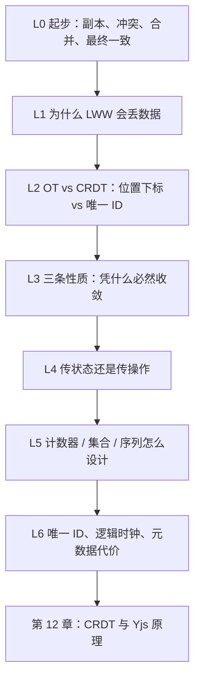
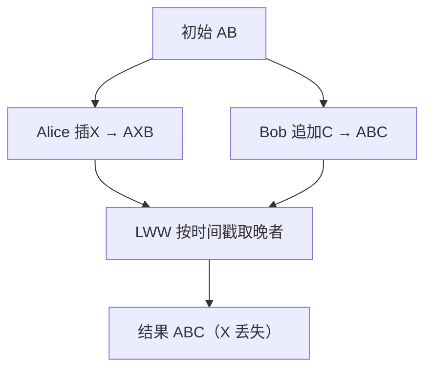
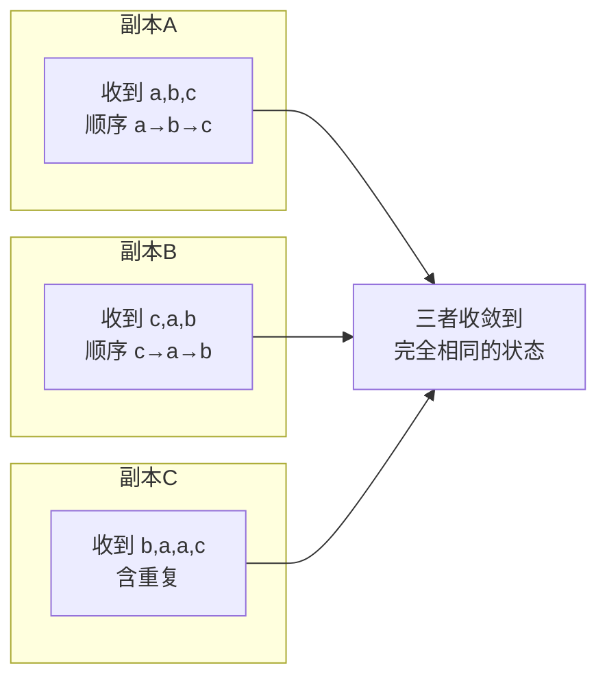
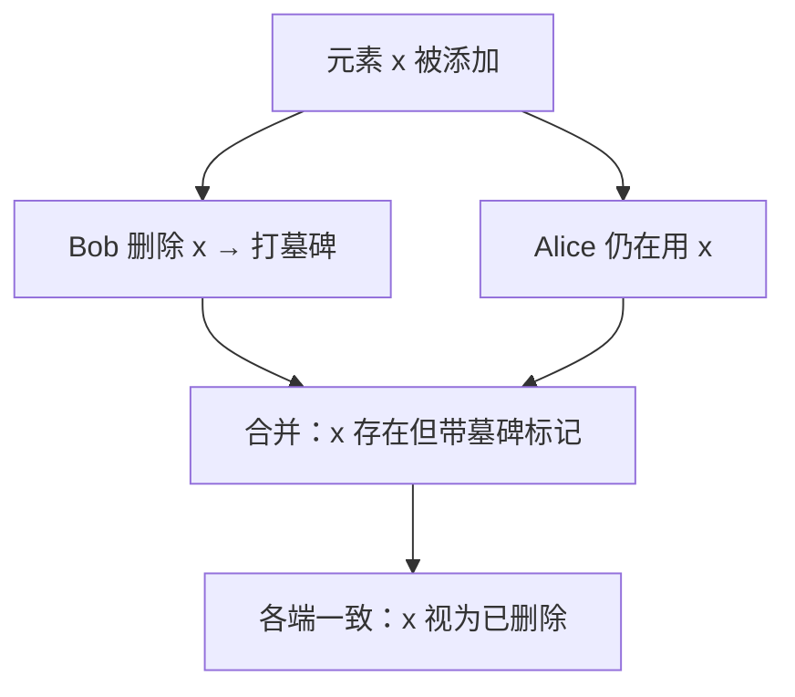
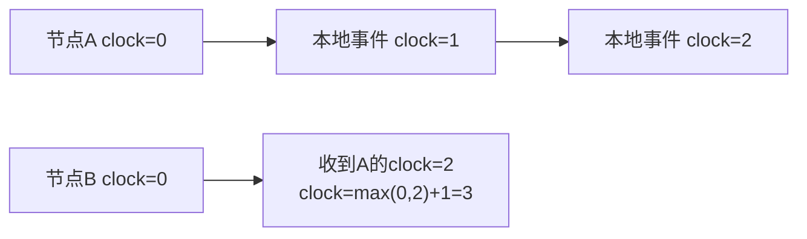

# 第 8 章 CRDT 基础入门

> **所属部分**：第 3 部分 · 编程语言与基础技术 ｜ **难度**：★★★☆☆ ｜ **建议学时**：10 小时（零基础路线）／4 小时（已有编程基础） ｜ **前置章节**：无硬性前置；完全没接触过协同算法的读者从起步节开始即可 ｜ **后续**：<a href="./12-CRDT与Yjs原理.md#ch-12">第 12 章</a> CRDT 与 Yjs 原理

---

## 本章导读

AFFiNE 的核心卖点是 **local-first**：断网也能照常编辑，联网后与云端、其他设备、其他协作者自动合并，且**不会出现「你的修改覆盖了我的修改」**。支撑这一切的底层技术叫 **CRDT**（Conflict-free Replicated Data Type，无冲突复制数据类型）。

<a href="./12-CRDT与Yjs原理.md#ch-12">第 12 章</a>会直接把 CRDT 和 Yjs、y-octo、BlockSuite 的数据模型绑在一起讲——`Y.Doc`、`Y.Map`、YATA 算法、state vector、墓碑 GC……如果你**没接触过 CRDT 或任何协同算法**，直接读<a href="./12-CRDT与Yjs原理.md#ch-12">第 12 章</a>会寸步难行：你会被一堆「为什么要这么设计」的前提假设绊住。

本章就是那块垫脚石。与同部分其他基础章一样，本章**额外照顾完全没接触过分布式与协同概念的读者**：起步节从「两个人同时改一篇文档会发生什么」讲起，把副本、同步延迟、冲突、合并、最终一致性这些词先变成看得见的画面；后面的正文再讲 CRDT 的通用原理与直觉，一路铺到<a href="./12-CRDT与Yjs原理.md#ch-12">第 12 章</a>的起点。本章**只讲原理、不碰具体库、不读 AFFiNE 源码**，读完你应当能用自己的话说清：「为什么简单的『最后写入者赢』不行」「CRDT 凭什么保证所有人最后看到同一份内容」。

CRDT 的一句话定位：**一类特殊的数据结构，无论各副本以什么顺序、分几批、重复多少次收到彼此的修改，最终都会收敛到完全相同的状态——而且不需要一个中心服务器来裁决**。记住这条，后面很多设计都是围绕它展开的。

### 三条学习路线

| 你的起点 | 怎么读 | 建议学时 |
| --- | --- | --- |
| **没接触过协同/分布式概念** | 从起步节开始，按顺序读完正文，每节的随堂小练都动手推演一遍 | 约 10 小时 |
| **会写代码，理解「多个客户端同时改一份数据」** | 跳过起步节，按顺序读正文；重点看「这一节要解决什么」「推演过程」「规则小结」 | 约 4 小时 |
| **只想查 CRDT 概念与术语** | 直接看每节的「规则小结」、[常见坑](#常见坑)和「最容易误解的点」 | 约 1.5 小时 |

> 表格里的「跳过」是真的可以跳过：正文各节**不依赖**起步节的任何记号，起步节只负责把读者带到「能看懂一次并发修改推演」的位置。

### 每一节的结构

正文各节按同一节奏推进：

1. **这一节要解决什么**——先说清动机，不先抛术语；
2. **逐步看 / 逐行看**——把一次推演或一段结构拆开，每一步都写明白，不跳步；
3. **规则小结**——把例子里的规律收敛成可查的表；
4. **最容易误解的点**——初学者最常卡住的那一两处；
5. **随堂小练**——30 秒能推完的小题，答案折叠，先自己想再展开。

> 本章的「最小例子」大多是**纸面推演**而不是代码：CRDT 的难点在概念，用两台设备、几个人、几张状态表就能讲透，不需要先装任何环境。想动手写代码的读者可以看<a href="./05-TypeScript基础入门.md#ch-5">第 5 章</a>的起步节，把推演翻译成 JS 对象来跑。

---

## 学习目标

**L0 · 起步**（起步节）

- [ ] 能说清什么是「副本」「同步」「网络延迟」，以及同一份数据为什么会有好几份
- [ ] 能用自己的话解释「冲突」不是报错，而是两份都合理的修改
- [ ] 能推演一次「后写覆盖」为什么会丢掉一方的改动
- [ ] 能说清「合并」是什么，以及为什么合并结果不能依赖顺序、分组或重复
- [ ] 能解释离线编辑与「最终一致性」分别指什么

**L1 · 问题定义**（协同三问题、LWW 两节）

- [ ] 能够说清协同编辑要解决的三个问题：并发冲突、离线编辑、最终一致性
- [ ] 能够解释「最后写入者赢（LWW）」为什么在协同文本场景下会丢数据

**L2 · 两条路线**（OT 与 CRDT 一节）

- [ ] 能够对比 OT 与 CRDT 两种思路的核心差异与各自代价，说清为什么 local-first 必须选 CRDT

**L3 · 收敛保证**（三条代数性质、状态式与操作式两节）

- [ ] 能够说出 CRDT 依赖的三条代数性质（交换律、结合律、幂等性）及其现实含义
- [ ] 能够区分状态式 CRDT 与操作式 CRDT，知道各自传什么、要求什么

**L4 · 数据结构**（常见 CRDT 类型一节）

- [ ] 能够描述三类常见 CRDT：计数器、集合（含墓碑）、有序序列（用于文本）
- [ ] 能解释「删除 = 打墓碑」为什么比物理删除更容易收敛

**L5 · 身份与顺序**（唯一 ID 与逻辑时钟一节）

- [ ] 能够说明唯一 ID 与逻辑时钟在 CRDT 中扮演的角色，为<a href="./12-CRDT与Yjs原理.md#ch-12">第 12 章</a>的 YATA 打底

**L6 · 工程代价**（代价与权衡一节）

- [ ] 能够说清 CRDT 的主要代价：元数据膨胀与墓碑堆积，以及 GC / 快照如何缓解

---

## 知识地图

本章是一条**阶梯**：每一级都在回答上一级留下的问题。



| 阶梯 | 对应小节 | 回答的问题 | 学完你能做什么 |
| --- | --- | --- | --- |
| L0 | 零基础起步 | 多人同时改，为什么会出问题？ | 独立推演一次并发修改 |
| L1 | 协同三问题、LWW | 最朴素的办法为什么不行？ | 说清「合并粒度太粗」 |
| L2 | OT 与 CRDT | 下标为什么会漂移？ | 说清「引用 ID 而非位置」 |
| L3 | 三条代数性质 | 凭什么保证大家最后一样？ | 用交换/结合/幂等解释收敛 |
| L4 | 状态式与操作式 | 同步时到底传什么？ | 对比整份状态与增量操作 |
| L5 | 常见 CRDT 类型 | 数字、集合、文本怎么做？ | 手算 G-Counter、墓碑、序列排序 |
| L6 | ID / 时钟 / 代价 | ID 从哪来？代价是什么？ | 看懂 YATA 的前提与元数据开销 |

---

## 8.1 零基础起步：两个人同时改一篇文档（有协同概念可跳过）

> **对应阶梯**：L0 ｜ **预计**：3 小时 ｜ 这一节不出现任何 CRDT 术语、不写代码、不碰 AFFiNE 源码，只把问题变成看得见的画面。

CRDT 难，往往不是难在公式，而是难在它要解决的问题从没被摆到台面上。这一节用一篇两人都编辑的文档，把每个词都落到具体画面上。

### 8.1.1 先看一个真实场景

小明和小红同时打开同一篇文档，里面只有一句话：

```text
初始内容： "AB"
```

两人在**几乎同一时刻**、各自在自己的电脑上做了不同的修改：

| 时刻 | 小明这边 | 小红这边 |
| --- | --- | --- |
| 开始前 | `AB` | `AB` |
| 各自编辑 | 在 A 和 B 中间插入 `X` → 本地看到 `AXB` | 在末尾追加 `C` → 本地看到 `ABC` |
| 同步之后 | ？ | ？ |

问题来了：**同步之后，两台电脑应该显示什么？**

- 显示 `AXB` → 小红加的 `C` 丢了。
- 显示 `ABC` → 小明插的 `X` 丢了。
- 显示 `AXBC` → 两个人的改动都保住了，这显然才是大家想要的。

这个「？」就是本章全部内容的起点。请注意：两人改的是**同一段文本的不同位置**，本来完全可以共存，没有任何一方「改错了」。

<div class="tip custom-block">
<p class="custom-block-title">先建立一个预期</p>
<p>协同编辑的难点不是「谁对谁错」，而是<strong>两份都合理的修改，怎么自动合成一份</strong>。后面所有设计都在回答这一句话。</p>
</div>

### 8.1.2 副本、同步与延迟：同一份数据为什么会有好几份

「同一篇文档」听起来像只有一份，其实在协作场景里至少有**好几份拷贝**：

| 位置 | 为什么需要一份 |
| --- | --- |
| 小明的电脑 | 断网也要能打字，不能每次按键都等服务器 |
| 小红的电脑 | 同上 |
| 云端 | 换设备、拉同事进来时有个汇合点 |

每一份拷贝叫一个**副本（replica）**。把各副本的改动互相传送、让它们重新对上的过程叫**同步（sync）**。

关键在于：**同步不是瞬间完成的**。网络有延迟、会断、会重连。所以一定存在一段时间，小明这边已经是 `AXB`、小红那边还是 `AB`——这不是 bug，而是协作系统必须接受的常态。


> 如果所有人的每次按键都实时传到所有人、且顺序完全一致，问题会简单得多——但那样断网就不能打字了。AFFiNE 的 local-first 恰恰选择了「先各自改，之后再合并」。

### 8.1.3 「冲突」到底是什么

很多初学者以为「冲突」是程序报错。在协同编辑里不是：

| | 一般理解 | 协同场景里的实际含义 |
| --- | --- | --- |
| 冲突 | 出错了、要弹窗让人选 | **两份都合理的修改同时发生**，需要决定怎么合并 |
| 典型例子 | — | 小明插了 `X`，小红加了 `C`，两份改动都没错 |
| 理想结果 | — | 自动合成 `AXBC`，双方都不丢 |

所以 CRDT 名字里的 **Conflict-free（无冲突）** 不是「不许同时改」，而是「**同时改了也能自动合并，不需要人裁决、不需要弹窗**」。

<div class="tip custom-block">
<p class="custom-block-title">为什么不能干脆「加锁」</p>
<p>传统做法是：谁要编辑先抢锁，别人等着。但协同编辑的体验要求是「所有人随时都能自由输入」，离线时更是连服务器都连不上、无锁可抢。所以协同系统必须<strong>允许并发修改先发生，再想办法合并</strong>，而不是预先阻止。</p>
</div>

### 8.1.4 最朴素的办法：后写覆盖为什么会丢数据

面对两份修改，最容易想到的规则是：**谁改得晚，就用谁的整份内容**（按时间戳比大小）。这叫「最后写入者赢」，正文里会叫它 LWW。

用上面的例子推一遍（假设小红的时间戳更晚）：

| 步骤 | 发生了什么 |
| --- | --- |
| 1 | 小明本地 `AXB`，小红本地 `ABC` |
| 2 | 两人把各自整份内容发给对方 |
| 3 | 比较时间戳，小红更晚 |
| 4 | 两边都采用小红的整份 `ABC` |
| 5 | 结果：`X` 彻底消失 |

明明可以合成 `AXBC`，却丢了一整份工作。根因是**合并粒度太粗**：把「整段文本」当成一个不可分割的值来覆盖，于是两处本可共存的局部修改被当成了「二选一」。

> 对「文档标题」「主题色」这种**单个独立字段**，后写覆盖其实够用——两个人同时改标题，最后留一个是合理的。出问题的是「一段会被同时插入、删除的文本」。这个区别很重要：不是 LWW 一无是处，而是**它不适用于可局部修改的复合内容**。

<details><summary>随堂小练 1：如果改的不是时间戳，而是「谁的字多就用谁的」，`X` 还会丢吗？</summary>

会。问题不在「按什么挑」，而在「<strong>挑的是整份内容</strong>」。只要合并规则是「从两份里选一份」，另一方的局部改动就必然丢。要保住两边，合并必须是「把两份的改动拼起来」，而不是「二选一」。

</details>

### 8.1.5 什么是「合并」：两个生活例子

**合并（merge）** 就是：拿到两份各自改过的内容，按规则算出一份同时包含两边改动的新内容。先看两个不需要任何数学的例子：

**例子 A：拼购物清单**

- 你写了「牛奶、面包」，家人写了「鸡蛋、牛奶」；
- 合并规则：把清单**并起来**，重复的只留一次 → 「牛奶、面包、鸡蛋」；
- 谁先说、说两遍、分几次说，结果都一样。

**例子 B：各记各的点赞数**

- 三个人各自记「我点过几次赞」：`{小明: 3, 小红: 2, 小刚: 0}`；
- 合并规则：每个人那一格**取两边见过的最大值**，总数 = 各格相加 = 5；
- 顺序、分组、重复都不影响结果（因为 `max` 不会因为算两遍就变大）。

这两个例子已经包含了 CRDT 的核心思想：**设计一种合并规则，使得「怎么收到改动」都不影响最终结果**。例子 B 的 `{节点: 计数}` 结构，正文里会正式叫它 G-Counter。

**逐步看例子 A**：

| 步骤 | 你的清单 | 家人清单 | 合并后 |
| --- | --- | --- | --- |
| 初始 | 牛奶、面包 | 鸡蛋、牛奶 | — |
| 先收到你的 | — | — | 牛奶、面包 |
| 再收到家人的 | — | — | 牛奶、面包、鸡蛋 |
| 家人清单又传了一遍 | — | — | 仍是「牛奶、面包、鸡蛋」 |

最后一步很关键：**重复收到同一份清单，结果不能变**（不能变成「牛奶两份」）。

### 8.1.6 顺序、分组、重复：合并必须「怎么算都一样」

真实网络里，改动消息的到达方式完全不可控。把三种情况和对应的要求列出来：

| 网络里会发生什么 | 例子 | 合并规则必须满足 |
| --- | --- | --- |
| **顺序不定** | 小明的改动可能比小红的先到，也可能反过来 | 先合谁都一样（交换律） |
| **被打包** | 网络层把三条改动攒成一批再发 | 怎么分组都一样（结合律） |
| **被重传** | 网络抖动，同一条改动发了两遍 | 收到两遍和一遍一样（幂等性） |

这三条名字听起来吓人，但上一小节的例子 A、B 已经全做到了：并集和取最大值，都不在乎顺序、分组、重复。

**为什么这三条如此重要**？因为只要合并规则满足它们，就能得出一个很强的结论：

> 只要所有副本**最终收到了相同的那批改动**，不管它们以什么顺序、分几批、重复多少次收到，**算出来的结果必然完全相同**。

这正是「大家最后看到同一份内容」的保证。正文会把它写成三条代数性质，并给出更正式的说法。

<div class="tip custom-block">
<p class="custom-block-title">最容易误解的点</p>
<p>「最终一致」<strong>不等于</strong>「任何时刻都一样」。同步过程中各端内容不同是允许的、也是必然的；保证的是「收到相同改动集之后必然一样」。把这两句话分开，后面就不会疑惑「既然保证一致，为什么我这边还没看到对方刚打的字」。</p>
</div>

### 8.1.7 离线编辑、最终一致性与起步自检

把前面的画面连起来，就是 AFFiNE 那句「断网也能编辑」：

| 阶段 | 状态 |
| --- | --- |
| 断网前 | 各副本内容一致 |
| 断网期间 | 小明离线改了三处、小红在线改了两处，两边都不知道对方改了什么 |
| 重新联网 | 攒下的改动互相同步 |
| 合并完成 | 因为合并规则不在乎顺序/分组/重复，两端收敛到同一份内容 |

「允许中途不同、承诺最终相同」就叫**最终一致性（eventual consistency）**。而 CRDT 就是那个「让最终相同成为数学必然」的数据结构。

**起步自检**（能回答这五问就能进正文）：

1. 为什么同一篇文档会有好几份副本？
2. 「冲突」是程序报错吗？它到底指什么？
3. 「谁改得晚就用谁的整份内容」为什么会丢数据？根因是什么？
4. 「合并」和「二选一」的区别是什么？举一个合并的例子。
5. 顺序不定、被打包、被重传，分别要求合并规则满足什么？

> 第 5 问答不上很正常，正文会用一张表把它讲透。前四问答得上，本章所有推演你就都看得懂了。

---

## 8.2 协同编辑要解决什么问题

> **这一节要解决什么**：起步节已经把「两人同时改」的画面摆出来了。这一节把协同系统必须同时搞定的三件事正式列清楚，作为后面所有设计的验收标准。

先把问题说清楚，再谈解法。一个「多人实时协作」的编辑器，至少要同时搞定三件事：

### 8.2.1 并发冲突

两个人（甚至同一个人的两台设备）在**几乎同一时刻**修改同一份文档。谁的改动都不该凭空消失，最终大家看到的内容还得一致。这是最核心的难题。

### 8.2.2 离线编辑

网络不是永远在线的。地铁里、飞机上，用户照样要能打字；等重新联网，离线期间攒下的所有改动要能**自动合并**进来，而不是弹一个「检测到冲突，请手动解决」的对话框。

### 8.2.3 最终一致性（eventual consistency）

分布式系统里有个经典结论：你没法同时拥有「强一致、高可用、分区容忍」。协同编辑选择了**可用性优先**——允许各副本在某一瞬间内容不同（你刚打的字还没传到我这），但承诺：**只要大家最终都收到了彼此全部的修改，就一定收敛到同一份内容**。这叫「最终一致性」。

<div class="tip custom-block">
<p class="custom-block-title">为什么不能靠「锁」</p>
<p>传统做法是加锁：谁要编辑先抢锁，别人只能等。但协同编辑的体验要求是「所有人随时都能自由输入」——加锁等于把实时协作变成排队，离线场景下更是无锁可抢。所以协同编辑必须<strong>允许并发修改先发生，再想办法合并</strong>，而不是预先阻止冲突。</p>
</div>

**规则小结**：

| 问题 | 要求 | 做不到会怎样 |
| --- | --- | --- |
| 并发冲突 | 两份合理改动都保留、各端一致 | 一方的工作被覆盖 |
| 离线编辑 | 断网可改、联网自动合并 | 弹窗让人手动解决 |
| 最终一致性 | 收到相同改动集后必然收敛 | 各端内容永远对不上 |

<details><summary>随堂小练：如果系统改成「每次只允许一个人编辑，其他人只读」，三个问题里哪个自动消失了？代价是什么？</summary>

并发冲突消失了（因为不会产生两份并发修改），但离线编辑也没法用了，而且体验从「实时协作」退化成「排队」。这正是「加锁」方案的取舍，也是 local-first 不选它的原因。

</details>

---

## 8.3 为什么不能简单「最后写入者赢」

> **这一节要解决什么**：上一节给了验收标准。这一节先排除最容易想到的方案，并精确指出它错在哪——「合并粒度太粗」，这决定了后面必须换一种数据结构。

面对并发修改，最朴素的想法是 **LWW（Last-Write-Wins，最后写入者赢）**：给每次修改打个时间戳，合并时谁的时间戳晚就用谁的。

对**单个独立字段**（比如「文档标题」「主题色」），LWW 是完全够用的——两个人同时改标题，最后保留一个也合情合理。AFFiNE 里很多原始值属性走的就是这种语义。

但一旦对象是**一段会被同时插入、删除的文本**，LWW 就会灾难性地丢数据。看例子：

```text
初始文本： "AB"
Alice：在位置 1 插入 "X"  →  本地得到 "AXB"
Bob：  同时在末尾追加 "C" →  本地得到 "ABC"
```

如果用「整段文本 + 时间戳」做 LWW 合并，假设 Bob 的时间戳更晚：

```text
最终结果 = Bob 的整段 "ABC"
→ Alice 插入的 "X" 彻底消失了
```

**逐步看**：

| 步骤 | Alice 副本 | Bob 副本 | 说明 |
| --- | --- | --- | --- |
| 1 | `AB` | `AB` | 起点一致 |
| 2 | `AXB` | `ABC` | 各自本地修改，互不知晓 |
| 3 | 收到 `ABC` | 收到 `AXB` | 同步开始 |
| 4 | 比较时间戳，Bob 晚 | 比较时间戳，Bob 晚 | 两端用同一规则 |
| 5 | `ABC` | `ABC` | 两端**确实一致了**，但 X 丢了 |

> 注意第 5 步：LWW 并不是「不一致」，它一致得很彻底——只是**一致地丢了数据**。这说明「各端一致」和「改动不丢」是两个独立目标，CRDT 要同时满足。

两个人的改动明明**不冲突**（一个在中间插字、一个在末尾加字，完全可以共存为 `"AXBC"`），LWW 却因为「按整段覆盖」而丢掉了一方的全部工作。



<div class="tip custom-block">
<p class="custom-block-title">问题的本质／最容易误解的点</p>
<p>LWW 把「整个文本」当成一个<strong>不可分割</strong>的值来覆盖，于是合并粒度太粗——两处本可共存的局部修改被当成了「二选一」。真正需要的是<strong>更细粒度、能把双方改动都保留下来</strong>的合并方式。最容易踩的误会是「换成更准的时间戳就好了」：换排序依据没用，只要挑的是整份内容就必丢。另外物理时间戳本身也不可靠——各设备时钟有偏差，离线几小时后的改动时间戳可能比在线设备还「新」或还「旧」。</p>
</div>

**规则小结**：

| 场景 | LWW 是否够用 | 原因 |
| --- | --- | --- |
| 单个独立字段（标题、颜色） | 够用 | 「二选一」本来就合理 |
| 可局部修改的复合内容（文本、列表） | **不够** | 粒度太粗，会吞掉局部改动 |
| 多设备 / 离线 | **不够** | 物理时钟不可比对 |

<details><summary>随堂小练：把合并规则改成「把两段文本直接拼起来」得到 `AXBABC`，算解决了吗？</summary>

没有。它保住了改动，却把未修改的部分重复了一遍，而且无法处理删除、也无法让两端用同一规则得到同一结果。正确的方向是「<strong>把每次改动记成独立的、可定位的单元</strong>，再按规则合并」——这正是下一节 OT 与 CRDT 的分岔口。

</details>

---

## 8.4 OT 与 CRDT：两种思路

> **这一节要解决什么**：知道「要更细粒度」之后，还差一个关键决定——用什么来标识「改动发生在哪个位置」。这一节的两条路线，差别全在这一个选择上。

既然要「把双方改动都保留、还要各端收敛一致」，业界有两大流派。

### 8.4.1 思路一：OT（操作变换）

**OT（Operational Transformation）** 的想法是：操作照常用「位置下标」表达（`insert(1, "X")`、`delete(1)`），但在应用对方操作前，先根据「我这边已经发生过什么」把对方操作的下标**变换**一下。

比如 Alice 已经在位置 1 插了一个字，那么 Bob 发来的 `delete(3)` 就得顺移成 `delete(4)`，因为 Alice 的插入让后面的字符都右移了一位。OT 把这套「操作遇到操作该如何改写」的规则写成一个个变换函数。

OT 能工作，但变换函数的组合情况极多、极难写对，而且通常**需要一个中心服务器**来给所有操作定一个全局顺序——这和 local-first「随时离线、多端对等」的诉求天然冲突。Google Docs 用的就是 OT。

### 8.4.2 思路二：CRDT（无冲突复制数据类型）

**CRDT** 换了个根本思路：**不再用「位置下标」标识元素，而是给每个元素分配一个全局唯一、永不改变的 ID**，操作引用的是 ID 而不是下标。

「在位置 1 插入 X」会被重新表达成「在 ID 为 `a` 的元素之后插入 X」。无论对方先插了多少字、删了多少字，`a` 这个 ID 始终指向同一个元素，**语义不会随并发操作漂移**。再配合一套所有副本都认同的**确定性排序规则**，不管操作以什么顺序到达，大家算出来的结果都一样——于是「无冲突」。

**逐步看「下标为什么会漂移」**：

| 步骤 | 文本 | 用下标表达 | 用 ID 表达 |
| --- | --- | --- | --- |
| 1 | `A B` | `B` 在位置 2 | `B` 的 ID 是 `b` |
| 2 | Alice 在中间插 `X` → `A X B` | `B` 变成位置 3 | `B` 仍是 `b` |
| 3 | Bob 之前发的「在 B 前插 Y」到达 | 按位置 2 会插错到 X 前面 | 按 ID `b` 稳稳插到 B 前 |

第 3 步就是 OT 要写变换函数、而 CRDT 完全不用管的原因。

### 8.4.3 对比

| 维度 | OT（操作变换） | CRDT（无冲突复制） |
| --- | --- | --- |
| 元素标识 | 位置下标 | 全局唯一 ID |
| 合并方式 | 按对方已执行操作**变换**下标 | 引用 ID + 确定性排序 |
| 中心服务器 | 通常需要（定序） | 不需要，任意拓扑都收敛 |
| 离线编辑 | 困难 | 天然支持 |
| 元数据开销 | 小 | 较大（ID、墓碑） |
| 代表 | Google Docs | Yjs、Automerge、y-octo |

<div class="tip custom-block">
<p class="custom-block-title">通往<a href="./12-CRDT与Yjs原理.md#ch-12">第 12 章</a>／最容易误解的点</p>
<p>AFFiNE 的 local-first 定位（长时间离线、桌面与手机互同步、多个存储间来回）决定了它<strong>不存在一个随时在线的权威定序者</strong>，所以必须选 CRDT。最容易踩的误会是「CRDT 比 OT 更先进」——两者是不同的取舍：OT 元数据省但要中心定序，CRDT 元数据贵但能去中心和离线。<a href="./12-CRDT与Yjs原理.md#ch-12">第 12 章</a>会看到 Yjs 的 YATA 算法正是「给每个字符一个 <code>(clientID, clock)</code> 唯一 ID + 按 clientID 确定性排序」的具体实现。</p>
</div>

<details><summary>随堂小练：如果所有客户端都永远在线、且有一个服务器能给每次操作编号，OT 的「中心定序」还是缺点吗？</summary>

不再是主要缺点，这正是 Google Docs 那类场景选 OT 的原因。缺点只在「要离线、要多端对等、没有权威定序者」时才凸显。技术选型没有绝对优劣，要看约束条件。

</details>

---

## 8.5 CRDT 的核心性质：为什么一定会收敛

> **这一节要解决什么**：上一节说「用 ID + 确定性排序就能收敛」，但凭什么？这一节把起步节那三条直觉写成正式性质，并说明它们如何把「收敛」变成数学必然。

CRDT 之所以能保证「无论顺序都收敛」，靠的是它的合并操作满足三条**代数性质**。把合并记作 `merge`，三条性质是：

| 性质 | 公式 | 现实含义 |
| --- | --- | --- |
| **交换律** | `merge(a, b) = merge(b, a)` | 先收到谁的改动都一样 |
| **结合律** | `merge(merge(a, b), c) = merge(a, merge(b, c))` | 怎么分组、分几批合并都一样 |
| **幂等性** | `merge(a, a) = a` | 同一份改动收到两次也无妨 |

直觉上这三条分别对应协同网络中三种无法避免的情况：

- **交换律** → 消息到达顺序不可控：Alice 的改动和 Bob 的改动，谁先到我这不一定。
- **结合律** → 消息可能被打包：网络层常把多条改动攒成一批再发，分组方式不该影响结果。
- **幂等性** → 消息可能重传：网络抖动导致同一条改动发了两遍，不能让计数翻倍、文字重复。

满足这三条的结构，在数学上构成一个**半格（semilattice）**。可以证明：**只要所有副本最终收到了相同的「改动集合」，无论以什么顺序、分组、重复，它们都会收敛到完全相同的状态**。这就是 CRDT 给出的强保证——它把「收敛」从「祈祷网络表现良好」变成了「数学上必然」。



**逐步看（用起步节的购物清单验证三条）**：

| 验证 | 两组输入 | 结果 | 对应性质 |
| --- | --- | --- | --- |
| 顺序 | 「牛奶+面包」后合「鸡蛋」 vs 反过来 | 都是「牛奶、面包、鸡蛋」 | 交换律 |
| 分组 | 先合前两条再合第三条 vs 先合后两条 | 都是「牛奶、面包、鸡蛋」 | 结合律 |
| 重复 | 同一份清单合两次 | 仍是「牛奶、面包、鸡蛋」 | 幂等性 |

<div class="tip custom-block">
<p class="custom-block-title">记住这句话／最容易误解的点</p>
<p>CRDT 不保证「任何时刻各端都一样」，它保证的是<strong>「收到相同改动集后必然一样」</strong>——顺序、分组、重复都无所谓。最容易踩的误会是把三条性质当成「性能要求」：它们其实是<strong>数据结构的设计约束</strong>，不满足就根本不是 CRDT。<a href="./12-CRDT与Yjs原理.md#ch-12">第 12 章</a>里 Yjs 的 update 恰好具备这三条，这正是存储层敢「本地攒一批合并再推」「服务端把一堆 update 压成快照」「网络重传不校验」的理论基础。</p>
</div>

<details><summary>随堂小练：把合并规则改成「每个副本的简单数值相加」，收到同一条 `+1` 两遍会怎样？违反哪条性质？</summary>

会变成 +2，违反<strong>幂等性</strong>。这也解释了正文里 G-Counter 为什么要「每个节点各记各的贡献、合并取 max」——取 max 天然不会因为重复而变大。

</details>

---

## 8.6 状态式 vs 操作式 CRDT

> **这一节要解决什么**：性质讲完了，落到工程上还有一个选择——同步时到底把什么东西发给对方？这一节对比两种传输风格。

CRDT 有两种实现风格，区别在于**副本之间到底传什么**。

### 8.6.1 状态式 CRDT（state-based / CvRDT）

每个副本维护一份完整**状态**，同步时直接把**整个状态**发给对方，对方用 `merge` 函数把两份状态合并。

- 要求：`merge` 必须满足前面说的交换/结合/幂等三条。
- 优点：网络可以随便丢包、乱序、重发，只要「最终把状态传过去」就行，非常鲁棒。
- 缺点：状态可能很大，每次传整份很浪费。

### 8.6.2 操作式 CRDT（operation-based / CmRDT）

副本之间只传**增量操作**（「插入了 X」「计数 +1」），对方把操作应用到本地。

- 要求：每个操作必须满足交换律（顺序无关），且传输层要保证**不丢、不重**（或操作本身设计成幂等）。
- 优点：每次只发很小的增量，带宽友好。
- 缺点：对传输层要求更高——操作一旦丢了或重复了，没有整份状态来兜底。

### 8.6.3 对比

| 维度 | 状态式（state-based） | 操作式（operation-based） |
| --- | --- | --- |
| 传输内容 | 整个状态 | 单个/一批增量操作 |
| 合并靠 | `merge(状态, 状态)` | `apply(操作)` |
| 对网络要求 | 很低（可丢/乱序/重发） | 较高（需不丢不重或幂等） |
| 带宽 | 大 | 小 |

**逐步看一次同步**：

| 步骤 | 状态式 | 操作式 |
| --- | --- | --- |
| 1 | A 把整份 `{A:3, B:2}` 发给 B | A 把「+1」这一条发给 B |
| 2 | B 用 `merge` 逐格取 max | B 在本地 apply「+1」 |
| 3 | 再收到一遍也没关系 | 再收到一遍就会多加一次（除非操作幂等） |

<div class="tip custom-block">
<p class="custom-block-title">现实中的折中／最容易误解的点</p>
<p>纯状态式太费带宽、纯操作式对网络太苛刻，所以成熟库（Yjs、Automerge）大多走<strong>混合路线</strong>：平时发操作（增量 update）省带宽，但 update 设计得可乱序、可重复、可任意分组合并——既有操作式的省流，又保留了状态式的鲁棒。最容易踩的误会是把两者当成两种「不同的 CRDT 数据结构」：其实同一个数据结构常可以同时有两种同步方式，区别只在<strong>传什么</strong>。<a href="./12-CRDT与Yjs原理.md#ch-12">第 12 章</a>里 Yjs 的「state vector + diff 同步」就是这种混合思路的典型。</p>
</div>

<details><summary>随堂小练：网络经常重传同一条消息，哪种风格更省心？为什么？</summary>

状态式。整份状态重复合并由幂等性兜底，结果不变；操作式若操作本身不幂等，重复的「+1」会被应用两次。所以操作式要么要求传输层去重，要么把操作设计成幂等。

</details>

---

## 8.7 常见的 CRDT 类型

> **这一节要解决什么**：抽象性质讲完了，该看具体怎么给「数字、集合、文本」设计合并规则。这一节用三类最小结构演示「用代数性质设计数据结构」。

CRDT 不是单一结构，而是一个「家族」。理解三类最常见的，就能举一反三。

### 8.7.1 计数器（Counter）

最简单的 CRDT。多个副本都在给同一个数字加减，要求合并后得到正确总和。

朴素做法「每个副本存一个数、合并时相加」会出错：无法区分「真的加了两次」和「同一次加法收到两遍」。正确做法（**G-Counter**，只增计数器）是**每个副本各记各的贡献**：

```text
副本状态 = { A: 3, B: 2, C: 0 }   // 各节点各自加了多少
本副本的计数值 = 所有分量之和 = 5
merge：对每个节点的分量取两边的最大值
```

**逐步看一次合并**：

| 步骤 | 副本 X 的状态 | 副本 Y 的状态 | 合并后 |
| --- | --- | --- | --- |
| 初始 | `{A:3, B:0}` | `{A:1, B:2}` | — |
| 逐格取 max | — | — | `{A:3, B:2}` |
| 求和 | — | — | 5 |
| 再合并一次同样的 | — | — | 仍是 `{A:3, B:2}` → 5 |

对同一个节点的分量取 `max` 天然满足交换/结合/幂等——这就是用代数性质「设计」出一个 CRDT 的范例。要支持减法，用两个 G-Counter（一增一减）相减即可，即 **PN-Counter**。

### 8.7.2 集合（Set）：增、删与墓碑

集合要支持「加元素」「删元素」。难点在删除：如果 Alice 删了元素 `x`、Bob 同时又添加了 `x`，并发之下该听谁的？

关键技巧是**不真的物理删除，而是打一个「已删除」的标记——墓碑（tombstone）**。被删的元素仍留在数据里，只是标记为失效。这样：

- 删除变成了「添加一个墓碑标记」，和「添加元素」一样是**单调增长**的操作，天然可交换、可幂等；
- 合并时谁也不会凭空抹掉对方的信息，只是标记叠加，收敛有保证。



<div class="tip custom-block">
<p class="custom-block-title">墓碑是 CRDT 的标志性设计</p>
<p>「删除 = 打标记而非物理移除」会贯穿几乎所有 CRDT。<a href="./12-CRDT与Yjs原理.md#ch-12">第 12 章</a>会看到 Yjs 删除文本字符时，Item 也不是真的消失，而是被标记为墓碑（因为别人可能还以它为锚点插入），已删除的 ID 区间记在 <code>DeleteSet</code> 里随 update 传输。墓碑带来的膨胀问题，要靠后面说的 GC 来缓解。</p>
</div>

### 8.7.3 有序序列（Sequence）：文本的基础

这是协同文本最核心、也最难的 CRDT。它要维护一个**有序列表**，支持在任意位置并发插入/删除，且各端收敛到相同顺序。

核心做法前面已经点过：**每个元素（字符）分配一个全局唯一 ID，插入时记录「插在哪个 ID 之后」而非「插在第几位」**。并发插在同一位置时，用一套所有副本都认同的确定性规则（比如比较 ID 大小）决定先后：

```text
初始： A — B            （A、B 各有唯一 ID）
Alice：在 A 之后插 X    （记：origin = A）
Bob：  在 A 之后插 Y    （记：origin = A）
两者 origin 相同 → 按 ID 比较，确定性地排出 A X Y B（或 A Y X B）
关键不在"谁在前"，而在"所有副本排法一致"
```

**逐步看**：

| 步骤 | Alice 副本 | Bob 副本 |
| --- | --- | --- |
| 1 | `A B` | `A B` |
| 2 | 插 X（origin=A）→ `A X B` | 插 Y（origin=A）→ `A Y B` |
| 3 | 收到 Y，按 ID 规则排在 X 之后 | 收到 X，按 ID 规则排在 Y 之前 |
| 4 | `A X Y B` | `A X Y B` |

无论 Alice 的 X 和 Bob 的 Y 以什么顺序到达，因为排序规则是确定的，各端都得到同一个序列——收敛达成。

<div class="tip custom-block">
<p class="custom-block-title">通往<a href="./12-CRDT与Yjs原理.md#ch-12">第 12 章</a>／最容易误解的点</p>
<p>这正是 Yjs 的 <strong>YATA</strong> 算法要解决的问题。最容易踩的误会是纠结「X 和 Y 到底谁该在前面」——<strong>答案不重要</strong>，重要的是所有副本用同一条规则得出同一个答案。<a href="./12-CRDT与Yjs原理.md#ch-12">第 12 章</a>会看到每个字符 Item 带 <code>id = (clientID, clock)</code>、<code>origin</code>（左邻居 ID）、<code>rightOrigin</code>（右邻居 ID），并发冲突时比较 <code>clientID</code> 确定性排序。本章记住「<strong>引用 ID 而非下标 + 确定性排序</strong>」这条主线即可。</p>
</div>

**规则小结**：

| 类型 | 状态长什么样 | 合并规则 | 满足三性质靠什么 |
| --- | --- | --- | --- |
| G-Counter | `{节点: 计数}` | 逐格取 max | max 可交换、可结合、幂等 |
| 集合（带墓碑） | 元素 + 删除标记 | 并集叠加标记 | 只增不减，天然幂等 |
| 有序序列 | 元素 + 唯一 ID + 邻居引用 | ID 确定性排序 | 规则唯一，与到达顺序无关 |

<details><summary>随堂小练：把有序序列的排序规则改成「谁的操作先到谁排前面」，还能收敛吗？</summary>

不能。各副本的到达顺序不同，就会排出不同序列。收敛要求排序规则只依赖<strong>改动本身携带的信息</strong>（如 ID），不能依赖「本地什么时候收到」。这也是「确定性」三个字的分量。

</details>

---

## 8.8 唯一 ID 与逻辑时钟

> **这一节要解决什么**：前面反复用「唯一 ID」，但没说它从哪来、为什么不能重复。这一节把身份与顺序的地基补齐。

前面反复提到「全局唯一 ID」和「确定性排序」，这一节把它说透。

### 8.8.1 为什么需要唯一 ID

CRDT 的一切都建立在「每个元素有一个全局唯一、永不改变的身份」之上。有了它：

- 操作可以稳定地引用元素（「在 ID=a 之后插入」），不受并发下标漂移影响；
- 幂等有了依据——收到一个 ID 已存在的元素，直接忽略即可（这就是去重）；
- 删除可以精确打墓碑到具体 ID。

ID 通常由两部分组成：**`(节点标识, 本地计数)`**。节点标识区分是哪个副本产生的（比如每个客户端启动时随机一个编号），本地计数是该副本内部自增的序号。两者组合既保证全局唯一，又能排序。

### 8.8.2 逻辑时钟：绕开物理时间的不可靠

前面说过物理时间戳不可靠。CRDT 改用**逻辑时钟**——它不关心「几点几分」，只关心**事件之间的先后关系**。最常见的是 **Lamport 时钟**：

```text
- 每个节点维护一个计数器 clock
- 本地每发生一个事件：clock = clock + 1
- 收到对方消息（携带其 clock' ）时：clock = max(clock, clock') + 1
```

**逐步看一次时钟推进**：

| 步骤 | 节点 A 的 clock | 节点 B 的 clock | 说明 |
| --- | --- | --- | --- |
| 初始 | 0 | 0 | 各自从 0 开始 |
| A 本地两次改动 | 1 → 2 | 0 | 本地事件只加自己的 |
| A 把带 `clock=2` 的消息发给 B | 2 | 0 | 消息携带当前 clock |
| B 收到 | 2 | `max(0,2)+1 = 3` | B 跳到比所见都大 |

这样产生的 `(clock, 节点ID)` 二元组可以给所有事件排出一个**全局一致的顺序**，而且完全不依赖各机器的物理时钟是否对准。并发（互不知晓）的事件则靠节点 ID 来打破平手——保证任意两端排序结果相同。



<div class="tip custom-block">
<p class="custom-block-title">通往<a href="./12-CRDT与Yjs原理.md#ch-12">第 12 章</a>／最容易误解的点</p>
<p>Yjs 里字符 Item 的 ID <code>(clientID, clock)</code> 就是这个思路：<code>clientID</code> 是节点标识（Doc 实例的随机编号），<code>clock</code> 是自增逻辑时钟。最容易踩的误会是把逻辑时钟当成「更准的时间」：它<strong>不是时间</strong>，只是「我见过多少个事件」的计数，无法回答「这件事发生在几点」。<a href="./12-CRDT与Yjs原理.md#ch-12">第 12 章</a>还会讲到 AFFiNE 给 yjs 打的 <code>uint53</code> 补丁——把 clientID 从 32 位扩到 53 位，正是因为「<strong>clientID 碰撞会让两个本是不同的元素被当成同一个</strong>」是 CRDT 的致命问题。</p>
</div>

**规则小结**：

| 概念 | 作用 | 不能拿来做什么 |
| --- | --- | --- |
| 节点标识 | 区分改动由哪个副本产生 | 必须保证不碰撞 |
| 本地计数 / 逻辑时钟 | 给同一副本的事件排先后 | 不能当物理时间用 |
| `(节点, 计数)` 组合 | 全局唯一 ID，兼作确定性排序依据 | ID 一旦分配不可复用、不可改变 |

<details><summary>随堂小练：两个客户端随机出了同一个 clientID，会发生什么？</summary>

它们产生的元素可能被判为「同一个 ID」，去重逻辑会把一方的改动当成重复消息丢掉，或者让两个不同元素互相覆盖——内容静默丢失。这正是 ID 必须全局唯一、且<a href="./12-CRDT与Yjs原理.md#ch-12">第 12 章</a>要把 clientID 位数扩大的原因。

</details>

---

## 8.9 代价与权衡

> **这一节要解决什么**：前面都在讲 CRDT 的好处。这一节诚实列出它付出的代价，并说明工程上怎么缓解——这也是<a href="./12-CRDT与Yjs原理.md#ch-12">第 12 章</a>大量工程决策的动机。

CRDT 不是免费午餐。它用额外的空间换来了「无冲突合并」的能力，主要代价有两类。

### 8.9.1 元数据膨胀

为了给每个元素挂唯一 ID、origin、逻辑时钟，CRDT 要存大量**元数据**。一个字符的「净荷」只有 1 字节，但围绕它的 ID、邻居指针等元数据可能是净荷的数倍。对一篇长文档，元数据开销相当可观。

### 8.9.2 墓碑堆积

删除不物理移除、只打墓碑，意味着**删掉的内容仍占着空间**。一个被反复编辑、删了又删的文档，墓碑会越积越多，数据体积只增不减。

### 8.9.3 缓解手段：GC 与快照

成熟实现用两招缓解：

- **垃圾回收（GC）**：在确认某些墓碑再也不会被引用后，安全地真正清除它们；
- **合并压缩 / 快照**：把一长串历史操作合并成一份紧凑的当前状态，丢弃中间过程。

| 代价 | 根因 | 缓解 |
| --- | --- | --- |
| 元数据膨胀 | 每个元素都要挂 ID、时钟、邻居 | 二进制紧凑编码、合并压缩 |
| 墓碑堆积 | 删除只打标记不物理删 | GC 在安全时机回收 |
| 历史无限增长 | 操作只增不减 | 定期生成快照、丢弃旧 update |

**逐步看一次「写时追加、读时压缩」**：

| 步骤 | 存储里发生什么 | 解决了什么 |
| --- | --- | --- |
| 1 | 每次编辑追加一条小 update | 写入快、不改写历史 |
| 2 | 读取时把一批 update 合并成一份状态 | 读到的始终是当前内容 |
| 3 | 定期把合并结果存成快照、丢掉旧 update | 历史不再无限增长 |

<div class="tip custom-block">
<p class="custom-block-title">通往<a href="./12-CRDT与Yjs原理.md#ch-12">第 12 章</a>／最容易误解的点</p>
<p>这些权衡在<a href="./12-CRDT与Yjs原理.md#ch-12">第 12 章</a>会变成具体工程决策：Yjs 默认开 <code>gc: true</code> 回收墓碑让文档更小；AFFiNE 放弃 <code>Y.snapshot</code> 历史方案、改为「服务端定期存整份合并后二进制」；nbstore 的「<strong>写时追加、读时压缩</strong>」把一堆 update 在读取时 <code>mergeUpdates</code> 成一份快照。最容易踩的误会是「开了 GC 就能随便删历史」：GC 只能在<strong>确认所有副本都不会再引用某个墓碑</strong>之后才安全，否则离线很久的旧设备重新上线会合不上。</p>
</div>

<details><summary>随堂小练：一台设备离线三个月后重新联网，如果服务端已经把它离线期间需要的墓碑 GC 掉了，会发生什么？</summary>

这台设备发来的改动可能引用已被清除的 ID，服务端无法定位锚点，合并可能失败或产生不一致。所以 GC 的时机必须保守，或依赖「各副本已确认同步到某个点」的信息（<a href="./12-CRDT与Yjs原理.md#ch-12">第 12 章</a>的 state vector 就是干这个的）。

</details>

---

## 动手实践

> 本章练习以**纸面推演**为主，不需要装环境。零基础读者请从第 1 题开始，不要跳。

1. **（L0）把一次并发修改画成表**：取初始文本 `"AB"`，设定小明插 `X`、小红追加 `C`，画一张「时刻 / 小明副本 / 小红副本」的表，分别写出「用整份覆盖」「用合并」两种规则下的最终内容。**验收**：能说清为什么前者丢数据、后者不丢，以及「合并粒度」指什么。
2. **（L1）手算一次 LWW 丢数据**：取初始文本 `"HELLO"`，设想 Alice 把它改成 `"HELLO!"`（末尾加感叹号）、Bob 同时改成 `"HELLO WORLD"`。用「整段文本 + 时间戳」的 LWW 合并，写出结果。**验收**：能指出哪一方的改动丢了，并说明「本可共存为 `HELLO WORLD!`」这一点。
3. **（L3）用三条性质设计一个计数器**：用纸笔实现 G-Counter——状态是 `{节点: 计数}` 的映射，`merge` 对每个节点取 `max`，计数值为各分量之和。手动模拟三个副本各加几次、乱序+重复地互相合并。**验收**：无论合并顺序与是否重复，三副本最终计数值都相同，并能说出这对应交换/结合/幂等中的哪条。
4. **（L4）给集合加墓碑**：设计一个支持增删的集合 CRDT。规定「删除 = 给元素打墓碑」。模拟 Alice 删 `x`、Bob 并发重新添加 `x`，写出合并后状态。**验收**：能说清为什么「删除打墓碑」比「物理删除」更容易满足交换律与幂等。
5. **（L4）给序列排并发插入**：初始序列两个元素 `A(id=1)`、`B(id=2)`。Alice 在 A 后插 `X(id=5)`，Bob 在 A 后插 `Y(id=3)`，约定「同一 origin 下按 id 从小到大排」。写出两端各自合并后的最终序列。**验收**：两端结果完全一致，并能解释「收敛靠的是排序规则确定，而非谁先到达」。
6. **（L5–L6）解释两个工程决策**：用自己的话回答 ① 为什么 ID 必须全局唯一且永不复用；② 为什么 GC 不能「想删就删」。**验收**：能各举一个会出问题的具体场景（ID 碰撞 / 离线设备回归）。

---

## 自测题

<details><summary>Q1（L0）. 同一篇文档为什么会有好几份「副本」？同步为什么不是瞬间完成的？</summary>

每台设备、云端都需要一份本地拷贝，才能保证断网也能编辑、换设备也能继续。同步要经网络传送，而网络有延迟、会断、会重连，所以必然存在「各副本暂时不一致」的窗口。这不是 bug，是协作系统必须接受的常态。

</details>

<details><summary>Q2（L0）. 协同场景里的「冲突」是程序报错吗？</summary>

不是。它指**两份都合理的修改同时发生**，需要决定怎么合并。例如一个人在中间插字、另一个人在末尾加字，两份改动都没错，理想结果是自动合成同时包含两者的内容，而不是弹窗让人二选一。

</details>

<details><summary>Q3（L0）. 「谁改得晚就用谁的整份内容」为什么会丢数据？根因是什么？</summary>

因为合并粒度太粗：把整段文本当成不可分割的值来覆盖，两处本可共存的局部修改被当成「二选一」，一方的改动整段消失。换更准的时间戳也没用——只要挑的是整份内容就必丢；而且多设备/离线时物理时钟本身就不可比对。

</details>

<details><summary>Q4（L0）. 顺序不定、被打包、被重传，分别要求合并规则满足什么？</summary>

分别对应**交换律**（先合谁都一样）、**结合律**（怎么分组都一样）、**幂等性**（收到两遍和一遍一样）。三者合起来保证：只要各副本最终收到相同的改动集，无论顺序、分组、重复，结果必然相同。

</details>

<details><summary>Q5（L0）. 「最终一致性」是说任何时刻各端都一样吗？</summary>

不是。它允许同步过程中各端暂时不同，承诺的是「收到相同改动集之后必然收敛到同一状态」。把「暂时不同」和「最终相同」分开，就不会疑惑「既然保证一致，为什么我还没看到对方刚打的字」。

</details>

<details><summary>Q6（L1）. 协同编辑要同时解决哪三个问题？</summary>

并发冲突（多端同时改同一数据、谁的改动都不能丢且最终一致）、离线编辑（断网也能改、联网自动合并）、最终一致性（允许某一瞬间各端不同，但收到相同改动集后必然收敛到同一状态）。

</details>

<details><summary>Q7（L2）. OT 与 CRDT 处理并发的核心差异是什么？</summary>

OT 仍用「位置下标」表达操作，在应用对方操作前按已发生的操作**变换下标**，通常需要中心服务器定序。CRDT 给每个元素分配**全局唯一不变的 ID**，操作引用 ID 而非下标，再配确定性排序规则，不需要中心服务器、天然支持离线。

</details>

<details><summary>Q8（L3）. CRDT 依赖哪三条代数性质？各自对应网络中的什么情况？</summary>

交换律（`merge(a,b)=merge(b,a)`）对应消息到达顺序不可控；结合律（分组无关）对应消息可能被打包成批；幂等性（`merge(a,a)=a`）对应消息可能被重传。三者合起来保证：收到相同改动集后，无论顺序、分组、重复，各副本必然收敛到相同状态。

</details>

<details><summary>Q9（L3）. 状态式与操作式 CRDT 的区别？各对网络有什么要求？</summary>

状态式传整份状态、用 `merge` 合并，对网络要求极低（可丢、可乱序、可重发），但费带宽；操作式只传增量操作、用 `apply` 应用，省带宽，但要求传输层不丢不重（或操作本身幂等）。成熟库多采用两者混合的折中方案。

</details>

<details><summary>Q10（L4）. 为什么 CRDT 删除常用「墓碑」而不是物理删除？</summary>

物理删除难以满足交换律与幂等（并发的「删」与「加」顺序不同会得到不同结果，重复的删除也难处理）。把删除变成「添加一个墓碑标记」后，它和「添加元素」一样是单调增长操作，天然可交换、可幂等，合并时不会凭空抹掉对方信息，收敛有保证。代价是墓碑会堆积，需靠 GC 回收。

</details>

<details><summary>Q11（L4）. 有序序列里并发插入「谁排在前面」重要吗？</summary>

不重要，**所有副本排法一致**才重要。排序规则必须只依赖改动本身携带的信息（如唯一 ID），不能依赖「本地什么时候收到」。若改成「先到先排」，各副本到达顺序不同就会排出不同序列，无法收敛。

</details>

<details><summary>Q12（L5–L6）. 唯一 ID 为什么不能复用？GC 为什么不能想删就删？</summary>

ID 复用或节点标识碰撞会让两个本是不同的元素被当成同一个，去重逻辑可能静默丢掉一方改动。GC 清除墓碑前必须确认不会再有副本引用它——离线很久的旧设备重新上线时，若锚点已被清除，合并会失败或不一致。两者都是「元数据不是随便能省」的体现。

</details>

---

## 常见坑

| 现象 | 原因 | 怎么处理 | 对应阶梯 |
| --- | --- | --- | --- |
| 以为「冲突」是报错、要弹窗 | 把它当成程序错误而非两份合理修改并存 | 设计自动合并规则，目标是两边改动都保留 | L0 |
| 以为各端必须时刻一致 | 混淆「强一致」与「最终一致」 | 接受同步窗口内的暂时不同，只保证收敛 | L0 |
| 以为换更准的时间戳能修好 LWW | 没看出根因是「挑整份内容」而非排序依据 | 改成细粒度、可合并的改动表示 | L1 |
| 把局部修改当「二选一」 | 合并粒度太粗 | 让每次改动成为独立可定位的单元 | L1 |
| 下标在并发插入后漂移 | 用位置而非身份标识元素 | 改用全局唯一 ID + 确定性排序 | L2 |
| 计数器「简单相加」合并出错 | 无法区分「真加两次」与「同一次收两遍」 | 每个节点各记贡献、合并取 max（G-Counter） | L3–L4 |
| 删除后数据体积不降反升 | 删除是打墓碑而非物理移除，墓碑只增不减 | 靠 GC 在安全时机回收、靠快照压缩历史 | L4 / L6 |
| 并发插入后两端顺序不一致 | 排序规则依赖到达顺序而非改动本身 | 用所有副本认同的确定性规则（比较 ID） | L4 |
| 以为 CRDT 保证「任何时刻都一致」 | 只保证「收到相同改动集后收敛」 | 过程中各端允许暂时不同（最终一致性） | L0 / L3 |
| 把唯一 ID 当成可复用/可变 | ID 必须全局唯一且永不改变 | 节点标识 + 逻辑时钟组合，绝不复用 | L5 |
| 逻辑时钟被当成物理时间 | 它只表达事件先后，不表达「几点」 | 需要墙上时间时另存字段 | L5 |
| 过早 GC 导致离线设备合不上 | 清除了仍可能被旧副本引用的墓碑 | 依据各副本同步进度（state vector）择机回收 | L6 |

---

## 延伸阅读

- Marc Shapiro 等《Conflict-free Replicated Data Types》原始论文：半格、状态式/操作式的严格定义
- <a href="./12-CRDT与Yjs原理.md#ch-12">第 12 章</a>：CRDT 与 Yjs 原理（YATA 算法、`Y.Doc/Y.Map/Y.Text`、state vector 与 diff 同步、snapshot/GC、AFFiNE 落地）
- <a href="./05-TypeScript基础入门.md#ch-5">第 5 章</a>：TypeScript 基础入门（本章实验若用代码验证，联合类型与泛型会派上用场）
- <a href="./07-Rust基础入门.md#ch-7">第 7 章</a>：Rust 基础入门（<a href="./12-CRDT与Yjs原理.md#ch-12">第 12 章</a>的 y-octo 是 Rust 实现）
- Automerge、Yjs 官方文档中「internals」章节：工业级 CRDT 的工程取舍

---

## 本章学时拆分

| 内容 | 零基础路线 | 已有编程基础 |
| --- | --- | --- |
| 起步：副本、冲突、合并、最终一致性 | 3h | 0h（跳过） |
| 协同三问题、为什么 LWW 不够 | 1h | 0.75h |
| OT vs CRDT 思路对比 | 0.75h | 0.5h |
| 三条代数性质与收敛 | 1h | 1h |
| 状态式 vs 操作式 | 0.5h | 0.5h |
| 常见 CRDT 类型（计数器 / 集合 / 序列） | 1.25h | 0.75h |
| 唯一 ID 与逻辑时钟、代价与权衡 | 1.5h | 0.5h |
| **合计** | **约 10h** | **约 4h** |

> 与<a href="./05-TypeScript基础入门.md#ch-5">第 5 章</a>、<a href="./06-前端框架基础入门-React-Lit-Signals-RxJS.md#ch-6">第 6 章</a>、<a href="./07-Rust基础入门.md#ch-7">第 7 章</a>口径一致：零基础多出的 6 小时只用于起步与逐节拆解，不计入总目录里「第 3 部分 60 小时」的标准学时。

---

上一章：[第 7 章 Rust 基础入门](07-Rust基础入门.md) ｜ 下一章：[第 9 章 TypeScript 在 AFFiNE 中的应用](09-TypeScript在AFFiNE中的应用.md) ｜ [返回目录](../README.md)
