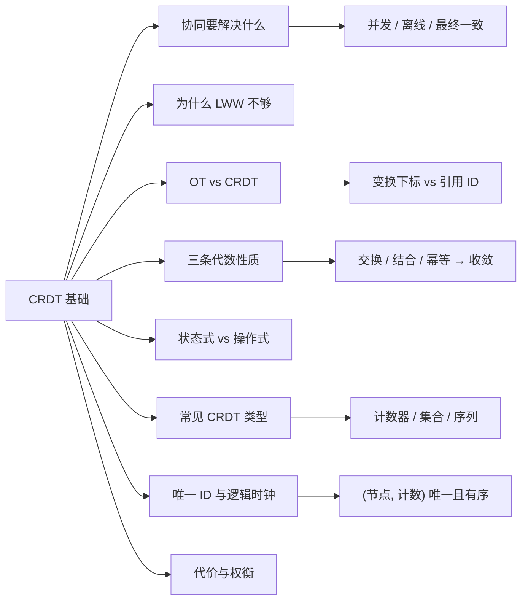
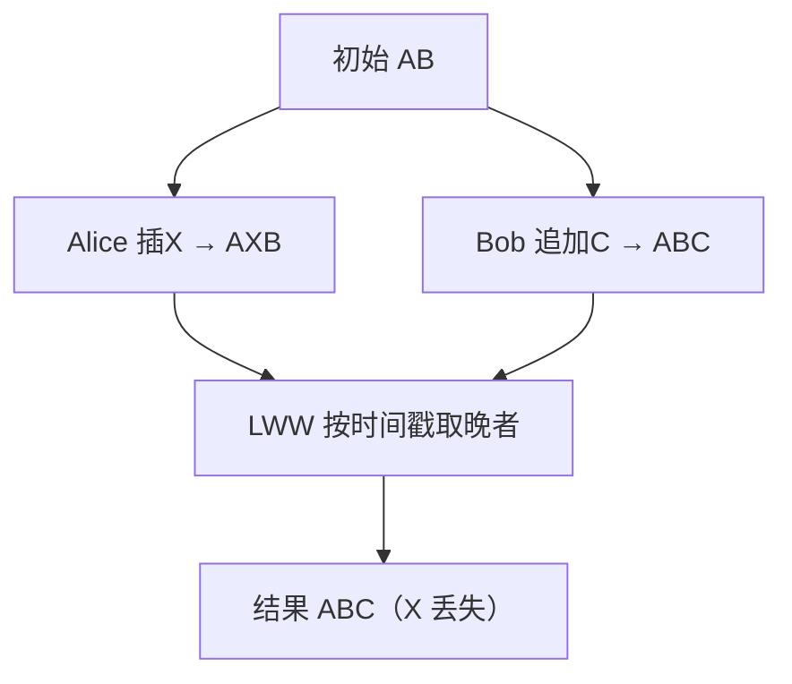
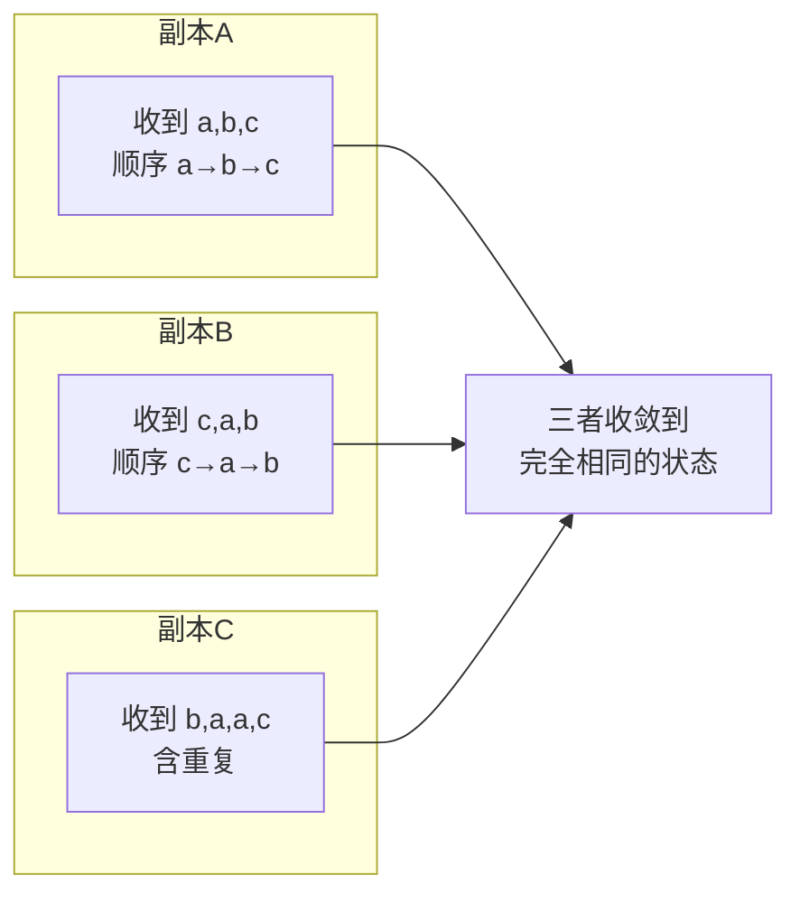
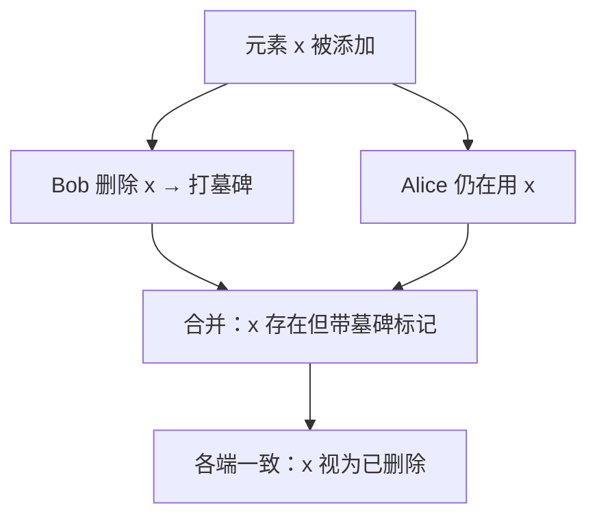
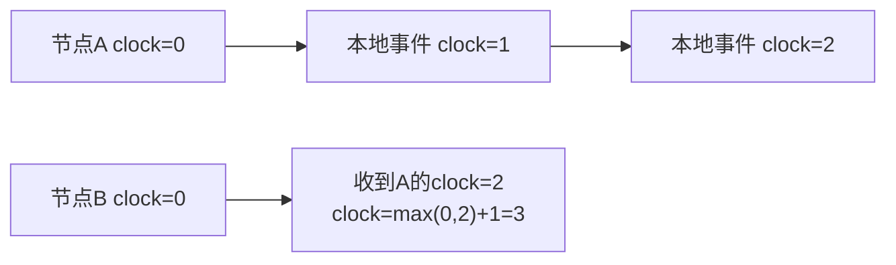

# 第 8 章 CRDT 基础入门

> **所属部分**：第 3 部分 · 编程语言与基础技术 ｜ **难度**：★★★☆☆ ｜ **建议学时**：4 小时 ｜ **前置章节**：第 5 章 ｜ **后续**：第 12 章 CRDT 与 Yjs 原理

---

## 本章导读

AFFiNE 的核心卖点是 **local-first**：断网也能照常编辑，联网后与云端、其他设备、其他协作者自动合并，且**不会出现"你的修改覆盖了我的修改"**。支撑这一切的底层技术叫 **CRDT**（Conflict-free Replicated Data Type，无冲突复制数据类型）。

第 12 章会直接把 CRDT 和 Yjs、y-octo、BlockSuite 的数据模型绑在一起讲——`Y.Doc`、`Y.Map`、YATA 算法、state vector、墓碑 GC……如果你**懂编程、但从没接触过 CRDT 或任何协同算法**，直接读第 12 章会寸步难行：你会被一堆"为什么要这么设计"的前提假设绊住。

本章就是那块垫脚石。它**只讲 CRDT 的通用原理与直觉**，不碰具体库、不读 AFFiNE 源码，把这些细节留给第 12 章。假设你会写普通代码、理解"多个客户端同时改一份数据"这件事大致是什么，本章从**协同编辑到底要解决什么问题**讲起，一路铺到第 12 章的起点。读完你应当能用自己的话说清："为什么简单的'最后写入者赢'不行"、"CRDT 凭什么保证所有人最后看到同一份内容"。

CRDT 的一句话定位：**一类特殊的数据结构，无论各副本以什么顺序、分几批、重复多少次收到彼此的修改，最终都会收敛到完全相同的状态——而且不需要一个中心服务器来裁决**。记住这条，后面很多设计都是围绕它展开的。

---

## 学习目标

- [ ] 能够说清协同编辑要解决的三个问题：并发冲突、离线编辑、最终一致性
- [ ] 能够解释"最后写入者赢（LWW）"为什么在协同文本场景下会丢数据
- [ ] 能够对比 OT 与 CRDT 两种思路的核心差异与各自代价
- [ ] 能够说出 CRDT 依赖的三条代数性质（交换律、结合律、幂等性）及其现实含义
- [ ] 能够区分状态式 CRDT 与操作式 CRDT，知道各自传什么、要求什么
- [ ] 能够描述三类常见 CRDT：计数器、集合（含墓碑）、有序序列（用于文本）
- [ ] 能够说明唯一 ID 与逻辑时钟在 CRDT 中扮演的角色，为第 12 章的 YATA 打底
- [ ] 能够说清 CRDT 的主要代价：元数据膨胀与墓碑堆积

---

## 知识地图



---

## 一、协同编辑要解决什么问题

先把问题说清楚，再谈解法。一个"多人实时协作"的编辑器，至少要同时搞定三件事：

### 并发冲突

两个人（甚至同一个人的两台设备）在**几乎同一时刻**修改同一份文档。谁的改动都不该凭空消失，最终大家看到的内容还得一致。这是最核心的难题。

### 离线编辑

网络不是永远在线的。地铁里、飞机上，用户照样要能打字；等重新联网，离线期间攒下的所有改动要能**自动合并**进来，而不是弹一个"检测到冲突，请手动解决"的对话框。

### 最终一致性（eventual consistency）

分布式系统里有个经典结论：你没法同时拥有"强一致、高可用、分区容忍"。协同编辑选择了**可用性优先**——允许各副本在某一瞬间内容不同（你刚打的字还没传到我这），但承诺：**只要大家最终都收到了彼此全部的修改，就一定收敛到同一份内容**。这叫"最终一致性"。

<div class="tip custom-block">
<p class="custom-block-title">为什么不能靠"锁"</p>
<p>传统做法是加锁：谁要编辑先抢锁，别人只能等。但协同编辑的体验要求是"所有人随时都能自由输入"——加锁等于把实时协作变成排队,离线场景下更是无锁可抢。所以协同编辑必须<strong>允许并发修改先发生，再想办法合并</strong>，而不是预先阻止冲突。</p>
</div>

---

## 二、为什么不能简单"最后写入者赢"

面对并发修改，最朴素的想法是 **LWW（Last-Write-Wins，最后写入者赢）**：给每次修改打个时间戳，合并时谁的时间戳晚就用谁的。

对**单个独立字段**（比如"文档标题""主题色"），LWW 是完全够用的——两个人同时改标题，最后保留一个也合情合理。AFFiNE 里很多原始值属性走的就是这种语义。

但一旦对象是**一段会被同时插入、删除的文本**，LWW 就会灾难性地丢数据。看例子：

```text
初始文本： "AB"
Alice：在位置 1 插入 "X"  →  本地得到 "AXB"
Bob：  同时在末尾追加 "C" →  本地得到 "ABC"
```

如果用"整段文本 + 时间戳"做 LWW 合并，假设 Bob 的时间戳更晚：

```text
最终结果 = Bob 的整段 "ABC"
→ Alice 插入的 "X" 彻底消失了
```

两个人的改动明明**不冲突**（一个在中间插字、一个在末尾加字，完全可以共存为 `"AXBC"`），LWW 却因为"按整段覆盖"而丢掉了一方的全部工作。



<div class="tip custom-block">
<p class="custom-block-title">问题的本质</p>
<p>LWW 把"整个文本"当成一个<strong>不可分割</strong>的值来覆盖，于是合并粒度太粗——两处本可共存的局部修改被当成了"二选一"。真正需要的是<strong>更细粒度、能把双方改动都保留下来</strong>的合并方式。这正是 CRDT 要提供的能力。</p>
</div>

还有一个更隐蔽的问题：**时间戳本身不可靠**。各设备时钟有偏差，离线几小时后的改动时间戳可能比在线设备还"新"或还"旧"，纯靠物理时间排序根本不公平。后面第七节的"逻辑时钟"就是为了绕开这个坑。

---

## 三、OT 与 CRDT：两种思路

既然要"把双方改动都保留、还要各端收敛一致"，业界有两大流派。

### 思路一：OT（操作变换）

**OT（Operational Transformation）** 的想法是：操作照常用"位置下标"表达（`insert(1, "X")`、`delete(1)`），但在应用对方操作前，先根据"我这边已经发生过什么"把对方操作的下标**变换**一下。

比如 Alice 已经在位置 1 插了一个字，那么 Bob 发来的 `delete(3)` 就得顺移成 `delete(4)`，因为 Alice 的插入让后面的字符都右移了一位。OT 把这套"操作遇到操作该如何改写"的规则写成一个个变换函数。

OT 能工作，但变换函数的组合情况极多、极难写对，而且通常**需要一个中心服务器**来给所有操作定一个全局顺序——这和 local-first "随时离线、多端对等"的诉求天然冲突。Google Docs 用的就是 OT。

### 思路二：CRDT（无冲突复制数据类型）

**CRDT** 换了个根本思路：**不再用"位置下标"标识元素，而是给每个元素分配一个全局唯一、永不改变的 ID**，操作引用的是 ID 而不是下标。

"在位置 1 插入 X"会被重新表达成"在 ID 为 `a` 的元素之后插入 X"。无论对方先插了多少字、删了多少字，`a` 这个 ID 始终指向同一个元素，**语义不会随并发操作漂移**。再配合一套所有副本都认同的**确定性排序规则**，不管操作以什么顺序到达，大家算出来的结果都一样——于是"无冲突"。

### 对比

| 维度 | OT（操作变换） | CRDT（无冲突复制） |
| --- | --- | --- |
| 元素标识 | 位置下标 | 全局唯一 ID |
| 合并方式 | 按对方已执行操作**变换**下标 | 引用 ID + 确定性排序 |
| 中心服务器 | 通常需要（定序） | 不需要，任意拓扑都收敛 |
| 离线编辑 | 困难 | 天然支持 |
| 元数据开销 | 小 | 较大（ID、墓碑） |
| 代表 | Google Docs | Yjs、Automerge、y-octo |

<div class="tip custom-block">
<p class="custom-block-title">通往第 12 章</p>
<p>AFFiNE 的 local-first 定位（长时间离线、桌面与手机互同步、多个存储间来回）决定了它<strong>不存在一个随时在线的权威定序者</strong>，所以必须选 CRDT。第 12 章会看到 Yjs 的 YATA 算法正是"给每个字符一个 <code>(clientID, clock)</code> 唯一 ID + 按 clientID 确定性排序"的具体实现。本章把这个思路理解透，到那里就只是"看它怎么落地"而已。</p>
</div>

---

## 四、CRDT 的核心性质：为什么一定会收敛

CRDT 之所以能保证"无论顺序都收敛"，靠的是它的合并操作满足三条**代数性质**。把合并记作 `merge`，三条性质是：

| 性质 | 公式 | 现实含义 |
| --- | --- | --- |
| **交换律** | `merge(a, b) = merge(b, a)` | 先收到谁的改动都一样 |
| **结合律** | `merge(merge(a, b), c) = merge(a, merge(b, c))` | 怎么分组、分几批合并都一样 |
| **幂等性** | `merge(a, a) = a` | 同一份改动收到两次也无妨 |

直觉上这三条分别对应协同网络中三种无法避免的情况：

- **交换律** → 消息到达顺序不可控：Alice 的改动和 Bob 的改动，谁先到我这不一定。
- **结合律** → 消息可能被打包：网络层常把多条改动攒成一批再发，分组方式不该影响结果。
- **幂等性** → 消息可能重传：网络抖动导致同一条改动发了两遍，不能让计数翻倍、文字重复。

满足这三条的结构，在数学上构成一个**半格（semilattice）**。可以证明：**只要所有副本最终收到了相同的"改动集合"，无论以什么顺序、分组、重复，它们都会收敛到完全相同的状态**。这就是 CRDT 给出的强保证——它把"收敛"从"祈祷网络表现良好"变成了"数学上必然"。



<div class="tip custom-block">
<p class="custom-block-title">记住这句话</p>
<p>CRDT 不保证"任何时刻各端都一样"，它保证的是<strong>"收到相同改动集后必然一样"</strong>——顺序、分组、重复都无所谓。第 12 章里 Yjs 的 update 恰好具备这三条，这正是存储层敢"本地攒一批合并再推""服务端把一堆 update 压成快照""网络重传不校验"的理论基础。</p>
</div>

---

## 五、状态式 vs 操作式 CRDT

CRDT 有两种实现风格，区别在于**副本之间到底传什么**。

### 状态式 CRDT（state-based / CvRDT）

每个副本维护一份完整**状态**，同步时直接把**整个状态**发给对方，对方用 `merge` 函数把两份状态合并。

- 要求：`merge` 必须满足前面说的交换/结合/幂等三条。
- 优点：网络可以随便丢包、乱序、重发，只要"最终把状态传过去"就行，非常鲁棒。
- 缺点：状态可能很大，每次传整份很浪费。

### 操作式 CRDT（operation-based / CmRDT）

副本之间只传**增量操作**（"插入了 X""计数 +1"），对方把操作应用到本地。

- 要求：每个操作必须满足交换律（顺序无关），且传输层要保证**不丢、不重**（或操作本身设计成幂等）。
- 优点：每次只发很小的增量，带宽友好。
- 缺点：对传输层要求更高——操作一旦丢了或重复了，没有整份状态来兜底。

### 对比

| 维度 | 状态式（state-based） | 操作式（operation-based） |
| --- | --- | --- |
| 传输内容 | 整个状态 | 单个/一批增量操作 |
| 合并靠 | `merge(状态, 状态)` | `apply(操作)` |
| 对网络要求 | 很低（可丢/乱序/重发） | 较高（需不丢不重或幂等） |
| 带宽 | 大 | 小 |

<div class="tip custom-block">
<p class="custom-block-title">现实中的折中</p>
<p>纯状态式太费带宽、纯操作式对网络太苛刻，所以成熟库（Yjs、Automerge）大多走<strong>混合路线</strong>：平时发操作（增量 update）省带宽，但 update 设计得可乱序、可重复、可任意分组合并——既有操作式的省流，又保留了状态式的鲁棒。第 12 章里 Yjs 的"state vector + diff 同步"就是这种混合思路的典型。</p>
</div>

---

## 六、常见的 CRDT 类型

CRDT 不是单一结构，而是一个"家族"。理解三类最常见的，就能举一反三。

### 6.1 计数器（Counter）

最简单的 CRDT。多个副本都在给同一个数字加减，要求合并后得到正确总和。

朴素做法"每个副本存一个数、合并时相加"会出错：无法区分"真的加了两次"和"同一次加法收到两遍"。正确做法（**G-Counter**，只增计数器）是**每个副本各记各的贡献**：

```text
副本状态 = { A: 3, B: 2, C: 0 }   // 各节点各自加了多少
本副本的计数值 = 所有分量之和 = 5
merge：对每个节点的分量取两边的最大值
```

对同一个节点的分量取 `max` 天然满足交换/结合/幂等——这就是用代数性质"设计"出一个 CRDT 的范例。要支持减法，用两个 G-Counter（一增一减）相减即可，即 **PN-Counter**。

### 6.2 集合（Set）：增、删与墓碑

集合要支持"加元素""删元素"。难点在删除：如果 Alice 删了元素 `x`、Bob 同时又添加了 `x`，并发之下该听谁的？

关键技巧是**不真的物理删除，而是打一个"已删除"的标记——墓碑（tombstone）**。被删的元素仍留在数据里，只是标记为失效。这样：

- 删除变成了"添加一个墓碑标记"，和"添加元素"一样是**单调增长**的操作，天然可交换、可幂等；
- 合并时谁也不会凭空抹掉对方的信息，只是标记叠加，收敛有保证。



<div class="tip custom-block">
<p class="custom-block-title">墓碑是 CRDT 的标志性设计</p>
<p>"删除 = 打标记而非物理移除"会贯穿几乎所有 CRDT。第 12 章会看到 Yjs 删除文本字符时，Item 也不是真的消失，而是被标记为墓碑（因为别人可能还以它为锚点插入），已删除的 ID 区间记在 <code>DeleteSet</code> 里随 update 传输。墓碑带来的膨胀问题，要靠后面说的 GC 来缓解。</p>
</div>

### 6.3 有序序列（Sequence）：文本的基础

这是协同文本最核心、也最难的 CRDT。它要维护一个**有序列表**，支持在任意位置并发插入/删除，且各端收敛到相同顺序。

核心做法前面已经点过：**每个元素（字符）分配一个全局唯一 ID，插入时记录"插在哪个 ID 之后"而非"插在第几位"**。并发插在同一位置时，用一套所有副本都认同的确定性规则（比如比较 ID 大小）决定先后：

```text
初始： A — B            （A、B 各有唯一 ID）
Alice：在 A 之后插 X    （记：origin = A）
Bob：  在 A 之后插 Y    （记：origin = A）
两者 origin 相同 → 按 ID 比较，确定性地排出 A X Y B（或 A Y X B）
关键不在"谁在前"，而在"所有副本排法一致"
```

无论 Alice 的 X 和 Bob 的 Y 以什么顺序到达，因为排序规则是确定的，各端都得到同一个序列——收敛达成。

<div class="tip custom-block">
<p class="custom-block-title">通往第 12 章</p>
<p>这正是 Yjs 的 <strong>YATA</strong> 算法要解决的问题。第 12 章会看到每个字符 Item 带 <code>id = (clientID, clock)</code>、<code>origin</code>（左邻居 ID）、<code>rightOrigin</code>（右邻居 ID），并发冲突时比较 <code>clientID</code> 确定性排序。本章记住"<strong>引用 ID 而非下标 + 确定性排序</strong>"这条主线即可。</p>
</div>

---

## 七、唯一 ID 与逻辑时钟

前面反复提到"全局唯一 ID"和"确定性排序"，这一节把它说透。

### 为什么需要唯一 ID

CRDT 的一切都建立在"每个元素有一个全局唯一、永不改变的身份"之上。有了它：

- 操作可以稳定地引用元素（"在 ID=a 之后插入"），不受并发下标漂移影响；
- 幂等有了依据——收到一个 ID 已存在的元素，直接忽略即可（这就是去重）；
- 删除可以精确打墓碑到具体 ID。

ID 通常由两部分组成：**`(节点标识, 本地计数)`**。节点标识区分是哪个副本产生的（比如每个客户端启动时随机一个编号），本地计数是该副本内部自增的序号。两者组合既保证全局唯一，又能排序。

### 逻辑时钟：绕开物理时间的不可靠

第二节说过物理时间戳不可靠。CRDT 改用**逻辑时钟**——它不关心"几点几分"，只关心**事件之间的先后关系**。最常见的是 **Lamport 时钟**：

```text
- 每个节点维护一个计数器 clock
- 本地每发生一个事件：clock = clock + 1
- 收到对方消息（携带其 clock' ）时：clock = max(clock, clock') + 1
```

这样产生的 `(clock, 节点ID)` 二元组可以给所有事件排出一个**全局一致的顺序**，而且完全不依赖各机器的物理时钟是否对准。并发（互不知晓）的事件则靠节点 ID 来打破平手——保证任意两端排序结果相同。



<div class="tip custom-block">
<p class="custom-block-title">通往第 12 章</p>
<p>Yjs 里字符 Item 的 ID <code>(clientID, clock)</code> 就是这个思路：<code>clientID</code> 是节点标识（Doc 实例的随机编号），<code>clock</code> 是自增逻辑时钟。第 12 章还会讲到 AFFiNE 给 yjs 打的 <code>uint53</code> 补丁——把 clientID 从 32 位扩到 53 位，正是因为"<strong>clientID 碰撞会让两个本是不同的元素被当成同一个</strong>"是 CRDT 的致命问题。本章理解"ID 为什么必须唯一"，到那里就懂补丁的必要性了。</p>
</div>

---

## 八、代价与权衡

CRDT 不是免费午餐。它用额外的空间换来了"无冲突合并"的能力，主要代价有两类。

### 元数据膨胀

为了给每个元素挂唯一 ID、origin、逻辑时钟，CRDT 要存大量**元数据**。一个字符的"净荷"只有 1 字节，但围绕它的 ID、邻居指针等元数据可能是净荷的数倍。对一篇长文档，元数据开销相当可观。

### 墓碑堆积

删除不物理移除、只打墓碑，意味着**删掉的内容仍占着空间**。一个被反复编辑、删了又删的文档，墓碑会越积越多，数据体积只增不减。

### 缓解手段：GC 与快照

成熟实现用两招缓解：

- **垃圾回收（GC）**：在确认某些墓碑再也不会被引用后，安全地真正清除它们；
- **合并压缩 / 快照**：把一长串历史操作合并成一份紧凑的当前状态，丢弃中间过程。

| 代价 | 根因 | 缓解 |
| --- | --- | --- |
| 元数据膨胀 | 每个元素都要挂 ID、时钟、邻居 | 二进制紧凑编码、合并压缩 |
| 墓碑堆积 | 删除只打标记不物理删 | GC 在安全时机回收 |
| 历史无限增长 | 操作只增不减 | 定期生成快照、丢弃旧 update |

<div class="tip custom-block">
<p class="custom-block-title">通往第 12 章</p>
<p>这些权衡在第 12 章会变成具体工程决策：Yjs 默认开 <code>gc: true</code> 回收墓碑让文档更小；AFFiNE 放弃 <code>Y.snapshot</code> 历史方案、改为"服务端定期存整份合并后二进制"；nbstore 的"<strong>写时追加、读时压缩</strong>"把一堆 update 在读取时 <code>mergeUpdates</code> 成一份快照。所有这些，都是在为本章讲的"元数据膨胀 + 墓碑堆积"买单。</p>
</div>

---

## 动手实践

1. **手算一次 LWW 丢数据**：取初始文本 `"HELLO"`，设想 Alice 把它改成 `"HELLO!"`（末尾加感叹号）、Bob 同时改成 `"HELLO WORLD"`。用"整段文本 + 时间戳"的 LWW 合并，写出结果。**验收**：能指出哪一方的改动丢了，并说明"本可共存为 `HELLO WORLD!`"这一点。
2. **用三条性质设计一个计数器**：用纸笔实现 G-Counter——状态是 `{节点: 计数}` 的映射，`merge` 对每个节点取 `max`，计数值为各分量之和。手动模拟三个副本各加几次、乱序+重复地互相合并。**验收**：无论合并顺序与是否重复，三副本最终计数值都相同，并能说出这对应交换/结合/幂等中的哪条。
3. **给集合加墓碑**：设计一个支持增删的集合 CRDT。规定"删除 = 给元素打墓碑"。模拟 Alice 删 `x`、Bob 并发重新添加 `x`，写出合并后状态。**验收**：能说清为什么"删除打墓碑"比"物理删除"更容易满足交换律与幂等。
4. **给序列排并发插入**：初始序列两个元素 `A(id=1)`、`B(id=2)`。Alice 在 A 后插 `X(id=5)`，Bob 在 A 后插 `Y(id=3)`，约定"同一 origin 下按 id 从小到大排"。写出两端各自合并后的最终序列。**验收**：两端结果完全一致，并能解释"收敛靠的是排序规则确定，而非谁先到达"。

---

## 自测题

<details><summary>Q1. 协同编辑要同时解决哪三个问题？</summary>

并发冲突（多端同时改同一数据、谁的改动都不能丢且最终一致）、离线编辑（断网也能改、联网自动合并）、最终一致性（允许某一瞬间各端不同，但收到相同改动集后必然收敛到同一状态）。

</details>

<details><summary>Q2. 为什么"最后写入者赢（LWW）"在协同文本里会丢数据？</summary>

LWW 把整段文本当成一个不可分割的值按时间戳覆盖，合并粒度太粗。两处本可共存的局部修改（如一处插字、一处追加）会被当成"二选一"，导致其中一方的改动被整段覆盖而消失。此外物理时间戳在多设备/离线场景下本身就不可靠。

</details>

<details><summary>Q3. OT 与 CRDT 处理并发的核心差异是什么？</summary>

OT 仍用"位置下标"表达操作，在应用对方操作前按已发生的操作**变换下标**，通常需要中心服务器定序。CRDT 给每个元素分配**全局唯一不变的 ID**，操作引用 ID 而非下标，再配确定性排序规则，不需要中心服务器、天然支持离线。

</details>

<details><summary>Q4. CRDT 依赖哪三条代数性质？各自对应网络中的什么情况？</summary>

交换律（`merge(a,b)=merge(b,a)`）对应消息到达顺序不可控；结合律（分组无关）对应消息可能被打包成批；幂等性（`merge(a,a)=a`）对应消息可能被重传。三者合起来保证：收到相同改动集后，无论顺序、分组、重复，各副本必然收敛到相同状态。

</details>

<details><summary>Q5. 状态式与操作式 CRDT 的区别？各对网络有什么要求？</summary>

状态式传整份状态、用 `merge` 合并，对网络要求极低（可丢、可乱序、可重发），但费带宽；操作式只传增量操作、用 `apply` 应用，省带宽，但要求传输层不丢不重（或操作本身幂等）。成熟库多采用两者混合的折中方案。

</details>

<details><summary>Q6. 为什么 CRDT 删除常用"墓碑"而不是物理删除？</summary>

物理删除难以满足交换律与幂等（并发的"删"与"加"顺序不同会得到不同结果，重复的删除也难处理）。把删除变成"添加一个墓碑标记"后，它和"添加元素"一样是单调增长操作，天然可交换、可幂等，合并时不会凭空抹掉对方信息，收敛有保证。代价是墓碑会堆积，需靠 GC 回收。

</details>

---

## 常见坑

| 现象 | 原因与处理 |
| --- | --- |
| 以为 LWW 时间戳越新越对 | 多设备/离线下物理时钟不可靠；CRDT 用逻辑时钟（Lamport）表达先后，用节点 ID 打破平手 |
| 计数器"简单相加"合并出错 | 无法区分"真加两次"与"同一次收两遍"；应每个节点各记贡献、合并取 max（G-Counter） |
| 删除后数据体积不降反升 | 删除是打墓碑而非物理移除，墓碑只增不减；靠 GC 在安全时机回收、靠快照压缩历史 |
| 并发插入后两端顺序不一致 | 排序规则不确定；CRDT 要求"引用 ID + 所有副本认同的确定性排序"，收敛靠规则而非到达顺序 |
| 以为 CRDT 保证"任何时刻都一致" | CRDT 只保证"收到相同改动集后收敛"；过程中各端允许暂时不同（最终一致性） |
| 把唯一 ID 当成可复用/可变 | ID 必须全局唯一且永不改变；节点标识碰撞会让不同元素被当成同一个，导致内容丢失 |

---

## 延伸阅读

- Marc Shapiro 等《Conflict-free Replicated Data Types》原始论文：半格、状态式/操作式的严格定义
- 第 12 章：CRDT 与 Yjs 原理（YATA 算法、`Y.Doc/Y.Map/Y.Text`、state vector 与 diff 同步、snapshot/GC、AFFiNE 落地）
- 第 5 章：TypeScript 基础入门（本章实验若用代码验证，联合类型与泛型会派上用场）
- Automerge、Yjs 官方文档中"internals"章节：工业级 CRDT 的工程取舍

---

## 本章学时拆分（建议 4 小时）

| 内容 | 时长 |
| --- | --- |
| 协同三问题、为什么 LWW 不够 | 0.75h |
| OT vs CRDT 思路对比 | 0.5h |
| 三条代数性质与收敛 | 1h |
| 状态式 vs 操作式 | 0.5h |
| 常见 CRDT 类型（计数器/集合/序列） | 0.75h |
| 唯一 ID 与逻辑时钟、代价与权衡 | 0.5h |

---

| [← 第 7 章 Rust 基础入门](./07-Rust基础入门.md) | [第 9 章 TypeScript 在 AFFiNE 中的应用 →](./09-TypeScript在AFFiNE中的应用.md) |
| --- | --- |
