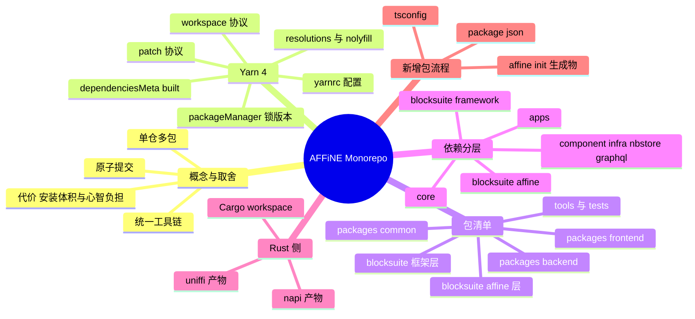
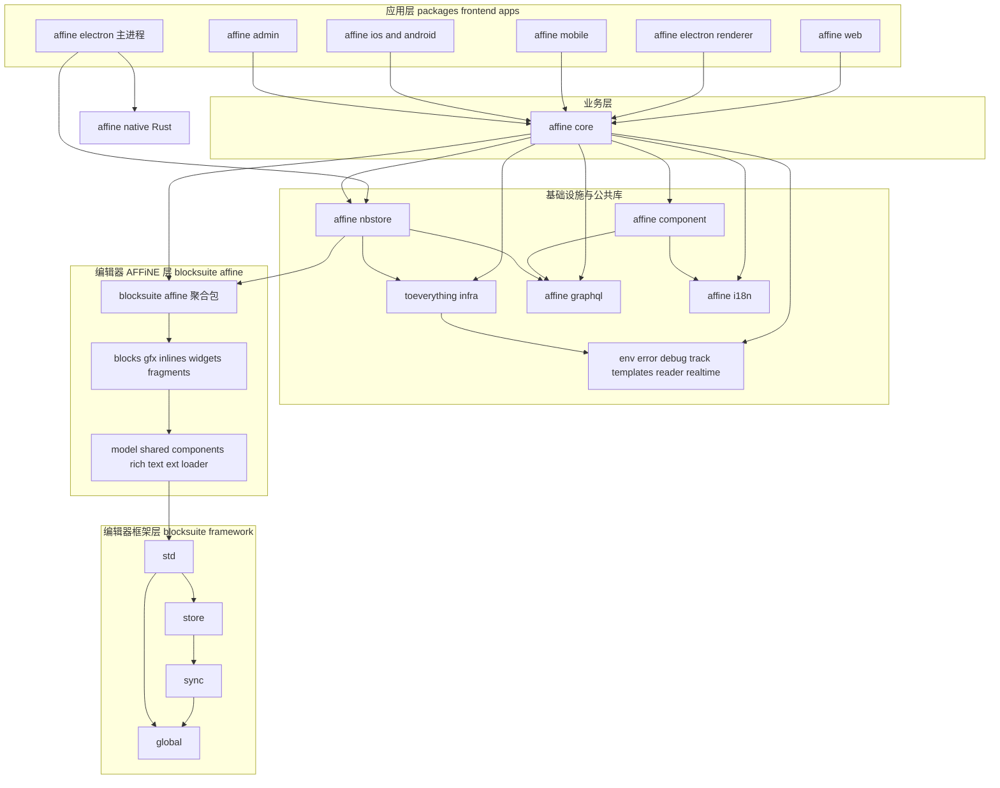
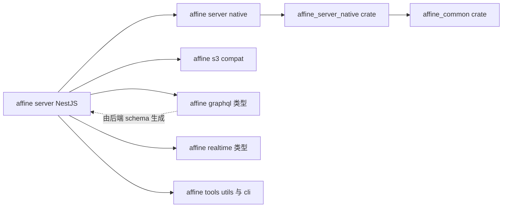
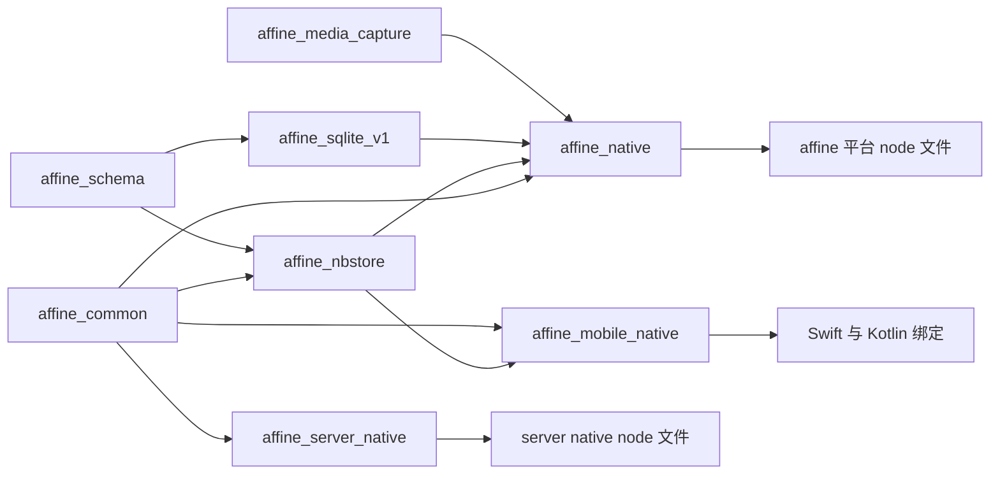

# 第 9 章 Monorepo 结构与包依赖地图

> **所属部分**：第 4 部分 · 工程化与开发环境 ｜ **难度**：★★☆☆☆ ｜ **建议学时**：4 小时 ｜ **前置章节**：第 1 章

## 本章导读

第一次 clone AFFiNE 仓库时，最直观的感受往往是"大"：根目录下有 `blocksuite/`、`packages/`、`tools/`、`tests/`、`docs/` 五个代码区，`yarn workspaces list` 能列出 **122 个 workspace 包**（外加根包 `@affine/monorepo`），同时还有一个由 7 个成员组成的 Rust `Cargo` workspace。如果没有一张"地图"，你很难判断某段代码属于哪一层、改动会影响谁、某个 import 为什么能解析成功。

本章的目标就是帮你画出这张地图。我们会从 Monorepo 的基本概念和取舍讲起，逐行拆解根 `package.json` 与 `.yarnrc.yml`，讲清楚 Yarn 4 的 `workspace:*` 协议、`resolutions` 中 69 条 `@nolyfill/*` 替换与 6 条 `patch:` 补丁、`dependenciesMeta.built` 开关的意图；然后用只读脚本枚举出全部包并给出"包名 | 路径 | 职责"完整表；再根据真实的 `dependencies` 画出前端与后端的分层依赖图；最后讲 Rust crate 与 JS 包的对应关系、命名空间约定、`@blocksuite/affine` 聚合包，以及"新增一个包需要做什么"。

读完本章，你应该能在看到任何一个 import 路径时，迅速定位它在仓库中的位置和所在层级。

## 学习目标

- [ ] 能够说清 Monorepo 相对多仓库（polyrepo）的收益与代价，并解释 AFFiNE 选择 Yarn workspaces + 自研 CLI 的理由
- [ ] 能够逐项解释根 `package.json` 中 `workspaces`、`engines`、`scripts.postinstall`、`resolutions`、`dependenciesMeta` 的作用
- [ ] 能够解读 `.yarnrc.yml` 的每一项配置，并说明 `.yarn/releases`、`.yarn/patches` 为何要提交进仓库
- [ ] 能够用只读命令枚举全部 workspace 包，并按"框架层 / 编辑器层 / 公共层 / 应用层 / 工具层 / 测试层"归类
- [ ] 能够依据真实依赖画出从 `@affine/web` 到 `@blocksuite/global` 的依赖链，以及 `@affine/server` 的依赖链
- [ ] 能够说出 7 个 Cargo workspace 成员各自产出什么、被哪个 JS 包或移动端工程消费
- [ ] 能够独立完成"新增一个 workspace 包"的全部步骤，并知道哪些文件会被自动生成

## 知识地图



## 9.1 Monorepo 是什么，AFFiNE 为什么需要它

### 9.1.1 概念

Monorepo（单体仓库）指**把多个可独立发布或独立构建的项目放在同一个版本库中管理**。注意它和"单体应用（monolith）"是两回事：Monorepo 里的包依旧边界清晰、各自有 `package.json`，只是共享同一份 Git 历史、同一套依赖安装和同一套工具链。

| 维度 | 多仓库（polyrepo） | 单仓库（monorepo） |
| --- | --- | --- |
| 跨包修改 | 需要多个 PR、按顺序发布、再升级版本号 | 一个 PR 原子完成，评审时看到全貌 |
| 依赖版本 | 各仓库容易漂移，出现"钻石依赖" | 根目录统一 `resolutions`，全仓一致 |
| 工具链 | 每个仓库各配一套 lint / tsconfig | 根目录一份 `.oxlintrc.json`、`tsconfig.json` |
| CI | 每个仓库独立、简单 | 需要按路径过滤、分片，配置复杂 |
| 新人上手 | 单仓小，但不知道去哪儿找相关代码 | 仓库大，但"全局搜索"即可找到一切 |
| 安装体积 | 小 | 大（AFFiNE 的 `yarn.lock` 超过 3 万行） |

### 9.1.2 AFFiNE 的特殊性

AFFiNE 有三个特点让 Monorepo 几乎成为必选项：

1. **编辑器与产品同步演进**。BlockSuite 编辑器（`blocksuite/`）曾经是独立仓库，现在被并入主仓库。产品侧需要一个新的块能力时，往往要同时修改 `blocksuite/affine/blocks/*` 与 `packages/frontend/core`，在同一个 PR 里完成最自然。
2. **多端共享同一套业务代码**。Web、Electron、iOS、Android、移动 Web、Admin 后台共用 `@affine/core`，差异只在 `packages/frontend/apps/*` 的入口层。
3. **前后端共享协议**。`@affine/graphql` 的类型由后端 `packages/backend/server/src/schema.gql` 生成，前端直接 import；`@affine/realtime` 定义的实时消息类型被前端和服务端共同引用。

### 9.1.3 AFFiNE 的工具选择

业界常见的 Monorepo 方案有 Nx、Turborepo、pnpm workspaces、Lerna、Rush 等。AFFiNE 选择的是：

- **Yarn 4 workspaces**：负责依赖安装、链接、版本锁定；
- **自研 CLI `@affine-tools/cli`**（`tools/cli`）：负责"按包执行脚本、带依赖执行、自动生成 tsconfig references"等编排工作，第 10 章会详细展开；
- **TypeScript Project References**：根 `tsconfig.json` 的 `references` 由 CLI 自动生成，`yarn typecheck` 即 `tsc -b`。

这种组合的好处是没有引入额外的任务编排框架，所有逻辑都在仓库内可读可改；代价是缓存、增量构建等高级能力需要自己实现或依赖底层工具（rspack、tsc -b）。

**小结**：Monorepo 的核心收益是"原子修改 + 统一治理"，AFFiNE 的多端、多语言、前后端共享协议的特点放大了这个收益。

## 9.2 根 package.json 逐段解剖

根 `package.json` 是整个仓库的"宪法"。我们分段阅读。

### 9.2.1 workspaces：哪些目录算作包

来源：`package.json`

```json
{
  "name": "@affine/monorepo",
  "version": "0.27.5",
  "private": true,
  "workspaces": [
    ".",
    "blocksuite/**/*",
    "packages/*/*",
    "packages/frontend/apps/*",
    "tools/*",
    "docs/reference",
    "tools/@types/*",
    "tests/*"
  ],
  "engines": {
    "node": ">=22.12.0 <23.0.0"
  },
  // ...
}
```

每一条 glob 对应的实际内容如下：

| glob | 匹配到的包 | 说明 |
| --- | --- | --- |
| `.` | `@affine/monorepo` | 根本身也是 workspace，所以根 `devDependencies` 中可以用 `workspace:*` 引用 `@affine-tools/cli` |
| `blocksuite/**/*` | 74 个 `@blocksuite/*` 包 | 递归匹配，`blocksuite/affine/blocks/paragraph` 这种三层目录也能被识别 |
| `packages/*/*` | `packages/backend/*`、`packages/common/*`、`packages/frontend/*` 共 21 个 | 只匹配两层，所以 `packages/frontend/apps` 本身不是包 |
| `packages/frontend/apps/*` | 7 个应用包 | 为 apps 单独开一条 glob |
| `tools/*` | 8 个工具包 | `tools/@types` 目录本身没有 `package.json` |
| `tools/@types/*` | 3 个类型声明包 | `@types/assets`、`@types/build-config`、`@types/affine__env` |
| `docs/reference` | `@affine/docs` | typedoc 生成的 API 参考 |
| `tests/*` | 8 个 `@affine-test/*` 包 | `tests/fixtures` 没有 `package.json`，只是测试素材目录 |

> 注意：没有 `package.json` 的目录即使被 glob 匹配到也不会成为 workspace。例如 `packages/common/native` 是一个纯 Rust crate，它只出现在 `Cargo.toml` 的 workspace 中。

`engines.node` 把 Node 版本卡死在 22.x，配合根目录 `.nvmrc`（内容为 `22.23.4`）和 `.npmrc` 中的 `engine-strict=true`，可以尽早暴露版本不匹配的问题。

### 9.2.2 scripts：根脚本只做"转发"

来源：`package.json`

```json
"scripts": {
  "affine": "r affine.ts",
  "af": "r affine.ts",
  "dev": "yarn affine dev",
  "build": "yarn affine build",
  "lint:format": "oxfmt --check .",
  "lint:format:fix": "oxfmt --write .",
  "lint:ox": "oxlint --deny-warnings",
  "lint:ox:fix": "yarn lint:ox --fix",
  "lint": "yarn lint:ox && yarn lint:format",
  "lint:fix": "yarn lint:ox:fix && yarn lint:format:fix",
  "test": "vitest --run",
  "test:ui": "vitest --ui",
  "test:coverage": "vitest run --coverage",
  "typecheck": "tsc -b tsconfig.json --verbose",
  "postinstall": "yarn affine init && yarn husky"
},
```

几个关键点：

- `r` 是 `@affine-tools/cli` 在 `tools/cli/package.json` 的 `bin` 字段里声明的可执行文件（`"r": "./bin/runner.js"`），它负责"用合适的 TS 加载器运行一个 `.ts` 文件"。`r affine.ts` 最终会找到 `tools/cli/src/affine.ts`。
- `dev`/`build` 只是 `yarn affine dev`/`yarn affine build` 的别名，真正的逻辑在 CLI 里。
- `postinstall` 会在每次 `yarn install` 之后执行 `yarn affine init`（重新生成 workspace 元信息与 tsconfig references）和 `yarn husky`（安装 Git 钩子）。这意味着**你新增或删除一个包之后，只要再跑一次 `yarn install`，相关生成物就会自动更新**。

### 9.2.3 根 devDependencies：全仓共享的工具

根 `devDependencies` 中放的是全仓共用的工具：`oxlint`、`oxfmt`、`vitest`、`@playwright/test`、`husky`、`lint-staged`、`typescript`、`electron` 等。值得注意的有两条：

来源：`package.json`

```json
"@typescript/native": "npm:typescript@7.0.2",
// ...
"typescript": "npm:@typescript/typescript6@6.0.2",
```

这是 Yarn 的 **npm 别名协议**：`"typescript"` 这个名字实际安装的是 `@typescript/typescript6@6.0.2`，而 `@typescript/native` 这个名字安装的是 `typescript@7.0.2`。仓库借此同时持有两个大版本的 TypeScript，便于渐进迁移。别名协议在 `resolutions` 里也被大量使用，下一节会看到。

**小结**：根 `package.json` 定义了"哪些目录是包"、"Node 版本"、"全仓工具"，并通过 `postinstall` 把 CLI 的代码生成挂进安装流程。

## 9.3 Yarn 4：packageManager、.yarnrc.yml 与 .yarn 目录

### 9.3.1 packageManager 字段与 yarnPath

根 `package.json` 末尾有：

```json
"packageManager": "yarn@4.18.0",
```

Node 自带的 Corepack 读取这个字段，确保你在仓库里敲 `yarn` 时用的是 4.18.0，而不是全局装的 Yarn 1。与此同时 `.yarnrc.yml` 中的 `yarnPath` 指向仓库内提交的 Yarn 二进制，双保险。

CI 里专门有一个 job 校验两者一致。

来源：`.github/workflows/build-test.yml`

```yaml
  check-yarn-binary:
    name: Check yarn binary
    runs-on: ubuntu-latest
    steps:
      - uses: actions/checkout@v7
      - name: Run check
        run: |
          set -euo pipefail
          yarn_version="$(node -e "console.log(require('./package.json').packageManager.split('@')[1])")"
          yarn set version "$yarn_version"
          git diff --exit-code
```

逻辑是：读取 `packageManager` 中的版本号，执行 `yarn set version`，如果 `.yarn/releases/` 或 `.yarnrc.yml` 因此产生 diff，说明有人只改了一处，CI 失败。

### 9.3.2 .yarnrc.yml 逐项解读

来源：`.yarnrc.yml`

```yaml
approvedGitRepositories:
  - "https://github.com/electron/node-gyp.git"
  - "https://github.com/locize/html-parse-stringify2.git"

compressionLevel: mixed

enableGlobalCache: true

enableScripts: false

nmMode: hardlinks-local

nodeLinker: node-modules

npmAuthToken: "${NPM_TOKEN:-NONE}"

npmPublishAccess: public

npmRegistryServer: "https://registry.npmjs.org"

yarnPath: .yarn/releases/yarn-4.18.0.cjs
```

| 配置项 | 值 | 含义与 AFFiNE 的考量 |
| --- | --- | --- |
| `approvedGitRepositories` | 两个 Git 仓库 | 允许从这两个 Git 地址安装依赖，其余 Git 依赖会被拒绝，是供应链安全的白名单 |
| `compressionLevel` | `mixed` | 缓存 zip 的压缩策略，在体积与速度之间折中 |
| `enableGlobalCache` | `true` | 包缓存放在用户级全局目录，多个 clone 共享，仓库内不保留离线缓存目录 |
| `enableScripts` | `false` | **默认不执行第三方包的 install 脚本**（postinstall 等），降低供应链攻击面与安装耗时 |
| `nmMode` | `hardlinks-local` | 在 node-modules 链接模式下，同一项目内相同文件用硬链接，节省磁盘 |
| `nodeLinker` | `node-modules` | 不使用 Yarn PnP，而是传统 `node_modules` 布局，兼容 Electron、Prisma、原生模块等生态 |
| `npmAuthToken` | `${NPM_TOKEN:-NONE}` | 发布时从环境变量读取 token，本地无变量时为 `NONE` |
| `npmPublishAccess` | `public` | 公开发布（`@blocksuite/*` 是要发布到 npm 的） |
| `yarnPath` | `.yarn/releases/yarn-4.18.0.cjs` | 使用仓库内的 Yarn 二进制 |

`nodeLinker: node-modules` 是一个重要的取舍：PnP 更快更严格，但 Electron 打包、Prisma 引擎、`.node` 原生模块对 `node_modules` 目录结构有强假设。`docs/building-desktop-client-app.md` 还专门提到打包桌面端时要切换 `nmMode classic` 与 `nmHoistingLimits workspaces`，CI 的 `.github/actions/setup-node/action.yml` 也提供了对应的输入参数。

### 9.3.3 .yarn 目录里该提交什么

`ls .yarn` 可以看到三样东西：`.yarn/releases/yarn-4.18.0.cjs`（Yarn 二进制）、`.yarn/patches/`（8 个 `.patch` 文件）和 `.yarn/install-state.gz`。对照 `.gitignore`：

来源：`.gitignore`

```gitignore
.pnp.*
.yarn/*
!.yarn/patches
!.yarn/plugins
!.yarn/releases
!.yarn/sdks
.yarn/versions
```

即：`.yarn/` 下默认全部忽略，只有 `patches`（补丁文件）、`releases`（Yarn 二进制）等是需要提交的；`install-state.gz` 是本地安装状态缓存，不提交。

**小结**：Yarn 版本被 `packageManager` + `yarnPath` + CI 三重锁定；`enableScripts: false` 与 `approvedGitRepositories` 体现了对供应链安全的重视；`node-modules` 链接器是为 Electron 与原生模块做出的兼容性选择。

## 9.4 依赖协议与依赖治理

### 9.4.1 workspace:* 协议

在任意子包的 `package.json` 中，引用另一个 workspace 包都写成 `workspace:*`：

来源：`packages/common/infra/package.json`

```json
{
  "name": "@toeverything/infra",
  "type": "module",
  "private": true,
  "sideEffects": false,
  "exports": {
    "./storage": "./src/storage/index.ts",
    "./utils": "./src/utils/index.ts",
    "./app-config-storage": "./src/app-config-storage.ts",
    "./op": "./src/op/index.ts",
    "./atom": "./src/atom/index.ts",
    ".": "./src/index.ts"
  },
  "dependencies": {
    "@affine/debug": "workspace:*",
    "@affine/env": "workspace:*",
    "@affine/error": "workspace:*",
    "@affine/templates": "workspace:*",
    // ...
  },
  // ...
}
```

`workspace:*` 告诉 Yarn："这个依赖必须来自本仓库的 workspace，不要去 npm 下载"。安装后，`node_modules/@affine/debug` 是一个指向 `packages/common/debug` 的符号链接。

这里还有一个对理解整个仓库**至关重要**的细节：`exports` 直接指向 `./src/*.ts` 源码，而不是 `dist/`。也就是说，**AFFiNE 内部绝大多数包是"源码直连"的**：消费方（rspack、vitest、tsc）直接编译依赖包的 TS 源码，不需要先 build 依赖包。这大幅简化了开发流程——改了 `@toeverything/infra` 的代码，`@affine/web` 的 dev server 立刻能感知到。

### 9.4.2 resolutions：全仓版本仲裁

根 `package.json` 的 `resolutions` 共有 **104 条**，可以分为三类：

| 类别 | 条数 | 示例 | 目的 |
| --- | --- | --- | --- |
| `@nolyfill/*` 替换 | 69 | `"has": "npm:@nolyfill/has@^1"` | 用零依赖实现替换老旧 polyfill |
| `patch:` 补丁 | 6 | `"yjs": "patch:yjs@npm%3A13.6.21#~/.yarn/patches/..."` | 修改第三方包源码 |
| 版本钉住 / 安全升级 | 其余 | `"ws@npm:^8.18.0": "^8.21.0"`、`"tar": "^7.5.21"` | 统一版本、修复安全漏洞 |

**为什么要大量替换为 @nolyfill？** 很多老牌 npm 包（如 eslint 插件生态、一些 Node 工具）为了兼容 ES5 时代的运行时，会依赖 `array-includes`、`object.assign`、`has-symbols`、`function-bind` 这类 polyfill 包。这些包有两个问题：

1. 在 Node 22 与现代浏览器中，对应的原生 API 早已存在，polyfill 纯属多余；
2. 它们彼此依赖，形成庞大的依赖树，拖慢安装、增大 `node_modules`，也扩大了供应链攻击面。

[nolyfill](https://github.com/SukkaW/nolyfill) 提供了一组同名替身包，内部直接调用原生实现，几乎零依赖。通过 Yarn 的 npm 别名协议 `npm:@nolyfill/xxx@^1`，可以在不修改任何上游包的情况下全局替换。

来源：`package.json`（`resolutions` 节选）

```json
"array-includes": "npm:@nolyfill/array-includes@^1",
"function-bind": "npm:@nolyfill/function-bind@^1",
"has-symbols": "npm:@nolyfill/has-symbols@^1",
"object.assign": "npm:@nolyfill/object.assign@^1",
"safe-buffer": "npm:@nolyfill/safe-buffer@^1",
// ...
"macos-alias": "npm:@napi-rs/macos-alias@0.0.4",
"fs-xattr": "npm:@napi-rs/xattr@latest",
// ...
"ws@npm:^8.18.0": "^8.21.0",
"ws@npm:~8.17.1": "^8.21.0",
```

后两组展示了另外两种写法：`macos-alias`、`fs-xattr` 被替换为 napi-rs 实现的版本（避免 node-gyp 编译）；`ws@npm:^8.18.0` 这种"带范围的 key"只覆盖特定范围的请求，用于把有安全问题的旧版本统一升级。

### 9.4.3 patch: 协议与补丁文件

`patch:` 协议允许在安装时对第三方包打补丁。以 yjs 为例：

来源：`.yarn/patches/yjs-npm-13.6.21-c9f1f3397c.patch`

```diff
diff --git a/dist/yjs.cjs b/dist/yjs.cjs
--- a/dist/yjs.cjs
+++ b/dist/yjs.cjs
@@ -416,7 +416,7 @@ const equalDeleteSets = (ds1, ds2) => {
-const generateNewClientId = random__namespace.uint32;
+const generateNewClientId = random__namespace.uint53;
// ...
```

这个补丁把 Yjs 文档的 `clientId` 生成从 32 位随机数扩大到 53 位，显著降低多端协作时 clientId 碰撞的概率（第 8 章讲过，Yjs 用 clientId + clock 唯一标识每个操作）。`yarn.lock` 中可以看到最终解析结果为 `yjs@patch:yjs@npm%3A13.6.21#~/.yarn/patches/yjs-npm-13.6.21-c9f1f3397c.patch`，即**全仓所有 yjs 引用都被统一到打过补丁的 13.6.21**。

补丁不一定都写在根目录。以下三个补丁是在子包的依赖中直接声明的：

| 子包 | 依赖 | 补丁文件 |
| --- | --- | --- |
| `packages/frontend/core/package.json` | `tinykeys` | `.yarn/patches/tinykeys-npm-2.1.0-819feeaed0.patch` |
| `packages/frontend/apps/electron/package.json` | `@electron-forge/core` | `.yarn/patches/@electron-forge-core-npm-7.11.1-b6ae130da1.patch` |
| `packages/backend/server/package.json` | `@nestjs/testing` | `.yarn/patches/@nestjs-testing-npm-11.1.18-32c0f6af12.patch` |

制作补丁的标准流程是 `yarn patch <pkg>` → 修改临时目录中的文件 → `yarn patch-commit -s <dir>`，Yarn 会自动生成 `.patch` 文件并改写 `package.json`。

### 9.4.4 dependenciesMeta.built：逐包控制构建脚本

`.yarnrc.yml` 全局设置了 `enableScripts: false`，但有些第三方包**必须**执行安装脚本才能工作（比如下载平台相关的二进制）。根 `package.json` 用 `dependenciesMeta` 做逐包声明：

来源：`package.json`

```json
"dependenciesMeta": {
  "@apollo/protobufjs": { "built": false },
  "@prisma/client": { "built": true },
  "@prisma/engines": { "built": true },
  "@scarf/scarf": { "built": false },
  "@sentry/cli": { "built": true },
  "@swc/core": { "built": false },
  "core-js": { "built": false },
  "electron-winstaller": { "built": true },
  "esbuild": { "built": true },
  "msgpackr-extract": { "built": false },
  "msw": { "built": false },
  "prisma": { "built": false },
  "protobufjs": { "built": false },
  "unrs-resolver": { "built": false }
},
```

（原文件每项占三行，此处为排版合并。）

可以这样理解：

- `built: true` 的包——`@prisma/client`、`@prisma/engines`（需要生成客户端/下载查询引擎）、`@sentry/cli`（下载 CLI 二进制）、`esbuild`（校验平台二进制）、`electron-winstaller`——是**明确放行**需要运行构建脚本的少数包；
- `built: false` 的包——`core-js`（安装时只打印赞助广告）、`@scarf/scarf`（安装统计）、`@swc/core`、`msw` 等——是**明确声明不需要**运行脚本，即使将来全局开关变化也不会执行。

> workspace 自身的脚本不受 `enableScripts` 影响。例如 `packages/frontend/templates/package.json` 中的 `"postinstall": "yarn build"`、`packages/backend/server/package.json` 中的 `"postinstall": "prisma generate"` 都会在安装时执行。具体语义请以 Yarn 官方文档对 `enableScripts` 与 `dependenciesMeta` 的说明为准。

### 9.4.5 依赖去重检查

CI 的 lint job 末尾有一步：

来源：`.github/workflows/build-test.yml`

```yaml
      - name: Yarn Dedupe
        run: yarn dedupe --check
```

`yarn dedupe --check` 会检查 `yarn.lock` 中是否存在可以合并的重复版本。如果你升级依赖后忘了 dedupe，CI 会失败，本地执行 `yarn dedupe` 即可修复。

**小结**：`workspace:*` 让内部包源码直连；`resolutions` 以 nolyfill、补丁、范围覆盖三种手段对全仓依赖做仲裁；`dependenciesMeta` 在"默认禁用脚本"的安全基线上做白名单放行。

## 9.5 全量包清单：122 个 workspace 一览

### 9.5.1 用只读脚本枚举

最权威的方式是让 Yarn 自己列出来：

```bash
# 列出所有 workspace（含根包），每行一个 JSON
yarn workspaces list --json

# 统计数量（结果为 123 行 = 122 个包 + 根包）
yarn workspaces list --json | wc -l

# 带上 workspace 间依赖（CLI 内部就是用这个命令生成 workspace.gen.ts）
yarn workspaces list -v --json | head -5
```

如果不想依赖 Yarn，也可以用 Node 直接读取 `package.json`：

```bash
node -e '
const fs=require("fs"),path=require("path");
function walk(d){for(const e of fs.readdirSync(d,{withFileTypes:true})){
  if(!e.isDirectory()||["node_modules","dist","lib","src"].includes(e.name)||e.name.startsWith("."))continue;
  const p=path.join(d,e.name),pj=path.join(p,"package.json");
  if(fs.existsSync(pj)){const j=require("./"+pj);console.log(`${j.name} | ${p} | ${j.description||""}`)}
  walk(p);}}
["blocksuite","packages","tools","tests","docs"].forEach(walk);'
```

> 第二种方式会多扫出 `packages/frontend/apps/electron/scripts/package.json`（内容只有 `{"type":"module"}`，没有 `name`），它不在 workspaces glob 范围内，只是为了让该目录下的脚本按 ESM 解析。这也说明了**以 `yarn workspaces list` 为准**的重要性。

CLI 把这份清单固化成了一个生成文件：

来源：`tools/utils/src/yarn.ts`

```ts
export const yarnList = once(() => {
  const output = exec('', 'yarn workspaces list -v --json', { silent: true });

  let packageList = JSON.parse(
    `[${output.trim().replace(/\r\n|\n/g, ',')}]`
  ) as YarnWorkspaceItem[];

  packageList.forEach(p => {
    p.location = p.location.replaceAll(/\\/g, '/');
    delete p['mismatchedWorkspaceDependencies'];
  });

  // ignore root package
  return packageList.filter(p => p.location !== '.');
});
```

`yarn affine init` 调用它并写入 `tools/utils/src/workspace.gen.ts`，其中导出 `PackageList`（每个包的 `location`、`name`、`workspaceDependencies`）和联合类型 `PackageName`。CLI 的参数校验、别名映射都基于这个文件。

### 9.5.2 完整清单

**A. BlockSuite 框架层（`blocksuite/framework/*`，4 个）**

| 包名 | 路径 | 职责 |
| --- | --- | --- |
| `@blocksuite/global` | `blocksuite/framework/global` | 最底层公共工具：DI 容器、异常、gfx 基础类型、disposable、lit 工具 |
| `@blocksuite/sync` | `blocksuite/framework/sync` | 数据同步引擎的抽象与实现 |
| `@blocksuite/store` | `blocksuite/framework/store` | 文档数据层：Schema、Block 模型、基于 Yjs 的 Doc/Workspace、Transformer |
| `@blocksuite/std` | `blocksuite/framework/std` | 视图层标准库：EditorHost、命令、事件、选区、扩展机制、gfx |

**B. BlockSuite AFFiNE 基础层（8 个）**

| 包名 | 路径 | 职责 |
| --- | --- | --- |
| `@blocksuite/affine` | `blocksuite/affine/all` | 聚合包，按子路径 re-export 全部 affine 能力（见 9.8） |
| `@blocksuite/affine-model` | `blocksuite/affine/model` | AFFiNE 所有块与 gfx 元素的数据模型定义 |
| `@blocksuite/affine-shared` | `blocksuite/affine/shared` | 共享的服务、工具函数、主题、类型 |
| `@blocksuite/affine-components` | `blocksuite/affine/components` | 可复用 UI 组件（按钮、菜单、工具栏元素等） |
| `@blocksuite/affine-rich-text` | `blocksuite/affine/rich-text` | 富文本与 inline 编辑基础 |
| `@blocksuite/affine-foundation` | `blocksuite/affine/foundation` | 基础扩展集合 |
| `@blocksuite/affine-ext-loader` | `blocksuite/affine/ext-loader` | 扩展加载器，按 store/view 两侧注册扩展 |
| `@blocksuite/data-view` | `blocksuite/affine/data-view` | 数据库视图（表格、看板）的通用视图层 |

**C. 块（`blocksuite/affine/blocks/*`，20 个，包名统一为 `@blocksuite/affine-block-<目录名>`）**

| 包名 | 路径 | 职责 |
| --- | --- | --- |
| `@blocksuite/affine-block-attachment` | `blocksuite/affine/blocks/attachment` | 附件块 |
| `@blocksuite/affine-block-bookmark` | `blocksuite/affine/blocks/bookmark` | 书签（链接卡片）块 |
| `@blocksuite/affine-block-callout` | `blocksuite/affine/blocks/callout` | 标注块 |
| `@blocksuite/affine-block-code` | `blocksuite/affine/blocks/code` | 代码块 |
| `@blocksuite/affine-block-data-view` | `blocksuite/affine/blocks/data-view` | 数据视图块 |
| `@blocksuite/affine-block-database` | `blocksuite/affine/blocks/database` | 数据库块 |
| `@blocksuite/affine-block-divider` | `blocksuite/affine/blocks/divider` | 分割线块 |
| `@blocksuite/affine-block-edgeless-text` | `blocksuite/affine/blocks/edgeless-text` | 白板文本块 |
| `@blocksuite/affine-block-embed` | `blocksuite/affine/blocks/embed` | 外部嵌入块（YouTube、Figma 等） |
| `@blocksuite/affine-block-embed-doc` | `blocksuite/affine/blocks/embed-doc` | 文档嵌入块（linked/synced doc） |
| `@blocksuite/affine-block-frame` | `blocksuite/affine/blocks/frame` | 白板 Frame 块 |
| `@blocksuite/affine-block-image` | `blocksuite/affine/blocks/image` | 图片块 |
| `@blocksuite/affine-block-latex` | `blocksuite/affine/blocks/latex` | LaTeX 公式块 |
| `@blocksuite/affine-block-list` | `blocksuite/affine/blocks/list` | 列表块 |
| `@blocksuite/affine-block-note` | `blocksuite/affine/blocks/note` | Note 容器块 |
| `@blocksuite/affine-block-paragraph` | `blocksuite/affine/blocks/paragraph` | 段落块 |
| `@blocksuite/affine-block-root` | `blocksuite/affine/blocks/root` | 根块（page/edgeless 根视图） |
| `@blocksuite/affine-block-surface` | `blocksuite/affine/blocks/surface` | 白板画布 Surface 块 |
| `@blocksuite/affine-block-surface-ref` | `blocksuite/affine/blocks/surface-ref` | 在文档中引用白板区域 |
| `@blocksuite/affine-block-table` | `blocksuite/affine/blocks/table` | 简单表格块 |

**D. Fragments（4 个）、Gfx（11 个）、Inlines（7 个）**

| 包名 | 路径 | 职责 |
| --- | --- | --- |
| `@blocksuite/affine-fragment-adapter-panel` | `blocksuite/affine/fragments/adapter-panel` | 适配器（导入导出）调试面板 |
| `@blocksuite/affine-fragment-doc-title` | `blocksuite/affine/fragments/doc-title` | 文档标题片段 |
| `@blocksuite/affine-fragment-frame-panel` | `blocksuite/affine/fragments/frame-panel` | Frame 列表面板 |
| `@blocksuite/affine-fragment-outline` | `blocksuite/affine/fragments/outline` | 大纲面板 |
| `@blocksuite/affine-gfx-brush` | `blocksuite/affine/gfx/brush` | 白板画笔 |
| `@blocksuite/affine-gfx-connector` | `blocksuite/affine/gfx/connector` | 白板连线 |
| `@blocksuite/affine-gfx-group` | `blocksuite/affine/gfx/group` | 白板分组 |
| `@blocksuite/affine-gfx-link` | `blocksuite/affine/gfx/link` | 白板链接元素 |
| `@blocksuite/affine-gfx-mindmap` | `blocksuite/affine/gfx/mindmap` | 思维导图 |
| `@blocksuite/affine-gfx-note` | `blocksuite/affine/gfx/note` | 白板上的 note 交互 |
| `@blocksuite/affine-gfx-pointer` | `blocksuite/affine/gfx/pointer` | 指针/选择工具 |
| `@blocksuite/affine-gfx-shape` | `blocksuite/affine/gfx/shape` | 形状 |
| `@blocksuite/affine-gfx-template` | `blocksuite/affine/gfx/template` | 白板模板 |
| `@blocksuite/affine-gfx-text` | `blocksuite/affine/gfx/text` | 白板文本元素 |
| `@blocksuite/affine-gfx-turbo-renderer` | `blocksuite/affine/gfx/turbo-renderer` | 视口加速渲染器 |
| `@blocksuite/affine-inline-comment` | `blocksuite/affine/inlines/comment` | 行内评论 |
| `@blocksuite/affine-inline-footnote` | `blocksuite/affine/inlines/footnote` | 行内脚注 |
| `@blocksuite/affine-inline-latex` | `blocksuite/affine/inlines/latex` | 行内公式 |
| `@blocksuite/affine-inline-link` | `blocksuite/affine/inlines/link` | 行内链接 |
| `@blocksuite/affine-inline-mention` | `blocksuite/affine/inlines/mention` | @提及 |
| `@blocksuite/affine-inline-preset` | `blocksuite/affine/inlines/preset` | 行内能力预设组合 |
| `@blocksuite/affine-inline-reference` | `blocksuite/affine/inlines/reference` | 文档引用 |

**E. Widgets（16 个，包名统一为 `@blocksuite/affine-widget-<目录名>`）**

| 包名 | 路径 | 职责 |
| --- | --- | --- |
| `@blocksuite/affine-widget-drag-handle` | `blocksuite/affine/widgets/drag-handle` | 块拖拽手柄 |
| `@blocksuite/affine-widget-edgeless-auto-connect` | `blocksuite/affine/widgets/edgeless-auto-connect` | 白板自动连接提示 |
| `@blocksuite/affine-widget-edgeless-dragging-area` | `blocksuite/affine/widgets/edgeless-dragging-area` | 白板框选区域 |
| `@blocksuite/affine-widget-edgeless-selected-rect` | `blocksuite/affine/widgets/edgeless-selected-rect` | 白板选中框 |
| `@blocksuite/affine-widget-edgeless-toolbar` | `blocksuite/affine/widgets/edgeless-toolbar` | 白板底部工具栏 |
| `@blocksuite/affine-widget-edgeless-zoom-toolbar` | `blocksuite/affine/widgets/edgeless-zoom-toolbar` | 白板缩放工具栏 |
| `@blocksuite/affine-widget-frame-title` | `blocksuite/affine/widgets/frame-title` | Frame 标题 |
| `@blocksuite/affine-widget-keyboard-toolbar` | `blocksuite/affine/widgets/keyboard-toolbar` | 移动端键盘工具栏 |
| `@blocksuite/affine-widget-linked-doc` | `blocksuite/affine/widgets/linked-doc` | 链接文档弹出菜单 |
| `@blocksuite/affine-widget-note-slicer` | `blocksuite/affine/widgets/note-slicer` | Note 切分 |
| `@blocksuite/affine-widget-page-dragging-area` | `blocksuite/affine/widgets/page-dragging-area` | 文档模式框选 |
| `@blocksuite/affine-widget-remote-selection` | `blocksuite/affine/widgets/remote-selection` | 协作者远程选区 |
| `@blocksuite/affine-widget-scroll-anchoring` | `blocksuite/affine/widgets/scroll-anchoring` | 滚动锚定 |
| `@blocksuite/affine-widget-slash-menu` | `blocksuite/affine/widgets/slash-menu` | 斜杠命令菜单 |
| `@blocksuite/affine-widget-toolbar` | `blocksuite/affine/widgets/toolbar` | 通用浮动工具栏 |
| `@blocksuite/affine-widget-viewport-overlay` | `blocksuite/affine/widgets/viewport-overlay` | 视口覆盖层 |

**F. BlockSuite 其他（4 个）**

| 包名 | 路径 | 职责 |
| --- | --- | --- |
| `@blocksuite/integration-test` | `blocksuite/integration-test` | 编辑器浏览器集成测试（Vitest 浏览器模式） |
| `@blocksuite/playground` | `blocksuite/playground` | Vite 驱动的编辑器演练场，也是 BlockSuite E2E 的被测应用 |
| `@blocksuite/bs-docs` | `blocksuite/docs` | typedoc 生成的 BlockSuite API 文档 |
| `@blocksuite/docs` | `blocksuite/docs-site` | BlockSuite 文档站点 |

**G. 后端（`packages/backend/*`，2 个）**

| 包名 | 路径 | 职责 |
| --- | --- | --- |
| `@affine/server` | `packages/backend/server` | NestJS 服务端：GraphQL、WebSocket、认证、存储、AI 等 |
| `@affine/server-native` | `packages/backend/native` | 服务端 Rust 原生模块（napi-rs），产物 `server-native.node` |

**H. 公共层（`packages/common/*`，10 个）**

| 包名 | 路径 | 职责 |
| --- | --- | --- |
| `@toeverything/infra` | `packages/common/infra` | 前端基础设施：DI Framework、LiveData、Op 通信、存储抽象 |
| `@affine/nbstore` | `packages/common/nbstore` | 存储与同步引擎（IndexedDB、SQLite、云端），含 Worker 端 |
| `@affine/graphql` | `packages/common/graphql` | 由 schema 自动生成的 GraphQL 类型与查询，及 fetcher |
| `@affine/env` | `packages/common/env` | 运行环境探测、全局常量、worker URL 等 |
| `@affine/error` | `packages/common/error` | 统一错误类型与处理工具 |
| `@affine/debug` | `packages/common/debug` | 基于 `debug` 的日志封装 |
| `@affine/auth` | `packages/common/auth` | 认证 token 刷新协调（token broker） |
| `@affine/reader` | `packages/common/reader` | 不启动编辑器即可读取 BlockSuite 格式 YDoc（可打包给 Node 侧使用） |
| `@affine/realtime` | `packages/common/realtime` | 前后端共享的实时请求/主题类型定义 |
| `@affine/s3-compat` | `packages/common/s3-compat` | 轻量 S3 兼容存储客户端，供服务端使用 |

**I. 前端非应用层（`packages/frontend/*`，9 个）**

| 包名 | 路径 | 职责 |
| --- | --- | --- |
| `@affine/core` | `packages/frontend/core` | 产品核心业务：模块、页面、组件、编辑器集成，所有端共享 |
| `@affine/component` | `packages/frontend/component` | 设计系统与通用 React 组件库 |
| `@affine/i18n` | `packages/frontend/i18n` | 多语言资源与 i18n 代码生成 |
| `@affine/track` | `packages/frontend/track` | 埋点、遥测与 Sentry 集成 |
| `@affine/routes` | `packages/frontend/routes` | 由 `routes.json` 生成的类型安全路由常量 |
| `@affine/templates` | `packages/frontend/templates` | 白板模板、贴纸、onboarding 数据（安装时生成） |
| `@affine/native` | `packages/frontend/native` | 桌面端 Rust 原生模块（napi-rs），产物 `affine.<平台>.node` |
| `@affine/electron-api` | `packages/frontend/electron-api` | 渲染进程调用 Electron 主进程/helper 的类型化 API 声明 |
| `@affine/admin` | `packages/frontend/admin` | 自托管管理后台（React + Tailwind） |

**J. 应用层（`packages/frontend/apps/*`，7 个）**

| 包名 | 路径 | 职责 |
| --- | --- | --- |
| `@affine/web` | `packages/frontend/apps/web` | Web 端入口 |
| `@affine/electron-renderer` | `packages/frontend/apps/electron-renderer` | 桌面端渲染进程入口（app/shell/popup/background-worker） |
| `@affine/electron` | `packages/frontend/apps/electron` | 桌面端主进程、helper 进程、preload 与打包 |
| `@affine/mobile` | `packages/frontend/apps/mobile` | 移动 Web 入口 |
| `@affine/ios` | `packages/frontend/apps/ios` | iOS 应用（Capacitor） |
| `@affine/android` | `packages/frontend/apps/android` | Android 应用（Capacitor） |
| `@affine/mobile-shared` | `packages/frontend/apps/mobile-shared` | iOS 与 Android 共享的认证、nbstore 适配代码 |

**K. 工具（`tools/*` 与 `tools/@types/*`，11 个）**

| 包名 | 路径 | 职责 |
| --- | --- | --- |
| `@affine-tools/cli` | `tools/cli` | `yarn affine` 命令行，打包与脚本编排 |
| `@affine-tools/utils` | `tools/utils` | CLI 共享工具：Workspace/Package 模型、Path、Logger、构建配置 |
| `@affine/commitlint-config` | `tools/commitlint` | commitlint 依赖与 `.commitlintrc.json`，供 CI 校验 PR 标题 |
| `@affine/changelog` | `tools/changelog` | 从版本变化生成 changelog |
| `@affine/copilot-result` | `tools/copilot-result` | 把 Copilot 测试结果发送到 Slack |
| `@affine/doc-diff` | `tools/doc-diff` | 对比 Yjs 快照文档（rootdoc/folder/favorite） |
| `@affine/revert-update` | `tools/revert-update` | 从两个 Yjs 快照生成回滚 update |
| `@affine/playstore-auto-bump` | `tools/playstore-auto-bump` | 自动递增 Android 版本号 |
| `@types/assets` | `tools/@types/assets` | 静态资源模块的类型声明 |
| `@types/build-config` | `tools/@types/build-config` | 全局 `BUILD_CONFIG` 的类型声明 |
| `@types/affine__env` | `tools/@types/env` | 全局环境变量的类型声明 |

**L. 测试（`tests/*`，8 个）与文档（1 个）**

| 包名 | 路径 | 职责 |
| --- | --- | --- |
| `@affine-test/kit` | `tests/kit` | E2E 公共工具与 fixtures（Playwright、Electron、mobile） |
| `@affine-test/affine-local` | `tests/affine-local` | Web 本地模式 E2E |
| `@affine-test/affine-cloud` | `tests/affine-cloud` | Web + 本地服务端 E2E |
| `@affine-test/affine-cloud-copilot` | `tests/affine-cloud-copilot` | AI Copilot E2E |
| `@affine-test/affine-desktop` | `tests/affine-desktop` | 桌面端 E2E |
| `@affine-test/affine-desktop-cloud` | `tests/affine-desktop-cloud` | 桌面端 + 服务端 E2E |
| `@affine-test/affine-mobile` | `tests/affine-mobile` | 移动 Web E2E |
| `@affine-test/blocksuite` | `tests/blocksuite` | 基于 playground 的编辑器 E2E |
| `@affine/docs` | `docs/reference` | typedoc 生成的 AFFiNE API 参考 |

合计：A 4 + B 8 + C 20 + D 22 + E 16 + F 4 + G 2 + H 10 + I 9 + J 7 + K 11 + L 9 = **122**。

**小结**：用 `yarn workspaces list --json` 为准枚举包；按目录可以快速判断层级——`blocksuite/framework` 是编辑器内核，`blocksuite/affine` 是 AFFiNE 风格的编辑器能力，`packages/common` 是前后端通用库，`packages/frontend` 是产品前端，`packages/backend` 是服务端。

## 9.6 分层依赖图：依据真实 dependencies 绘制

下表是用只读脚本从各包 `package.json` 中提取的 `workspace:*` 依赖（含 dependencies、devDependencies、peerDependencies，`bs:` 表示 `@blocksuite/affine-` 前缀）：

| 包 | workspace 依赖 |
| --- | --- |
| `@affine/web` | component, core, env, nbstore, track, infra |
| `@affine/electron-renderer` | component, core, debug, electron-api, i18n, nbstore, track, `@blocksuite/affine`, infra |
| `@affine/electron` | `@affine-tools/cli`, `@affine-tools/utils`, auth, i18n, native, nbstore, infra |
| `@affine/mobile` | component, core, env, nbstore, track, `@blocksuite/affine`, infra |
| `@affine/ios` / `@affine/android` | component, core, env, i18n, mobile-shared, nbstore, track, `@blocksuite/affine`, infra 等 |
| `@affine/admin` | component, core, error, graphql, routes |
| `@affine/core` | component, debug, electron-api, env, error, graphql, i18n, nbstore, reader, templates, track, infra, `@blocksuite/affine`, bs:block-root, bs:components, bs:shared, bs:ext-loader, `@blocksuite/data-view`, `@blocksuite/global`, `@blocksuite/std` |
| `@affine/component` | debug, error, graphql, i18n, `@affine-tools/utils` |
| `@affine/nbstore` | reader, realtime, infra, error, graphql, `@blocksuite/affine` |
| `@toeverything/infra` | debug, env, error, templates |
| `@affine/graphql` | debug, error |
| `@affine/error` | graphql（peerDependencies） |
| `@affine/env` | templates, `@blocksuite/affine` |
| `@affine/reader` | `@blocksuite/affine` |
| `@blocksuite/affine` | 全部 64 个 `@blocksuite/affine-*` 与 data-view、global、std、store、sync |
| `@blocksuite/affine-block-paragraph`（代表） | bs:components, bs:ext-loader, bs:gfx-turbo-renderer, bs:inline-preset, bs:model, bs:rich-text, bs:shared, global, std, store |
| `@blocksuite/affine-shared` | bs:model, global, std, store |
| `@blocksuite/std` | global, store |
| `@blocksuite/store` | global, sync |
| `@blocksuite/sync` | global |
| `@affine/server` | s3-compat, server-native, graphql, realtime, `@affine-tools/cli`, `@affine-tools/utils` |

### 9.6.1 前端分层图



读图要点：

1. **单向依赖**：上层可以依赖下层，下层绝不依赖上层。`@blocksuite/*` 完全不知道 `@affine/core` 的存在，这使得 BlockSuite 可以独立发布。
2. **core 是汇聚点**：几乎所有应用都只依赖 `core` + 少量基础库，平台差异被压缩在 apps 层。
3. **nbstore 依赖编辑器**：`@affine/nbstore` 依赖 `@blocksuite/affine`，因为索引、文档解析需要理解块结构。
4. **`@affine/error` 与 `@affine/graphql` 的关系**：`graphql` 把 `error` 列为 dependencies，而 `error` 把 `graphql` 列为 **peerDependencies**，避免形成硬性循环依赖。

### 9.6.2 后端分层图



后端只依赖少量 workspace 包；其中 `@affine/graphql` 是"反向生成"的：后端代码生成 `packages/backend/server/src/schema.gql`，前端的 `@affine/graphql` 再根据它生成 TS 类型（第 10 章）。后端 import `@affine/graphql` 主要用于测试中复用查询语句（如 `packages/backend/server/src/__tests__/e2e/user/account.spec.ts` 中的 `getCurrentUserQuery`）。

### 9.6.3 CLI 对依赖图的约束

依赖图不只是"约定"，CLI 在构建 Workspace 模型时会强制检查：

来源：`tools/utils/src/workspace.ts`

```ts
class ForbiddenPackageRefError extends Error {
  constructor(
    public currentName: string,
    public refName: string
  ) {
    super(
      `Public package cannot reference private package. Found '${refName}' in dependencies of '${currentName}'`
    );
  }
}
// ...
        if (building.has(dep.name)) {
          throw new CircularDependenciesError(dep.name);
        }

        if (!pkg.packageJson.private && dep.packageJson.private) {
          throw new ForbiddenPackageRefError(pkg.name, dep.name);
        }
```

两条硬规则：

- **禁止循环依赖**：发现环会打印 `Circular dependencies found: a -> b -> a` 并退出；
- **公开包不得依赖私有包**：`@blocksuite/*` 没有 `private: true`（要发布到 npm），所以它们绝不能依赖 `@affine/*`（全部 `private: true`）。这从机制上保证了 BlockSuite 的独立性。

此外 `.oxlintrc.json` 为 `packages/**`、`tools/**`、`blocksuite/**` 开启了 `import-x-js/no-extraneous-dependencies`，**import 了却没在 `package.json` 声明的依赖会直接报错**，从而保证上面的依赖表是"真实"的。

**小结**：AFFiNE 的依赖图是一条清晰的五层单向链：apps → core → 公共库 → blocksuite affine → blocksuite framework；CLI 与 lint 规则共同守护这张图。

## 9.7 Rust 侧：Cargo workspace 与 JS 包的对应

根目录的 `Cargo.toml` 定义了 Rust workspace：

来源：`Cargo.toml`

```toml
[workspace]
members = [
  "./packages/backend/native",
  "./packages/common/native",
  "./packages/frontend/mobile-native",
  "./packages/frontend/native",
  "./packages/frontend/native/nbstore",
  "./packages/frontend/native/schema",
  "./packages/frontend/native/sqlite_v1",
]
resolver = "3"

  [workspace.package]
  edition = "2024"

  [workspace.dependencies]
  aes-gcm = "0.10"
  affine_common = { path = "./packages/common/native" }
  # ...
  affine_nbstore = { path = "./packages/frontend/native/nbstore" }
  # ...
  napi = { version = "3.7.0", features = [
    "async",
    "chrono_date",
    "error_anyhow",
    "napi9",
    "serde",
  ] }
  napi-build = { version = "2" }
  napi-derive = { version = "3.4" }
  # ...
  uniffi = "0.29"
```

`[workspace.dependencies]` 是 Cargo 的"版本集中声明"，作用与 Yarn `resolutions` 类似：成员 crate 写 `napi = { workspace = true }` 即可继承统一版本。工具链版本由 `rust-toolchain.toml`（`channel = "1.97.1"`）固定。

| Cargo 成员 | crate 名 | crate-type | 产物 / 消费者 |
| --- | --- | --- | --- |
| `packages/backend/native` | `affine_server_native` | `cdylib` | napi 产物 `server-native.node`，由 JS 包 `@affine/server-native` 的 `index.js` 加载，供 `@affine/server` 使用 |
| `packages/frontend/native` | `affine_native` | `cdylib`, `rlib` | napi 产物 `affine.<平台三元组>.node`（`napi.binaryName = "affine"`），由 `@affine/native` 加载，供 Electron 主进程使用 |
| `packages/frontend/native/nbstore` | `affine_nbstore` | `cdylib`, `rlib` | 本地 SQLite 存储实现，被 `affine_native`（开启 `napi` feature）与 `affine_mobile_native` 复用 |
| `packages/frontend/native/sqlite_v1` | `affine_sqlite_v1` | `cdylib`, `rlib` | 旧版 SQLite 格式兼容，被 `affine_native` 引用 |
| `packages/frontend/native/schema` | `affine_schema` | lib | README 说明：在 native 与其 `build.rs` 之间共享 schema 的临时 crate |
| `packages/frontend/mobile-native` | `affine_mobile_native` | `cdylib`, `staticlib` | 通过 uniffi 生成 Swift/Kotlin 绑定，被 iOS（`packages/frontend/apps/ios/App/App/uniffi/affine_mobile_native.swift`）和 Android（`packages/frontend/apps/android/App/app/build.gradle`）引用，**没有对应的 npm 包** |
| `packages/common/native` | `affine_common` | lib | 前后端共享的 Rust 公共能力（如 hashcash），含 `packages/common/native/benches/hashcash.rs` |

另外 `packages/frontend/native/media_capture`（crate 名 `affine_media_capture`）没有列在 `members` 中，而是被 `affine_native` 以 `path = "./media_capture"` 引用——Cargo 会把位于 workspace 目录内的 path 依赖自动视为 workspace 成员。



JS 包与 Rust crate 共用同一个目录（如 `packages/frontend/native` 下既有 `package.json` 也有 `Cargo.toml`），`package.json` 的 `build` 脚本调用 `napi build`：

来源：`packages/frontend/native/package.json`

```json
  "scripts": {
    "artifacts": "napi artifacts",
    "build": "napi build -p affine_native --platform --release",
    "build:debug": "napi build -p affine_native --platform",
    "universal": "napi universal",
    "test": "ava --no-worker-threads --concurrency=2",
    "version": "napi version"
  },
```

所以 `yarn affine @affine/native build` 本质上就是在该目录执行 `napi build -p affine_native --platform --release`。这一点在第 7 章讲 NAPI-rs 时已有铺垫，第 10、11 章会继续使用。

**小结**：Rust workspace 共 7 个显式成员（加 1 个隐式 path 成员），产出两类二进制：napi 的 `.node`（给 Node/Electron）与 uniffi 的静态/动态库（给 iOS/Android）。

## 9.8 命名空间约定与 @blocksuite/affine 聚合包

### 9.8.1 命名空间

| 命名空间 | 含义 | 是否发布 npm |
| --- | --- | --- |
| `@blocksuite/*` | 编辑器框架与 AFFiNE 编辑器能力 | 是（未标记 private，`.yarnrc.yml` 中 `npmPublishAccess: public`） |
| `@affine/*` | AFFiNE 产品代码（前端、后端、公共库、部分工具） | 否（全部 `private: true`） |
| `@toeverything/infra` | 历史沿用的前端基础设施包名（toeverything 是 AFFiNE 背后的组织） | 否 |
| `@affine-tools/*` | 仓库内部工具链（cli、utils） | 否 |
| `@affine-test/*` | E2E 测试包 | 否 |
| `@types/*` | 位于 `tools/@types` 的全局类型声明，被根 `tsconfig.json` 的 `typeRoots` 引用 | 否 |

`@types/affine__env` 采用了 DefinitelyTyped 的命名惯例：scoped 包 `@affine/env` 的类型包名是 `@types/affine__env`。

CLI 还为常用包提供了**短别名**：

来源：`tools/utils/src/distribution.ts`

```ts
export const AliasToPackage = new Map<string, PackageName>([
  ['admin', '@affine/admin'],
  ['web', '@affine/web'],
  ['electron', '@affine/electron'],
  ['desktop', '@affine/electron-renderer'],
  ['renderer', '@affine/electron-renderer'],
  ['mobile', '@affine/mobile'],
  ['ios', '@affine/ios'],
  ['android', '@affine/android'],
  ['server', '@affine/server'],
  ['gql', '@affine/graphql'],
  ...PackageList.map(
    pkg => [pkg.name.split('/').pop()!, pkg.name] as [string, PackageName]
  ),
]);
```

除了手写的 10 个别名，每个包名斜杠后的部分都自动成为别名，所以 `yarn affine server dev`、`yarn affine gql build`、`yarn affine i18n build`、`yarn affine bs-docs build` 都是合法的。

### 9.8.2 @blocksuite/affine 聚合包

`blocksuite/affine/all` 的 `package.json` 有 **207 个 `exports` 子路径**，它自身几乎没有逻辑，只做 re-export：

来源：`blocksuite/affine/all/src/blocks/paragraph/index.ts`

```ts
export * from '@blocksuite/affine-block-paragraph';
```

来源：`blocksuite/affine/all/src/std/index.ts`

```ts
export * from '@blocksuite/std';
```

于是消费方可以写 `import { ... } from '@blocksuite/affine/blocks/paragraph'`、`'@blocksuite/affine/std'`、`'@blocksuite/affine/store'`，而不必在自己的 `package.json` 中逐个声明 70 个依赖。在 `packages/frontend/core/src` 中统计 import 来源，`'@blocksuite/affine...'` 出现约 1000 次，直接 import `@blocksuite/affine-shared`、`@blocksuite/std` 等子包的只有几十次。

聚合包的设计意图：

1. **对外稳定入口**：BlockSuite 内部拆包、合包不影响消费方的 import 路径；
2. **依赖声明简化**：消费方只需声明一个 `@blocksuite/affine`；
3. **配合 tree-shaking**：每个块都是独立子路径，加上 `sideEffects` 声明，打包器可以只打进用到的部分。

代价是聚合包本身的 `exports` 需要随子包变化同步维护，且 `@blocksuite/affine` 的 `index.ts` 只有 `export {}`，**不能从根路径直接 import 任何东西**，必须用子路径。

**小结**：命名空间区分了"发布与否"和"职责归属"；短别名提升 CLI 使用体验；`@blocksuite/affine` 以子路径 re-export 的方式成为编辑器能力的统一门面。

## 9.9 新增一个包需要做什么

假设我们要在 `packages/common` 下新增一个纯 TS 工具包 `@affine/hello`。

### 步骤 1：创建目录与 package.json

目录必须落在某条 workspaces glob 之内，`packages/common/hello` 匹配 `packages/*/*`。参照 `packages/common/error/package.json` 的最小结构：

来源：`packages/common/error/package.json`

```json
{
  "name": "@affine/error",
  "version": "0.27.5",
  "private": true,
  "type": "module",
  "exports": {
    ".": "./src/index.ts"
  },
  "peerDependencies": {
    "@affine/graphql": "workspace:*",
    "graphql": "^16.9.0"
  },
  "devDependencies": {
    "vitest": "^4.1.11"
  }
}
```

要点：`private: true`、`type: module`、`version` 与仓库一致、`exports` 指向源码。

### 步骤 2：创建 tsconfig.json

参照 `packages/common/infra/tsconfig.json`，继承根目录的 `tsconfig.web.json`（浏览器环境）或 `tsconfig.node.json`（Node 环境）：

来源：`packages/common/infra/tsconfig.json`

```json
{
  "extends": "../../../tsconfig.web.json",
  "include": ["./src"],
  "compilerOptions": {
    "types": ["build-config", "affine__env", "node"],
    "rootDir": "./src",
    "outDir": "./dist",
    "tsBuildInfoFile": "./dist/tsconfig.tsbuildinfo"
  },
  "references": [
    { "path": "../debug" },
    { "path": "../env" },
    { "path": "../error" }
  ]
}
```

`references` 不需要手写，下一步会自动生成。注意 `@toeverything/infra` 依赖了 `@affine/templates`，但 references 中没有它——因为 `templates` 没有 `tsconfig.json`，不是 TS project，CLI 自动跳过了。

### 步骤 3：在消费方声明依赖并安装

在需要使用它的包中加入 `"@affine/hello": "workspace:*"`，然后在根目录执行 `yarn install`。`postinstall` 会触发 `yarn affine init`：

来源：`tools/cli/src/init.ts`

```ts
  async generateWorkspaceFiles() {
    this.workspace = new Workspace(yarnList());
    const filesToGenerate: [Path, (prev: string) => string][] = [
      [this.workspace.join('tsconfig.json'), this.genProjectTsConfig],
      [
        this.workspace
          .getPackage('@affine-tools/utils')
          .join('src/workspace.gen.ts'),
        this.genWorkspaceInfo,
      ],
      [this.workspace.join('.oxlintrc.json'), this.genOxlintConfig],
      ...this.workspace.packages
        .filter(p => p.isTsProject)
        .map(
          p =>
            [
              p.join('tsconfig.json'),
              this.genPackageTsConfig.bind(this, p),
            ] satisfies [Path, (prev: string) => string]
        ),
    ];
    // ...
  }
```

它会更新四类文件：

| 文件 | 变化 |
| --- | --- |
| 根 `tsconfig.json` | `references` 中加入 `./packages/common/hello` |
| `tools/utils/src/workspace.gen.ts` | `PackageList` 与 `PackageName` 联合类型加入新包 |
| `.oxlintrc.json` | `ignorePatterns` 与 `.prettierignore` 同步 |
| 各 TS 包的 `tsconfig.json` | `references` 按 workspace 依赖重算，消费方会引用新包 |

### 步骤 4：提交生成物并通过 CI

CI 的 `check-git-status` job 会重新执行 `yarn affine init && yarn affine gql build && yarn affine i18n build && yarn affine server genconfig`，若产生 diff 就失败。因此**生成物必须和源码一起提交**。

### 步骤 5（按需）：其他登记

- 如果希望 PR 标题能用新的 scope（如 `feat(hello): ...`），需要在 `tools/commitlint/.commitlintrc.json` 的 `scope-enum` 中加入；
- 如果它需要单元测试，`*.spec.ts` 放在 `packages/common/**` 下会被根 `vitest.config.ts` 的 include 自动收集（第 25 章）；
- 如果它需要被 rspack 打包为独立产物，需要在 `tools/cli/src/bundle-shared.ts` 的 `RSPACK_SUPPORTED_PACKAGES` 与 `tools/cli/src/bundle.ts` 中登记（目前只有 admin、web、mobile、ios、android、electron-renderer、server、reader）。

**小结**：新增包的核心是"放对目录 + 写对 package.json/tsconfig + 跑 yarn install + 提交生成物"，其余登记按需进行。

## 源码导读清单

| 优先级 | 路径 | 阅读重点 |
| --- | --- | --- |
| P0 | `package.json` | workspaces、scripts、resolutions、dependenciesMeta、packageManager |
| P0 | `.yarnrc.yml` | nodeLinker、enableScripts、nmMode、yarnPath |
| P0 | `tools/utils/src/workspace.ts` | Workspace 模型、循环依赖与公开/私有包检查 |
| P0 | `tools/cli/src/init.ts` | `yarn affine init` 生成哪些文件 |
| P0 | `Cargo.toml` | Rust workspace 成员与集中依赖 |
| P1 | `tools/utils/src/yarn.ts` | 如何调用 `yarn workspaces list -v --json` |
| P1 | `tools/utils/src/workspace.gen.ts` | 自动生成的包列表与依赖关系 |
| P1 | `tools/utils/src/distribution.ts` | 包短别名与 distribution 映射 |
| P1 | `blocksuite/affine/all/package.json` | 207 个子路径 exports 的聚合方式 |
| P1 | `packages/frontend/core/package.json` | 业务核心包的依赖全貌 |
| P1 | `tsconfig.json` | 根 references 与 paths |
| P2 | `.yarn/patches/yjs-npm-13.6.21-c9f1f3397c.patch` | 一个真实补丁的样子 |
| P2 | `packages/frontend/native/package.json` | napi 配置与构建脚本 |
| P2 | `packages/frontend/mobile-native/Cargo.toml` | uniffi 移动端 crate |
| P2 | `.github/workflows/build-test.yml` | `check-yarn-binary`、`check-git-status`、`yarn dedupe --check` |

## 动手实践

### 练习 1：枚举并分类全部 workspace 包

- **目标**：亲手得到 122 个包的清单并按顶层目录统计。
- **步骤**：
  ```bash
  yarn workspaces list --json | wc -l
  yarn workspaces list --json | node -e '
  let s="";process.stdin.on("data",d=>s+=d).on("end",()=>{
    const m={};for(const l of s.trim().split("\n")){const {location}=JSON.parse(l);
    const k=location.split("/").slice(0,2).join("/");m[k]=(m[k]||0)+1}
    console.table(m)})'
  ```
- **验收标准**：输出 123 行；分类表中 `blocksuite/affine` 为 66、`blocksuite/framework` 为 4、`packages/common` 为 10、`packages/frontend` 为 16（9 个非应用包 + 7 个 apps），`tests/*` 各占 1 行合计 8。

### 练习 2：追踪一条依赖链

- **目标**：验证 `@affine/web` 最终依赖到 `@blocksuite/global`。
- **步骤**：
  ```bash
  node -e 'for (const p of ["packages/frontend/apps/web","packages/frontend/core","blocksuite/affine/all","blocksuite/framework/std","blocksuite/framework/store"]) {
    const j=require("./"+p+"/package.json");
    console.log(j.name, "=>", Object.keys({...j.dependencies,...j.devDependencies}).filter(k=>/^@(affine|blocksuite|toeverything)/.test(k)).join(", "))}'
  yarn why @blocksuite/global | head -20
  ```
- **验收标准**：能写出 `@affine/web → @affine/core → @blocksuite/affine → @blocksuite/std → @blocksuite/store → @blocksuite/global` 这条链。

### 练习 3：读懂 resolutions 的三类条目

- **目标**：统计 resolutions 构成并解释一条补丁。
- **步骤**：
  ```bash
  node -e 'const r=require("./package.json").resolutions;const v=Object.values(r);
  console.log({total:v.length,nolyfill:v.filter(x=>x.includes("@nolyfill")).length,patch:v.filter(x=>x.startsWith("patch:")).length})'
  grep -n '^"yjs@' yarn.lock
  head -20 .yarn/patches/yjs-npm-13.6.21-c9f1f3397c.patch
  ```
- **验收标准**：得到 `{ total: 104, nolyfill: 69, patch: 6 }`；能口头解释 yjs 补丁改了什么、为什么。

### 练习 4：观察 CLI 的约束（只读推演）

- **目标**：理解"公开包不能依赖私有包"规则。
- **步骤**：阅读 `tools/utils/src/workspace.ts` 的 `buildDeps`，再执行：
  ```bash
  node -e 'for (const p of ["blocksuite/framework/std","packages/frontend/core","packages/common/infra"]) {const j=require("./"+p+"/package.json");console.log(j.name,"private=",!!j.private)}'
  ```
- **验收标准**：能回答"如果在 `@blocksuite/std` 的 dependencies 中加入 `@affine/debug`，`yarn affine init` 会报什么错"（答：`Public package cannot reference private package`）。**不要真的修改文件**。

### 练习 5：对照 Rust 与 JS

- **目标**：建立 crate 与 npm 包的映射。
- **步骤**：
  ```bash
  for d in packages/backend/native packages/frontend/native packages/frontend/mobile-native packages/common/native; do
    echo "== $d"; grep -m1 '^name' $d/Cargo.toml; ls $d/package.json 2>/dev/null || echo "无 package.json"; done
  ```
- **验收标准**：能说出哪两个 crate 有对应的 npm 包、哪两个没有，以及原因。

## 自测题

1. 根 `package.json` 的 workspaces 中为什么要单独写一条 `packages/frontend/apps/*`？
2. `enableScripts: false` 会阻止 `packages/backend/server` 的 `postinstall: prisma generate` 执行吗？`dependenciesMeta` 中 `@prisma/engines` 为什么是 `built: true`？
3. 解释 `"has": "npm:@nolyfill/has@^1"` 这一行用了 Yarn 的哪种协议，起到什么作用。
4. AFFiNE 内部包的 `exports` 大多指向 `./src/*.ts`，这对开发体验和构建流程分别有什么影响？
5. 为什么 `@blocksuite/std` 不能依赖 `@affine/debug`？这个约束由哪段代码保证？
6. `@affine/error` 与 `@affine/graphql` 互相引用，为什么没有触发循环依赖错误？
7. `affine_mobile_native` 为什么没有对应的 npm 包？它的产物给谁用？
8. 从 `@blocksuite/affine` 的根路径 `import { X } from '@blocksuite/affine'` 能拿到东西吗？为什么？
9. 新增一个包后，哪些文件会被 `yarn affine init` 自动修改？不提交会怎样？
10. `yarn affine gql build` 中的 `gql` 是怎么被解析成 `@affine/graphql` 的？

<details><summary>参考答案</summary>

1. 因为 `packages/*/*` 只匹配两层，`packages/frontend/apps` 本身不是包，其下的 `web`、`electron` 等在第三层，需要额外 glob 才能被识别。
2. 不会。`enableScripts` 只影响第三方依赖，workspace 自身脚本照常执行（以 Yarn 文档为准）。`@prisma/engines` 需要在安装时下载/准备查询引擎二进制，所以显式放行 `built: true`。
3. npm 别名协议 `npm:<name>@<range>`：所有对 `has` 的依赖都会被解析为 `@nolyfill/has`，用零依赖的原生实现替换老旧 polyfill，减小依赖树与攻击面。
4. 开发时改动依赖包立即生效、无需预构建；构建时由消费方的 rspack/vitest/tsc 统一编译所有源码，因此 SWC 配置（装饰器版本等）需要全仓一致。
5. `@blocksuite/std` 是公开包（无 `private`），`@affine/debug` 是私有包；`tools/utils/src/workspace.ts` 的 `buildDeps` 会抛出 `ForbiddenPackageRefError`。
6. `@affine/error` 把 `@affine/graphql` 声明为 `peerDependencies`，而非 dependencies，因此不构成 CLI 统计的硬依赖环。
7. 它通过 uniffi 生成 Swift/Kotlin 绑定，以 `cdylib`/`staticlib` 形式链接进 iOS/Android 原生工程，不通过 Node 加载，所以无需 npm 包。
8. 不能。`blocksuite/affine/all/src/index.ts` 只有 `export {}`，必须使用 `@blocksuite/affine/blocks/paragraph` 这类子路径。
9. 根 `tsconfig.json`、`tools/utils/src/workspace.gen.ts`、`.oxlintrc.json`、各 TS 包的 `tsconfig.json`。不提交会导致 CI 的 `check-git-status` 失败。
10. `tools/utils/src/distribution.ts` 的 `AliasToPackage` 手动登记了 `['gql', '@affine/graphql']`；此外每个包名斜杠后的部分也自动成为别名。

</details>

## 常见坑与排错

| 现象 | 原因 | 处理 |
| --- | --- | --- |
| `yarn -v` 显示 `1.22.x` | 未启用 Corepack，使用了全局 Yarn 1 | `corepack enable` 后在仓库内重新执行 |
| 新建包后 `yarn affine xxx` 报 "not one of" 参数校验失败 | `workspace.gen.ts` 未更新 | 执行 `yarn install` 或 `yarn affine init` |
| `import-x-js/no-extraneous-dependencies` 报错 | import 了未在 `package.json` 声明的包 | 在当前包补充 `workspace:*` 或 npm 依赖 |
| `Circular dependencies found` 并退出 | 新增依赖形成环 | 按打印出的链路拆分，或改为 peerDependencies/类型导入 |
| CI `Yarn Dedupe` 失败 | 升级依赖后 lock 中有可合并的重复版本 | 本地 `yarn dedupe` 后提交 `yarn.lock` |
| CI `check-git-status` 失败 | 生成物未提交 | 按报错提示执行 `yarn affine init` 等命令并提交 |
| 两份 yjs 导致 "Yjs was already imported" 警告 | 某处绕过了统一解析 | 根 `resolutions` 已统一 yjs，rspack/vitest 配置中也 alias 到根 `node_modules/yjs`；检查是否有包引入了自带 yjs 的产物 |
| 修改补丁后不生效 | `.patch` 文件变更后需要重新安装 | `yarn install`；必要时用 `yarn patch` 重新生成 |

## 延伸阅读

- Yarn Workspaces：https://yarnpkg.com/features/workspaces
- Yarn 配置项 `.yarnrc.yml`：https://yarnpkg.com/configuration/yarnrc
- Yarn `package.json` 字段（resolutions、dependenciesMeta）：https://yarnpkg.com/configuration/manifest
- Yarn workspace 协议：https://yarnpkg.com/protocol/workspace
- Yarn patch 协议：https://yarnpkg.com/protocol/patch
- Corepack：https://nodejs.org/api/corepack.html
- nolyfill：https://github.com/SukkaW/nolyfill
- Cargo Workspaces：https://doc.rust-lang.org/cargo/reference/workspaces.html
- TypeScript Project References：https://www.typescriptlang.org/docs/handbook/project-references.html
- NAPI-RS：https://napi.rs/
- UniFFI：https://mozilla.github.io/uniffi-rs/

## 学时拆分

| 内容 | 建议时长 |
| --- | --- |
| 9.1–9.2 Monorepo 概念与根 package.json | 0.5 小时 |
| 9.3–9.4 Yarn 4 配置与依赖治理 | 1 小时 |
| 9.5 全量包清单阅读与练习 1 | 0.5 小时 |
| 9.6 分层依赖图与练习 2、4 | 0.75 小时 |
| 9.7–9.8 Rust 对应关系、命名空间与聚合包 | 0.5 小时 |
| 9.9 新增包流程与练习 3、5 | 0.5 小时 |
| 自测题与复盘 | 0.25 小时 |
| **合计** | **4 小时** |

---
上一章：[第 8 章 CRDT 与 Yjs 原理](../03-编程语言与基础技术/08-CRDT与Yjs原理.md) ｜ 下一章：[第 10 章 构建工具链与代码规范](./10-构建工具链与代码规范.md) ｜ [返回目录](../README.md)
