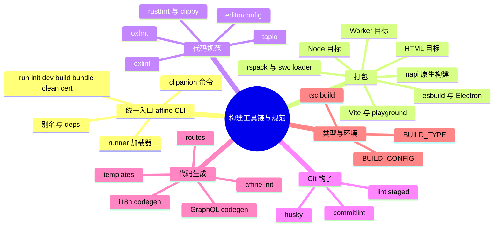
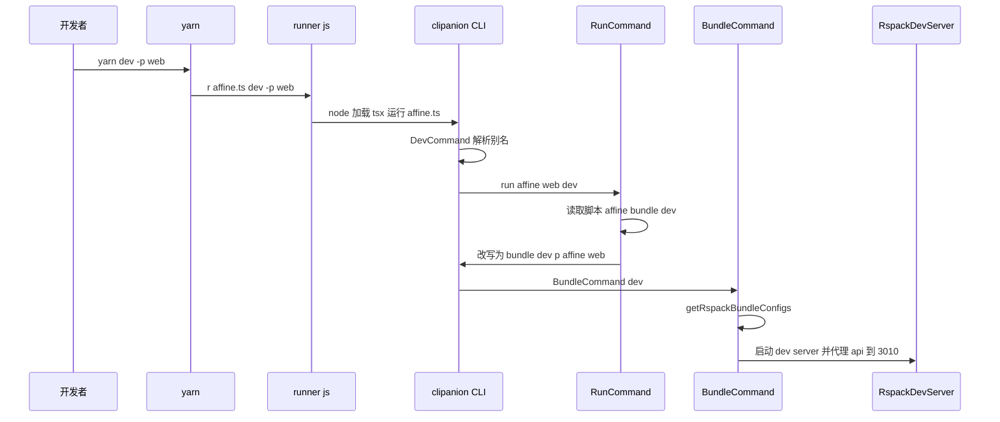

# 第 14 章 构建工具链与代码规范

> **所属部分**：第 4 部分 · 工程化与开发环境 ｜ **难度**：★★★☆☆ ｜ **建议学时**：6 小时 ｜ **前置章节**：第 13 章

## 本章导读

第 13 章我们知道了"仓库里有哪些包、它们怎么依赖"。本章回答下一个问题：**这些包是怎么被运行、打包、检查和生成的？**

在 AFFiNE 里，你几乎不会直接敲 `rspack`、`tsx` 或 `napi`，而是通过统一入口 `yarn affine ...`（自研 CLI `@affine-tools/cli`）来驱动一切。CLI 之下是一组各司其职的工具：rspack + SWC 负责 Web/桌面渲染进程/服务端打包；Vite 负责 BlockSuite playground 与 Vitest；esbuild 负责 Electron 主进程；napi-rs 负责 Rust 原生模块；oxlint + oxfmt 负责 JS/TS 的 lint 与格式化；taplo、rustfmt、clippy 负责 TOML 与 Rust；husky + lint-staged 把检查挂到 Git 提交上；GraphQL、i18n、路由、模板等多个代码生成器保证"生成物与源头一致"。

本章会逐一打开这些配置文件，结合源码讲清楚每个工具"为什么在这里、怎么配、有什么坑"。

## 学习目标

- [ ] 能够画出 `yarn dev -p @affine/web` 从根脚本到 rspack dev server 的完整调用链
- [ ] 能够解释 `yarn affine <包名> <脚本>` 的执行机制，包括别名解析、TS 加载器注入与 `--deps`
- [ ] 能够读懂 `tools/cli/src/rspack/index.ts` 中 HTML、Worker、Node 三类目标配置的差异
- [ ] 能够说明 SWC 在 rspack、Vitest、服务端加载器中的三种配置及装饰器版本差异的原因
- [ ] 能够解读 `.oxlintrc.json` 的结构（categories、jsPlugins、typeAware、overrides）与关键规则
- [ ] 能够说出 pre-commit 钩子与 lint-staged 对不同文件类型执行的检查
- [ ] 能够列举仓库中的代码生成器、其输入输出，以及 CI 如何校验生成物已提交
- [ ] 能够说明 `BUILD_TYPE` 等环境变量如何变成运行时的 `BUILD_CONFIG`

## 知识地图



## 10.1 工具链全景

| 工具 | 版本/来源 | 用在哪里 | 配置位置 |
| --- | --- | --- | --- |
| `@affine-tools/cli` | 仓库自研 | 所有 `yarn affine ...` 命令 | `tools/cli/src` |
| rspack | `@rspack/core ^2.0.8` | web、mobile、ios、android、admin、electron-renderer、server、reader 打包 | `tools/cli/src/rspack/index.ts` |
| SWC | `@swc/core`、`swc-loader`、`unplugin-swc` | TS/TSX 转译（rspack、Vitest、服务端运行时） | 多处，见 10.5 |
| Vite | `vite ^7.3.7` | BlockSuite playground、integration-test、Vitest 底座 | `blocksuite/playground/vite.config.ts`、`vitest.config.ts` |
| esbuild | 依赖 | Electron 主进程/preload/helper 构建 | `packages/frontend/apps/electron/scripts/common.ts` |
| napi-rs | `@napi-rs/cli 3.5.0` | Rust 原生模块 | `packages/frontend/native/package.json`、`packages/backend/native/package.json` |
| TypeScript | `typescript` 别名到 6.0.2 | 类型检查 `tsc -b` | 根 `tsconfig.json` 及各包 |
| oxlint | `1.78.0` + `oxlint-tsgolint` | JS/TS lint | `.oxlintrc.json` |
| oxfmt | `0.63.0` | JS/TS/JSON/MD 等格式化 | `.oxfmtrc.json`、`.prettierignore` |
| taplo | `@taplo/cli ^0.7.0` | TOML 格式化 | `.taplo.toml` |
| rustfmt / clippy | Rust 工具链 `1.97.1` | Rust 格式化与静态检查 | `rustfmt.toml`、`rust-toolchain.toml` |
| husky + lint-staged | `^9.1.7` / `^16.0.0` | Git 提交前检查 | `.husky/pre-commit`、根 `package.json` |
| commitlint | `tools/commitlint` | PR 标题规范 | `tools/commitlint/.commitlintrc.json` |

**小结**：CLI 是"总调度"，其余工具各管一摊；理解 CLI 就理解了工具链的骨架。

## 10.2 tools/cli：yarn affine 的入口与命令

### 10.2.1 从 `yarn affine` 到 `affine.ts`

根 `package.json` 中 `"affine": "r affine.ts"`。`r` 是 `tools/cli/package.json` 的 `bin`：

来源：`tools/cli/package.json`

```json
  "bin": {
    "affine": "./bin/cli.js",
    "r": "./bin/runner.js"
  },
```

`runner.js` 是一个"智能的 node"：它在若干目录中查找脚本文件，并决定用哪个 TS 加载器。

来源：`tools/cli/bin/runner.js`

```js
const scriptsFolder = join(fileURLToPath(import.meta.url), '..', '..');
const scriptsSrcFolder = join(scriptsFolder, 'src');
const projectRoot = join(scriptsFolder, '..', '..');
const serverRoot = join(projectRoot, 'packages', 'backend', 'server');
const tsRuntimeRegister = join(scriptsFolder, 'register.js');
const tsxRuntimeRegister = join(scriptsFolder, 'tsx-register.js');
// ...
const fileLocationCandidates = new Set([
  process.cwd(),
  scriptsSrcFolder,
  projectRoot,
]);
// ...
if (
  scriptLocation.endsWith('.ts') ||
  scriptLocation.startsWith(scriptsFolder)
) {
  if (scriptLocation.startsWith(serverRoot)) {
    nodeOptions.unshift(`--import=${pathToFileURL(tsRuntimeRegister)}`);
  } else {
    nodeOptions.unshift(`--import=${pathToFileURL(tsxRuntimeRegister)}`);
  }
} else {
  nodeOptions.unshift('--experimental-specifier-resolution=node');
}

spawn(node, [...nodeOptions, scriptLocation, ...options], {
  stdio: 'inherit',
}).on('exit', code => {
  process.exit(code);
});
```

查找顺序是"当前目录 → `tools/cli/src` → 仓库根"，所以 `r affine.ts` 无论在哪个目录执行都能找到 `tools/cli/src/affine.ts`。加载器分两种：

| 加载器 | 文件 | 适用 | 特点 |
| --- | --- | --- | --- |
| tsx | `tools/cli/tsx-register.js`（内容就是 `import 'tsx'`） | 绝大多数脚本 | 零配置运行 TS |
| SWC hooks | `tools/cli/register.js` → `tools/cli/hooks.js` | `packages/backend/server` 下的脚本 | 用 `@swc/core` 转译，开启 `legacyDecorator` 与 `decoratorMetadata` |

为什么服务端要单独用 SWC hooks？因为 NestJS 依赖 TypeScript 的**旧版装饰器 + `emitDecoratorMetadata`** 来做依赖注入（通过 `reflect-metadata` 读取构造函数参数类型），而 tsx 基于 esbuild，不支持 `emitDecoratorMetadata`。

来源：`tools/cli/hooks.js`

```js
    output = await transform(sourceText, {
      filename: filePath,
      sourceMaps: 'inline',
      module: { type: moduleType },
      jsc: {
        target: 'es2022',
        keepClassNames: true,
        // ...
        transform: {
          legacyDecorator: true,
          decoratorMetadata: true,
          useDefineForClassFields: false,
          // ...
        },
      },
    });
```

`hooks.js` 实现了 Node 的模块定制钩子 `resolve` 与 `load`：`resolve` 在默认解析失败时尝试补全 `.ts/.tsx` 扩展名（允许 `import './foo.js'` 实际指向 `foo.ts`）；`load` 对 TS 文件调用 SWC 转译，并以 `mtimeMs` 做内存缓存。

### 10.2.2 clipanion 命令注册

来源：`tools/cli/src/affine.ts`

```ts
const cli = new Cli<CliContext>({
  binaryName: 'affine',
  // ...
});

cli.register(RunCommand);
cli.register(InitCommand);
cli.register(CleanCommand);
cli.register(BuildCommand);
cli.register(DevCommand);
cli.register(BundleCommand);
cli.register(CertCommand);

await cli.runExit(process.argv.slice(2), {
  workspace: new Workspace(),
  // stdin / stdout / stderr ...
});
```

`CliContext`（`tools/cli/src/context.ts`）在 clipanion 的 `BaseContext` 上扩展了一个 `workspace: Workspace` 字段，所有命令都能通过 `this.workspace` 拿到第 13 章介绍的 Workspace 模型。

| 命令 | 路径别名 | 源文件 | 作用 |
| --- | --- | --- | --- |
| `run` | 空路径、`run`、`r` | `tools/cli/src/run.ts` | 执行某个包的脚本（默认命令） |
| `init` | `init`、`i`、`codegen` | `tools/cli/src/init.ts` | 生成 tsconfig references、workspace.gen.ts、oxlint 忽略列表 |
| `dev` | `dev`、`d` | `tools/cli/src/dev.ts` | 交互式选择包并执行其 `dev` 脚本 |
| `build` | `build`、`b` | `tools/cli/src/build.ts` | 执行某个包的 `build` 脚本，`--deps` 时先构建依赖 |
| `bundle` | `bundle`、`pack`、`bun` | `tools/cli/src/bundle.ts` | 用 rspack 打包，`--dev` 启动 dev server |
| `clean` | `clean` | `tools/cli/src/clean.ts` | 清理 `dist`、`lib`、`node_modules`、`cargo clean` |
| `cert` | `cert` | `tools/cli/src/cert.ts` | 生成本地 HTTPS 自签证书（第 15 章） |

### 10.2.3 三种命令基类与包名解析

`tools/cli/src/command.ts` 定义了三种基类：

| 基类 | 包参数 | 使用者 |
| --- | --- | --- |
| `PackageCommand` | `--package,-p` 必填单个 | `RunCommand`（覆盖为位置参数）、`BuildCommand`、`BundleCommand` |
| `PackagesCommand` | `--package,-p` 可多个 | 预留 |
| `PackageSelectorCommand` | `-p` 可选，缺省时用 inquirer 交互选择 | `DevCommand` |

包名校验来自 `Workspace.PackageNames`（即 `workspace.gen.ts`）与 `AliasToPackage`，所以 `-p web`、`-p @affine/web` 都合法。`DevCommand` 把可选列表限制为 8 个可运行目标：

来源：`tools/cli/src/dev.ts`

```ts
export class DevCommand extends PackageSelectorCommand {
  static override paths = [['dev'], ['d']];

  protected override availablePackages: PackageName[] = [
    '@affine/web',
    '@affine/server',
    '@affine/electron',
    '@affine/electron-renderer',
    '@affine/mobile',
    '@affine/ios',
    '@affine/android',
    '@affine/admin',
  ];
  // ...
  async execute() {
    const name = await this.getPackage();
    const args = [];
    if (this.deps) {
      args.push('--deps');
    }
    args.push(name, 'dev');
    await this.cli.run(args);
  }
}
```

可以看到 `dev` 与 `build` 都只是"翻译"成 `run` 命令：`yarn affine dev -p web` ≡ `yarn affine @affine/web dev`。

### 10.2.4 RunCommand：按包执行的核心机制

`yarn affine @affine/native build` 这种写法由 `RunCommand` 处理。其核心逻辑：

来源：`tools/cli/src/run.ts`

```ts
  async run(name: PackageName, args: string[], opts: RunScriptOptions = {}) {
    // ...
    const pkg = this.workspace.getPackage(name);
    const scriptName = args[0];
    const pkgScript = pkg.scripts[scriptName];

    if (pkgScript) {
      await this.runScript(pkg, scriptName, args.slice(1), opts);
    } else {
      await this.runCommand(pkg, args);
    }
  }
  // runScript 中：
    const isAFFiNECommand = args[0] === 'affine';
    if (isAFFiNECommand) {
      // remove 'affine' from 'affine xxx' command
      args.shift();
      args.push('-p', pkg.name);

      process.env = {
        ...process.env,
        ...envs,
      };
      await this.cli.run(args);
    } else {
      await this.runCommand(pkg, rawArgs);
    }
```

规则可以总结为四条：

1. **脚本存在就执行脚本**：`yarn affine @affine/native build` → 在 `packages/frontend/native` 下执行其 `build` 脚本 `napi build -p affine_native --platform --release`；
2. **脚本不存在就当作命令**：`yarn affine @affine/server prisma migrate deploy` 中 `prisma` 不是脚本名，于是在该包目录执行 `yarn prisma migrate deploy`；
3. **脚本以 `affine` 开头则递归回 CLI**：`@affine/web` 的 `dev` 脚本是 `affine bundle --dev`，会被改写成 `bundle --dev -p @affine/web` 再交给 clipanion，进而进入 `BundleCommand`；
4. **前缀环境变量被提取**：`extractEnvs` 会把脚本开头的 `FOO=bar`、`cross-env` 剥离成环境变量（因此 `cross-env DEV_SERVER_URL=http://localhost:8080 r ./scripts/dev.ts` 在 Windows 上也能工作）。

`runCommand` 还会为非白名单命令自动注入 TS 加载器：

来源：`tools/cli/src/run.ts`

```ts
const ignoreLoaderScripts = [
  'vitest',
  'vite',
  'tsx',
  'prisma',
  'cap',
  'tsc',
  'typedoc',
  /^r$/,
  /electron(?!-)/,
];
// ...
    const loader =
      pkg.name === '@affine/server' ? serverRuntimeLoader : tsxRuntimeLoader;
    // ...
    if (isLoaderRequired) {
      NODE_OPTIONS.push(`--import=${loader}`);
    }
```

也就是说，`@affine/server` 的 `dev` 脚本 `nodemon ./src/index.ts` 能直接运行 TS，靠的是 CLI 在 `NODE_OPTIONS` 里塞了 `--import=tools/cli/register.js`；`test` 脚本 `ava ...` 能运行 `.spec.ts` 也是同理。这也是为什么**服务端相关命令应当通过 `yarn affine @affine/server <script>` 执行，而不是 `yarn workspace @affine/server <script>`**——后者不会注入加载器。

`--deps` 选项让 CLI 先在所有 workspace 依赖上执行同名脚本（`ignoreIfNotFound: true`），`yarn affine build -p web --deps` 即"先构建依赖再构建自身"。

### 10.2.5 一条命令的完整旅程



**小结**：CLI 用"脚本优先、命令兜底、affine 前缀递归、自动注入加载器"四条规则把 100 多个包的脚本统一起来。

## 10.3 rspack 打包配置

### 10.3.1 每个包打包什么

`tools/cli/src/bundle-shared.ts` 声明了支持 rspack 打包的 8 个包，`tools/cli/src/bundle.ts` 的 `getRspackBundleConfigs` 为每个包组装一个**多编译器配置**（`MultiRspackOptions`）：

| 包 | 目标配置 | 入口 | Worker |
| --- | --- | --- | --- |
| `@affine/admin` | HTML | `src/index.tsx`，`selfhostPublicPath: '/admin/'` | 无 |
| `@affine/web`、`@affine/mobile` | HTML + Worker | `src/index.tsx` | 基础 5 个 + `src/nbstore.worker.ts` |
| `@affine/ios`、`@affine/android` | HTML + Worker | `src/index.tsx` | 基础 3 个 + nbstore（不含 mermaid、typst） |
| `@affine/electron-renderer` | HTML（多入口）+ Worker | `app`、`shell`、`popup`、`background-worker` 四个入口 | 基础 3 个 |
| `@affine/server` | Node | `src/index.ts` | 无 |
| `@affine/reader` | Node（ESM 库） | `src/index.ts`，打包全部依赖但 external `yjs` | 无 |

"基础 Worker"来自 `@affine/core` 源码：`modules/workspace-engine/impls/workspace-profile.worker.ts`、`modules/pdf/renderer/pdf.worker.ts`、`blocksuite/view-extensions/turbo-renderer/turbo-painter.worker.ts`，以及仅 web/mobile 包含的 `modules/mermaid/renderer/mermaid.worker.ts`、`modules/typst/renderer/typst.worker.ts`（由 `getBaseWorkerConfigs` 的 `includeMermaidAndTypst` 控制）。

HTML 目标的 `dependencies` 字段被设置为这些 Worker 配置的 `name`，rspack 会保证 Worker 先于主应用完成编译。

### 10.3.2 HTML 目标配置要点

`createHTMLTargetConfig`（`tools/cli/src/rspack/index.ts`）是最复杂的一个。以下是精选片段：

来源：`tools/cli/src/rspack/index.ts`

```ts
    output: {
      environment: { module: true, dynamicImport: true },
      filename: buildConfig.debug
        ? 'js/[name].js'
        : 'js/[name].[contenthash:8].js',
      // ...
      path: pkg.distPath.value,
      clean: false,
      globalObject: 'globalThis',
      // NOTE: always keep it '/'
      publicPath: '/',
    },
    target: ['web', 'es2022'],
    mode: buildConfig.debug ? 'development' : 'production',
    devtool: buildConfig.debug ? 'cheap-module-source-map' : 'source-map',
    resolve: {
      symlinks: true,
      extensionAlias: {
        '.js': ['.js', '.tsx', '.ts'],
        '.mjs': ['.mjs', '.mts'],
      },
      extensions: ['.js', '.ts', '.tsx'],
      alias: {
        yjs: ProjectRoot.join('node_modules', 'yjs').value,
        lit: ProjectRoot.join('node_modules', 'lit').value,
        '@preact/signals-core': ProjectRoot.join(
          'node_modules',
          '@preact',
          'signals-core'
        ).value,
        // ...
      },
    },
```

逐项解读：

| 配置 | 设计意图 |
| --- | --- |
| `extensionAlias` `.js → .ts/.tsx` | 源码遵循 ESM 规范写 `import './foo.js'`，打包时映射回 `.ts` 文件 |
| `alias` 固定 `yjs`、`lit`、`@preact/signals-core` | 这三个库都依赖"全局单例"（Yjs 的类型判断、Lit 的自定义元素注册、Signals 的依赖追踪），多副本会出现诡异 bug，所以强制只用根 `node_modules` 中的一份 |
| `strictExportPresence: true` | 导入不存在的导出直接报错，而不是得到 `undefined` |
| `source-map-loader` 作用于 `@blocksuite` | 便于调试已编译的 BlockSuite 代码 |
| `experiments.asyncWebAssembly` | 支持 wasm 依赖 |

TS/TSX 交给 `swc-loader`，注意装饰器配置：

来源：`tools/cli/src/rspack/index.ts`

```ts
            {
              test: /\.tsx$/,
              exclude: /node_modules/,
              loader: 'swc-loader',
              options: {
                jsc: {
                  parser: { syntax: 'typescript', tsx: true, decorators: true, /* ... */ },
                  target: 'es2022',
                  transform: {
                    react: { runtime: 'automatic' },
                    useDefineForClassFields: false,
                    decoratorVersion: '2022-03',
                  },
                },
                sourceMaps: true,
                // ...
              },
            },
```

（parser 字段原文分多行，此处合并。）

前端使用 **`decoratorVersion: '2022-03'`（TC39 Stage 3 标准装饰器）**，因为 BlockSuite 的 Lit 组件大量使用 `@property()`、`@state()` 等标准装饰器；而服务端使用 `legacyDecorator + decoratorMetadata`（10.2.1）。`useDefineForClassFields: false` 则与根 `tsconfig.json` 保持一致，避免类字段语义改变导致 Lit 响应式属性失效。

CSS 规则链为 `style-loader`（dev）或 `CssExtractRspackPlugin.loader`（prod）→ `css-loader` → `postcss-loader`；若包内存在 `tailwind.config.js`（如 admin），则使用 Tailwind + autoprefixer，否则使用 cssnano。另外始终启用 `VanillaExtractPlugin` 处理 `.css.ts` 样式文件（第 22 章）。

### 10.3.3 BUILD_CONFIG：编译期常量

来源：`tools/cli/src/rspack/index.ts`

```ts
const availableChannels = ['canary', 'beta', 'stable', 'internal'];
function getBuildConfigFromEnv(pkg: Package) {
  const channel = process.env.BUILD_TYPE ?? 'canary';
  const dev = process.env.NODE_ENV === 'development';
  if (!availableChannels.includes(channel)) {
    throw new Error(
      `BUILD_TYPE must be one of ${availableChannels.join(', ')}, received [${channel}]`
    );
  }

  return getBuildConfig(pkg, {
    // @ts-expect-error checked
    channel,
    mode: dev ? 'development' : 'production',
  });
}
// ... plugins 中：
      new rspack.DefinePlugin({
        'process.env.NODE_ENV': JSON.stringify(process.env.NODE_ENV),
        ...Object.entries(buildConfig).reduce(
          (def, [k, v]) => {
            def[`BUILD_CONFIG.${k}`] = JSON.stringify(v);
            return def;
          },
          {} as Record<string, string>
        ),
      }),
```

`getBuildConfig`（`tools/utils/src/build-config.ts`）根据包名映射出 `distribution`（web/desktop/mobile/ios/android/admin），再根据 `BUILD_TYPE` 选择 stable/beta/internal/canary 预设，生成 `isElectron`、`isMobileEdition`、`appBuildType`、`appVersion` 等字段。`DefinePlugin` 把每个字段替换为字面量，于是业务代码中的 `if (BUILD_CONFIG.isElectron) {...}` 在 Web 产物里会被常量折叠并 tree-shake 掉。类型声明在 `tools/@types/build-config/__all.d.ts`。

### 10.3.4 html-plugin、cache-group、node-loader

**html-plugin**（`tools/cli/src/rspack-shared/html-plugin.ts`）负责生成 HTML 并注入若干自定义插件：

| 功能 | 说明 |
| --- | --- |
| `getPublicPath` | 优先读 `PUBLIC_PATH`；debug、desktop、ios、android 用 `/`；否则按 `BUILD_TYPE` 选 `prod/beta/dev.affineassets.com` CDN，并拼接 `RELEASE_ASSET_PREFIX` |
| `selfhost.html` | `additionalEntryForSelfhost` 时额外生成一份 publicPath 为 `/` 的 HTML，带 `env:isSelfHosted` meta，供自托管部署 |
| Electron 多 HTML | 额外生成 `shell.html`、`popup.html`、`background-worker.html` |
| `AssetsManifestPlugin` | 输出 `assets-manifest.json`（js/css 列表与 gitHash），服务端渲染 HTML 时使用 |
| `GlobalErrorHandlerPlugin` | 把 `error-handler.js` 作为第一个脚本注入，捕获启动期错误 |
| `CorsPlugin` | 非 `/` 的 publicPath（CDN）时给 script/style 加 `crossorigin` |

**cache-group**（`tools/cli/src/rspack-shared/cache-group.ts`）定义生产环境的分包策略：

来源：`tools/cli/src/rspack-shared/cache-group.ts`

```ts
export const productionCacheGroups = {
  i18n: {
    test: /frontend[\\/]i18n[\\/]/,
    name: (module: any) => {
      const name = module.resource.match(/[\\/]([^\\/]+)\.json$/)?.[1];
      if (name && name !== 'en') {
        return `i18n-langs.${name}`;
      }

      return 'i18n';
    },
    priority: 200,
    enforce: true,
  },
  // asyncVendor: 异步 node_modules 按包名拆为 npm-async-<name>
  blocksuite: {
    name: `npm-blocksuite`,
    test: testPackageName(/[\\/]node_modules[\\/](@blocksuite)[\\/]/),
    priority: 200,
    enforce: true,
  },
  // react、jotai、rxjs、lodash、emotion 各自独立 chunk
  // vendor: 其余同步 node_modules
  // styles: 所有 CSS 合并
};
```

设计意图：每种语言包独立成 chunk 按需加载；React、BlockSuite 这类大而稳定的库独立缓存；异步依赖按 npm 包名拆分，避免一个依赖更新导致整个 vendor 缓存失效。注意 `bundle.ts` 中把 `vendor` 改成了 `chunks: 'initial'`，注释说明 rspack 否则会把异步依赖拉进初始 vendor。

**node-loader**（`tools/cli/src/rspack-shared/node-loader.js`）处理 Node 目标中的 `.node` 原生模块：

来源：`tools/cli/src/rspack-shared/node-loader.js`

```js
export const raw = true;
export default function loader(content) {
  const name = parse(this.resourcePath).base;
  this.emitFile(name, content);

  return `
    import { createRequire } from 'node:module'

    const require = createRequire(import.meta.url)
    const binding = require('./${name}')
    export default binding
  `;
}
```

它把 `.node` 文件原样拷贝到输出目录，并生成一段用 `createRequire` 加载它的 ESM 代码——这样服务端打包后 `server-native.node` 会和 `main.js` 放在一起。

### 10.3.5 Worker 与 Node 目标

`createWorkerTargetConfig` 的特点：`target: ['webworker', 'es2022']`、输出文件名 `js/<name>-<appVersion>.worker.js`、`LimitChunkCountPlugin({ maxChunks: 1 })`（Worker 必须是单文件）、不做 splitChunks。前端用 `getWorkerUrl`（`packages/common/env/src/worker.ts`）按同样规则拼出 Worker URL。

`createNodeTargetConfig` 的特点：

- `externals` 函数：**非 workspace 的 npm 依赖一律 external**（运行时从 `node_modules` 加载），workspace 依赖则打进 bundle；`bundleAllDependencies` 为 true 时（reader）全部打包；
- `IgnorePlugin` 忽略 `@nestjs/microservices`、`@apollo/gateway` 等 NestJS 的可选懒加载依赖；
- 装饰器默认 legacy 模式（服务端），reader 显式改为 `2022-03`；
- 输出 `main.js`，`package.json` 中 `"cli": "cross-env SERVER_FLAVOR=script node ./dist/main.js"` 就是运行它。

### 10.3.6 dev server

来源：`tools/cli/src/bundle-shared.ts`

```ts
export const DEFAULT_DEV_SERVER_CONFIG: RspackDevServerConfiguration = {
  host: '0.0.0.0',
  allowedHosts: 'all',
  hot: false,
  liveReload: true,
  // ...
  historyApiFallback: {
    rewrites: [
      {
        from: /.*/,
        to: () => {
          return process.env.SELF_HOSTED === 'true'
            ? '/selfhost.html'
            : '/index.html';
        },
      },
    ],
  },
  proxy: [
    { context: '/api', target: 'http://localhost:3010' },
    { context: '/socket.io', target: 'http://localhost:3010', ws: true },
    { context: '/graphql', target: 'http://localhost:3010' },
  ],
};
```

（`proxy` 数组原文每项多行，此处合并。）要点：关闭 HMR（`hot: false`）而用整页 liveReload；`client.overlay` 受 `DISABLE_DEV_OVERLAY` 控制，`client.webSocketURL` 固定为 `ws://0.0.0.0:8080/ws`（源码注释说明 Electron 的自定义协议无法构造 WebSocket 地址）；SPA 路由回退到 `index.html`；`/api`、`/socket.io`、`/graphql` 代理到本地服务端 3010 端口，这就是"只开前端也能连本地后端"的原因。

**小结**：rspack 配置按"HTML / Worker / Node"三类目标组织，通过 `BUILD_CONFIG` 常量、SWC 装饰器、单例 alias、分包策略实现多端一套配置。

## 10.4 Vite、Vitest、SWC 与 esbuild

### 10.4.1 Vite：playground 与 integration-test

BlockSuite 的开发体验走的是 Vite 路线。`blocksuite/playground/package.json` 中 `"dev": "vite --host"`、`"build": "vite build"`。其配置：

来源：`blocksuite/playground/vite.config.ts`

```ts
const enableIstanbul = !!process.env.COVERAGE;
// ...
export default defineConfig(({ mode }) => {
  // ...
  return {
    envDir: __dirname,
    // define: PLAYGROUND_SERVER / PLAYGROUND_WS ...
    plugins: [
      hmrPlugin,
      sourcemapExclude(),
      enableIstanbul &&
        istanbul({ /* include: ['packages/**/src/*'], forceBuildInstrument: true ... */ }),
      wasm(),
      vanillaExtractPlugin(),
      clearSiteDataPlugin(),
    ],
    esbuild: {
      target: 'es2018',
    },
    // ...
  };
});
```

为什么 BlockSuite 用 Vite 而产品用 rspack？playground 是纯前端、单入口、强调秒级启动与 HMR（`blocksuite/playground/scripts/hmr-plugin`），Vite 的按需编译最合适；产品端需要多 Worker、多 HTML、CDN publicPath、自定义 manifest 等复杂产物控制，rspack（webpack 兼容 API）更顺手。

### 10.4.2 Vitest 与 unplugin-swc

根 `vitest.config.ts` 基于 Vite，而 Vite 默认用 esbuild 转译 TS。为了让测试中的装饰器、类字段语义与 rspack 产物（SWC、`decoratorVersion: '2022-03'`、`useDefineForClassFields: false`）**完全一致**，这里引入 `unplugin-swc` 接管转译（配置上方的注释链接指向 vite-plugin-react-swc 关于装饰器的 issue）：

来源：`vitest.config.ts`

```ts
export default defineConfig({
  plugins: [
    vanillaExtractPlugin(),
    // https://github.com/vitejs/vite-plugin-react-swc/issues/85#issuecomment-2003922124
    swc.vite({
      jsc: {
        parser: { syntax: 'typescript', tsx: true, decorators: true, /* ... */ },
        target: 'es2022',
        transform: {
          react: { runtime: 'automatic' },
          useDefineForClassFields: false,
          decoratorVersion: '2022-03',
        },
      },
      sourceMaps: true,
      // ...
    }),
  ],
  // ...
});
```

至此可以看到 SWC 在仓库中的三种身份：

| 场景 | 接入方式 | 装饰器 |
| --- | --- | --- |
| 前端打包 | `swc-loader`（rspack） | `2022-03` |
| 前端单测 | `unplugin-swc`（Vitest） | `2022-03` |
| 服务端运行/测试 | `@swc/core` + Node 模块钩子（`tools/cli/hooks.js`） | legacy + metadata |
| 服务端打包 | `swc-loader`（rspack Node 目标） | legacy + metadata |

Vitest 的测试细节留到第 29 章。

### 10.4.3 esbuild：Electron 主进程

Electron 的 main、preload、helper 代码运行在 Node 环境，只需简单转译 + 打包，所以使用 esbuild：

来源：`packages/frontend/apps/electron/scripts/common.ts`

```ts
export const config = (): BuildOptions => {
  const define = {
    'process.env.GITHUB_SHA': process.env.GITHUB_SHA,
    // SENTRY_RELEASE / SENTRY_DSN / DEV_SERVER_URL / NODE_ENV ...
    REPLACE_ME_BUILD_ENV: process.env.BUILD_TYPE ?? 'stable',
    ...Object.entries(
      getBuildConfig(new Package('@affine/electron'), {
        mode:
          process.env.NODE_ENV === 'production' ? 'production' : 'development',
        channel: (process.env.BUILD_TYPE as any) ?? 'canary',
      })
    ).reduce(
      (def, [key, val]) => {
        def[`BUILD_CONFIG.${key}`] = val;
        return def;
      },
      {} as Record<string, any>
    ),
  };
  // ...
```

可以看到 Electron 复用了同一个 `getBuildConfig`，保证主进程与渲染进程的 `BUILD_CONFIG` 一致。`packages/frontend/apps/electron/scripts/dev.ts` 用 `esbuild.context().watch()` 监听变更并重启 Electron，`packages/frontend/apps/electron/scripts/build-layers.ts` 做生产构建。

### 10.4.4 napi：原生模块构建

`yarn affine @affine/native build` → `napi build -p affine_native --platform --release`；`yarn affine @affine/server-native build` → `napi build --release --no-const-enum`。`napi` CLI 会调用 `cargo build`，并把产物 `.node` 拷贝到包目录、同步生成/更新 `index.js` 与 `index.d.ts`（这两个文件已提交，且被 `.prettierignore` 排除格式化）。`--platform` 让文件名带上平台三元组（如 `affine.darwin-arm64.node`），`packages/frontend/native/index.js` 按当前平台选择加载哪个文件。

**小结**：Vite 服务于"轻量、快"的场景，rspack 服务于"复杂产物"，esbuild 服务于"Node 侧简单打包"，SWC 作为统一转译内核保证装饰器语义一致。

## 10.5 代码规范：oxlint

### 10.5.1 为什么是 oxlint

oxlint 是 Oxc 项目的 Rust 实现 linter，速度比 ESLint 快一到两个数量级，对一个有数千个 TS 文件的仓库意义重大。AFFiNE 根脚本 `lint:ox` 为 `oxlint --deny-warnings`——**警告也视为失败**。

### 10.5.2 配置结构

来源：`.oxlintrc.json`

```json
{
  "$schema": "./node_modules/oxlint/configuration_schema.json",
  "jsPlugins": [
    "eslint-plugin-simple-import-sort",
    "eslint-plugin-sonarjs",
    "eslint-plugin-lit",
    { "name": "import-x-js", "specifier": "eslint-plugin-import-x" },
    { "name": "react-js", "specifier": "eslint-plugin-react" },
    { "name": "react-hooks-js", "specifier": "eslint-plugin-react-hooks" }
  ],
  "plugins": ["import", "react", "typescript", "unicorn", "promise"],
  "settings": {
    "_comment": "TODO: Restore rxjs/finnish when Oxlint JS plugins support type-aware rules.",
    "react": { "version": "19.2.1" }
  },
  "categories": { "correctness": "error", "perf": "error" },
  "options": { "typeAware": true },
  "env": { "builtin": true, "es2026": true },
  "ignorePatterns": [ "**/node_modules", ".yarn", "..." ],
  "rules": { "...": "共 183 条" },
  "overrides": [ "...共 14 组" ]
}
```

（为排版把 `jsPlugins` 对象合并为单行，省略了列表内容。）

| 字段 | 含义 |
| --- | --- |
| `plugins` | oxlint 原生（Rust 实现）的规则集：import、react、typescript、unicorn、promise |
| `jsPlugins` | **用 oxlint 运行 ESLint 的 JS 插件**。这解释了为什么根 `devDependencies` 里仍有 `eslint`、`eslint-plugin-*`：它们不再通过 ESLint 运行，而是作为 oxlint 的 JS 插件被加载 |
| `categories` | 整类开启：所有 correctness（正确性）与 perf（性能）类规则默认 error |
| `options.typeAware` | 开启类型感知规则（需要 `oxlint-tsgolint`，基于 Go 版 TypeScript），用于 `no-floating-promises` 等 |
| `ignorePatterns` | 由 `yarn affine init` 从 `.prettierignore` 同步生成（见 `tools/cli/src/init.ts` 的 `genOxlintConfig`） |

### 10.5.3 关键规则解读

| 规则 | 级别 | 解读 |
| --- | --- | --- |
| `no-restricted-imports`（禁止 `**/dist`、`**/src`） | error | 跨包只能通过 `exports` 声明的入口导入，不能深入别人的 `src` 或 `dist` |
| `import/no-cycle`（`ignoreTypes: true`） | error | 禁止模块级循环导入，类型导入除外 |
| `typescript/consistent-type-imports` | error | 只用作类型的导入必须写 `import type`，配合 `verbatimModuleSyntax` |
| `typescript/no-non-null-assertion` | error | 禁止 `!`，测试与 tools 目录放开 |
| `typescript/ban-ts-comment` | error | 禁止 `@ts-ignore`/`@ts-nocheck`；`@ts-expect-error` 必须带说明 |
| `unicorn/filename-case`（kebabCase） | error | 文件名必须短横线风格，如 `doc-title.ts` |
| `unicorn/prefer-node-protocol` | error | 必须写 `node:fs` 而不是 `fs` |
| `simple-import-sort/imports`、`exports` | error | import/export 排序，可 `--fix` 自动修复 |
| `eqeqeq`（smart） | error | 用 `===`，与 `null` 比较除外 |
| `react/rules-of-hooks`、`react/exhaustive-deps` | error/warn | Hooks 规则，`.ts/.js` 文件关闭 rules-of-hooks |
| `react-hooks-js/*`（purity、set-state-in-render 等） | error | React Compiler 相关规则 |
| `lit/*` | error | Lit 模板绑定位置、非法 HTML 等 |
| `sonarjs/no-identical-functions` 等 | error | 重复代码、恒真条件等坏味道 |

### 10.5.4 overrides：按目录差异化

来源：`.oxlintrc.json`（overrides 节选）

```json
    {
      "files": [
        "packages/**/*.{ts,tsx}",
        "tools/**/*.{ts,tsx}",
        "blocksuite/**/*.{ts,tsx}"
      ],
      "rules": {
        "typescript/await-thenable": "error",
        "typescript/no-floating-promises": [
          "error",
          { "ignoreVoid": false, "ignoreIIFE": false }
        ],
        "typescript/no-misused-promises": "error",
        "typescript/prefer-readonly": "error",
        "typescript/require-array-sort-compare": "error",
        "react/exhaustive-deps": [
          "warn",
          {
            "additionalHooks": "(useAsyncCallback|useCatchEventCallback|useDraggable|useDropTarget|useRefEffect)"
          }
        ]
      }
    },
```

这组规则在根 `rules` 中是 `allow`，只对源码目录开启——因为类型感知规则代价高，对 tests、scripts 没必要。其它典型 override：

- `packages/backend/**/*.ts` 关闭 `consistent-type-imports`：NestJS 依赖注入需要**值导入**才能在运行时拿到类型元数据，写成 `import type` 会导致注入失败；
- `blocksuite/**/*.ts` 关闭 `eqeqeq` 与 `no-non-null-assertion`：历史代码风格差异；
- `packages/frontend/core/**/*` 中 `import-x-js/no-extraneous-dependencies` 白名单 `@affine/core`：允许包内用自己的包名自引用。

### 10.5.5 行内禁用

确需例外时使用 `// oxlint-disable-next-line <rule>`，如 `nyc.config.js` 中的 `// oxlint-disable-next-line typescript/no-var-requires`；生成文件则在文件头写 `/* oxlint-disable */`（如 `packages/frontend/i18n/src/i18n.gen.ts`）。

**小结**：oxlint 以原生规则 + ESLint JS 插件 + 类型感知三层能力覆盖了原 ESLint 体系，并通过 overrides 对后端、BlockSuite、测试做差异化。

## 10.6 格式化与其他规范

### 10.6.1 oxfmt

来源：`.oxfmtrc.json`

```json
{
  "$schema": "./node_modules/oxfmt/configuration_schema.json",
  "printWidth": 80,
  "singleQuote": true,
  "trailingComma": "es5",
  "tabWidth": 2,
  "arrowParens": "avoid",
  "sortPackageJson": false,
  "ignorePatterns": ["**/*.toml"]
}
```

oxfmt 是 Prettier 兼容的格式化器，选项名与 Prettier 一致：80 列、单引号、ES5 尾逗号、单参数箭头函数不加括号。`sortPackageJson: false` 避免打乱 `package.json` 字段顺序；TOML 交给 taplo。CLI 的 `init` 命令也会用 `oxfmt` 的 JS API 格式化它生成的文件（`tools/cli/src/init.ts` 的 `format` 方法读取 `.oxfmtrc.json`）。

### 10.6.2 .prettierignore：两者共享的忽略清单

`.prettierignore` 首行注释写明 `# shared by oxfmt|oxlint`。它忽略了 `node_modules`、`dist`、`lib`、`*.gen.ts`、`*.gql`、`*.d.ts`、原生模块的 `index.js/index.d.ts`、iOS/Android 原生工程目录、测试快照等。修改忽略规则时只需改这一处，再执行 `yarn affine init` 同步到 `.oxlintrc.json`。

### 10.6.3 .editorconfig

来源：`.editorconfig`

```ini
root = true

[*.rs]
max_line_length = 120
[*]
charset = utf-8
indent_style = space
indent_size = 2
insert_final_newline = true
trim_trailing_whitespace = true

[*.md]
max_line_length = off
trim_trailing_whitespace = false
```

全仓 2 空格缩进、UTF-8、文件末尾换行；Markdown 保留行尾空格（Markdown 中两个尾空格表示换行）。

### 10.6.4 TOML 与 Rust

来源：`.taplo.toml`

```toml
exclude = [
  "node_modules/**/*.toml",
  "target/**/*.toml",
  "packages/frontend/apps/ios/App/Packages/AffineGraphQL/**/*.toml",
  "packages/frontend/apps/ios/App/Packages/Intelligents/**/*.toml",
  "packages/frontend/apps/ios/App/Packages/AffinePaywall/**/*.toml",
]

# https://taplo.tamasfe.dev/configuration/formatter-options.html
[formatting]
align_entries = true
indent_tables = true
reorder_keys  = true
```

`align_entries` 让等号对齐（所以 `Cargo.toml` 中 `name    = "..."` 有对齐空格），`reorder_keys` 让键按字母排序。

来源：`rustfmt.toml`

```toml
edition       = "2024"
max_width     = 120
style_edition = "2024"

hard_tabs  = false
tab_spaces = 2

format_strings    = true
unstable_features = true
wrap_comments     = true

group_imports       = "StdExternalCrate"
imports_granularity = "Crate"
```

注意 `unstable_features = true`、`group_imports`、`imports_granularity` 都是 **nightly rustfmt** 才支持的选项。所以 CI 的 `lint-rust` job 专门安装 nightly：

来源：`.github/workflows/build-test.yml`

```yaml
      - name: fmt check
        run: |
          rustup toolchain add nightly
          rustup component add --toolchain nightly-x86_64-unknown-linux-gnu rustfmt
          cargo +nightly fmt --all -- --check
      - name: Clippy
        run: |
          rustup component add clippy
          cargo clippy --workspace --exclude affine_server_native --all-targets --all-features -- -D warnings
          cargo clippy -p affine_server_native --all-targets --all-features -- -D warnings
```

clippy 用 `-D warnings` 把所有警告当错误；`affine_server_native` 单独跑一遍，避免 `--all-features` 在 workspace 层面产生 feature 合并冲突。本地建议同样使用 `cargo +nightly fmt`。

**小结**：JS/TS 用 oxfmt、TOML 用 taplo、Rust 用 nightly rustfmt，三者都在 CI 中以 `--check` 方式强制。

## 10.7 Git 钩子：husky、lint-staged、commitlint

### 10.7.1 husky 与 pre-commit

根 `postinstall` 中的 `yarn husky` 会把 `.husky/` 设为 Git 的 hooksPath。仓库只定义了一个钩子：

来源：`.husky/pre-commit`

```sh
yarn lint-staged && yarn lint:ox
```

`.husky/_/` 目录是 husky 自动生成的各钩子转发脚本，不需要关心。

### 10.7.2 lint-staged

来源：`package.json`

```json
  "lint-staged": {
    "*": "oxfmt --write --no-error-on-unmatched-pattern",
    "*.{ts,tsx,mjs,js,jsx}": [
      "oxlint --fix --no-error-on-unmatched-pattern"
    ],
    "*.toml": [
      "taplo format"
    ],
    "*.rs": [
      "cargo fmt --"
    ]
  },
```

| 暂存文件 | 执行 |
| --- | --- |
| 所有文件 | `oxfmt --write`（不支持的类型静默跳过） |
| JS/TS | `oxlint --fix` 自动修复 |
| TOML | `taplo format` |
| Rust | `cargo fmt --`（对暂存的 `.rs` 文件） |

lint-staged 只处理暂存区文件，修复结果会自动加回暂存区；随后 `yarn lint:ox` 再对**全仓**跑一次 oxlint（`--deny-warnings`），确保提交不会引入任何警告。

### 10.7.3 commitlint：校验 PR 标题

commitlint 没有挂在本地 `commit-msg` 钩子上，而是在 CI 中校验 **PR 标题**（从 `git log` 中 `fix(client): windows static link (#15753)` 这类带 PR 号的提交可以看出，PR 标题会成为合入 canary 后的提交信息）：

来源：`.github/workflows/pr-title-lint.yml`

```yaml
      - name: Install dependencies
        run: yarn workspaces focus @affine/commitlint-config
      - name: Check PR title
        env:
          TITLE: ${{ github.event.pull_request.title }}
        run: echo "$TITLE" | yarn workspace @affine/commitlint-config commitlint -g ./.commitlintrc.json
```

`yarn workspaces focus` 只安装这一个包的依赖，CI 几秒完成——这正是 `tools/commitlint/README.md` 所说的"minimize the installation time"。规则继承 `@commitlint/config-conventional`，并用 `scope-enum` 限定 scope 必须是 `admin`、`electron`、`server`、`core`、`web`、`editor`、`infra`、`nbstore` 等 24 个之一（完整列表见 `tools/commitlint/.commitlintrc.json`）。

**小结**：本地 pre-commit 保证"格式化 + lint 零警告"，CI 的 PR Title Lint 保证提交信息符合 Conventional Commits。

## 10.8 代码生成

AFFiNE 中有大量"从单一事实源生成代码"的环节：

| 生成器 | 命令 | 输入 | 输出 |
| --- | --- | --- | --- |
| Workspace 元信息 | `yarn affine init` | `yarn workspaces list -v --json` | 根与各包 `tsconfig.json` references、`tools/utils/src/workspace.gen.ts`、`.oxlintrc.json` |
| GraphQL | `yarn affine gql build` | `packages/backend/server/src/schema.gql` + `packages/common/graphql/src/**/*.gql` | `packages/common/graphql/src/schema.ts`、`packages/common/graphql/src/graphql/index.ts` |
| i18n | `yarn affine i18n build` | `packages/frontend/i18n/src/resources/en.json` + 服务端错误定义 | `packages/frontend/i18n/src/i18n.gen.ts`、`i18n-completenesses.json` |
| 路由 | `yarn affine routes build` | `packages/frontend/routes/routes.json` | `packages/frontend/routes/src/routes.ts` |
| 模板 | `yarn affine templates build`（也在 postinstall 执行） | `packages/frontend/templates/edgeless`、`edgeless-snapshot`、`stickers` | `edgeless-templates.gen.ts`、`stickers-templates.gen.ts` |
| 服务端配置 Schema | `yarn affine server genconfig` | 服务端各模块 `defineModuleConfig` | `.docker/selfhost/schema.json`、`packages/frontend/admin/src/config.json` |
| GraphQL Schema | 服务端 dev 启动时 | NestJS 代码优先的 resolver | `packages/backend/server/src/schema.gql` |

### 10.8.1 GraphQL codegen

来源：`packages/common/graphql/codegen.yml`

```yaml
hooks:
  afterOneFileWrite:
    - oxfmt --write
config:
  strict: true
  maybeValue: T | null
  declarationKind: interface
  avoidOptionals:
    field: true
    inputValue: false
    object: false
    defaultValue: false
  preResolveTypes: true
  namingConvention:
    enumValues: keep
  scalars:
    DateTime: string
    # ...
    Upload: File
    SafeInt: number
overwrite: true
schema: ../../backend/server/src/schema.gql
documents: ./src/**/*.gql
generates:
  ./src/schema.ts:
    plugins:
      - typescript
      - typescript-operations
      - ./export-gql-plugin.cjs:
          output: ./src/graphql/index.ts
```

数据流是：服务端 NestJS 以"代码优先"方式定义 resolver → 开发模式启动时写出 `schema.gql`（见 `packages/backend/server/src/base/graphql/index.ts` 中的 `autoSchemaFile`）→ 前端在 `src/graphql/*.gql` 中手写查询，例如：

来源：`packages/common/graphql/src/graphql/get-current-user.gql`

```graphql
query getCurrentUser {
  currentUser {
    id
    name
    email
    emailVerified
    avatarUrl
    hasPassword
    features
  }
}
```

→ `gql-gen` 生成类型到 `schema.ts`，自定义插件 `export-gql-plugin.cjs` 把每个查询导出为 `getCurrentUserQuery` 这样的常量（命名规则见插件中的 `getExportedName`：名称 + 操作类型后缀）。前后端于是共享同一份强类型契约。

### 10.8.2 i18n codegen

`packages/frontend/i18n/build.ts` 依次执行：`appendErrorI18n()` 把服务端 `packages/backend/server/src/base/error/def.ts` 中的 `USER_FRIENDLY_ERRORS` 写入 `en.json` 的 `error.*` 键；可选 `--cleanup` 清理未使用的键；`i18nnext()` 调用 `@magic-works/i18n-codegen`（配置 `packages/frontend/i18n/.i18n-codegen.json`，生成 `useAFFiNEI18N` 类型安全 hooks）；`calcCompletenesses()` 计算各语言翻译完成度。`dev` 脚本 `r build.ts --dev` 以 watch 模式运行。根 `resolutions` 中对 `@magic-works/i18n-codegen` 打了补丁。

### 10.8.3 routes 与 templates

`packages/frontend/routes/build.ts` 读取 `routes.json`，用 `path-to-regexp` 解析参数，生成 `RouteParamsTypes`（参数类型）、`ROUTES`（绝对路径）、`RELATIVE_ROUTES`（相对路径）与工厂函数，最后用 `formatCode` 格式化写入 `packages/frontend/routes/src/routes.ts`。`@affine/templates` 的 `build-edgeless.mjs`、`build-stickers.mjs` 把模板 zip 与素材处理成 TS 模块，素材拷贝到 `packages/frontend/core/public/static/templates`。

### 10.8.4 CI 如何保证生成物已提交

来源：`.github/workflows/build-test.yml`

```yaml
      - name: Run Check
        run: |
          yarn affine init
          yarn affine gql build
          yarn affine i18n build
          yarn affine server genconfig
          git checkout packages/frontend/i18n/src/i18n-completenesses.json
          if git status --porcelain | grep -q .; then
            echo "Run 'yarn affine init && yarn affine gql build && yarn affine i18n build && yarn affine server genconfig' and make sure all changes are submitted"
            exit 1
          else
            echo "All changes are submitted"
          fi
```

**原则：生成物入库，CI 重放生成并要求零 diff。** 好处是阅读代码时无需先运行生成器，IDE 跳转与类型提示开箱即用；代价是 PR 中会出现生成文件的 diff。

**小结**：每个生成器都对应一个"单一事实源"，CI 的 `check-git-status` 与 `typecheck` job 共同保证源与生成物同步。

## 10.9 类型检查、环境变量与编辑器设置

### 10.9.1 typecheck：tsc -b

`yarn typecheck` = `tsc -b tsconfig.json --verbose`。根 `tsconfig.json` 自身 `files: []`、`include: []`，只通过 `references` 引用每个 TS 包（由 `yarn affine init` 生成），每个包又 `references` 它的依赖。`tsc -b` 据此按拓扑顺序增量检查，`tsBuildInfoFile` 记录增量信息于各包 `dist/tsconfig.tsbuildinfo`。

根配置的关键编译选项：`strict`、`verbatimModuleSyntax`（与 `consistent-type-imports` 呼应）、`moduleResolution: bundler`、`useDefineForClassFields: false`、`composite: true`、`typeRoots: ["./tools/@types", "./node_modules/@types"]`。`tsconfig.web.json` 额外引入 DOM 库与 `jsx: react-jsx`，`tsconfig.node.json` 引入 `node` 类型。CI 的 typecheck job 设置 `NODE_OPTIONS: --max-old-space-size=14384`，说明全量类型检查非常吃内存，本地跑时也可能需要类似设置。

### 10.9.2 构建相关环境变量

以下变量均经 grep 在源码中确认：

| 变量 | 读取位置 | 作用 |
| --- | --- | --- |
| `BUILD_TYPE` | `tools/cli/src/rspack/index.ts`、`packages/frontend/apps/electron/scripts/common.ts`、`tools/cli/src/rspack-shared/html-plugin.ts` | 渠道：`canary`（默认）/`beta`/`stable`/`internal`，决定 `BUILD_CONFIG.appBuildType` 与 CDN 域名 |
| `NODE_ENV` | `bundle.ts` 自动设置 | `development` 时 `BUILD_CONFIG.debug = true` |
| `PUBLIC_PATH` | `html-plugin.ts` | 覆盖资源 publicPath |
| `RELEASE_ASSET_PREFIX` | `html-plugin.ts` | CDN 路径前缀 |
| `SELF_HOSTED` | `bundle-shared.ts` | dev server 回退到 `selfhost.html` |
| `DISABLE_DEV_OVERLAY` | `bundle-shared.ts` | 关闭 dev server 错误浮层 |
| `CI` | 多处 | 关闭进度条、压缩、调整日志；Playwright 重试次数 |
| `SENTRY_AUTH_TOKEN` / `SENTRY_ORG` / `SENTRY_PROJECT` | `tools/cli/src/rspack/index.ts`、`packages/frontend/apps/electron/scripts/common.ts` | 三者齐全才启用 Sentry 上传 sourcemap |
| `SENTRY_DSN` | `tools/utils/src/build-config.ts` | 写入 `BUILD_CONFIG.SENTRY_DSN` |
| `GITHUB_SHA` | `html-plugin.ts` | HTML 中的 git short hash，缺省时读本地 Git |
| `CHANGELOG_URL` | `build-config.ts` | 非 CI 环境下覆盖 changelog 链接（仅调试用） |
| `DEV_SERVER_URL` | electron `package.json` dev 脚本、`common.ts` | Electron 开发时加载渲染进程的 dev server 地址 |
| `SKIP_WEB_BUILD` / `HOIST_NODE_MODULES` | `packages/frontend/apps/electron/scripts/generate-assets.ts`、`docs/building-desktop-client-app.md` | 桌面打包时跳过 Web 构建、调整依赖拷贝 |
| `COVERAGE` | playground `vite.config.ts`、各 Playwright 配置 | 开启 istanbul 插桩 |

### 10.9.3 .vscode 推荐设置

仓库只提交模板（`.gitignore` 中 `.vscode/*` 但放行三个文件）：

- `.vscode/extensions.json`：推荐 `ms-playwright.playwright`、`oxc.oxc-vscode`、`deepscan.vscode-deepscan`、`streetsidesoftware.code-spell-checker`；
- `.vscode/settings.template.json`：默认格式化器为 `oxc.oxc-vscode`、保存时格式化；Rust 用 rust-analyzer、TOML 用 even-better-toml；`vitest.include` 指向 `packages/**/*.spec.ts`；`typescript.tsdk` 指向 `node_modules/typescript/lib`；`rust-analyzer.check.extraEnv` 设置 `DATABASE_URL`（sqlx 编译期检查需要）；
- `.vscode/launch.template.json`：调试配置，第 15 章详述。

使用方式：`cp .vscode/settings.template.json .vscode/settings.json`。

**小结**：`tsc -b` + 自动生成的 references 实现全仓增量类型检查；`BUILD_TYPE` 是最重要的构建变量，经 `getBuildConfig` 转为 `BUILD_CONFIG` 常量注入各端。

## 源码导读清单

| 优先级 | 路径 | 阅读重点 |
| --- | --- | --- |
| P0 | `tools/cli/bin/runner.js` | 脚本查找与加载器选择 |
| P0 | `tools/cli/src/run.ts` | 按包执行、affine 前缀递归、加载器注入 |
| P0 | `tools/cli/src/bundle.ts` | 每个包的 rspack 多编译器配置 |
| P0 | `tools/cli/src/rspack/index.ts` | HTML/Worker/Node 三类目标 |
| P0 | `.oxlintrc.json` | 规则、jsPlugins、overrides |
| P1 | `tools/cli/hooks.js` | 服务端 SWC 模块钩子 |
| P1 | `tools/cli/src/rspack-shared/html-plugin.ts` | publicPath、selfhost、manifest |
| P1 | `tools/cli/src/rspack-shared/cache-group.ts` | 分包策略 |
| P1 | `tools/utils/src/build-config.ts` | BUILD_CONFIG 生成 |
| P1 | `vitest.config.ts` | unplugin-swc 与装饰器 |
| P1 | `packages/common/graphql/codegen.yml` | GraphQL 代码生成 |
| P2 | `packages/frontend/i18n/build.ts` | i18n 生成流程 |
| P2 | `packages/frontend/routes/build.ts` | 路由生成 |
| P2 | `packages/frontend/apps/electron/scripts/common.ts` | esbuild 配置 |
| P2 | `rustfmt.toml`、`.taplo.toml`、`.husky/pre-commit` | Rust/TOML 规范与钩子 |

## 动手实践

### 练习 1：探索 CLI

- **目标**：熟悉命令与别名。
- **步骤**：
  ```bash
  yarn affine -h
  yarn affine bundle -h
  node -e 'const s=require("fs").readFileSync("tools/utils/src/distribution.ts","utf8");console.log(s.match(/\[\x27[a-z]+\x27, \x27@affine\/[a-z-]+\x27\]/g))'
  ```
- **验收标准**：能列出 7 个命令及其别名；能说出 `desktop` 与 `renderer` 都指向 `@affine/electron-renderer`。

### 练习 2：推演 `yarn affine server dev` 的执行过程

- **目标**：理解加载器注入。
- **步骤**：阅读 `packages/backend/server/package.json` 的 `dev` 脚本与 `nodemonConfig`，再阅读 `tools/cli/src/run.ts` 的 `runCommand`。
- **验收标准**：能写出最终执行的命令形如 `yarn nodemon ./src/index.ts`，且 `NODE_OPTIONS` 中包含 `--import=.../tools/cli/register.js`；能解释为什么不是 tsx。

### 练习 3：做一次生产打包并观察产物（耗时较长，可选）

- **目标**：认识 rspack 产物结构。
- **步骤**：
  ```bash
  BUILD_TYPE=canary yarn affine bundle -p @affine/web
  ls packages/frontend/apps/web/dist packages/frontend/apps/web/dist/js | head -40
  cat packages/frontend/apps/web/dist/assets-manifest.json | head -30
  ```
- **验收标准**：看到 `index.html`、`selfhost.html`、`assets-manifest.json`、`js/nbstore-<版本>.worker.js`、`npm-react`/`npm-blocksuite` 等 chunk；能把 chunk 名对应到 `cache-group.ts` 中的规则。

### 练习 4：体验 lint 与格式化

- **目标**：掌握规范工具的使用。
- **步骤**：
  ```bash
  yarn lint:ox packages/common/infra/src/livedata
  yarn oxfmt --check packages/common/infra/src/livedata
  yarn taplo format --check Cargo.toml
  ```
- **验收标准**：命令均能运行并输出结果；能说出 `--deny-warnings` 的含义。若在临时文件中写 `import fs from 'fs'`，能预测会触发 `unicorn/prefer-node-protocol`（练习后删除临时文件）。

### 练习 5：重放代码生成并检查 diff

- **目标**：理解"生成物入库"原则。
- **步骤**：
  ```bash
  yarn affine init
  yarn affine routes build
  yarn affine gql build
  git status --porcelain
  ```
- **验收标准**：在干净的 canary 上 `git status` 应无变化或仅有少量可解释的变化；若有变化，能根据 10.8 判断是哪个生成器、哪个源头导致（练习后用 `git checkout -- <file>` 还原）。

## 自测题

1. `r affine.ts` 是如何找到 `tools/cli/src/affine.ts` 的？
2. 为什么服务端脚本使用 `tools/cli/register.js` 而不是 tsx？
3. `@affine/web` 的 `dev` 脚本是 `affine bundle --dev`，`RunCommand` 是如何处理以 `affine` 开头的脚本的？
4. rspack 配置为什么要把 `yjs`、`lit`、`@preact/signals-core` alias 到根 `node_modules`？
5. 前端 SWC 使用 `decoratorVersion: '2022-03'`，服务端使用 legacy 装饰器，各自的原因是什么？
6. `BUILD_TYPE=beta` 会影响产物的哪些地方？
7. `.oxlintrc.json` 的 `jsPlugins` 解决了什么问题？为什么根 `devDependencies` 中还有 `eslint`？
8. 为什么 `packages/backend/**/*.ts` 关闭了 `typescript/consistent-type-imports`？
9. pre-commit 钩子中 `yarn lint-staged` 之后为什么还要 `yarn lint:ox`？
10. CI 的 `check-git-status` job 会重放哪些生成器？

<details><summary>参考答案</summary>

1. `runner.js` 依次在 `process.cwd()`、`tools/cli/src`、仓库根中查找 `affine.ts`/`affine.ts.js`/`affine.ts.ts`，在 `tools/cli/src` 中命中。
2. NestJS 依赖旧版装饰器与 `emitDecoratorMetadata` 做 DI；tsx 基于 esbuild 不支持 decorator metadata，SWC 支持 `legacyDecorator + decoratorMetadata`。
3. 去掉 `affine`，在参数末尾追加 `-p <包名>`，合并脚本前缀中的环境变量后调用 `this.cli.run(args)` 重新进入 CLI，于是变成 `bundle --dev -p @affine/web`。
4. 这三个库依赖模块级单例（Yjs 类型判断、Lit 自定义元素注册与指令、Signals 依赖追踪），多副本会导致 instanceof 失败、重复注册或响应式失效。
5. 前端 BlockSuite/Lit 使用 TC39 标准装饰器语义；服务端 NestJS 依赖 legacy 装饰器和反射元数据。
6. `BUILD_CONFIG.appBuildType` 与 `changelogUrl` 变为 beta 预设；非 desktop/移动端且非 debug 时 publicPath 使用 `beta.affineassets.com`；Electron 的 `REPLACE_ME_BUILD_ENV` 也随之变化。
7. 让 oxlint 直接运行 ESLint 生态的插件（simple-import-sort、sonarjs、lit、import-x、react、react-hooks），这些插件包依赖 `eslint` 作为 peer，所以 eslint 仍需安装，但不再用 ESLint 执行 lint。
8. NestJS 构造函数注入需要在运行时通过元数据拿到类，`import type` 会在编译后被擦除，导致注入失败。
9. lint-staged 只检查暂存文件，且 `--fix` 后可能仍有无法自动修复的问题；`lint:ox` 以 `--deny-warnings` 对全仓再检查一次，确保没有任何警告。
10. `yarn affine init`、`yarn affine gql build`、`yarn affine i18n build`、`yarn affine server genconfig`。

</details>

## 常见坑与排错

| 现象 | 原因 | 处理 |
| --- | --- | --- |
| `yarn workspace @affine/server dev` 报 TS 语法错误 | 未经 CLI，没有注入 `register.js` | 改用 `yarn affine @affine/server dev` 或 `yarn affine server dev` |
| 打包报 `export 'xxx' was not found` | `strictExportPresence: true` 生效 | 修正导入名，或检查依赖包的 `exports` |
| 运行时出现 "Yjs was already imported" 或 Lit 重复注册 | 引入了第二份 yjs/lit | 检查是否有依赖自带打包副本；rspack 已 alias，测试中 `vitest.config.ts` 也 alias 了 yjs |
| Lit 组件属性不更新 | 某处转译把类字段改为 define 语义 | 确保 `useDefineForClassFields: false` 一致 |
| 提交时 pre-commit 很慢 | `yarn lint:ox` 全仓 typeAware 检查 | 正常现象；也可先手动 `yarn lint:ox` 再提交 |
| CI fmt check 失败但本地 `cargo fmt` 通过 | 本地用的是 stable rustfmt | 使用 `cargo +nightly fmt --all` |
| CI typecheck 提示 i18n 未提交 | 修改了 `en.json` 但没跑生成 | `yarn affine @affine/i18n build` 后提交 |
| `tsc -b` 内存溢出 | 全量检查内存占用大 | `NODE_OPTIONS=--max-old-space-size=14384 yarn typecheck` |
| `BUILD_TYPE must be one of ...` | 环境变量拼写错误 | 只能是 canary/beta/stable/internal |

## 延伸阅读

- Rspack 文档：https://rspack.rs/
- SWC 配置：https://swc.rs/docs/configuration/swcrc
- Vite 文档：https://vite.dev/guide/
- esbuild 文档：https://esbuild.github.io/
- Oxlint：https://oxc.rs/docs/guide/usage/linter.html
- Oxfmt：https://oxc.rs/docs/guide/usage/formatter.html
- clipanion：https://mael.dev/clipanion/
- Node.js 模块定制钩子：https://nodejs.org/api/module.html#customization-hooks
- TC39 装饰器提案：https://github.com/tc39/proposal-decorators
- GraphQL Code Generator：https://the-guild.dev/graphql/codegen/docs/getting-started
- husky：https://typicode.github.io/husky/
- lint-staged：https://github.com/lint-staged/lint-staged
- commitlint：https://commitlint.js.org/
- Taplo：https://taplo.tamasfe.dev/
- rustfmt 配置：https://rust-lang.github.io/rustfmt/
- Clippy：https://doc.rust-lang.org/clippy/

## 学时拆分

| 内容 | 建议时长 |
| --- | --- |
| 10.1–10.2 工具链全景与 CLI 机制（含练习 1、2） | 1.5 小时 |
| 10.3 rspack 打包配置（含练习 3） | 1.5 小时 |
| 10.4 Vite、Vitest、SWC、esbuild、napi | 0.5 小时 |
| 10.5–10.6 oxlint、oxfmt 与其他规范（含练习 4） | 1 小时 |
| 10.7 Git 钩子与 commitlint | 0.25 小时 |
| 10.8 代码生成（含练习 5） | 0.75 小时 |
| 10.9 类型检查、环境变量、编辑器设置 | 0.25 小时 |
| 自测与复盘 | 0.25 小时 |
| **合计** | **6 小时** |

---
上一章：[第 13 章 Monorepo 结构与包依赖地图](./13-Monorepo结构与包依赖地图.md) ｜ 下一章：[第 15 章 本地开发环境搭建与调试](./15-本地开发环境搭建与调试.md) ｜ [返回目录](../README.md)
