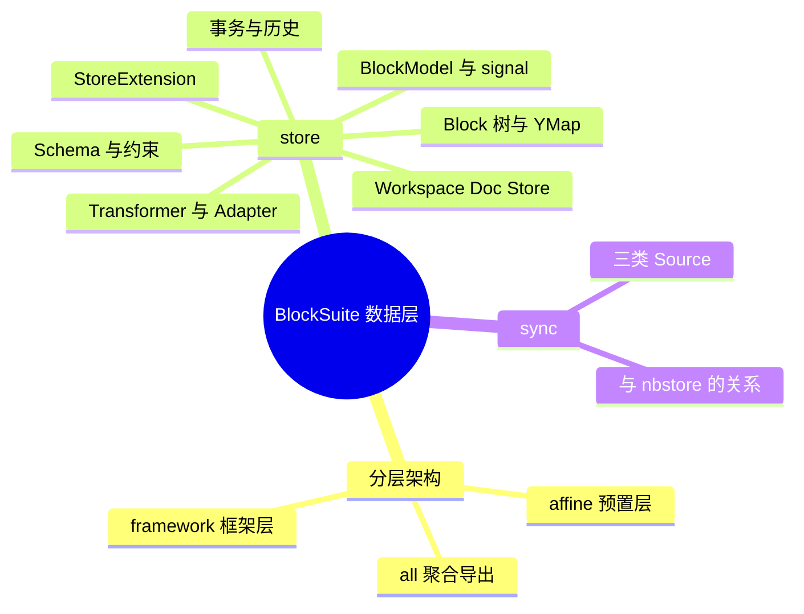
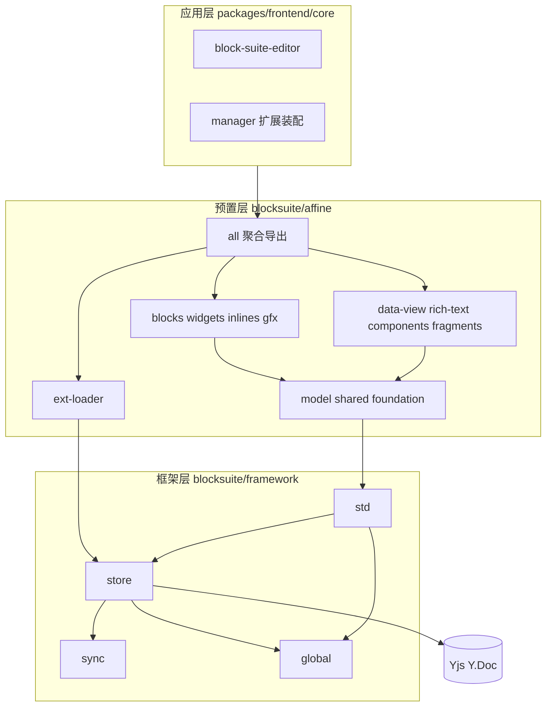
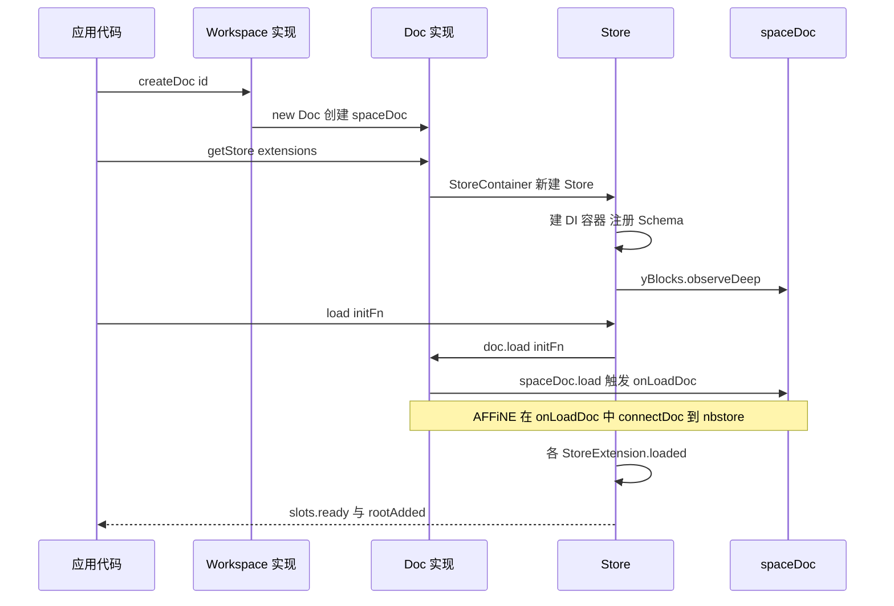
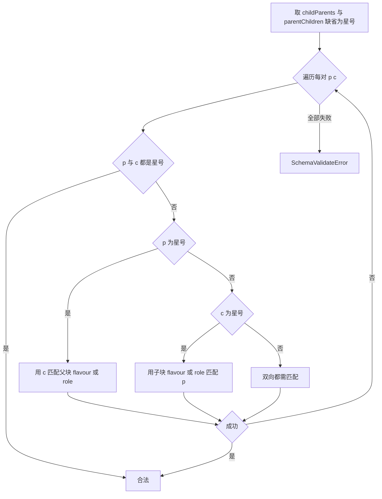
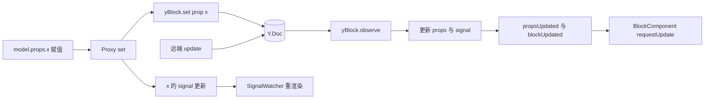
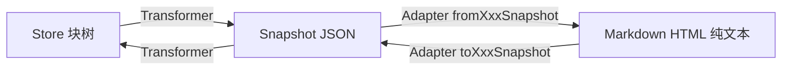
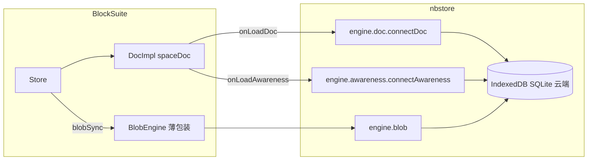
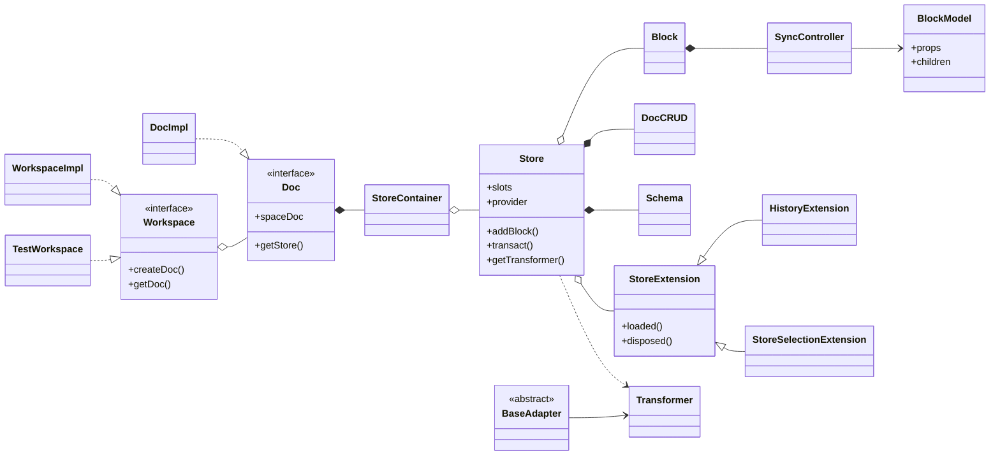

# 第 12 章 BlockSuite 架构与 Store 数据层

> **所属部分**：第 5 部分 · 编辑器内核 BlockSuite ｜ **难度**：★★★★☆ ｜ **建议学时**：10 小时 ｜ **前置章节**：第 6 章（React / Lit / Signals / RxJS）、第 8 章（CRDT 与 Yjs 原理）

---

## 本章导读

如果把 AFFiNE 比作一辆车，BlockSuite 就是它的发动机：文档页（Page）、白板（Edgeless）、数据库视图、富文本、协同光标……几乎所有"编辑"能力都来自仓库里的 `blocksuite/` 目录，React 应用层（`packages/frontend/core`）只负责把发动机装进车壳。

学习 BlockSuite 最容易犯的错误，是一上来就钻进某个块组件的 Lit 渲染代码，被扩展注册、DI 标识符、Signal、Yjs 事件绕晕。正确的顺序是**自底向上**：先看清分层（哪些包是框架、哪些是 AFFiNE 预置块），再吃透数据层 `@blocksuite/store`——所有块最终都是一棵存在 Yjs 里的 **Block 树**，视图只是它的投影；最后（第 13 章）才看 `@blocksuite/std` 如何把数据变成可交互的 DOM。

本章覆盖：分层架构与聚合包、`framework/global` 基础设施、Workspace / Doc / Store 三层容器、Block 树存储布局、Schema、BlockModel 响应式、事务与撤销、Transformer / Adapter、Store 侧扩展，以及 `framework/sync` 与 nbstore 的关系。我们会对照 `blocksuite/docs-site/guide` 指出**文档落后于源码之处**——在 BlockSuite 中这很普遍，务必养成"以源码为准"的习惯。

> 本章路径均相对仓库根目录 `AFFiNE/`，对应 `@affine/monorepo` 0.27.5（canary）。

---

## 学习目标

- [ ] 能够画出 BlockSuite 的两层架构（framework / affine），说出 `global`、`store`、`sync`、`std` 的职责边界
- [ ] 能够解释聚合包 `@blocksuite/affine` 的导出结构，以及块包 `store` / `view` 子路径的含义
- [ ] 能够说清 `Workspace`、`Doc`、`Store` 的关系，并指出它们在 AFFiNE 中由哪个类实现
- [ ] 能够描述 Block 在 Yjs 中的存储布局（`sys:*` / `prop:*`），并跟踪 `store.addBlock()` 的执行路径
- [ ] 能够用 `defineBlockSchema` 正确设置 `role`、`parent`、`children`、`version`，理解 `@role` 与 glob 匹配
- [ ] 能够解释 `model.props.x` 与 `model.props.x$` 的区别，以及一次赋值如何落到 `Y.Map` 并刷新视图
- [ ] 能够正确使用 `transact`、`captureSync`、`withoutTransact` 控制撤销栈
- [ ] 能够使用 `Transformer` 完成 Doc ↔ Snapshot 转换，并编写一个 Transformer 中间件

---

## 知识地图



---

## 12.1 BlockSuite 的定位与分层架构

### 12.1.1 它是"编辑器框架"，而不是"一个编辑器"

`blocksuite/docs-site/guide/overview.md` 开篇即说明：BlockSuite 是**用来构建编辑器与协同应用的工具集**，由一个最小化的 vanilla framework 加一组预置组件组成。它与 AFFiNE 的关系类似 Monaco 与 VS Code，但 BlockSuite 使用 **Web Components（Lit）**，AFFiNE 使用 React，这迫使两者之间必须有清晰的包边界。

| 层次 | 关心什么 | 不关心什么 |
| --- | --- | --- |
| framework（框架层） | 块树如何存储、协同、渲染成组件树，事件/选择/命令如何流转 | "段落""白板"等具体业务 |
| affine（预置层） | AFFiNE 用到的块、小部件（widget）、行内元素、白板元素 | React、路由、账号、云同步 |
| `packages/frontend/core`（应用层） | 把编辑器嵌入 React 页面，注入主题、AI、云端用户等服务 | 块的内部实现 |

### 12.1.2 目录与子包地图

```text
blocksuite/
├── framework/          # 框架层：global / store / sync / std
├── affine/             # 预置层：all blocks components data-view ext-loader foundation
│                       #         fragments gfx inlines model rich-text shared widgets
├── playground/         # 本地调试用 Vite 应用（第 15 章使用）
├── integration-test/   # 浏览器集成测试与 TestAffineEditorContainer
├── docs-site/          # VitePress 文档站：guide / blog / components
└── docs/               # typedoc API 文档配置
```

框架层四个包：

| 包名 | 目录 | 职责 |
| --- | --- | --- |
| `@blocksuite/global` | `blocksuite/framework/global` | DI 容器、Disposable、错误码、几何计算、Lit 混入、日志、平台判断 |
| `@blocksuite/store` | `blocksuite/framework/store` | Workspace/Doc 接口、Store、Block 树、Schema、响应式代理、事务、Transformer、Adapter 基类 |
| `@blocksuite/sync` | `blocksuite/framework/sync` | `DocSource` / `BlobSource` / `AwarenessSource` 抽象与参考 Engine |
| `@blocksuite/std` | `blocksuite/framework/std` | `BlockStdScope`、`EditorHost`、`BlockComponent`、事件、命令、选择、Inline、gfx（`./gfx`、`./inline`、`./effects` 子路径） |

> `blocksuite/framework/global/src/index.ts` 只有一行 `export {};`，必须用 `@blocksuite/global/di`、`@blocksuite/global/disposable` 等子路径导入（见其 `package.json` 的 `exports`），以利于 tree-shaking 并避免循环依赖。

预置层 `blocksuite/affine/`：

| 目录 | 包名示例 | 职责 |
| --- | --- | --- |
| `model` | `@blocksuite/affine-model` | 多数块的 Schema/Model、白板元素模型 `elements/`、主题 `themes/`、常量 `consts/` |
| `blocks/*` | `@blocksuite/affine-block-paragraph` 等 20 个 | 每块一包：视图组件、快捷键、命令、Adapter、配置 |
| `widgets/*` | `@blocksuite/affine-widget-slash-menu` 等 | 挂在块上的浮层 UI |
| `inlines/*` | `@blocksuite/affine-inline-link` 等 | 行内元素：链接、引用、提及、公式、脚注、评论 |
| `gfx/*` | `@blocksuite/affine-gfx-shape` 等 | 白板元素与工具、turbo-renderer |
| `data-view` | `@blocksuite/data-view` | 通用数据视图框架（表格/看板/日历） |
| `rich-text` / `shared` / `components` | `@blocksuite/affine-rich-text` 等 | 富文本封装 / 跨块共享 services·commands·adapters / 通用 UI |
| `fragments/*` | `@blocksuite/affine-fragment-doc-title` 等 | 编辑器外片段：标题、大纲、Frame 面板 |
| `foundation` / `ext-loader` | `@blocksuite/affine-foundation` / `@blocksuite/affine-ext-loader` | 基础扩展集合 / 扩展加载器 |
| `all` | `@blocksuite/affine` | **聚合包**，把上述所有包按子路径重导出 |

### 12.1.3 聚合包 `@blocksuite/affine`

应用层几乎只从 `@blocksuite/affine/...` 导入。`blocksuite/affine/all/package.json` 的 `exports` 有 207 个条目，模式规整：

```text
"./store"              -> ./src/store/index.ts          # 重导出 @blocksuite/store
"./std" "./std/gfx"    -> ./src/std/index.ts / gfx.ts   # 重导出 @blocksuite/std
"./global/di"          -> ./src/global/di.ts
"./blocks/divider"     -> ./src/blocks/divider/index.ts
"./blocks/divider/store" -> ./src/blocks/divider/store.ts
"./blocks/divider/view"  -> ./src/blocks/divider/view.ts
"./extensions/store"   -> ./src/extensions/store.ts     # getInternalStoreExtensions()
"./extensions/view"    -> ./src/extensions/view.ts      # getInternalViewExtensions()
"./schemas"            -> ./src/schemas.ts              # AffineSchemas 数组
```

每个块包都按 **`.`（公共 API）/ `./store`（可在无 DOM 环境运行的数据扩展）/ `./view`（视图扩展）** 三段式导出，`blocksuite/affine/all/src/blocks/divider/index.ts` 只有一行 `export * from '@blocksuite/affine-block-divider';`。`store`/`view` 分离很关键：服务端做 Markdown 导出只需 Schema 与 Adapter，不应加载任何 Lit 组件。

`blocksuite/affine/all/src/schemas.ts` 把预置块的 Schema 收集成数组 `AffineSchemas`（25 个），供测试、playground 使用。小发现：其中 `SurfaceBlockSchema`、`DataViewBlockSchema` 并不来自 `affine-model`，而是定义在各自块包中（如 `blocksuite/affine/blocks/surface/src/surface-model.ts`），因为它们依赖块内实现。

### 12.1.4 分层架构图



**小结**：依赖只能自上而下——`store` 不依赖 `std`，`std` 不依赖任何 `affine-*` 包；`@blocksuite/affine` 是应用层的唯一入口。

---

## 12.2 framework/global：地基工具箱

`blocksuite/framework/global/src/` 下有 `di`、`disposable`、`env`、`exceptions`、`gfx`、`lit`、`types`、`utils` 八个目录，与编辑器概念无关，却被上层到处使用。

### 12.2.1 di：轻量依赖注入容器

| 概念 | 源码 | 作用 |
| --- | --- | --- |
| `createIdentifier<T>(name)` | `blocksuite/framework/global/src/di/identifier.ts` | 创建服务标识符；返回值本身还是函数，`Id('variant')` 创建同名不同**变体** |
| `Container` | `.../di/container.ts` | 注册表：`add`（按类）、`addImpl`（为标识符注册类/工厂/值）、`override` |
| `ServiceProvider` | `.../di/provider.ts` | 解析器：`get`、`getOptional`、`getAll`；支持父 provider 链 |

`createIdentifier` 的实现是 `Object.assign(variant => createIdentifier(name, variant), { identifierName: name, variant })`——一个"可调用的标识符对象"。"变体"是 BlockSuite 最常见的用法：`BlockSchemaIdentifier('affine:paragraph')`、`BlockViewIdentifier('affine:paragraph')` 以 flavour 为变体，`provider.getAll(BlockSchemaIdentifier)` 一次取出全部。`container.provider(scope, parentProvider)` 的第二个参数是父 provider——这正是 Store 与 Std 两级容器能串起来的原因（第 13 章）。

### 12.2.2 disposable、exceptions、gfx、lit 与其它

- **disposable**：`DisposableGroup` 接受 `Disposable`、RxJS `Subscription`、`Subject` 或回调，统一 `dispose()`；`addFromEvent()` 封装事件监听。已 dispose 的组再 `add` 会立即释放。所有监听都应放进 `DisposableGroup`，这是 BlockSuite 的强约定。
- **exceptions**：`blocksuite/framework/global/src/exceptions/code.ts` 定义 `ErrorCode`（`ModelCRUDError`、`SchemaValidateError`、`TransformerError`、`InlineEditorError`、`SelectionError`…），`>= 10000` 为致命错误（`NoRootModelError` 等）。`BlockSuiteError` 自动计算 `isFatal`。枚举中的 `MigrationError` 已无代码使用（见 12.5.5）。
- **gfx**：`Bound`、`Vec`、`PointLocation`、`xywh.ts`（序列化格式 `"[x,y,w,h]"`）、曲线/折线/SVG 路径工具与 vendored 的 `perfect-freehand`（画笔平滑）。纯数学，可在 Worker 中运行。
- **lit**：`SignalWatcher(Base)` 在 Lit 的 `performUpdate` 中用 `effect` 包裹渲染，**自动收集读取过的 signal**并在变化时 `requestUpdate()`；`WithDisposable(Base)` 提供 `_disposables`；`watch` 装饰器。`EditorHost`、`BlockComponent` 都是 `SignalWatcher(WithDisposable(...))`。
- **utils / env / types**：`NoopLogger`、`nextTick`、`assertType`；`IS_MAC`、`IS_ANDROID`、`IS_MOBILE` 等；`VirtualKeyboard` 类型补充。

**小结**：DI 容器与 SignalWatcher 是理解后续扩展机制与响应式渲染的两把钥匙。

---

## 12.3 Workspace / Doc / Store：三层数据容器

### 12.3.1 三者关系

在 `@blocksuite/store` 中，**`Workspace` 与 `Doc` 只是接口，`Store` 才是具体类**——这与旧文档的 `DocCollection`、`doc.addBlock` 大不相同。`Workspace` 接口（`blocksuite/framework/store/src/extension/workspace/workspace.ts`）包含 `id`、`meta`、`idGenerator`、`blobSync: BlobEngine`、`onLoadDoc?`、`onLoadAwareness?`、`doc`、`docs` 与 `createDoc/getDoc/removeDoc`；`Doc` 接口如下：
```ts
// 来源：blocksuite/framework/store/src/extension/workspace/doc.ts（节选）
export interface Doc {
  readonly id: string;
  load(initFn?: () => void): void;
  getStore(options?: GetStoreOptions): Store;
  get awarenessStore(): AwarenessStore;
  get workspace(): Workspace;
  get rootDoc(): Y.Doc;
  get spaceDoc(): Y.Doc;
  get yBlocks(): Y.Map<YBlock>;
  // ... meta、remove、ready、loaded、clear、removeStore、dispose
}
export const DocIdentifier = createIdentifier<Doc>('store-doc');
```

| 概念 | 粒度 | 持有的 Yjs 对象 | 主要职责 |
| --- | --- | --- | --- |
| `Workspace` | 一个工作区 | `doc`：根 `Y.Doc` | 管理多个 Doc、`WorkspaceMeta`、ID 生成器、Blob 引擎 |
| `Doc` | 一篇文档 | `spaceDoc`；`yBlocks = spaceDoc.getMap('blocks')` | 加载/卸载 Y.Doc、Awareness、创建 Store |
| `Store` | 文档的一个数据切片 | 读写 `doc.yBlocks` | Block CRUD、Schema 校验、事务与撤销、扩展 DI 容器、Transformer 入口 |

一个 Doc 可以有**多个 Store**：主编辑器的可编辑 Store、引用预览的 `readonly` Store、带 `query` 过滤的 Store……`StoreContainer`（`blocksuite/framework/store/src/model/store-container.ts`）按 `id` 或 `{ readonly, query }` 缓存：

```ts
// 来源：blocksuite/framework/store/src/model/store-container.ts（节选）
if (readonly || query) {
  idOrOptions = { readonly, query };
} else if (!id) {
  idOrOptions = this.doc.workspace.idGenerator();
} else {
  idOrOptions = id;
}
const key = this._getQueryKey(idOrOptions);
if (this._storeMap.has(key)) return this._storeMap.get(key) as Store;
const storeExtension: ExtensionType = {
  setup: di => { di.addImpl(DocIdentifier, () => this.doc); },
};
// ... new Store({ doc, readonly, query, provider, extensions: [storeExtension, ...] })
```

两个细节：① `StoreContainer` 在不传 `id` 且不传 `readonly/query` 时会**生成新 id**——AFFiNE 的 `DocImpl.getStore()` 原样透传 `id`，所以不传参调用每次都新建 Store，复用必须传 `id`；而 `TestDoc.getStore()`（`blocksuite/framework/store/src/test/test-doc.ts`）在未传 `id` 时默认使用 `spaceDoc.guid`，因此测试环境中多次调用拿到的是同一个 Store——两种实现行为不同，务必留意；② Store 通过 DI（`DocIdentifier`）拿到 Doc，Store 自身也是"扩展化"的。

### 12.3.2 谁来实现 Workspace 与 Doc

| 场景 | Workspace 实现 | Doc 实现 |
| --- | --- | --- |
| 测试与 playground | `TestWorkspace`（`blocksuite/framework/store/src/test/test-workspace.ts`，注释"Test only, Do not use this in production"） | `TestDoc`（同目录 `test-doc.ts`） |
| AFFiNE 应用 | `WorkspaceImpl`（`packages/frontend/core/src/modules/workspace/impls/workspace.ts`） | `DocImpl`（同目录 `doc.ts`） |

AFFiNE 的 `DocImpl.getStore()` 会**自动注入全部 Store 扩展**：

```ts
// 来源：packages/frontend/core/src/modules/workspace/impls/doc.ts（节选）
getStore({ readonly, query, provider, extensions, id }: GetStoreOptions = {}) {
  const storeExtensions = getStoreManager()
    .config.init()
    .featureFlag(this.workspace.featureFlagService)
    .value.get('store');
  const exts = storeExtensions.concat(extensions ?? []).concat(this.storeExtensions);
  const extensionSet = new Set(exts);
  return this._storeContainer.getStore({
    id, readonly, query, provider, extensions: Array.from(extensionSet),
  });
}
// load(): spaceDoc.load() → workspace.onLoadDoc(spaceDoc) → onLoadAwareness(...) → initFn()
```

`getStoreManager()`（`packages/frontend/core/src/blocksuite/manager/store.ts`）汇总了 `getInternalStoreExtensions()` + `AIStoreExtension` + `FeatureFlagStoreExtension`，因此 AFFiNE 中任何 Store 都认识全部 flavour。`DocImpl` 为每篇文档新建**独立**的 `Y.Doc({ guid: id })` 作为 `spaceDoc`，`clientID` 与 `rootDoc` 相同；为兼容旧版本仍在 `rootDoc.getMap('spaces')` 放一个同 guid 的 subdoc 占位（源码注释"old version compatible code"）。

### 12.3.3 生命周期



`Store.load()` 依次执行：（若已 dispose 则重建 `disposableGroup`）→ `this._doc.load(initFn)` → 对所有 `StoreExtensionIdentifier` 调用 `ext.loaded()` → `slots.ready.next()` → `slots.rootAdded.next(root.id)`。`dispose()` 则反向调用 `ext.disposed()` 并 `unobserveDeep`。`Store.slots` 是一组 RxJS `Subject`：`ready`、`rootAdded`、`rootDeleted`、`blockUpdated`（`add`/`delete`/`update` 三种 payload）与内部的 `yBlockUpdated`。视图层对"数据变了"的感知几乎都来自 `blockUpdated` 与 `BlockModel.propsUpdated`。

### 12.3.4 初始化文档的标准姿势

```ts
// 来源：blocksuite/playground/apps/starter/data/empty.ts（节选）
const doc = collection.getDoc(id) ?? collection.createDoc(id);
const store = doc.getStore();
doc.clear();
doc.load(() => {
  const rootId = store.addBlock('affine:page', { title: new Text() });
  store.addBlock('affine:surface', {}, rootId);
  const noteId = store.addBlock('affine:note', {}, rootId);
  store.addBlock('affine:paragraph', {}, noteId);
});
store.resetHistory();
```

这是 AFFiNE 文档的最小合法结构：`affine:page`（root）→ `affine:surface`（画布）+ `affine:note`（文档流容器）→ `affine:paragraph`。`EditorHost.connectedCallback` 在 `store.root` 为空时抛出 `NoRootModelError`，**挂编辑器前必须先初始化根块**。

**小结**：`Workspace`/`Doc` 由宿主实现，决定"Y.Doc 从哪来、怎么同步"；`Store` 是框架的具体类，决定"如何在 Y.Doc 上安全读写块"。

---

## 12.4 Block 树：在 Y.Map 中的存储布局

### 12.4.1 扁平存储 + id 引用

BlockSuite **不嵌套存储**块树：`doc.yBlocks` 是 `Y.Map<YBlock>`，键为 block id，值为一个 `Y.Map`；父子关系由父块的 `sys:children`（`Y.Array<string>`）引用 id 表达。

```text
yBlocks (Y.Map)
└── "block-abc" (YBlock)
    ├── sys:id        = "block-abc"
    ├── sys:flavour   = "affine:paragraph"
    ├── sys:version   = 1
    ├── sys:children  = Y.Array ["block-def"]
    ├── prop:type     = "text"
    ├── prop:text     = Y.Text("Hello")
    └── prop:collapsed= false
```

好处：移动块只改两个 `Y.Array`；按 id 查找 O(1)；协同冲突粒度更细。

### 12.4.2 跟踪 `store.addBlock()`

`Store.addBlock` 只做只读检查、生成 id、包事务，再委托 `DocCRUD`：

```ts
// 来源：blocksuite/framework/store/src/model/store/store.ts（节选）
addBlock<T extends BlockModel = BlockModel>(flavour: string, blockProps = {}, parent?, parentIndex?): string {
  if (this.readonly) {
    throw new BlockSuiteError(ErrorCode.ModelCRUDError, 'cannot modify data in readonly mode');
  }
  const id = blockProps.id ?? this._doc.workspace.idGenerator();
  this.transact(() => {
    this._crud.addBlock(id, flavour, { ...blockProps },
      typeof parent === 'string' ? parent : parent?.id, parentIndex);
  });
  return id;
}
```

```ts
// 来源：blocksuite/framework/store/src/model/store/crud.ts（节选）
this._schema.validate(flavour, parentFlavour as string);

const yBlock = new Y.Map() as YBlock;
this._yBlocks.set(id, yBlock);
yBlock.set('sys:id', id);
yBlock.set('sys:flavour', flavour);
yBlock.set('sys:version', schema.version);
yBlock.set('sys:children', Y.Array.from(children ?? []));

const defaultProps = schema.model.props?.(internalPrimitives) ?? {};
const props = { ...defaultProps, ...initialProps };
delete props.id; delete props.flavour; delete props.children;
// 非 flat 模式
Object.entries(props).forEach(([key, value]) => {
  if (value === undefined) return;
  yBlock.set(`prop:${key}`, native2Y(value));
});
const parentId = parent ?? (schema.model.role === 'root' ? null : this.root);
// ... 将 id 插入父块 sys:children 的 parentIndex 位置
```

易忽视的语义：① **不传 parent 默认挂到 root 下**；② 写入前 `schema.validate` 校验嵌套——但由于整个 CRUD 运行在 `Store.transact` 的 try/catch 中，校验失败**不会向调用方抛出**，只会 `console.error`，而 `addBlock` 照常返回预先生成的 id（只读模式检查例外，它在 `transact` 之前直接抛出）；③ 值为 `undefined` 的属性**不写入** Yjs；④ `native2Y` 把数组转 `Y.Array`、纯对象转 `Y.Map`、`Text` 转 `Y.Text`、`Boxed` 转其内部 `Y.Map`。

写入后，Store 构造时注册的 `observeDeep` 回调捕获顶层 `add` 事件，经 `slots.yBlockUpdated` 进入 `_onBlockAdded`：`new Block(schema, yBlock, store, options)`（由 `SyncController` 解析出 Model）→ 运行 query 设置 `blockViewType` → 更新 `_blocks` signal → `model.created.next()` → 若为 root 则 `slots.rootAdded` → 最后发出 `blockUpdated: { type: 'add' }`。注意：**Block 对象是由 Yjs 事件创建的，而不是由 `addBlock` 直接创建**——远端协作者新增的块走的是完全相同的路径。

### 12.4.3 Query 与 blockViewType

`Store` 的 `query` 参数对块树做视图过滤，结果存于 `Block.blockViewType`：`'display' | 'hidden' | 'bypass'`。

```ts
// 来源：blocksuite/framework/store/src/model/store/query.ts（节选）
/**
 * - `strict` means that only blocks that match the query will be included.
 * - `loose` means that all blocks will be included first, and then the blocks will be run through the query.
 * - `include` means that only blocks and their ancestors that match the query will be included.
 */
type QueryMode = 'strict' | 'loose' | 'include';
```

`bypass` 表示"自身不渲染但渲染子块"：子块需要显示而祖先被隐藏时，祖先被提升为 `bypass`。`BlockComponent._renderViewType` 按这三个值决定渲染内容（第 13 章）。

### 12.4.4 常用 CRUD API

| 方法 | 说明 |
| --- | --- |
| `addBlock` / `addBlocks` / `addSiblingBlocks(target, props[], 'before'\|'after')` | 新增 |
| `updateBlock(modelOrId, props \| callback)` | 更新；传回调则在事务中执行任意修改 |
| `deleteBlock(model, { deleteChildren?, bringChildrenTo? })` | 删除，可转移子块 |
| `moveBlocks(blocks, newParent, targetSibling?, before?)` | 移动 |
| `getBlock(id)` / `getBlock$(id)` | 取 `Block`；`$` 版本读 signal、可被追踪 |
| `getModelById` / `getModelsByFlavour` / `getAllModels` | 取 Model |
| `getParent` / `getPrev` / `getNext` / `getPrevs` / `getNexts` | 树遍历 |

> 文档差异：`docs-site/guide/working-with-block-tree.md` 中的 `doc.getBlockById(id)` 已不存在，应使用 `store.getBlock(id)?.model` 或 `store.getModelById(id)`；文档里的 `doc` 在新 API 中对应 `Store`。

**小结**：Block 树 = 扁平 `Y.Map` + `sys:children` 引用；写操作走 `Store → DocCRUD → Yjs`，读来自 Yjs 事件驱动维护的 `_blocks` signal。

---

## 12.5 Schema：用 defineBlockSchema 声明块

### 12.5.1 结构

`defineBlockSchema`（`blocksuite/framework/store/src/model/block/zod.ts`）把参数重组成 zod 定义的 `BlockSchema` 形状并 `parse` 一次：

| 字段 | 说明 |
| --- | --- |
| `flavour` | 块类型唯一名，约定 `namespace:name` |
| `props(internal)` | **函数**，返回默认属性；`internal.Text()` 建 `Text`，`internal.Boxed(v)` 建 `Boxed` |
| `metadata.version` | Schema 版本，写入 `sys:version` |
| `metadata.role` | `'root'` 有特殊语义；其它字符串（`content`、`hub`、自定义）用于 `@role` 匹配 |
| `metadata.parent` / `children` | 允许的父/子块 flavour 或 `@role` 列表；`children: []` 表示禁止子块 |
| `metadata.isFlatData` | 扁平属性存储（12.6.4） |
| `toModel` | 返回自定义 Model 实例 |
| `transformer` | 返回自定义 `BaseBlockTransformer`（快照处理资源等） |

### 12.5.2 真实例子

```ts
// 来源：blocksuite/affine/model/src/blocks/paragraph/paragraph-model.ts（节选）
export const ParagraphBlockSchema = defineBlockSchema({
  flavour: 'affine:paragraph',
  props: (internal): ParagraphProps => ({
    type: 'text',
    text: internal.Text(),
    textAlign: undefined,
    collapsed: false,
    comments: undefined,
    // ... 'meta:createdAt' 等 4 个 meta 字段，默认 undefined
  }),
  metadata: {
    version: 1,
    role: 'content',
    parent: ['affine:note', 'affine:database', 'affine:paragraph', 'affine:list',
      'affine:edgeless-text', 'affine:callout', 'affine:transcription'],
  },
  toModel: () => new ParagraphBlockModel(),
});

export const ParagraphBlockSchemaExtension = BlockSchemaExtension(ParagraphBlockSchema);

export class ParagraphBlockModel extends BlockModel<ParagraphProps> {
  override isEmpty(): boolean {
    return this.props.text$.value.length === 0 && this.children.length === 0;
  }
}
```

```ts
// 来源：blocksuite/affine/model/src/blocks/note/note-model.ts（节选）
export const NoteBlockSchema = defineBlockSchema({
  flavour: 'affine:note',
  props: (): NoteProps => ({ xywh: `[0,0,${DEFAULT_NOTE_WIDTH},${DEFAULT_NOTE_HEIGHT}]`, /* ... */ }),
  metadata: {
    version: 1,
    role: 'hub',
    parent: ['@root'],
    children: ['@content', 'affine:database', 'affine:data-view', 'affine:callout'],
  },
  toModel: () => new NoteBlockModel(),
});
```

Note 的 `parent: ['@root']`、`children: ['@content', ...]` 中，**`@` 前缀表示按 role 匹配**：任何 `role: 'content'` 的新块无需改 Note 的 Schema 就能放进 Note。Root（`affine:page`）是 `role: 'root'`、`version: 2`；Callout 是 `role: 'hub'`、`children: ['affine:paragraph', 'affine:list']`。

### 12.5.3 校验算法

`Schema`（`blocksuite/framework/store/src/schema/schema.ts`）的 `validate(flavour, parentFlavour?, childFlavours?)`：root 块不能有父、非 root 块必须有父，然后调用 `validateSchema(child, parent)` → `_validateParent`：取 `child.model.parent ?? ['*']` 与 `parent.model.children ?? ['*']` 两两组合，任一组满足即合法。



`_matchFlavourOrRole` 支持：`@xxx` 与对方 role 比较；普通字符串用 `minimatch` 做 **glob 匹配**（Surface 的 `children` 含 `'affine:embed-*'`）。

### 12.5.4 role 的真实语义

`docs-site/guide/block-schema.md` 称 role 只有 `root`/`hub`/`content` 三种，且 hub/content 有隐式嵌套规则。**源码中没有这些硬编码规则**：`RoleType` 是 `'root' | 'content' | string`；`Schema` 只特殊处理 `root`；其余 role 仅在 `@role` 匹配时生效。反例：`packages/frontend/core/src/blocksuite/ai/blocks/transcription-block/model.ts` 使用了自定义 `role: 'attachment-viewer'`。

### 12.5.5 version：只校验，不迁移

`version` 在 `addBlock` 时写入 `sys:version`。渲染时 `BlockComponent.isVersionMismatch`（`blocksuite/framework/std/src/view/element/block-component.ts`）比较 Schema 与数据版本，不一致则渲染 "Block Version Mismatched" 警告而非内容。在 `framework`、`affine` 目录搜索 `migrat`/`upgrade`，**没有任何 Schema 迁移实现**（早期 BlockSuite 的迁移钩子已移除）。因此：

- 改 `version` 是**破坏性**操作，老数据会直接显示版本不匹配；
- AFFiNE 实践是"兼容式演进"：新增可选属性（`textAlign?`、`comments?`）、读取时容错，而非升版本；
- 版本 > 1 的只有 `affine:page`(2)、`affine:database`(3)、`affine:surface`(5)，均为历史遗留。

### 12.5.6 注册方式：BlockSchemaExtension

```ts
// 来源：blocksuite/framework/store/src/extension/schema.ts
export const BlockSchemaIdentifier = createIdentifier<BlockSchemaType>('BlockSchema');

export function BlockSchemaExtension(blockSchema: BlockSchemaType): ExtensionType {
  return {
    setup: di => {
      di.addImpl(BlockSchemaIdentifier(blockSchema.model.flavour), () => blockSchema);
    },
  };
}
```

Store 构造时执行 `this._provider.getAll(BlockSchemaIdentifier).forEach(schema => this._schema.register([schema]))`——**每个 Store 都有自己的 `Schema` 实例**，由扩展列表决定认识哪些块。`new Schema().register(AffineSchemas)` 的写法仍出现在 playground 与测试中，但用途已变成"给 `Transformer` 构造用"。

**小结**：Schema = flavour + 默认 props 工厂 + 嵌套约束 + 版本；约束是 flavour glob 与 `@role` 的双向匹配；通过 DI 注册到每个 Store。

---

## 12.6 BlockModel 与响应式：props 如何落到 Y.Map

### 12.6.1 Block、BlockModel、SyncController

```ts
// 来源：blocksuite/framework/store/src/model/block/block.ts（节选）
export class Block {
  private readonly _syncController: SyncController | FlatSyncController;
  blockViewType: BlockViewType = 'display';
  get model() { return this._syncController.model; }

  constructor(readonly schema: Schema, readonly yBlock: YBlock, readonly doc?: Store, readonly options: BlockOptions = {}) {
    // ... onChange 包装
    const blockSchema = this.schema.get(yBlock.get('sys:flavour') as string);
    if (blockSchema?.model.isFlatData) {
      this._syncController = new FlatSyncController(schema, yBlock, doc, onChange);
    } else {
      this._syncController = new SyncController(schema, yBlock, doc, onChange);
    }
  }
}
```

- `Block`：Store 内部容器，持有 `yBlock`、`blockViewType`；
- `BlockModel`（`block-model.ts`）：业务模型，`id`、`flavour`、`props`、`children`、`parent`、`store`、`propsUpdated`、`created`/`deleted`；
- `SyncController`：**双向绑定器**——解析 YBlock 生成 Model、Yjs 变化回写 Model、拦截 Model 赋值写 Yjs。

`BlockModel._children` 是 signal，`created` 时从 `sys:children` 初始化并 observe；`children` 通过 `computed` 映射为 `store.getBlock$(id).model`，所以 **`model.children` 也是响应式的**。

### 12.6.2 props 的双形态：值与 signal

`SyncController._createModel` 为每个 prop 同时生成"值"与"`$` signal"：

```ts
// 来源：blocksuite/framework/store/src/model/block/sync-controller.ts（节选）
const signalWithProps = Object.entries(props).reduce((acc, [key, value]) => {
  const data = signal(value);
  const dispose = effect(() => {
    const value = data.value;
    if (!this.model) return;
    _mutex(() => {
      // @ts-expect-error allow magic props
      this.model.props[key] = value;
    });
  });
  // ... model.deleted 时 dispose
  return { ...acc, [`${key}$`]: data, [key]: value };
}, {} as Record<string, unknown>);
```

| 写法 | 类型 | 用途 |
| --- | --- | --- |
| `model.props.type` | 值 | 读取 / 赋值写入 Yjs |
| `model.props.type$` | `Signal` | 在渲染、`computed`、`effect` 中读取可被追踪；给 `.value` 赋值同样写入 Yjs |

`BlockModel` 用映射类型 `SignaledProps<Props>` 声明了 `` `${P}$` `` 形式的 signal 属性。

### 12.6.3 写路径与读路径

Proxy 的 `set` 拦截器（节选）：

```ts
// 来源：blocksuite/framework/store/src/model/block/sync-controller.ts（节选）
set: (target, p, value, receiver) => {
  if (!this._byPassProxy && typeof p === 'string' && model.keys.includes(p)) {
    if (this._stashed.has(p)) {
      setValue(target, p, value);
      const result = Reflect.set(target, p, value, receiver);
      this.onChange?.(p, true);
      return result;
    }
    const yValue = native2Y(value);
    if (this.yBlock.get(`prop:${p}`) === yValue) {
      return Reflect.set(target, p, value, receiver);
    }
    this.yBlock.set(`prop:${p}`, yValue);
    const proxy = this._getPropsProxy(p, yValue);
    setValue(target, p, value);
    return Reflect.set(target, p, proxy, receiver);
  }
  return Reflect.set(target, p, value, receiver);
},
```

要点：① 只有 `model.keys`（Schema 声明过的属性）才写入 Yjs；② 写 `prop:${p}` 后同步 `${p}$` signal，`_mutex` 防止 signal→effect→写回的循环；③ 被 `stash` 的属性只改本地。**直接赋值不自动包事务**：callout 块中的 `this.model.props.icon$.value = iconData` 会产生独立的、origin 为 `null` 的 Yjs 事务；而 `store.updateBlock(model, { type: 'h1' })` 先 `schema.validate` 再 `transact`。

读路径：`_observeYBlockChanges` 监听 `yBlock` 的 `keysChanged`，对 `add/update` 更新 `model.props[key]` 与 `key$`，对 `delete` 删除，然后调用 `onChange(keyName, isLocal)`。`onChange` 由 Store 在 `_onBlockAdded` 中注入，最终触发 `model.propsUpdated.next({ key })` 与 `slots.blockUpdated.next({ type: 'update' })`。`BlockComponent` 订阅 `propsUpdated` 调用 `requestUpdate()`，同时它又是 `SignalWatcher`——**两条路径保证视图刷新**。`isLocal` 根据事务 origin 判断（为空、为 `UndoManager`、带 `proxy` 标记或等于本地 `clientID` 视为本地）。



### 12.6.4 复杂属性：Text、Boxed、嵌套对象与 Flat Data

| 类型 | 存储 | 说明 |
| --- | --- | --- |
| 原始值 | 直接存 | — |
| 数组 / 纯对象 | `Y.Array` / `Y.Map` | 读取时经 `createYProxy`（`reactive/proxy.ts`）包成 `ReactiveYArray`/`ReactiveYMap`，**子字段修改也同步到 Yjs** |
| `Text` | `Y.Text` | `reactive/text/text.ts`：`insert/delete/format/split/join/applyDelta/toDelta/sliceToDelta`，`deltas$`、`length` |
| `Boxed<T>` | 一个 `Y.Map`，值在 `value` 键 | `reactive/boxed.ts`：不希望被深转换、或需直接操作 `Y.Map`（如 Surface 的 `elements`） |

`Text` 是富文本核心，Inline 编辑器直接绑定 `text.yText`。`native2Y` 遇到已附着 doc 的 `Y.Text` 会 `clone()`，所以 `paragraph.text.split()` 返回的新 `Text` 能直接作为新块 props。

`isFlatData: true` 的块（目前只有 `affine:table`）使用 `FlatSyncController` + `ReactiveFlatYMap`（`reactive/flat-native-y/`）：嵌套对象**展开为点路径扁平键**，如 `prop:cells.row1:col1.text`（见 `DocCRUD.addBlock` 中的 `run(obj, basePath)` 递归）。表格这类"大量小对象"结构协同冲突更细、观察更高效。

### 12.6.5 stash / pop

`model.stash('xywh')` 把属性从 Yjs"摘出来"成纯本地值，此后修改只触发 `onChange` 不写 Yjs；`model.pop('xywh')` 再一次性写回。白板拖拽时避免每帧写 Yjs、产生海量更新与撤销项。

**小结**：`SyncController` 用 Proxy + Signal 在 `model.props` 与 `Y.Map` 之间建立双向绑定；`x` 用于读写，`x$` 用于响应式追踪。

---

## 12.7 事务与历史

### 12.7.1 transact 与 origin

```ts
// 来源：blocksuite/framework/store/src/model/store/store.ts（节选）
transact(fn: () => void, shouldTransact: boolean = this._shouldTransact) {
  const spaceDoc = this._doc.spaceDoc;
  spaceDoc.transact(
    () => {
      try {
        fn();
      } catch (e) {
        // ... console.error 输出错误
      }
    },
    shouldTransact ? this.spaceDoc.clientID : null
  );
}

withoutTransact(fn: () => void) {
  this._shouldTransact = false;
  fn();
  this._shouldTransact = true;
}
```

`HistoryExtension`（`blocksuite/framework/store/src/extension/history/history-extension.ts`）只追踪 `clientID` 这个 origin：

```ts
// 来源：blocksuite/framework/store/src/extension/history/history-extension.ts（节选）
constructor(store: Store) {
  super(store);
  this._history = new Y.UndoManager([this.store.doc.yBlocks], {
    trackedOrigins: new Set([this.store.doc.spaceDoc.clientID]),
  });
}
// ... canUndo$ / canRedo$ 两个 signal；loaded() 时绑定 stack-* 事件
```

| 写入方式 | origin | 可撤销 |
| --- | --- | --- |
| `transact` / `addBlock` / `updateBlock` / `deleteBlock` / `moveBlocks` | `clientID` | 是 |
| `withoutTransact(() => ...)` 中的上述操作 | `null` | 否（适合初始化、AI 流式写入的中间态） |
| 事务外直接 `model.props.x = v` | `null`（Yjs 默认） | 否 |
| 远端协作者更新 | 对方 origin | 否 |

### 12.7.2 captureSync：切分撤销单元

`Y.UndoManager` 默认把 500ms（`captureTimeout`）内的变更合并为一项。`store.captureSync()` 调用 `undoManager.stopCapturing()`，强制开启新项。源码注释示例：`op1(); op2(); store.captureSync(); op3();` 之后第一次 `undo` 撤销 op3，第二次撤销 op1、op2。`blocksuite/affine/blocks/paragraph/src/commands/split-paragraph.ts` 在拆分段落前调用 `store.captureSync()`，保证"回车拆分"是独立的撤销步骤。

### 12.7.3 撤销时恢复选择

`StoreSelectionExtension`（`blocksuite/framework/store/src/extension/selection/selection-extension.ts`）在 `loaded()` 中订阅 UndoManager 的 `stack-item-added`（把当前选择存入 `stackItem.meta` 的 `selection-state`）和 `stack-item-popped`（恢复选择）。撤销后光标能回到原处，且这发生在 **store 层**，与视图无关。

**小结**：origin 决定能否撤销；`captureSync` 切分撤销单元；选择随历史栈保存与恢复。

---

## 12.8 Transformer：Snapshot、中间件与 Adapter

### 12.8.1 Snapshot

Yjs 二进制适合同步，却不适合复制粘贴、导入导出、模板与测试断言。BlockSuite 定义了 JSON 快照（`blocksuite/framework/store/src/transformer/type.ts`）：

```ts
// 来源：blocksuite/framework/store/src/transformer/type.ts（节选）
export type BlockSnapshot = {
  type: 'block'; id: string; flavour: string; version?: number;
  props: Record<string, unknown>;
  children: BlockSnapshot[];
};
export type SliceSnapshot = { type: 'slice'; content: BlockSnapshot[]; workspaceId: string; pageId: string };
export type DocSnapshot = { type: 'page'; meta: DocMeta; blocks: BlockSnapshot };
```

快照是**嵌套树**（与 Yjs 扁平存储相反）。`transformer/json.ts` 中 `toJSON` 把 `Text` 序列化为 `{ "$blocksuite:internal:text$": true, delta }`，`Boxed` 序列化为 `{ "$blocksuite:internal:native$": true, value }`，`fromJSON` 反向还原。

### 12.8.2 Transformer 类

`Transformer`（`blocksuite/framework/store/src/transformer/transformer.ts`）提供 `blockToSnapshot`/`snapshotToBlock`、`docToSnapshot`/`snapshotToDoc`、`sliceToSnapshot`/`snapshotToSlice`。最便捷的获取方式是 `store.getTransformer(middlewares)`：它用 Store 的 `schema`、`workspace.blobSync` 作为 `blobCRUD`，并用 `workspace.createDoc(id).getStore({ id })` 等组装 `docCRUD`。

导出时每个块由其 Schema 的 `transformer`（缺省 `BaseBlockTransformer`，`transformer/base.ts`）完成单节点转换，`Transformer` 负责递归并触发钩子：

```ts
// 来源：blocksuite/framework/store/src/transformer/transformer.ts（节选）
private _blockToSnapshot(model: DraftModel): BlockSnapshot | null {
  this._slots.beforeExport.next({ type: 'block', model });
  const schema = this._getSchema(model.flavour);
  const transformer = this._getTransformer(schema);
  const snapshotLeaf = transformer.toSnapshot({ model, assets: this._assetsManager });
  const children = model.children
    .map(child => this._blockToSnapshot(child))
    .filter(Boolean) as BlockSnapshot[];
  const snapshot: BlockSnapshot = { type: 'block', ...snapshotLeaf, children };
  this._slots.afterExport.next({ type: 'block', model, snapshot });
  return snapshot;
}
```

`DraftModel`（`model/block/draft.ts`）是 `BlockModel` 的纯数据拷贝（`toDraftModel`），避免遍历中受实时变更影响。导入时按 `BATCH_SIZE = 100` 分批插入。

### 12.8.3 块级 Transformer：图片资源

```ts
// 来源：blocksuite/affine/model/src/blocks/image/image-transformer.ts（节选）
export class ImageBlockTransformer extends BaseBlockTransformer<ImageBlockProps> {
  override async fromSnapshot(payload: FromSnapshotPayload): Promise<SnapshotNode<ImageBlockProps>> {
    const snapshotRet = await super.fromSnapshot(payload);
    const sourceId = snapshotRet.props.sourceId;
    if (!payload.assets.isEmpty() && sourceId && !sourceId.startsWith('/'))
      await payload.assets.writeToBlob(sourceId);
    return snapshotRet;
  }

  override toSnapshot(snapshot: ToSnapshotPayload<ImageBlockProps>): BlockSnapshotLeaf {
    const snapshotRet = super.toSnapshot(snapshot);
    const sourceId = snapshot.model.props.sourceId;
    if (sourceId) {
      snapshot.assets.getPathBlobIdMap().set(snapshot.model.id, sourceId);
    }
    return snapshotRet;
  }
}
```

它通过 Schema 的 `transformer: transformerConfigs => new ImageBlockTransformer(transformerConfigs)` 挂载；`AssetsManager`（`transformer/assets.ts`）负责 blob 与快照资源之间的搬运。

### 12.8.4 中间件

中间件接收 `{ slots, docCRUD, assetsManager, adapterConfigs, transformerConfigs }`，可订阅 `beforeImport/afterImport/beforeExport/afterExport`，并可返回清理函数。最简单的真实例子：

```ts
// 来源：blocksuite/affine/shared/src/adapters/middlewares/title.ts
export const titleMiddleware =
  (metas: DocMeta[]): TransformerMiddleware =>
  ({ slots, adapterConfigs }) => {
    const beforeExportSubscription = slots.beforeExport.subscribe(() => {
      for (const meta of metas) {
        adapterConfigs.set('title:' + meta.id, meta.title);
      }
    });
    return () => {
      beforeExportSubscription.unsubscribe();
    };
  };
```

同目录还有 `replace-id.ts`、`paste.ts`、`upload.ts`、`doc-link.ts`、`surface-ref-to-embed.ts` 等，剪贴板（第 13 章）大量使用。

### 12.8.5 Adapter 基类

`BaseAdapter<AdapterTarget>`（`blocksuite/framework/store/src/adapter/base.ts`）站在 Transformer 之上，定义 6 个抽象方法（`fromDocSnapshot/fromBlockSnapshot/fromSliceSnapshot/toDocSnapshot/toBlockSnapshot/toSliceSnapshot`）与组合便捷方法（`fromDoc`、`toDoc`、`fromSlice`…）。同文件的 `ASTWalker` 与 `adapter/context.ts` 的 `ASTWalkerContext` 提供"遍历源 AST 同时 `openNode/closeNode` 构造目标 AST"的机制。具体 Markdown/HTML/Notion HTML/纯文本适配器在 `blocksuite/affine/shared/src/adapters/`，每个块通过 `BlockMarkdownAdapterExtension` 等注册 matcher（第 14、15 章）。



> 文档差异：`docs-site/guide/data-synchronization.md` 中 `import { Job } from '@blocksuite/store'`、`new Job({ collection })` 已过时——`Job` 更名为 **`Transformer`**，参数为 `{ schema, blobCRUD, docCRUD, middlewares }`；且 `docToSnapshot` 现为**同步**方法，`snapshotToDoc` 才是异步。

**小结**：Transformer 管 Block 树 ↔ 快照，块级差异交给 Schema 的 `transformer`，横切逻辑交给中间件，Adapter 再对接外部格式。

---

## 12.9 Store 侧扩展体系

### 12.9.1 Extension 与 StoreExtension

`blocksuite/framework/store/src/extension/extension.ts` 只定义了两样东西：抽象类 `Extension`（静态 `setup(_di)` 空实现）与接口 `ExtensionType { setup(di: Container): void }`。任何拥有 `setup(di)` 的对象或带静态 `setup` 的类都是扩展。该文件顶部有一段很长的"水果加工系统"注释，讲解了"接口 → 标识符 → 实现 → 工厂产出扩展 → 容器 setup → provider 按变体取用"的模式，强烈建议通读。

```ts
// 来源：blocksuite/framework/store/src/extension/store-extension.ts（节选）
export class StoreExtension extends Extension {
  static readonly key: string;
  constructor(readonly store: Store) { super(); }
  loaded() {}
  disposed() {}
  static readonly [storeExtensionSymbol] = true;

  static override setup(di: Container) {
    if (!this.key) {
      throw new BlockSuiteError(ErrorCode.ValueNotExists, 'Key is not defined in the StoreExtension');
    }
    di.add(this, [StoreIdentifier]);
    di.addImpl(StoreExtensionIdentifier(this.key), provider => provider.get(this));
  }
}
```

源码注释强调：Store 扩展**必须能在非 DOM 环境运行**。内置的 `HistoryExtension`（key `history`）与 `StoreSelectionExtension`（key `selection`）在 Store 构造时作为 `internalExtensions` 最先注册，可用 `store.get(HistoryExtension)` 取得。

| 扩展 | 定义位置 | 作用 |
| --- | --- | --- |
| `BlockSchemaExtension(schema)` | `blocksuite/framework/store/src/extension/schema.ts` | 注册 Schema |
| `SelectionExtension(Ctor)` | `blocksuite/framework/store/src/extension/selection/selection-extension.ts` | 注册选择类型 |
| `StoreExtension` 子类 | 各处 | 带生命周期的 Store 服务 |
| `BlockMarkdownAdapterExtension(matcher)` 等 | `blocksuite/affine/shared/src/adapters/*/block-adapter.ts` | 块的 Adapter 规则 |

### 12.9.2 StoreExtensionProvider：按块打包

```ts
// 来源：blocksuite/affine/blocks/divider/src/store.ts
export class DividerStoreExtension extends StoreExtensionProvider {
  override name = 'affine-divider-block';

  override setup(context: StoreExtensionContext) {
    super.setup(context);
    context.register(DividerBlockSchemaExtension);
    context.register(DividerBlockAdapterExtensions);
  }
}
```

`getInternalStoreExtensions()`（`blocksuite/affine/all/src/extensions/store.ts`）返回所有内置 Provider，首个是 `FoundationStoreExtension`（`blocksuite/affine/foundation/src/store.ts`，注册预置选择类型、Adapter 工厂、`FeatureFlagService` 等）。`StoreExtensionManager.get('store')` 实例化 Provider、调用 `setup`、收集所有 `register` 的扩展，得到 `ExtensionType[]`。完整机制（含 `ViewExtensionProvider`）见第 13 章 13.10 节。

**小结**：Store 层的可插拔能力全部是 `ExtensionType`；预置层用 `StoreExtensionProvider` 按块打包、由 Manager 汇总。

---

## 12.10 framework/sync 与 nbstore 的关系

### 12.10.1 三类 Source

```ts
// 来源：blocksuite/framework/sync/src/doc/source.ts（节选）
export interface DocSource {
  name: string;
  pull(docId: string, state: Uint8Array):
    | Promise<{ data: Uint8Array; state?: Uint8Array } | null>
    | { data: Uint8Array; state?: Uint8Array } | null;
  push(docId: string, data: Uint8Array): Promise<void> | void;
  subscribe(
    cb: (docId: string, data: Uint8Array) => void,
    disconnect: (reason: string) => void
  ): Promise<() => void> | (() => void);
}
```

| 类别 | 接口 | Engine | 内置实现 |
| --- | --- | --- | --- |
| 文档 | `DocSource`（pull/push/subscribe） | `DocEngine`（主源 + 影子源） | `doc/impl/indexeddb.ts`、`broadcast.ts`、`noop.ts` |
| 资源 | `BlobSource`（get/set/delete/list，可选 `blobState$`、`upload`） | `BlobEngine` | `MemoryBlobSource`、`IndexedDBBlobSource` |
| 在线状态 | `AwarenessSource`（connect/disconnect） | `AwarenessEngine` | `BroadcastChannelAwarenessSource` |

`pull(docId, stateVector)` 返回差量、`push` 推送本地更新、`subscribe` 监听远端——正是第 8 章状态向量同步协议的抽象。

### 12.10.2 在 AFFiNE 中谁在用

- **`TestWorkspace`**（playground、单测）完整使用三类 Engine：`blocksuite/playground/apps/starter/utils/collection.ts` 用 `BroadcastChannelDocSource` 让同浏览器多标签页协同，用 `MemoryBlobSource`/`IndexedDBBlobSource` 存图片。
- **AFFiNE 的 `WorkspaceImpl`** 只用 `BlobEngine`（接口要求 `blobSync: BlobEngine`），传入的 `blobSource` 是转发到 nbstore 的薄包装；文档与 Awareness 同步完全交给 nbstore：

```ts
// 来源：packages/frontend/core/src/modules/workspace/entities/workspace.ts（节选）
this._docCollection = new WorkspaceImpl({
  id: this.openOptions.metadata.id,
  rootDoc: this.rootYDoc,
  blobSource: {
    get: async key => {
      const record = await this.engine.blob.get(key);
      return record ? new Blob([toArrayBuffer(record.data)], { type: record.mime }) : null;
    },
    // ... set / delete / list / blobState$ / upload / name / readonly
  },
  onLoadDoc: doc => {
    this.loadBlobSource(doc);
    this.engine.doc.connectDoc(doc);
  },
  onLoadAwareness: awareness => this.engine.awareness.connectAwareness(awareness),
  // ... featureFlagService、onUnloadDoc、onCreateDoc
});
```



**小结**：`@blocksuite/sync` 是 BlockSuite 独立使用时的参考同步实现；AFFiNE 中 Workspace/Doc 通过 `onLoadDoc` 等钩子把 Y.Doc 交给 nbstore（第 19 章）。这正是框架把 `Workspace`/`Doc` 设计成接口的原因。

---

## 12.11 核心类关系总览



左侧是"宿主可替换"的接口层（Workspace/Doc），右侧是"框架固定"的实现层；Store 是**聚合根**，Schema、CRUD、Block 集合、扩展容器都挂在它身上；视图层的 `BlockStdScope` 再以 Store 的 provider 为父级（第 13 章）。

---

## 12.12 官方文档与源码差异对照及本章总结

| 文档页面 | 文档写法 | 当前源码 |
| --- | --- | --- |
| `overview.md` | 包：`store`、`inline`、`block-std`、`blocks`、`presets` | `global`/`store`/`sync`/`std` + 数十个 `@blocksuite/affine-*`，聚合为 `@blocksuite/affine`；`inline` 并入 `@blocksuite/std/inline` |
| `store.md` | `DocCollection`、`doc.collection` | `Workspace` 接口 + `TestWorkspace`/`WorkspaceImpl`；`store.workspace` |
| `store.md` | 每个 doc 持有一个 Yjs subdocument | AFFiNE 的 `DocImpl` 为每篇文档创建独立 `Y.Doc`，subdoc 仅为兼容占位 |
| `working-with-block-tree.md` | `doc.addBlock`、`doc.getBlockById` | `store.addBlock`；`getBlockById` 已移除，用 `store.getBlock(id)?.model` |
| `block-schema.md` | role 仅三种且有隐式规则 | 只特殊处理 `root`；支持 `@role`；可自定义 role |
| `block-schema.md` | `SchemaToModel`、`model.text` | 无 `SchemaToModel`；需 `class XxxModel extends BlockModel<Props>` + `toModel`，属性在 `model.props` |
| `block-schema.md` | props 不应使用 `undefined`/`null` | 官方块大量使用 `undefined` 默认值，`addBlock` 跳过不写 |
| `data-synchronization.md` | `Job`、`await job.docToSnapshot(doc)` | `Transformer`，`docToSnapshot` 同步；可用 `store.getTransformer()` |
| `data-synchronization.md` | `IndexeddbPersistence` + `AffineEditorContainer` | AFFiNE 用 nbstore 经 `onLoadDoc` 接管；playground 用 `TestWorkspace` + `@blocksuite/sync` |

API 虽变，`docs-site/blog/crdt-native-data-flow.md` 阐述的**设计哲学仍成立**：状态更新**先写 CRDT**，再由 CRDT 事件驱动模型与视图（12.4、12.6 的读写路径印证了这一点）；本地编辑与远端协同走同一通路，即 `ui = f(data)`；数据层与同步层解耦，宿主可挂任意 provider。

**本章总结**：BlockSuite 由框架层与预置层组成并以 `@blocksuite/affine` 聚合；`Workspace`/`Doc` 由宿主实现，`Store` 是聚合根；Block 树扁平存储于 Yjs，写走 `Store → DocCRUD → Yjs`、读来自 Yjs 事件；Schema 以 flavour glob + `@role` 约束嵌套、`version` 只校验不迁移；`SyncController` 实现 `model.props` ↔ `Y.Map` 双向绑定；事务 origin 决定可否撤销；Transformer/中间件/Adapter 构成导入导出管线；`ExtensionType` 是统一插件模型，AFFiNE 的同步由 nbstore 接管。

---

## 源码导读清单

| 优先级 | 路径 | 阅读重点 |
| --- | --- | --- |
| P0 | `blocksuite/framework/store/src/model/store/store.ts` | 构造（DI、Schema 注册、observeDeep）、CRUD、transact、load、slots |
| P0 | `blocksuite/framework/store/src/model/store/crud.ts` | `addBlock` 写 Yjs 全过程、`deleteBlock`、`moveBlocks` |
| P0 | `blocksuite/framework/store/src/model/block/sync-controller.ts` | Proxy 拦截、signal 生成、Yjs 观察、stash/pop |
| P0 | `blocksuite/framework/store/src/model/block/zod.ts` | `BlockSchema` 与 `defineBlockSchema` |
| P0 | `blocksuite/framework/store/src/schema/schema.ts` | `validate`、`_validateParent`、`_matchFlavourOrRole` |
| P1 | `blocksuite/framework/store/src/model/block/block-model.ts` | 模型字段、children 响应式、`SignaledProps` |
| P1 | `blocksuite/framework/store/src/extension/workspace/` | Workspace/Doc/WorkspaceMeta 接口 |
| P1 | `packages/frontend/core/src/modules/workspace/impls/doc.ts` | DocImpl 的 spaceDoc、getStore 注入、load 钩子 |
| P1 | `blocksuite/framework/store/src/extension/history/history-extension.ts` | UndoManager 与 trackedOrigins |
| P1 | `blocksuite/framework/store/src/transformer/transformer.ts` | 快照导入导出、批量插入、中间件槽 |
| P1 | `blocksuite/framework/store/src/reactive/native-y.ts`、`proxy.ts`、`text/text.ts` | 值转换、深代理、Text API |
| P2 | `blocksuite/framework/store/src/reactive/flat-native-y/` | 扁平数据模式 |
| P2 | `blocksuite/framework/global/src/di/container.ts`、`provider.ts` | DI 容器与父 provider 链 |
| P2 | `blocksuite/framework/sync/src/doc/engine.ts` | DocEngine 主源/影子源策略 |
| P2 | `blocksuite/affine/all/package.json`、`src/extensions/store.ts` | 聚合导出与内置 Store 扩展清单 |

---

## 动手实践

### 练习 1：画出包依赖链（基础）

- **目标**：熟悉 framework 与 affine 的包边界。
- **步骤**：查看 `blocksuite/affine/blocks/callout/package.json`、`blocksuite/affine/model/package.json`、`blocksuite/framework/std/package.json` 的 `dependencies`，再在 `tools/utils/src/workspace.gen.ts`（自动生成）中找到它们的 `workspaceDependencies`，用 Mermaid 画出 callout → … → store/global 的依赖链。
- **验收标准**：图中没有 `framework/*` 指向 `affine/*` 的箭头；能说出 callout 依赖 `@blocksuite/affine-widget-slash-menu` 的原因（注册 Slash 菜单项）。

### 练习 2：用单元测试观察存储布局（进阶）

- **目标**：亲眼看到 `sys:*`/`prop:*` 键与 `$` signal。
- **步骤**：
  1. 阅读 `blocksuite/framework/store/src/__tests__/block.unit.spec.ts` 中的 `createTestDoc()`；
  2. 本地临时新建测试文件（**不要提交**），仿照其写法定义 `role: 'root'` 的 `page` 与 `role: 'content'`、带 `title: ''` 默认 prop 的 `note`，`addBlock('page')` 后 `addBlock('note', { title: 'x' })`；
  3. 打印 `store.doc.yBlocks.toJSON()`；对 note 的 `model.props.title$` 建立 `effect`，再修改 `model.props.title`；
  4. 在仓库根执行 `yarn vitest run <测试文件路径>`（环境见第 11 章）。
- **验收标准**：输出含 `sys:flavour`、`sys:children`、`prop:title`；effect 被触发；把 note 的 `metadata.parent` 改为 `['not-exist']` 后，`store.schema.validate('note', 'page')` 抛出 `SchemaValidateError`，而 `addBlock` 只在控制台打印错误、返回的 id 在 `store.getBlock(id)` 中不存在（异常被 `transact` 捕获）。

### 练习 3：验证撤销单元切分（进阶）

- **目标**：理解 `transact`/`captureSync`/`withoutTransact`。
- **步骤**：在练习 2 的测试中先 `store.load()`；连续 `addBlock` 两次，`store.captureSync()`，再 `addBlock` 一次；`store.undo()` 两次并检查 `store.getAllModels().length`；再用 `store.withoutTransact(() => store.addBlock(...))` 添加并观察 `store.canUndo`。
- **验收标准**：第一次 undo 只撤销最后一块，第二次撤销前两块；`withoutTransact` 添加的块不可撤销。

### 练习 4：在 playground 控制台玩转 Transformer（综合）

- **目标**：掌握快照导出与中间件。
- **步骤**：
  1. 执行 `yarn workspace @blocksuite/playground dev` 并打开页面；
  2. `blocksuite/playground/apps/starter/utils/collection.ts` 已把 `collection` 与 `job`（一个 `Transformer`）挂到 `window`；控制台执行 `const store = collection.getDoc('doc:home').getStore({ id: 'doc:home' })`；
  3. `job.docToSnapshot(store)`，观察嵌套结构与 `$blocksuite:internal:text$`；
  4. 写一个中间件在 `afterExport` 中统计 `type === 'block'` 次数，用 `store.getTransformer([mw]).docToSnapshot(store)` 验证。
- **验收标准**：能解释快照每个字段的来源；统计块数与 `store.blockSize` 一致。

---

## 自测题

1. `@blocksuite/global` 的根入口导出了什么？为什么？
2. 在 AFFiNE 中不传参数连续调用两次 `doc.getStore()`，得到的是同一个 Store 吗？在 `TestWorkspace` 中呢？
3. 段落块在 Yjs 中如何存储？父子关系保存在哪里？
4. `children: ['@content', 'affine:embed-*']` 中两项的匹配方式有何不同？
5. `model.props.type` 与 `model.props.type$` 有何区别？在 `computed` 中应读哪个？
6. 为什么事务外直接 `model.props.x = v` 无法撤销，而 `store.updateBlock` 可以？
7. 把某块 Schema 的 `version` 从 1 改为 2，老文档打开时会怎样？
8. 图片块导出快照时如何携带二进制资源？
9. AFFiNE 生产环境中 `@blocksuite/sync` 的 `DocEngine` 是否参与文档同步？
10. `HistoryExtension` 为什么只追踪 `spaceDoc.clientID`？

<details><summary>参考答案</summary>

1. 只有 `export {};`，必须用 `/di`、`/disposable` 等子路径导入，以利于 tree-shaking、减少副作用、避免循环依赖。
2. 不一定，取决于 Doc 实现。`StoreContainer.getStore` 在无 `id` 且无 `readonly/query` 时用 `idGenerator()` 生成新 key；AFFiNE 的 `DocImpl` 原样透传参数，因此每次新建，复用需传 `id`。`TestDoc` 则在未传 `id` 时默认使用 `spaceDoc.guid`，所以测试环境中返回同一个 Store。
3. `spaceDoc.getMap('blocks')` 中以 id 为键的 `Y.Map`，含 `sys:id/flavour/version/children` 和 `prop:*`（`prop:text` 为 `Y.Text`）。父子关系保存在父块的 `sys:children`（`Y.Array<string>`）中。
4. `@content` 按 role 匹配任何 `role === 'content'` 的块；`affine:embed-*` 用 `minimatch` 对 flavour 做 glob 匹配。
5. 前者是值，后者是 `Signal`。`computed`/`effect` 只能追踪 `$` 版本；`renderBlock` 中也推荐读 `$.value` 以便 `SignalWatcher` 自动追踪。
6. 事务外赋值的 Yjs origin 为 `null`，不在 `trackedOrigins` 中；`updateBlock` 内部 `transact` 使用 `clientID` 作为 origin。
7. 没有自动迁移；`BlockComponent.isVersionMismatch` 发现版本不一致，渲染 "Block Version Mismatched" 警告。
8. Schema 声明 `transformer` 为 `ImageBlockTransformer`：`toSnapshot` 把 `model.id → sourceId` 记入 `assets.getPathBlobIdMap()`；`fromSnapshot` 调用 `assets.writeToBlob(sourceId)` 写回。
9. 不参与。`WorkspaceImpl` 只用 `BlobEngine` 包装转发到 nbstore 的 `blobSource`；文档与 awareness 通过 `onLoadDoc`/`onLoadAwareness` 交给 nbstore。
10. 本地 `Store.transact` 写入都以 `clientID` 为 origin，远端更新与 `withoutTransact` 写入不是；只追踪本地 origin 才能"只撤销自己的操作"并允许有意绕过历史。

</details>

---

## 常见坑与排错

| 现象 | 可能原因 | 解决 |
| --- | --- | --- |
| `@blocksuite/store was already imported. This breaks constructor checks` | 页面加载了两份 store 或 yjs，`instanceof` 失效 | 依赖去重；根 `vitest.config.ts` 专门对 `yjs` 做了 alias |
| `Schema not found. The block flavour may not be registered.` | Store 扩展中缺少该块的 `BlockSchemaExtension` | 检查 `getStore({ extensions })`；AFFiNE 中检查 `packages/frontend/core/src/blocksuite/manager/store.ts` |
| `None root block must have parent.` / `Block cannot have parent` | 嵌套约束不满足 | 对照双方 `parent`/`children`，缺省为 `['*']`，检查 `@role` 拼写 |
| `addBlock` 返回了 id，但 `getBlock(id)` 为空 | `transact` 捕获了 CRUD 中的异常（Schema 校验失败等）只打印不抛出 | 查看控制台错误；事先用 `store.schema.safeValidate` 判断 |
| `NoRootModelError`：missing root block | 挂编辑器时 Store 尚无 root | 先 `doc.load(() => 初始化)` 再渲染 |
| 改了属性视图不刷新 | 字段不在 Schema props（不在 `model.keys`） | 在 Schema 声明默认值；打印 `model.keys` |
| 撤销把多步一起撤销 | 500ms 内变更被合并 | 在逻辑分界处 `store.captureSync()` |
| 撤销无效 | 写入未经 `transact` 或在 `withoutTransact` 中 | 改用 `updateBlock`/`transact` |
| 拿到的 Store 收不到编辑器事件 | AFFiNE 中 `getStore()` 未传 `id`，新建了 Store | 使用 `std.store` 或 `getStore({ id })` |
| `getBlockById is not a function`、`Job` 未导出 | 照抄了过时文档 | 以 12.12 对照表为准 |

---

## 延伸阅读

- `blocksuite/docs-site/blog/crdt-native-data-flow.md`、`document-centric.md`：设计理念（仍适用）
- `blocksuite/docs-site/guide/store.md`、`block-schema.md`、`working-with-block-tree.md`、`data-synchronization.md`：对照 12.12 节练习识别过时 API
- `blocksuite/framework/store/src/extension/extension.ts` 顶部注释：扩展模式官方讲解
- `blocksuite/framework/store/src/__tests__/`：`block.unit.spec.ts`、`schema.unit.spec.ts`、`transformer.unit.spec.ts` 是"可运行的文档"
- Yjs 文档中 `Y.UndoManager`、`trackedOrigins`、`captureTimeout` 部分
- 本书第 8 章（CRDT 与 Yjs）、第 16 章（应用层 DI，可对比）、第 19 章（nbstore）

---

## 学时拆分

| 内容 | 建议时长 |
| --- | --- |
| 12.1–12.2 分层架构、聚合包与 global | 1.5 小时 |
| 12.3–12.4 Workspace/Doc/Store 与 Block 树存储 | 2 小时 |
| 12.5 Schema 定义与校验 | 1.5 小时 |
| 12.6 BlockModel 响应式 | 1.5 小时 |
| 12.7 事务与历史 | 0.5 小时 |
| 12.8 Transformer、中间件与 Adapter | 1 小时 |
| 12.9–12.12 扩展、sync、类图与文档差异 | 0.5 小时 |
| 动手实践与自测 | 1.5 小时 |
| **合计** | **10 小时** |

---

上一章：[第 11 章 本地开发环境搭建与调试](../04-工程化与开发环境/11-本地开发环境搭建与调试.md) ｜ 下一章：[第 13 章 BlockSuite Std：视图、扩展、命令、事件](./13-BlockSuite-Std视图扩展命令事件.md) ｜ [返回目录](../README.md)
