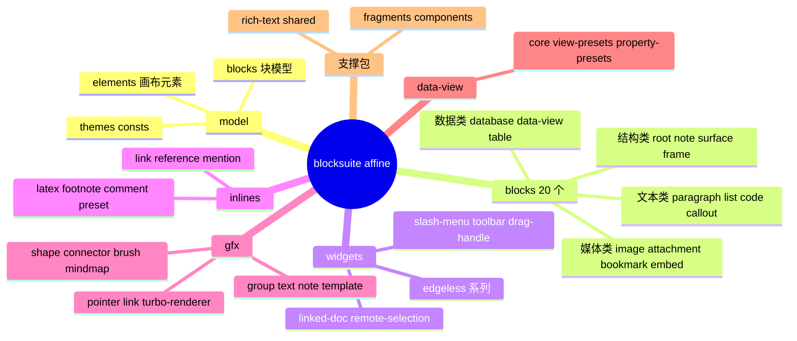
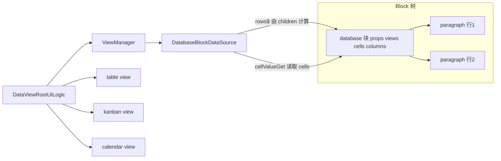
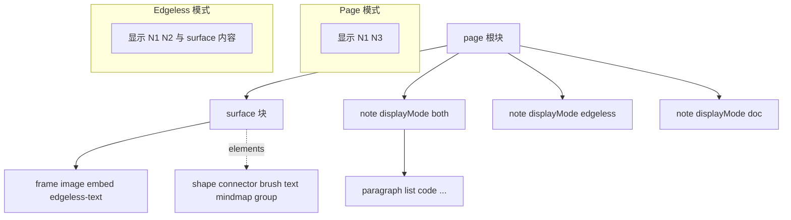
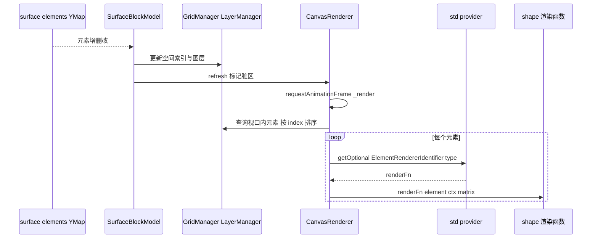

# 第 14 章 Affine 块组件与 Edgeless 白板

> **所属部分**：第 5 部分 · 编辑器内核 BlockSuite ｜ **难度**：★★★★★ ｜ **建议学时**：14 小时 ｜ **前置章节**：第 13 章（BlockSuite Std：视图、扩展、命令、事件）

---

## 本章导读

前两章我们读完了 BlockSuite 的"发动机图纸"：Store 管数据，Std 管视图、事件与命令。本章进入 `blocksuite/affine/`——AFFiNE 真正交付给用户的那些功能：段落、列表、代码块、图片、数据库、白板形状与连线、斜杠菜单、浮动工具栏、协同光标……

`blocksuite/affine/` 下有十几个目录、六十多个子包，逐个精读既不现实也没必要。本章的策略是：

1. **先建立全景**：用表格把 model、20 个块、16 个 widget、7 类 inline、11 个 gfx 包、data-view、rich-text、shared、fragments、components 的职责一次理清；
2. **再挑代表深读**：段落/列表（文本块）、代码块（LifeCycleWatcher 服务）、图片（资源与按上下文切换视图）、数据库（data-view 框架接入），以及 root/note 在 Page 与 Edgeless 两种模式下的不同面貌；
3. **最后啃白板**：surface 块如何把画布元素渲染到 Canvas、gfx 元素模型如何用装饰器绑定 Yjs、工具如何切换、turbo-renderer 如何用 Worker 位图提升性能。

读完本章，你应能在 AFFiNE 中看到任何一个编辑器功能时，快速定位到它的源码包，并读懂其注册方式。

---

## 学习目标

- [ ] 能够说出 `blocksuite/affine/model` 的四个子目录及各自内容，区分"块模型"与"画布元素模型"
- [ ] 能够列出 20 个块包的 flavour 与职责，并说明哪些块只在 Edgeless 中出现
- [ ] 能够读懂 paragraph、list、code、image、database 的关键文件，说出它们分别展示了哪种扩展技巧
- [ ] 能够解释 `affine:page` 在 Page 与 Edgeless 模式下分别渲染为哪个组件，以及 note 的 `displayMode` 如何影响两种模式
- [ ] 能够描述 slash-menu、toolbar、drag-handle、remote-selection 等 widget 的注册与配置方式
- [ ] 能够说明 Surface 如何把 `GfxPrimitiveElementModel` 渲染到 Canvas，以及 `@field` 装饰器如何把属性存入 Yjs
- [ ] 能够说明 data-view 框架的 DataSource / View / Property 三层抽象及 database 块如何接入
- [ ] 能够解释 turbo-renderer 的启用条件与基本原理

---

## 知识地图



---

## 14.1 affine/model：块模型与画布元素模型

`blocksuite/affine/model/src/` 有五个子目录：

| 目录 | 内容 | 说明 |
| --- | --- | --- |
| `blocks/` | 17 类块的 `XxxBlockSchema`、`XxxBlockModel`、`XxxBlockSchemaExtension` | 每个子目录一个块，如 `paragraph/paragraph-model.ts`；`embed/` 下有 figma、github、html、iframe、linked-doc、loom、synced-doc、youtube |
| `elements/` | 画布元素模型：`brush`、`connector`、`group`、`highlighter`、`mindmap`、`shape`、`text` | **不是块**，而是 Surface 块内部 `elements` 中的条目，继承 `GfxPrimitiveElementModel` |
| `themes/` | `DefaultTheme`、`Color`、`ColorSchema` 等 | 白板与 note 的主题色体系 |
| `consts/` | `NoteDisplayMode`、`ShapeType`、`FontFamily`、`StrokeStyle`、连线/思维导图常量 | 跨块共享的枚举与默认值 |
| `utils/` | `createEmbedBlockSchema`、`BlockMeta` 类型等 | 工具 |

"块模型"与"画布元素模型"的区别是理解 Edgeless 的第一把钥匙：

| 维度 | 块（Block） | 画布元素（Element） |
| --- | --- | --- |
| 基类 | `BlockModel`（白板中可放置的块再混入 `GfxCompatible`） | `GfxPrimitiveElementModel` |
| 存储 | `yBlocks` 中独立的 YBlock | Surface 块 `prop:elements`（一个 `Boxed<Y.Map>`）中的 `Y.Map` 条目 |
| 渲染 | Lit 组件（DOM） | Canvas 绘制函数（或可选的 DOM 渲染器） |
| 例子 | note、image、frame、embed-*、edgeless-text | shape、connector、brush、text、mindmap、group |

所有 embed 块都通过 `createEmbedBlockSchema`（`blocksuite/affine/model/src/utils/helper.ts`）统一生成，flavour 为 `` `affine:embed-${name}` ``，并自动带上 `index`、`xywh`、`lockedBySelf`、`rotate` 等白板通用属性。这也解释了 Surface 的 `children` 为什么能用 glob `'affine:embed-*'` 一次匹配所有嵌入块（第 12 章 12.5.3）。

Shape 元素的属性用 `@field` 装饰器声明：

```ts
// 来源：blocksuite/affine/model/src/elements/shape/shape.ts（节选）
export class ShapeElementModel extends GfxPrimitiveElementModel<ShapeProps> {
  textBound: IBound | null = null;

  get type() {
    return 'shape';
  }
  // ...
  @field(DefaultTheme.shapeTextColor)
  accessor color!: Color;

  @field()
  accessor fillColor: Color = DefaultTheme.shapeFillColor;

  @field()
  accessor filled: boolean = false;
  // ... fontFamily、fontSize、padding、radius、shapeType、strokeColor ...
}
```

`@field`（`blocksuite/framework/std/src/gfx/model/surface/decorators/field.ts`）在 `init` 时把初值写入元素自己的 `yMap`，`get` 时从 `yMap` 读取（未附着 doc 时读 `_preserved`，再回退到 fallback），`set` 时写回 `yMap`。同目录还有 `@local`（仅本地、不同步）、`@derive`（派生属性）、`@watch`、`@observe`、`@convert`。这与块的 `SyncController` Proxy 方案不同，但目标一致：**属性即 Yjs**。

**小结**：model 包是 AFFiNE 的数据字典；块走 `defineBlockSchema` + `BlockModel`，画布元素走 `GfxPrimitiveElementModel` + 装饰器。

---

## 14.2 块全景：20 个块包

`blocksuite/affine/blocks/` 下 20 个目录，每个是一个 `@blocksuite/affine-block-xxx` 包：

| 目录 | flavour | 主要组件 / 职责 | 出现场景 |
| --- | --- | --- | --- |
| `root` | `affine:page` | 文档根：`affine-page-root` / `affine-edgeless-root` / 预览根；页面剪贴板、Edgeless 根服务 | 两者 |
| `note` | `affine:note` | 文档流容器：`affine-note` / `affine-edgeless-note` | 两者 |
| `surface` | `affine:surface` | 白板画布：`affine-surface`（Canvas 渲染）/ `affine-surface-void`（Page 下占位） | Edgeless |
| `paragraph` | `affine:paragraph` | 段落与标题、引用；Enter/Backspace/Tab 等快捷键；行内 Markdown | 两者 |
| `list` | `affine:list` | 有序、无序、待办、折叠列表 | 两者 |
| `code` | `affine:code` | 代码块：shiki 高亮、行号、工具栏 widget、预览扩展 | 两者 |
| `callout` | `affine:callout` | 标注块：图标、背景色，子块为段落/列表 | 两者 |
| `divider` | `affine:divider` | 分割线 | 两者 |
| `latex` | `affine:latex` | 块级公式 | 两者 |
| `image` | `affine:image` | 图片：Page 中 `affine-image`，Surface 下 `affine-edgeless-image` | 两者 |
| `attachment` | `affine:attachment` | 附件卡片、PDF 等嵌入预览 | 两者 |
| `bookmark` | `affine:bookmark` | 链接书签卡片 | 两者 |
| `embed` | `affine:embed-figma/github/html/iframe/loom/youtube` | 第三方内容嵌入 | 两者 |
| `embed-doc` | `affine:embed-linked-doc`、`affine:embed-synced-doc` | 链接文档卡片、同步嵌入另一篇文档 | 两者 |
| `database` | `affine:database` | 数据库：基于 data-view 的表格/看板/日历 | 两者 |
| `data-view` | `affine:data-view` | 查询型数据视图块 | 两者 |
| `table` | `affine:table` | 简单表格（flat data 模型） | 两者 |
| `frame` | `affine:frame` | 白板框架（分组、演示模式） | Edgeless |
| `edgeless-text` | `affine:edgeless-text` | 白板中的富文本块 | Edgeless |
| `surface-ref` | `affine:surface-ref` | 在文档中引用白板中的 frame/group 区域 | Page |

每个块包的内部结构高度一致（以 `blocksuite/affine/blocks/paragraph/src/` 为例）：

```text
paragraph-block.ts     # 视图组件（继承 CaptionedBlockComponent）
paragraph-keymap.ts    # KeymapExtension
paragraph-block-config.ts # ConfigExtensionFactory
commands/              # 块专属命令
adapters/              # markdown / html / notion-html / plain-text 适配器
markdown.ts            # InlineMarkdownExtension（如 "# " 转标题）
turbo/                 # turbo-renderer 的布局处理器与 Worker 画笔
effects.ts             # customElements.define
store.ts / view.ts     # StoreExtensionProvider / ViewExtensionProvider
index.ts               # 公共导出
```

记住这个"模板"，读任何块都会轻松很多，第 15 章也会照着它写自定义块。

---

## 14.3 文本类块深读：paragraph 与 list

### 14.3.1 paragraph：一个完整的文本块

视图 Provider 展示了"带配置项的 Provider"写法：

```ts
// 来源：blocksuite/affine/blocks/paragraph/src/view.ts（节选）
const optionsSchema = z.object({
  getPlaceholder: z.optional(
    z.function().args(z.instanceof(ParagraphBlockModel)).returns(z.string())
  ),
});

export class ParagraphViewExtension extends ViewExtensionProvider<z.infer<typeof optionsSchema>> {
  override name = 'affine-paragraph-block';
  override schema = optionsSchema;
  override effect(): void {
    super.effect();
    effects();
  }
  override setup(context: ViewExtensionContext, options?: z.infer<typeof optionsSchema>) {
    super.setup(context, options);
    const getPlaceholder = options?.getPlaceholder ?? (model => placeholders[model.props.type]);
    context.register([
      FlavourExtension('affine:paragraph'),
      BlockViewExtension('affine:paragraph', literal`affine-paragraph`),
      ParagraphTextKeymapExtension,
      ParagraphKeymapExtension,
      ParagraphBlockConfigExtension({ getPlaceholder }),
      ParagraphMarkdownExtension,
    ]);
  }
}
```

AFFiNE 应用侧（`packages/frontend/core/src/blocksuite/manager/view.ts` 的 `_configureParagraph`）调用 `manager.configure(ParagraphViewExtension, { getPlaceholder })`，在开启 AI 时把占位符改为 `"Type '/' for commands, 'space' for AI"`，移动端则去掉提示——这就是 13.2.3 节"配置覆盖"的真实用法。

`ParagraphBlockComponent`（`paragraph-block.ts`）的要点：

- `focused$ = computed(() => 当前块是否有 TextSelection)`——用 signal 驱动占位符显隐；
- `inlineManager` 取自 `this.std.get(DefaultInlineManagerExtension.identifier)`，`attributesSchema/attributeRenderer/embedChecker/markdownMatches` 都由它提供并传给 `<rich-text>`（13.8.4）；
- 标题（`h1`–`h6`）支持折叠：`collapsed` 属性 + `calculateCollapsedSiblings()` 计算被折叠的后续兄弟块；
- `topContenteditableElement` 在 Edgeless 模式下返回最近的 `EDGELESS_TOP_CONTENTEDITABLE_SELECTOR` 元素（note 或 edgeless-text），保证事件源正确。

键盘逻辑分两层（`paragraph-keymap.ts`）：`ParagraphTextKeymapExtension = KeymapExtension(textKeymap, { flavour: 'affine:paragraph' })` 复用 `@blocksuite/affine-inline-preset` 中通用的文本快捷键（加粗、斜体等）；`ParagraphKeymapExtension` 处理段落结构操作：

| 按键 | 行为 | 涉及命令 / 工具函数 |
| --- | --- | --- |
| `Backspace`（行首） | 非 text 类型先转为 text；否则与上一块合并；再不行则反缩进 | `mergeWithPrev`、`canDedentParagraphCommand`、`dedentParagraphCommand` |
| `Enter` | 引用块双空行跳出；折叠标题跳过子节点；行尾新建段落；否则拆分 | `addParagraphCommand`、`splitParagraphCommand` |
| `Mod-Enter` | 在当前块后新建段落 | `addParagraphCommand` |
| `Tab` / `Shift-Tab` | 缩进 / 反缩进 | `indentParagraphCommand` / `dedentParagraphCommand` |
| `Delete` / `Control-d`（mac） | 向前删除 | `forwardDelete` |

一个值得注意的细节：Enter 与 Backspace 处理器都先判断 `matchModels(model.parent, [CalloutBlockModel])`，若父块是 callout 则直接返回、交给 `CalloutKeymapExtension` 处理——**块之间通过"让出事件"协作**，依赖的正是第 13 章讲的事件作用域冒泡。

### 14.3.2 list：同构的另一种文本块

`ListBlockSchema` 的 `type` 为 `'bulleted' | 'numbered' | 'todo' | 'toggle'`（`toggle` 已标注废弃），另有 `checked`、`collapsed`、`order`（仅有序列表使用）。`ListBlockComponent.renderBlock()`（`blocksuite/affine/blocks/list/src/list-block.ts`）的结构：

```ts
// 来源：blocksuite/affine/blocks/list/src/list-block.ts（节选）
override renderBlock(): TemplateResult<1> {
  const { model, _onClickIcon } = this;
  // ... widgets
  const collapsed = this.store.readonly ? this._readonlyCollapsed : model.props.collapsed;
  const listIcon = getListIcon(model, !collapsed, _onClickIcon);
  // ... textAlignStyle
  const children = html`<div
    id=${`list-children-${this.model.id}`}
    class="affine-block-children-container"
    style=${styleMap({
      paddingLeft: `${BLOCK_CHILDREN_CONTAINER_PADDING_LEFT}px`,
      display: collapsed ? 'none' : undefined,
    })}
  >
    ${this.renderChildren(this.model)}
  </div>`;
  // ... 返回：图标 + <rich-text> + children + widgets
}
```

折叠不是删除子块，只是 `display: none`；只读模式下用本地 `_readonlyCollapsed` 状态，避免访客的折叠操作写入文档。有序列表的序号持久化在 `order` 属性中，由 `commands/utils.ts` 的 `correctNumberedListsOrderToPrev`、`correctListOrder` 在增删、缩进时修正，渲染时 `utils/get-list-icon.ts` 调用 `getNumberPrefix(order, depth)`（`blocksuite/affine/shared/src/utils/number-prefix.ts`）按嵌套深度轮换生成数字、字母或罗马数字前缀——而不是简单的 DOM 计数，因为跨嵌套的编号规则复杂且需要导出到 Markdown。

**小结**：文本块 = `CaptionedBlockComponent` + `<rich-text>` + 两层 Keymap + 块专属命令 + Markdown 快捷输入 + Adapter。

---

## 14.4 code 与 image：服务化与资源管理

### 14.4.1 code：LifeCycleWatcher 驱动的高亮服务

```ts
// 来源：blocksuite/affine/blocks/code/src/view.ts（节选）
const codeToolbarWidget = WidgetViewExtension(
  'affine:code',
  AFFINE_CODE_TOOLBAR_WIDGET,
  literal`${unsafeStatic(AFFINE_CODE_TOOLBAR_WIDGET)}`
);

export class CodeBlockViewExtension extends ViewExtensionProvider {
  override name = 'affine-code-block';
  // ... effect()
  override setup(context: ViewExtensionContext) {
    super.setup(context);
    context.register([
      FlavourExtension('affine:code'),
      CodeBlockHighlighter,
      BlockViewExtension('affine:code', literal`affine-code`),
      SlashMenuConfigExtension('affine:code', codeSlashMenuConfig),
      CodeKeymapExtension,
      CodeBlockMarkdownExtension,
      ...getCodeClipboardExtensions(),
    ]);
    context.register([CodeBlockInlineManagerExtension, CodeBlockUnitSpecExtension]);
    if (!this.isMobile(context.scope)) {
      context.register(codeToolbarWidget);
    } else {
      context.register(CodeBlockConfigExtension({ showLineNumbers: false }));
    }
  }
}
```

这个 Provider 几乎用上了第 13 章所有扩展类型：

- **`CodeBlockHighlighter`**（`code-block-service.ts`）是 LifeCycleWatcher（key `code-block-highlighter`），用**静态单例 + 引用计数**共享 shiki 的 `HighlighterCore`（多个编辑器实例不会重复加载 WASM），`highlighter$` 是 signal，主题随 `ThemeProvider.theme$` 切换明暗；
- **独立的 InlineManager**：`CodeBlockInlineManagerExtension` 只包含代码块需要的行内规格（`CodeBlockUnitSpecExtension` 渲染 `affine-code-unit`，`highlight/affine-code-unit.ts` 按高亮 token 着色），代码块里不会出现链接、提及等富文本格式；
- **块专属 widget**：代码工具栏挂在 `affine:code` 而非 `affine:page`；
- **按 scope 调整**：移动端不注册工具栏，并用 `CodeBlockConfigExtension` 关闭行号；
- **剪贴板扩展**：`getCodeClipboardExtensions()` 让粘贴进代码块时保持纯文本。

应用侧 `packages/frontend/core/src/blocksuite/view-extensions/code-block-preview/` 为代码块注册了 HTML、Mermaid、Typst 预览（`code-preview-extension.ts` 定义扩展点）。

### 14.4.2 image：按上下文切换视图与资源控制

`ImageBlockSpec`（`blocksuite/affine/blocks/image/src/image-spec.ts`）用函数形式的 `BlockViewExtension`：父块为 `affine:surface` 时渲染 `affine-edgeless-image`，否则 `affine-image`（13.2.2）。图片模型 `ImageBlockModel extends GfxCompatible<ImageBlockProps>(BlockModel)`——**同一个模型既能在文档流中，也能作为白板上的自由元素**，`GfxCompatible` 混入提供了 `xywh`、`rotate`、`index`、包围盒计算等能力。

图片二进制不在 Yjs 中，模型只存 `sourceId`（blob key）。组件通过 `ResourceController`（`blocksuite/affine/components/src/resource/`）管理加载状态：

```ts
// 来源：blocksuite/affine/blocks/image/src/image-block.ts（节选）
export class ImageBlockComponent extends CaptionedBlockComponent<ImageBlockModel> {
  resourceController = new ResourceController(/* ... */);

  get blobUrl() {
    return this.resourceController.blobUrl$.value;
  }

  override connectedCallback() {
    // ...
    this.resourceController.setEngine(this.std.store.blobSync);
    this.disposables.add(this.resourceController.subscribe());
    this.disposables.add(this.resourceController);
    // ...
  }
}
```

`setEngine(this.std.store.blobSync)` 把它接到 Workspace 的 `BlobEngine`（AFFiNE 中最终落到 nbstore，第 12 章 12.10）。导入导出时 `ImageBlockTransformer` 负责搬运二进制（第 12 章 12.8.3）。附件块（`attachment`）使用同样的 `ResourceController` 模式。

**小结**：code 展示了"服务 + 独立 InlineManager + 块级 widget + 按 scope 注册"；image 展示了"函数式 View + GfxCompatible 双栖模型 + blob 资源控制"。

---

## 14.5 database 与 data-view 框架

### 14.5.1 data-view：与块无关的数据视图框架

`blocksuite/affine/data-view`（包名 `@blocksuite/data-view`，注意不带 `affine-` 前缀）是一个**独立于 Block 树**的通用框架：

| 目录 | 内容 |
| --- | --- |
| `core/data-source/` | `DataSource` 接口与 `DataSourceBase`：行、列（property）、单元格、视图的读写抽象 |
| `core/view-manager/` | `ViewManager`、`SingleView`、行/列/单元格运行时对象 |
| `core/view/` | `ViewMeta`、视图注册与转换 |
| `core/property/` | 属性（列类型）配置、渲染器、转换 |
| `core/filter`、`sort`、`group-by`、`statistics`、`logical`、`expression` | 过滤、排序、分组、统计、类型系统 |
| `core/data-view.ts` | `DataViewRootUILogic`、`DataViewRootUI`：视图根 |
| `view-presets/` | `table`、`kanban`、`calendar` 三种视图 |
| `property-presets/` | `checkbox`、`date`、`image`、`multi-select`、`number`、`progress`、`select`、`text` |
| `widget-presets/` | 视图工具栏等 |

```ts
// 来源：blocksuite/affine/data-view/src/core/data-source/base.ts（节选）
export interface DataSource {
  readonly$: ReadonlySignal<boolean>;
  properties$: ReadonlySignal<string[]>;
  featureFlags$: ReadonlySignal<DatabaseFlags>;

  cellValueGet(rowId: string, propertyId: string): unknown;
  cellValueGet$(rowId: string, propertyId: string): ReadonlySignal<unknown | undefined>;
  cellValueChange(rowId: string, propertyId: string, value: unknown): void;

  rows$: ReadonlySignal<string[]>;
  rowAdd(InsertToPosition: InsertToPosition | number): string;
  rowDelete(ids: string[]): void;
  rowMove(rowId: string, position: InsertToPosition): void;

  propertyMetas$: ReadonlySignal<PropertyMetaConfig[]>;
  // ... propertyNameGet/Set、propertyTypeGet/Set、viewManager 等
}
```

`DataSource` 全部以 signal 暴露——视图层（表格/看板）只依赖这个接口，不知道数据来自 database 块、`affine:data-view` 查询块，还是 AFFiNE 应用的"文档属性列表"。

### 14.5.2 database 块：把 Block 树适配成 DataSource

`DatabaseBlockSchema`（`blocksuite/affine/model/src/blocks/database/database-model.ts`）是 `role: 'hub'`、`version: 3`，props 为 `views`、`title`、`cells`、`columns`，`children: ['affine:paragraph', 'affine:list']`。也就是说：

- **每一行就是一个子块**（段落或列表），行标题就是子块的文本；
- 其它列的值存在 `cells[rowId][columnId]` 中；
- 视图配置（筛选、排序、分组、列宽）存在 `views` 中。

`DatabaseBlockDataSource extends DataSourceBase`（`blocksuite/affine/blocks/database/src/data-source.ts`）完成适配，例如 `rows$ = computed(() => this._model.children.map(v => v.id))`。写单元格经 `utils/block-utils.ts` 的 `updateCell`，它在 `model.store.transact` 中执行，并显式拒绝 `__proto__`、`constructor`、`prototype` 作为 rowId——**防止原型污染**，因为 `cells` 是以用户可控 id 为键的普通对象。



组件 `DatabaseBlockComponent`（`database-block.ts`）用 `lazy()` 延迟创建 DataSource 与 `DataViewRootUILogic`，并把 BlockSuite 的能力注入给 data-view：`bindHotkey` 转发到 `this.host.event.bindHotkey(..., { blockId })`、`handleEvent` 转发到 `this.host.event.add(..., { blockId })`；外部分组配置、日历外部数据源通过 `dataSource.serviceSet(...)` 从 `std.provider.getAll(...)` 注入（应用侧在 `packages/frontend/core/src/blocksuite/view-extensions/database/` 提供）。`renderBlock()` 最终渲染 `this.dataViewRootLogic.value.render()`。视图预设由 `blocksuite/affine/blocks/database/src/views/index.ts` 选定：`[tableViewMeta, kanbanViewMeta, calendarViewMeta]`。

**小结**：data-view 是"DataSource → ViewManager → View UI"的独立框架；database 块用子块表示行、用 `cells` 存列值，通过 `DatabaseBlockDataSource` 接入。

---

## 14.6 root 与 note：Page 与 Edgeless 两种视图

### 14.6.1 一个 flavour，四种根组件

`affine:page` 只有一个 Schema，但 `RootViewExtension`（`blocksuite/affine/blocks/root/src/view.ts`）按 scope 注册不同视图：

| scope | 根组件 | 额外扩展 |
| --- | --- | --- |
| `page` / `mobile-page` | `affine-page-root`（`page/page-root-block.ts`） | `PageClipboard`、`ViewportElementExtension('.affine-page-viewport')` |
| `preview-page` | `affine-preview-root` | `ReadOnlyClipboard` |
| `edgeless` / `mobile-edgeless` | `affine-edgeless-root`（`edgeless/edgeless-root-block.ts`） | `EdgelessRootService`、`EdgelessClipboardController`、`AltCloneExtension`、元素工具栏 |
| `preview-edgeless` | `affine-edgeless-root-preview` | `EdgelessLocker`、`ReadOnlyClipboard` |

两种根组件的 `renderBlock` 对比最能说明问题：

```ts
// 来源：blocksuite/affine/blocks/root/src/page/page-root-block.ts（节选）
override renderBlock() {
  // ... widgets
  const children = this.renderChildren(this.model, child => {
    const isNote = matchModels(child, [NoteBlockModel]);
    const note = child as NoteBlockModel;
    const displayOnEdgeless =
      !!note.props.displayMode && note.props.displayMode === NoteDisplayMode.EdgelessOnly;
    // Should remove deprecated `hidden` property in the future
    return !(isNote && displayOnEdgeless);
  });
  // ... Android 下关闭外层 contentEditable
  return html`<div class="affine-page-root-block-container">${children} ${widgets}</div>`;
}
```

```ts
// 来源：blocksuite/affine/blocks/root/src/edgeless/edgeless-root-block.ts（节选）
override renderBlock() {
  // ... widgets
  return html`
    <div class="edgeless-background edgeless-container">
      <gfx-viewport
        .maxConcurrentRenders=${6}
        .viewport=${this.gfx.viewport}
        .getModelsInViewport=${() => {
          const blocks = this.gfx.grid.search(this.gfx.viewport.overscanBlockBounds, {
            useSet: true,
            filter: ['block'],
          });
          return blocks;
        }}
        .host=${this.host}
      >
        ${this.renderChildren(this.model)}
        ${this.renderChildren(this.surfaceBlockModel)}
      </gfx-viewport>
    </div>
    <div class="edgeless-mount-point"></div>
    <div class="widgets-container">${widgets}</div>
  `;
}
```

- **Page 根**：纵向渲染子块，并**过滤掉 `displayMode === EdgelessOnly` 的 note**；整个容器是一个大的 contenteditable，跨块文本选择由此实现。
- **Edgeless 根**：在 `<gfx-viewport>` 中同时渲染根的子块（note 等）与 **Surface 的子块**（frame、image、embed、edgeless-text），并通过 `GridManager.search` 只让视口（含 overscan）内的块参与渲染、限制并发渲染数——这是大白板性能的基础。

### 14.6.2 note：两种模式的桥梁

`NoteDisplayMode`（`blocksuite/affine/model/src/consts/note.ts`）有三个值：`DocAndEdgeless = 'both'`、`DocOnly = 'doc'`、`EdgelessOnly = 'edgeless'`。note 是文档内容在两种模式下的**共同容器**：

| 模式 | note 的组件 | note 的含义 |
| --- | --- | --- |
| Page | `affine-note` | 文档流的一节，不可见边框，按 `index` 顺序纵向排列 |
| Edgeless | `affine-edgeless-note` | 白板上的一张"卡片"，有 `xywh`、背景、阴影、圆角，可拖拽缩放 |

`NoteViewExtension`（`blocksuite/affine/blocks/note/src/view.ts`）在 edgeless scope 下注册 `affine-edgeless-note` 与 `EdgelessNoteInteraction`（交互扩展：拖拽、缩放、双击进入编辑），否则注册 `affine-note`。`NoteBlockModel` 通过 `GfxCompatible` 混入白板能力。于是：在白板上新建的 note 默认 `EdgelessOnly`，不会出现在文档模式；文档模式里的 note 默认 `DocAndEdgeless`，切到白板会以卡片形式出现。



**小结**：`affine:page` 按 scope 渲染为 page/edgeless/preview 根；note 用 `displayMode` 决定在哪种模式出现，是文档与白板共享内容的关键。

---

## 14.7 widgets 一览与深读

### 14.7.1 全景

`blocksuite/affine/widgets/` 下 16 个包，都以 `WidgetViewExtension` 挂到某个 flavour 上，组件继承 `WidgetComponent`：

| 包 | 挂载 flavour | 作用 | scope 条件 |
| --- | --- | --- | --- |
| `slash-menu` | `affine:page` | 输入 `/` 弹出块插入菜单 | 非移动端 |
| `toolbar` | `affine:page` | 选中文本/块/元素时的浮动工具栏 | 非移动端 |
| `drag-handle` | `affine:page` | 块左侧拖拽手柄、拖拽排序 | 全部 |
| `linked-doc` | `affine:page` | 输入 `@`/`[[` 弹出文档链接菜单；导入（`import-doc/`、`transformers/`） | 全部 |
| `remote-selection` | `affine:page` | 协作者光标与选区（doc 版与 edgeless 版） | edgeless 版仅 `edgeless` |
| `keyboard-toolbar` | `affine:page` | 移动端软键盘上方的工具条 | `mobile-page` 或旧版移动 page |
| `scroll-anchoring` | `affine:page` | 定位滚动锚点 | — |
| `page-dragging-area` | `affine:page` | Page 模式框选块 | 非 edgeless |
| `viewport-overlay` | `affine:page` | 视口遮罩层 | — |
| `note-slicer` | `affine:page` | Edgeless 中切分 note | edgeless |
| `frame-title` | `affine:page` | frame 标题 | 仅 `edgeless` |
| `edgeless-toolbar` | `affine:page` | 白板底部主工具栏（Quick/Senior 工具） | edgeless |
| `edgeless-zoom-toolbar` | `affine:page` | 缩放控件 | edgeless |
| `edgeless-selected-rect` | `affine:page` | 选中框、缩放旋转手柄、自动补全面板 | edgeless |
| `edgeless-dragging-area` | `affine:page` | 白板框选区域 | edgeless |
| `edgeless-auto-connect` | `affine:page` | 演示顺序的自动连接标记 | edgeless |
| 代码工具栏（在 `blocks/code`） | `affine:code` | 代码块语言/复制等 | 非移动端 |

`getInternalViewExtensions()`（`blocksuite/affine/all/src/extensions/view.ts`）中 Widget 段落有注释"order will affect the z-index of the widget"——**注册顺序决定叠放层级**。

### 14.7.2 slash-menu：配置聚合型 widget

```ts
// 来源：blocksuite/affine/widgets/slash-menu/src/extensions.ts（节选）
export class SlashMenuExtension extends Extension {
  config: SlashMenuConfig;

  static override setup(di: Container) {
    WidgetViewExtension(
      'affine:page',
      AFFINE_SLASH_MENU_WIDGET,
      literal`${unsafeStatic(AFFINE_SLASH_MENU_WIDGET)}`
    ).setup(di);
    di.add(this, [StdIdentifier]);
    SlashMenuConfigExtension('default', defaultSlashMenuConfig).setup(di);
  }

  constructor(readonly std: BlockStdScope) {
    super();
    this.config = mergeSlashMenuConfigs(this.std.provider.getAll(SlashMenuConfigIdentifier));
  }
}

export function SlashMenuConfigExtension(id: string, config: SlashMenuConfig): ExtensionType {
  return {
    setup: di => {
      di.addImpl(SlashMenuConfigIdentifier(id), config);
    },
  };
}
```

这是 BlockSuite 中最典型的"**配置聚合**"模式：widget 自身只提供默认配置，各块通过 `SlashMenuConfigExtension(flavour, config)` 贡献菜单项，构造时 `getAll` 合并。`SlashMenuConfig`（`types.ts`）包含 `items`（数组或 `(ctx) => items`）与 `disableWhen`；每个 item 有 `name`、`description`、`icon`、`tooltip`、`searchAlias`、`group`（形如 `` `${number}_${string}@${number}` ``，如 `'0_Basic@9'`，用于分组排序）、`when(ctx)` 与 `action(ctx)` 或 `subMenu`。

有趣的是，标题、引用、分割线、代码块等"基础"菜单项并不在各自块包中，而是由 note 块的 `NoteSlashMenuConfigExtension`（`blocksuite/affine/blocks/note/src/configs/slash-menu.ts`）基于 rich-text 包的 `textConversionConfigs` 统一生成；而 callout、image 等则在自己的块包中注册（如 `blocksuite/affine/blocks/callout/src/configs/slash-menu.ts`）。

`AffineSlashMenuWidget`（`widget.ts`）监听输入，在 `inlineEditor.slots.inlineRangeSync` 之后检查光标前文本是否以触发字符结尾，然后弹出 `slash-menu-popover`；若当前块不在 `affine:page` 根下会报错 "SlashMenuWidget should be used in RootBlock"。

### 14.7.3 toolbar、drag-handle、remote-selection、keyboard-toolbar

- **toolbar**（`blocksuite/affine/widgets/toolbar/src/toolbar.ts`，`AffineToolbarWidget`）：本身是"空壳"，内容来自 `ToolbarRegistryExtension`（foundation 注册）与各块的 `ToolbarModuleExtension({ id: BlockFlavourIdentifier(flavour), config })`。例如 callout 的 `createBuiltinToolbarConfigExtension('affine:callout')`、根块为 note 注册的 `builtinToolbarConfig`；AI 功能通过 `ToolbarModuleExtension({ id: BlockFlavourIdentifier('custom:affine:note'), ... })` 追加按钮（`packages/frontend/core/src/blocksuite/view-extensions/ai/index.ts`）。
- **drag-handle**（`AffineDragHandleWidget`）：基于 `std.dnd`（pragmatic-drag-and-drop）实现块拖拽，`watchers/` 下按 Page/Edgeless 分别处理指针与拖放，`middleware/` 中有拖拽时的 Transformer 中间件。
- **remote-selection**：doc 版 `doc-remote-selection.ts` 以 `computed` 读取 `std.selection.remoteSelections` 渲染他人选区与光标，`manager/remote-color-manager.ts` 为每个协作者分配颜色；edgeless 版渲染白板中他人的选中框与指针。
- **keyboard-toolbar**：仅在 `mobile-page`（或旧版移动端 page）注册，`config.ts` 中定义了"Divider"等快捷插入项，与 slash 菜单共享 `textConversionConfigs` 思路。

**小结**：widget = 挂在块上的浮层 UI；它们普遍采用"widget 提供壳 + 各块贡献配置"的聚合模式，注册顺序决定 z-index。

---

## 14.8 inlines 与 rich-text

### 14.8.1 七个 inline 包

| 包（`blocksuite/affine/inlines/`） | 匹配的 delta 属性 / 节点 | 说明 |
| --- | --- | --- |
| `preset` | bold、italic、underline、strike、code、color、background | 基础格式 spec、`DefaultInlineManagerExtension`、`textKeymap`、格式命令（`command/format-text.ts` 等） |
| `link` | `link` | `affine-link` 节点、链接弹窗、工具栏、Markdown `[text](url)` |
| `reference` | `reference` | 文档引用 `affine-reference`、`RefNodeSlotsProvider`（点击跳转事件） |
| `mention` | `mention` | `@用户` 提及 |
| `latex` | `latex` | 行内公式 `$...$`，KaTeX 渲染 |
| `footnote` | `footnote` | 脚注（AI 回答引用来源常用） |
| `comment` | `comment` | 行内评论标记 |

每个包通常提供：`inline-spec.ts`（`InlineSpecExtension`）、节点组件、`markdown.ts`（`InlineMarkdownExtension`）、`adapters/`（Markdown/HTML/纯文本中的行内转换）、`store.ts`/`view.ts` Provider。`InlinePresetViewExtension`（`blocksuite/affine/inlines/preset/src/view.ts`）注册 `DefaultInlineManagerExtension`、全部基础 spec 与 Markdown 规则。

```ts
// 来源：blocksuite/affine/inlines/preset/src/inline-spec.ts（节选）
export const BoldInlineSpecExtension = InlineSpecExtension<AffineTextAttributes>({
  name: 'bold',
  schema: z.object({
    bold: z.literal(true).optional().nullable().catch(undefined),
  }),
  match: delta => {
    return !!delta.attributes?.bold;
  },
  renderer: ({ delta }) => {
    return html`<affine-text .delta=${delta}></affine-text>`;
  },
});
```

spec 的 `schema` 使用 `.catch(undefined)`，非法属性值会被静默丢弃而不是报错——协同数据可能来自旧版本或其它客户端，容错比严格更重要。

### 14.8.2 rich-text 包

`blocksuite/affine/rich-text/src/`：

| 文件 | 内容 |
| --- | --- |
| `rich-text.ts` | `<rich-text>` 组件：创建 `InlineEditor`、行内 Markdown 转换、自定义撤销栈 meta（`richtext-v-range`）、滚动跟随 |
| `hooks.ts` | `onVBeforeinput`、`onVCompositionEnd`：输入时继承前一字符格式等 |
| `dom.ts` | `focusTextModel(std, id, offset?)`、`getInlineEditorByModel(std, model)` 等跨块焦点工具 |
| `conversion.ts` | `textConversionConfigs`：段落类型/列表/代码/引用/分割线等"块类型转换"清单，被 slash 菜单、工具栏、键盘工具条复用 |
| `align.ts` | `textAlignConfigs` |

`textConversionConfigs` 中分割线条目是 `{ flavour: 'affine:divider', type: 'divider', name: 'Divider', hotkey: ['Mod-Alt-d', 'Mod-Shift-d'] }`——**同一份配置驱动了斜杠菜单、格式工具栏、快捷键三个入口**。

**小结**：inline 包以 spec 为单位扩展行内格式；rich-text 把 InlineEditor 封装为块可直接使用的组件，并提供焦点工具与块类型转换清单。

---

## 14.9 Edgeless：surface 块与 Canvas 渲染

### 14.9.1 Surface 的数据：elements Y.Map

```ts
// 来源：blocksuite/affine/blocks/surface/src/surface-model.ts（节选）
export const SurfaceBlockSchema = defineBlockSchema({
  flavour: 'affine:surface',
  props: (internalPrimitives): SurfaceBlockProps => ({
    elements: internalPrimitives.Boxed(new Y.Map()),
  }),
  metadata: {
    version: 5,
    role: 'hub',
    parent: ['@root'],
    children: ['affine:frame', 'affine:image', 'affine:bookmark', 'affine:attachment',
      'affine:embed-*', 'affine:edgeless-text'],
  },
  transformer: transformerConfigs => new SurfaceBlockTransformer(transformerConfigs),
  toModel: () => new SurfaceBlockModel(),
});
```

画布元素全部存在 `elements` 这个 `Boxed<Y.Map>` 中（用 `Boxed` 是为了直接操作 `Y.Map` 而不被深转换，第 12 章 12.6.4）。每个元素是一个 `Y.Map`，含 `type`、`id`、`xywh`、`index`（fractional index，决定图层顺序）以及 `@field` 声明的属性。`SurfaceBlockModel`（框架基类在 `blocksuite/framework/std/src/gfx/model/surface/surface-model.ts`）观察这个 Map，按 `elementsCtorMap`（`blocksuite/affine/blocks/surface/src/element-model/index.ts`）实例化元素模型：

```ts
// 来源：blocksuite/affine/blocks/surface/src/element-model/index.ts（节选）
export const elementsCtorMap = {
  group: GroupElementModel,
  connector: ConnectorElementModel,
  shape: ShapeElementModel,
  brush: BrushElementModel,
  text: TextElementModel,
  mindmap: MindmapElementModel,
  highlighter: HighlighterElementModel,
};
```

框架层的 `SurfaceBlockModel` 提供 `addElement`、`getElementById`、`elementAdded` 等 API；affine 层的子类额外维护连线端点索引（`_connectorIdsByEndpoint`），使"移动形状时找出所有相连的连线"成为 O(1)。

### 14.9.2 渲染：CanvasRenderer 与 ElementRendererExtension

`SurfaceBlockComponent`（`surface-block.ts`）根据特性开关选择渲染器：

```ts
// 来源：blocksuite/affine/blocks/surface/src/surface-block.ts（节选）
if (useDOMRenderer) {
  this._renderer = new DomRenderer(rendererOptions);
  this._disposables.add(() => this._renderer.dispose());
} else {
  this._renderer = new CanvasRenderer({
    ...rendererOptions,
    enableStackingCanvas: true,
    onStackingCanvasCreated(canvas) {
      canvas.className = 'indexable-canvas';
    },
  });
  // ...
}
```

其中 `useDOMRenderer = featureFlagService.getFlag('enable_dom_renderer')`，默认走 Canvas。`CanvasRenderer`（`renderer/canvas-renderer.ts`，约 1300 行）负责：按视口裁剪（`viewportBounds`/`overscanViewportBounds`）、DPR 缩放矩阵、**堆叠画布**（block 层与 canvas 层交错时，用多张 canvas 叠放以保证与 DOM 块的 z 序正确）、脏区重绘、低缩放手势下的降级策略。绘制单个元素时从 DI 中取渲染函数：

```ts
// 来源：blocksuite/affine/blocks/surface/src/renderer/canvas-renderer.ts（节选）
const renderFn = this.std.getOptional<ElementRenderer>(ElementRendererIdentifier(element.type));
if (!renderFn) continue;
ctx.globalAlpha = element.opacity ?? 1;
const dx = element.x - bound.x;
const dy = element.y - bound.y;
renderFn(element, ctx, matrix.translate(dx, dy), this, rc, bound);
ctx.restore();
```

渲染函数由各 gfx 包注册：

```ts
// 来源：blocksuite/affine/gfx/shape/src/element-renderer/shape/index.ts（节选）
export const shape: ElementRenderer<ShapeElementModel> = (model, ctx, matrix, renderer, rc) => {
  const color = renderer.getColorValue(model.color, DefaultTheme.shapeTextColor, true);
  const fillColor = renderer.getColorValue(model.fillColor, DefaultTheme.shapeFillColor, true);
  const strokeColor = renderer.getColorValue(model.strokeColor, DefaultTheme.shapeStrokeColor, true);
  const colors = { color, fillColor, strokeColor };
  shapeRenderers[model.shapeType](model, ctx, matrix, renderer, rc, colors);
  if (model.textDisplay) {
    renderText(model, ctx, colors);
  }
};

export const ShapeElementRendererExtension = ElementRendererExtension('shape', shape);
```

`rc` 是 RoughJS 的 `RoughCanvas`，用于"手绘风格"形状；`shapeRenderers` 按 `rect`/`ellipse`/`diamond`/`triangle` 分派。DOM 渲染器对应 `DomElementRendererIdentifier` 与 `ShapeDomRendererExtension`。



### 14.9.3 gfx 包一览

`blocksuite/affine/gfx/` 下 11 个包，几乎都只在 `isEdgeless(scope)` 时注册视图扩展：

| 包 | 提供 | 要点 |
| --- | --- | --- |
| `shape` | 形状渲染器（canvas/DOM）、`ShapeElementView`、`ShapeTool`（toolName `shape`）、Senior 工具按钮、元素工具栏、文本编辑 | 最完整的元素样板 |
| `connector` | 连线渲染、`ConnectorTool`、`connector-manager.ts`（路径计算、端点吸附）、`connector-watcher.ts` | 依赖 surface 的端点索引与 A* 寻路（`blocksuite/affine/blocks/surface/src/__tests__/a-star.unit.spec.ts`） |
| `brush` | 画笔、荧光笔、橡皮擦三个工具（`brush`/`highlighter`/`eraser`） | 笔迹平滑使用 global/gfx 的 perfect-freehand |
| `mindmap` | 思维导图元素、布局（`view/layout.ts`）、拖拽交互（`interactivity/mind-map-drag.ts`） | 节点本身是 shape，mindmap 元素维护树结构 |
| `group` | 分组元素、`group-watcher.ts`、交互扩展 | group 是"容器型"元素 |
| `text` | 画布文本元素、`TextTool`、双击空白处添加 edgeless-text | 区分 text 元素与 edgeless-text 块 |
| `note` | `NoteTool`（toolName `affine:note`）、note 菜单 | 在白板上创建 note 块 |
| `template` | `TemplateTool`、模板服务 | 插入模板 |
| `link` | `linkQuickTool`（`QuickToolExtension('link', ...)`） | 只是工具栏按钮，不是画布元素 |
| `pointer` | `PanTool`、`EmptyTool`、quick-tool 默认按钮、`snap/` 对齐吸附 | 默认选择工具 `DefaultTool`（toolName `default`）在 `blocksuite/affine/blocks/surface/src/tool/default-tool.ts` |
| `turbo-renderer` | `ViewportTurboRendererExtension` | 见 14.10.2 |

**小结**：画布元素存于 Surface 的 `elements` Y.Map，由 `elementsCtorMap` 实例化；CanvasRenderer 按视口与图层绘制，单元素绘制逻辑通过 `ElementRendererExtension` 由各 gfx 包注入。

---

## 14.10 工具切换与 turbo-renderer

### 14.10.1 工具与工具栏

白板中的每种交互模式都是一个 `BaseTool` 子类（第 13 章 13.11），已注册的 toolName 包括：`default`、`pan`、`empty`、`shape`、`connector`、`brush`、`highlighter`、`eraser`、`text`、`affine:note`、`frame`、`frameNavigator`（演示）、`template`，以及应用侧的 `CopilotTool`。

工具栏按钮通过 `edgeless-toolbar` widget 的两个扩展点注入：

```ts
// 来源：blocksuite/affine/widgets/edgeless-toolbar/src/extension/index.ts（节选）
export interface QuickTool {
  type?: string;
  enable?: boolean;
  content: TemplateResult;
  /** if not configured, the tool will not be shown in dense mode */
  menu?: MenuConfig;
  priority?: number;
}

export interface SeniorTool {
  /** Used to show in nav-button's tooltip */
  name: string;
  content: TemplateResult;
  enable?: boolean;
}

export const QuickToolIdentifier = createIdentifier<ToolBuilder<QuickTool>>('edgeless-quick-tool');
export const SeniorToolIdentifier = createIdentifier<ToolBuilder<SeniorTool>>('edgeless-senior-tool');
```

例如 `ShapeViewExtension`（`blocksuite/affine/gfx/shape/src/view.ts`）在 edgeless 下注册 `ShapeElementRendererExtension`、`ShapeDomRendererExtension`、`ShapeElementView`、`ShapeTool`、`shapeSeniorTool`、`shapeToolbarExtension`、`ShapeViewInteraction` 七个扩展——**一个 gfx 元素 = 模型 + 渲染器 + 视图 + 工具 + 工具栏按钮 + 元素工具栏 + 交互**。

一次"画矩形"的流程：点击工具栏按钮 → `gfx.tool.setTool(ShapeTool, { shapeName })` → `ShapeTool.activate` → 指针 `dragStart/dragMove/dragEnd` 中创建并更新元素（`click` 时则 `doc.captureSync()` 后直接添加默认尺寸形状）→ 完成后 `this.gfx.tool.setTool(DefaultTool)` 回到选择工具并 `gfx.selection.set({ elements: [id] })`。

### 14.10.2 turbo-renderer：用 Worker 位图加速

`ViewportTurboRendererExtension`（`blocksuite/affine/gfx/turbo-renderer/src/turbo-renderer.ts`）是一个 GfxExtension（key `viewportTurboRenderer`）。源码注释描述其原理："Turbo Rendering optimizes performance by rendering block content onto a canvas bitmap, falling back to standard DOM rendering during interactions."

| 要素 | 说明 |
| --- | --- |
| 目标 | 白板中大量 note 等 DOM 块在缩放平移时的重排开销 |
| 做法 | 主线程收集视口内块的布局树（`layout/`），发送给 Worker（`painter/`）绘制成位图，缩放手势期间显示位图、隐藏 DOM |
| 回退 | 默认 `zoomThreshold: 1`（缩放够大时回到 DOM 渲染）、`debounceTime: 1000`；iOS 低缩放下有专门的保活策略 |
| 块的接入 | 每个支持的块提供 `turbo/xxx-layout-handler.ts` 与 `turbo/xxx-painter.worker.ts`，当前有 paragraph、list、note、code、image |
| 配置 | `TurboRendererConfigFactory = ConfigExtensionFactory<TurboRendererConfig>('viewport-turbo-renderer')`，必须提供 `painterWorkerEntry` |

应用侧 `TurboRendererViewExtension`（`packages/frontend/core/src/blocksuite/view-extensions/turbo-renderer/index.ts`）只有在 `enableTurboRenderer` 为真**且** scope 为 edgeless 时才注册，开关来自特性标志 `enable_turbo_renderer`（`lit-adaper.tsx` 中读取）。

> 文档差异：`turbo-renderer.ts` 顶部的接入指南仍引用 `blocksuite/affine/blocks/block-paragraph` 与 `packages/frontend/core/src/blocksuite/extensions` 路径，实际路径已变为 `blocksuite/affine/blocks/paragraph` 与 `packages/frontend/core/src/blocksuite/view-extensions/turbo-renderer/`。

**小结**：工具 = BaseTool + 工具栏扩展点；turbo-renderer 是"交互期间位图替代 DOM"的可选优化，按块逐个接入、受特性开关控制。

---

## 14.11 shared、fragments 与 components

### 14.11.1 shared：跨块公共层

`blocksuite/affine/shared/src/`：

| 目录 | 内容 |
| --- | --- |
| `services/` | 约 30 个服务：`DocModeService`/`DocModeProvider`、`ThemeService`/`ThemeProvider`、`FeatureFlagService`、`EditPropsStore`、`ToolbarRegistryExtension`、`LinkPreviewService`、`TelemetryService`、`FontLoaderService`、`ParseDocUrlService`、`NotificationService`、`IconPickerService`、`VirtualKeyboardService`… |
| `commands/` | 通用命令：`block-crud`（获取前后块、选中块）、`model-crud`（删除/复制/草稿选中模型）、`selection`（聚焦块首尾、获取各类选择） |
| `adapters/` | 适配器实现：`markdown/`、`html/`、`notion-html/`、`plain-text/`、`notion-text.ts`、`mix-text.ts`、`pdf/`、`clipboard/`、`attachment.ts`、`image.ts`、`middlewares/` |
| `utils/` | `matchModels`、`isInsideBlockByFlavour`、`getViewportElement`、位置计算等 |
| `selection/`、`types/`、`consts/`、`styles/`、`theme/` | 高亮选择、`AffineTextAttributes` 等类型、常量、样式、主题工具 |

这些服务大多是"**接口 + 默认实现 + 应用覆盖**"：块代码通过 `std.get(DocModeProvider)` 使用，AFFiNE 在 `packages/frontend/core/src/blocksuite/view-extensions/editor-view/doc-mode-service.ts` 中提供连接到应用路由的实现；playground 则用 `mockDocModeService` 覆盖（`blocksuite/playground/apps/starter/utils/extensions.ts`）。

每个块的 Adapter 通过 matcher 扩展接入这些适配器。Markdown 块级 matcher 的形态（以分割线为例，第 15 章详解）：`{ flavour, toMatch(o), fromMatch(o), toBlockSnapshot: { enter, leave }, fromBlockSnapshot: { enter, leave } }`，由 `BlockMarkdownAdapterExtension(matcher)` 以 flavour 为变体注册。

### 14.11.2 fragments：编辑器外的"片段"

| 包 | 组件 | 说明 |
| --- | --- | --- |
| `fragments/doc-title` | `doc-title` | 文档标题输入框，绑定 root 的 `title` Text；`DocTitleViewExtension` 只有 `effect()` |
| `fragments/outline` | `outline-panel`、`outline-viewer`、`mobile-outline-panel` | 大纲（基于标题块）与浮动目录 |
| `fragments/frame-panel` | `frame-panel` | Edgeless 中 frame 列表与演示顺序 |
| `fragments/adapter-panel` | `adapter-panel` | 调试用：实时查看 Markdown/HTML/快照输出（playground 中可见） |

fragment 不属于 Block 树、不由 EditorHost 渲染，而是放在编辑器旁边、通过 `std`/`store` 读写数据的独立组件。

### 14.11.3 components：通用 UI

`blocksuite/affine/components/src/` 下约 35 个组件目录：`caption`（`CaptionedBlockComponent` 与 `block-caption-editor`）、`toolbar`、`context-menu`（`createPopup`、菜单系统）、`color-picker`、`date-picker`、`drop-indicator`（含 `FileDropExtension`）、`embed-card-modal`、`link-preview`、`peek`（`PeekViewExtension`）、`portal`、`resource`（`ResourceController`）、`toast`、`tooltip`、`icons`、`smooth-corner` 等。注意：`CaptionedBlockComponent` 位于 components 而非 std——它是 AFFiNE 风格的块基类。

**小结**：shared 提供服务/命令/适配器/工具，fragments 提供编辑器外部件，components 提供 UI 积木；三者是所有块包的共同依赖。

---

## 14.12 本章总结与文档差异

| 主题 | 核心结论 |
| --- | --- |
| model | 块模型（`BlockModel`）与画布元素模型（`GfxPrimitiveElementModel` + `@field`）是两套体系 |
| 块包结构 | `xxx-block.ts` + keymap + config + commands + adapters + markdown + turbo + effects + store/view Provider |
| 文本块 | CaptionedBlockComponent + rich-text + 两层 Keymap，块间通过"让出事件"协作 |
| code / image | LifeCycleWatcher 服务、独立 InlineManager、块级 widget；函数式 View、GfxCompatible、ResourceController |
| database | 子块即行、`cells` 存列值，`DatabaseBlockDataSource` 接入独立的 data-view 框架 |
| root / note | 同一 flavour 按 scope 渲染不同根；note 的 `displayMode` 连接两种模式 |
| widgets | "壳 + 配置聚合"，注册顺序即 z-index |
| Edgeless | Surface `elements` Y.Map → 元素模型 → CanvasRenderer → `ElementRendererExtension`；工具与工具栏都是扩展 |
| 性能 | 视口裁剪、空间网格、并发渲染限制、堆叠画布、turbo-renderer |

`blocksuite/docs-site/guide/block-widgets.md`、`component-types.md` 以及 `docs-site/components/` 下的组件文档仍以 `@blocksuite/blocks`、`@blocksuite/presets` 和 `PageEditor`/`EdgelessEditor` 预置编辑器为基础。当前仓库中这两个包已不存在，AFFiNE 自己的编辑器组件在 `packages/frontend/core/src/blocksuite/editors/`（`page-editor.ts`、`edgeless-editor.ts`），playground 使用 `blocksuite/integration-test` 中的 `TestAffineEditorContainer`（`affine-editor-container` 元素）。

---

## 源码导读清单

| 优先级 | 路径 | 阅读重点 |
| --- | --- | --- |
| P0 | `blocksuite/affine/blocks/paragraph/src/`（`view.ts`、`paragraph-block.ts`、`paragraph-keymap.ts`） | 文本块完整样板 |
| P0 | `blocksuite/affine/blocks/root/src/view.ts`、`page/page-root-block.ts`、`edgeless/edgeless-root-block.ts` | 按 scope 切换根组件、两种渲染方式 |
| P0 | `blocksuite/affine/blocks/surface/src/surface-model.ts`、`surface-block.ts`、`renderer/canvas-renderer.ts` | 画布数据与渲染 |
| P0 | `blocksuite/affine/widgets/slash-menu/src/extensions.ts`、`types.ts` | 配置聚合模式 |
| P1 | `blocksuite/affine/blocks/code/src/view.ts`、`code-block-service.ts` | 服务化、独立 InlineManager、块级 widget |
| P1 | `blocksuite/affine/blocks/image/src/image-spec.ts`、`image-block.ts` | 函数式 View 与资源控制 |
| P1 | `blocksuite/affine/blocks/database/src/data-source.ts`、`database-block.ts` | data-view 接入 |
| P1 | `blocksuite/affine/data-view/src/core/data-source/base.ts`、`core/data-view.ts` | DataSource 抽象与视图根 |
| P1 | `blocksuite/affine/model/src/elements/shape/shape.ts`、`blocksuite/framework/std/src/gfx/model/surface/decorators/field.ts` | 画布元素模型与 `@field` |
| P1 | `blocksuite/affine/gfx/shape/src/view.ts`、`element-renderer/shape/index.ts`、`shape-tool.ts` | 一个 gfx 元素的全部扩展 |
| P2 | `blocksuite/affine/blocks/note/src/view.ts`、`blocksuite/affine/model/src/consts/note.ts` | note 双模式与 displayMode |
| P2 | `blocksuite/affine/inlines/preset/src/`、`blocksuite/affine/inlines/link/src/inline-spec.ts` | InlineSpec 与默认管理器 |
| P2 | `blocksuite/affine/rich-text/src/rich-text.ts`、`conversion.ts`、`dom.ts` | 富文本封装与转换清单 |
| P2 | `blocksuite/affine/gfx/turbo-renderer/src/turbo-renderer.ts` | 位图加速原理 |
| P2 | `blocksuite/affine/widgets/edgeless-toolbar/src/extension/index.ts` | Quick/Senior 工具扩展点 |

---

## 动手实践

### 练习 1：块与 widget 普查（基础）

- **目标**：建立块与 widget 的全景认知。
- **步骤**：在 playground（`yarn workspace @blocksuite/playground dev`）中打开 `?init=preset`；在控制台执行 `const std = document.querySelector('editor-host').std;`，遍历 `std.store.getAllModels()` 统计各 flavour 数量；再切换到白板模式，查询 `document.querySelectorAll('[data-widget-id]')` 列出当前挂载的 widget id。
- **验收标准**：能说出每个 flavour 对应 14.2 表中的哪个包；能区分 Page 与 Edgeless 下 widget 列表的差异并对应到 14.7.1 表中的 scope 条件。

### 练习 2：观察 note 的 displayMode（进阶）

- **目标**：理解 note 如何连接两种模式。
- **步骤**：在白板中新建一个 note 并输入文字；控制台找到它的模型并打印 `model.props.displayMode`；执行 `std.store.updateBlock(model, { displayMode: 'both' })`（字面值见 `NoteDisplayMode`）；切回文档模式观察。
- **验收标准**：修改前该 note 不出现在文档模式（值为 `edgeless`）；修改后出现；能在 `page-root-block.ts` 中指出过滤逻辑。

### 练习 3：用代码在白板上画形状（进阶）

- **目标**：理解画布元素的数据与渲染。
- **步骤**：在白板模式下执行 `const gfx = document.querySelector('affine-edgeless-root').gfx;`；调用 `gfx.surface.addElement({ type: 'shape', shapeType: 'rect', xywh: '[0,0,200,100]' })` 得到元素 id；再打印 `gfx.surface.elementModels` 与 `gfx.surface.getElementById(id).yMap.toJSON()`。
- **验收标准**：画布上出现矩形；能指出该元素在 Yjs 中的存储位置；修改 `element.fillColor` 后画布自动重绘。

### 练习 4：为现有块追加一个 Slash 菜单项（综合）

- **目标**：掌握配置聚合模式。
- **步骤**：参照 `blocksuite/affine/blocks/callout/src/configs/slash-menu.ts`，在 playground 的 `getTestCommonExtensions`（`blocksuite/playground/apps/starter/utils/extensions.ts`，本地修改不提交）中追加 `SlashMenuConfigExtension('my-demo', { items: [{ name: 'Insert Divider x3', group: '0_Basic@99', action: ({ model }) => { /* 用 store.addSiblingBlocks 插入 3 个 affine:divider */ } }] })`。
- **验收标准**：输入 `/insert` 能搜到菜单项，执行后插入 3 条分割线，`Ctrl/Cmd+Z` 一次撤销。

---

## 自测题

1. 块模型与画布元素模型在存储、渲染上各有什么不同？举出各两个例子。
2. 为什么 Surface 的 `children` 可以用 `'affine:embed-*'`？这依赖哪个工具函数？
3. 段落的 Enter 处理器为什么在父块是 callout 时直接返回？
4. 代码块为什么要有独立的 InlineManager？`CodeBlockHighlighter` 为何用静态单例？
5. 图片块如何在 Page 与 Edgeless 中渲染为不同组件？它的模型为何能同时适用两种场景？
6. database 块的"行"和"列值"分别存在哪里？`updateCell` 为什么要检查 `__proto__`？
7. Page 根与 Edgeless 根的 `renderBlock` 各渲染了哪些子块？为什么 Edgeless 根要传 `getModelsInViewport`？
8. Slash 菜单项来自哪些地方？`group: '0_Basic@9'` 是什么意思？
9. CanvasRenderer 如何找到某类元素的绘制函数？若你新增一种元素类型 `star`，需要注册什么？
10. turbo-renderer 在 AFFiNE 中何时启用？块要支持它需要提供哪两个文件？

<details><summary>参考答案</summary>

1. 块存储为 `yBlocks` 中独立的 YBlock，用 Lit 组件渲染（DOM），如 note、image；画布元素存储在 Surface 块 `elements` 这个 `Y.Map` 的条目中，用 Canvas 绘制函数渲染（可选 DOM 渲染器），如 shape、connector。
2. Schema 校验中普通字符串用 `minimatch` 做 glob 匹配；所有 embed 块由 `createEmbedBlockSchema` 生成，flavour 统一为 `affine:embed-${name}`。
3. callout 内的段落拆分/删除需要 callout 特有逻辑（`CalloutKeymapExtension` + `splitCalloutCommand`）；段落 handler 返回 `undefined` 让出事件，作用域冒泡到 callout 层由其处理。
4. 代码块只需要高亮 token 渲染，不应出现链接、提及等富文本格式，因此用只含 `CodeBlockUnitSpecExtension` 的独立管理器；shiki 高亮器加载 WASM 与语法成本高，静态单例 + 引用计数让多个编辑器实例共享。
5. `BlockViewExtension` 使用函数形式：父块为 `affine:surface` 时返回 `affine-edgeless-image`，否则 `affine-image`。模型 `ImageBlockModel extends GfxCompatible(BlockModel)`，自带 `xywh`、`rotate`、`index` 等白板属性。
6. 行是 database 块的子块（段落/列表），列值存在 `props.cells[rowId][columnId]`。`cells` 是以 id 为键的普通对象，rowId 若为 `__proto__` 等会造成原型污染，因此显式拒绝。
7. Page 根渲染根的子块但过滤 `displayMode === EdgelessOnly` 的 note；Edgeless 根在 `gfx-viewport` 中渲染根的子块与 Surface 的子块。`getModelsInViewport` 通过 `GridManager.search` 只让视口内的块参与渲染，配合 `maxConcurrentRenders` 控制大白板性能。
8. 来自 `SlashMenuExtension` 的默认配置以及各处 `SlashMenuConfigExtension` 注册的配置（note 块基于 `textConversionConfigs` 生成标题/引用/分割线等，callout、image、code 等块注册自己的项，AI 扩展也会追加），构造时用 `getAll` 合并。`group` 格式为 `${组序号}_${组名}@${组内序号}`，即 Basic 组（序号 0）中的第 9 项。
9. 通过 `std.getOptional(ElementRendererIdentifier(element.type))` 获取。新增 `star` 需要：元素模型（继承 `GfxPrimitiveElementModel`，`type` 返回 `star`）并加入 Surface 的元素构造映射、`ElementRendererExtension('star', renderFn)`，以及工具、工具栏、交互等扩展（视需要）。
10. 当特性标志 `enable_turbo_renderer` 开启且 scope 为 edgeless 时，由 `TurboRendererViewExtension` 注册。块需提供 `turbo/xxx-layout-handler.ts`（主线程布局收集）与 `turbo/xxx-painter.worker.ts`（Worker 中绘制）。

</details>

---

## 常见坑与排错

| 现象 | 可能原因 | 解决 |
| --- | --- | --- |
| 白板中新建的 note 在文档模式看不到 | `displayMode` 为 `edgeless` | 这是设计行为；需要时改为 `both` |
| 某块在 Page 正常、Edgeless 中消失 | 该块的 Provider 只在非 edgeless scope 注册了 View，或 Surface 的 `children` 不允许它 | 检查 `isEdgeless(scope)` 分支与 Surface Schema |
| 自定义画布元素不显示 | 未注册 `ElementRendererExtension`，CanvasRenderer `continue` 跳过 | 注册渲染器，type 字符串需一致 |
| widget 被遮挡 | 注册顺序决定 z-index | 调整 Provider 在 Manager 列表中的位置 |
| Slash 菜单没有新项 | `SlashMenuConfigExtension` 在移动端 scope 下（slash 菜单不注册）或 `when` 返回 false | 检查 scope 与 `when` |
| 代码块在两个编辑器中高亮异常 | 共享高亮器的引用计数被破坏（手动 dispose） | 只通过 LifeCycleWatcher 生命周期管理 |
| 数据库单元格修改无法撤销 | 绕过 `updateCell` 直接改 `cells` 对象 | 使用 DataSource API 或 `store.transact` |
| turbo-renderer 抛出 `TurboRendererConfig not found` | 注册了 `ViewportTurboRendererExtension` 却没有 `TurboRendererConfigFactory` 配置 | 同时注册配置并提供 `painterWorkerEntry` |
| 照着 docs-site 用 `@blocksuite/presets` 报包不存在 | 文档过时 | 使用 `@blocksuite/affine` 与 `integration-test` 中的容器 |

---

## 延伸阅读

- `blocksuite/affine/ext-loader/README.md`：Provider 机制（读块包 `view.ts` 前必读）
- `blocksuite/affine/shared/src/commands/README.md`：通用命令的放置原则
- `blocksuite/affine/gfx/turbo-renderer/src/turbo-renderer.ts` 顶部注释：新块接入 turbo 的步骤（注意路径已过时）
- `blocksuite/affine/blocks/surface/src/__tests__/`：连线寻路（A*）、包围盒等算法单测
- `blocksuite/affine/all/src/__tests__/adapters/`：各 Adapter 的快照测试，是理解块 ↔ Markdown/HTML 映射的最佳材料
- `tests/blocksuite/e2e/`：按功能组织的 Playwright 端到端测试（`edgeless/`、`database/`、`slash-menu.spec.ts` 等）
- 本书第 15 章（自定义 Block 实战）、第 19 章（nbstore 与 blob 存储）

---

## 学时拆分

| 内容 | 建议时长 |
| --- | --- |
| 14.1–14.2 model 与块全景 | 1.5 小时 |
| 14.3 paragraph 与 list 深读 | 2 小时 |
| 14.4 code 与 image | 1.5 小时 |
| 14.5 database 与 data-view | 2 小时 |
| 14.6 root 与 note 双模式 | 1 小时 |
| 14.7–14.8 widgets、inlines 与 rich-text | 1.5 小时 |
| 14.9–14.10 Edgeless 渲染、gfx 元素、工具与 turbo-renderer | 2.5 小时 |
| 14.11–14.12 shared、fragments、components 与总结 | 0.5 小时 |
| 动手实践与自测 | 1.5 小时 |
| **合计** | **14 小时** |

---

上一章：[第 13 章 BlockSuite Std：视图、扩展、命令、事件](./13-BlockSuite-Std视图扩展命令事件.md) ｜ 下一章：[第 15 章 自定义 Block 实战](./15-自定义Block实战.md) ｜ [返回目录](../README.md)
