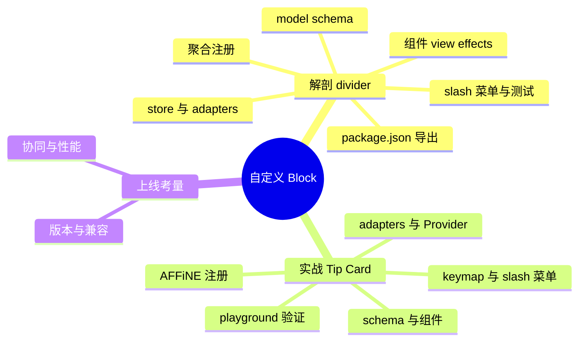
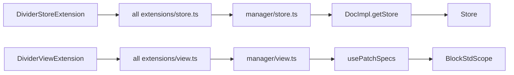

# 第 15 章 自定义 Block 实战

> **所属部分**：第 5 部分 · 编辑器内核 BlockSuite ｜ **难度**：★★★★☆ ｜ **建议学时**：8 小时 ｜ **前置章节**：第 14 章（Affine 块组件与 Edgeless 白板）

---

## 本章导读

前三章我们从数据层、标准库到预置块完整走了一遍 BlockSuite。现在是动手的时候了：**自己写一个块**。

本章分两部分。第一部分"解剖"：选择仓库里最简单的真实块——分割线 `affine:divider`（必要时对照稍复杂的 `affine:callout`），从 `package.json` 一路读到测试，把一个块从"定义"到"被用户看见"的每个环节都对应到具体文件。第二部分"实战"：照着同样的结构编写一个**教学示例：提示卡片（Tip Card）Block**——有图标、有三种样式、可编辑富文本、能从斜杠菜单插入、能导出 Markdown/纯文本，并给出在 playground 中验证、在 AFFiNE 应用中注册的完整步骤。最后讨论 Schema 版本、兼容性、协同与性能这些"上线前必须想清楚"的问题。

> 本章所有"教学示例"代码**不写入仓库**，仅供你在本地实验时参照；其中用到的每个 API 都与当前源码一致，并标注了参照的真实文件。

---

## 学习目标

- [ ] 能够说出一个 BlockSuite 块包的标准目录结构与 `package.json` 三段式导出
- [ ] 能够独立编写块的 Schema、Model 与 `BlockSchemaExtension`，并正确设置嵌套约束
- [ ] 能够编写 `StoreExtensionProvider` 与 `ViewExtensionProvider`，理解 `effect()` 与 `setup()` 的分工
- [ ] 能够基于 `CaptionedBlockComponent` 与 `<rich-text>` 编写可编辑的块组件
- [ ] 能够为块接入斜杠菜单、快捷键与 Markdown / 纯文本 Adapter
- [ ] 能够在 playground 中加载自定义块并验证，在 AFFiNE 应用侧通过 manager 注册
- [ ] 能够评估 Schema 版本变更、兼容性、协同冲突与性能方面的风险

---

## 知识地图



---

## 15.1 为什么选 divider，以及要对照 callout

| 块 | 源码规模 | 特点 | 适合学习 |
| --- | --- | --- | --- |
| `affine:divider` | 13 个 `.ts` 文件，组件约 50 行 | 无属性、无文本、不可有子块；四种 Adapter 齐全；有行内 Markdown 快捷输入（`---`） | 块的**骨架**：注册链路、Adapter、组件基类 |
| `affine:callout` | 14 个 `.ts` 文件 | 有 `icon`、`text`、`backgroundColorName` 属性；`role: 'hub'`、可含段落与列表；自带 Keymap、命令、Slash 菜单、工具栏 | 块的**血肉**：属性响应、Slash 菜单、快捷键、命令 |

我们以 divider 为主线、callout 为补充，读完两者就覆盖了自定义块需要的全部扩展点。

---

## 15.2 divider 的包结构与 package.json

```text
blocksuite/affine/blocks/divider/
├── package.json
├── tsconfig.json
└── src/
    ├── index.ts            # 公共 API：export adapters 与组件
    ├── store.ts            # DividerStoreExtension（StoreExtensionProvider）
    ├── view.ts             # DividerViewExtension（ViewExtensionProvider）
    ├── effects.ts          # customElements.define('affine-divider', ...)
    ├── divider-block.ts    # DividerBlockComponent
    ├── styles.ts           # Lit css
    ├── markdown.ts         # 行内 Markdown 快捷输入：--- *** ___
    └── adapters/
        ├── extension.ts    # DividerBlockAdapterExtensions 数组
        ├── html.ts  markdown.ts  notion-html.ts  plain-text.ts
        └── index.ts
```

注意：**Schema 不在块包里**，而在 `blocksuite/affine/model/src/blocks/divider/divider-model.ts`。这是 AFFiNE 预置块的惯例——模型集中在 `@blocksuite/affine-model`，块包依赖模型包。

```json
// 来源：blocksuite/affine/blocks/divider/package.json（节选）
{
  "name": "@blocksuite/affine-block-divider",
  "type": "module",
  "sideEffects": false,
  "dependencies": {
    "@blocksuite/affine-components": "workspace:*",
    "@blocksuite/affine-ext-loader": "workspace:*",
    "@blocksuite/affine-model": "workspace:*",
    "@blocksuite/affine-rich-text": "workspace:*",
    "@blocksuite/affine-shared": "workspace:*",
    "@blocksuite/std": "workspace:*",
    "@blocksuite/store": "workspace:*",
    "@types/mdast": "^4.0.4",
    "lit": "^3.2.0"
  },
  "exports": {
    ".": "./src/index.ts",
    "./view": "./src/view.ts",
    "./store": "./src/store.ts"
  },
  "version": "0.27.5"
}
```

三个要点：

1. **`exports` 直接指向 `.ts` 源码**：monorepo 内由构建工具（Vite/Webpack + SWC）直接编译，无需预先 `build`；
2. **`sideEffects: false`**：`customElements.define` 这类副作用被刻意收敛到 `effects.ts`，只在 `ViewExtensionProvider.effect()` 中调用，因此包可以被安全地 tree-shake；
3. **依赖全部是 `workspace:*`**：`tsconfig.json` 中的 `references` 与之一一对应（`../../components`、`../../ext-loader`、`../../model`、`../../rich-text`、`../../shared`、`../../../framework/std`、`../../../framework/store`），`tools/utils/src/workspace.gen.ts`（自动生成，"DO NOT MODIFY THIS FILE MANUALLY"）中也有对应条目。

---

## 15.3 Model：Schema 定义

```ts
// 来源：blocksuite/affine/model/src/blocks/divider/divider-model.ts
import { BlockModel, BlockSchemaExtension, defineBlockSchema } from '@blocksuite/store';

export const DividerBlockSchema = defineBlockSchema({
  flavour: 'affine:divider',
  metadata: {
    version: 1,
    role: 'content',
    children: [],
  },
  toModel: () => new DividerBlockModel(),
});

type Props = {
  text: string;
};

export class DividerBlockModel extends BlockModel<Props> {}

export const DividerBlockSchemaExtension = BlockSchemaExtension(DividerBlockSchema);
```

逐项解读：

- **没有 `props`**：分割线没有可编辑属性（`Props` 类型中的 `text` 只是类型占位，Schema 未声明默认值，因此不会写入 Yjs，`model.keys` 为空）；
- **`role: 'content'` + 无 `parent`**：`parent` 缺省为 `['*']`，配合 Note 的 `children: ['@content', ...]`，分割线可以放进 note；
- **`children: []`**：不允许子块——但组件里仍调用了 `renderChildren`，这是所有块的统一写法（防御性地渲染，若数据异常也不丢失内容）；
- **三件套导出**：`XxxBlockSchema`、`XxxBlockModel`、`XxxBlockSchemaExtension`，这是所有块模型文件的固定模式。

对照 callout 的 Schema（第 12 章 12.5 已展示），它声明了 `props`（`icon`、`text`、`backgroundColorName` 与 4 个 `meta:*` 字段）、`role: 'hub'`、显式的 `parent` 列表与 `children: ['affine:paragraph', 'affine:list']`。

---

## 15.4 Store 侧：StoreExtension 与 Adapters

### 15.4.1 store.ts

```ts
// 来源：blocksuite/affine/blocks/divider/src/store.ts
import { type StoreExtensionContext, StoreExtensionProvider } from '@blocksuite/affine-ext-loader';
import { DividerBlockSchemaExtension } from '@blocksuite/affine-model';

import { DividerBlockAdapterExtensions } from './adapters/extension';

export class DividerStoreExtension extends StoreExtensionProvider {
  override name = 'affine-divider-block';

  override setup(context: StoreExtensionContext) {
    super.setup(context);
    context.register(DividerBlockSchemaExtension);
    context.register(DividerBlockAdapterExtensions);
  }
}
```

Store 侧只放**与 DOM 无关**的东西：Schema 与 Adapter。这样服务端渲染、Worker 中的 Markdown 导出、单元测试都能只加载 store 扩展。

### 15.4.2 Markdown Adapter

```ts
// 来源：blocksuite/affine/blocks/divider/src/adapters/markdown.ts（节选）
const isDividerNode = (node: MarkdownAST): node is ThematicBreak => node.type === 'thematicBreak';

export const dividerBlockMarkdownAdapterMatcher: BlockMarkdownAdapterMatcher = {
  flavour: DividerBlockSchema.model.flavour,
  toMatch: o => isDividerNode(o.node),
  fromMatch: o => o.node.flavour === DividerBlockSchema.model.flavour,
  toBlockSnapshot: {
    enter: (_, context) => {
      const { walkerContext } = context;
      walkerContext
        .openNode(
          { type: 'block', id: nanoid(), flavour: 'affine:divider', props: {}, children: [] },
          'children'
        )
        .closeNode();
    },
  },
  fromBlockSnapshot: {
    enter: (_, context) => {
      const { walkerContext } = context;
      walkerContext.openNode({ type: 'thematicBreak' }, 'children').closeNode();
    },
  },
};

export const DividerBlockMarkdownAdapterExtension =
  BlockMarkdownAdapterExtension(dividerBlockMarkdownAdapterMatcher);
```

一个 matcher 包含两个方向：

| 字段 | 方向 | 作用 |
| --- | --- | --- |
| `toMatch(o)` | Markdown AST → Snapshot | 判断某个 mdast 节点是否由本块处理（这里是 `thematicBreak`） |
| `toBlockSnapshot.enter/leave` | Markdown AST → Snapshot | 用 `walkerContext.openNode(...)`/`closeNode()` 构造 `BlockSnapshot` |
| `fromMatch(o)` | Snapshot → Markdown AST | 判断某个快照节点是否由本块处理（按 flavour） |
| `fromBlockSnapshot.enter/leave` | Snapshot → Markdown AST | 构造 mdast 节点 |

`openNode(node, 'children')` 的第二个参数指明把新节点挂到当前节点的哪个字段；有子内容的块（如 callout）在 `enter` 中 `openNode`、在 `leave` 中 `closeNode`，从而让子块的输出嵌套进来。

其余三个 Adapter 形态相同：HTML 匹配 `<hr>`（`HastUtils.isElement(o.node) && o.node.tagName === 'hr'`）；Notion HTML 只支持导入（`fromMatch: () => false`）；纯文本只支持导出（`toMatch: () => false`，`fromBlockSnapshot.enter` 中执行 `context.textBuffer.content += '---\n'`）。

`adapters/extension.ts` 把四个扩展汇总成 `DividerBlockAdapterExtensions: ExtensionType[]`，供 `store.ts` 一次注册。

---

## 15.5 View 侧：组件、effects 与 ViewExtension

### 15.5.1 组件

`DividerBlockComponent`（`blocksuite/affine/blocks/divider/src/divider-block.ts`）已在第 13 章 13.4.4 介绍，这里补充几个细节：

```ts
// 来源：blocksuite/affine/blocks/divider/src/divider-block.ts（节选）
export class DividerBlockComponent extends CaptionedBlockComponent<DividerBlockModel> {
  static override styles = dividerBlockStyles;

  override connectedCallback() {
    super.connectedCallback();
    this.contentEditable = 'false';
    this.handleEvent('click', () => {
      this.host.selection.setGroup('note', [
        this.host.selection.create(BlockSelection, { blockId: this.blockId }),
      ]);
    });
  }

  override renderBlock() {
    const children = html`<div
      class="affine-block-children-container"
      style="padding-left: ${BLOCK_CHILDREN_CONTAINER_PADDING_LEFT}px"
    >
      ${this.renderChildren(this.model)}
    </div>`;
    return html`
      <div class="affine-divider-block-container">
        <hr />
        ${children}
      </div>
    `;
  }

  override accessor useZeroWidth = true;
}

declare global {
  interface HTMLElementTagNameMap {
    'affine-divider': DividerBlockComponent;
  }
}
```

- `contentEditable = 'false'`：非文本块必须关闭可编辑，否则浏览器会把光标放进 `<hr>` 周围；
- `handleEvent('click', ...)`：默认以本块 `blockId` 为作用域（第 13 章 13.6.3），点击时以 `setGroup('note', ...)` 设置块选择；
- `useZeroWidth = true`：`CaptionedBlockComponent` 的选项，在块末尾渲染零宽占位（`block-zero-width`），使用户点击块下方空白时能创建新段落（`tests/blocksuite/e2e/zero-width.spec.ts` 覆盖了这一行为）；
- `declare global` 为 `HTMLElementTagNameMap` 补充类型，让 `document.querySelector('affine-divider')` 有正确类型。

### 15.5.2 effects.ts 与 view.ts

```ts
// 来源：blocksuite/affine/blocks/divider/src/effects.ts
import { DividerBlockComponent } from './divider-block';

export function effects() {
  customElements.define('affine-divider', DividerBlockComponent);
}
```

```ts
// 来源：blocksuite/affine/blocks/divider/src/view.ts（节选）
export class DividerViewExtension extends ViewExtensionProvider {
  override name = 'affine-divider-block';

  override effect() {
    super.effect();
    effects();
  }

  override setup(context: ViewExtensionContext) {
    super.setup(context);
    context.register([
      BlockViewExtension('affine:divider', literal`affine-divider`),
      DividerMarkdownExtension,
    ]);
  }
}
```

分工很清楚：`effect()` 在每个 Provider 类生命周期内**只执行一次**（定义自定义元素不能重复）；`setup()` 每次构建扩展列表都会执行（不同 scope、不同配置）。`BlockViewExtension` 中的 `literal\`affine-divider\`` 必须与 `customElements.define` 的标签名一致。

> 有趣的是 divider 的 View Provider 没有注册 `FlavourExtension('affine:divider')`，而 callout、paragraph、code 都注册了。`FlavourExtension` 只在需要按 flavour 注入依赖时才必需（如已弃用的 `BlockService`），对纯视图块不是必选项；但为一致性起见，新块建议注册。

### 15.5.3 行内 Markdown 快捷输入

```ts
// 来源：blocksuite/affine/blocks/divider/src/markdown.ts（节选）
export const DividerMarkdownExtension = InlineMarkdownExtension<AffineTextAttributes>({
  name: 'divider',
  pattern: /^(-{3,}|\*{3,}|_{3,})\s$/,
  action: ({ inlineEditor, inlineRange }) => {
    if (inlineEditor.yTextString.slice(0, inlineRange.index).includes('\n')) return;
    if (!inlineEditor.rootElement) return;
    const blockComponent = inlineEditor.rootElement.closest<BlockComponent>('[data-block-id]');
    if (!blockComponent) return;
    const { model, std, store } = blockComponent;
    if (matchModels(model, [ParagraphBlockModel]) && model.props.type !== 'quote') {
      const parent = store.getParent(model);
      if (!parent) return;
      const index = parent.children.indexOf(model);
      store.captureSync();
      inlineEditor.deleteText({ index: 0, length: inlineRange.index });
      store.addBlock<DividerBlockModel>(
        DividerBlockSchema.model.flavour, { children: model.children }, parent, index
      );
      // ... 若后面没有块则新建段落，然后 focusTextModel(std, id)
    }
  },
});
```

在段落开头输入 `---` + 空格即转换为分割线。这个扩展注册在 **View 侧**（它依赖 InlineEditor 与组件），由 `InlineManager.markdownMatches` 收集后交给 `<rich-text>` 执行（第 13 章 13.8）。注意 `store.captureSync()` 让"转换"成为独立的撤销步骤。

---

## 15.6 注册链路：从块包到编辑器

一个块要被用户看见，需要经过四层注册：



| 层 | 文件 | divider 在其中的位置 |
| --- | --- | --- |
| 块包 | `blocksuite/affine/blocks/divider/src/store.ts`、`view.ts` | 定义两个 Provider |
| 聚合导出 | `blocksuite/affine/all/package.json` | `dependencies` 中的 `"@blocksuite/affine-block-divider": "workspace:*"`，`exports` 中的 `./blocks/divider`、`./blocks/divider/store`、`./blocks/divider/view` |
| 聚合源码 | `blocksuite/affine/all/src/blocks/divider/{index,store,view}.ts` | 各一行 `export * from ...` |
| 聚合 tsconfig | `blocksuite/affine/all/tsconfig.json` | `references` 中的 `{ "path": "../blocks/divider" }` |
| 内置清单 | `blocksuite/affine/all/src/extensions/store.ts`、`view.ts` | `DividerStoreExtension`、`DividerViewExtension` 出现在 `getInternalStoreExtensions()`/`getInternalViewExtensions()` 返回的数组中 |
| Schema 清单 | `blocksuite/affine/all/src/schemas.ts` | `DividerBlockSchema` 在 `AffineSchemas` 中 |
| 应用 | `packages/frontend/core/src/blocksuite/manager/store.ts`、`view.ts` | 通过 `...getInternalStoreExtensions()`/`...getInternalViewExtensions()` 间接包含 |

---

## 15.7 斜杠菜单接入：两种方式

### 15.7.1 divider：经由 note 与 textConversionConfigs

在 divider 包里你找不到任何斜杠菜单配置。它的菜单项来自 rich-text 包的 `textConversionConfigs`：

```ts
// 来源：blocksuite/affine/rich-text/src/conversion.ts（节选）
  {
    flavour: 'affine:divider',
    type: 'divider',
    name: 'Divider',
    description: 'Visually separate content.',
    hotkey: [`Mod-Alt-d`, `Mod-Shift-d`],
    icon: DividerIcon,
  },
```

再由 note 块的 `NoteSlashMenuConfigExtension`（`blocksuite/affine/blocks/note/src/configs/slash-menu.ts`）把 `type` 为 `divider`、`quote` 的条目转成菜单项，并加上 `when: ({ model }) => model.store.schema.flavourSchemaMap.has(config.flavour) && !isInsideBlockByFlavour(model.store, model, 'affine:edgeless-text')`——**只有当前 Store 注册了该 flavour 时才显示**。同一份配置还驱动了快捷键 `Mod-Alt-d` 与格式工具栏的"转换为"菜单。这种方式适合"可与段落互相转换"的基础块。

### 15.7.2 callout：块包自行注册

```ts
// 来源：blocksuite/affine/blocks/callout/src/configs/slash-menu.ts（节选）
export const calloutSlashMenuConfig: SlashMenuConfig = {
  items: [
    {
      name: 'Callout',
      description: 'Let your words stand out.',
      icon: FontIcon(),
      tooltip: { figure: calloutTooltip, caption: 'Callout' },
      searchAlias: ['callout'],
      group: '0_Basic@9',
      when: ({ model }) => !isInsideBlockByFlavour(model.store, model, 'affine:edgeless-text'),
      action: ({ model, std }) => {
        const { store } = model;
        const parent = store.getParent(model);
        // ... parent / index 校验
        const calloutId = store.addBlock('affine:callout', {}, parent, index + 1);
        // ...
        const paragraphId = store.addBlock('affine:paragraph', {}, calloutId);
        // ...
        std.host.updateComplete
          .then(() => {
            const paragraph = std.view.getBlock(paragraphId);
            if (!paragraph) return;
            std.command.exec(focusBlockEnd, { focusBlock: paragraph });
          })
          .catch(console.error);
      },
    },
  ],
};
```

在 `CalloutViewExtension.setup` 中以 `SlashMenuConfigExtension('affine:callout', calloutSlashMenuConfig)` 注册。`action` 中的 `model` 是**触发斜杠菜单时光标所在的块**，新块插在它后面；插入后 `await std.host.updateComplete` 再聚焦，因为新块的组件要等下一轮渲染才存在。**自定义块推荐使用这种方式**。

---

## 15.8 测试

BlockSuite 的测试分三层（第 25 章会全面展开）：

| 层 | 位置 | 运行方式 | divider 的例子 |
| --- | --- | --- | --- |
| 框架单测 | `blocksuite/framework/*/src/__tests__/*.unit.spec.ts` | 根目录 `yarn vitest run <路径>` | Schema 校验、Block 模型（`blocksuite/framework/store/src/__tests__/schema.unit.spec.ts`、`block.unit.spec.ts`） |
| Adapter 单测 | `blocksuite/affine/all/src/__tests__/adapters/*.unit.spec.ts` | 同上（`blocksuite/affine/all/vitest.config.ts`） | `plain-text.unit.spec.ts` 中的 `test('divider', ...)`；Markdown 用快照文件 `__snapshots__/markdown.unit.spec.ts.snap` |
| 端到端 | `tests/blocksuite/e2e/*.spec.ts` | `yarn workspace @affine-test/blocksuite test`（Playwright，自动以 `yarn workspace @blocksuite/playground run dev` 启动服务） | `zero-width.spec.ts` 中通过 `doc.addBlock('affine:divider', {}, note)` 构造场景 |

```ts
// 来源：blocksuite/affine/all/src/__tests__/adapters/plain-text.unit.spec.ts（节选）
test('divider', async () => {
  const blockSnapshot: BlockSnapshot = {
    type: 'block',
    id: 'block:vu6SK6WJpW',
    flavour: 'affine:page',
    // ... props.title、surface 块、note 块，note 中含一个 'aaa' 段落与一个 divider：
    //     { type: 'block', id: 'block:12lDwMD7ec', flavour: 'affine:divider', props: {}, children: [] }
  };

  const plainText = 'aaa\n---\n';
  const plainTextAdapter = new PlainTextAdapter(createJob(), provider);
  const target = await plainTextAdapter.fromBlockSnapshot({ snapshot: blockSnapshot });
  expect(target.file).toBe(plainText);
});
```

其中 `createJob()`（`blocksuite/affine/all/src/__tests__/utils/create-job.ts`）用 `new Schema().register(AffineSchemas)` 与 `TestWorkspace` 构造 `Transformer`；`getProvider()`（`utils/get-provider.ts`）把 `StoreExtensionManager(getInternalStoreExtensions()).get('store')` 全部 `setup` 到一个 `Container` 并返回 provider——Adapter 就是从这个 provider 中按 flavour 取到各块的 matcher。另外 `blocksuite/affine/shared/src/test-utils/` 提供了 `affine` 模板标签，可用类 HTML 语法快速构造测试文档。

---

## 15.9 教学示例：自定义提示卡片 Block

> 以下全部为**教学示例**，不写入仓库。导入路径采用应用层使用的聚合包 `@blocksuite/affine/*`，因此可以直接放在 playground（`blocksuite/playground/apps/_common/` 下）或 AFFiNE 应用（`packages/frontend/core/src/blocksuite/` 下）中实验。若作为 `blocksuite/affine/blocks/` 下的正式块包，请把导入换成对应的细粒度包名（见 15.9.8 对照表）。

### 15.9.1 需求与设计

| 需求 | 设计决策 | 参照的真实块 |
| --- | --- | --- |
| 一张带图标的提示卡片，内容可编辑富文本 | 属性 `text: Text`；组件内渲染 `<rich-text>` | paragraph、callout |
| 三种样式 info / warning / success，点击图标切换 | 属性 `variant`；`store.updateBlock` 修改 | callout 的图标点击 |
| 只能放在 note 中，不含子块 | `role: 'content'`、`parent: ['affine:note']`、`children: []` | divider、code |
| 斜杠菜单插入 | `SlashMenuConfigExtension` | callout |
| 文末 Enter 跳出卡片新建段落 | `KeymapExtension` + `{ flavour }` | paragraph、callout |
| 导出 Markdown / 纯文本 | `BlockMarkdownAdapterExtension`、`BlockPlainTextAdapterExtension` | paragraph、divider |
| 第三方块不与官方冲突 | flavour 使用自定义命名空间 `custom:tip-card` | 第 12 章 flavour 约定 |

目录结构（教学示例）：

```text
tip-card/
├── tip-card-model.ts        # Schema + Model + SchemaExtension
├── tip-card-block.ts        # 组件
├── styles.ts                # 样式与图标
├── effects.ts               # customElements.define
├── keymap.ts                # Enter 跳出
├── slash-menu.ts            # 斜杠菜单项
├── adapters.ts              # Markdown + 纯文本
├── store.ts                 # TipCardStoreExtension
├── view.ts                  # TipCardViewExtension
└── tip-card.unit.spec.ts    # Store 层单元测试
```

### 15.9.2 Schema 与 Model

```ts
// 教学示例：tip-card/tip-card-model.ts（参照 blocksuite/affine/model/src/blocks/callout/callout-model.ts）
import {
  BlockModel,
  BlockSchemaExtension,
  defineBlockSchema,
  type Text,
} from '@blocksuite/affine/store';

export type TipCardVariant = 'info' | 'warning' | 'success';

export type TipCardProps = {
  variant: TipCardVariant;
  text: Text;
};

export const TipCardBlockSchema = defineBlockSchema({
  flavour: 'custom:tip-card',
  props: (internal): TipCardProps => ({
    variant: 'info',
    text: internal.Text(),
  }),
  metadata: {
    version: 1,
    role: 'content',
    parent: ['affine:note'],
    children: [],
  },
  toModel: () => new TipCardBlockModel(),
});

export class TipCardBlockModel extends BlockModel<TipCardProps> {
  override isEmpty(): boolean {
    return this.props.text$.value.length === 0;
  }
}

export const TipCardBlockSchemaExtension = BlockSchemaExtension(TipCardBlockSchema);
```

校验推演：子块 `parent = ['affine:note']`，Note 的 `children = ['@content', ...]`。对 `('affine:note', '@content')` 这一对：`'@content'` 与本块 `role: 'content'` 匹配，`'affine:note'` 与父块 flavour 用 minimatch 匹配——双向成立，合法。若把卡片插到根块下，根块 `children` 缺省 `['*']`，但本块 `parent` 只允许 note，校验失败。注意：`Store.addBlock` 把 CRUD 包在 `transact` 中，而 `transact` 会 **catch 并 `console.error`** 回调里的异常（第 12 章 12.7.1），所以 `addBlock` 本身**不会抛出** `SchemaValidateError`，只会打印错误、照常返回 id，但块并未创建。需要可靠判断时请先调用 `store.schema.safeValidate(flavour, parentFlavour)`。

### 15.9.3 样式、effects 与组件

```ts
// 教学示例：tip-card/styles.ts（参照 blocksuite/affine/blocks/divider/src/styles.ts）
import { css } from 'lit';

import type { TipCardVariant } from './tip-card-model';

export const TIP_CARD_ICONS: Record<TipCardVariant, string> = {
  info: '💡',
  warning: '⚠️',
  success: '✅',
};

export const tipCardStyles = css`
  .custom-tip-card {
    display: flex;
    gap: 8px;
    padding: 12px 16px;
    margin-top: var(--affine-paragraph-space);
    border-radius: 8px;
    border-left: 4px solid var(--affine-primary-color);
    background: var(--affine-hover-color);
  }
  .custom-tip-card--warning { border-left-color: var(--affine-warning-color); }
  .custom-tip-card--success { border-left-color: var(--affine-success-color); }
  .custom-tip-card__icon { cursor: pointer; user-select: none; line-height: 24px; }
  .custom-tip-card__text { flex: 1; min-width: 0; }
`;
```

```ts
// 教学示例：tip-card/effects.ts（参照 blocksuite/affine/blocks/divider/src/effects.ts）
import { TipCardBlockComponent } from './tip-card-block';

export function effects() {
  customElements.define('custom-tip-card', TipCardBlockComponent);
}

declare global {
  interface HTMLElementTagNameMap {
    'custom-tip-card': TipCardBlockComponent;
  }
}
```

组件分两段展示。第一段是"逻辑"部分：

```ts
// 教学示例：tip-card/tip-card-block.ts（上半，参照 callout-block.ts 与 paragraph-block.ts）
import { CaptionedBlockComponent } from '@blocksuite/affine/components/caption';
import { DefaultInlineManagerExtension } from '@blocksuite/affine/inlines/preset';
import { EDGELESS_TOP_CONTENTEDITABLE_SELECTOR } from '@blocksuite/affine/shared/consts';
import { DocModeProvider } from '@blocksuite/affine/shared/services';
import { getViewportElement } from '@blocksuite/affine/shared/utils';
import type { BlockComponent } from '@blocksuite/affine/std';
import { getInlineRangeProvider, type InlineRangeProvider } from '@blocksuite/affine/std/inline';
import { html, nothing } from 'lit';
import { classMap } from 'lit/directives/class-map.js';
import { TIP_CARD_ICONS, tipCardStyles } from './styles';
import type { TipCardBlockModel, TipCardVariant } from './tip-card-model';

const VARIANT_ORDER: TipCardVariant[] = ['info', 'warning', 'success'];

export class TipCardBlockComponent extends CaptionedBlockComponent<TipCardBlockModel> {
  static override styles = tipCardStyles;
  private _inlineRangeProvider: InlineRangeProvider | null = null;

  get inlineManager() {
    return this.std.get(DefaultInlineManagerExtension.identifier);
  }

  override get topContenteditableElement() {
    if (this.std.get(DocModeProvider).getEditorMode() === 'edgeless') {
      return this.closest<BlockComponent>(EDGELESS_TOP_CONTENTEDITABLE_SELECTOR);
    }
    return this.rootComponent;
  }

  override connectedCallback() {
    super.connectedCallback();
    this._inlineRangeProvider = getInlineRangeProvider(this);
  }

  private readonly _cycleVariant = () => {
    if (this.store.readonly) return;
    const i = VARIANT_ORDER.indexOf(this.model.props.variant);
    this.store.updateBlock(this.model, { variant: VARIANT_ORDER[(i + 1) % VARIANT_ORDER.length] });
  };
```

第二段是渲染：

```ts
// 教学示例：tip-card/tip-card-block.ts（下半，<rich-text> 属性与 paragraph-block.ts 一致）
  override renderBlock() {
    const variant = this.model.props.variant$.value;
    const inlineManager = this.inlineManager;
    return html`
      <div class=${classMap({
        'custom-tip-card': true,
        [`custom-tip-card--${variant}`]: true,
      })}>
        <span class="custom-tip-card__icon" contenteditable="false" @click=${this._cycleVariant}>
          ${TIP_CARD_ICONS[variant]}
        </span>
        <rich-text
          class="custom-tip-card__text"
          .yText=${this.model.props.text.yText}
          .inlineEventSource=${this.topContenteditableElement ?? nothing}
          .undoManager=${this.store.history.undoManager}
          .attributesSchema=${inlineManager.getSchema()}
          .attributeRenderer=${inlineManager.getRenderer()}
          .markdownMatches=${inlineManager.markdownMatches}
          .embedChecker=${inlineManager.embedChecker}
          .readonly=${this.store.readonly}
          .inlineRangeProvider=${this._inlineRangeProvider}
          .enableClipboard=${false}
          .enableUndoRedo=${false}
          .verticalScrollContainerGetter=${() => getViewportElement(this.host)}
        ></rich-text>
      </div>
    `;
  }
}
```

设计要点：

- 读 `variant$.value`（signal），切换样式时组件自动重渲染；
- 图标区 `contenteditable="false"`，否则点击会把光标放进 emoji；
- `.enableClipboard=${false}`、`.enableUndoRedo=${false}`：剪贴板与撤销交给编辑器全局处理（`PageClipboard` 与 `HistoryExtension`），与段落保持一致；
- `topContenteditableElement` 的覆盖直接取自 callout，保证在白板的 note 中事件源正确。

### 15.9.4 快捷键与斜杠菜单

```ts
// 教学示例：tip-card/keymap.ts（参照 blocksuite/affine/blocks/callout/src/callout-keymap.ts）
import { focusTextModel } from '@blocksuite/affine/rich-text';
import { matchModels } from '@blocksuite/affine/shared/utils';
import { KeymapExtension, TextSelection } from '@blocksuite/affine/std';

import { TipCardBlockModel, TipCardBlockSchema } from './tip-card-model';

export const TipCardKeymapExtension = KeymapExtension(
  std => ({
    Enter: ctx => {
      const raw = ctx.get('keyboardState').raw;
      if (raw.isComposing) return;
      const text = std.selection.find(TextSelection);
      if (!text || !text.isCollapsed()) return;
      const model = std.store.getBlock(text.from.blockId)?.model;
      if (!model || !matchModels(model, [TipCardBlockModel])) return;
      // 非文末：交给 InlineEditor 默认行为（insertParagraph → 软换行）
      if (text.from.index !== model.props.text.length) return;
      const parent = std.store.getParent(model);
      if (!parent) return;
      raw.preventDefault();
      std.store.captureSync();
      const index = parent.children.indexOf(model);
      const id = std.store.addBlock('affine:paragraph', {}, parent, index + 1);
      focusTextModel(std, id);
      return true;
    },
  }),
  { flavour: TipCardBlockSchema.model.flavour }
);
```

```ts
// 教学示例：tip-card/slash-menu.ts（参照 blocksuite/affine/blocks/callout/src/configs/slash-menu.ts）
import { focusTextModel } from '@blocksuite/affine/rich-text';
import { isInsideBlockByFlavour } from '@blocksuite/affine/shared/utils';
import type { SlashMenuConfig } from '@blocksuite/affine/widgets/slash-menu';
import { html } from 'lit';

import { TipCardBlockSchema } from './tip-card-model';

export const tipCardSlashMenuConfig: SlashMenuConfig = {
  items: [
    {
      name: 'Tip Card',
      description: 'Highlight a tip, warning or success message.',
      icon: html`<span>💡</span>`,
      searchAlias: ['tip', 'hint', 'card'],
      group: '0_Basic@20',
      when: ({ model }) =>
        model.store.schema.flavourSchemaMap.has(TipCardBlockSchema.model.flavour) &&
        !isInsideBlockByFlavour(model.store, model, 'affine:edgeless-text'),
      action: ({ model, std }) => {
        const { store } = model;
        const parent = store.getParent(model);
        if (!parent) return;
        const index = parent.children.indexOf(model);
        if (index === -1) return;
        const id = store.addBlock(TipCardBlockSchema.model.flavour, {}, parent, index + 1);
        std.host.updateComplete.then(() => focusTextModel(std, id)).catch(console.error);
      },
    },
  ],
};
```

注意 `when` 中的 `flavourSchemaMap.has(...)` 检查——借鉴自 note 的配置，确保在没有注册该 Schema 的 Store 中不显示菜单项（否则 `addBlock` 内部校验失败、只在控制台报错）。另外，若光标所在块的父块不是 note（例如在 callout 内），同样会因 Schema 约束失败；生产代码应先用 `store.schema.safeValidate(flavour, parent.flavour)` 判断。

### 15.9.5 Adapters

```ts
// 教学示例：tip-card/adapters.ts（参照 paragraph/src/adapters/markdown.ts 与 plain-text.ts）
import {
  BlockMarkdownAdapterExtension,
  type BlockMarkdownAdapterMatcher,
  BlockPlainTextAdapterExtension,
  type BlockPlainTextAdapterMatcher,
} from '@blocksuite/affine/shared/adapters';
import type { DeltaInsert, ExtensionType } from '@blocksuite/affine/store';

import { TipCardBlockSchema } from './tip-card-model';

const flavour = TipCardBlockSchema.model.flavour;
const getDelta = (props: Record<string, unknown>) =>
  ((props.text ?? { delta: [] }) as { delta: DeltaInsert[] }).delta;

export const tipCardMarkdownAdapterMatcher: BlockMarkdownAdapterMatcher = {
  flavour,
  toMatch: () => false, // 教学示例只支持导出；导入留作练习
  fromMatch: o => o.node.flavour === flavour,
  toBlockSnapshot: {},
  fromBlockSnapshot: {
    enter: (o, context) => {
      const { walkerContext, deltaConverter } = context;
      const variant = String(o.node.props.variant ?? 'info').toUpperCase();
      walkerContext
        .openNode({ type: 'blockquote', children: [] }, 'children')
        .openNode({
          type: 'paragraph',
          children: [
            { type: 'text', value: `[!${variant}] ` },
            ...deltaConverter.deltaToAST(getDelta(o.node.props)),
          ],
        }, 'children')
        .closeNode()
        .closeNode();
    },
  },
};
```

```ts
// 教学示例：tip-card/adapters.ts（续）
export const tipCardPlainTextAdapterMatcher: BlockPlainTextAdapterMatcher = {
  flavour,
  toMatch: () => false,
  fromMatch: o => o.node.flavour === flavour,
  toBlockSnapshot: {},
  fromBlockSnapshot: {
    enter: (o, context) => {
      const { deltaConverter } = context;
      const text = deltaConverter.deltaToAST(getDelta(o.node.props)).join('');
      context.textBuffer.content += `[${o.node.props.variant ?? 'info'}] ${text}\n`;
    },
  },
};

export const TipCardAdapterExtensions: ExtensionType[] = [
  BlockMarkdownAdapterExtension(tipCardMarkdownAdapterMatcher),
  BlockPlainTextAdapterExtension(tipCardPlainTextAdapterMatcher),
];
```

导出的 Markdown 形如 `> [!INFO] 这是一条提示`，与 GitHub 的 alert 语法相近（callout 的 GFM 导出风格也是 `[!emoji]` 前缀的 blockquote）。

### 15.9.6 Store 与 View Provider

```ts
// 教学示例：tip-card/store.ts（参照 blocksuite/affine/blocks/divider/src/store.ts）
import { type StoreExtensionContext, StoreExtensionProvider } from '@blocksuite/affine/ext-loader';
import type { ExtensionType } from '@blocksuite/affine/store';

import { TipCardAdapterExtensions } from './adapters';
import { TipCardBlockSchemaExtension } from './tip-card-model';

export const TipCardStoreExtensions: ExtensionType[] = [
  TipCardBlockSchemaExtension,
  ...TipCardAdapterExtensions,
];

export class TipCardStoreExtension extends StoreExtensionProvider {
  override name = 'custom-tip-card-block';

  override setup(context: StoreExtensionContext) {
    super.setup(context);
    context.register(TipCardStoreExtensions);
  }
}
```

```ts
// 教学示例：tip-card/view.ts（参照 blocksuite/affine/blocks/callout/src/view.ts）
import { type ViewExtensionContext, ViewExtensionProvider } from '@blocksuite/affine/ext-loader';
import { BlockViewExtension, FlavourExtension } from '@blocksuite/affine/std';
import type { ExtensionType } from '@blocksuite/affine/store';
import { SlashMenuConfigExtension } from '@blocksuite/affine/widgets/slash-menu';
import { literal } from 'lit/static-html.js';

import { effects } from './effects';
import { TipCardKeymapExtension } from './keymap';
import { tipCardSlashMenuConfig } from './slash-menu';
import { TipCardBlockSchema } from './tip-card-model';

const flavour = TipCardBlockSchema.model.flavour;

export const TipCardViewExtensions: ExtensionType[] = [
  FlavourExtension(flavour),
  BlockViewExtension(flavour, literal`custom-tip-card`),
  TipCardKeymapExtension,
  SlashMenuConfigExtension(flavour, tipCardSlashMenuConfig),
];

export class TipCardViewExtension extends ViewExtensionProvider {
  override name = 'custom-tip-card-block';

  override effect() {
    super.effect();
    effects();
  }

  override setup(context: ViewExtensionContext) {
    super.setup(context);
    context.register(TipCardViewExtensions);
  }
}
```

除 Provider 外，还单独导出了 `TipCardStoreExtensions` / `TipCardViewExtensions` 数组——在 playground 这类"已有 Manager、不便追加 Provider"的环境中可以直接拼接（15.10）。

### 15.9.7 Store 层单元测试

```ts
// 教学示例：tip-card/tip-card.unit.spec.ts（参照 blocksuite/framework/store/src/__tests__/block.unit.spec.ts）
import { NoteBlockSchemaExtension, RootBlockSchemaExtension } from '@blocksuite/affine/model';
import { Text } from '@blocksuite/affine/store';
import { TestWorkspace } from '@blocksuite/affine/store/test';
import { describe, expect, test } from 'vitest';

import { TipCardBlockModel, TipCardBlockSchemaExtension } from './tip-card-model';

function createStore() {
  const workspace = new TestWorkspace();
  workspace.meta.initialize();
  const doc = workspace.createDoc('doc:test');
  doc.load();
  return doc.getStore({
    extensions: [RootBlockSchemaExtension, NoteBlockSchemaExtension, TipCardBlockSchemaExtension],
  });
}

describe('custom:tip-card', () => {
  test('default props and Yjs layout', () => {
    const store = createStore();
    const rootId = store.addBlock('affine:page', { title: new Text() });
    const noteId = store.addBlock('affine:note', {}, rootId);
    const id = store.addBlock('custom:tip-card', { text: new Text('hi') }, noteId);
    const model = store.getModelById<TipCardBlockModel>(id)!;
    expect(model.props.variant).toBe('info');
    expect(model.props.text.toString()).toBe('hi');
    expect(store.doc.yBlocks.get(id)?.get('prop:variant')).toBe('info');
  });

  test('schema forbids non-note parent', () => {
    const store = createStore();
    expect(store.schema.safeValidate('custom:tip-card', 'affine:note')).toBe(true);
    expect(store.schema.safeValidate('custom:tip-card', 'affine:page')).toBe(false);
  });
});
```

`NoteBlockSchemaExtension` 来自 `blocksuite/affine/model/src/blocks/note/note-model.ts`，`RootBlockSchemaExtension` 来自 `root-block-model.ts`；它们依赖 `@blocksuite/std/gfx`（`GfxCompatible`），建议在与 `blocksuite/affine/all` 单测相同的环境中运行。第二个用例用 `safeValidate` 而不是 `expect(() => store.addBlock(...)).toThrow()`，原因见 15.9.2 的说明。若要测试 Adapter，参照 15.8 中 `createJob`/`getProvider` 的写法，把 `TipCardStoreExtension` 加入 `StoreExtensionManager`、把 `TipCardBlockSchema` 加入 `Schema`，再用 `new MarkdownAdapter(job, provider).fromBlockSnapshot(...)` 断言输出。

### 15.9.8 正式块包时的导入路径对照

| 教学示例中的导入 | 在 `blocksuite/affine/blocks/tip-card` 正式包中应改为 |
| --- | --- |
| `@blocksuite/affine/store` | `@blocksuite/store` |
| `@blocksuite/affine/std`、`@blocksuite/affine/std/inline` | `@blocksuite/std`、`@blocksuite/std/inline` |
| `@blocksuite/affine/ext-loader` | `@blocksuite/affine-ext-loader` |
| `@blocksuite/affine/components/caption` | `@blocksuite/affine-components/caption` |
| `@blocksuite/affine/inlines/preset` | `@blocksuite/affine-inline-preset` |
| `@blocksuite/affine/rich-text` | `@blocksuite/affine-rich-text` |
| `@blocksuite/affine/shared/*` | `@blocksuite/affine-shared/*` |
| `@blocksuite/affine/widgets/slash-menu` | `@blocksuite/affine-widget-slash-menu` |

正式包还需要：在 `package.json` 声明上述依赖与 `.`/`./store`/`./view` 导出、在 `tsconfig.json` 写 `references`、按 15.6 节在 `blocksuite/affine/all` 中补齐依赖/导出/重导出文件/`references`/内置清单，最后在仓库根执行 `yarn affine init`——`blocksuite/affine/gfx/turbo-renderer/src/turbo-renderer.ts` 的注释指出该命令会更新 `workspace.gen.ts` 等生成文件与 lockfile。这些都会修改仓库，属于正式贡献流程（第 30 章）。

---

## 15.10 在 playground 中运行验证

### 15.10.1 playground 的启动与结构

| 文件 | 作用 |
| --- | --- |
| `blocksuite/playground/package.json` | `"dev": "vite --host"`；依赖 `@blocksuite/affine`、`@blocksuite/integration-test` 等 |
| `blocksuite/playground/vite.config.ts` | 插件：HMR、wasm、vanilla-extract、istanbul（`COVERAGE` 时）；多入口 `index.html` 与 `examples/inline/index.html` |
| `blocksuite/playground/apps/starter/main.ts` | 入口：`getTestStoreManager()`、`createStarterDocCollection`、`initStarterDocCollection`、`mountDefaultDocEditor` |
| `blocksuite/playground/apps/starter/utils/collection.ts` | 创建 `TestWorkspace`，`collection.storeExtensions = storeExtensionManager.get('store')`，挂 `window.collection`/`window.job` |
| `blocksuite/playground/apps/starter/utils/extensions.ts` | `createTestEditor`：`editor.pageSpecs = [...viewManager.get('page'), ...defaultExtensions]` |
| `blocksuite/playground/apps/starter/data/` | 初始化数据（`?init=empty`、`preset` 等） |
| `blocksuite/integration-test/src/store.ts`、`view.ts` | `getTestStoreManager()`/`getTestViewManager()`：基于 `getInternalStoreExtensions()`/`getInternalViewExtensions()` |

启动：在仓库根执行 `yarn workspace @blocksuite/playground dev`（CI 中 `.github/workflows/build-test.yml` 使用 `yarn workspace @blocksuite/playground build`），默认地址 `http://localhost:5173`（`tests/blocksuite/playwright.config.ts` 的 `webServer.url`）。URL 参数 `?init=empty` 使用空文档，`?room=xxx` 开启 BroadcastChannel 多标签页协同。

### 15.10.2 接入步骤（本地实验，不要提交）

1. 把 15.9 的文件放到 `blocksuite/playground/apps/_common/tip-card/`。
2. 在 `apps/starter/utils/collection.ts` 中将 `collection.storeExtensions = storeExtensionManager.get('store');` 改为在其后追加 `...TipCardStoreExtensions`（`TestDoc.getStore` 会把 `workspace.storeExtensions` 拼进每个 Store，见 `blocksuite/framework/store/src/test/test-doc.ts`）。
3. 在 `apps/starter/utils/extensions.ts` 的 `getTestCommonExtensions` 返回数组中追加 `...TipCardViewExtensions`（它同时用于 `pageSpecs` 与 `edgelessSpecs`），并在模块顶层调用一次 `effects()` 定义 `custom-tip-card` 元素——因为这里直接拼接扩展数组，不经过 Provider 的 `effect()`。
4. 若希望 `window.job` 也能处理该块，在 `collection.ts` 的 `schema.register(AffineSchemas)` 后追加 `schema.register([TipCardBlockSchema])`。
5. 启动 playground，在段落中输入 `/tip` 插入卡片，验证编辑、点击图标切换样式、撤销重做、文末 Enter 跳出；打开右侧 Adapter 面板（`adapter-panel` fragment）或在控制台执行 `window.job.docToSnapshot(collection.getDoc('doc:home').getStore())` 检查数据。
6. 用 `?room=test` 在两个标签页同时打开，验证协同编辑与远程光标。

> 为什么不往 `getTestViewManager()` 里加 Provider？`ExtensionManager` 的 Provider 集合在构造时确定，没有公开的追加 API；而为卡片单独 `new ViewExtensionManager([TipCardViewExtension]).get('page')` 会在结果末尾附带"把该 Manager 注册为 `ViewExtensionManagerIdentifier`"的扩展，覆盖主 Manager 的注册。直接拼接扩展数组是 playground 中最干净的做法。

---

## 15.11 在 AFFiNE 应用侧注册

### 15.11.1 方式 A：应用内定义块（不改 blocksuite 目录）

AFFiNE 自己就是这么做的：AI 相关的 `affine:transcription` 块定义在 `packages/frontend/core/src/blocksuite/ai/blocks/transcription-block/model.ts`，由 `AIStoreExtension`（`packages/frontend/core/src/blocksuite/store-extensions/ai/index.ts`）注册 Schema，由 `AIViewExtension`（`packages/frontend/core/src/blocksuite/view-extensions/ai/index.ts`）注册视图 `AITranscriptionBlockSpec`。照此：

1. 把教学示例放到 `packages/frontend/core/src/blocksuite/tip-card/`（路径自拟）；
2. 在 `packages/frontend/core/src/blocksuite/manager/store.ts` 的 `new StoreExtensionManager([...getInternalStoreExtensions(), AIStoreExtension, FeatureFlagStoreExtension])` 数组中加入 `TipCardStoreExtension`；
3. 在 `packages/frontend/core/src/blocksuite/manager/view.ts` 的 `new ViewExtensionManager([...getInternalViewExtensions(), AffineThemeViewExtension, ...])` 数组中加入 `TipCardViewExtension`；
4. 如需按特性开关启用，仿照 `TurboRendererViewExtension` 定义 zod `optionsSchema`，并在 `ViewProvider.config` 中增加一个 `_configureTipCard` 方法，由 `lit-adaper.tsx` 的链式调用传入开关。

数据流回顾：`DocImpl.getStore()` 会调用 `getStoreManager().config.init()...value.get('store')`，所以 Store 侧注册后**所有文档的 Store 都认识新 flavour**；视图侧经 `usePatchSpecs` 进入 `BlockStdScope`。

### 15.11.2 方式 B：作为 BlockSuite 内置块

按 15.9.8 建立正式包并加入 `getInternalStoreExtensions()`/`getInternalViewExtensions()`，应用侧无需改动（manager 通过展开运算符自动包含）。适合计划贡献到上游的通用块。

### 15.11.3 注意：Store 扩展必须"全局一致"

Schema 必须在**所有可能打开该文档的环境**中注册，否则：

- 未注册的客户端打开文档时，`SyncController` 找不到 Schema 抛出 `schema for flavour: custom:tip-card not found`（`ModelCRUDError`），`Store._onBlockAdded` 捕获并 `console.error`，该块被跳过；
- 若 Schema 已注册但 View 未注册，`EditorHost` 打印 `Cannot find render flavour` 并静默不渲染（第 13 章）。

因此 Store 扩展应放在 `packages/frontend/core/src/blocksuite/manager/store.ts`（随 `DocImpl` 全局生效），而不是只在某个编辑器的 View 配置中。服务端（`packages/backend/server`）若要做文档内容解析/导出，也需要认识该 flavour。

---

## 15.12 版本迁移、兼容性、性能与协同

### 15.12.1 Schema version 策略

第 12 章已经说明：当前 BlockSuite **只做版本校验、不做迁移**。`BlockComponent.isVersionMismatch` 在 Schema 版本与数据 `sys:version` 不一致时渲染 "Block Version Mismatched"。由此得出实践原则：

| 变更类型 | 是否升版本 | 做法 |
| --- | --- | --- |
| 新增可选属性 | 否 | 在 `props` 中给默认值；`SyncController._parseYBlock` 会为老数据中缺失的属性**写入默认值**（注意这会产生一次 Yjs 写入） |
| 新增枚举值（如 variant 增加 `danger`） | 否 | 读取时容错：未知值回退为默认样式；老客户端看到新值也不应崩溃 |
| 属性重命名 / 改类型 | 尽量避免 | 新增新属性并保留旧属性的读取逻辑（兼容层），在 Adapter 中同时处理 |
| 结构性变化（如子块关系改变） | 是 | 只能整体升版本并接受老客户端显示不匹配；或定义新 flavour |

一个真实的反例提醒：callout 的 Schema 已使用 `icon: IconData`，而其 Markdown Adapter（`blocksuite/affine/blocks/callout/src/adapters/markdown.ts`）仍读写 `props.emoji`，相关测试快照也使用 `emoji` 字段——**Schema 演进时要同步审视 Adapter、测试快照与 Transformer**，否则导入导出会悄悄丢信息。

### 15.12.2 协同注意事项

- **属性粒度**：每个 `prop:*` 是 `Y.Map` 的一个键，两人同时修改同一属性时"后写者胜"；把频繁并发修改的数据拆成多个属性，或像 table 一样使用 `isFlatData` 细化粒度；
- **文本用 `Text`**：富文本必须是 `internal.Text()`（`Y.Text`），才能字符级合并；不要把文本存成 `string` 属性；
- **不要在渲染中写数据**：`renderBlock`、`connectedCallback` 中写 Yjs 会在每个客户端打开文档时都触发写入，造成"打开即修改"、撤销栈污染与协同抖动；初始化写入应放在创建块时（`addBlock` 的 props），必要时用 `withoutTransact`；
- **事务与撤销**：一次用户操作对应一次 `store.transact` / `updateBlock`，并在操作边界 `captureSync()`；
- **本地状态用 local**：折叠、悬停、拖拽中间态不应写入文档（参考 list 在只读模式下使用 `_readonlyCollapsed`、白板拖拽使用 `stash/pop`）；
- **远程更新**：组件通过 signal 与 `propsUpdated` 自动响应远端修改，不需要额外订阅；若有副作用（如加载资源），应在 `effect` 中依赖对应 signal。

### 15.12.3 性能注意事项

- **渲染中只读 signal**：`renderBlock` 内读 `xxx$.value`，避免在渲染中创建昂贵对象；像 `inlineManager.getRenderer()` 这类调用如有性能问题可以缓存；
- **监听放进 disposables**：所有 `subscribe`/`addEventListener` 通过 `this.disposables.add(...)` 或 `handleEvent` 注册，组件卸载时自动清理，避免大文档中的泄漏；
- **大资源懒加载**：参照 `CodeBlockHighlighter` 的共享单例与 `ResourceController` 的按需加载；
- **Edgeless 场景**：白板中视口外的块不渲染（`getModelsInViewport`），自定义块不要假设"始终挂载"；若块在白板中大量出现，可参照 paragraph 的 `turbo/` 实现 turbo-renderer 支持；
- **customElements 只定义一次**：放在 `effect()` 中，避免多编辑器场景重复定义报错。

---

## 源码导读清单

| 优先级 | 路径 | 阅读重点 |
| --- | --- | --- |
| P0 | `blocksuite/affine/blocks/divider/`（全部文件） | 块包最小完整结构 |
| P0 | `blocksuite/affine/model/src/blocks/divider/divider-model.ts` | Schema 三件套 |
| P0 | `blocksuite/affine/blocks/callout/src/view.ts`、`configs/slash-menu.ts`、`callout-keymap.ts` | Slash 菜单与快捷键 |
| P0 | `blocksuite/affine/blocks/callout/src/callout-block.ts` | 属性驱动渲染、`topContenteditableElement` |
| P1 | `blocksuite/affine/blocks/paragraph/src/paragraph-block.ts`、`adapters/markdown.ts` | `<rich-text>` 用法与 delta 转 mdast |
| P1 | `blocksuite/affine/all/package.json`、`src/extensions/store.ts`、`view.ts`、`src/schemas.ts` | 聚合注册位置 |
| P1 | `blocksuite/affine/ext-loader/src/` | Provider 的 `effect` / `setup` 分工 |
| P1 | `blocksuite/affine/widgets/slash-menu/src/types.ts`、`extensions.ts` | 菜单项字段与配置合并 |
| P1 | `blocksuite/affine/all/src/__tests__/adapters/plain-text.unit.spec.ts`、`utils/` | Adapter 测试写法 |
| P1 | `blocksuite/playground/apps/starter/`（`main.ts`、`utils/collection.ts`、`utils/extensions.ts`） | playground 装配 |
| P2 | `packages/frontend/core/src/blocksuite/manager/store.ts`、`view.ts` | 应用侧注册入口 |
| P2 | `packages/frontend/core/src/blocksuite/ai/blocks/transcription-block/model.ts`、`packages/frontend/core/src/blocksuite/ai/blocks/ai-chat-block/ai-transcription-block.ts` | 应用内自定义块的真实范例 |
| P2 | `blocksuite/affine/rich-text/src/conversion.ts`、`blocksuite/affine/blocks/note/src/configs/slash-menu.ts` | divider 的菜单来源 |
| P2 | `blocksuite/framework/std/src/view/element/block-component.ts`（`isVersionMismatch`） | 版本校验 |
| P2 | `tests/blocksuite/e2e/zero-width.spec.ts`、`tests/blocksuite/playwright.config.ts` | e2e 写法与服务启动 |

---

## 动手实践

### 练习 1：给 divider 画一张"注册地图"（基础）

- **目标**：熟悉块从定义到渲染的所有注册点。
- **步骤**：用 Grep 在仓库中搜索 `DividerStoreExtension`、`DividerViewExtension`、`DividerBlockSchema`、`affine-block-divider`，把每个出现位置填进 15.6 节的表格，并标出哪些是自动生成文件。
- **验收标准**：能找到至少 8 处引用，并说明 `tools/utils/src/workspace.gen.ts` 为何不能手改。

### 练习 2：在 playground 中跑通 Tip Card（进阶）

- **目标**：完成 15.9 + 15.10。
- **步骤**：按 15.10.2 的步骤在本地接入教学示例；依次验证斜杠菜单插入、编辑、样式切换、撤销重做、文末 Enter、白板中 note 内的编辑。
- **验收标准**：所有交互正常；`window.job.docToSnapshot(...)` 中出现 `custom:tip-card` 节点，`props.variant` 与界面一致；两个 `?room=test` 标签页能实时同步样式切换。

### 练习 3：补全 Markdown 导入（进阶）

- **目标**：掌握 `toMatch`/`toBlockSnapshot`。
- **步骤**：参照 `blocksuite/affine/blocks/callout/src/adapters/markdown.ts` 中 `isCalloutNode` 与 `toBlockSnapshot.enter/leave` 的写法，让 `> [!WARNING] xxx` 形式的 blockquote 导入为 `variant: 'warning'` 的 Tip Card（用 `deltaConverter.astToDelta` 生成文本）；注意不要与 callout 的匹配冲突（考虑 matcher 的优先顺序与判断条件）。
- **验收标准**：导出再导入后快照一致（round-trip）；普通 blockquote 仍导入为引用段落。

### 练习 4：模拟一次 Schema 演进（综合）

- **目标**：体验版本与兼容策略。
- **步骤**：① 给 Tip Card 增加可选属性 `title: string`（默认 `''`），不改 `version`，用旧数据（先创建卡片、再改代码刷新）观察 `_parseYBlock` 补写默认值；② 把 `version` 改为 2，刷新观察 "Block Version Mismatched"；③ 撤回改动并写一段说明，比较两种方式对老客户端的影响。
- **验收标准**：能结合 `sync-controller.ts` 与 `block-component.ts` 源码解释两种现象；说明中给出推荐方案。

### 练习 5：在 AFFiNE 应用中注册（综合，可选）

- **目标**：完成 15.11 方式 A。
- **步骤**：按 15.11.1 在本地分支中把 Tip Card 放入 `packages/frontend/core/src/blocksuite/` 并修改两个 manager 文件，启动应用（第 11 章）验证。
- **验收标准**：在 AFFiNE 文档中可插入、编辑、导出 Markdown；在另一台未包含该改动的客户端打开同一文档时，能在控制台看到预期的 Schema 缺失错误并理解其原因。

---

## 自测题

1. 块包 `package.json` 的 `exports` 为什么分成 `.`、`./store`、`./view` 三段？`sideEffects: false` 与 `effects.ts` 有什么关系？
2. divider 的 Schema 没有 `parent` 字段，它为什么能放进 note？从 Schema 规则上看，它能直接放在根块（`affine:page`）下吗？
3. `ViewExtensionProvider` 的 `effect()` 与 `setup()` 分别适合放什么代码？如果把 `customElements.define` 放进 `setup()` 会怎样？
4. divider 的斜杠菜单项从哪里来？与 callout 的方式相比各适合什么场景？
5. Markdown matcher 的 `toMatch` 与 `fromMatch` 分别在什么方向使用？`openNode(node, 'children')` 的第二个参数是什么意思？
6. 教学示例的 Tip Card 为什么要覆盖 `topContenteditableElement`？
7. 在 playground 中为什么选择直接拼接扩展数组，而不是 `new ViewExtensionManager([TipCardViewExtension])`？
8. 如果只在 View 侧注册了 Tip Card、忘了 Store 侧，会出现什么现象？反过来呢？
9. 给块新增一个可选属性时是否需要升级 `version`？老文档首次打开时会发生什么？
10. 列出三条自定义块在协同场景下的注意事项。

<details><summary>参考答案</summary>

1. Store 部分（Schema、Adapter）必须能在无 DOM 环境运行，View 部分包含 Lit 组件与浏览器 API，拆分后服务端/测试只需引入 `./store`。`sideEffects: false` 声明包无副作用以便 tree-shaking，所以把 `customElements.define` 这类副作用集中在 `effects.ts`，只在 View Provider 的 `effect()` 中显式调用。
2. `parent` 缺省为 `['*']`；note 的 `children` 含 `'@content'`，divider 的 `role` 是 `content`，双向匹配成立。根块的 Schema 没有声明 `children`（缺省 `['*']`），所以从 Schema 规则上说**是允许的**；只是 AFFiNE 的编辑与插入逻辑总把内容块放进 note。若要在 Schema 层面禁止，应像教学示例那样显式声明 `parent: ['affine:note']`。
3. `effect()` 每个 Provider 类只执行一次，适合定义自定义元素、初始化全局状态；`setup()` 每次构建扩展（不同 scope/配置）都会执行，适合根据 scope 与 options `context.register(...)`。放进 `setup()` 会在第二次构建时重复 `define` 抛出异常。
4. 来自 `blocksuite/affine/rich-text/src/conversion.ts` 的 `textConversionConfigs`，由 note 的 `NoteSlashMenuConfigExtension` 统一生成；这种方式适合可与段落互转、且需要同时出现在工具栏转换菜单与快捷键中的基础块。callout 在自己的块包中用 `SlashMenuConfigExtension` 注册，适合独立的、自带特定插入逻辑（如同时创建子段落）的块，也是自定义块的推荐方式。
5. `toMatch` 用于 Markdown → Snapshot（导入）时判断 mdast 节点；`fromMatch` 用于 Snapshot → Markdown（导出）时判断快照节点。第二个参数指定把新节点挂到当前节点的哪个字段（如 `children`）。
6. 在 Edgeless 中块位于白板 note 内，事件源应是最近的可编辑容器（`EDGELESS_TOP_CONTENTEDITABLE_SELECTOR` 匹配的元素）而非整个根组件；否则 `<rich-text>` 的 `inlineEventSource` 不正确，输入与选择会异常。
7. `ExtensionManager` 没有公开的追加 Provider API；单独新建的 `ViewExtensionManager.get()` 会在结果末尾附加注册 `ViewExtensionManagerIdentifier` 的扩展，覆盖主 Manager。直接拼接 `TipCardViewExtensions` 并手动调用一次 `effects()` 最简洁。
8. 只注册 View：Store 不认识 flavour，斜杠菜单 `when` 返回 false；若强行 `addBlock`，`DocCRUD` 抛出的 `schema for flavour ... not found` 被 `transact` 捕获打印，块不会创建；已有数据中的该块在加载时 `SyncController` 同样报错，被 `_onBlockAdded` 捕获跳过。只注册 Store：块数据正常，但 `EditorHost` 找不到 View，打印 `Cannot find render flavour` 并不渲染。
9. 不需要。老文档打开时，`SyncController._parseYBlock` 发现缺失的属性会用 Schema 默认值补写到 `yBlock`（一次 Yjs 写入），模型立即拥有新属性；若升级 `version`，老数据会因版本不匹配而显示警告。
10. 例如：富文本使用 `Text`（`Y.Text`）以字符级合并；不要在渲染或挂载阶段写 Yjs；一次用户操作一个事务并在边界 `captureSync()`；本地 UI 状态不要写入文档；并发修改频繁的数据拆成独立属性或使用 `isFlatData`；Schema 必须在所有客户端一致注册。

</details>

---

## 常见坑与排错

| 现象 | 可能原因 | 解决 |
| --- | --- | --- |
| 斜杠菜单搜不到新块 | 未注册 `SlashMenuConfigExtension`；`when` 返回 false；移动端 scope 不注册 slash 菜单 | 检查 View Provider 与 `when` 条件 |
| 插入无效，控制台出现 `SchemaValidateError`，但 `addBlock` 返回了 id | 光标所在块的父块不在 `parent` 白名单中（如在 callout 内触发）；`transact` 吞掉了异常 | `store.schema.safeValidate` 预判，或扩大 `parent` |
| 块插入后不显示，控制台 `Cannot find render flavour` | View 未注册或 `literal` 标签名与 `customElements.define` 不一致 | 统一标签名，确认 `BlockViewExtension` 已注册 |
| `Failed to execute 'define' on 'CustomElementRegistry'` | 元素被重复定义（多处调用 effects 或放在 `setup` 中） | 只在 `effect()` 或模块顶层调用一次 |
| 在卡片里打字光标乱跳 / 无法输入 | 组件外层未设 `contenteditable="false"` 的非文本区域，或 `inlineEventSource` 不正确 | 参照 paragraph 设置 `<rich-text>` 属性，覆盖 `topContenteditableElement` |
| 修改属性后撤销不了 | 直接给 `model.props.x$.value` 赋值且不在事务中 | 用 `store.updateBlock` |
| Markdown 导出缺少卡片内容 | Store 侧未注册 Adapter；`fromMatch` 判断错误 | 检查 `TipCardStoreExtension` 与 matcher |
| 新增属性后老文档打开即产生一次"修改" | `_parseYBlock` 补写默认值 | 预期行为；若敏感可把默认值设为 `undefined` 并在读取时容错 |
| 改了 `version` 后老文档显示 "Block Version Mismatched" | 当前无迁移机制 | 撤回版本变更，改用兼容式演进 |
| 新建正式块包后 import 报找不到模块 | 未在 `blocksuite/affine/all` 补齐依赖/导出，或未执行 `yarn affine init` 更新生成文件 | 按 15.6、15.9.8 补齐 |

---

## 延伸阅读

- `blocksuite/affine/ext-loader/README.md`：Provider 与 Manager 用法
- `blocksuite/affine/shared/src/test-utils/README.md`：用模板语法构造测试文档
- `blocksuite/affine/shared/src/commands/README.md`：命令应放在哪里
- `blocksuite/affine/gfx/turbo-renderer/src/turbo-renderer.ts` 顶部注释：块接入 turbo-renderer 的步骤
- `blocksuite/docs-site/guide/block-schema.md`、`block-view.md`、`block-spec.md`：对照第 12–13 章的差异表阅读，体会 API 演进
- `packages/frontend/core/src/blocksuite/ai/`：应用内自定义块、widget、tool 的综合范例
- 本书第 25 章（测试体系）、第 29 章（端到端链路追踪）、第 30 章（贡献实战）

---

## 学时拆分

| 内容 | 建议时长 |
| --- | --- |
| 15.1–15.5 解剖 divider（结构、Schema、Store、View） | 1.5 小时 |
| 15.6–15.8 注册链路、斜杠菜单、测试 | 1 小时 |
| 15.9 编写 Tip Card 教学示例 | 2 小时 |
| 15.10 playground 验证 | 1 小时 |
| 15.11 AFFiNE 应用侧注册 | 0.5 小时 |
| 15.12 版本、兼容、协同与性能 | 0.5 小时 |
| 动手实践与自测 | 1.5 小时 |
| **合计** | **8 小时** |

---

上一章：[第 14 章 Affine 块组件与 Edgeless 白板](./14-Affine块组件与Edgeless白板.md) ｜ 下一章：[第 16 章 前端基础设施：DI 与 LiveData](../06-前端应用/16-前端基础设施-DI与LiveData.md) ｜ [返回目录](../README.md)
