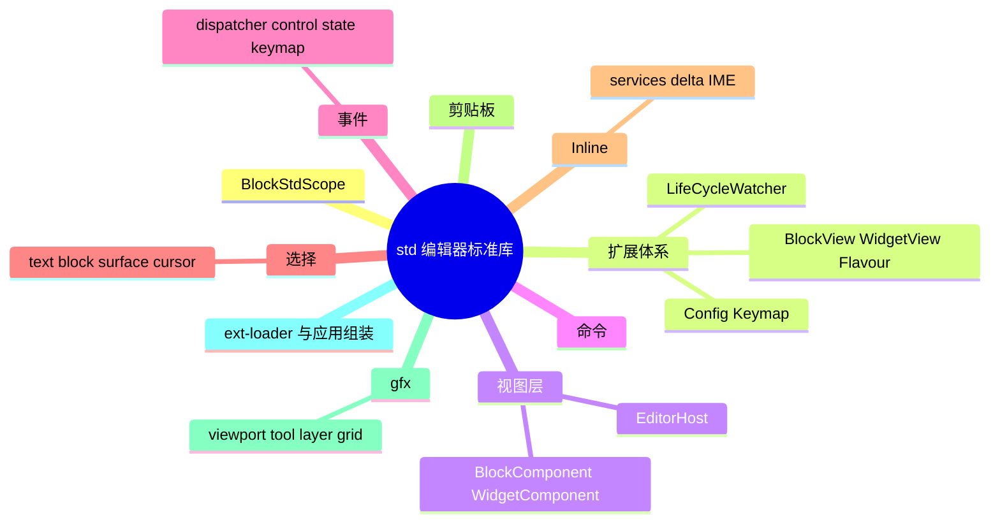
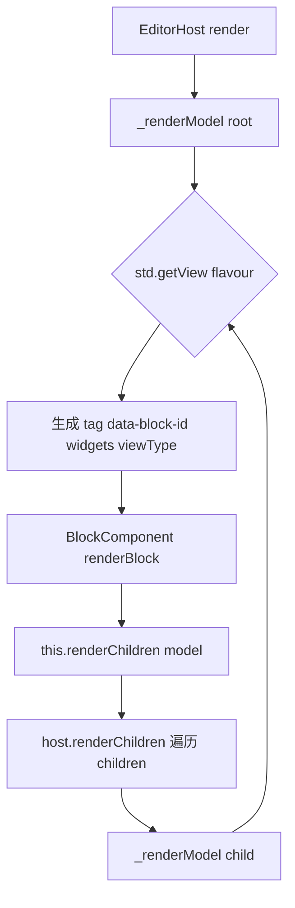
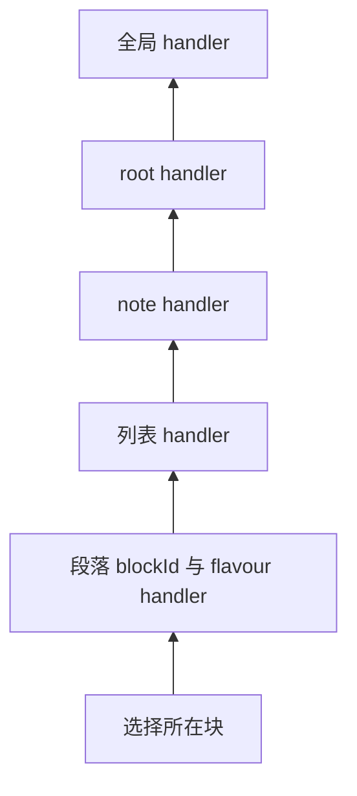
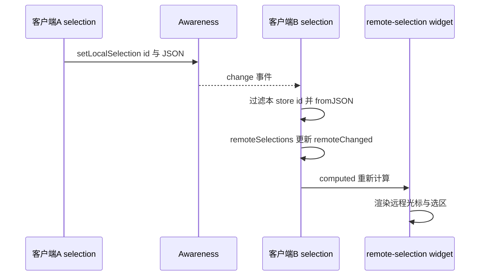
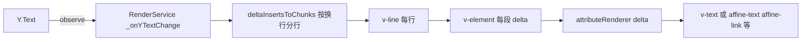
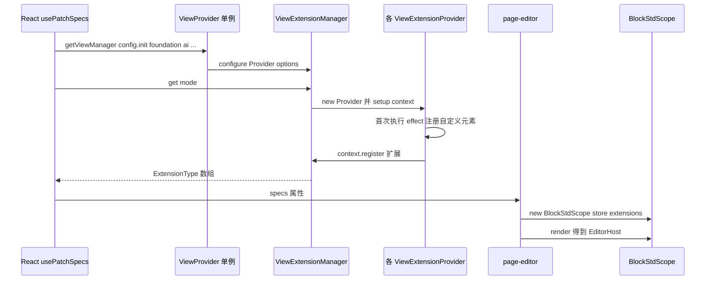
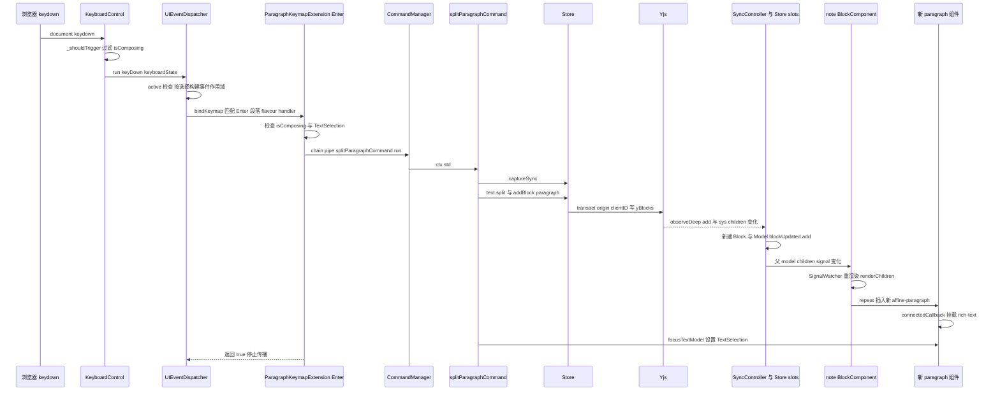

# 第 17 章 BlockSuite Std：视图、扩展、命令、事件

> **所属部分**：第 5 部分 · 编辑器内核 BlockSuite ｜ **难度**：★★★★☆ ｜ **建议学时**：12 小时 ｜ **前置章节**：第 16 章（BlockSuite 架构与 Store 数据层）

---

## 本章导读

第 16 章我们看到，一篇文档在 BlockSuite 里是一棵存放在 Yjs 中的 Block 树，由 `Store` 管理。但 Store 不认识 DOM：它不知道段落该渲染成什么标签，不知道用户按下 Enter 时该做什么，也不知道光标在哪里。把"数据"变成"可编辑的界面"，是 `@blocksuite/std`（`blocksuite/framework/std`）的工作。

`std` 是 BlockSuite 的**编辑器标准库**，它提供：

- 一个视图级 DI 作用域 `BlockStdScope`，以 Store 的 provider 为父级；
- 一组**扩展工厂**（`BlockViewExtension`、`WidgetViewExtension`、`KeymapExtension`、`ConfigExtensionFactory`…）与带生命周期的 `LifeCycleWatcher`；
- 视图组件基类 `EditorHost`、`BlockComponent`、`WidgetComponent`；
- 命令（`CommandManager`）、事件（`UIEventDispatcher`）、选择（`TextSelection` 等）、剪贴板（`Clipboard`）；
- Inline 富文本编辑器（`@blocksuite/std/inline`）；
- 白板图形基础（`@blocksuite/std/gfx`：视口、工具、图层、网格、交互）。

本章还会讲解 `@blocksuite/affine-ext-loader` 的 Provider/Manager 机制，以及 AFFiNE 应用侧 `packages/frontend/core/src/blocksuite/manager` 如何用它组装出编辑器。最后我们串起一条完整链路：**一次按键 → 事件分发 → 命令 → 模型变更 → 视图刷新**。

---

## 学习目标

- [ ] 能够说出 `BlockStdScope` 的 14 个内置扩展，并解释其 provider 与 Store provider 的父子关系
- [ ] 能够使用 `BlockViewExtension`、`WidgetViewExtension`、`FlavourExtension`、`ConfigExtensionFactory`、`KeymapExtension`、`LifeCycleWatcher` 为块注册能力
- [ ] 能够描述 `EditorHost` 如何把 Block 树渲染成组件树，以及 `BlockComponent` 的渲染管线（renderers）
- [ ] 能够编写并链式执行命令（`pipe`、`with`、`try`、`tryAll`），理解上下文如何在命令间传递
- [ ] 能够解释 `UIEventDispatcher` 如何根据选择或事件目标构建"事件作用域"，以及快捷键字符串的规范化规则
- [ ] 能够区分 `TextSelection`、`BlockSelection`、`SurfaceSelection`、`CursorSelection`，并理解远程选择如何经 Awareness 传播
- [ ] 能够说明 `InlineEditor` 的服务划分、Delta 文本模型以及 IME（输入法组合）处理方式
- [ ] 能够画出 AFFiNE 应用从 `getViewManager()` 到 `BlockStdScope` 的扩展装配流程

---

## 知识地图



---

## 13.1 std 全景与 BlockStdScope

### 13.1.1 目录结构

`blocksuite/framework/std/src/` 下的子目录与本章小节一一对应：`scope/`（13.1）、`extension/` 与 `spec/`（13.2）、`view/`（13.3–13.4）、`command/`（13.5）、`event/`（13.6）、`selection/`（13.7）、`inline/`（13.8，子路径 `@blocksuite/std/inline`）、`clipboard/`（13.9）、`gfx/`（13.11，子路径 `@blocksuite/std/gfx`），外加集中定义 DI 标识符的 `identifier.ts` 与注册自定义元素的 `effects.ts`。

`package.json` 的 `exports` 只有四个：`.`、`./gfx`、`./effects`、`./inline`。`effects.ts` 注册了 `editor-host`、`gfx-viewport`、`v-element`、`v-line`、`v-text` 五个自定义元素——**所有 `customElements.define` 都集中在 effects 中执行**，这是 BlockSuite 的约定（预置块也一样，见 13.10）。

### 13.1.2 BlockStdScope：视图层的 DI 作用域

```ts
// 来源：blocksuite/framework/std/src/scope/std-scope.ts（节选）
export const internalExtensions = [
  ServiceManager, CommandManager, UIEventDispatcher, RangeManager, ViewStore,
  Clipboard, GfxController, GfxSelectionManager, GridManager, LayerManager,
  SurfaceMiddlewareExtension, ViewManager, DndController, EditorLifeCycleExtension,
];

export class BlockStdScope {
  constructor(options: BlockStdOptions) {
    this.store = options.store;
    this.userExtensions = options.extensions;
    this.container = new Container();
    this.container.addImpl(StdIdentifier, () => this);
    internalExtensions.forEach(ext => {
      const container = this.container;
      ext.setup(container);
    });
    this.userExtensions.forEach(ext => {
      const container = this.container;
      ext.setup(container);
    });
    this.provider = this.container.provider(undefined, this.store.provider);
    this._lifeCycleWatchers.forEach(watcher => watcher.created());
  }
  // render(): new EditorHost()，设置 std/store 后调用各 watcher.rendered()
  // mount() / unmount()：分别调用 watcher.mounted() / unmounted()
}
```

三个关键点：

1. **provider 父子链**：`container.provider(undefined, this.store.provider)` 把 Store 的 provider 设为父级，所以视图层可以 `std.get(FeatureFlagService)`（注册在 Store 侧），而 Store 侧拿不到任何视图服务——Store 必须能在无 DOM 环境运行。
2. **内置扩展在前，用户扩展在后**：用户可以用 `di.override` 覆盖内置实现。
3. **便捷 getter**：`std.command`、`std.event`、`std.selection`（注意它返回 Store 层的 `StoreSelectionExtension`）、`std.range`、`std.view`、`std.clipboard`、`std.dnd`、`std.host`、`std.get`、`std.getOptional`、`std.getView(flavour)`。

### 13.1.3 生命周期

`LifeCycleWatcher`（`blocksuite/framework/std/src/extension/lifecycle-watcher.ts`）定义了四个钩子，源码注释给出了调用顺序：

| 钩子 | 时机 | 触发者 |
| --- | --- | --- |
| `created()` | `new BlockStdScope()` 结束时 | `BlockStdScope` 构造函数 |
| `rendered()` | `std.render()` 创建 `EditorHost` 后 | `BlockStdScope.render` |
| `mounted()` | `EditorHost.connectedCallback` | `EditorHost` → `std.mount()` |
| `unmounted()` | `EditorHost.disconnectedCallback` | `EditorHost` → `std.unmount()` |

`UIEventDispatcher`、`CommandManager`、`RangeManager`、`ViewStore`、`Clipboard`、`GfxController` 都继承自 `LifeCycleWatcher`。例如 `UIEventDispatcher.mounted()` 才开始绑定 DOM 事件与快捷键——**扩展的副作用都应在 `mounted` 中建立、在 `unmounted` 中清理**。`EditorLifeCycleExtension`（`extension/editor-life-cycle.ts`）把这四个时刻转成 `slots.created/mounted/rendered/unmounted` 四个 `Subject`，方便非扩展代码订阅。

**小结**：`BlockStdScope` = 一个以 Store provider 为父的 DI 容器 + 14 个内置扩展 + 用户扩展；`render()` 产出 `EditorHost`，DOM 挂载驱动 `mounted/unmounted`。

---

## 13.2 扩展体系：标识符与工厂函数

### 13.2.1 标识符总表

`blocksuite/framework/std/src/identifier.ts` 集中定义了视图层的 DI 标识符：

| 标识符 | 变体键 | 值 | 对应工厂 |
| --- | --- | --- | --- |
| `BlockViewIdentifier` | flavour | Lit `literal` 标签或 `(model) => literal` | `BlockViewExtension(flavour, view)` |
| `WidgetViewIdentifier` | `` `${flavour}|${id}` `` | Lit `literal` 标签 | `WidgetViewExtension(flavour, id, view)` |
| `BlockFlavourIdentifier` | flavour | `{ flavour }` | `FlavourExtension(flavour)` |
| `ConfigIdentifier` | configId | 任意配置对象 | `ConfigExtensionFactory<T>(id)` |
| `KeymapIdentifier` | 自增 `Keymap-n` | `{ getter, options }` | `KeymapExtension(factory, options?)` |
| `LifeCycleWatcherIdentifier` | `key` | watcher 实例 | `LifeCycleWatcher.setup` |
| `BlockServiceIdentifier` | flavour | service 实例 | `BlockService.setup`（已弃用） |
| `StdIdentifier` | — | `BlockStdScope` | 内置 |

### 13.2.2 BlockViewExtension 与 WidgetViewExtension

```ts
// 来源：blocksuite/framework/std/src/extension/block-view.ts（节选）
export function BlockViewExtension(flavour: string, view: BlockViewType): ExtensionType {
  return {
    setup: di => {
      di.addImpl(BlockViewIdentifier(flavour), () => view);
    },
  };
}
```

`BlockViewType = StaticValue | ((model: BlockModel) => StaticValue)`（`spec/type.ts`）。函数形式允许**同一 flavour 按上下文选择不同组件**，图片块就是这样做的：

```ts
// 来源：blocksuite/affine/blocks/image/src/image-spec.ts（节选）
BlockViewExtension(flavour, model => {
  const parent = model.store.getParent(model.id);
  if (parent?.flavour === 'affine:surface') {
    return literal`affine-edgeless-image`;
  }
  return literal`affine-image`;
}),
```

`WidgetViewExtension` 用 `` `${flavour}|${id}` `` 作变体键（因此 flavour 与 id 都不能含 `|`）。小部件通常挂在 `affine:page` 上，例如 `blocksuite/affine/widgets/drag-handle/src/index.ts` 中的 `dragHandleWidget = WidgetViewExtension('affine:page', AFFINE_DRAG_HANDLE_WIDGET, literal\`${unsafeStatic(AFFINE_DRAG_HANDLE_WIDGET)}\`)`。

flavour 还支持 `xxx/*` 形式的"祖先路径匹配"（见 `EditorHost` 中的 `isMatchFlavour`），例如 `affine:page/affine:note/*` 表示"父链为 page→note 的任意块"。

### 13.2.3 ConfigExtensionFactory：块级配置

```ts
// 来源：blocksuite/framework/std/src/extension/config.ts（节选）
export function ConfigExtensionFactory<Config extends Record<string, any>>(
  configId: string
): ConfigFactory<Config> {
  const identifier = ConfigIdentifier(configId) as ServiceIdentifier<Config>;
  const extensionFactory = (config: Config): ExtensionType => ({
    setup: di => {
      di.override(ConfigIdentifier(configId), () => config);
    },
  });
  extensionFactory.identifier = identifier;
  return extensionFactory;
}
```

注意它用的是 **`override`**——后注册的配置覆盖先注册的。这就是应用层能"打补丁"的原理：段落块 `ParagraphBlockConfigExtension({ getPlaceholder })` 在块内注册一次，AFFiNE 通过 `manager.configure(ParagraphViewExtension, { getPlaceholder })` 改变 Provider 的参数，最终生效的是带应用文案的版本（13.10）。读取时使用 `std.getOptional(XxxConfigExtension.identifier)`。

### 13.2.4 KeymapExtension

`KeymapExtension(keymapFactory, options?)`（`extension/keymap.ts`）以自增的 `KeymapIdentifier(\`Keymap-${id++}\`)` 注册 `{ getter: keymapFactory, options }`。`UIEventDispatcher.mounted()` 中遍历 `provider.getAll(KeymapIdentifier)`，以 `bindHotkey(getter(std), options)` 绑定。`options.flavour` 让快捷键只在**选择落在该 flavour 的块（或其子孙）上**时生效。

> 源码注释差异：`keymap.ts` 的 JSDoc 示例写的是工厂返回 `{ keymap, options }`，但实际签名是"工厂返回 `Record<string, UIEventHandler>`，`options` 作为第二个参数"。以签名为准，参照 `ParagraphKeymapExtension`、`CalloutKeymapExtension` 的写法。

### 13.2.5 LifeCycleWatcher 与 BlockService

自定义带生命周期的视图扩展：继承 `LifeCycleWatcher`，声明唯一的 `static key`，构造参数固定为 `std`（`setup` 中以 `[StdIdentifier]` 注入）。代码高亮器 `CodeBlockHighlighter`（`blocksuite/affine/blocks/code/src/code-block-service.ts`，key `code-block-highlighter`）就是一个 LifeCycleWatcher：在 `mounted` 中加载 shiki 高亮器并把结果放进 `highlighter$` signal。

`BlockService`（`extension/service.ts`）标注了 **`@deprecated`**："BlockService is deprecated. You should reconsider where to put your feature." 它按 flavour 实例化（依赖 `BlockFlavourIdentifier(flavour)`，因此必须同时注册 `FlavourExtension`），由内置的 `ServiceManager` 在 `mounted/unmounted` 时统一调用。现存使用者只剩 embed 系列块与 `EdgelessRootService`。**新代码应使用 `LifeCycleWatcher`、`ConfigExtensionFactory` 或普通 DI 服务。**

### 13.2.6 DnD

`DndController`（`extension/dnd/index.ts`）是基于 `@atlaskit/pragmatic-drag-and-drop` 的 LifeCycleWatcher，封装了 `draggable`、`dropTarget`、`monitor`、`autoScroll` 等能力，并定义了 `DragPayload<{ bsEntity, from }>` 数据格式。拖拽手柄 widget 与文件拖放（`FileDropExtension`）都建立在它之上，通过 `std.dnd` 访问。

**小结**：std 的扩展都是"工厂函数返回 `{ setup }`"；视图、小部件、配置、快捷键分别落在不同标识符下；带生命周期的能力用 `LifeCycleWatcher`，`BlockService` 已弃用。

---

## 13.3 视图层：EditorHost 与渲染流程

### 13.3.1 EditorHost：Block 树 → 组件树

`EditorHost`（`blocksuite/framework/std/src/view/element/lit-host.ts`）是 `SignalWatcher(WithDisposable(ShadowlessElement))`，通过 `@lit/context` 向下 `provide` 了 `storeContext` 与 `stdContext`。它的 `render()` 只渲染根模型，核心逻辑在 `_renderModel`：

```ts
// 来源：blocksuite/framework/std/src/view/element/lit-host.ts（节选）
private readonly _renderModel = (model: BlockModel): TemplateResult => {
  const { flavour } = model;
  const block = this.store.getBlock(model.id);
  if (!block || block.blockViewType === 'hidden') {
    return html`${nothing}`;
  }
  const schema = this.store.schema.flavourSchemaMap.get(flavour);
  const view = this.std.getView(flavour);
  if (!schema || !view) {
    console.warn(`Cannot find render flavour ${flavour}.`);
    return html`${nothing}`;
  }

  const widgetViews = this.std.provider.getAll(WidgetViewIdentifier);
  const widgets = Array.from(widgetViews.entries()).reduce((mapping, [key, tag]) => {
    // ... key 拆成 [widgetFlavour, id]，isMatchFlavour 时生成 <tag data-widget-id=id>
    return mapping;
  }, {} as Record<string, TemplateResult>);

  const tag = typeof view === 'function' ? view(model) : view;
  return html`<${tag}
    ${unsafeStatic(BLOCK_ID_ATTR)}=${model.id}
    .widgets=${widgets}
    .viewType=${block.blockViewType}
  ></${tag}>`;
};

renderChildren = (model: BlockModel, filter?: (model: BlockModel) => boolean): TemplateResult => {
  return html`${repeat(
    model.children.filter(filter ?? (() => true)),
    child => child.id,
    child => this._renderModel(child)
  )}`;
};
```

要点：

- 组件**只拿到 `data-block-id` 属性**（`BLOCK_ID_ATTR`），模型由组件自己通过 `store.getModelById(blockId)` 获取；
- 小部件以 `TemplateResult` 形式通过 `.widgets` 属性传给块组件，由块决定放在哪里渲染（根块通常在末尾 `repeat` 渲染全部 widgets）；
- 子块渲染使用 `repeat` + id 作 key，保证块移动时 DOM 复用；
- 找不到 Schema 或 View 时只是 `console.warn` 并跳过——**注册了 Schema 却忘了 View，块会"静默消失"**。

### 13.3.2 渲染递归



`BlockComponent.renderChildren` 是 `this.host.renderChildren.bind(this)`——块组件不自己实现递归，而是回调宿主，宿主再为每个子模型查 View。这让"渲染哪个组件"的决定权始终集中在 DI 中。

### 13.3.3 ShadowlessElement 与样式

`ShadowlessElement`（`view/element/shadowless-element.ts`）关闭了 Shadow DOM：块组件渲染在 light DOM 中，`static styles` 会被注入到最近的根节点并按构造器去重。这样做是为了让**原生 Selection 能跨块连续选择**（Shadow DOM 会切断 Range）以及让全局主题 CSS 变量直接生效。

**小结**：EditorHost 是 Block 树到组件树的"翻译器"，按 flavour 查 View、按 flavour 匹配 Widget，并以回调方式递归子块。

---

## 13.4 BlockComponent 与 WidgetComponent

### 13.4.1 BlockComponent 的关键成员

`BlockComponent<Model, Service, WidgetName>`（`view/element/block-component.ts`，约 315 行）：

| 成员 | 说明 |
| --- | --- |
| `std`、`store` | 通过 `@consume` 从 context 获取 |
| `blockId` / `model` | `dataset.blockId` / `store.getModelById(blockId)`（缓存） |
| `widgets` / `viewType` | 由 EditorHost 传入 |
| `renderBlock()` | **子类覆盖的主渲染方法** |
| `renderChildren(model, filter?)` | 渲染子块 |
| `handleEvent(name, handler, { global?, flavour? })` | 向 `UIEventDispatcher` 注册事件，默认作用域为本块 `blockId` |
| `bindHotKey(keymap, options)` | 注册块级快捷键 |
| `selected$` | `computed`：当前块是否被 `BlockSelection` 选中 |
| `parentComponent` / `childBlocks` / `rootComponent` / `widgetComponents` | 组件树导航 |
| `topContenteditableElement` | 最近的可编辑根（Page 模式为根组件，Edgeless 中为 note） |
| `isVersionMismatch` / `renderVersionMismatch` | 版本校验（第 16 章 12.5.5） |

### 13.4.2 渲染管线：renderers

`BlockComponent.render()` 不是直接调用 `renderBlock`，而是把一组 renderer 依次 reduce：

```ts
// 来源：blocksuite/framework/std/src/view/element/block-component.ts（节选）
override render() {
  return this._renderers.reduce((acc, cur) => cur.call(this, acc), nothing as unknown);
}

@state()
protected accessor _renderers: Array<(content: unknown) => unknown> = [
  this.renderBlock,
  this._renderMismatchBlock,
  this._renderViewType,
];

private _renderViewType(content: unknown) {
  return choose(this.viewType, [
    ['display', () => content],
    ['hidden', () => nothing],
    ['bypass', () => this.renderChildren(this.model)],
  ]);
}
```

管线顺序：`renderBlock` 生成内容 → 版本不匹配时替换为警告 → 按 `viewType` 决定显示/隐藏/仅渲染子块。子类可以 `addRenderer(fn)` 追加包装层。`CaptionedBlockComponent`（`blocksuite/affine/components/src/caption/captioned-block-component.ts`）在构造函数中 `this.addRenderer(this._renderWithWidget)`，统一为块加上选中样式、caption 编辑器与 widgets——**绝大多数 AFFiNE 块继承的是 `CaptionedBlockComponent` 而不是 `BlockComponent`**。

### 13.4.3 与 Lit 生命周期的结合

```ts
// 来源：blocksuite/framework/std/src/view/element/block-component.ts（节选）
override connectedCallback() {
  super.connectedCallback();
  this.std.view.setBlock(this);
  const disposable = this.std.store.slots.blockUpdated.subscribe(({ type, id }) => {
    if (id === this.model.id && type === 'delete') {
      this.std.view.deleteBlock(this);
      disposable.unsubscribe();
    }
  });
  this._disposables.add(disposable);
  this._disposables.add(
    this.model.propsUpdated.subscribe(() => {
      this.requestUpdate();
    })
  );
}

protected override async getUpdateComplete(): Promise<boolean> {
  const result = await super.getUpdateComplete();
  await Promise.all(this.childBlocks.map(el => el.updateComplete));
  return result;
}
```

组件挂载时（上面的 `connectedCallback`）`std.view.setBlock(this)` 注册到 `ViewStore`，订阅 `blockUpdated` 中本块的 `delete` 事件以便 `deleteBlock`，并订阅 `model.propsUpdated` 调用 `requestUpdate()`；之后进入 Lit 的 `willUpdate → render（renderers 管线）→ updated` 周期，模型属性或读取过的 signal 变化时再次 `requestUpdate`。

- `ViewStore`（`view/view-store.ts`）维护 `blockId → BlockComponent` 与 widget 映射，`std.view.getBlock(id)` 是从模型找组件的标准途径；它还提供 `viewUpdated` Subject。
- 重写的 `getUpdateComplete` 会**等待所有子块完成渲染**，所以 `await std.host.updateComplete` 后可以安全查询子组件——callout 的 Slash 菜单 action 就是先 `await std.host.updateComplete` 再 `std.view.getBlock(paragraphId)` 聚焦。

### 13.4.4 一个最小真实块组件：divider

`blocksuite/affine/blocks/divider/src/divider-block.ts` 只有约 50 行，展示了块组件的三个惯例：继承 `CaptionedBlockComponent<DividerBlockModel>`；`connectedCallback` 中设 `contentEditable = 'false'`（非文本块）并 `handleEvent('click')` 设置 `BlockSelection`；`renderBlock` 中渲染 `<hr />` 并调用 `renderChildren(this.model)`。第 19 章会逐行拆解它。

### 13.4.5 WidgetComponent

`WidgetComponent<Model, Block, Service>`（`view/element/widget-component.ts`）继承 `SignalWatcher(WithDisposable(LitElement))`（**有 Shadow DOM**，因为浮层 UI 不需要参与文本选择），通过 context 消费 `store`、`model`（所属块的模型）、`service`、`std`。`connectedCallback` 中 `std.view.setWidget(this)`。`handleEvent`/`bindHotKey` 默认作用域是所属块的 flavour。`AffineSlashMenuWidget`、`AffineToolbarWidget`、`AffineDragHandleWidget` 等都继承它。

**小结**：`BlockComponent` 的 `render` 是一条 renderer 管线；`CaptionedBlockComponent` 是 AFFiNE 块的常用基类；组件通过 `ViewStore` 互相查找，`updateComplete` 会等待整棵子树。

---

## 13.5 命令系统

### 13.5.1 Command 的定义

```ts
// 来源：blocksuite/framework/std/src/command/types.ts（节选）
export interface InitCommandCtx {
  std: BlockStdScope;
}

export type Command<Input = InitCommandCtx, Output = {}> = (
  input: Input & InitCommandCtx,
  next: (output?: Output) => void
) => void;
```

命令是一个**纯函数**：读 `ctx`，成功则调用 `next(output)` 并把产出合并进上下文，失败则直接 `return`（不调用 `next`）中断链条。类型参数 `Input`/`Output` 让上下文在链上**类型安全地累积**。

### 13.5.2 CommandManager 与链式调用

`CommandManager`（`command/manager.ts`）是一个 LifeCycleWatcher（key `commandManager`）。链本质上是一个命令数组，`run()` 时递归执行：

```ts
// 来源：blocksuite/framework/std/src/command/manager.ts（节选）
run: function (this: Chain) {
  let ctx = getCommandCtx();
  let success = false;
  try {
    const cmds = this[cmdSymbol];
    ctx = runCmds(ctx, [
      ...cmds,
      (_, next) => {
        success = true;
        next();
      },
    ]);
  } catch (err) {
    console.error(err);
  }
  return [success, ctx];
},
pipe: function (this: Chain, command: Command, input?: object) {
  const cmds = this[cmdSymbol];
  return createChain([...cmds, (ctx, next) => command({ ...ctx, ...input }, next)]);
},
// ...
function runCmds(ctx: InitCommandCtx, [cmd, ...rest]: Command[]) {
  let _ctx = ctx;
  if (cmd) {
    cmd(ctx, data => {
      _ctx = runCmds({ ...ctx, ...data }, rest);
    });
  }
  return _ctx;
}
```

巧妙之处在于 `run` 在链尾追加一个"哨兵命令"把 `success` 置为 `true`——只有所有命令都调用了 `next`，哨兵才会执行。

| API | 语义 |
| --- | --- |
| `chain().pipe(cmd, input?)` | 追加命令，`input` 与当前 ctx 合并后传入 |
| `.with(value)` | 直接向上下文注入数据 |
| `.try(chain => [c1, c2, ...])` | 依次尝试分支，**第一个成功的分支**继续，后续不执行 |
| `.tryAll(chain => [...])` | 执行**所有**分支，至少一个成功即继续 |
| `.run()` | 返回 `[success, ctx]` |
| `exec(cmd, input?)` | `chain().pipe(cmd, input).run()` 的简写 |

### 13.5.3 真实例子

段落按 Enter 时的拆分命令：

```ts
// 来源：blocksuite/affine/blocks/paragraph/src/commands/split-paragraph.ts（节选）
export const splitParagraphCommand: Command<
  { blockId?: string },
  { paragraphConvertedId: string }
> = (ctx, next) => {
  const { std } = ctx;
  const { store, selection } = std;
  let blockId = ctx.blockId;
  if (!blockId) {
    const text = selection.find(TextSelection);
    blockId = text?.blockId;
  }
  if (!blockId) return;
  // ... 校验是段落、取得 inlineEditor 与 range
  // ... 有子块时把右半部分作为第一个子块；否则：
  store.captureSync();
  const right = model.props.text.split(splitIndex, splitLength);
  const id = store.addBlock(model.flavour, { text: right, type: model.props.type }, parent, index + 1);
  // ... store.moveBlocks(model.children, newModel)
  focusTextModel(std, id);
  return next({ paragraphConvertedId: id });
};
```

粘贴时 `PageClipboard.onPagePaste`（`blocksuite/affine/blocks/root/src/clipboard/page-clipboard.ts`）展示了 `try` 的用法：

```ts
// 来源：blocksuite/affine/blocks/root/src/clipboard/page-clipboard.ts（节选）
this.std.command
  .chain()
  .try<{}>(cmd => [
    cmd.pipe(getTextSelectionCommand).pipe((ctx, next) => {
      // ... 无文本选择则 return；跨块选择先 deleteTextCommand
      return next();
    }),
    cmd
      .pipe(getSelectedModelsCommand)
      .pipe(clearAndSelectFirstModelCommand)
      .pipe(retainFirstModelCommand)
      .pipe(deleteSelectedModelsCommand),
  ])
  // ...
```

"有文本选择就走第一条，否则走块选择分支"——`try` 天然表达了这种"多策略回退"。通用命令放在 `blocksuite/affine/shared/src/commands/`（`block-crud`、`model-crud`、`selection` 三类），README 强调"不要把单个块专用的命令放在这里"。

> 文档差异：`docs-site/guide/command.md` 使用 `std.command.chain().command1().command2()` 的"方法式"调用，以及在 `Commands` 接口中声明命令的写法——那是旧版需要全局注册命令的 API。**当前源码中命令就是普通函数，通过 `pipe(cmd)` 引用**，`CommandManager` 注释中残留的 `chain.myCommand1()` 示例同样过时。

**小结**：命令是"ctx in, next(out)"的纯函数；链条通过递归执行并以哨兵判断成功；`try`/`tryAll` 表达分支策略。

---

## 13.6 事件系统

### 13.6.1 结构

```text
event/
├── dispatcher.ts     # UIEventDispatcher：事件注册、作用域构建、分发
├── base.ts           # UIEventState / UIEventStateContext / UIEventHandler
├── keymap.ts         # bindKeymap：快捷键字符串规范化与匹配
├── control/          # 原生事件 → BlockSuite 事件：pointer keyboard range clipboard
└── state/            # 事件状态对象：PointerEventState KeyboardEventState ClipboardEventState DndEventState EventSourceState
```

`UIEventDispatcher` 支持的事件名（`eventNames`）包括：`click/doubleClick/tripleClick`、`pointerDown/Move/Up/Out`、`dragStart/Move/End`、`pinch/pan`、`keyDown/Up/Press`、`selectionChange`、`compositionStart/Update/End`、`cut/copy/paste`、`nativeDrag*`/`nativeDrop`，以及直接透传的 `beforeInput/blur/focus/contextMenu/wheel`。

### 13.6.2 handler 与上下文

`base.ts` 中 `UIEventStateContext` 是一个以 `state.type` 为键的状态表（`add`/`get`/`has`/`static from(...states)`），`get` 取不到时抛出 `EventDispatcherError`；`UIEventHandler = (context) => boolean | null | undefined | void`。
一个事件会携带多个"状态"：`defaultState`（原始 event）、`sourceState`（作用域来源）以及特定状态如 `keyboardState`、`pointerState`、`clipboardState`。handler 用 `ctx.get('keyboardState').raw` 取原生 `KeyboardEvent`。**handler 返回 `true` 表示"已处理"**：分发器停止调用后续 handler，并对非合成事件 `stopPropagation()`。

### 13.6.3 事件作用域：谁先收到事件

```ts
// 来源：blocksuite/framework/std/src/event/dispatcher.ts（节选）
buildEventScope(name: EventName, blocks: string[]): EventHandlerRunner[] | undefined {
  const handlers = this._handlersMap[name];
  if (!handlers) return;
  const globalEvents = handlers.filter(h => h.flavour === undefined && h.blockId === undefined);
  let blockIds: string[] = blocks;
  const events: EventHandlerRunner[] = [];
  const flavourSeen: Record<string, boolean> = {};
  while (blockIds.length > 0) {
    const idHandlers = handlers.filter(h => h.blockId && blockIds.includes(h.blockId));
    const flavourHandlers = blockIds
      .map(blockId => this.std.store.getBlock(blockId)?.flavour)
      // ... 过滤空值与已处理过的 flavour（flavourSeen）
      .flatMap(flavour => handlers.filter(h => h.flavour === flavour));
    events.push(...idHandlers, ...flavourHandlers);
    blockIds = blockIds
      .map(blockId => this.std.store.getParent(blockId)?.id)
      .filter((id): id is string => !!id);
  }
  return events.concat(globalEvents);
}
```

作用域起点有两种来源（`EventScopeSourceType`）：

- **Selection**：键盘、`beforeInput` 等事件以当前选择的 `blockId` 为起点；
- **Target**：指针事件以 `event.target.closest('[data-block-id]')` 为起点，找不到再退回选择。

然后**从起点块向祖先冒泡**，每层先收集 `blockId` 精确匹配的 handler，再收集 `flavour` 匹配的 handler，最后追加全局 handler。同一层中 `add()` 使用 `unshift`，**后注册的先执行**。这一机制让"列表块里的段落"按 Tab 时，段落自己的 handler 先处理，不处理才轮到列表、Note、根块。



### 13.6.4 active 状态与多编辑器

`UIEventDispatcher` 维护静态的 `_activeDispatcher`：页面上可能同时存在多个编辑器（主编辑器、侧边预览、嵌入同步文档），只有**当前激活**的那个才分发事件（`run()` 第一行 `if (!this.active) return;`）。`pointerdown`、`focusin`、`click`、`dragenter` 等会激活，`focusout`（目标移出 host）、`visibilitychange` 隐藏、选区移出 host 等会失活。

### 13.6.5 快捷键与 KeyboardControl

`KeyboardControl`（`event/control/keyboard.ts`）在 `document` 上监听 `keydown/keyup/keypress`，并在捕获阶段监听 `compositionstart/compositionend` 维护 `composition` 标志。`_shouldTrigger` 会过滤 `event.isComposing`，以及不带 Shift/Alt 的 `Mod-c/v/x`（交给剪贴板事件处理）。`bindHotkey` 在 `keyDown` 上注册一个 handler，组合输入期间直接返回 `false`；Android 上还额外在 `beforeInput` 上打补丁（`androidBindKeymapPatch`）。

`keymap.ts` 的 `normalizeKeyName` 规则：

| 写法 | 含义 |
| --- | --- |
| `Mod` | macOS 为 `Meta`，其它平台为 `Ctrl` |
| `Cmd`/`Meta`/`M`、`Ctrl`/`Control`/`C`、`Alt`/`A`、`Shift`/`S` | 修饰键别名，大小写不敏感 |
| `Space` | 空格 |
| 规范化顺序 | `Shift-Meta-Ctrl-Alt-键名` |

例如 `ParagraphKeymapExtension` 中的 `'Mod-Enter'`、`'Control-d'`（仅 macOS 生效，函数内判断 `IS_MAC`）。对于单字符键，`bindKeymap` 还会尝试用 `w3c-keyname` 的 `base` 映射做兼容匹配（处理 Shift 改变字符的情况）。

**小结**：原生事件经 control 层转换为带多种 state 的上下文，按"选择/目标 → 祖先冒泡 → 全局"的作用域顺序分发；handler 返回 `true` 即终止；快捷键字符串经规范化后匹配。

---

## 13.7 选择系统

### 13.7.1 选择类型

选择管理器其实在 **Store 层**：`std.selection` 返回 `StoreSelectionExtension`（第 16 章 12.7.3）。std 只提供具体的选择类型（`blocksuite/framework/std/src/selection/`），并由 `FoundationStoreExtension` 统一注册：

| 类型 | `type` | `group` | 数据 | 场景 |
| --- | --- | --- | --- | --- |
| `TextSelection` | `text` | `note` | `from`/`to: { blockId, index, length }`、`reverse` | 文本光标与跨块文本选区 |
| `BlockSelection` | `block` | `note` | `blockId` | 整块选中（点击分割线、拖选） |
| `SurfaceSelection` | `surface` | `gfx` | `blockId`、`elements[]`、`editing`、`inoperable` | 白板元素选中 |
| `CursorSelection` | `cursor` | `gfx` | 光标坐标 | 白板协同光标 |
| `HighlightSelection` | — | — | 定义于 `blocksuite/affine/shared/src/selection` | 高亮定位 |

```ts
// 来源：blocksuite/framework/std/src/selection/block.ts（节选）
export class BlockSelection extends BaseSelection {
  static override group = 'note';
  static override type = 'block';
  static override fromJSON(json: Record<string, unknown>): BlockSelection {
    const result = BlockSelectionSchema.parse(json);
    return new BlockSelection(result);
  }
  // ... equals()：同为 BlockSelection 且 blockId 相同
  override toJSON(): Record<string, unknown> {
    return { type: 'block', blockId: this.blockId };
  }
}
export const BlockSelectionExtension = SelectionExtension(BlockSelection);
```

每个选择类都必须实现 `fromJSON`/`toJSON`/`equals`——因为选择要被**序列化进 Awareness** 传给其它客户端，也要存入撤销栈的 meta。

### 13.7.2 常用 API

| API | 说明 |
| --- | --- |
| `selection.value` | 当前选择数组（signal 值，可被追踪） |
| `selection.find(TextSelection)` / `find$` | 找到第一个该类型的选择 |
| `selection.filter(BlockSelection)` / `filter$` | 过滤某类型 |
| `selection.create(Type, ...args)` | 创建实例 |
| `selection.set([...])` | 整体替换 |
| `selection.setGroup('note', [...])` | 只替换某个 group，保留其它 group |
| `selection.clear(types?)` / `update(fn)` / `getGroup(group)` | 其它操作 |
| `selection.remoteSelections` / `slots.remoteChanged` | 远程选择 |

group 的意义在于**不同区域的选择互不覆盖**：文档区（`note`）与白板区（`gfx`）可以并存。

### 13.7.3 远程选择

```ts
// 来源：blocksuite/framework/store/src/extension/selection/selection-extension.ts（节选）
set(selections: BaseSelection[]) {
  this.store.awarenessStore.setLocalSelection(this._id, selections.map(s => s.toJSON()));
  this._selections.value = selections;
  this.slots.changed.next(selections);
}
```

`set` 时把 JSON 写入本地 Awareness 的 `selectionV2[selectionManagerId]`，其中 `_id = ${store.id}:${nanoid()}`。监听 Awareness `change` 时，只取其它客户端中 key 以本 `store.id` 开头的条目，用已注册的选择构造器 `fromJSON` 还原，写入 `remoteSelections` 并触发 `slots.remoteChanged`。`blocksuite/affine/widgets/remote-selection/src/doc/doc-remote-selection.ts` 的 widget 用 `computed` 读取 `std.selection.remoteSelections` 渲染他人光标。



### 13.7.4 TextSelection 与原生 Range 的同步

`RangeManager`（`inline/range/range-manager.ts`，LifeCycleWatcher）提供 `syncTextSelectionToRange(selection)` 与 `syncRangeToTextSelection(range, isRangeReversed)`；`RangeBinding`（`inline/range/range-binding.ts`）监听 `document` 的 `selectionchange`（`_onNativeSelectionChanged`）与 `selection.slots.changed`（`_onStdSelectionChanged`），实现**双向同步**：用户拖选文字 → 生成 `TextSelection`；代码 `selection.set([TextSelection])` → 设置原生 Range。`TextSelection` 只记录 `blockId + index + length`，这得益于"每个块一个独立 Inline 编辑器"的扁平设计。

> 文档差异：`working-with-block-tree.md` 与 `selection.md` 中选择对象带 `path`（从根到块的 id 序列），且通过 `SelectionManager` 管理。**当前源码中选择只有 `blockId`，没有 `path`；管理器是 Store 层的 `StoreSelectionExtension`**。

**小结**：选择类型在 std，管理器在 store；选择可序列化，从而支持远程光标与撤销恢复；TextSelection 与原生 Range 由 RangeBinding 双向同步。

---

## 13.8 Inline 编辑器

### 13.8.1 定位与结构

`@blocksuite/std/inline`（`blocksuite/framework/std/src/inline/`）是一个**绑定单个 `Y.Text` 的极简富文本编辑器**。每个文本类块（段落、列表、代码、标题）都拥有一个独立的 `InlineEditor` 实例，这让跨块的复杂结构完全交给 Block 树处理，Inline 只管"一行（或多行）带格式的文本"。

`InlineEditor` 把职责拆为多个 service，并把常用方法"平铺"到自身：

| Service | 文件 | 职责 / 代表方法 |
| --- | --- | --- |
| `AttributeService` | `services/attribute.ts` | 属性 schema 与渲染器：`setAttributeSchema`、`setAttributeRenderer`、`setMarks` |
| `InlineTextService` | `services/text.ts` | 文本写入：`insertText`、`deleteText`、`formatText`、`insertLineBreak` |
| `DeltaService` | `services/delta.ts` | Delta 查询：`getDeltasByInlineRange`、`embedDeltas` |
| `RangeService` | `services/range.ts` | 选区：`getInlineRange`、`setInlineRange`、`focusEnd`、`toDomRange`、`toInlineRange` |
| `EventService` | `services/event.ts` | DOM 事件：`beforeinput`、composition、keydown、selectionchange |
| `RenderService` | `services/render.ts` | 渲染：观察 `yText`，把 delta 渲染成 `v-line`/`v-element`/`v-text` |
| `InlineHookService` | `services/hook.ts` | 钩子：`beforeinput`、`compositionEnd` |

```ts
// 来源：blocksuite/framework/std/src/inline/inline-editor.ts（节选）
mount(rootElement: HTMLElement, eventSource: HTMLElement = rootElement, isReadonly = false) {
  const inlineRoot = rootElement as InlineRootElement<TextAttributes>;
  inlineRoot.inlineEditor = this;
  this._rootElement = inlineRoot;
  this._eventSource = eventSource;
  // ...
  this.eventService.mount();
  this.rangeService.mount();
  this.renderService.mount();
  this._mounted = true;
  this.slots.mounted.next();
  this.render();
}

transact(fn: () => void, withoutTransact = false): void {
  const doc = this.yText.doc;
  // ...
  doc.transact(fn, withoutTransact ? null : doc.clientID);
}
```

构造函数会校验：`yText` 必须已附着于某个 `Y.Doc`，且不能包含 `\r`（"it will break the range synchronization"）。`transact` 使用 `doc.clientID` 作为 origin——与 `Store.transact` 一致，所以打字可被 `HistoryExtension` 撤销。`eventSource` 参数允许把事件监听放在更上层元素（`topContenteditableElement`）上，因为整个页面根是一个大的 `contenteditable`。

### 13.8.2 Delta 文本模型

Inline 的数据模型就是 Yjs 的 **Delta**：`yText.toDelta()` 返回 `[{ insert: 'Hello ', attributes: { bold: true } }, { insert: 'world' }]` 这样的数组。渲染流程：



`attributeRenderer` 决定"带某种 attributes 的 delta 渲染成什么"。在 AFFiNE 中，它由 **InlineSpec + InlineManager** 生成：

```ts
// 来源：blocksuite/affine/inlines/link/src/inline-spec.ts（节选）
export const LinkInlineSpecExtension = InlineSpecExtension<AffineTextAttributes>('link', provider => {
  const std = provider.get(StdIdentifier);
  return {
    name: 'link',
    schema: z.object({ link: z.string().optional().nullable().catch(undefined) }),
    match: delta => !!delta.attributes?.link,
    renderer: ({ delta }) => html`<affine-link .std=${std} .delta=${delta}></affine-link>`,
  };
});
```

`InlineManagerExtension({ id, specs })`（`inline/extensions/inline-manager.ts`）收集一组 spec 的标识符，产出 `InlineManager`：`getRenderer()` 按优先级匹配 spec（`wrapper` 型 spec 可以层层包裹），`getSchema()` 把所有 spec 的 zod schema 求交集，`embedChecker` 判断 delta 是否为嵌入（如 `@提及`、公式），`markdownMatches` 汇总所有 `InlineMarkdownExtension` 注册的行内 Markdown 规则。AFFiNE 的默认管理器是 `DefaultInlineManagerExtension`（`blocksuite/affine/inlines/preset/src/default-inline-manager.ts`），汇集了 bold、italic、link、reference、latex、mention、footnote、comment 等 13 个 spec。

### 13.8.3 IME（输入法）处理

中文、日文输入需要"组合输入"：用户输入拼音时浏览器在 DOM 中显示临时文字，确认后才产生最终文本。`EventService` 的策略是：

1. **非组合状态下拦截一切原生编辑**：`_onBeforeInput` 中 `event.preventDefault()`，然后根据 `inputType` 调用 `transformInput` 写 Yjs。源码注释解释了原因："Browsers (notably Firefox) may remove Lit marker comment nodes during native edits, which will crash subsequent Lit updates"；
2. **组合期间放任浏览器修改 DOM**：`_onCompositionStart` 记录起始 `_compositionInlineRange`，`_onBeforeInput` 检测到 `_isComposing` 直接 `return`；
3. **组合结束时以模型为准**：

```ts
// 来源：blocksuite/framework/std/src/inline/services/event.ts（节选）
private readonly _onCompositionEnd = async (event: CompositionEvent) => {
  this._isComposing = false;
  // ... 检查 rootElement 已连接、range 完全在本编辑器内
  this.editor.rerenderWholeEditor();
  await this.editor.waitForUpdate();
  const inlineRange = this._compositionInlineRange;
  if (!inlineRange) return;
  event.preventDefault();
  // ... 构造 ctx 并调用 this.editor.hooks.compositionEnd?.(ctx)
  const { inlineRange: newInlineRange, data: newData } = ctx;
  if (newData && newData.length > 0) {
    this.editor.insertText(newInlineRange, newData, ctx.attributes);
    this.editor.setInlineRange({ index: newInlineRange.index + newData.length, length: 0 });
  }
  this.editor.slots.inputting.next(event.data ?? '');
  // ...
};
```

即：先 `rerenderWholeEditor()` 用 Yjs 内容**覆盖**浏览器在组合期间产生的脏 DOM，再把组合结果作为一次 `insertText` 写入 Yjs。同理，快捷键层（13.6.5）在组合期间不触发，段落的 Enter handler 也会检查 `raw.isComposing`。Android 输入法行为特殊，`EventService` 另有 `_onAndroidIMEInput` 等分支。

### 13.8.4 RichText：业务封装

AFFiNE 块并不直接 `new InlineEditor`，而是使用 `<rich-text>`（`blocksuite/affine/rich-text/src/rich-text.ts`）。段落块的用法：

```ts
// 来源：blocksuite/affine/blocks/paragraph/src/paragraph-block.ts（节选）
<rich-text
  .yText=${this.model.props.text.yText}
  .inlineEventSource=${this.topContenteditableElement ?? nothing}
  .undoManager=${this.store.history.undoManager}
  .attributesSchema=${this.attributesSchema}
  .attributeRenderer=${this.attributeRenderer}
  .markdownMatches=${this.inlineManager?.markdownMatches}
  .embedChecker=${this.embedChecker}
  .readonly=${this.store.readonly}
  .inlineRangeProvider=${this._inlineRangeProvider}
  // ... enableClipboard、enableUndoRedo 均为 false，verticalScrollContainerGetter
></rich-text>
```

`RichText` 内部创建 `InlineEditor`，挂上 `onVBeforeinput`/`onVCompositionEnd` 钩子（`blocksuite/affine/rich-text/src/hooks.ts`），并实现行内 Markdown 转换（遍历 `markdownMatches` 的 `pattern`）。`inlineRangeProvider` 来自 `getInlineRangeProvider(block)`，把 Inline 选区与 std 的 `TextSelection` 打通。

**小结**：每个文本块一个 InlineEditor，绑定一个 `Y.Text`；数据模型是 Delta，渲染由 InlineSpec 决定；IME 期间放任 DOM、结束后以模型覆盖并一次性写入。

---

## 13.9 剪贴板

`Clipboard`（`blocksuite/framework/std/src/clipboard/clipboard.ts`）是 LifeCycleWatcher（key `clipboard`），它本身**不监听 DOM 事件**，只提供能力：`copy`/`copySlice`/`duplicateSlice`/`paste`/`pasteBlockSnapshot`/`readFromClipboard`/`writeToClipboard`/`use(middleware)`/`unuse`。

粘贴时按优先级尝试所有已注册的适配器：

```ts
// 来源：blocksuite/framework/std/src/clipboard/clipboard.ts（节选）
const byPriority = Array.from(this._adapters).sort((a, b) => b.priority - a.priority);
for (const { adapter, mimeType } of byPriority) {
  const item = getItem(mimeType);
  // ... 文件类型校验
  if (item) {
    const job = this._getJob();
    const adapterInstance = new adapter(job, this.std.store.provider);
    const payload = { file: item, assets: job.assetsManager, workspaceId: doc.workspace.id, pageId: doc.id };
    const result = await adapterInstance.toSlice(payload, doc, parent, index);
    if (result) return result;
  }
}
```

适配器通过 `ClipboardAdapterConfigExtension({ mimeType, adapter, priority })` 注册。`blocksuite/affine/foundation/src/clipboard.ts` 中的配置：BlockSuite 自有快照格式 `ClipboardAdapter`（100）> Notion（95）> HTML（90）> 图片 > 纯文本等。真正监听事件的是根块注册的 `PageClipboard`（`blocksuite/affine/blocks/root/src/clipboard/page-clipboard.ts`）：在 `mounted` 中 `std.clipboard.use(paste / surfaceRefToEmbedMiddleware / replaceId / upload)` 挂载 Transformer 中间件，并 `std.event.add('copy' | 'paste' | 'cut', ...)`。`ClipboardControl`（`event/control/clipboard.ts`）把原生 `copy/paste/cut` 转为带 `clipboardState` 的事件。

完整粘贴链路：原生 `paste` → `ClipboardControl` → `dispatcher.run('paste')` → `PageClipboard.onPagePaste`（命令链先删除当前选区）→ `std.clipboard.paste(...)` → 按 priority 选择 Adapter 的 `toSlice` → Transformer（经 `replaceId`、`upload` 等中间件）→ `snapshotToSlice` 写入 Store。

**小结**：剪贴板 = 事件（ClipboardControl）+ 策略（PageClipboard）+ 能力（Clipboard）+ 格式（Adapter）+ 管线（Transformer 中间件）。

---

## 13.10 ext-loader 与应用侧组装

### 13.10.1 Provider 与 Manager

`@blocksuite/affine-ext-loader`（`blocksuite/affine/ext-loader/src/`）解决的问题：扩展数量庞大（每个块十几个），且同一块在不同场景（页面、白板、预览、移动端）需要不同扩展组合，还要能接受宿主配置。

```ts
// 来源：blocksuite/affine/ext-loader/src/view-provider.ts（节选）
export type ViewScope =
  | 'page' | 'edgeless' | 'preview-page' | 'preview-edgeless' | 'mobile-page' | 'mobile-edgeless';

export class ViewExtensionProvider<Options extends object = Empty>
  extends BaseExtensionProvider<ViewScope, Options> {
  override name = 'ViewExtension';
  static effectRan = false;
  effect(): void {}
  isEdgeless = (scope: ViewScope) =>
    scope === 'edgeless' || scope === 'preview-edgeless' || scope === 'mobile-edgeless';
  // isPreview / isMobile 同理
  override setup(context: ViewExtensionContext, options?: Options) {
    super.setup(context, options);
    const constructor = this.constructor as typeof ViewExtensionProvider;
    if (!constructor.effectRan) {
      constructor.effectRan = true;
      this.effect();
    }
  }
}
```

| 类 | 作用 |
| --- | --- |
| `BaseExtensionProvider<Scope, Options>` | `name`、zod `schema`（校验 options）、`setup(context, options)` |
| `StoreExtensionProvider` | scope 固定为 `'store'` |
| `ViewExtensionProvider` | 6 种 `ViewScope`；`effect()` 每个 Provider 类**只执行一次**（用于 `customElements.define`） |
| `ExtensionManager` | 持有 Provider 类集合与 options；`get(scope)` 实例化（缓存）Provider 并 `setup`，收集 `context.register` 的扩展；`configure(Provider, options)` 修改配置并清除实例缓存 |
| `StoreExtensionManager` / `ViewExtensionManager` | 在 `get` 结果末尾追加"把 Manager 自身注册进 DI"的扩展 |

以 callout 为例（`blocksuite/affine/blocks/callout/src/view.ts`），`CalloutViewExtension` 在 `effect()` 中调用 `effects()` 定义 `affine-callout` 元素，在 `setup()` 中 `context.register([FlavourExtension('affine:callout'), BlockViewExtension('affine:callout', literal\`affine-callout\`), CalloutKeymapExtension, SlashMenuConfigExtension('affine:callout', calloutSlashMenuConfig), ...createBuiltinToolbarConfigExtension('affine:callout')])`——第 19 章会以此为模板编写自定义块。

根块 `RootViewExtension`（`blocksuite/affine/blocks/root/src/view.ts`）则在 `isEdgeless(scope)` 时注册 `affine-edgeless-root`、`EdgelessRootService`、`EdgelessClipboardController`，否则注册 `affine-page-root` 与 `PageClipboard`——**同一个 `affine:page` flavour，因 scope 不同而渲染为完全不同的组件**（第 18 章展开）。

### 13.10.2 应用侧：manager/view.ts

AFFiNE 的视图装配集中在 `packages/frontend/core/src/blocksuite/manager/view.ts`：

```ts
// 来源：packages/frontend/core/src/blocksuite/manager/view.ts（节选）
class ViewProvider {
  static instance: ViewProvider | null = null;
  // ... static getInstance() 单例
  private readonly _manager: ViewExtensionManager;
  constructor() {
    this._manager = new ViewExtensionManager([
      ...getInternalViewExtensions(),
      AffineThemeViewExtension,
      AffineEditorViewExtension,
      // ... EditorConfig、IconPicker、CodeBlockPreview、TurboRenderer、Cloud、Pdf、Mobile、AI、Electron 等
    ]);
  }
  // ... get config(): { init, foundation, theme, editorView, paragraph, ai, comment, ..., value }
}
export function getViewManager() {
  return ViewProvider.getInstance();
}
```

`config` 是一组可链式调用的配置方法，每个方法内部调用 `this._manager.configure(SomeProvider, options)`。例如 `_configureParagraph(enableAI)` 在开启 AI 时把段落占位符改成 `"Type '/' for commands, 'space' for AI"`。React 侧在 `packages/frontend/core/src/blocksuite/block-suite-editor/lit-adaper.tsx` 的 `usePatchSpecs` 中：

```ts
// 来源：packages/frontend/core/src/blocksuite/block-suite-editor/lit-adaper.tsx（节选）
const patchedSpecs = useMemo(() => {
  const manager = getViewManager()
    .config.init()
    .foundation(framework)
    .ai(enableAI, framework)
    // ... theme、editorConfig、editorView、cloud、turboRenderer、pdf、paragraph、mobile 等
    .comment(enableComment, framework).value;
  if (BUILD_CONFIG.isMobileEdition) {
    // ... 返回 manager.get('mobile-page') 或 'mobile-edgeless'
  } else {
    return manager.get(mode);
  }
}, [/* ... */]);
```

得到的 `ExtensionType[]` 作为 `specs` 传给 Lit 编辑器组件（`packages/frontend/core/src/blocksuite/editors/page-editor.ts`），后者在 `connectedCallback` 中 `new BlockStdScope({ store: this.doc, extensions: this.specs })` 并 `std.render()`：



应用侧还有 `createBlockStdScope(store)`（同文件末尾）给非编辑器场景（如生成预览、导出）快速创建 page scope 的 std。Store 侧对应的是 `packages/frontend/core/src/blocksuite/manager/store.ts` 的 `getStoreManager()`（第 16 章）。

> 一个隐蔽的坑：`effectRan` 是静态属性。如果你 `class MyParagraph extends ParagraphViewExtension`，而父类已经执行过 `effect`，子类读取 `constructor.effectRan` 会**继承到父类的 `true`**，导致子类的 `effect` 永远不执行。扩展已有 Provider 时要么不依赖 effect，要么显式声明 `static override effectRan = false`。

**小结**：Provider 按 scope 产出扩展、Manager 汇总并接受配置；AFFiNE 通过单例 `ViewProvider` + 链式 `config` 在 React 侧组装，最终喂给 `BlockStdScope`。

---

## 13.11 gfx 基础：白板的骨架

`@blocksuite/std/gfx`（`blocksuite/framework/std/src/gfx/`）为 Edgeless 白板提供通用基础，第 18 章会在此之上讲具体元素。

| 模块 | 关键类 | 职责 |
| --- | --- | --- |
| `controller.ts` | `GfxController`（LifeCycleWatcher） | 白板总控：`viewport`、`grid`、`layer`、`surface`、`tool`、`selection`、`getElementByPoint`、`getElementsByBound`、`fitToScreen` |
| `viewport.ts` | `Viewport` | 平移缩放：`zoom`、`center`、`viewportBounds`、`toModelCoord`；`ZOOM_MIN = 0.1`、`ZOOM_MAX = 6.0` |
| `viewport-element.ts` | `GfxViewportElement`（`<gfx-viewport>`） | 视口内块的按需渲染（`getModelsInViewport`、`maxConcurrentRenders`） |
| `grid.ts` | `GridManager`（GfxExtension） | 空间网格索引，加速按包围盒查询 |
| `layer.ts` | `LayerManager`（GfxExtension） | 图层与 z 序（fractional index），区分 block 层与 canvas 层 |
| `tool/` | `BaseTool`、`ToolController` | 工具机制：`toolName`、`activate/deactivate`、指针钩子；`setTool(Tool, options)` |
| `selection.ts` | `GfxSelectionManager` | 白板选择（基于 `SurfaceSelection`） |
| `interactivity/` | `InteractivityManager`、`GfxViewInteractionExtension` | 拖拽、缩放、旋转、框选等交互的统一扩展点 |
| `model/` | `GfxBlockElementModel`、`GfxPrimitiveElementModel`、`SurfaceBlockModel`、`@field` 等装饰器 | 白板中的"块元素"与"画布元素"模型 |
| `extension.ts` | `GfxExtension` | 依赖 `GfxControllerIdentifier` 的扩展基类，可用 `extendGfx` 扩展控制器 |

```ts
// 来源：blocksuite/framework/std/src/gfx/tool/tool-controller.ts（节选）
setTool = <T extends BaseTool>(toolType: ToolType<T>, options?: ToolOptions<T>): void => {
  const toolNameStr = toolType.toolName;
  // ... beforeToolUpdate 钩子，被 prevented 则返回
  // explicitly clear the selection when switching tools
  this.gfx.selection.set({ elements: [] });
  this.currentTool$.peek()?.deactivate();
  this.currentToolName$.value = toolNameStr;
  const currentTool = this.currentTool$.peek();
  // ... 未定义时抛出 ValueNotExists
  currentTool.activatedOption = options ?? {};
  // ...
  currentTool.activate(currentTool.activatedOption);
  // ... toolUpdate 钩子
};
```

`GfxBlockComponent`（`view/element/gfx-block-component.ts`）是白板中块组件的基类：`getCSSTransform()` 根据视口计算 `translate + scale`，`onDragStart` 时 `this.model.stash('xywh')`、`onDragEnd` 时 `pop('xywh')`——这正是第 16 章 stash/pop 的典型用途。

**小结**：gfx 层提供视口、空间索引、图层、工具、交互与元素模型的通用骨架，AFFiNE 白板功能都以 GfxExtension / BaseTool / 交互扩展的形式插入。

---

## 13.12 端到端：一次按键的完整旅程

把前面所有部分串起来：在 Page 模式的段落中间按下 **Enter**。



逐段解读：

1. **原生事件 → BlockSuite 事件**：`KeyboardControl` 在 `document` 上监听 `keydown`，过滤组合输入，构造包含 `defaultState`、`sourceState(Selection)`、`keyboardState` 的上下文，调用 `dispatcher.run('keyDown')`。
2. **事件作用域**：当前 `TextSelection` 在段落上，作用域从段落向上冒泡；`ParagraphKeymapExtension` 以 `{ flavour: 'affine:paragraph' }` 注册，匹配成功。
3. **快捷键处理**：Enter handler（`blocksuite/affine/blocks/paragraph/src/paragraph-keymap.ts`）检查 `raw.isComposing`、确认是段落且父块不是 callout，非结尾位置时执行 `std.command.chain().pipe(splitParagraphCommand).run()`，返回 `true`。
4. **命令 → 模型**：命令中 `captureSync()` 切分撤销单元，`text.split()` 截出右半段，`store.addBlock()` 在事务中写 Yjs。
5. **Yjs → 模型**：Store 的 `observeDeep` 创建新 Block 与 Model；父块 `sys:children` 的 observe 更新 `_children` signal。
6. **模型 → 视图**：note 组件的 `renderChildren` 读取了 `model.children`（computed signal），`SignalWatcher` 自动重渲染；`repeat` 只插入新元素，新段落挂载 `<rich-text>` 与 InlineEditor。
7. **选择**：`focusTextModel(std, id)` 设置新的 `TextSelection`，`RangeBinding` 把它同步为原生 Range，光标出现在新段落开头。

整个过程**没有任何一处直接操作 DOM 来"插入段落"**——DOM 完全是 Yjs 数据的投影。远端协作者收到这次更新时，只走第 5、6 步，结果一致。

### 文档与源码差异汇总

| 文档 | 过时内容 | 当前源码 |
| --- | --- | --- |
| `block-spec.md` | `BlockSpec = { schema, service, view: { component, widgets } }` | 不再有 `BlockSpec` 对象；拆为 `BlockSchemaExtension`（Store）+ `BlockViewExtension`/`WidgetViewExtension`/`FlavourExtension`（View） |
| `block-view.md` | `@blocksuite/lit`、`renderModelChildren`、`SchemaToModel`、在 `render()` 中渲染 | 基类在 `@blocksuite/std`；覆盖 `renderBlock()`，用 `renderChildren()` |
| `block-service.md` | 推荐用 `BlockService.mounted` 绑定快捷键 | `BlockService` 已 `@deprecated`，用 `KeymapExtension` / `LifeCycleWatcher` |
| `command.md` | `chain().command1()` 方法式调用 | `chain().pipe(cmd)`，命令是普通函数 |
| `selection.md`、`working-with-block-tree.md` | 选择带 `path`；`SelectionManager` | 只有 `blockId`；管理器为 Store 层 `StoreSelectionExtension` |
| `inline.md` | `import { InlineEditor } from '@blocksuite/inline'` | `@blocksuite/std/inline`（应用中经 `@blocksuite/affine/std/inline`） |

**本章总结**：std 以 `BlockStdScope` 为中心，用 DI 扩展组织视图、配置、快捷键与生命周期；EditorHost 把 Block 树翻译为组件树；命令是纯函数链；事件按"选择/目标 → 祖先 → 全局"分发；选择可序列化并支持协同；InlineEditor 以 Delta 绑定 `Y.Text` 并妥善处理 IME；剪贴板、gfx 都是可插拔的能力集合；ext-loader 让 AFFiNE 能按场景与配置组装这一切。

---

## 源码导读清单

| 优先级 | 路径 | 阅读重点 |
| --- | --- | --- |
| P0 | `blocksuite/framework/std/src/scope/std-scope.ts` | 内置扩展、provider 父子链、render/mount 生命周期 |
| P0 | `blocksuite/framework/std/src/view/element/lit-host.ts` | `_renderModel`、widget 匹配、`renderChildren` |
| P0 | `blocksuite/framework/std/src/view/element/block-component.ts` | renderer 管线、事件注册、版本校验、updateComplete |
| P0 | `blocksuite/framework/std/src/command/manager.ts` | 链式调用、`runCmds` 递归、`try`/`tryAll` |
| P0 | `blocksuite/framework/std/src/event/dispatcher.ts` | 事件作用域构建、active 状态、`run` |
| P1 | `blocksuite/framework/std/src/extension/` | 各扩展工厂、`LifeCycleWatcher`、`BlockService`（弃用） |
| P1 | `blocksuite/framework/std/src/event/control/keyboard.ts`、`event/keymap.ts` | 键盘监听、组合输入过滤、快捷键规范化 |
| P1 | `blocksuite/framework/std/src/selection/`、`blocksuite/framework/store/src/extension/selection/selection-extension.ts` | 选择类型与远程选择 |
| P1 | `blocksuite/framework/std/src/inline/inline-editor.ts`、`services/event.ts`、`services/render.ts` | Inline 服务划分、IME、渲染 |
| P1 | `blocksuite/affine/ext-loader/src/` | Provider、Manager、`effect` 一次性执行 |
| P1 | `packages/frontend/core/src/blocksuite/manager/view.ts`、`packages/frontend/core/src/blocksuite/block-suite-editor/lit-adaper.tsx` | AFFiNE 视图扩展装配 |
| P2 | `blocksuite/framework/std/src/clipboard/clipboard.ts`、`blocksuite/affine/blocks/root/src/clipboard/page-clipboard.ts` | 剪贴板能力与事件策略 |
| P2 | `blocksuite/framework/std/src/inline/range/range-binding.ts` | TextSelection 与原生 Range 双向同步 |
| P2 | `blocksuite/framework/std/src/gfx/controller.ts`、`tool/tool-controller.ts` | 白板总控与工具切换 |
| P2 | `blocksuite/affine/blocks/paragraph/src/paragraph-keymap.ts`、`commands/split-paragraph.ts` | 端到端链路的业务端 |

---

## 动手实践

### 练习 1：在控制台探索 std（基础）

- **目标**：熟悉 `std` 的各个入口。
- **步骤**：
  1. `yarn workspace @blocksuite/playground dev` 启动 playground，打开页面并点击正文；
  2. 控制台执行 `const host = document.querySelector('editor-host'); const std = host.std;`；
  3. 依次查看 `std.selection.value`、`std.view.getBlock(std.store.root.id)`、`std.getView('affine:paragraph')`、`std.userExtensions.length`、`std.event.active`；
  4. 选中一段文字后再看 `std.selection.value[0]`，用 `std.selection.value[0].constructor.type` 读出选择类型。
- **验收标准**：能说明 `selection.value` 中每个对象的 `type`、`group`、`blockId`；能用 `std.view.getBlock(id)` 找到任意块组件。

### 练习 2：手写一个命令链（进阶）

- **目标**：掌握命令的上下文传递。
- **步骤**：
  1. 在控制台定义 `const getFirst = (ctx, next) => { const m = ctx.std.store.getModelsByFlavour('affine:paragraph')[0]; if (!m) return; next({ firstModel: m }); };`
  2. 定义 `const toH1 = (ctx, next) => { ctx.std.store.updateBlock(ctx.firstModel, { type: 'h1' }); next(); };`
  3. 执行 `std.command.chain().pipe(getFirst).pipe(toH1).run()`，观察返回值与页面；
  4. 用 `.try(c => [c.pipe(() => {}), c.pipe(getFirst)])` 观察第一个分支失败时的回退。
- **验收标准**：第一段变为一级标题；能解释 `run()` 返回的 `[true, ctx]` 中 `ctx.firstModel` 的来源；`Ctrl/Cmd+Z` 能撤销。

### 练习 3：注册一个全局快捷键扩展（进阶）

- **目标**：理解 KeymapExtension 与事件作用域。
- **步骤**：
  1. 阅读 `blocksuite/playground/apps/starter/utils/extensions.ts` 中 `createTestEditor` 如何拼接 `pageSpecs`；
  2. 本地（不提交）在 `getTestCommonExtensions` 返回数组中追加 `KeymapExtension(std => ({ 'Mod-Shift-k': () => { console.log(std.selection.value); return true; } }))`（从 `@blocksuite/affine/std` 导入）；
  3. 刷新 playground，在段落中按快捷键；再改为带 `{ flavour: 'affine:list' }` 选项，在段落与列表中分别测试。
- **验收标准**：无 options 时任意位置生效；带 flavour 时只在列表（及其子孙块）中生效。

### 练习 4：追踪一次 Enter 的调用栈（综合）

- **目标**：亲自验证 13.12 的时序。
- **步骤**：在浏览器 DevTools 中给 `split-paragraph.ts` 的 `store.addBlock` 一行与 `lit-host.ts` 的 `_renderModel` 打断点，在段落中间按 Enter，记录调用栈；然后在 `crud.ts` 的 `addBlock` 与 `store.ts` 的 `_onBlockAdded` 再打断点重复一次。
- **验收标准**：能按顺序写出从 `KeyboardControl._down` 到新 `affine-paragraph` 元素 `connectedCallback` 的至少 8 个关键函数。

---

## 自测题

1. `BlockStdScope` 的 provider 为什么要以 `store.provider` 为父？反过来行不行？
2. 注册了 `BlockSchemaExtension` 却忘了 `BlockViewExtension`，会出现什么现象？
3. `BlockComponent.render()` 由哪几个 renderer 组成？`CaptionedBlockComponent` 额外做了什么？
4. 命令链中某个命令没有调用 `next()`，`run()` 返回什么？后续命令会执行吗？
5. `try` 与 `tryAll` 的区别是什么？
6. 段落在列表块中，同时注册了列表 flavour 与段落 flavour 的 Tab 处理器，谁先执行？如何阻止另一个执行？
7. 为什么 `KeyboardControl` 要过滤 `event.isComposing`？组合输入结束后文本是如何写入 Yjs 的？
8. 选择对象为什么必须实现 `toJSON`/`fromJSON`？
9. `ConfigExtensionFactory` 使用 `di.override` 而非 `addImpl`，这带来了什么能力？
10. AFFiNE 中 page 与 edgeless 模式下 `affine:page` 渲染为不同组件，这是在哪里决定的？

<details><summary>参考答案</summary>

1. 视图层需要访问 Store 层注册的服务（Schema、选择、FeatureFlag、Adapter 等），父子链让 `std.get` 能向上查找；反过来不行，因为 Store 必须能在无 DOM 环境运行，不能依赖任何视图服务。
2. `EditorHost._renderModel` 找不到 view，打印 `Cannot find render flavour xxx.` 并渲染 `nothing`，该块（及其子块）在界面上"静默消失"，但数据仍在。
3. 默认依次为 `renderBlock`、`_renderMismatchBlock`（版本不匹配时替换为警告）、`_renderViewType`（按 display/hidden/bypass 处理）。`CaptionedBlockComponent` 通过 `addRenderer(this._renderWithWidget)` 追加一层，包裹选中样式容器、caption 编辑器并渲染 widgets。
4. 返回 `[false, ctx]`，其中 `ctx` 是中断前累积的上下文；后续命令不会执行（`runCmds` 只在 `next` 回调中递归）。
5. `try` 依次尝试分支，第一个成功即继续、其余不执行；`tryAll` 执行全部分支，至少一个成功即继续。
6. 作用域从选择所在的段落开始冒泡，段落层的 handler 先执行；handler 返回 `true` 即停止调用后续 handler。
7. 组合输入期间按键用于输入法选词，不应触发编辑器快捷键（如 Enter 拆分段落）。组合期间 `EventService` 放任浏览器修改 DOM，`compositionend` 时先 `rerenderWholeEditor()` 用模型覆盖 DOM，再以 `insertText` 把 `event.data` 写入 Yjs。
8. 选择会被写入 Awareness 传播给其它客户端（远程选择），也会存进撤销栈 meta 以便撤销后恢复，二者都需要可序列化的纯数据。
9. 后注册者覆盖先注册者，块包可以提供默认配置，宿主（AFFiNE）再按需覆盖，而无需修改块包源码。
10. 在 `blocksuite/affine/blocks/root/src/view.ts` 的 `RootViewExtension.setup` 中：`isEdgeless(context.scope)` 时注册 `BlockViewExtension('affine:page', literal\`affine-edgeless-root\`)`，否则注册 `affine-page-root`；scope 由 `manager.get(mode)` 传入。

</details>

---

## 常见坑与排错

| 现象 | 可能原因 | 解决 |
| --- | --- | --- |
| `Host is not ready to use, the render method should be called first` | 在 `std.render()` 之前访问 `std.host` | 等待渲染完成，或在 `rendered/mounted` 钩子中访问 |
| `Cannot find render flavour xxx.` | 缺少 `BlockViewExtension`，或当前 scope 的 Provider 没注册它 | 检查 Provider 的 `setup` 中 scope 分支 |
| `customElements.define` 报重复定义 | 在 `setup` 而非 `effect` 中定义元素，或同一元素被两个包定义 | 只在 `effect()` 中定义；确认 tag 唯一 |
| 继承已有 Provider 后自定义元素未注册 | 静态 `effectRan` 继承自父类为 `true` | 子类声明 `static override effectRan = false` 或不依赖 effect |
| 快捷键不生效 | 编辑器未激活（多编辑器场景）；处于组合输入；被更内层 handler 返回 `true` 截断；`options.flavour` 不匹配 | 检查 `std.event.active`；调整 flavour；在 handler 打日志 |
| `Unrecognized modifier name` | 快捷键字符串修饰键写错 | 使用 `Mod`、`Shift`、`Alt`、`Ctrl`、`Meta` |
| 设置了 `TextSelection` 光标却不出现 | 目标块组件尚未渲染 | 先 `await std.host.updateComplete` 再设置，或用 `focusTextModel` |
| `yText must be attached to a Y.Doc` | 用游离的 `Y.Text` 创建 InlineEditor | 确保 Text 已写入块属性（附着于 spaceDoc） |
| 修改 `BlockService` 代码不生效 | 未注册 `FlavourExtension`，Service 无法实例化 | 改用 LifeCycleWatcher；或补注册 FlavourExtension |

---

## 延伸阅读

- `blocksuite/docs-site/guide/event.md`、`command.md`、`selection.md`、`inline.md`、`block-view.md`、`block-widgets.md`：对照 13.12 差异表阅读
- `blocksuite/affine/ext-loader/README.md`：Provider/Manager 官方说明与示例
- `blocksuite/playground/examples/inline/`：脱离 Block 树单独使用 InlineEditor 的示例
- `blocksuite/framework/std/src/__tests__/`：std 的单元测试
- Lit 官方文档：Reactive update cycle、`@lit/context`、static html（`literal`/`unsafeStatic`）
- 本书第 18 章（Affine 块与 Edgeless）、第 19 章（自定义 Block 实战）、第 20 章（应用层 DI，对比两套 DI）

---

## 学时拆分

| 内容 | 建议时长 |
| --- | --- |
| 13.1–13.2 BlockStdScope 与扩展体系 | 2 小时 |
| 13.3–13.4 EditorHost、BlockComponent、WidgetComponent | 2 小时 |
| 13.5 命令系统 | 1 小时 |
| 13.6 事件系统 | 1.5 小时 |
| 13.7 选择系统 | 1 小时 |
| 13.8 Inline 编辑器与 IME | 1.5 小时 |
| 13.9–13.11 剪贴板、ext-loader 与应用组装、gfx 基础 | 1.5 小时 |
| 13.12 端到端链路、动手实践与自测 | 1.5 小时 |
| **合计** | **12 小时** |

---

上一章：[第 16 章 BlockSuite 架构与 Store 数据层](./16-BlockSuite架构与Store数据层.md) ｜ 下一章：[第 18 章 Affine 块组件与 Edgeless 白板](./18-Affine块组件与Edgeless白板.md) ｜ [返回目录](../README.md)
