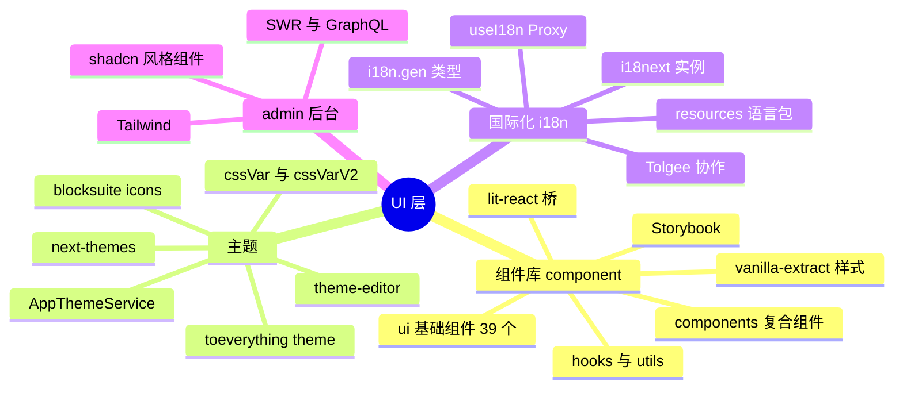
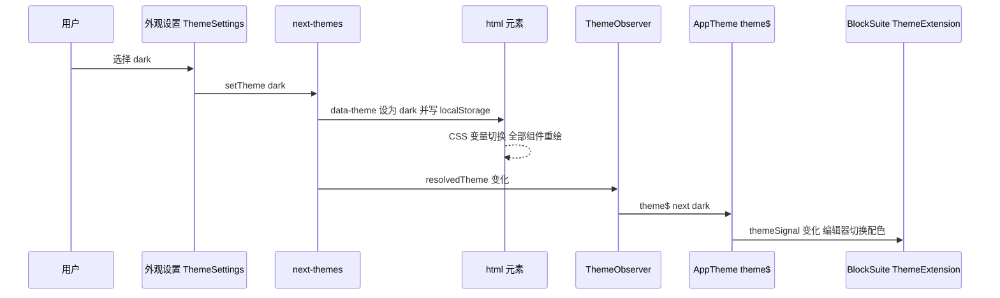
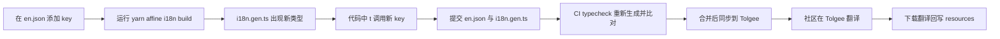

# 第 18 章 组件库、主题与国际化

> **所属部分**：第 6 部分 · 前端应用 ｜ **难度**：★★☆☆☆ ｜ **建议学时**：6 小时 ｜ **前置章节**：第 6 章 前端技术栈-React-Lit-Signals-RxJS

## 本章导读

前两章讲的是"数据怎么流"，本章讲"界面长什么样、说什么话"。AFFiNE 的 UI 层有三个支柱：

1. **组件库** `@affine/component`（`packages/frontend/component`）：39 个基础 UI 组件 + 15 个复合组件，样式用 **vanilla-extract**（编译期 CSS-in-TS），行为大量基于 **Radix UI**，配 Storybook 预览；
2. **主题** `@toeverything/theme`（npm 包，源码已迁至 `toeverything/design` 仓库）：一套以 CSS 变量为载体的设计令牌（design tokens），v1/v2 两代命名并存，配合 `next-themes` 实现明暗切换，`theme-editor` 支持运行时改色；
3. **国际化** `@affine/i18n`（`packages/frontend/i18n`）：i18next + 代码生成的**类型安全 key**，26 份语言资源，翻译经 Tolgee 平台协作。

此外，管理后台 `@affine/admin`（`packages/frontend/admin`）走的是另一条技术路线：**Tailwind CSS + shadcn/ui 风格组件 + SWR 包装的 GraphQL hooks**。把两套做法放在一起对比，能帮你理解"产品主应用"与"内部后台"在 UI 工程上的不同取舍。

本章难度不高，但细节多。建议边读边打开 Storybook（18.3 节），对照组件效果阅读源码。

## 学习目标

- [ ] 能够说出 `packages/frontend/component/src` 下 ui、components、hooks、lit-react、styles、theme、fonts、utils 各目录职责与导出方式
- [ ] 能够以 Button、Modal、Menu 为例，解释 vanilla-extract 的 `style/createVar/selectors` 与 `data-*` 属性驱动变体的写法
- [ ] 能够在本地启动 Storybook 预览组件，并为一个组件编写 story
- [ ] 能够区分 `cssVar` 与 `cssVarV2` 的命名规则，并说明 `next-themes`、`AppThemeService`、BlockSuite `ThemeExtension` 三者如何协作完成明暗切换
- [ ] 能够描述 `@affine/i18n` 的初始化、懒加载、回退策略，以及 `i18n.gen.ts` 的生成方式与 `useI18n()` 的 Proxy 机制
- [ ] 能够独立新增一个文案 key 并通过 CI 的 i18n 检查，了解 Tolgee 翻译协作流程
- [ ] 能够说明 admin 后台的技术栈、模块划分与 `useQuery/useMutation` 的实现
- [ ] 能够列举组件库在可访问性与响应式方面的关键做法

## 知识地图



## 18.1 组件库全景

### 18.1.1 目录与导出

```json
// 来源：packages/frontend/component/package.json（节选）
"exports": {
  ".": "./src/index.ts",
  "./theme": "./src/theme/index.ts",
  "./ui/*": "./src/ui/*/index.ts",
  "./*": "./src/components/*/index.tsx"
},
"scripts": {
  "dev": "storybook dev -p 6006",
  "build:storybook": "storybook build"
}
```

| 目录 | 内容 | 导入方式 |
|---|---|---|
| `src/ui/` | 39 个基础组件（每个一个目录） | `import { Button } from '@affine/component'` 或 `@affine/component/ui/button` |
| `src/components/` | 15 个复合/业务通用组件 | `@affine/component/<目录名>`，如 `@affine/component/provider-composer` |
| `src/hooks/` | `useAutoFocus`、`useAutoSelect`、`useDisposable`、`useRefEffect`、`useThemeColorMeta`、`useThemeValueV1/V2` | 根入口 |
| `src/lit-react/` | Lit 组件转 React（`createReactComponentFromLit`、`toReactNode`、`LitPortal`） | 根入口 |
| `src/styles/` | `displayFlex` 等样式助手、emotion `styled` | 根入口 |
| `src/theme/` | 全局 CSS 入口：主题变量、字体、reset | `import '@affine/component/theme'` |
| `src/fonts/` | Inter、Source Code Pro、Source Serif 4、IBM Plex Mono、Space Mono、Kalam | 由 `theme/fonts.css` 引用 |
| `src/utils/` | `observeResize`、`observeIntersection`、`startViewTransition`、`withUnit`、`isMacOS` 等 | 根入口 |

根入口 `src/index.ts` 依次 `export *` 了 hooks、lit-react、styles、全部 `ui/*` 与 utils。`src/theme/index.ts` 只有四行副作用 import：

```ts
// 来源：packages/frontend/component/src/theme/index.ts
import '@toeverything/theme/style.css';
import './fonts.css';
import './global.css';
import './theme.css';
```

Web 应用的 `apps/web/src/setup.ts` 第三行就是 `import '@affine/component/theme'`——全局样式在应用启动最早期注入。

### 18.1.2 ui 组件清单

| 组件目录 | 主要导出 | 用途 | Story |
|---|---|---|---|
| `audio-player` | `AudioPlayer`、`MiniAudioPlayer`、`AudioWaveform` | 音频播放（会议录音） | 有 |
| `avatar` | `Avatar` | 头像，带彩色兜底 | 有 |
| `button` | `Button`、`IconButton`、`DropdownButton` | 按钮 | 有 |
| `checkbox` | `Checkbox` | 复选框（带动画） | 有 |
| `date-picker` | `DatePicker`、`DayPicker`、`MonthPicker` | 日期选择 | 有 |
| `divider` | `Divider` | 分割线 | 有 |
| `dnd` | `DNDContext`、`Draggable`、`DropTarget`、`DropIndicator` | 拖拽（基于 pragmatic-drag-and-drop） | 有 |
| `drag-handle` | `DragHandle` | 拖拽手柄 | — |
| `editable` | `InlineEdit` | 行内编辑 | 有 |
| `empty` | `Empty` | 空状态 | 有 |
| `error-message` | `ErrorMessage` | 错误提示文本 | — |
| `icon-name-editor` | `IconAndNameEditorMenu`、`IconEditor` | 图标 + 名称编辑 | 有 |
| `icon-picker` | `IconPicker`、`IconRenderer`、`AffineIconRenderer` | 图标/emoji 选择 | 有 |
| `input` | `Input` | 输入框 | 有 |
| `layout` | `Wrapper`、`FlexWrapper`、`Content` | 布局容器 | — |
| `loading` | `Loading` | 加载动画 | 有 |
| `lottie` | `AnimatedDeleteIcon`、`AnimatedFolderIcon` 等 | Lottie 动画图标 | 有 |
| `masonry` | `Masonry` | 瀑布流 + 虚拟滚动 | 有 |
| `menu` | `Menu`、`MenuItem`、`MenuSub`、`MenuSeparator`、`ContextMenu`、`MenuTrigger` | 下拉/右键菜单（桌面/移动两套） | 有 |
| `modal` | `Modal`、`ConfirmModal`、`PromptModal`、`OverlayModal`、`useConfirmModal` | 对话框 | 有 |
| `notification` | `notify`、`NotificationCenter` | 通知（桌面/移动两套卡片） | 有 |
| `popover` | `Popover` | 气泡弹层 | — |
| `progress` | `Progress` | 进度条 | 有 |
| `property` | `PropertyCollapsibleSection` 等 | 文档属性面板 | 有 |
| `radio` | `RadioGroup` | 单选/分段控件 | 有 |
| `resize-panel` | `ResizePanel` | 可拖拽调整尺寸面板 | — |
| `safe-area` | `SafeArea` | 移动端安全区留白 | — |
| `scrollbar` | `Scrollable.*` | 自定义滚动条（Radix ScrollArea） | 有 |
| `skeleton` | `Skeleton` | 骨架屏 | 有 |
| `slider` | `Slider` | 滑块 | 有 |
| `switch` | `Switch` | 开关 | 有 |
| `table` | `Table*` | 表格 | 有 |
| `tabs` | `Tabs.*` | 标签页（Radix Tabs） | — |
| `themed-img` | `ThemedImg` | 明暗主题自动切换的图片 | — |
| `toast` | `toast` | 轻提示 | 有 |
| `tooltip` | `Tooltip` | 提示（支持快捷键展示） | 有 |

`src/components/` 下的复合组件：`affine-banner`、`affine-other-page-layout`、`auth-components`、`card`、`global-loading`、`import-page`、`internal-lottie`、`member-components`、`not-found-page`、`notification-center`、`page-detail-skeleton`、`provider-composer`、`rename-modal`、`resize-panel`、`setting-components`。它们更贴近业务（登录表单、设置项布局），但仍不依赖 DI——**组件库不认识 `@toeverything/infra` 的 Service**，这是一条重要的分层约束。

## 18.2 深读三个组件

### 18.2.1 Button：data 属性驱动的变体

```tsx
// 来源：packages/frontend/component/src/ui/button/button.tsx（节选）
export type ButtonType = 'primary' | 'secondary' | 'plain' | 'error' | 'success' | 'custom';
export type ButtonSize = 'default' | 'large' | 'extraLarge' | 'custom';
// ...
return (
  <Tooltip content={tooltip} shortcut={tooltipShortcut} {...tooltipOptions}>
    <button
      {...otherProps}
      ref={buttonRef}
      className={clsx(styles.button, className)}
      data-loading={loading || undefined}
      data-block={block || undefined}
      disabled={disabled}
      data-disabled={disabled || undefined}
      data-size={size}
      data-variant={variant}
      data-no-hover={withoutHover || BUILD_CONFIG.isMobileEdition || undefined}
      data-mobile={BUILD_CONFIG.isMobileEdition}
      onClick={handleClick}
    >
      <IconSlot icon={prefix} loading={loading} className={prefixClassName} style={prefixStyle} variant={variant} />
      {children ? (
        <span className={clsx(styles.content, contentClassName)} style={contentStyle}>
          {children}
        </span>
      ) : null}
      <IconSlot icon={suffix} className={suffixClassName} style={suffixStyle} />
    </button>
  </Tooltip>
);
```

（类型联合与 `IconSlot` 属性为节省篇幅压缩为单行。）

要点：

- **只有一个 className**（`styles.button`），变体全部用 `data-variant`、`data-size` 等属性表达，样式层用属性选择器匹配。这比"根据 props 拼接多个 class"更易调试——DevTools 里一眼可见状态；
- `undefined` 而非 `false`：React 不会渲染值为 `undefined` 的属性，`data-loading` 只在真正 loading 时出现；
- `handleClick` 内 `if (loading || disabled) return;`，防止 loading 期间重复提交；
- `tooltip` 内建：所有按钮都能直接带提示与快捷键说明；
- 移动版（`BUILD_CONFIG.isMobileEdition`）自动关闭 hover 效果。

### 18.2.2 vanilla-extract 样式：CSS 变量做"可覆盖的接口"

```ts
// 来源：packages/frontend/component/src/ui/button/button.css.ts（节选）
import { cssVar } from '@toeverything/theme';
import { cssVarV2 } from '@toeverything/theme/v2';
import { createVar, style } from '@vanilla-extract/css';

// Using variables can override externally, without considering the priority of selectors.
export const hVar = createVar('height');
export const wVar = createVar('width');
export const iconSizeVar = createVar('iconSize');
const bgVar = createVar('bg');
const textVar = createVar('fg');
// ...
export const button = style({
  // ...
  backgroundColor: bgVar,
  color: textVar,
  width: wVar,
  height: hVar,
  selectors: {
    '&:hover:before': { opacity: 1 },
    '&[data-size="default"]': {
      vars: { [hVar]: '28px', [iconSizeVar]: '16px', [fontSizeVar]: cssVar('fontXs') },
    },
    '&[data-variant="primary"]': {
      vars: {
        [bgVar]: cssVarV2('button/primary'),
        [textVar]: cssVarV2('button/pureWhiteText'),
      },
    },
    '&[data-disabled]': { opacity: 0.5 },
  },
});
```

（`vars` 对象内若干键值合并为单行，其余属性以 `// ...` 省略。）

vanilla-extract 是"**编译期** CSS-in-TS"：`.css.ts` 文件在构建时被执行，产出静态 CSS 与哈希类名，运行时零开销。这里的设计精髓在源码注释第一句："使用变量可以从外部覆盖，而无需考虑选择器优先级"——

- 组件内部只声明"读变量"（`backgroundColor: bgVar`），变体只负责"写变量"；
- 外部想定制尺寸，只需 `assignInlineVars({ [hVar]: '36px' })` 或在自己的 class 里设置 `vars`，不必和 `[data-size]` 选择器比拼优先级；
- hover 效果用 `:before` 伪元素叠加 `cssVarV2('layer/background/hoverOverlay')`，与背景色解耦，任意 variant 都有统一的悬浮反馈。

### 18.2.3 Modal：Radix Dialog + 动画 + 安全区

```tsx
// 来源：packages/frontend/component/src/ui/modal/modal.tsx（节选）
export const Modal = forwardRef<HTMLDivElement, ModalProps>((props, ref) => {
  const insideModal = useContext(InsideModalContext);
  if (!props.open) {
    return;
  }
  return (
    <InsideModalContext.Provider value={insideModal + 1}>
      <ModalInner {...props} ref={ref} />
    </InsideModalContext.Provider>
  );
});

export const useIsInsideModal = () => {
  const context = useContext(InsideModalContext);
  return context > 0;
};
```

`ModalInner` 的结构是 `Dialog.Root → Dialog.Portal → Dialog.Overlay → SafeArea → Dialog.Content`。几个值得学习的细节：

- **未打开即不渲染**（`if (!props.open) return;`），对话框内部的重组件不会提前挂载；
- **嵌套计数** `InsideModalContext`：内层组件可通过 `useIsInsideModal()` 判断自己是否在对话框里（例如决定菜单是否 portal）；
- **`persistent`**：点击外部或按 Esc 不关闭，通过 `onPointerDownOutside`/`onEscapeKeyDown` 拦截实现；
- **`animation`**：`'fadeScaleTop' | 'none' | 'slideBottom' | 'slideRight'`，以 `anim-${animation}` 类名驱动 CSS 动画；
- **移动端**：`SafeArea bottom` + `dynamicKeyboardHeight` 让弹窗避开软键盘，`fullScreen` 时宽高为 `100dvw`/`100dvh`；
- **尺寸**：`width/height/minHeight` 通过 `assignInlineVars` 写入 `styles.widthVar` 等变量，延续 Button 的"变量即接口"思路；
- **可访问性**：没有 `title` 时，仍渲染一个包在 `VisuallyHidden.Root` 里的空 `Dialog.Title`（注释引用了 Radix 文档），关闭按钮带 `aria-label="Close"`。

命令式用法由 `confirm-modal.tsx` 提供：`ConfirmModalProvider` 在 Context 中维护一份 `modalProps`，`useConfirmModal()` 返回 `openConfirmModal(props, { autoClose, onSuccess })`。`onConfirm` 被包装为"设置按钮 loading → 等待 Promise → 关闭"。`AffineContext`（`core/src/components/context/index.tsx`）把 `ConfirmModalProvider`、`PromptModalProvider` 挂在应用根部。

### 18.2.4 Menu：一套 API，两套实现

```ts
// 来源：packages/frontend/component/src/ui/menu/index.ts（节选）
const MenuItem = BUILD_CONFIG.isMobileEdition ? MobileMenuItem : DesktopMenuItem;
const MenuSeparator = BUILD_CONFIG.isMobileEdition ? MobileMenuSeparator : DesktopMenuSeparator;
const MenuSub = BUILD_CONFIG.isMobileEdition ? MobileMenuSub : DesktopMenuSub;
const Menu = BUILD_CONFIG.isMobileEdition ? MobileMenu : DesktopMenu;

export { Menu, MenuItem, MenuSeparator, MenuSub, MenuTrigger };
```

`BUILD_CONFIG.isMobileEdition` 是构建期常量，打包器会做死代码消除，所以桌面包不含移动菜单实现，反之亦然。桌面实现 `desktop/root.tsx` 基于 `@radix-ui/react-dropdown-menu`：

```tsx
// 来源：packages/frontend/component/src/ui/menu/desktop/root.tsx（节选）
export const DesktopMenu = ({ children, items, noPortal, portalOptions, rootOptions: rawRootOptions, contentOptions: rawContentOptions, ref }: MenuProps) => {
  const { defaultOpen, modal, open, onOpenChange, onClose, ...rootOptions } =
    rawRootOptions ?? EMPTY_ROOT_OPTIONS;
  // ...
  const [innerOpen, setInnerOpen] = useState(defaultOpen);
  const finalOpen = open ?? innerOpen;

  const handleOpenChange = useCallback(
    (open: boolean) => {
      setInnerOpen(open);
      onOpenChange?.(open);
      if (!open) {
        onClose?.();
      }
    },
    [onOpenChange, onClose]
  );
  // useImperativeHandle 暴露 changeOpen；noPortal 时用 Fragment 替代 DropdownMenu.Portal
};
```

（解构参数压缩为单行。）

`MenuProps`（`menu.types.ts`）的设计是 **`children` 是触发器、`items` 是菜单内容**：

```tsx
// 教学示例（与当前 MenuProps 一致）
<Menu items={<><MenuItem onSelect={rename}>重命名</MenuItem><MenuSeparator /><MenuItem type="danger" onSelect={remove}>删除</MenuItem></>}>
  <IconButton><MoreHorizontalIcon /></IconButton>
</Menu>
```

受控/非受控两用（`rootOptions.open` 优先于内部 state），并支持通过 `ref.changeOpen` 命令式开关。移动端实现（`mobile/root.tsx`）则是底部弹出的抽屉式菜单。

## 18.3 Storybook：本地预览组件

仓库**确实有 Storybook**：

- 配置在 `packages/frontend/component/.storybook/`（`main.ts`、`preview.tsx`、`preview.css.ts`、`polyfill.ts`、`preview.html`）；
- `main.ts` 中 `stories: ['../src/ui/**/*.@(mdx|stories.@(js|jsx|ts|tsx))']`，即只收录 `src/ui` 下的 story，当前共 34 个 `*.stories.tsx`；
- 框架为 `@storybook/react-vite`，`viteFinal` 中加入 `vanillaExtractPlugin()` 与 `unplugin-swc`（支持装饰器），并把 `getBuildConfig(new Package('@affine/web'), { mode: 'development', channel: 'canary' })` 的结果注入为 `BUILD_CONFIG.*` 常量；
- `preview.tsx` 引入 `'../src/theme'`、`I18nextProvider`（`getOrCreateI18n()`）、`ConfirmModalProvider`，并通过 `globalTypes.theme` 在工具栏提供 light/dark 切换（借助 `next-themes`）。

启动命令（在已安装依赖的前提下）：

```bash
yarn workspace @affine/component dev   # 即 storybook dev -p 6006
```

一个 story 的写法（摘自真实文件）：

```tsx
// 来源：packages/frontend/component/src/ui/button/button.stories.tsx（节选）
import type { Meta } from '@storybook/react';
import { Button } from './button';
import type { ButtonProps } from './button';

export default {
  title: 'UI/Button',
  component: Button,
} satisfies Meta<ButtonProps>;

const types: ButtonProps['variant'][] = ['primary', 'secondary', 'plain', 'error', 'success'];
const sizes: ButtonProps['size'][] = ['default', 'large', 'extraLarge'];
```

（import 顺序与数组排版有调整。）该文件随后用一个表格把 5 种 variant × 3 种 size 全部渲染出来，是检验样式改动最快的方式。

## 18.4 主题：设计令牌与 CSS 变量

### 18.4.1 @toeverything/theme 与 packages/common/theme

`packages/common/theme` 目录现在只剩一个 README：

```
This package has been moved to [toeverything/design](https://github.com/toeverything/design)
```

主题已独立为 npm 包 `@toeverything/theme`（当前依赖版本 `^1.1.23`），在 `node_modules/@toeverything/theme` 中可以看到它导出了 `.`（v1）、`./v2`、`./typography`、`./style.css`、`./fonts`。`style.css` 在 `:root`、`[data-theme=light]`、`[data-theme=dark]` 上定义了全部变量。

### 18.4.2 两代命名规则

| 代际 | TS 访问方式 | 生成的 CSS 变量 | 示例 |
|---|---|---|---|
| v1 | `cssVar('textPrimaryColor')` | `--affine-` + kebab-case | `var(--affine-text-primary-color)` |
| v2 | `cssVarV2('button/primary')` 或 `cssVarV2.layer.insideBorder.blackBorder` | `--affine-v2-` + 路径用 `-` 连接 | `var(--affine-v2-button-primary)` |

v2 的实现是一个递归 `Proxy`（`dist/v2/index.js`）：属性访问逐级拼接路径，到达叶子 token 时返回 `var(--affine-v2-...)` 字符串；也可以函数调用并传 fallback。v2 按"语义层级"组织（`layer/background/hoverOverlay`、`text/primary`、`icon/primary`、`button/primary`），比 v1 的扁平命名更适合设计系统演进。新代码优先用 v2。

统计 `core/src` 与 `component/src` 的 import：`@toeverything/theme` 296 处、`@toeverything/theme/v2` 270 处、`@toeverything/theme/typography` 35 处——两代并存、逐步迁移是现状。

### 18.4.3 明暗主题切换链路



对应源码：

```tsx
// 来源：packages/frontend/core/src/components/theme-provider/index.tsx（节选）
function ThemeObserver() {
  const { resolvedTheme } = useTheme();
  const service = useService(AppThemeService);

  useEffect(() => {
    service.appTheme.theme$.next(resolvedTheme);
  }, [resolvedTheme, service.appTheme.theme$]);

  return null;
}

export const ThemeProvider = ({ children }: PropsWithChildren) => {
  return (
    <NextThemeProvider themes={themes} enableSystem={true}>
      {children}
      <ThemeObserver />
    </NextThemeProvider>
  );
};
```

- `next-themes` 默认把主题写到 `<html data-theme="...">`，正好命中 `@toeverything/theme/style.css` 的 `[data-theme=dark]` 选择器；`enableSystem` 支持"跟随系统"；
- `ThemeObserver` 把 React 世界的 `resolvedTheme` 写入 DI 世界的 `AppTheme.theme$`（`modules/theme/entities/theme.ts`），`AppTheme` 再用 `createSignalFromObservable` 生成 `themeSignal` 给 Lit/BlockSuite 用；
- 设置入口：`desktop/dialogs/setting/general-setting/appearance/index.tsx` 的 `ThemeSettings` 调 `setTheme(value)`；CMD-K 中 `commands/affine-settings.tsx` 也注册了切换到 system/dark/light 的命令。

编辑器侧的桥接（`blocksuite/view-extensions/theme/theme.ts`）是"infra 服务 → BlockSuite 扩展"的典型写法：

```ts
// 来源：packages/frontend/core/src/blocksuite/view-extensions/theme/theme.ts（节选）
export function getThemeExtension(framework: FrameworkProvider): typeof LifeCycleWatcher {
  class AffineThemeExtension extends LifeCycleWatcher implements ThemeExtension {
    static override readonly key = 'affine-theme';

    static override setup(di: Container) {
      super.setup(di);
      di.override(ThemeExtensionIdentifier, AffineThemeExtension, [StdIdentifier]);
    }

    getAppTheme() {
      // ... 缓存
      const theme$: Observable<ColorScheme> = framework
        .get(AppThemeService)
        .appTheme.theme$.map(theme => (theme === ColorScheme.Dark ? ColorScheme.Dark : ColorScheme.Light));
      const { signal: themeSignal, cleanup } = createSignalFromObservable<ColorScheme>(theme$, ColorScheme.Light);
      this.disposables.push(cleanup);
      return themeSignal;
    }
    // getEdgelessTheme(docId)：combineLatest(应用主题, 文档属性 edgelessColorTheme)
  }
  return AffineThemeExtension;
}
```

（若干表达式压缩为单行，缓存逻辑以注释代替。）`getEdgelessTheme` 让每个白板文档可以独立设置配色（文档属性 `edgelessColorTheme`，取值 `'system'` 时跟随应用主题）。

### 18.4.4 theme-editor：运行时改色

`modules/theme-editor/services/theme-editor.ts` 的 `ThemeEditorService` 把自定义主题存在 `GlobalState` 的 `custom-theme` 键下，结构是 `{ light: Record<变量名, 值>, dark: Record<变量名, 值> }`，提供 `customTheme$`、`modified$`、`updateCustomTheme(mode, key, value)`、`reset()`。编辑界面是 `/theme-editor` 路由（`desktop/pages/theme-editor`）。

应用到页面的是 `desktop/pages/root/custom-theme/index.tsx` 的 `CustomThemeModifier`：当实验开关 `enable_theme_editor` 打开时，订阅 `customTheme$`，按当前 `resolvedTheme` 选择 light/dark 映射，逐个 `document.documentElement.style.setProperty(key, value)`。因为所有组件都读 CSS 变量，**覆盖变量 = 换肤**，无需重新构建。同一组件还会把编辑器设置中的字号写入 `--affine-font-base`。

### 18.4.5 图标 @blocksuite/icons

图标来自独立 npm 包 `@blocksuite/icons`，按渲染框架分入口：React 用 `@blocksuite/icons/rc`（`core/src` 与 `component/src` 中 332 处），Lit 用 `@blocksuite/icons/lit`（57 处）。图标是 SVG 组件，默认 `1em` 大小、`currentColor` 着色，所以 Button 的 `IconSlot` 只需给容器设置尺寸与颜色变量即可统一风格。

## 18.5 国际化：@affine/i18n

### 18.5.1 包结构

```
packages/frontend/i18n
├── .i18n-codegen.json        # 代码生成配置
├── build.ts                  # 构建脚本：错误文案注入 → 可选清理 → 生成类型 → 计算完成度
├── cleanup.mjs
└── src
    ├── i18next.ts            # 实例创建、懒加载后端、回退、createI18nWrapper
    ├── react.ts              # useI18n、导出 Trans/I18nextProvider/useTranslation
    ├── i18n.gen.ts           # 生成：useAFFiNEI18N 类型、TypedTrans
    ├── i18n-completenesses.json  # 生成：各语言完成度百分比
    ├── resources/            # en.json 等 26 份语言文件 + index.ts（SUPPORTED_LANGUAGES）
    └── utils/                # i18nTime 时间格式化
```

`resources/` 下有 26 个 JSON：ar、ca、da、de、el-GR、en、es-AR、es-CL、es、fa、fr、hi、it、ja、kk、ko、nb-NO、pl、pt-BR、ru、sv-SE、tr、uk、ur、zh-Hans、zh-Hant。但 `resources/index.ts` 的 `Language` 类型与 `SUPPORTED_LANGUAGES` 只登记了 **25 种**——`el-GR.json` 文件存在、`i18n-completenesses.json` 里也有它（84%），却没有出现在 `SUPPORTED_LANGUAGES` 中，所以用户在界面上选不到希腊语。这是阅读源码时容易忽略的细节。`en.json` 约 2600 个 key。

### 18.5.2 初始化与懒加载

```ts
// 来源：packages/frontend/i18n/src/i18next.ts（节选）
export const getOrCreateI18n = (): i18n => {
  if (!_instance) {
    _instance = i18next.createInstance();
    _instance
      .use(initReactI18next)
      .use({
        type: 'backend',
        init: () => {},
        read: (lng: Language, _ns: string, callback) => {
          const resource = SUPPORTED_LANGUAGES[lng].resource;
          if (typeof resource === 'function') {
            resource()
              .then(data => callback(null, data.default))
              .catch(err => { /* logger.error */ callback(null, null); });
          } else {
            callback(null, resource);
          }
        },
      } as BackendModule)
      .init({
        lng: defaultLng,
        fallbackLng: code => { /* 见下文 */ },
        supportedLngs: Object.keys(SUPPORTED_LANGUAGES),
        partialBundledLanguages: true,
        resources: { [defaultLng]: { translation: SUPPORTED_LANGUAGES[defaultLng].resource } },
        interpolation: { escapeValue: false },
      });
  }
  return _instance;
};
```

（日志与 Promise 处理压缩。）

- **只有英文打进主包**：`SUPPORTED_LANGUAGES.en.resource` 是静态 import 的 JSON，其余语言是 `() => import('./ko.json')` 形式，切换时才加载对应 chunk；
- **自定义 backend**：不需要 http 后端，直接调用动态 import；
- **回退链**：总是回退到 `en`；`xx-YY` 先回退到 `xx`（如 `es-AR → es`）；`cn` 前缀回退到 `zh-Hans`；
- `escapeValue: false`：React 自身会转义，避免二次转义。

### 18.5.3 useI18n：Proxy 包装的类型安全调用

```ts
// 来源：packages/frontend/i18n/src/i18next.ts（createI18nWrapper 节选）
return new Proxy(I18nMethod, {
  get(self, key: string) {
    if (key in self) {
      return self[key];
    }
    return I18nMethod.t.bind(null, key);
  },
  // has(...) 同理
}) as typeof I18nMethod &
  ReturnType<typeof useAFFiNEI18N> & { [unknownKey: string]: () => string };
```

`I18nMethod` 自带 `t`、`language`、`changeLanguage`、`on`；访问其他任意属性时返回 `t.bind(null, key)`。所以 `t['com.affine.rootAppSidebar.favorites']()` 本质是 `i18n.t('com.affine.rootAppSidebar.favorites')`。**类型安全来自 `useAFFiNEI18N` 的返回类型**：

```ts
// 来源：packages/frontend/i18n/src/i18n.gen.ts（节选，生成文件）
    /**
      * `Heading {{number}}`
      */
    Heading(options: {
        readonly number: string;
    }): string;
```

带插值的 key 会生成"必须传参"的函数签名；带 `<1>...</1>` 富文本标记的 key 则生成 `TypedTrans` 下的组件类型，`components` 与 `values` 都有类型约束。React 中 `useI18n()`（`src/react.ts`）通过 `useTranslation` 拿到实例，`useMemo` 包一层 wrapper；非 React 代码可直接用导出的单例 `I18n`。另有 `isI18nString`/`I18nString` 类型，允许在数据结构里存放"尚未翻译的 key"。

`createI18nWrapper.t` 还有一个兜底：`i18n.exists(key)` 为假时**返回 key 本身**，所以界面上出现 `com.affine.xxx` 字样就说明缺翻译或 key 写错。

### 18.5.4 代码生成：i18n.gen.ts 从哪里来

```json
// 来源：packages/frontend/i18n/.i18n-codegen.json（节选）
{
  "input": "./src/resources/en.json",
  "output": "./src/i18n.gen",
  "parser": { "type": "i18next", "contextSeparator": "$", "pluralSeparator": "_" },
  "generator": { "type": "i18next/react-hooks", "hooks": "useAFFiNEI18N", "emitTS": true, "shouldUnescape": true }
}
```

`build.ts` 的执行顺序（文件末尾四行）：

```ts
// 来源：packages/frontend/i18n/build.ts（末尾）
await appendErrorI18n();
if (shouldCleanup) {
  await cleanupResources();
}
i18nnext();
calcCompletenesses();
```

1. `appendErrorI18n`：导入后端 `packages/backend/server/src/base/error/def.ts` 的 `USER_FRIENDLY_ERRORS`，把每个错误的 message 写成 `error.<NAME>` 写入 `en.json`——**前后端共享错误文案**；
2. `cleanupResources`（`--cleanup` 时）：扫描 `packages/frontend/**/src/**/*.{js,tsx,ts}`，删除所有语言文件中未被引用的 key（识别模板字符串前缀等动态用法）；
3. `i18nnext`：调用 `@magic-works/i18n-codegen` 的 `runCli` 生成 `i18n.gen.ts`（`--dev` 时 watch）；
4. `calcCompletenesses`：以 `en` 的 key 数为基数，计算各语言完成度（变体语言如 `es-AR` 会合并父语言 `es` 计算），写入 `i18n-completenesses.json`，设置页的语言列表据此显示百分比（`core/modules/i18n/entities/i18n.ts` 的 `mapLanguageInfo`）。

### 18.5.5 新增一个文案的完整流程



具体步骤：

1. 在 `packages/frontend/i18n/src/resources/en.json` 中添加 `"com.affine.xxx.yyy": "Hello {{name}}"`。**只改英文**，其他语言交给翻译平台；
2. 运行 `yarn affine @affine/i18n build`（或别名 `yarn affine i18n build`），`i18n.gen.ts` 会多出 `["com.affine.xxx.yyy"](options: { readonly name: string }): string`；
3. 代码中 `const t = useI18n(); t['com.affine.xxx.yyy']({ name })`；
4. 提交 `en.json` 与 `i18n.gen.ts`。`.github/workflows/build-test.yml` 的 typecheck job 会重新执行 `yarn affine @affine/i18n build`，`git checkout` 掉 `i18n-completenesses.json` 后若仍有 diff 就失败，提示 "Run 'yarn affine @affine/i18n build' and make sure all generated i18n changes are submitted"。

**翻译协作**：`packages/frontend/i18n/README.md` 描述的是 **Tolgee**（`https://i18n.affine.pro/`）而非 Crowdin：基础语言更新合并后由 `languages-sync` action 把缺失 key 推到 Tolgee，社区在平台翻译；也可设置 `TOLGEE_API_KEY` 后手动执行 `sync-languages:check`、`sync-languages`、`download-resources` 脚本。需要注意：在当前仓库 `.github/workflows/` 中**找不到** `languages-sync` 工作流，`package.json` 里也没有上述三个脚本——README 描述的流程与仓库现状存在出入，实际同步方式以维护者当前做法为准。

### 18.5.6 core 中的 I18n 模块

`core/modules/i18n` 把 i18next 实例纳入 DI：`I18n` 实体依赖 `GlobalCache`，把当前语言持久化在 `i18n_lng` 键，`languageChanged` 时同步设置 `document.documentElement.lang` 与 `dir`（`rtl` 语言为 `'rtl'`，`SUPPORTED_LANGUAGES` 中有三种语言标记了 `rtl: true`）；`changeLanguage` 是一个 `effect(exhaustMap(...))`，失败时 `notify` 提示。`I18nProvider`（`context.tsx`）在挂载时 `i18n.init()` 并渲染 `I18nextProvider`。

## 18.6 Admin 后台：另一套 UI 技术栈

### 18.6.1 技术选型对比

| 维度 | 主应用（core + component） | Admin（`packages/frontend/admin`） |
|---|---|---|
| 样式 | vanilla-extract + CSS 变量 | Tailwind CSS v4（`global.css` 中 `@import 'tailwindcss'`）+ `tailwindcss-animate` |
| 组件 | 自研 `@affine/component` | shadcn/ui 风格（`components.json` 声明 `$schema: https://ui.shadcn.com/schema.json`），代码在 `src/components/ui/` |
| 原语 | Radix（部分） | Radix 全家桶 + `cmdk`、`vaul`、`sonner`、`react-day-picker`、`recharts`、`@tanstack/react-table` |
| 状态/数据 | DI + LiveData + nbstore | SWR + `@affine/graphql` |
| 路由 | 自研 Workbench + React Router | React Router `BrowserRouter` + `@affine/routes` 常量 |
| 国际化 | `@affine/i18n` | 无（`src` 中没有 `useI18n` 调用），界面为英文 |
| 主题 | next-themes + `@toeverything/theme` | next-themes（`defaultTheme="system"`），Tailwind 颜色映射到 shadcn 变量，字体/字号映射到 `@toeverything/theme` 变量 |

后台功能单一、使用者少、迭代快，shadcn 的"复制即拥有"模式非常合适；主应用则需要像素级一致的品牌视觉、与 BlockSuite 共享主题、在 Electron/移动端复用，自研组件库更可控。

### 18.6.2 shadcn 风格组件

```tsx
// 来源：packages/frontend/admin/src/components/ui/button.tsx（节选）
const buttonVariants = cva(
  'inline-flex items-center justify-center whitespace-nowrap rounded-lg text-sm font-medium ... disabled:pointer-events-none disabled:opacity-50',
  {
    variants: {
      variant: {
        default: 'bg-primary text-primary-foreground shadow-1 hover:bg-primary/90 active:translate-y-px',
        destructive: 'bg-destructive text-destructive-foreground shadow-1 hover:bg-destructive/90 active:translate-y-px',
        outline: 'border border-border bg-background text-foreground hover:bg-accent hover:text-accent-foreground',
        // secondary / ghost / link
      },
      size: { default: 'h-9 px-4', sm: 'h-8 px-3 text-xs', lg: 'h-10 px-6', icon: 'h-9 w-9' },
    },
    defaultVariants: { variant: 'default', size: 'default' },
  }
);
```

（基础类名中部以 `...` 省略，部分对象压缩为单行。）`cva`（class-variance-authority）定义变体，`cn()`（`src/utils.ts`，`twMerge(clsx(...))`）合并类名，`asChild` 时用 Radix `Slot` 渲染。`tailwind.config.js` 用 `themeToVar` 把 `fontFamily`、`fontSize` 映射到 `@toeverything/theme` 变量，保持与主应用一致的字体基线。

### 18.6.3 模块与路由

`src/modules/` 下：`about`、`accounts`、`auth`、`dashboard`、`nav`、`panel`、`settings`、`setup`、`workspaces`，以及 `common.ts`、`header.tsx`、`layout.tsx`。`app.tsx` 的路由逻辑：

- `RootRoutes`：服务器未初始化时强制跳 `/admin/setup`；访问 `/admin` 时自托管跳 `accounts`，否则跳 `dashboard`；
- `AuthenticatedRoutes`：未登录或非管理员跳 `/admin/auth`，否则渲染 `Layout`；
- 自托管环境下 `dashboard`、`workspaces` 重定向到 `accounts`；`ai` 路由重定向到 `settings`；
- 所有页面用 `@affine/routes` 的 `lazy()` 懒加载。

### 18.6.4 use-query 与 use-mutation

```ts
// 来源：packages/frontend/admin/src/use-query.ts（节选）
const createUseQuery =
  (immutable: boolean): useQueryFn =>
  (options, config) => {
    const configWithSuspense: SWRConfiguration = useMemo(
      () => ({ suspense: true, ...config }),
      [config]
    );

    const useSWRFn = immutable ? useSWRImmutable : useSWR;
    return useSWRFn(
      options ? () => ['cloud', options.query.id, options.variables] : null,
      options ? () => gqlFetcher(options) : null,
      configWithSuspense
    );
  };

export const useQuery = createUseQuery(false);
export const useQueryImmutable = createUseQuery(true);

export const gqlFetcher = gqlFetcherFactory('/graphql', window.fetch);
```

- SWR key 是 `['cloud', query.id, variables]`，`query.id` 来自 `@affine/graphql` 代码生成的查询对象（见第 23 章）；
- 默认 `suspense: true`，配合 `app.tsx` 中 `SWRConfig`（`revalidateOnFocus: false`、`revalidateOnMount: false`）；
- `useQueryInfinite` 包装 `useSWRInfinite` 做分页；`use-mutation.ts` 的 `useMutation` 包装 `useSWRMutation`，`useMutateQueryResource` 用于失效重查。

业务用法（`modules/accounts/use-user-list.ts`）：

```ts
// 来源：packages/frontend/admin/src/modules/accounts/use-user-list.ts（节选）
const {
  data: { users, usersCount },
} = useQuery(
  {
    query: listUsersQuery,
    variables: {
      filter: {
        first: pagination.pageSize,
        skip: pagination.pageIndex * pagination.pageSize,
        keyword: filter?.keyword || undefined,
        // features ...
      },
    },
  },
  { keepPreviousData: true }
);
```

列表本身用 `components/shared/data-table.tsx`（基于 `@tanstack/react-table`）渲染。

## 18.7 可访问性与响应式

| 主题 | 做法 | 源码位置 |
|---|---|---|
| 焦点管理 | 依赖 Radix 原语的焦点陷阱与 Esc 关闭；Modal 支持 `disableAutoFocus` | `ui/modal/modal.tsx` |
| 键盘可见焦点 | `:focus-visible::after` 绘制 1px 边框，移动端关闭 | `ui/button/button.css.ts` |
| 读屏文本 | 无标题对话框渲染 `VisuallyHidden` 包裹的 `Dialog.Title`；关闭按钮 `aria-label="Close"` | `ui/modal/modal.tsx` |
| 语言与方向 | 切换语言时设置 `<html lang dir>`，RTL 语言 `dir="rtl"` | `core/modules/i18n/entities/i18n.ts` |
| 自动聚焦/选中 | `useAutoFocus`、`useAutoSelect` | `component/src/hooks/focus-and-select.ts` |
| 端适配 | 构建期 `BUILD_CONFIG.isMobileEdition` 切换实现（Menu、Notification、Button hover） | `ui/menu/index.ts` 等 |
| 安全区与软键盘 | `SafeArea` + `dynamicKeyboardHeight`、`100dvh` | `ui/safe-area`、`ui/modal` |
| 尺寸监听 | `observeResize`、`observeIntersection` 工具 | `component/src/utils` |
| 平台快捷键 | `isMacOS()`、tinykeys `$mod` | `component/src/utils/platform.ts`、`core/src/commands` |

不足之处同样值得了解：在 `component/src/ui` 中显式使用 `aria-` 属性的文件只有 8 个，较多依赖 Radix 默认行为；自研组件（如 `editable`、`masonry`）的无障碍支持需要贡献者额外关注。

## 18.8 小结

- `@affine/component` 以"单 className + data 属性 + CSS 变量"组织样式，vanilla-extract 保证零运行时；组件库不依赖 DI；
- Storybook 只收录 `src/ui` 的 story，是改组件样式的首选验证手段；
- 主题以 CSS 变量为载体，v1 `--affine-*` 与 v2 `--affine-v2-*` 并存；next-themes 改 `data-theme`，`ThemeObserver` 把结果同步给 DI 与 BlockSuite；theme-editor 通过覆盖变量实现运行时换肤；
- i18n 以 `en.json` 为唯一真相源，代码生成提供类型安全，CI 保证生成物已提交，Proxy 让调用像访问属性一样自然；
- admin 采用 Tailwind + shadcn + SWR，是"内部工具"的务实选择。

## 源码导读清单

| 优先级 | 路径 | 阅读重点 |
|---|---|---|
| P0 | `packages/frontend/component/src/ui/button/button.tsx`、`button.css.ts` | data 属性变体、createVar |
| P0 | `packages/frontend/component/src/ui/modal/modal.tsx`、`confirm-modal.tsx` | Radix Dialog 封装、命令式确认框 |
| P0 | `packages/frontend/i18n/src/i18next.ts` | 实例、懒加载、回退、Proxy |
| P0 | `packages/frontend/i18n/build.ts` | 生成流程四步 |
| P1 | `packages/frontend/component/src/ui/menu/index.ts`、`desktop/root.tsx` | 双端实现切换 |
| P1 | `packages/frontend/component/.storybook/main.ts`、`preview.tsx` | Storybook 配置 |
| P1 | `packages/frontend/core/src/components/theme-provider/index.tsx` | next-themes 与 DI 同步 |
| P1 | `packages/frontend/core/src/blocksuite/view-extensions/theme/theme.ts` | 主题桥接到 BlockSuite |
| P1 | `packages/frontend/i18n/src/resources/index.ts` | 语言注册表 |
| P1 | `packages/frontend/admin/src/use-query.ts`、`app.tsx` | SWR 包装与路由守卫 |
| P2 | `packages/frontend/core/src/modules/theme-editor/services/theme-editor.ts`、`desktop/pages/root/custom-theme/index.tsx` | 运行时换肤 |
| P2 | `packages/frontend/core/src/modules/i18n/entities/i18n.ts` | 语言持久化与 dir |
| P2 | `packages/frontend/admin/src/components/ui/button.tsx`、`tailwind.config.js` | shadcn 风格与主题映射 |
| P2 | `node_modules/@toeverything/theme/dist/v2/index.js` | cssVarV2 的 Proxy 实现 |

## 动手实践

### 练习 1：跑起 Storybook（基础）

- **目标**：会预览与调试组件。
- **步骤**：依赖安装完成后执行 `yarn workspace @affine/component dev`，打开 `http://localhost:6006`，找到 `UI/Button`，用工具栏切换 dark 主题；在 DevTools 中选中一个按钮，观察 `data-variant`、`data-size` 与计算后的 `--affine-v2-button-primary`。
- **验收标准**：能说明切换主题时哪个 DOM 属性变化、哪些 CSS 变量的值随之改变。

### 练习 2：为 Switch 写一个 story（基础）

- **目标**：掌握 story 写法。
- **步骤**：参考 `ui/switch/switch.stories.tsx` 与 `ui/button/button.stories.tsx`，新增一个展示"禁用 + 选中"组合的 story（本地实验即可）。
- **验收标准**：Storybook 中出现新 story，切换主题外观正确。

### 练习 3：新增一个文案 key（进阶）

- **目标**：走通 i18n 流程。
- **步骤**：在 `en.json` 加 `"com.affine.demo.greeting": "Hello {{name}}"`，运行 `yarn affine @affine/i18n build`，在任一组件中 `t['com.affine.demo.greeting']({ name: 'AFFiNE' })`；故意不传 `name` 观察类型报错；再在 `zh-Hans.json` 中补一条中文，切换语言验证。
- **验收标准**：`i18n.gen.ts` 中出现带 `options: { readonly name: string }` 的签名；切换到简体中文后显示中文。

### 练习 4：用 theme-editor 换肤（进阶）

- **目标**：理解"覆盖变量即换肤"。
- **步骤**：确认实验开关 `enable_theme_editor` 处于开启状态（`feature-flag/constant.ts` 中它仅在 canary 构建且非移动端时可配置，canary 默认开启），打开 `/theme-editor`，修改 `--affine-v2-button-primary`，回到工作区观察按钮颜色；在控制台执行 `document.documentElement.style.cssText` 查看注入结果。
- **验收标准**：能说明修改是如何从 `GlobalState` 流到 `<html style>` 的。

### 练习 5：在 admin 中新增一个只读页面（挑战）

- **目标**：熟悉 admin 技术栈。
- **步骤**：在 `routes.json` 的 admin 下增加一个路由并运行 `packages/frontend/routes` 的 build 脚本；新建 `modules/demo/index.tsx`，用 `useQuery({ query: adminServerConfigQuery })` 显示服务器版本，用 shadcn `Card`/`Button` 组件布局；在 `app.tsx` 注册路由、在 `nav.tsx` 增加入口（本地实验）。
- **验收标准**：页面可访问，数据通过 SWR 加载，暗色模式下样式正常。

## 自测题

1. `@affine/component` 的 `exports` 中 `"./*"` 映射到哪里？举一个用这种方式导入的例子。
2. Button 为什么用 `data-variant` 而不是多个 className？值为什么用 `undefined` 而不是 `false`？
3. `button.css.ts` 注释说"使用变量可以从外部覆盖，而无需考虑选择器优先级"，请解释其原理。
4. `Modal` 在 `open` 为 false 时的行为是什么？这样做有什么好处？
5. Storybook 的 story 收录范围是什么？`BUILD_CONFIG` 在 Storybook 中是怎么来的？
6. `cssVar('textPrimaryColor')` 与 `cssVarV2('text/primary')` 分别生成什么字符串？
7. 用户切换到暗色后，BlockSuite 编辑器是如何得知的？
8. i18next 实例为什么只把英文打进主包？`es-AR` 缺失 key 时如何回退？
9. `t['com.affine.xxx']()` 在 key 不存在时返回什么？类型安全从哪里来？
10. 修改 `en.json` 后忘了运行生成脚本，CI 会怎样？

<details><summary>参考答案</summary>

1. 映射到 `./src/components/*/index.tsx`，例如 `import { ProviderComposer } from '@affine/component/provider-composer'`（`core/src/components/context/index.tsx` 中的用法）。
2. 单一 className + 属性选择器让状态在 DOM 上直观可见、样式组合简单；React 不渲染值为 `undefined` 的属性，而 `false` 会被渲染为字符串 `"false"`，导致 `[data-loading]` 选择器误匹配。
3. 组件基础样式只"读"变量（`backgroundColor: bgVar`），变体只"写"变量。外部只需在任意层级给元素设置同名变量（`assignInlineVars` 或自定义 class 的 `vars`），CSS 变量按 DOM 继承/就近生效，不需要写更高优先级的选择器去覆盖属性本身。
4. 直接 `return`（不渲染任何内容），关闭时内部组件被卸载。好处是未打开的对话框不会挂载重组件、不产生副作用，打开时总是全新状态。
5. 只收录 `src/ui/**/*.stories.*`（以及 mdx）。`main.ts` 的 `viteFinal` 调用 `getBuildConfig(new Package('@affine/web'), { mode: 'development', channel: 'canary' })`，把每个字段以 `BUILD_CONFIG.xxx` 形式注入 `define`。
6. 分别是 `var(--affine-text-primary-color)` 与 `var(--affine-v2-text-primary)`。
7. `next-themes` 更新 `resolvedTheme` → `ThemeObserver` 写入 `AppThemeService.appTheme.theme$` → `AffineThemeExtension.getAppTheme()` 通过 `createSignalFromObservable` 得到的 signal 变化 → BlockSuite 组件响应 signal 重新渲染配色。
8. 减小主包体积：其他语言用动态 import 按需加载。`es-AR` 的回退链是 `es` → `en`（`fallbackLng` 函数对 `xx-YY` 先 unshift `xx`，始终包含 `en`）。
9. 返回 key 字符串本身（`i18n.exists(key)` 为假时）。类型安全来自代码生成的 `useAFFiNEI18N` 返回类型，`createI18nWrapper` 的返回值被断言为该类型。
10. typecheck job 中 `yarn affine @affine/i18n build` 会重新生成 `i18n.gen.ts`，`git status` 出现差异，CI 失败并提示运行该命令后提交生成物。

</details>

## 常见坑与排错

| 现象 | 原因 | 解决 |
|---|---|---|
| 界面出现 `com.affine.xxx` 原文 | key 拼写错误或未在 `en.json` 中添加 | 检查 key；运行 i18n build 让类型报错暴露问题 |
| CI 提示 i18n 生成物未提交 | 改了 `en.json` 没跑生成 | `yarn affine @affine/i18n build` 后提交 `i18n.gen.ts` |
| 新增语言选不到 | 只加了 JSON，没在 `resources/index.ts` 的 `Language` 与 `SUPPORTED_LANGUAGES` 登记（如 `el-GR`） | 同时更新类型与注册表 |
| 组件样式在某处被覆盖不掉 | 直接覆盖属性与 `[data-*]` 选择器比优先级 | 改为设置组件暴露的 CSS 变量（如 `hVar`、`widthVar`） |
| 暗色模式下某个自定义颜色不变 | 写死了色值而不是用 `cssVar`/`cssVarV2` | 改用主题变量 |
| 编辑器颜色与外壳不同步 | 只改了 CSS，没走 `AppTheme.theme$` | 通过 next-themes `setTheme` 切换，不要直接改 `data-theme` |
| Storybook 报 `BUILD_CONFIG is not defined` | 自己新建了 Storybook 配置或在 `ui` 之外放 story | 使用现有 `.storybook/main.ts`，story 放在 `src/ui` 下 |
| 在组件库里 `useService` 报错 | 组件库不应依赖 DI，Storybook 也没有 FrameworkRoot | 把依赖 DI 的逻辑放到 core 层，组件只接收 props |
| admin 修改路由不生效 | 改了 `routes.json` 没重新生成 `src/routes.ts` | 运行 `packages/frontend/routes` 的 build 脚本 |

## 延伸阅读

- `packages/frontend/i18n/README.md`：i18n 使用与 Tolgee 协作说明；
- `packages/frontend/component/src/lit-react/readme.md`：为何自研 Lit → React 包装（官方 `createComponent` 在 `connectedCallback` 中访问属性的问题）；
- `packages/common/theme/README.md`：主题包迁移说明；
- vanilla-extract 官方文档（`style`、`createVar`、`assignInlineVars`）；Radix UI Primitives 文档；next-themes 文档；shadcn/ui 文档；i18next 与 react-i18next 文档；Tolgee 文档；
- 第 13 章：BlockSuite 扩展与 DI（理解 `ThemeExtensionIdentifier`）；
- 第 17 章：dialogs 模块与命令系统（文案与 UI 的使用方）；
- 第 23 章：GraphQL 代码生成（admin `useQuery` 的查询对象来源）。

## 学时拆分

| 内容 | 建议时长 |
|---|---|
| 18.1–18.3 组件库全景、三组件深读、Storybook | 2 小时 |
| 18.4 主题与图标 | 1 小时 |
| 18.5 国际化 | 1 小时 |
| 18.6–18.7 admin 后台、可访问性与响应式 | 1 小时 |
| 动手实践与自测 | 1 小时 |
| **合计** | **6 小时** |

---
上一章：[第 17 章 Core 业务模块与路由](./17-Core业务模块与路由.md) ｜ 下一章：[第 19 章 存储与同步引擎 nbstore](./19-存储与同步引擎nbstore.md) ｜ [返回目录](../README.md)
