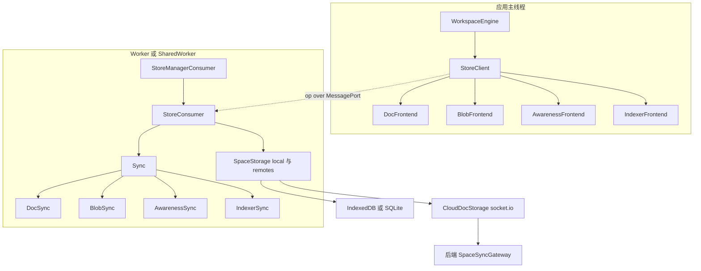
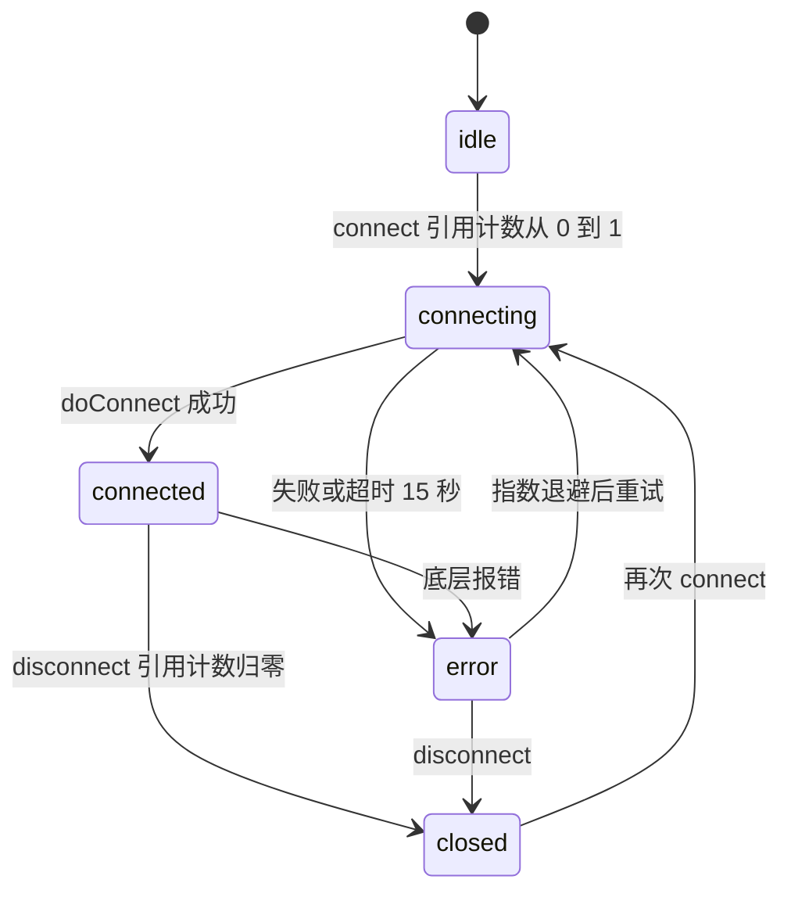
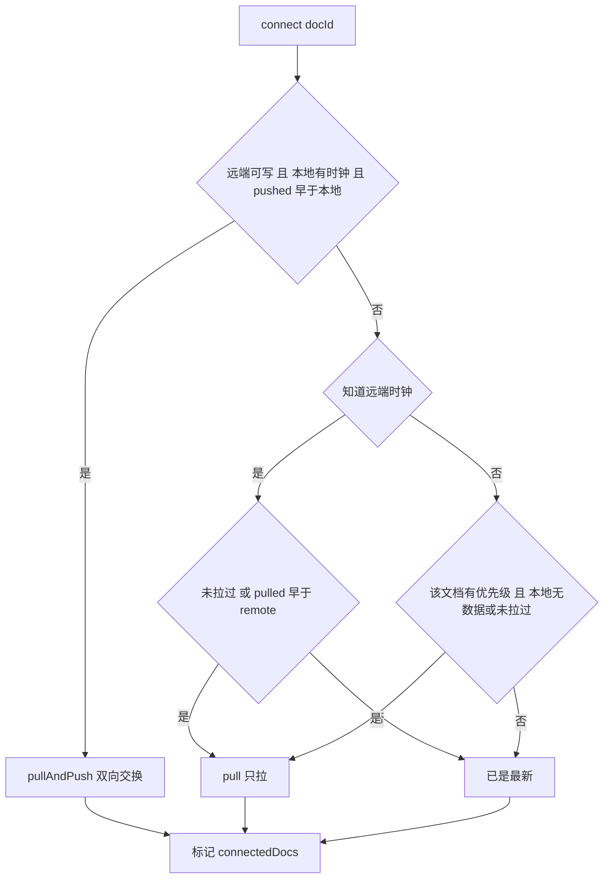
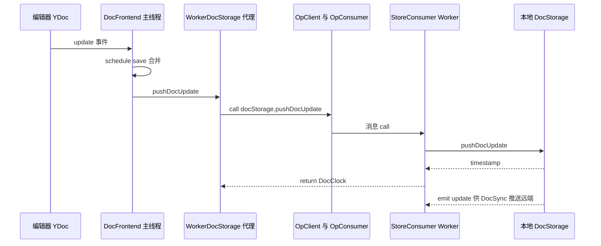
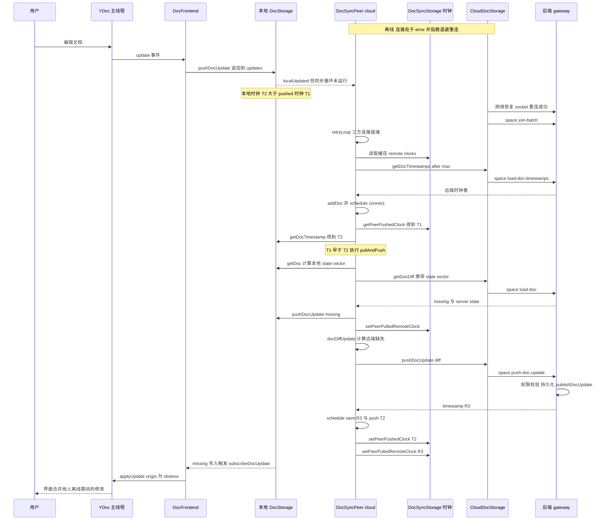

# 第 19 章 存储与同步引擎 nbstore

> **所属部分**：第 6 部分 · 前端应用 ｜ **难度**：★★★★★ ｜ **建议学时**：10 小时 ｜ **前置章节**：第 8 章 CRDT与Yjs原理、第 16 章 前端基础设施-DI与LiveData

## 本章导读

AFFiNE 自称 local-first：断网时照常编辑，联网后自动合并；打开文档不等网络，直接读本地；同一台电脑开五个标签页，只维持一条同步连接；桌面端用 SQLite，浏览器用 IndexedDB，移动端走原生插件——而上层业务代码对此**一无所知**。

承担这一切的是 `@affine/nbstore`（`packages/common/nbstore`）。它是一个**以 Yjs 二进制更新为核心数据单元、可插拔多存储、多对端同步、运行在 Worker 中**的存储引擎。

本章路线：先看清 local-first 的需求与 nbstore 的分层；再逐层下钻 storage 抽象、connection、各端实现、SpaceStorage 组合；然后重点剖析**文档同步算法**（三种时钟与五种任务）；接着是 frontend 门面、Worker 化、与后端 socket.io 网关的协议对照；最后回到应用侧，看 `workspace-engine`、Web Worker、Electron 与原生 SQLite 如何接入，并以一张"离线编辑→上线同步"的完整时序图收尾。

> 关于 `packages/common/nbstore/README.md`：其中示例（如 `SpaceStorageWorkerClient`、`@affine/nbstore/op`、`client.addStorage`）与当前源码**不一致**——`package.json` 的 `exports` 中并无 `./op`，Worker 客户端实际是 `worker/client.ts` 的 `StoreManagerClient`。README 只能用来理解"组合多个存储"的思想，API 请以源码为准。

## 学习目标

- [ ] 能够阐述 local-first 存储的核心需求，以及 nbstore 的"存储 → 同步 → 门面 → Worker"分层
- [ ] 能够列出七种 `StorageType` 及其接口职责，解释 `SnapshotDocStorageBase` 的"快照 + 增量更新队列"设计
- [ ] 能够描述 `AutoReconnectConnection` 的状态机、引用计数、指数退避与 `share()` 连接复用
- [ ] 能够说明 idb、sqlite、cloud、broadcast-channel、disk 各实现的适用端与选择方式
- [ ] 能够完整讲解 `DocSyncPeer` 的三种时钟（remote / pulled / pushed）与 connect、pull、pullAndPush、push、save 五种任务
- [ ] 能够描述 `DocFrontend` 如何把 YDoc 与存储双向绑定，以及 Worker 中运行存储的 op 通信结构
- [ ] 能够对照 `impls/cloud/socket.ts` 与 `packages/backend/server/src/core/sync/gateway.ts` 说出云同步的事件协议
- [ ] 能够画出"离线编辑 → 上线同步"的完整时序图，并说明索引（indexer）如何服务全文搜索

## 知识地图



## 19.1 local-first 的存储需求

| 需求 | 含义 | nbstore 的回应 |
|---|---|---|
| 本地优先读写 | 打开/编辑不依赖网络 | `DocFrontend` 只与**本地** DocStorage 交互；远端同步在后台 |
| 无冲突合并 | 多端并发编辑最终一致 | 数据单元是 Yjs update，合并靠 `mergeUpdates`/`diffUpdate` |
| 增量同步 | 只传缺失部分 | 基于 state vector 的 `getDocDiff`，加上时钟判断"是否需要同步" |
| 多对端 | 本地 ↔ 云端、本地 ↔ 磁盘文件夹、旧版存储迁移 | `remotes: Record<peerId, SpaceStorage>`，每个对端一个 `DocSyncPeer` |
| 多标签共享 | 避免重复连接与竞态 | SharedWorker + `share()` 连接复用 + BroadcastChannel 通知 |
| 不阻塞 UI | 二进制合并、索引开销大 | 存储与同步运行在 Worker，主线程只持有门面 |
| 优先级 | 当前打开的文档先同步 | `addPriority` 贯穿 frontend/sync/队列 |
| 二进制资源 | 图片附件不进 CRDT | 独立的 BlobStorage + BlobSync |
| 协作感知 | 光标、在线成员 | AwarenessStorage + AwarenessSync（y-protocols） |
| 全文搜索 | 离线也能搜 | IndexerStorage + IndexerSync（本地倒排索引或云端索引） |

## 19.2 包结构与分层

```json
// 来源：packages/common/nbstore/package.json（exports 节选）
"exports": {
  ".": "./src/index.ts",
  "./worker/client": "./src/worker/client.ts",
  "./worker/consumer": "./src/worker/consumer.ts",
  "./idb": "./src/impls/idb/index.ts",
  "./broadcast-channel": "./src/impls/broadcast-channel/index.ts",
  "./idb/v1": "./src/impls/idb/v1/index.ts",
  "./cloud": "./src/impls/cloud/index.ts",
  "./disk": "./src/impls/disk/index.ts",
  "./sqlite": "./src/impls/sqlite/index.ts",
  "./sqlite/v1": "./src/impls/sqlite/v1/index.ts",
  "./sync": "./src/sync/index.ts",
  "./frontend": "./src/frontend/index.ts"
}
```

每个实现单独一个入口，**按端按需打包**：Web Worker 只 import idb/cloud/broadcast-channel，Electron 只 import sqlite/disk/cloud。根入口 `src/index.ts` 导出 `connection`、`storage`、`universal-id`，而 `frontend` 与 `sync` **只导出类型**（注释写明"For implementation, please import from '@affine/nbstore/frontend'"），避免主线程误把同步实现打进来。

| 目录 | 职责 |
|---|---|
| `src/storage/` | 七类存储接口与基类、`SpaceStorage`、`lock`、`errors`、`dummy`、`indexer/` 查询与 schema |
| `src/connection/` | `AutoReconnectConnection`、`DummyConnection`、`share()` |
| `src/impls/` | `idb`（含 `v1`、`indexer/` BM25 倒排）、`sqlite`（含 `v1`）、`cloud`、`broadcast-channel`、`disk` |
| `src/sync/` | `Sync` 总控与 `doc/blob/awareness/indexer` 四个同步器 |
| `src/frontend/` | 主线程门面：`DocFrontend`、`BlobFrontend`、`AwarenessFrontend`、`IndexerFrontend` |
| `src/worker/` | `ops.ts` 协议、`client.ts`（主线程）、`consumer.ts` + `store.ts`（Worker 侧） |
| `src/realtime/`、`src/telemetry/` | 复用云端 socket 的实时请求/订阅与埋点批量上报 |
| `src/utils/` | `ClockMap`、`AsyncPriorityQueue`、`universalId`、`isEmptyUpdate`、`throwIfAborted` 等 |

## 19.3 storage 抽象：七类存储

```ts
// 来源：packages/common/nbstore/src/storage/storage.ts
export type StorageType =
  | 'blob'
  | 'blobSync'
  | 'doc'
  | 'docSync'
  | 'awareness'
  | 'indexer'
  | 'indexerSync';

export interface Storage {
  readonly storageType: StorageType;
  readonly connection: Connection;
}
```

| 类型 | 接口（`src/storage/`） | 存什么 | 关键方法 |
|---|---|---|---|
| `doc` | `DocStorage`（`doc.ts`） | Yjs 文档二进制 | `getDoc`、`getDocDiff`、`pushDocUpdate`、`getDocTimestamp(s)`、`deleteDoc`、`subscribeDocUpdate`、可选 `crawlDocData`、`applyDocLifecycle` |
| `docSync` | `DocSyncStorage`（`doc-sync.ts`） | 每个对端每个文档的三种时钟 | `get/setPeerRemoteClock`、`get/setPeerPulledRemoteClock`、`get/setPeerPushedClock`、`clearClocks` |
| `blob` | `BlobStorage`（`blob.ts`） | 二进制资源 | `get`、`set`、`delete(key, permanently)`、`release`、`list` |
| `blobSync` | `BlobSyncStorage`（`blob-sync.ts`） | 每个对端每个 blob 的上传时间 | `setBlobUploadedAt`、`getBlobUploadedAt` |
| `awareness` | `AwarenessStorage`（`awareness.ts`） | 协作感知（不持久化） | `update`、`subscribeUpdate(id, onUpdate, onCollect)` |
| `indexer` | `IndexerStorage`（`indexer.ts`） | 全文索引 | `search`、`aggregate`、`insert/update/delete`、`indexVersion` 等 |
| `indexerSync` | `IndexerSyncStorage`（`indexer-sync.ts`） | 每个文档的已索引时钟与索引版本 | `get/setDocIndexedClock`、`clearDocIndexedClock` |

注意 `docSync`、`blobSync`、`indexerSync` 三类都是"**同步元数据**"——它们与数据本身分开存储，所以同一个本地数据库可以对多个对端分别记账。

### 19.3.1 DocStorage 的数据模型

```ts
// 来源：packages/common/nbstore/src/storage/doc.ts（节选）
export interface DocClock {
  docId: string;
  timestamp: Date;
}
export type DocClocks = Record<string, Date>;
export interface DocRecord extends DocClock {
  bin: Uint8Array;
  editor?: string;
}
export interface DocDiff extends DocClock {
  missing: Uint8Array;
  state: Uint8Array;
}
export interface DocUpdate {
  docId: string;
  bin: Uint8Array;
  editor?: string;
}
```

- **时钟就是时间戳**：每次 `pushDocUpdate` 存储都返回一个 `timestamp`，它是"该文档在这个存储里的版本号"。同步算法只比较时间戳大小，不比较内容；
- `getDocDiff(docId, stateVector)` 返回 `missing`（对方缺的部分）与 `state`（自己的 state vector），这是 Yjs 标准的两步同步；
- `subscribeDocUpdate` 的注释强调：本地存储（SQLite）只会在用户写入时产生更新，而**云存储会因其他客户端广播而自发产生更新**。

### 19.3.2 DocStorageBase 与 SnapshotDocStorageBase

`DocStorageBase` 提供默认 `getDocDiff`（基于 `getDoc` + `diffUpdate`/`encodeStateVectorFromUpdate`）、内部事件、`mergeUpdates`（可注入，默认 `yjs.mergeUpdates`，并过滤空更新）、`lockDocForUpdate`。`SnapshotDocStorageBase` 进一步实现了"**快照 + 更新队列**"：

```ts
// 来源：packages/common/nbstore/src/storage/doc.ts（SnapshotDocStorageBase.getDoc）
override async getDoc(docId: string) {
  await using _lock = this.isReadonly
    ? undefined
    : await this.lockDocForUpdate(docId);

  const snapshot = await this.getDocSnapshot(docId);
  const updates = await this.getDocUpdates(docId);

  if (updates.length) {
    const { timestamp, bin, editor } = await this.squash(
      snapshot ? [snapshot, ...updates] : updates
    );

    const newSnapshot = { spaceId: this.spaceId, docId, bin, timestamp, editor };

    if (!this.isReadonly) {
      await this.setDocSnapshot(newSnapshot, snapshot);
      await this.markUpdatesMerged(docId, updates);
    }

    return newSnapshot;
  }

  return snapshot;
}
```

源码注释解释了动机："如果不立即把更新合并进快照，可以节省大量写入时间；在读取最新文档时再合并"。即：**写入只追加（append-only），读取时惰性压实（lazy compaction）**。子类只需实现 `getDocSnapshot`、`setDocSnapshot`、`getDocUpdates`、`markUpdatesMerged` 四个原语。`await using` + `lockDocForUpdate` 保证并发读取时只有一个在做合并。`setDocSnapshot` 的注释还提醒：多线程下可能收到过期快照，实现应"只在时间戳更新时才写入"。

`HistoricalDocStorage`（`storage/history.ts`）继承 `SnapshotDocStorageBase`，监听 `'snapshot'` 事件生成历史版本，供"页面历史"功能使用。

### 19.3.3 lock、errors、dummy

- `lock.ts`：`Locker` 接口与 `SingletonLocker`（进程内按 `domain:resource` 的 Promise 链锁）。IndexedDB 实现会替换为 `IndexedDBLocker`（`impls/idb/lock.ts`），在数据库的 `locks` 对象仓库上用读写事务实现锁，使锁对同库的其他连接（其他标签页）同样生效；
- `errors/`：`OverCapacityError`（存储超额）、`OverSizeError`（单文件过大），Blob 同步据此显示不同状态；
- `dummy/`：七类存储的空实现，`SpaceStorage` 对未配置的类型自动填充 dummy，`DocSyncImpl.dummy` 用于测试。

## 19.4 connection：自动重连与连接共享



```ts
// 来源：packages/common/nbstore/src/connection/connection.ts（节选）
export abstract class AutoReconnectConnection<T = any> implements Connection<T> {
  retryDelay = 3000;
  maxRetryDelay = 60000;
  connectingTimeout = 15000;
  private retryCount = 0;
  private refCount = 0;
  // ...
  protected abstract doConnect(signal?: AbortSignal): Promise<T>;
  protected abstract doDisconnect(conn: T): void;

  protected getRetryDelay(retryCount: number) {
    return Math.min(this.retryDelay * 2 ** retryCount, this.maxRetryDelay);
  }

  connect() {
    this.refCount++;
    if (this.refCount === 1) {
      this.innerConnect();
    }
  }
  // disconnect(force?)：refCount-- 归零时 innerDisconnect 并置 closed
}
```

- **引用计数**：多个存储共用一个连接时，只有第一个 `connect` 真正建连、最后一个 `disconnect` 真正断开；
- **退避**：3s、6s、12s……上限 60s；连接超时 15s；
- **错误处理**：`handleError` 先 `innerDisconnect` 再置 `error` 状态并安排重连，除非已 `closed`；
- `waitForConnected(signal)` 返回 Promise，同步器启动前都会等待它。

`share(conn)`（`connection/shared-connection.ts`）按 `conn.shareId` 在模块级 `Map` 中去重：

```ts
// 来源：packages/common/nbstore/src/connection/shared-connection.ts（节选）
export function share<T extends AutoReconnectConnection<any>>(conn: T): T {
  if (!conn.shareId) {
    throw new Error(`Connection ${conn.constructor.name} is not shareable. ...`);
  }
  const existing = CONNECTIONS.get(conn.shareId);
  if (existing) {
    return existing as T;
  }
  CONNECTIONS.set(conn.shareId, conn);
  return conn;
}
```

`IndexedDBDocStorage`、`IndexedDBBlobStorage` 等都写 `readonly connection = share(new IDBConnection(this.options))`，`IDBConnection.shareId` 为 `idb(<schema 版本>):<flavour>:<type>:<id>`——**同一工作区的六类 IDB 存储共用一个数据库连接**。云端则由 `getSocketManager(endpoint, isSelfHosted)` 按端点缓存 `SocketManager`，同一服务器的所有工作区共用一条 socket。

## 19.5 impls：各端实现

### 19.5.1 实现一览

| 实现目录 | 提供的存储类（`identifier`） | 适用端 | 底层 |
|---|---|---|---|
| `impls/idb` | `IndexedDBDocStorage`、`IndexedDBBlobStorage`、`IndexedDBDocSyncStorage`、`IndexedDBBlobSyncStorage`、`IndexedDBIndexerStorage`、`IndexedDBIndexerSyncStorage` | Web、移动 Web | `idb` 库；索引为自研 BM25 倒排（`indexer/bm25.ts`、`inverted-index.ts`、`tokenizer.ts`） |
| `impls/idb/v1` | `IndexedDBV1DocStorage`、`IndexedDBV1BlobStorage` | Web | 旧版数据格式，只读迁移 |
| `impls/sqlite` | `SqliteDocStorage`、`SqliteBlobStorage`、`SqliteDocSyncStorage`、`SqliteBlobSyncStorage`、`SqliteIndexerStorage`、`SqliteIndexerSyncStorage` | Electron、iOS、Android | 通过 `bindNativeDBApis` 注入的原生 API |
| `impls/sqlite/v1` | `SqliteV1DocStorage`、`SqliteV1BlobStorage` | Electron | 旧版 SQLite 数据 |
| `impls/cloud` | `CloudDocStorage`、`StaticCloudDocStorage`、`CloudBlobStorage`、`CloudAwarenessStorage`、`CloudIndexerStorage` | 所有端 | socket.io（文档、感知）+ HTTP（Blob、静态文档） |
| `impls/broadcast-channel` | `BroadcastChannelAwarenessStorage` | 所有浏览器环境 | `BroadcastChannel`，同源多标签间传递光标 |
| `impls/disk` | `DiskDocStorage` | Electron（磁盘同步文件夹） | 通过 `bindDiskSyncApis` 注入，`syncMetadataScope = 'connection'` |

`StorageConstructor` 要求每个类有静态 `identifier`，Worker 根据字符串名字实例化（因为构造参数要跨线程传递，只能是可结构化克隆的数据）。

### 19.5.2 各端如何选择

```ts
// 来源：packages/frontend/core/src/modules/workspace-engine/impls/local.ts（节选）
DocStorageType =
  BUILD_CONFIG.isElectron || BUILD_CONFIG.isIOS || BUILD_CONFIG.isAndroid
    ? SqliteDocStorage
    : IndexedDBDocStorage;
DocStorageV1Type = BUILD_CONFIG.isElectron
  ? SqliteV1DocStorage
  : BUILD_CONFIG.isWeb || BUILD_CONFIG.isMobileWeb
    ? IndexedDBV1DocStorage
    : undefined;
// BlobStorageType / DocSyncStorageType / BlobSyncStorageType / IndexerStorageType 同理
IndexerSyncStorageType = BUILD_CONFIG.isElectron
  ? SqliteIndexerSyncStorage
  : IndexedDBIndexerSyncStorage;
```

### 19.5.3 IndexedDB 的表结构与跨标签通知

`impls/idb/schema.ts` 顶部注释给出了库表设计：每个空间一个数据库 `${flavour}:${type}:${id}`，包含 `snapshots`、`updates`（自增 id）、`clocks`、`blobs`、`blobData`、`peerClocks`（含 `clock`、`pulledClock`、`pushedClock`）、`locks`、`blobSync`、`indexerSync`、`indexerMetadata`、`indexerRecords`、`invertedIndex` 等对象仓库。

`IndexedDBDocStorage.pushDocUpdate` 在一个事务里写 `updates` 与 `clocks`（遇到 `ConstraintError` 时把时间戳 +1ms 重试，最多 10 次，保证时钟单调唯一），然后：① 本地 `emit('update')`；② 通过 `IDBConnection` 自带的 `BroadcastChannel('idb:' + dbName)` 广播给其他标签页。`subscribeDocUpdate` 同时监听该 channel——**即使不用 SharedWorker，多个标签页也能互相感知 IndexedDB 中的变化**。

SQLite 实现则直接继承 `DocStorageBase`（快照合并在原生侧完成）：

```ts
// 来源：packages/common/nbstore/src/impls/sqlite/doc.ts（节选）
export class SqliteDocStorage extends DocStorageBase<SqliteNativeDBOptions> {
  static readonly identifier = 'SqliteDocStorage';
  override connection = share(new NativeDBConnection(this.options));

  get db() {
    return this.connection.apis;
  }

  override getDoc(docId: string) {
    return this.db.getDoc(docId);
  }

  override async pushDocUpdate(update: DocUpdate, origin?: string) {
    const timestamp = await this.db.pushUpdate(update.docId, update.bin);
    this.emit('update', { docId: update.docId, bin: update.bin, timestamp, editor: update.editor }, origin);
    // ...
  }
}
```

（`emit` 参数压缩为单行。）

## 19.6 SpaceStorage：把七类存储组合成一个"空间"

```ts
// 来源：packages/common/nbstore/src/storage/index.ts（节选）
export class SpaceStorage {
  constructor(storages: SpaceStorageOptions) {
    this.storages = {
      awareness: storages.awareness ?? new DummyAwarenessStorage(),
      blob: storages.blob ?? new DummyBlobStorage(),
      blobSync: storages.blobSync ?? new DummyBlobSyncStorage(),
      doc: storages.doc ?? new DummyDocStorage(),
      docSync: storages.docSync ?? new DummyDocSyncStorage(),
      indexer: storages.indexer ?? new DummyIndexerStorage(),
      indexerSync: storages.indexerSync ?? new DummyIndexerSyncStorage(),
    };
  }

  get<T extends StorageType>(type: T): Extract<Storages, { storageType: T }> { /* ... */ }

  connect() {
    Object.values(this.storages).forEach(storage => {
      storage.connection.connect();
    });
  }
  // disconnect / waitForConnected / destroy
}
```

一个工作区 = 一个本地 `SpaceStorage` + 若干远端 `SpaceStorage`。以云工作区为例（`workspace-engine/impls/cloud.ts` 的 `getEngineWorkerInitOptions`）：

| 位置 | doc | blob | awareness | indexer | docSync/blobSync/indexerSync |
|---|---|---|---|---|---|
| `local` | IndexedDB/SQLite | IndexedDB/SQLite | `BroadcastChannelAwarenessStorage` | IndexedDB/SQLite | IndexedDB/SQLite |
| `remotes['cloud:<serverId>']` | `CloudDocStorage` | `CloudBlobStorage` | `CloudAwarenessStorage` | `CloudIndexerStorage`（服务器开启 Indexer 特性时） | — |
| `remotes.v1` | v1 DocStorage（存在时） | v1 BlobStorage | — | — | — |

本地工作区没有 cloud 对端，但在 Electron 开启磁盘同步时多一个 `remotes.disk`（`DiskDocStorage`）。**"迁移旧数据"与"同步云端"用的是同一套机制**——都只是多了一个对端。

## 19.7 Doc 同步算法（核心）

### 19.7.1 Sync 与 DocSyncImpl

`Sync`（`sync/index.ts`）从 local/remotes 两组 `SpaceStorage` 中取出对应类型，构造四个同步器，`start()` 启动 doc、blob、indexer。`DocSyncImpl`（`sync/doc/index.ts`）为每个远端创建一个 `DocSyncPeer`，并把各 peer 的状态聚合为 `state$`（`total`/`syncing`/`synced`/`retrying`/`errorMessage`，节流 1 秒避免刷屏 UI）。

### 19.7.2 三种时钟

每个 `(peerId, docId)` 在 `DocSyncStorage` 中记录三种时钟：

| 时钟 | 含义 | 何时更新 |
|---|---|---|
| **remote clock** | 远端该文档的最新版本时间戳（"我所知道的远端有多新"） | 启动时 `remote.getDocTimestamps(after)` 拉取；收到远端广播时 `updateRemoteClock` |
| **pulled remote clock** | 已经拉取并写入本地的远端版本 | pull / pullAndPush / save 成功后 |
| **pushed clock** | 已经推送给远端的**本地**版本 | push / pullAndPush 成功后 |

再加上本地存储自身的 `local.getDocTimestamp(docId)`（本地最新版本），就能做出所有判断：

- 本地时钟 > pushed clock ⇒ 本地有没推上去的改动；
- remote clock > pulled clock ⇒ 远端有没拉下来的改动。

这比"每次都交换 state vector"高效得多：几千篇文档的工作区，上线时只需一次 `getDocTimestamps` 就能知道哪些文档需要同步。

### 19.7.3 五种任务

```ts
// 来源：packages/common/nbstore/src/sync/doc/peer.ts（Job 类型）
type Job =
  | { type: 'connect'; docId: string }
  | { type: 'push'; docId: string; update?: Uint8Array; clock: Date }
  | { type: 'pull'; docId: string }
  | { type: 'pullAndPush'; docId: string }
  | { type: 'save'; docId: string; update?: Uint8Array; remoteClock: Date };
```

（原文为多行联合类型，此处每个成员压缩为单行。）

**connect**：决定一个文档初次需要什么。

```ts
// 来源：packages/common/nbstore/src/sync/doc/peer.ts（jobs.connect 节选）
const pushedClock =
  (await this.syncMetadata.getPeerPushedClock(this.peerId, docId))?.timestamp ?? null;
const clock = await this.local.getDocTimestamp(docId);
const remoteClock = this.status.remoteClocks.get(docId);

throwIfAborted(signal);
if (
  !this.remote.isReadonly &&
  clock &&
  (pushedClock === null || pushedClock.getTime() < clock.timestamp.getTime())
) {
  await this.jobs.pullAndPush(docId, signal);
} else {
  // no need to push
  const pulled =
    (await this.syncMetadata.getPeerPulledRemoteClock(this.peerId, docId))?.timestamp ?? null;
  const hasRemoteClock = remoteClock.getTime() > 0;
  const hasPulled = pulled !== null && pulled.getTime() > 0;
  if (
    hasRemoteClock
      ? !hasPulled || (pulled !== null && pulled.getTime() < remoteClock.getTime())
      : (this.prioritySettings.get(docId) ?? 0) > 0 && (!clock || !hasPulled)
  ) {
    await this.jobs.pull(docId, signal);
  }
}

this.status.connectedDocs.add(docId);
```

（部分表达式压缩为单行。）



**pullAndPush**：本地有改动时的完整双向同步——

1. 读本地文档，算出本地 state vector，向远端 `getDocDiff(docId, sv)` 要"我缺的部分"；
2. 把 `missing` 写入本地（`local.pushDocUpdate(..., this.uniqueId)`），记录 pulled clock；
3. 用 `docDiffUpdate(local, localSv, remoteDiff, remoteSv)` 算出"远端缺的部分"：若两边 state vector 不同，直接 `diffUpdate(local, remoteSv)`；若相同，再比较删除集（deleteSet）是否一致——这是对 Yjs "state vector 不包含删除信息"的精细处理；
4. 有差异就 `remote.pushDocUpdate`，并 `schedule({ type: 'save', remoteClock })` 记录远端新时钟；
5. 最后 `schedule({ type: 'push', clock: localClock })` 标记 pushed clock。

若远端没有该文档（`getDocDiff` 返回 null），则直接把本地全量推上去。

**pull**：只拉取 `missing` 写本地，记录 pulled clock，再安排一个"空 push"以推进 pushed clock（因为写入本地会产生新本地时钟，而这份数据本就来自远端，无需再推）。

**push**：把同一文档排队中的多个本地更新 `mergeUpdates` 合并成一个，推给远端，记录 pushed clock（取这批任务中最大的 clock）；仅对已 connect 的文档、可写远端执行。

**save**：远端广播来的更新，合并后写入本地，记录 pulled clock。

### 19.7.4 事件驱动与主循环

```ts
// 来源：packages/common/nbstore/src/sync/doc/peer.ts（events 节选）
localUpdated: ({ docId, update, clock }) => {
  // ... 错误文档的重试逻辑
  this.actions.addDoc(docId);
  this.schedule({ type: 'push', docId, clock, update });
},
remoteUpdated: ({ docId, update, remoteClock, origin }) => {
  // ... 错误文档的重试逻辑
  this.actions.addDoc(docId);
  this.actions.updateRemoteClock(docId, remoteClock);
  if (isEmptyUpdate(update)) {
    this.schedule({ type: 'pull', docId });
  } else {
    this.schedule({ type: 'save', docId, remoteClock: remoteClock, update });
  }
},
```

（参数类型声明省略。）注意 `remoteUpdated` 收到**空更新**时调度 `pull`——这是云端"失效通知"的落点（19.11.3）。

`retryLoop` 的骨架：

1. 本地只读则直接跳过（`skipped`）；
2. 等待 local、remote、syncMetadata 三个连接就绪（30 秒超时）；
3. 订阅三者的连接状态，任何一个断开就 abort 本轮；
4. 订阅本地更新（过滤掉 `origin` 为自己 `uniqueId` 或以 `sync:<peerId>:` 开头的，防止回声）与远端更新；
5. 把本地所有文档 `addDoc`（触发 connect）；读取缓存的 remote clocks，再增量 `remote.getDocTimestamps(max)`（`syncMetadataScope === 'connection'` 的对端每次全量），把远端所有文档也 `addDoc`；
6. 进入循环：`jobDocQueue.asyncPop()` 取出优先级最高的文档，**按 connect → pullAndPush → pull → push → save 的顺序**批量处理该文档的全部排队任务。

`mainLoop` 包住 `retryLoop`：异常后（权限错误 `DOC_ACTION_DENIED`/`SPACE_ACCESS_DENIED` 除外）重置全部状态，5 秒后重试。单个文档的权限错误只标记该文档（`docErrors`），不影响其他文档。

### 19.7.5 优先级

`schedule` 把 docId 以 `getJobPriority(docId)` 推进 `AsyncPriorityQueue`。**工作区根文档（docId 等于 spaceId）优先级为 Infinity**——注释说明"新文档上传需要先同步其在根文档中的成员关系"。其余优先级由 `addPriority(id, n)` 累加：`WorkspaceEngine.start()` 给根文档 +100，`Doc` 实体打开时 +100，详情页 +10，ORM 表文档 +50。`addPriority` 返回撤销函数，优先级能精确"借还"。

## 19.8 Blob、Awareness、Indexer 同步

### 19.8.1 BlobSync

`BlobSyncPeer`（`sync/blob/peer.ts`）不做双向合并（Blob 以内容哈希为 key，天然不可变），只做：

- `uploadBlob(blob, force)`：非强制时先查 `blobSync.getBlobUploadedAt(peer, key)`，已上传跳过；上传前把 uploadedAt 置 null、成功后写当前时间；同一 key 的并发上传复用同一个 Promise；`OverCapacityError` 标记远端超额并暂停上传循环，`OverSizeError` 只标记该 blob；
- `fullUploadLoop`：每 15 秒扫描本地 `list()`，把 uploadedAt 为 null 的逐个上传；
- `downloadBlob`/`fullDownload`：按需或全量从远端拉取本地缺失的 blob；
- `registerSource/unregisterSource`：登记"当前文档/历史版本"等来源，供云端按来源鉴权读取（`BlobSource`）。

`BlobFrontend.get` 先读本地，没有再 `sync.downloadBlob` 后重读；`set` 写本地后**不等待**上传（`uploadBlob(blob, true)` 在后台进行）——用户插入图片立即可见。

### 19.8.2 AwarenessSync

```ts
// 来源：packages/common/nbstore/src/sync/awareness/index.ts（节选）
async update(record: AwarenessRecord, origin?: string) {
  await Promise.all(
    [this.storages.local, ...Object.values(this.storages.remotes)].map(peer =>
      peer.connection.status === 'connected' ? peer.update(record, origin) : Promise.resolve()
    )
  );
}
```

感知数据不持久化，同步就是"广播给所有已连接对端"：本地对端是 BroadcastChannel（同源其他标签页），远端是云端 socket（`space:update-awareness`）。`subscribeUpdate(id, onUpdate, onCollect)` 的 `onCollect` 用于新加入者"收集"现有成员状态（云端 `space:collect-awareness`、BroadcastChannel `awareness-collect` 消息）。

### 19.8.3 IndexerSync

`IndexerSyncImpl`（`sync/indexer/index.ts`）负责把文档内容写入索引：

1. 订阅本地 DocStorage 更新；根文档变化时用 `@affine/reader` 的 `readAllDocsFromRootDoc` 重新计算文档列表与标题，新文档入队、删除的文档从索引移除；
2. 主循环取出文档：根文档任务同步 `doc` 表（标题）；普通文档任务用 `crawlingDocData`（`sync/indexer/crawler.ts`，内部 `readAllBlocksFromDoc`）抽取所有块，写入 `block` 表并更新 `summary`；优先使用存储自带的 `crawlDocData`（SQLite 原生实现可在 Rust 侧完成）；
3. 用 `IndexerSyncStorage` 记录每个文档的已索引时钟与 `indexerVersion`，索引版本升级时全量重建；
4. 支持 `pauseSync/resumeSync`、电池节省模式（`enableBatterySaveMode`）；`apps/web/src/app.tsx` 在窗口 `blur` 时调用 `storeManagerClient.pause()`、`focus`/`click` 时调用 `resume()`，它们对每个已打开的 store 发 `sync.pauseSync`/`sync.resumeSync`，Worker 侧 `StoreConsumer.pauseSync` 延迟 1 秒（`ENABLE_BATTERY_SAVE_MODE_DELAY`）后暂停索引同步。

索引 schema 定义在 `storage/indexer/schema.ts`：`doc` 表（`docId`、`title` 全文、`summary` 不索引）与 `block` 表（`docId`、`blockId`、`content` 全文、`flavour`、`blob`、`refDocId`、`ref`、`parentFlavour`、`parentBlockId`、`additional`、`markdownPreview`）。查询时可通过 `prefer: 'local' | 'remote'` 选择本地索引或云端索引。

## 19.9 frontend 层：主线程门面

### 19.9.1 DocFrontend：YDoc 与存储的双向绑定

```ts
// 来源：packages/common/nbstore/src/frontend/doc.ts（_connectDoc 与 handleDocUpdate 节选）
private _connectDoc(doc: YDoc) {
  if (this.status.docs.has(doc.guid)) {
    throw new Error('doc already connected');
  }
  this.schedule({ type: 'load', docId: doc.guid });
  this.status.docs.set(doc.guid, doc);
  this.statusUpdatedSubject$.next(doc.guid);
  doc.on('update', this.handleDocUpdate);
  doc.on('destroy', () => {
    this.disconnectDoc(doc);
  });
}

private readonly handleDocUpdate = (update: Uint8Array, origin: any, doc: YDoc, transaction: YTransaction) => {
  if (origin === NBSTORE_ORIGIN) {
    return;
  }
  // ... debug 模式下检测"应用远端更新时触发本地修改"的编码错误
  if (!this.status.docs.has(doc.guid)) {
    return;
  }
  this.schedule({ type: 'save', docId: doc.guid, update });
};
```

（方法签名压缩为单行。）DocFrontend 有三种任务：

| 任务 | 触发 | 行为 |
|---|---|---|
| `load` | `connectDoc` | 若内存 YDoc 已有数据先安排 `save`；`doc.emit('sync', [true, doc])`；读本地 `getDoc` 并 `applyUpdate`；标记 ready/connected |
| `save` | YDoc 本地 `update` 事件 | 合并同一文档排队的多个更新，`storage.pushDocUpdate(..., uniqueId)` |
| `apply` | `storage.subscribeDocUpdate`（origin 不是自己） | `applyUpdate(doc, update, NBSTORE_ORIGIN)` |

`NBSTORE_ORIGIN` 作为 Yjs transaction origin，`handleDocUpdate` 见到它就跳过——这是防止"写回自己"的关键。debug 模式下若在应用远端更新期间有代码修改了文档，会打印醒目警告：这会导致"编辑者"被误记为当前用户。

`docState$(docId)` 把自身的 `ready/loaded/updating` 与 `DocSync.docState$` 的 `syncing/synced/retrying/errorMessage` 合并成 `DocFrontendDocState`；第 17 章工作区页面正是等 `docState$(workspace.id)` 的 `ready` 才渲染工作台。`addPriority` 同时调整自身队列与 `sync.addPriority`。

### 19.9.2 其他门面

- `BlobFrontend`：`get/set/upload/registerSource/fullDownload`，用 `SingletonLocker` 保证同一 blob 的 set 与 get 不交错；
- `AwarenessFrontend.connectAwareness(awareness)`：监听 y-protocols `Awareness` 的 `change`，`encodeAwarenessUpdate` 后经 sync 广播；收到更新 `applyAwarenessUpdate`；`onCollect` 返回自己的状态；
- `IndexerFrontend`：`search/aggregate/search$/aggregate$/docState$/addPriority/waitForCompleted/waitForDocCompleted` 等，全部委托给 `IndexerSync`。

## 19.10 Worker 化：存储跑在另一个线程

### 19.10.1 两级 op 协议

`worker/ops.ts` 定义两套 `OpSchema`：

- `WorkerManagerOps`：管理级——`open`（携带一个 `MessagePort`）、`close`、`telemetry.*`、`realtime.*`；
- `WorkerOps`：单个 store 级——由 `GroupedWorkerOps` 用模板字面量类型展开为 `docStorage.getDoc`、`docSync.state`、`blobSync.uploadBlob`、`indexerSync.search` 等扁平名字。

```ts
// 来源：packages/common/nbstore/src/worker/ops.ts（WorkerOps 推导）
export type WorkerOps = UnionToIntersection<
  Values<
    Values<{
      [k in keyof GroupedWorkerOps]: {
        [k2 in keyof GroupedWorkerOps[k]]: k2 extends string
          ? Record<`${k}.${k2}`, GroupedWorkerOps[k][k2]>
          : never;
      };
    }>
  >
>;
```

`StoreInitOptions` 描述要创建哪些存储：`{ local: { [type]: { name, opts } }, remotes: { [peer]: { [type]: { name, opts } } } }`，`name` 必须是某个实现的 `identifier`，`opts` 类型由 `ConstructorParameters` 推导——类型系统保证了"字符串名 ↔ 构造参数"的一致。

### 19.10.2 打开一个 store

```ts
// 来源：packages/common/nbstore/src/worker/client.ts（StoreManagerClient.open 节选）
open(key: string, options: StoreInitOptions) {
  const { port1, port2 } = new MessageChannel();
  const client = new OpClient<WorkerOps>(port1);
  const closeKey = uuid();

  this.client
    .call('open', transfer({ key, closeKey, options, port: port2 }, [port2]))
    .catch(err => {
      console.error('error opening', err);
    });

  const connection = {
    store: new StoreClient(client),
    dispose: () => {
      this.client.call('close', closeKey).catch(err => {
        console.error('error closing', err);
      });
      this.connections.delete(closeKey);
    },
  };
  this.connections.set(closeKey, connection);
  return connection;
}
```

- 每个工作区一条**专属 MessageChannel**：管理通道只负责 open/close，数据走 `port1 ↔ port2`；
- `transfer(..., [port2])` 把端口所有权移交给 Worker（第 16 章 `op` 的 Transferable 机制）；
- Worker 侧 `StoreManagerConsumer`（`worker/consumer.ts`）按 `key`（如 `workspace:<flavour>:<id>`）维护 `storePool`，**同 key 的第二次 open 复用已有 `StoreConsumer`（引用计数 +1）**，只在远端配置变化时 `reconfigure`；`serialize(key, ...)` 让同一 key 的 open/close 串行执行。结合 SharedWorker，这意味着**多个标签页打开同一工作区，只有一份存储与同步实例**。

### 19.10.3 StoreClient：远程代理 + 本地门面

```ts
// 来源：packages/common/nbstore/src/worker/client.ts（StoreClient 构造）
export class StoreClient {
  constructor(private readonly client: OpClient<WorkerOps>) {
    this.docStorage = new WorkerDocStorage(this.client);
    this.blobStorage = new WorkerBlobStorage(this.client);
    this.docSync = new WorkerDocSync(this.client);
    this.blobSync = new WorkerBlobSync(this.client);
    this.awarenessSync = new WorkerAwarenessSync(this.client);
    this.docFrontend = new DocFrontend(this.docStorage, this.docSync);
    this.blobFrontend = new BlobFrontend(this.blobStorage, this.blobSync);
    this.awarenessFrontend = new AwarenessFrontend(this.awarenessSync);
    this.indexerSync = new WorkerIndexerSync(this.client);
    this.indexerFrontend = new IndexerFrontend(this.indexerSync);
  }
}
```

精妙之处：`WorkerDocStorage` 等类**实现了与真实存储相同的接口**（`getDoc` → `client.call('docStorage.getDoc', docId)`，`subscribeDocUpdate` → `client.ob$('docStorage.subscribeDocUpdate')`），于是**同一份 `DocFrontend` 代码**既能直接接 IndexedDB（单测 `__tests__/frontend.spec.ts` 就这么做），也能接 Worker 代理。YDoc 必须留在主线程（编辑器要用），所以 frontend 在主线程，存储与同步在 Worker。



### 19.10.4 Worker 入口与 realtime、telemetry

Web 端 Worker 入口：

```ts
// 来源：packages/frontend/apps/web/src/nbstore.worker.ts（节选）
const consumer = new StoreManagerConsumer([
  ...idbStorages,
  ...idbV1Storages,
  ...broadcastChannelStorages,
  ...cloudStorages,
]);

if ('onconnect' in globalThis) {
  // if in shared worker
  (globalThis as any).onconnect = (event: MessageEvent) => {
    const port = event.ports[0];
    consumer.bindConsumer(new OpConsumer<WorkerManagerOps>(port));
  };
} else {
  // if in worker
  consumer.bindConsumer(new OpConsumer<WorkerManagerOps>(globalThis as MessageCommunicapable));
}
```

`StoreManagerConsumer` 还持有：

- `RealtimeManager`（`realtime/manager.ts`）：复用云端 `SocketConnection`，提供 `realtime.request`/`realtime.subscribe`（基于 `@affine/realtime` 的类型定义，socket 事件 `realtime:request`、`realtime:subscribe`、`realtime:event`），主应用通过 `NbstoreProvider.realtime` 使用（如 `cloud/services/realtime.ts`）；
- `TelemetryManager`（`telemetry/manager.ts`）：埋点先写入 IndexedDB 队列 `affine-telemetry`（`telemetry/queue.ts`），批量通过 `telemetry:batch` 上报，失败退避重试；`apps/web/src/app.tsx` 中 `setTelemetryTransport(storeManagerClient.telemetry)` 接入。

## 19.11 与云端 socket.io 的协议对接

### 19.11.1 事件对照表

客户端类型定义在 `packages/common/nbstore/src/impls/cloud/socket.ts` 的 `ServerEvents`/`ClientEvents`，服务端处理在 `packages/backend/server/src/core/sync/gateway.ts`：

| 方向 | 事件名 | 客户端使用处 | 服务端 | 载荷要点 |
|---|---|---|---|---|
| C→S（ack） | `space:join-batch` | `CloudDocStorageConnection.joinDoc`、`doConnect` | `@SubscribeMessage('space:join-batch')` | `spaces[{spaceType, spaceId, docId?}]`、`clientVersion` |
| C→S | `space:leave-batch` | 离开文档 | `@SubscribeMessage('space:leave-batch')` | `docIds` |
| C→S（ack） | `space:load-doc` | `getDocSnapshot`、`getDocDiff`、`getDocTimestamp` | `@SubscribeMessage('space:load-doc')` | 可选 `stateVector`（base64），返回 `missing`/`state`/`timestamp` |
| C→S（ack） | `space:push-doc-update` | `pushDocUpdate` | `onReceiveDocUpdate` | `update`（base64），返回 `timestamp` |
| C→S（ack） | `space:load-doc-timestamps` | `getDocTimestamps(after)` | `@SubscribeMessage('space:load-doc-timestamps')` | 可选 `timestamp`，返回 `Record<docId, number>` |
| C→S（ack） | `space:delete-doc` | `deleteDoc` | `@SubscribeMessage('space:delete-doc')` | — |
| C→S（ack） | `space:doc-lifecycle` | `applyDocLifecycle`（trash/restore/delete） | `@SubscribeMessage('space:doc-lifecycle')` | 返回 `rootUpdate`、`timestamp` |
| C→S | `space:update-awareness` | `CloudAwarenessStorage.update` | `@SubscribeMessage('space:update-awareness')` | `awarenessUpdate`（base64） |
| C→S | `space:load-awarenesses` | 订阅时收集 | `@SubscribeMessage('space:load-awarenesses')` | — |
| S→C | `space:broadcast-doc-updates` | `onServerUpdates` → `emit('update')` | `emitActiveDocUpdate` | `updates[]`、`timestamp`、`editor`、`compressed?` |
| S→C | `space:broadcast-doc-invalidation` | `onServerInvalidation` | `publishDocUpdate` 向空间房间广播 | `spaceType`、`spaceId`、`timestamp` |
| S→C | `space:collect-awareness` | 回传自身状态 | `emitActiveAwarenessCollect` | — |
| S→C | `space:broadcast-awareness-update` | 应用他人感知 | 转发 | `awarenessUpdate` |
| C→S | `telemetry:batch`、`realtime:request/subscribe/unsubscribe` | Telemetry/Realtime Manager | 其他网关 | — |

服务端另有 `space:leave`（`@SubscribeMessage('space:leave')`），当前客户端类型中未声明。所有二进制均以 base64 传输（`uint8ArrayToBase64`/`base64ToUint8Array`，有 `Buffer` 时用 `Buffer` 加速）；`idConverter` 负责新旧文档 id 格式转换。

### 19.11.2 推送的服务端处理

```ts
// 来源：packages/backend/server/src/core/sync/gateway.ts（onReceiveDocUpdate 节选）
const active = this.hasActiveDocSubscription(client, spaceType, spaceId, docId);
if (!active) {
  throw new NotInSpace({ spaceId });
}
if (!this.hasActiveDocAction(client, spaceType, spaceId, docId, 'Doc.Update')) {
  throw new DocActionDenied({ action: 'Doc.Update', docId, spaceId });
}
// ... 工作区根文档走 runtime.executeDomainCommandV1('append_root_update')
timestamp = await adapter.push(spaceId, docId, [Buffer.from(update, 'base64')], user.id, permissionGeneration);

this.publishDocUpdate(
  { spaceType, spaceId, docId, updates: [Buffer.from(update, 'base64')], timestamp, editor: user.id },
  client
);

return { data: { accepted: true, timestamp } };
```

（部分参数压缩为单行。）返回的 `timestamp` 就是客户端 `CloudDocStorage.pushDocUpdate` 拿到的远端时钟。抛出的 `DocActionDenied` 到客户端变成 `error.name` 为 `DOC_ACTION_DENIED` 的错误——正是 `DocSyncPeer` 中 `isRemotePermissionError` 识别的名字。服务端细节见第 23 章。

### 19.11.3 两级广播：活跃订阅 vs 失效通知

`publishDocUpdate` 做了两件事：

1. 向**整个空间房间**（`${spaceType}:${Room(spaceId, 'sync-027')}`）发 `space:broadcast-doc-invalidation`（只含时间戳）；
2. 向**正在订阅该文档**的 socket（`activeDocSockets`，即 `join-batch` 时带了 docId 的连接）发完整的 `space:broadcast-doc-updates`（排除发送者）。

客户端收到失效通知后，`CloudDocStorage` 50ms 防抖执行 `repairInvalidatedDocs`：重新 `getDocTimestamps()`，对时间戳比已知更新的文档 `emit('update', { bin: new Uint8Array() })`——一个**空更新**。`DocSyncPeer.events.remoteUpdated` 看到空更新就调度 `pull`。这样，没有打开某文档的客户端不必接收它的全部增量，只在需要时按 state vector 拉取差量，大幅节省带宽。

## 19.12 应用侧接入、搜索与全链路

### 19.12.1 workspace-engine：配置 + 打开

`WorkspaceFlavourProvider.getEngineWorkerInitOptions(workspaceId)`（第 17 章）生成 `StoreInitOptions`；`WorkspaceEngine.start()`（`core/modules/workspace/entities/engine.ts`）：

```ts
// 来源：packages/frontend/core/src/modules/workspace/entities/engine.ts（start 节选）
const { store, dispose } = this.nbstoreService.openStore(
  (this.props.isSharedMode ? 'shared:' : '') +
    `workspace:${this.workspaceService.workspace.flavour}:${this.workspaceService.workspace.id}`,
  this.props.engineWorkerInitOptions
);
// 非本地工作区且开启 enable_battery_save_mode 时 store.enableBatterySaveMode()
this.client = store;
this.disposables.push(dispose);
this.eventBus.emit(WorkspaceEngineBeforeStart, this);

const rootDoc = this.workspaceService.workspace.docCollection.doc;
// priority load root doc
this.doc.addPriority(rootDoc.guid, 100);
this.indexer.addPriority(rootDoc.guid, 100);
this.doc.start();
this.disposables.push(() => this.doc.stop());

// fully migrate blobs from v1 to v2, its won't do anything if v1 storage is not exist
store.blobFrontend.fullDownload('v1').catch(() => {});
```

之后 `Workspace.docCollection` 的 `onLoadDoc` 回调对每个子文档 `engine.doc.connectDoc(doc)`，ORM 的表文档也同样 `connectDoc`（第 16 章）。`NbstoreService` 只是 `NbstoreProvider` 的薄包装，Web 端由 `apps/web/src/app.tsx` 用 `storeManagerClient.open` 实现。

### 19.12.2 Electron 与原生 SQLite

Electron 渲染层的存储 Worker 在 `packages/frontend/apps/electron-renderer/src/background-worker/index.ts`：

```ts
// 来源：packages/frontend/apps/electron-renderer/src/background-worker/index.ts（节选）
bindNativeDBApis(apis!.nbstore);
bindNativeDBV1Apis(apis!.db);
bindDiskSyncApis(createDiskSyncApis(apis!.diskSync, events!.diskSync));
configureSocketAuthMethod((endpoint, cb) => {
  apis!.auth
    .getValidAccessToken(endpoint)
    .then(({ token }: { token?: string | null }) => {
      cb(token ? { token, tokenType: 'jwt' } : {});
    })
    .catch(() => cb({ error: 'AUTH_SESSION_TEMPORARILY_UNAVAILABLE' }));
});

const storeManager = new StoreManagerConsumer([
  ...sqliteStorages,
  ...sqliteV1Storages,
  ...diskStorages,
  ...broadcastChannelStorages,
  ...cloudStorages,
]);
```

（oxlint 注释已省略。）`apis.nbstore` 来自 Electron helper 进程：`packages/frontend/apps/electron/src/helper/nbstore/handlers.ts` 把 `@affine/native` 的 `DocStoragePool` 方法一一绑定为 `NativeDBApis`（`connect` 时用 `parseUniversalId` 解析出 peer/type/id 并定位数据库文件路径）。`DocStoragePool` 由 Rust crate `packages/frontend/native/nbstore`（`affine_nbstore`，基于 `sqlx` + SQLite，`#[napi]` 导出 `connect`、`push_update`、`get_doc`、`get_doc_clocks`、`crawl_doc_data` 等）实现，源码分为 `doc.rs`、`blob.rs`、`doc_sync.rs`、`blob_sync.rs`、`indexer_sync.rs`、`indexer/`、`pool.rs`、`storage.rs`。iOS/Android 则在各自 `nbstore.worker.ts` 中 `bindNativeDBApis(rpc)`，经 Capacitor 插件调用同一套 Rust 逻辑（第 7、20 章）。


`universalId`（`utils/universal-id.ts`）把 `{peer, type, id}` 编码为 `@peer(...);@type(...);@id(...);`，作为原生侧区分数据库的唯一键。

### 19.12.3 搜索索引：indexer 与 docs-search

`core/modules/docs-search` 的 README 写道："负责订阅文档引擎的更新并把文档内容写入索引，提供搜索与聚合能力"。实际上写入已由 nbstore 的 `IndexerSync` 完成，`DocsSearchService` 主要做查询：

```ts
// 来源：packages/frontend/core/src/modules/docs-search/services/docs-search.ts（节选）
get indexer() {
  return this.workspaceService.workspace.engine.indexer;
}

searchTitle$(query: string) {
  return this.indexer
    .search$('doc', { type: 'match', field: 'title', match: query }, { pagination: { skip: 0, limit: Infinity } })
    .pipe(map(({ nodes }) => nodes.map(node => node.id)));
}
```

（参数对象压缩为单行。）`search$(query, prefer = 'remote')` 对 `block` 表做 `aggregate$`（按 `docId` 聚合、带高亮），`watchRefsFrom`、`watchRefsBySourceFrom`、`watchDatabasesTo`、`watchDocSummary` 等则利用 `refDocId`、`ref`、`flavour` 字段实现反链、数据库引用与摘要。CMD-K 的 `DocsQuickSearchSession`、`collection-rules` 的 `system:title` 过滤器都建立在它之上。

| 端 | 本地索引实现 | 远端索引 |
|---|---|---|
| Web | `IndexedDBIndexerStorage`：自研分词（`tokenizer.ts`）+ 倒排表 + BM25 打分 + 高亮 | `CloudIndexerStorage`（服务器开启 Indexer 特性时） |
| Electron/移动 | `SqliteIndexerStorage`：查询经 `NativeDBApis` 交给 Rust 侧（`native/nbstore/src/indexer/`，依赖 `memory-indexer` crate） | 同上 |

### 19.12.4 完整时序：离线编辑 → 上线同步



关键点：

- 离线期间所有编辑都已安全落在本地 `updates` 表，`DocFrontend` 从不等待网络；
- 上线后一次 `load-doc-timestamps` 就找出全部需要同步的文档；当前打开的文档因优先级高而先处理；
- `pullAndPush` 先拉后推，推送的是"远端缺的部分"，而非整个文档；
- 远端拉下的数据写入本地存储后，通过 `subscribeDocUpdate` 回到 `DocFrontend` 再应用到 YDoc——**数据永远经由本地存储流向 UI**，单一数据通路保证了一致性；
- 其他在线客户端：打开该文档的收到 `space:broadcast-doc-updates` → `save`；没打开的收到失效通知 → 空更新 → 稍后 `pull`。

### 19.12.5 本章小结

- nbstore 以 Yjs 更新为数据单元，用"七类存储 + SpaceStorage 组合 + 多对端同步"实现 local-first；
- `SnapshotDocStorageBase` 的追加写、惰性压实，`AutoReconnectConnection` 的引用计数与退避，`share()` 的连接复用，是性能与稳定性的基础；
- 文档同步以 remote/pulled/pushed 三种时钟判断方向，以 connect/pull/pullAndPush/push/save 五种任务执行，配合优先级队列与回声过滤；
- frontend 门面留在主线程绑定 YDoc，存储与同步在（Shared）Worker 中运行，通过两级 op 协议与独占 MessagePort 通信；
- 云端协议是一组 `space:*` socket.io 事件，"活跃订阅推增量 + 全员推失效"的两级广播兼顾实时性与带宽；
- 应用侧只需提供 `StoreInitOptions` 并 `connectDoc`，不同端通过注入原生 API（SQLite/磁盘）切换实现。

## 源码导读清单

| 优先级 | 路径 | 阅读重点 |
|---|---|---|
| P0 | `packages/common/nbstore/src/sync/doc/peer.ts` | 三种时钟、五种任务、retryLoop |
| P0 | `packages/common/nbstore/src/storage/doc.ts` | DocStorage 接口、SnapshotDocStorageBase |
| P0 | `packages/common/nbstore/src/frontend/doc.ts` | load/save/apply、origin 防回声 |
| P0 | `packages/common/nbstore/src/worker/client.ts`、`consumer.ts`、`store.ts` | Worker 化与 store 复用 |
| P0 | `packages/common/nbstore/src/impls/cloud/doc.ts`、`socket.ts` | 云端协议与失效修复 |
| P1 | `packages/common/nbstore/src/connection/connection.ts`、`shared-connection.ts` | 自动重连与共享 |
| P1 | `packages/common/nbstore/src/storage/index.ts`、`sync/index.ts` | SpaceStorage 与 Sync 组合 |
| P1 | `packages/common/nbstore/src/worker/ops.ts` | 协议类型推导 |
| P1 | `packages/backend/server/src/core/sync/gateway.ts` | 服务端事件处理与广播 |
| P1 | `packages/frontend/core/src/modules/workspace/entities/engine.ts`、`workspace-engine/impls/cloud.ts` | 应用侧配置与启动 |
| P2 | `packages/common/nbstore/src/impls/idb/schema.ts`、`doc.ts` | IndexedDB 表结构、跨标签通知 |
| P2 | `packages/common/nbstore/src/sync/blob/peer.ts`、`sync/indexer/index.ts` | Blob 与索引同步 |
| P2 | `packages/frontend/apps/web/src/nbstore.worker.ts`、`apps/electron-renderer/src/background-worker/index.ts` | 各端 Worker 入口 |
| P2 | `packages/frontend/apps/electron/src/helper/nbstore/handlers.ts`、`packages/frontend/native/nbstore/src/lib.rs` | 原生 SQLite 绑定 |
| P2 | `packages/common/nbstore/src/__tests__/sync.spec.ts`、`frontend.spec.ts` | 用例学习 |

## 动手实践

### 练习 1：读懂一个单测（基础）

- **目标**：在不跑应用的情况下理解 DocFrontend。
- **步骤**：阅读 `src/__tests__/frontend.spec.ts` 的 `doc` 用例（两个 `DocFrontend` 共享一个 `IndexedDBDocStorage`，`fake-indexeddb` 提供环境）；执行 `yarn vitest run packages/common/nbstore/src/__tests__/frontend.spec.ts`（需已安装依赖）。
- **验收标准**：能解释 doc2 为什么能读到 doc1 写入的数据，以及 `DocSyncImpl.dummy` 在这里的作用。

### 练习 2：观察浏览器中的本地存储（基础）

- **目标**：把 schema 注释与真实数据对应起来。
- **步骤**：本地启动 Web 端（第 11 章），创建一个本地工作区并输入几段文字；打开 DevTools → Application → IndexedDB，找到名为 `local:workspace:<id>` 的库，查看 `updates`、`snapshots`、`clocks` 表；刷新页面后再看 `updates` 是否被合并进 `snapshots`。
- **验收标准**：能说明"追加写、惰性压实"在数据上的表现。

### 练习 3：手推三种时钟（进阶）

- **目标**：掌握同步判断。
- **步骤**：设某文档 local=10:05、pushed=10:00、remote=10:03、pulled=10:01，按 `jobs.connect` 逻辑推导执行哪个任务；再分别改为 pushed=10:05、pulled=10:03 等组合推导。
- **验收标准**：写出至少 4 种组合的结论，并与 19.7.3 的流程图一致。

### 练习 4：抓包云同步事件（进阶）

- **目标**：对照协议表。
- **步骤**：登录云端工作区，在 DevTools → Network → WS 中找到 socket.io 连接（SharedWorker 的请求需在 `chrome://inspect/#workers` 中调试对应 Worker），编辑文档，观察 `space:push-doc-update` 的 ack 与另一窗口收到的 `space:broadcast-doc-updates`；在第二个窗口打开另一篇文档，观察是否只收到 `space:broadcast-doc-invalidation`。
- **验收标准**：截图标注三个事件，并解释第二个窗口为什么收不到完整更新。

### 练习 5：实现一个内存 DocStorage（挑战）

- **目标**：理解存储抽象。
- **步骤**：仿照 `__tests__/sync.spec.ts` 中的 `TestDocStorage`，继承 `SnapshotDocStorageBase` 写一个 `MemoryDocStorage`（用 `Map` 实现四个原语与 `getDocTimestamp(s)`、`deleteDoc`、`pushDocUpdate`），用 `DocSyncPeer` 让两个内存存储互相同步，断言最终 Yjs 内容一致（可借助 `__tests__/utils.ts` 的 `expectYjsEqual`）。
- **验收标准**：单测通过；能说明 `connection` 为什么用 `DummyConnection`。

## 自测题

1. nbstore 的七种 `StorageType` 中，哪三种是"同步元数据"？为什么与数据分开存？
2. `SnapshotDocStorageBase` 写入与读取各做什么？这种设计的收益是什么？
3. `AutoReconnectConnection` 的重试间隔如何计算？`refCount` 的作用是什么？
4. 同一工作区的 IndexedDB 文档存储与 Blob 存储是否共用数据库连接？依据是什么？
5. 解释 remote clock、pulled remote clock、pushed clock 的含义。
6. `connect` 任务在什么条件下执行 `pullAndPush`？什么条件下执行 `pull`？
7. `DocSyncPeer` 如何避免把自己写入的更新又当成"新更新"处理？`DocFrontend` 又如何避免？
8. 为什么工作区根文档在同步队列中的优先级是 Infinity？
9. 多个标签页打开同一工作区时，Worker 中会有几个 `StoreConsumer`？
10. 云端收到一次推送后会发出哪两类广播？客户端如何处理"失效通知"？

<details><summary>参考答案</summary>

1. `docSync`、`blobSync`、`indexerSync`。分开存储使同一份本地数据能针对多个对端（云端、磁盘、v1 迁移）分别记录同步进度，也便于在不动数据的情况下清空/重置同步状态（如 `clearClocks`、`resetSync`）。
2. 写入只追加到更新队列（不合并）；读取 `getDoc` 时在锁内把快照与所有未合并更新 `squash` 成新快照、写回并标记更新已合并。收益是写入极快（编辑高频），合并成本摊到读取时且只做一次。
3. `min(retryDelay * 2^retryCount, maxRetryDelay)`，即 3s 起翻倍、上限 60s；连接超时 15s。`refCount` 让多个使用者共享一个连接：首个 `connect` 建连，最后一个 `disconnect` 才真正断开。
4. 是。它们都通过 `share(new IDBConnection(options))` 创建连接，`shareId` 为 `idb(<版本>):<flavour>:<type>:<id>`，相同即复用。
5. remote clock：所知的远端最新版本时间戳；pulled remote clock：已拉取并写入本地的远端版本；pushed clock：已推送给远端的本地版本。配合本地时钟判断"本地有无未推送改动""远端有无未拉取改动"。
6. 远端可写、本地有时钟且（pushed 为空或早于本地时钟）时执行 `pullAndPush`；否则若已知远端时钟且（未拉过或 pulled 早于 remote），或不知远端时钟但该文档有正优先级且本地无数据/未拉过，执行 `pull`。
7. `DocSyncPeer` 写入本地/远端时以 `this.uniqueId`（`sync:<peerId>:<nanoid>`）作为 origin，订阅回调中过滤该 origin 及同 peer 前缀；`DocFrontend` 写存储时用自己的 `uniqueId` 并在 `onStorageUpdate` 中过滤，应用到 YDoc 时用 `NBSTORE_ORIGIN`，`handleDocUpdate` 见到它就跳过。
8. 根文档记录了工作区的文档列表等成员关系，新文档上传需要其在根文档中的登记先同步到远端（源码注释："New document uploads require their root membership to be synced first"）。
9. 一个。`StoreManagerConsumer` 按 key（`workspace:<flavour>:<id>`）在 `storePool` 中复用 `StoreConsumer` 并做引用计数；在 SharedWorker 中所有标签页连到同一个 consumer。
10. 向整个空间房间发 `space:broadcast-doc-invalidation`，向活跃订阅该文档的其他 socket 发 `space:broadcast-doc-updates`。客户端收到失效通知后防抖调用 `repairInvalidatedDocs`：重新获取时间戳，对变新的文档发出空更新，`DocSyncPeer` 收到空更新后调度 `pull` 按需拉取差量。

</details>

## 常见坑与排错

| 现象 | 原因 | 解决 |
|---|---|---|
| 照着 README 写 `SpaceStorageWorkerClient` 报找不到 | README 过时 | 使用 `@affine/nbstore/worker/client` 的 `StoreManagerClient`/`StoreClient` |
| `doc already connected` | 同一 YDoc（同 guid）被 `connectDoc` 两次 | 确保每个 guid 只连接一次，销毁 YDoc 会自动断开 |
| 控制台出现"When nbstore applies a remote update, some code triggers a local change" | 监听 YDoc 变化的代码在应用远端更新时写入了文档 | 在观察回调中判断 transaction origin，避免副作用写入 |
| 同步状态一直 retrying | 远端连接失败或权限错误以外的异常 | 查看 `docState$` 的 `errorMessage`；检查 socket 连接与鉴权（`configureSocketAuthMethod`） |
| 某文档停止同步、其他正常 | 该文档收到 `DOC_ACTION_DENIED` 等文档级错误 | 检查权限；本地再次编辑会触发重试（`retryOnLocalUpdate`） |
| 多标签页数据不一致 | 禁用了 SharedWorker 又绕过存储直接改 YDoc | 保持通过 DocFrontend 写入；IndexedDB 通过 BroadcastChannel 通知其他标签 |
| 图片显示但其他设备看不到 | 上传在后台进行，可能超额（`OverCapacityError`）或过大（`OverSizeError`） | 查看 `blobFrontend.state$`/`blobState$` |
| 搜索结果缺失 | 索引尚未完成或页面失焦时索引被暂停 | 查看 `indexer.state$`；`waitForCompleted` |
| Worker 中报 `Storage implementation X not found` | `StoreInitOptions.name` 对应的实现未在该端 `StoreManagerConsumer` 中注册 | 检查 Worker 入口传入的存储列表（如 Web 不含 sqlite） |

## 延伸阅读

- `packages/common/nbstore/README.md`（仅参考思想，API 已过时）；
- `packages/frontend/core/src/modules/docs-search/README.md`；
- Yjs 文档：Document Updates、State Vector、`mergeUpdates`/`diffUpdate`；y-protocols Awareness；
- 论文/文章：Ink & Switch《Local-first software》；
- 第 8 章 CRDT 与 Yjs 原理：理解 update 与 state vector；
- 第 16 章：`op` RPC 与 ORM 如何接入 DocFrontend；
- 第 20 章：Electron helper 与移动端原生桥；
- 第 22、23 章：服务端文档存储与 WebSocket 网关；
- 第 29 章：端到端链路追踪。

## 学时拆分

| 内容 | 建议时长 |
|---|---|
| 19.1–19.3 需求、包结构、storage 抽象 | 1.5 小时 |
| 19.4–19.6 connection、impls、SpaceStorage | 1.5 小时 |
| 19.7 Doc 同步算法精读 | 2 小时 |
| 19.8–19.10 其他同步器、frontend、Worker 化 | 1.5 小时 |
| 19.11–19.12 云协议、应用接入、索引、完整时序 | 1.5 小时 |
| 动手实践与自测 | 2 小时 |
| **合计** | **10 小时** |

---
上一章：[第 18 章 组件库、主题与国际化](./18-组件库主题与国际化.md) ｜ 下一章：[第 20 章 多端：Electron 与移动端](./20-多端-Electron与移动端.md) ｜ [返回目录](../README.md)
