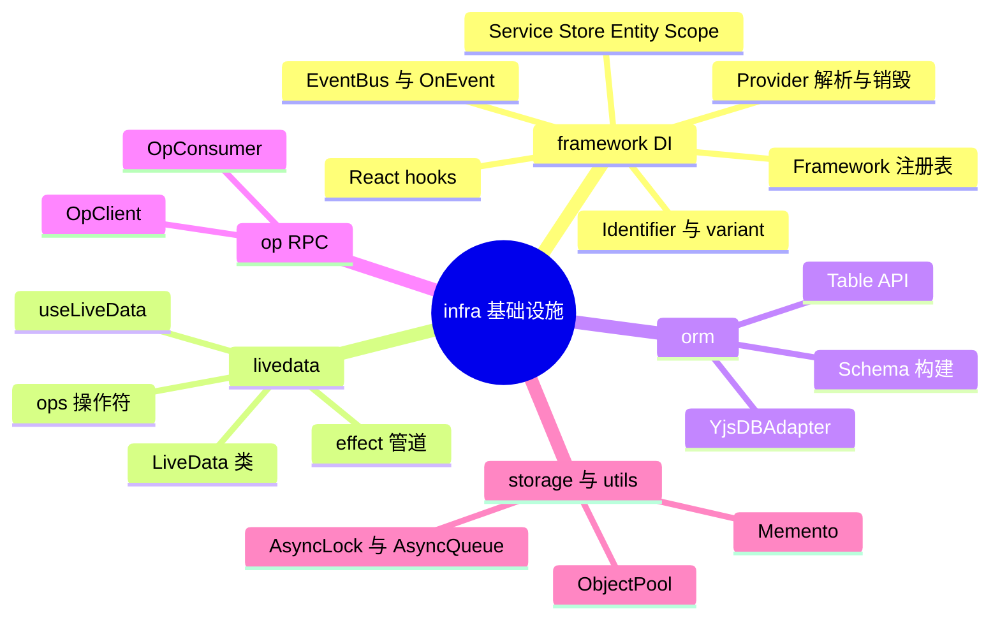
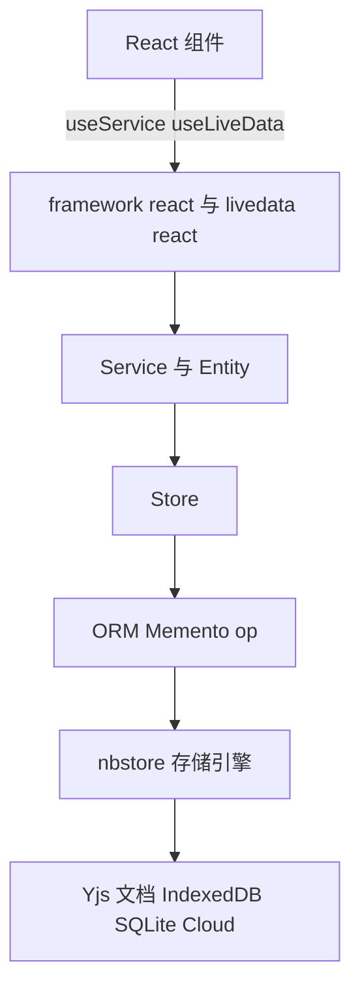
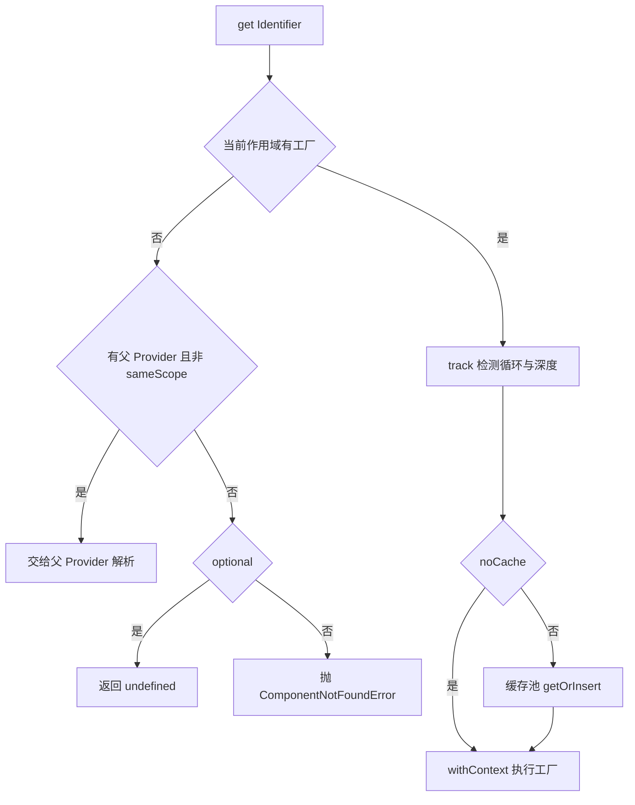
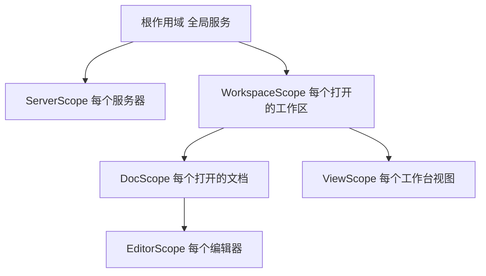
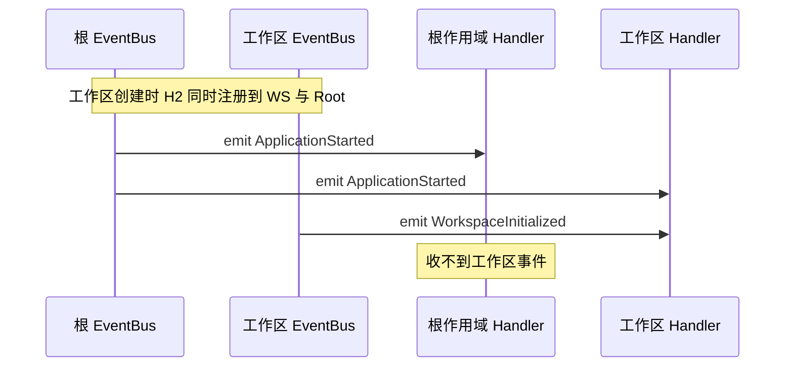
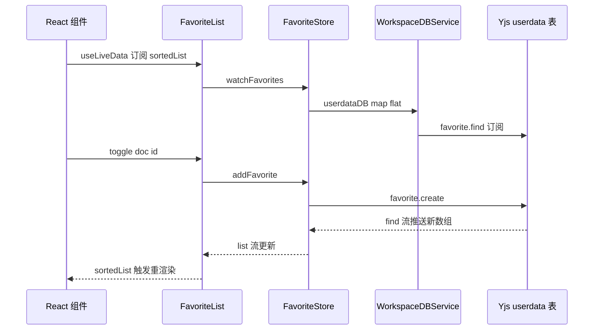
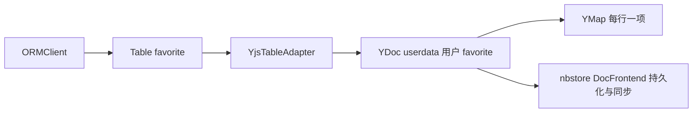

# 第 20 章 前端基础设施：DI 与 LiveData

> **所属部分**：第 6 部分 · 前端应用 ｜ **难度**：★★★★☆ ｜ **建议学时**：8 小时 ｜ **前置章节**：第 10 章 前端技术栈-React-Lit-Signals-RxJS

## 本章导读

打开 `packages/frontend/core/src/modules`，你会看到 69 个业务模块目录，每个目录里都有相似的 `services/`、`stores/`、`entities/`、`index.ts`。再打开任意一个 React 组件，几乎都以这样两行开场：

```tsx
const { favoriteService } = useServices({ FavoriteService });
const favorites = useLiveData(favoriteService.favoriteList.sortedList$);
```

这两行背后是 AFFiNE 前端最底层、也最需要先吃透的基础设施——`@toeverything/infra`（目录 `packages/common/infra`）。它自研了三样东西：

1. **轻量依赖注入（DI）容器** `Framework`：支持服务、存储、实体、作用域（Scope）、多实现变体（variant）、事件总线；
2. **响应式数据类型** `LiveData`：既是 RxJS `Observable`，又能同步取值，还能桥接到 Preact Signals 和 React；
3. **周边工具**：基于 Yjs 的 ORM、跨 Worker 的 RPC（`op`）、`Memento` 存储抽象、异步锁/队列、对象池等。

为什么不用 InversifyJS、Redux、Zustand？因为 AFFiNE 有几个特殊需求：同一应用里会**同时打开多个工作区、多个文档、多个编辑器**，每个都需要一套"自己的"服务实例并能整体销毁；数据大量来自 Yjs CRDT 和 Worker，天然是"流"；同一套业务代码要跑在 Web、Electron、iOS、Android 上，需要在启动时"换实现"。本章从源码层面拆解这套设计，并用 `favorite` 模块完整走一遍"Store → Service → Entity → Scope → configureXxxModule 注册 → React 中使用"的闭环。

## 学习目标

- [ ] 能够说出 `packages/common/infra/src` 下各子目录（framework、livedata、orm、op、storage、atom、utils）的职责与导出入口
- [ ] 能够解释 `Framework` 内部"作用域 → 标识符 → 变体 → 工厂"的三层 Map 注册表，以及 `service/store/entity/impl/override/scope` 的差异
- [ ] 能够描述 Provider 的依赖解析流程（缓存、父作用域回退、循环检测）和 `createEntity`/`createScope` 的语义
- [ ] 能够解释 `CONSTRUCTOR_CONTEXT` 如何让组件"零参数"拿到 `this.framework` 与 `this.props`
- [ ] 能够使用 `createEvent` + `@OnEvent` 编写跨模块事件响应，并说明事件在作用域树中的传播方向
- [ ] 能够对比 `LiveData` 与 `BehaviorSubject`、Preact Signals，熟练使用 `map/selector/computed/flat` 与 `effect` + `ops`
- [ ] 能够以 `favorite` 模块为模板，独立实现一个新的 Store/Entity/Service 并在 React 中消费
- [ ] 能够说明 `op` RPC 的消息协议，以及 ORM、Memento、ObjectPool 在业务中的落点

## 知识地图



## 16.1 infra 全景：一个包，三层能力

`@toeverything/infra` 是 `private` 的 workspace 包。`packages/common/infra/package.json` 的 `exports` 直接指向 `.ts` 源文件（`".": "./src/index.ts"`、`"./op": "./src/op/index.ts"` 等），由上层构建工具统一转译（见第 14 章）。根入口 `src/index.ts` 再导出 `app-config-storage`、`atom`、`framework`、`livedata`、`media`、`orm`、`storage`、`utils`——**唯独 `op` 不在根入口**，必须 `import { OpClient } from '@toeverything/infra/op'`。这是有意为之：`op` 会在 Worker 里用，而 Worker 不应把 React（`framework/react`、`livedata/react`）打进包里。

| 子目录 | 核心导出 | 职责 | 主要使用方 |
|---|---|---|---|
| `framework/core` | `Framework`、`Service`、`Store`、`Entity`、`Scope`、`createIdentifier`、`createEvent`、`OnEvent` | DI 容器与组件模型 | 所有业务模块 |
| `framework/react` | `useService`、`useServices`、`useServiceOptional`、`useFramework`、`FrameworkRoot`、`FrameworkScope` | DI 与 React Context 的桥 | React 组件 |
| `livedata` | `LiveData`、`effect`、`useLiveData`、`fromPromise`、`smartRetry` 等 | 响应式状态 | Store/Entity/组件 |
| `orm` | `createORMClient`、`YjsDBAdapter`、`f`、`t` | 基于 Yjs 的表结构存储 | `core/modules/db` |
| `op` | `OpClient`、`OpConsumer`、`transfer` | 跨线程 RPC | nbstore Worker |
| `storage` | `Memento`、`MemoryMemento`、`AsyncMemento`、`ByteKV` | KV 抽象 | `core/modules/storage` |
| `atom` | `appSettingAtom`、`getCurrentStore` | Jotai 全局设置 | 应用设置 |
| `utils` | `ObjectPool`、`AsyncLock`、`AsyncQueue`、`exhaustMapWithTrailing`、`generateFractionalIndexingKeyBetween`、`yjsGetPath` | 通用工具 | 各处 |



记住方向：**UI 只认识 Service/Entity 暴露的 LiveData 与方法；Store 是唯一"碰"外部数据源的层**。

## 16.2 Framework：三层 Map 的组件注册表

### 16.2.1 数据结构

```ts
// 来源：packages/common/infra/src/framework/core/framework.ts（节选）
export class Framework {
  private readonly components: Map<
    string,
    Map<string, Map<ComponentVariant, ComponentFactory>>
  > = new Map();

  get service() {
    return new FrameworkEditor(this).service;
  }
  get scope() {
    return new FrameworkEditor(this).scope;
  }
  // impl / entity / store / override 同理
}
```

三层 Map 的键依次是：

1. **作用域栈字符串**：`stringifyScope` 把 `['WorkspaceScope…', 'DocScope…']` 用 `/` 拼接；根作用域 `ROOT_SCOPE = []` 拼成空串；
2. **标识符名** `identifierName`；
3. **变体名** `variant`，默认 `'default'`（`DEFAULT_VARIANT`）。

值是 `ComponentFactory<T> = (provider) => T`——**注册的永远是工厂，不是实例**，这是懒加载的基础。

### 16.2.2 FrameworkEditor：链式注册

每次访问 `framework.service` 都会 `new FrameworkEditor(this)`，编辑器维护一个 `currentScopeStack`。`.scope(X)` 把 X 压栈：

```ts
// 来源：packages/common/infra/src/framework/core/framework.ts（FrameworkEditor.scope）
scope = (scope: Type<Scope<any>>): this => {
  this.currentScopeStack = [
    ...this.currentScopeStack,
    parseIdentifier(scope).identifierName,
  ];

  this.collection.addFactory<any>(
    scope as any,
    dependenciesToFactory(scope, [] as any),
    { scope: this.currentScopeStack, override: true }
  );

  return this;
};
```

- Scope 类自身也作为组件注册进该作用域（`override: true`，因为多个模块会重复 `.scope(WorkspaceScope)`）；
- `framework.scope` 是 getter，每次返回**新** editor：`framework.scope(A).service(X)` 之后再写 `framework.service(Y)`，Y 回到根作用域。所以各模块的 `configureXxxModule` 总是"一条链写到底"。

### 16.2.3 六种注册方法

| 方法 | 第一参数 | 第二参数 | 重复检查 | 典型用途 |
|---|---|---|---|---|
| `service(Cls, deps?)` | Service 子类 | 依赖数组 / 工厂函数 / 实例 | 是 | 业务服务 |
| `store(Cls, deps?)` | Store 子类 | 同上 | 是 | 数据访问层 |
| `entity(Cls, deps?)` | Entity 子类 | 依赖数组 / 工厂函数 | 是 | 业务实体（多实例） |
| `impl(Id, ClsOrValue, deps?)` | 接口标识符 | 实现类 / 工厂 / 值 | 是 | 平台差异注入 |
| `override(Id, ..., deps?)` | 接口标识符 | 同上，`null` 表示删除 | 否 | 测试替身、平台覆盖 |
| `scope(ScopeCls)` | Scope 子类 | — | — | 切换注册作用域 |

`service` 的第二参数在运行时判型：`Function` → 工厂；`Array` 或 `undefined` → 依赖数组；其他 → 直接作为值。工厂形式适合有**可选依赖**的场景：

```ts
// 来源：packages/frontend/core/src/modules/cloud/index.ts（节选）
.service(CaptchaService, f => {
  return new CaptchaService(
    f.get(ServerService),
    f.get(FetchService),
    f.getOptional(ValidatorProvider)
  );
})
```

### 16.2.4 依赖数组如何变成工厂

```ts
// 来源：packages/common/infra/src/framework/core/framework.ts（dependenciesToFactory 节选）
return (provider: FrameworkProvider) => {
  const args = [];
  for (const dep of deps) {
    // ... Array.isArray(dep) 时 isAll = true, identifier = dep[0]
    if (isAll) {
      args.push(Array.from(provider.getAll(identifier).values()));
    } else {
      args.push(provider.get(identifier));
    }
  }
  if (isConstructor(cls)) {
    return new cls(...args, provider);
  } else {
    return cls(...args, provider);
  }
};
```

- `[[X]]`（数组套数组）表示注入 X 的**全部变体**数组。`configureWorkspaceModule` 里 `.service(WorkspaceFlavoursService, [[WorkspaceFlavoursProvider]])` 让本地、云端两种 flavour 一起注入；
- 构造函数额外收到 `provider` 作为最后一个参数；
- 依赖数组与构造参数"手动对齐"，`TypesToDeps<ConstructorParameters<T>>` 在类型层面校验顺序。AFFiNE 没用 `reflect-metadata` 自动注入，换来零运行时反射、对 SWC/esbuild 友好、依赖关系在注册处一目了然。

## 16.3 Identifier、Variant 与面向接口编程

```ts
// 来源：packages/common/infra/src/framework/core/identifier.ts（节选）
export function createIdentifier<T>(
  name: string,
  variant: ComponentVariant = DEFAULT_VARIANT
): Identifier<T> & ((variant: ComponentVariant) => Identifier<T>) {
  return Object.assign(
    (variant: ComponentVariant) => createIdentifier<T>(name, variant),
    { identifierName: name, variant }
  ) as any;
}

export function createIdentifierFromConstructor<T extends Component>(target: Type<T>) {
  return createIdentifier<T>(`${target.name}${stableHash(target)}`);
}
```

- **类即标识符**：`framework.service(FavoriteService)` 时，`parseIdentifier` 用 `类名 + stableHash(类)` 生成标识符，加哈希避免不同模块的同名类冲突；
- **显式标识符**：返回值"既是对象又是函数"——当对象用表示默认变体，`X('local')` 得到具名变体。

业务层大量使用"`interface` + 同名 `const`"写法（TS 允许类型与值同名）：

```ts
// 来源：packages/frontend/core/src/modules/storage/providers/global.ts（节选）
export interface GlobalState extends Memento {}
export const GlobalState = createIdentifier<GlobalState>('GlobalState');
```

不同平台在启动时注入不同实现：Web 端 `configureLocalStorageStateStorageImpls(framework)`，Electron 端 `configureElectronStateStorageImpls(framework)`（`packages/frontend/apps/electron-renderer/src/app/effects/modules.ts`）。业务只依赖 `GlobalState` 接口。

Variant 让一个接口拥有多份并存的实现：

```ts
// 来源：packages/frontend/core/src/modules/workspace-engine/index.ts（节选）
framework
  .impl(WorkspaceFlavoursProvider('LOCAL'), LocalWorkspaceFlavoursProvider)
  .impl(WorkspaceFlavoursProvider('CLOUD'), CloudWorkspaceFlavoursProvider, [
    GlobalState,
    ServersService,
  ]);
```

`collection-rules` 模块把这个模式用到极致：`FilterProvider('system:tags')`、`FilterProvider('property:date')`……几十个变体按 `type:key` 动态挑选，本质是一个**插件注册表**。

## 16.4 组件模型：Component 与四个子类

四个子类都继承 `Component`（`framework/core/components/component.ts`），后者提供 `framework`、`props`、`disposables`、`eventBus`、`dispose`；`Scope` 额外把 `get/getAll/createEntity/createScope/emitEvent` 代理到自己的子 Provider 上。

| 类型 | 生命周期 | 实例数 | 约定职责 |
|---|---|---|---|
| `Service` | 首次 `get` 时创建并缓存于所在 Provider | 每个作用域实例 1 个 | 对外门面，持有 Entity |
| `Store` | 同 Service | 每个作用域实例 1 个 | 访问外部数据源（Yjs、GraphQL、Memento），不含业务状态 |
| `Entity` | `createEntity` 时创建，不缓存 | 任意多个 | 业务对象，暴露 LiveData 与方法 |
| `Scope` | `createScope` 时创建，`dispose` 时销毁整个子 Provider | 任意多个 | 承载 props，划定子容器边界 |

`Service`/`Store`/`Scope` 带 `__injectable = true` 标记，`Entity` 带 `__isEntity`。真正决定语义的是解析方式：Entity 以 `noCache` 解析，每次都是新实例，不适合作为单例依赖。

### 16.4.1 constructor-context：零参数拿到 framework

```ts
// 来源：packages/common/infra/src/framework/core/constructor-context.ts（节选）
export const CONSTRUCTOR_CONTEXT: { current: Context } = { current: {} };

export function withContext<T>(cb: () => T, context: Context): T {
  const pre = CONSTRUCTOR_CONTEXT.current;
  try {
    CONSTRUCTOR_CONTEXT.current = context;
    return cb();
  } finally {
    CONSTRUCTOR_CONTEXT.current = pre;
  }
}
```

```ts
// 来源：packages/common/infra/src/framework/core/components/component.ts（节选）
constructor() {
  if (!CONSTRUCTOR_CONTEXT.current.provider) {
    throw new Error('Component must be created in the context of a provider');
  }
  this.framework = CONSTRUCTOR_CONTEXT.current.provider;
  this.props = CONSTRUCTOR_CONTEXT.current.props;
  CONSTRUCTOR_CONTEXT.current = {};
}
```

执行顺序：Provider 在 `withContext` 中执行工厂 → 工厂先解析完所有依赖（每个依赖各自 `withContext`，结束后恢复）→ `new cls(...args)` → 子类第一句 `super()` 读取上下文并**立即清空**。清空防止"上下文泄漏"：组件里若直接 `new` 别的 Component，会立刻抛错而不是拿到错误的 provider。因此子类的**字段初始化器**可以放心使用 `this.framework`，例如 `FavoriteService` 的 `favoriteList = this.framework.createEntity(FavoriteList)`。

> **推论**：永远不要 `new SomeService()`；需要实体时用 `this.framework.createEntity(X, props)`。

`Component` 实现了 `Symbol.dispose`，可配合 TS 的 `using` 语法；`dispose()` 依次调用 `disposables` 里的清理函数，所以 Entity 订阅 RxJS 后通常 `this.disposables.push(() => sub.unsubscribe())`，`FeatureFlagService.setupRestartListener` 即如此。

## 16.5 Provider：解析、缓存与作用域树

三个 Provider 实现都继承抽象类 `FrameworkProvider`（提供 `get/getAll/getOptional/createEntity/createScope/emitEvent`）：

- `BasicFrameworkProvider`：真正的容器实例，持有 `ComponentCachePool`、`EventBus`、`parent`。`framework.provider()` 创建根实例；
- `Resolver`：一次解析中的临时对象，记录 `stack` 与 `depth` 做循环检测；
- `FrameworkStackProvider`：把多个 Provider 叠成栈依次查找，专为 React 嵌套作用域设计（16.7）。

### 16.5.1 解析流程

```ts
// 来源：packages/common/infra/src/framework/core/provider.ts（Resolver.getRaw 节选）
const factory = this.provider.collection.getFactory(identifier, this.provider.scope);
if (!factory) {
  if (this.provider.parent && !sameScope) {
    return this.provider.parent.getRaw(identifier, { sameScope, optional, noCache, props });
  }
  if (optional) {
    return undefined;
  }
  throw new ComponentNotFoundError(identifier);
}

const runFactory = () => {
  const nextResolver = this.track(identifier);
  try {
    return withContext(() => factory(nextResolver), {
      provider: this.provider,
      props,
    });
  } catch (err) {
    if (err instanceof ComponentNotFoundError) {
      throw new MissingDependencyError(identifier, err.identifier, this.stack);
    }
    throw err;
  }
};

if (noCache) {
  return runFactory();
}
return this.provider.cache.getOrInsert(identifier, runFactory);
```



关键语义：

1. **子作用域能注入父作用域的组件，反之不行**。`DocScope` 的 `Doc` 实体可依赖 `WorkspaceService`；根作用域服务永远拿不到某个工作区的东西——从结构上杜绝"全局服务持有工作区引用导致泄漏"。
2. **组件在定义它的作用域的 Provider 中创建并缓存**。DocScope 解析 `WorkspaceService` 时交给父 Provider，由父 Provider 缓存，因此同一工作区所有文档共享同一个 `WorkspaceService`；且该服务的 `this.framework` 是工作区 Provider。
3. `track` 把标识符压栈，重复则抛 `CircularDependencyError`，深度 ≥ 100 抛 `RecursionLimitError`。

### 16.5.2 createEntity 与 createScope

```ts
// 来源：packages/common/infra/src/framework/core/provider.ts（节选，泛型签名省略）
createEntity = (identifier, ...[props]) => {
  return this.getRaw(parseIdentifier(identifier), {
    noCache: true,
    sameScope: true,
    props,
  });
};

createScope = (root, ...[props]) => {
  const newProvider = this.collection.provider(
    [...this.scope, parseIdentifier(root).identifierName],
    this
  );
  return newProvider.getRaw(parseIdentifier(root), { sameScope: true, props });
};
```

- `createEntity`：`noCache` 保证每次新建；`sameScope` 要求实体注册在**调用者所在作用域**；
- `createScope`：新建子 `BasicFrameworkProvider`（作用域栈 = 当前栈 + Scope 名），再在其中实例化 Scope 组件本身。Scope 实例的 `framework` 就是这个新 Provider。

`Scope.dispose()` 调用 `this.framework.dispose()` → `ComponentCachePool.dispose()` 遍历缓存组件调用 `Symbol.dispose`。**这就是"关掉一个工作区，其所有服务一起销毁"的实现**：

```ts
// 来源：packages/frontend/core/src/modules/workspace/services/repo.ts（节选）
pool = new ObjectPool<string, Workspace>({
  onDelete(workspace) {
    workspace.scope.dispose();
  },
  // ...
});
// instantiate() 中：
const workspaceScope = this.framework.createScope(WorkspaceScope, {
  openOptions,
  engineWorkerInitOptions,
});
const workspace = workspaceScope.get(WorkspaceService).workspace;
workspace.engine.start();
workspaceScope.emitEvent(WorkspaceInitialized, workspace);
```

### 16.5.3 AFFiNE 实际的作用域树



分别定义于 `modules/cloud/scopes/server.ts`、`modules/workspace/scopes/workspace.ts`、`modules/doc/scopes/doc.ts`、`modules/editor/scopes/editor.ts`、`modules/workbench/scopes/view.ts`，第 21 章详细展开。

### 16.5.4 错误类型速查

| 错误类（`framework/core/error.ts`） | 触发条件 | 排查思路 |
|---|---|---|
| `ComponentNotFoundError` | `get` 未注册的标识符 | 检查 `configureXxxModule` 是否调用、作用域是否正确 |
| `MissingDependencyError` | 创建 A 时依赖 B 找不到 | 信息带依赖链 `[A] -> [B]`，多半 B 注册在更深的子作用域 |
| `CircularDependencyError` | A→B→A | 把一方改为方法内懒取 `this.framework.get(X)` |
| `DuplicateDefinitionError` | 同作用域同标识符同变体注册两次 | 用 `override`，或检查模块是否 configure 两次 |
| `RecursionLimitError` | 解析深度 ≥ 100 | 工厂函数里递归 `get` 自己 |

## 16.6 事件：createEvent、@OnEvent 与 EventBus

事件就是一个带类型的普通对象 `createEvent<T>(id)` → `{ id, _type }`。`lifecycle` 模块定义了最常用的两个全局事件：

```ts
// 来源：packages/frontend/core/src/modules/lifecycle/service/lifecycle.ts（节选）
export const ApplicationStarted = createEvent<boolean>('ApplicationStartup');
export const ApplicationFocused = createEvent<boolean>('ApplicationFocused');

export class LifecycleService extends Service {
  applicationStart() {
    this.eventBus.emit(ApplicationStarted, true);
  }
  applicationFocus() {
    this.eventBus.emit(ApplicationFocused, true);
  }
}
```

订阅方用类装饰器声明式绑定，如 `modules/feature-flag/services/feature-flag.ts` 的 `@OnEvent(ApplicationStarted, e => e.setupRestartListener)`。

### 16.6.1 @OnEvent：注册为子组件

```ts
// 来源：packages/common/infra/src/framework/core/event.ts（OnEvent 节选）
return (target: C): C => {
  const handlers = (target as any)[SUB_COMPONENTS] ?? [];
  (target as any)[SUB_COMPONENTS] = [
    ...handlers,
    {
      identifier: EventHandler(target.name + stableHash(e) + stableHash(pick)),
      factory: provider => ({
        event: e,
        handler: (payload: any) => {
          const i = provider.get(target);
          pick(i).apply(i, [payload]);
        },
      }),
    },
  ];
  return target;
};
```

装饰器不立即订阅，只往类上挂 `SUB_COMPONENTS`；`framework.service(X)` 注册时检测到它，额外注册若干 `EventHandler` 变体；`EventBus` 构造时 `provider.getAll(EventHandler, { sameScope: true })` 把本作用域的 handler 挂上。注意 handler 中 `provider.get(target)`——**事件触发时才实例化服务**，从未被 UI 使用的服务也会因订阅 `ApplicationStarted` 而在启动时被创建。

### 16.6.2 传播方向：从发出者向下广播

```ts
// 来源：packages/common/infra/src/framework/core/event.ts（EventBus.on 节选）
on<T>(event: FrameworkEvent<T>, listener: (event: T) => void) {
  if (!this.listeners[event.id]) {
    this.listeners[event.id] = [];
  }
  this.listeners[event.id].push(listener);
  const off = this.parent?.on(event, listener);
  return () => {
    off?.();
    this.off(event.id, listener);
  };
}
```

`on` 把监听器**同时注册到所有祖先总线**，而 `emit` 只触发本总线的监听器。结论：

- 根作用域 `emit(ApplicationStarted)`：根与**所有已创建子作用域**中的 handler 都收到；
- 工作区作用域 `emit(WorkspaceInitialized)`：只有该工作区（及其子作用域）的 handler 收到，其他工作区与根收不到。

框架测试 `scope event`（`packages/common/infra/src/framework/__tests__/framework.spec.ts`）验证了后一点：在子作用域发事件，根作用域服务的 `value` 仍为 0。



## 16.7 framework/react：把容器接进组件树

`packages/common/infra/src/framework/react/index.tsx` 只有 81 行，导出 `FrameworkProviderContext`、`useFramework`、`useService`、`useServices`、`useServiceOptional`、`FrameworkRoot`、`FrameworkScope`。

```tsx
// 来源：packages/common/infra/src/framework/react/index.tsx（节选）
export function useService<T>(identifier: GeneralIdentifier<T>): T {
  return useContext(FrameworkProviderContext).get(identifier);
}

export const FrameworkScope = ({ scope, children }: React.PropsWithChildren<{ scope?: Scope }>) => {
  const provider = useContext(FrameworkProviderContext);
  const nextStack = useMemo(() => {
    if (!scope) return provider;
    // make sure the stack order is inside to outside
    return new FrameworkStackProvider([scope.framework, provider]);
  }, [scope, provider]);

  return (
    <FrameworkProviderContext.Provider value={nextStack}>
      {children}
    </FrameworkProviderContext.Provider>
  );
};
```

为什么用 `FrameworkStackProvider` 而不直接用 `scope.framework`？因为 React 树与 DI 作用域树**不一定同构**：`ServerScope` 与 `WorkspaceScope` 在 DI 里是兄弟，页面上却是 `<FrameworkScope scope={server?.scope}>` 包着 `<FrameworkScope scope={workspace.scope}>`（`desktop/pages/workspace/index.tsx`）。栈式 Provider 让内层组件同时取到两个作用域的服务。

`useServices({ AuthService, UserService })` 把 key 首字母小写返回 `{ authService, userService }`，类型层面用 `Uncapitalize` 推导，是减少重复 `useService` 的语法糖。`FrameworkProviderContext` 的默认值是 `Framework.EMPTY.provider()`，在没有 Root 的环境里 `useService` 抛出清晰的 `ComponentNotFoundError`。

应用根（`packages/frontend/apps/web/src/app.tsx`）的组装：

```tsx
// 来源：packages/frontend/apps/web/src/app.tsx（节选）
const framework = new Framework();
configureCommonModules(framework);
configureBrowserWorkbenchModule(framework);
configureLocalStorageStateStorageImpls(framework);
configureBrowserWorkspaceFlavours(framework);
// ... impl(NbstoreProvider, ...)、impl(PopupWindowProvider, ...)
const frameworkProvider = framework.provider();
frameworkProvider.get(LifecycleService).applicationStart();

export function App() {
  return (
    <Suspense fallback={<AppContainer fallback />}>
      <FrameworkRoot framework={frameworkProvider}>{/* ... */}</FrameworkRoot>
    </Suspense>
  );
}
```

## 16.8 完整案例：favorite 模块的五层闭环

目录 `packages/frontend/core/src/modules/favorite/` 包含：`constant.ts`（支持收藏的类型 collection/doc/tag/folder）、`index.ts`（`configureFavoriteModule`）、`stores/favorite.ts`、`entities/favorite-list.ts`、`services/favorite.ts`，以及 `services/old/`（旧数据迁移/兼容适配器）。

### 16.8.1 Store：只管数据

```ts
// 来源：packages/frontend/core/src/modules/favorite/stores/favorite.ts（节选）
export class FavoriteStore extends Store {
  constructor(private readonly workspaceDBService: WorkspaceDBService) {
    super();
  }

  watchFavorites() {
    return this.workspaceDBService.userdataDB$
      .map(db => LiveData.from(db.favorite.find$(), []))
      .flat()
      .map(raw =>
        raw
          .map(data => this.toRecord(data))
          .filter((record): record is FavoriteRecord => !!record)
      );
  }

  addFavorite(type: FavoriteSupportTypeUnion, id: string, index: string): FavoriteRecord {
    const db = this.workspaceDBService.userdataDB$.value;
    const raw = db.favorite.create({ key: this.encodeKey(type, id), index });
    return this.toRecord(raw) as FavoriteRecord;
  }
  // removeFavorite / reorderFavorite / watchFavorite；encodeKey = `${type}:${id}`
}
```

- `userdataDB$` 本身是 `LiveData<DB>`——登录/切换账号时 DB 会换（见 `modules/db/services/db.ts` 的 `userdataDB$`）。`map(db => LiveData.from(...)).flat()` 是"**切换数据源并自动重订阅**"的惯用法，相当于 `switchMap`；
- 存储格式 `key = "doc:xxxx"` 由 Store 编解码，上层无感。

### 16.8.2 Entity：业务语义

```ts
// 来源：packages/frontend/core/src/modules/favorite/entities/favorite-list.ts（节选）
export class FavoriteList extends Entity {
  list$ = this.store.watchFavorites();
  sortedList$ = this.list$.map(v => v.sort((a, b) => (a.index > b.index ? 1 : -1)));
  isLoading$ = this.store.watchIsLoading();

  constructor(private readonly store: FavoriteStore) {
    super();
  }

  isFavorite$(type: FavoriteSupportTypeUnion, id: string) {
    return this.favorite$(type, id).map(v => !!v);
  }

  toggle(type: FavoriteSupportTypeUnion, id: string, index: string = this.indexAt('before')) {
    if (this.favorite$(type, id).value) {
      return this.remove(type, id);
    } else {
      return this.add(type, id, index);
    }
  }
  // indexAt() 用 generateFractionalIndexingKeyBetween 计算插入位置
}
```

`index` 是**分数索引**字符串：在 a、b 之间插入时生成字典序介于两者之间的新串，无需改动其他条目。这对 CRDT 场景很重要——多人同时拖拽排序不会互相覆盖整个列表。

### 16.8.3 Service、注册与 React

```ts
// 来源：packages/frontend/core/src/modules/favorite/services/favorite.ts
export class FavoriteService extends Service {
  favoriteList = this.framework.createEntity(FavoriteList);
}
```

```ts
// 来源：packages/frontend/core/src/modules/favorite/index.ts（节选）
export function configureFavoriteModule(framework: Framework) {
  framework
    .scope(WorkspaceScope)
    .service(FavoriteService)
    .entity(FavoriteList, [FavoriteStore])
    .store(FavoriteStore, [WorkspaceDBService])
    .service(MigrationFavoriteItemsAdapter, [WorkspaceService])
    .service(CompatibleFavoriteItemsAdapter, [FavoriteService]);
}
```

- 收藏"每个工作区一份"，所以挂在 `WorkspaceScope`；注册顺序无关紧要（注册的是工厂）；
- `index.ts` 只 `export type { FavoriteList }`——对外隐藏 Entity 的构造能力，外部只能通过 `FavoriteService.favoriteList` 访问；
- `configureFavoriteModule` 由 `packages/frontend/core/src/modules/index.ts` 的 `configureCommonModules` 调用。

```tsx
// 来源：packages/frontend/core/src/components/page-list/operation-cell.tsx（节选）
const { favoriteService } = useServices({ FavoriteService });
const favourite = useLiveData(favoriteService.favoriteList.isFavorite$('tag', tag.id));

const onToggleFavoriteCollection = useCallback(() => {
  favoriteService.favoriteList.toggle('tag', tag.id);
}, [favoriteService, tag.id]);
```

### 16.8.4 全链路时序



`toggle` 没有任何"通知 UI"的代码——写入 Yjs 后，观察链自动把新数据推回 UI。这就是 AFFiNE 前端的**单向数据流**：写走方法，读走 LiveData。

## 16.9 LiveData：量身定做的响应式类型

### 16.9.1 本质：BehaviorSubject + 操作流

```ts
// 来源：packages/common/infra/src/livedata/livedata.ts（节选）
private readonly raw$: BehaviorSubject<T>;
private readonly ops$ = new Subject<LiveDataOperation>();

constructor(initialValue: T, upstream?: (upstream: Observable<LiveDataOperation>) => Observable<T>) {
  super();
  this.raw$ = new BehaviorSubject(initialValue);
  if (upstream) {
    this.upstreamSubscription = upstream(this.ops$).subscribe({
      next: v => {
        this.raw$.next(v);
      },
      // complete 打日志；error 进入 poisoned 状态
    });
  }
}

getValue = (): T => {
  // ... poisoned 检查
  this.ops$.next('get');
  return this.raw$.value;
};
```

LiveData 继承 `Observable`，内部用 `BehaviorSubject` 存当前值，**另维护一条 `ops$` 操作流**：`getValue` 发 `'get'`、`subscribe` 发 `'watch'`、退订发 `'unwatch'`、`setValue` 发 `'set'`。上游由此"看见"下游的使用情况。

### 16.9.2 LiveData.from：引用计数式懒订阅

```ts
// 来源：packages/common/infra/src/livedata/livedata.ts（from 节选）
stream$.pipe(
  mergeMap(v => {
    if (v === 'set') return EMPTY;
    else if (v === 'get') return of('watch' as const, 'unwatch' as const);
    else return of(v);
  }),
  scan((acc, op) => (op === 'watch' ? acc + 1 : op === 'unwatch' ? acc - 1 : acc), 0),
  map(count => (count > 0 ? 'watch' : 'unwatch')),
  distinctUntilChanged(),
  switchMap(op => (op === 'watch' ? upstream$ : EMPTY))
)
```

（为便于阅读，此处把源码中的 if/else 压缩为三元表达式，逻辑一致。）

- 有订阅者（计数 > 0）才订阅上游，最后一个订阅者离开即退订——**冷启动、自动释放**；
- 读 `.value` 被翻译为"瞬时 watch + unwatch"：若上游同步发射（Yjs 观察、`of(...)`、另一个 LiveData），这一瞬间就把最新值灌进 `raw$`，所以**没有订阅者时 `.value` 也是新鲜的**。测试 `from` 用例中 `LiveData.from(of(1, 2, 3, 4), 0).value` 直接等于 4。

这解决了 RxJS 的经典痛点：`BehaviorSubject` 能同步取值但不懒；`shareReplay` 懒但取不到同步值。

### 16.9.3 API 速查

| API | 作用 | 备注 |
|---|---|---|
| `new LiveData(v)` | 可写的源 | `next/setValue/value=` |
| `LiveData.from(ob$, init)` | 从 Observable 派生 | 懒订阅 |
| `LiveData.computed(get => ...)` | 自动追踪依赖 | 递归深度上限 10 |
| `LiveData.fromSignal(sig)` / `.signal` | 与 Preact Signal 互转 | 与 BlockSuite 互通 |
| `.map(fn)` / `.selector(fn)` | 映射 / 映射 + 浅比较去重 | 返回对象时优先 `selector` |
| `.flat()` | 拍平 `LiveData<LiveData<T>>` 或其数组 | 相当于 switchMap + combineLatest |
| `.distinctUntilChanged()` / `.throttleTime()` | 快捷操作符 | 返回 LiveData |
| `.pipe(...)` | 任意 RxJS 操作符 | 返回普通 Observable |
| `.waitFor(pred)` / `.waitForNonNull()` | 转 Promise | 支持 AbortSignal |

`computed` 的动态依赖例子：

```ts
// 来源：packages/frontend/core/src/modules/workbench/entities/workbench.ts（节选）
activeView$ = LiveData.computed(get => {
  const activeIndex = get(this.activeViewIndex$);
  const views = get(this.views$);
  // activeIndex could be out of bounds when reordering views
  return views.at(activeIndex) || views[0];
});

location$ = LiveData.computed(get => {
  return get(get(this.activeView$).location$);
});
```

`location$` 先 get 当前活动视图，再 get 该视图的 location——活动视图切换时依赖自动更换。

**Poisoned**：上游抛错时 LiveData 进入不可恢复的 poisoned 状态，之后任何读写都抛 `PoisonedError`。源码注释说明了理念："livedata 的开发规范是不抛任何错误，进入 poisoned 状态通常意味着编程错误"。异步错误应用 `catchErrorInto(error$)` 建模为数据。

### 16.9.4 与 BehaviorSubject、Signals 的对比

| 维度 | RxJS `BehaviorSubject` | Preact Signals | `LiveData` |
|---|---|---|---|
| 同步取值 | `.value` | `.value` | `.value`（派生值也是最新） |
| 派生是否懒 | 需 `shareReplay` 手工控制 | 惰性计算 | `from` 引用计数自动懒订阅 |
| 异步编排 | 强 | 弱 | 强（本身是 Observable） |
| 自动依赖追踪 | 无 | 有 | `computed` 提供 |
| React 集成 | 需手写 hook | 需额外包 | `useLiveData` |
| 错误语义 | error 终止流 | 抛出 | poisoned，强制把错误建模为数据 |

一句话：**LiveData = 能同步读的、懒的、可当 Signal 用的 Observable**。

## 16.10 React 绑定与 effect

### 16.10.1 useLiveData

```ts
// 来源：packages/common/infra/src/livedata/react.ts（节选，返回类型省略）
export function useLiveData<Input extends LiveData<any> | null | undefined>(liveData: Input) {
  return useSyncExternalStore(
    liveData ? liveData.reactSubscribe : noopSubscribe,
    liveData
      ? liveData.reactGetSnapshot
      : liveData === undefined
        ? undefinedGetSnapshot
        : nullGetSnapshot
  );
}
```

```ts
// 来源：packages/common/infra/src/livedata/livedata.ts（节选）
reactSubscribe = (cb: () => void) => {
  // ... poisoned 检查
  this.ops$.next('watch');
  const subscription = this.raw$.pipe(distinctUntilChanged(), skip(1)).subscribe(cb);
  subscription.add(() => {
    this.ops$.next('unwatch');
  });
  return () => subscription.unsubscribe();
};

reactGetSnapshot = () => {
  // ... poisoned 检查
  this.ops$.next('watch');
  Promise.resolve().then(() => {
    this.ops$.next('unwatch');
  });
  return this.raw$.value;
};
```

- 箭头函数属性保证引用稳定，`useSyncExternalStore` 不会反复重订阅；
- `getSnapshot` 中"watch 后微任务 unwatch"保证渲染期间上游处于激活态，紧随的 `subscribe` 又 +1，避免上游频繁启停；
- 允许传 `null/undefined`，便于条件订阅。

> **坑**：`useLiveData(list.isFavorite$('doc', id))` 每次渲染都新建 LiveData，长列表里有开销，必要时 `useMemo`。`livedata/__tests__/react.spec.tsx` 的 `react useMemo livedata.map heavy object copy` 用例可参考。

### 16.10.2 effect：把异步流程写成管道

`effect(op1, op2, ...)`（`livedata/effect/index.ts`）内部创建一个 `Subject`，把操作符 `pipe` 起来并订阅，返回一个"调用即推值"的函数，附带 `unsubscribe()` 与 `reset()`。若管道 complete 或 error，会在 `setTimeout` 中抛出 `EffectError` 变成未捕获异常——**错误必须在管道内被处理**。真实用法（发票分页）：

```ts
// 来源：packages/frontend/core/src/modules/cloud/entities/invoices.ts（节选）
readonly revalidate = effect(
  map(() => this.pageNum$.value),
  exhaustMapSwitchUntilChanged(
    (a, b) => a === b,
    pageNum => {
      return fromPromise(async signal => {
        return this.store.fetchInvoices(pageNum * this.PAGE_SIZE, this.PAGE_SIZE, signal);
      }).pipe(
        tap(data => {
          this.invoiceCount$.setValue(data.invoiceCount);
          this.pageInvoices$.setValue(data.invoices);
        }),
        smartRetry(),
        catchErrorInto(this.error$),
        onStart(() => {
          this.pageInvoices$.setValue(undefined);
          this.isLoading$.setValue(true);
        }),
        onComplete(() => this.isLoading$.setValue(false))
      );
    }
  )
);
```

一次性解决：并发控制（同页重复请求忽略、换页立即取消旧请求）、取消（`fromPromise` 把 AbortSignal 传给 fetch）、重试、加载态、错误态。该实体的 `dispose()` 中调用 `this.revalidate.unsubscribe()`。

| `ops.ts` 操作符 | 作用 |
|---|---|
| `fromPromise(p \| signal => p)` | Promise 转 Observable，退订时 abort |
| `mapInto(l$)` | 把值写入 LiveData |
| `catchErrorInto(l$, cb?)` | 错误写入 LiveData；完成时置 null |
| `onStart(cb)` / `onComplete(cb)` | 生命周期钩子 |
| `backoffRetry({ when, count, delay, maxDelay })` | 指数退避重试 |
| `smartRetry()` | 网络错误（`UserFriendlyError.isNetworkError`）无限重试 + 其他错误最多 3 次 |
| `exhaustMapSwitchUntilChanged(cmp, project)` | 输入不变时 exhaustMap，变化时 switchMap |

## 16.11 周边工具：ORM、op、storage 与 utils

### 16.11.1 ORM：把 Yjs 当成数据库

工作区里有很多"非文档"结构化数据：文件夹树、文档属性、收藏、固定的收藏夹……它们要**像文档一样被同步与合并**，底层必须是 Yjs；业务又希望像操作表一样 `create/update/find$`。`orm/core` 就是这座桥。

```ts
// 来源：packages/frontend/core/src/modules/db/schema/schema.ts（节选）
export const AFFiNE_WORKSPACE_USERDATA_DB_SCHEMA = {
  favorite: {
    key: f.string().primaryKey(),
    index: f.string(),
  },
  settings: {
    key: f.string().primaryKey(),
    value: f.json(),
  },
  // ... docIntegrationRef
} as const satisfies DBSchemaBuilder;
```

`f` 提供 `string/number/boolean/json/enum`，可链式 `.optional()/.default(fn)/.primaryKey()`；`t.document(schema)` 额外加 `__document` 字段，表示每行是独立 YDoc（如 `docProperties`）。

```ts
// 来源：packages/frontend/core/src/modules/db/services/db.ts（节选）
const WorkspaceUserdataDBClient = createORMClient(AFFiNE_WORKSPACE_USERDATA_DB_SCHEMA);
// userdataDB(userId) 中：
db: new WorkspaceUserdataDBClient(
  new YjsDBAdapter(AFFiNE_WORKSPACE_USERDATA_DB_SCHEMA, {
    getDoc: guid => {
      const ydoc = new YDoc({
        // guid format: userdata${userId}${guid}
        guid: `userdata$${userId}$${guid}`,
      });
      this.workspaceService.workspace.engine.doc.connectDoc(ydoc);
      this.workspaceService.workspace.engine.doc.addPriority(ydoc.guid, 50);
      return ydoc;
    },
  })
),
```



`YjsTableAdapter`（`orm/core/adapters/yjs/table.ts`）的注释写明结构："每张表是一个 YDoc，key → 行（YMap），行内字段 → 原始值"，删除采用软删除标记 `$$DELETED`。每张表的 YDoc 通过 `engine.doc.connectDoc` 接入第 23 章的 nbstore，于是**收藏数据自动获得本地持久化与多端同步**。

`Table`（`orm/core/table.ts`）提供 `create`、`update`、`get/get$`、`find/find$`、`select/select$`、`keys/keys$`、`delete`；带 `$` 的返回 Observable，正好喂给 `LiveData.from`。`ORMClient.defineHook` 支持写入前变换，见 `orm/core/__tests__/hook.spec.ts`。

### 16.11.2 op：Worker 间的极简 RPC

`packages/common/infra/src/op/message.ts` 定义了 8 种消息：

| 方向 | 消息类型 | 字段 |
|---|---|---|
| Client → Consumer | `call` / `subscribe` | `id`、`name`、`payload` |
| Client → Consumer | `cancel` / `unsubscribe` | `id` |
| Consumer → Client | `return` | `id`、`data` 或 `error` |
| Consumer → Client | `next` / `error` / `complete` | `id`、`data`/`error` |

`id` 形如 `getDoc:12`（`nextCallId`）。通道只需满足 `MessageCommunicapable`（`postMessage/addEventListener/removeEventListener`），`Worker`、`MessagePort`、`SharedWorker.port`、`BroadcastChannel` 都能用。

```ts
// 教学示例（与 op/README.md 及当前 API 一致）
import { OpClient, OpConsumer, type OpSchema } from '@toeverything/infra/op';
import { interval, map } from 'rxjs';

interface Ops extends OpSchema {
  add: [{ a: number; b: number }, number];
  ticks: [number, string];
}

const { port1, port2 } = new MessageChannel();
const consumer = new OpConsumer<Ops>(port2);
consumer.register('add', ({ a, b }) => a + b);
consumer.register('ticks', n => interval(n).pipe(map(i => `tick ${i}`)));

const client = new OpClient<Ops>(port1);
const sum = await client.call('add', { a: 1, b: 2 }); // 3
const sub = client.ob$('ticks', 1000).subscribe(console.log);
```

Consumer 的 handler 可返回值、Promise 或 Observable，内部统一 `defer` 为 Observable 并 `takeUntil(abort)`；`call` 取第一个值即完成。Client 端 `call` 最后一个参数可传 `AbortSignal`，取消时发送 `cancel`，Consumer 侧对应的 AbortController 被 abort。`transfer(data, [buffer])` 把可转移对象登记到模块级 `Map`，`postMessage` 时取出——nbstore 正是用它把 `MessagePort` 转交给 Worker（`packages/common/nbstore/src/worker/client.ts` 的 `open`）。第 23 章详述。

### 16.11.3 storage、atom、app-config 与 utils

`Memento` 接口（`storage/memento.ts`）定义 `get/watch/set/del/clear/keys`：

- `MemoryMemento`：内部是 `Map<string, LiveData>`，`GlobalContext` 实体用它存"当前工作区 id、当前文档 id"等运行期上下文（`modules/global-context/entities/global-context.ts`）；
- `wrapMemento(memento, prefix)`：加前缀隔离命名空间；
- `AsyncMemento`：异步版本，`CacheStorage` 标识符基于它，Web 端实现为 `IDBGlobalState`（`modules/storage/impls/storage.ts`）；
- `ByteKV` / `MemoryByteKV` / `ReadonlyByteKV`：二进制 KV，`transaction` 内部用 `AsyncLock` 串行化。

`atom/settings.ts` 用 Jotai `atomWithStorage('affine-settings', ...)` 存窗口边框、模糊背景、自动更新等应用级设置，`appSettingAtom` 在 `WorkbenchRoot` 中被读取，属于历史方案，新代码优先 DI + `GlobalState`。`app-config-storage.ts` 是一个用 zod 生成默认值的简单配置存储。

| utils 工具 | 要点 | 真实落点 |
|---|---|---|
| `ObjectPool<K, T>` | 引用计数 + 定时 GC；`onDangling` 决定能否回收，`onDelete` 负责销毁 | `WorkspaceRepositoryService.pool`、`DocsService.pool` |
| `AsyncLock` | `acquire()` 返回带 `Symbol.dispose` 的句柄，可 `using _lock = await lock.acquire()` | `MemoryByteKV.transaction` |
| `AsyncQueue` / `PriorityAsyncQueue` | `await next(abort)` 阻塞等待；按 `priorityRule` 抢占 | 队列型任务 |
| `exhaustMapWithTrailing` | exhaustMap 但保留最后一次触发 | 节流刷新 |
| `generateFractionalIndexingKeyBetween` | 分数索引 | 收藏、文件夹排序 |
| `yjsGetPath` / `yjsObserve*` | Yjs 结构转 Observable | `Workspace.name$` |
| `throwIfAborted` / `MANUALLY_STOP` | 取消语义 | `fromPromise`、nbstore |

## 16.12 对比与小结

### 16.12.1 与 BlockSuite global/di 的异同

BlockSuite 在 `blocksuite/framework/global/src/di` 有一套几乎同源的 DI：`Container`、`ServiceProvider`、`createIdentifier`、`createScope`。

| 维度 | `@toeverything/infra` framework | `@blocksuite/global/di` |
|---|---|---|
| 容器类 | `Framework` | `Container` |
| 注册 API | `service/store/entity/impl/override/scope` | `add/addImpl/override/scope` |
| 组件基类 | `Component` 及四个子类，构造上下文注入 framework/props | 无基类，任意类 |
| Scope 表示 | Scope 是带 props 的组件类 | `createScope(name, base)` 返回字符串数组 |
| 事件 | 内置 `EventBus` + `@OnEvent` | 无（BlockSuite 用自己的扩展机制） |
| React 集成 | 有 | 无（Lit 世界） |
| 用途 | 应用层业务模块 | 编辑器扩展（`ExtensionType`、`StdIdentifier`，见第 17 章） |

可以把 infra framework 看作 BlockSuite DI 的"应用层增强版"。两套容器**互不相通**：AFFiNE 向编辑器注入应用能力时，在 `packages/frontend/core/src/blocksuite/view-extensions` 中让各 `ViewExtensionProvider` 通过 options 接收 infra 的 `FrameworkProvider`（如 `view-extensions/database/index.ts` 的 `framework: z.instanceof(FrameworkProvider).optional()`），再把服务包装成 BlockSuite 扩展 `context.register(...)`。

### 16.12.2 本章小结

- `Framework` 是"作用域 × 标识符 × 变体 → 工厂"的注册表，Provider 按作用域树解析、缓存与销毁；
- 四件套分工明确：Store 碰数据、Entity 表达业务、Service 做门面、Scope 划生命周期；
- 事件从发出的作用域向子孙广播，`@OnEvent` 让服务在事件触发时才被创建；
- LiveData 是同步可读、引用计数懒订阅、可桥接 Signal 的 Observable，配合 `effect` 与 `ops` 把异步流程写成声明式管道；
- ORM、op、Memento、ObjectPool 把 Yjs、Worker、KV 存储统一纳入"可观察 + 可注入"的体系。

## 源码导读清单

| 优先级 | 路径 | 阅读重点 |
|---|---|---|
| P0 | `packages/common/infra/src/framework/core/framework.ts` | 注册表结构、`FrameworkEditor`、`dependenciesToFactory` |
| P0 | `packages/common/infra/src/framework/core/provider.ts` | `Resolver.getRaw`、`createEntity`、`createScope`、`FrameworkStackProvider` |
| P0 | `packages/common/infra/src/framework/core/components/component.ts` | 构造上下文、`disposables` |
| P0 | `packages/common/infra/src/livedata/livedata.ts` | `from` 引用计数、`computed`、`reactSubscribe` |
| P0 | `packages/frontend/core/src/modules/favorite/` | 完整模块范式 |
| P1 | `packages/common/infra/src/framework/core/event.ts` | `EventBus` 传播、`OnEvent` 子组件 |
| P1 | `packages/common/infra/src/framework/react/index.tsx` | hooks 与 `FrameworkScope` |
| P1 | `packages/common/infra/src/livedata/effect/index.ts`、`ops.ts` | effect 错误处理、`smartRetry` |
| P1 | `packages/common/infra/src/framework/__tests__/framework.spec.ts` | 全部特性的最小用例 |
| P1 | `packages/frontend/core/src/modules/db/services/db.ts` | ORM 实战与 Yjs 文档接入引擎 |
| P2 | `packages/common/infra/src/orm/core/adapters/yjs/table.ts` | Yjs 表结构、软删除 |
| P2 | `packages/common/infra/src/op/client.ts`、`consumer.ts`、`README.md` | RPC 协议 |
| P2 | `packages/common/infra/src/utils/object-pool.ts` | 引用计数与 GC |
| P2 | `blocksuite/framework/global/src/di/container.ts` | 与 BlockSuite DI 对比 |

## 动手实践

### 练习 1：在单测里玩转 Framework（基础）

- **目标**：熟悉注册、作用域、事件。
- **步骤**：
  1. 阅读 `framework/__tests__/framework.spec.ts` 的 `scope`、`scope event`、`dispose` 三个用例；
  2. 新建临时测试文件（不提交），定义 `ProjectScope`，注册根作用域 `LoggerService` 与 `ProjectScope` 下依赖它的 `ProjectService`；
  3. 用 `provider.createScope(ProjectScope)` 创建两次，断言两个 `ProjectService` 不同、`LoggerService` 相同；
  4. 执行 `yarn vitest run <你的测试文件路径>`（根 `vitest.config.ts` 会包含 `packages/{common,frontend}/**/*.spec.{ts,tsx}`，需已安装依赖）。
- **验收标准**：测试通过；能解释两个 `ProjectService` 不同而 `LoggerService` 相同的原因。

### 练习 2：观察 LiveData 的懒订阅（基础）

- **目标**：亲眼看到引用计数。
- **步骤**：用 `new Observable(sub => { console.log('subscribe'); sub.next(1); return () => console.log('unsubscribe'); })` 包一个 `LiveData.from`；依次执行：读 `.value`、`subscribe` 两次、两次退订。
- **验收标准**：写出每一步的日志顺序，并解释读 `.value` 为什么也会打印一次 subscribe/unsubscribe。

### 练习 3：仿写一个 "最近浏览" 模块（进阶）

- **目标**：完整走一遍五层闭环。
- **步骤**：
  1. 参考 `favorite`，设计 `RecentStore`（依赖 `WorkspaceLocalState`，用 `watch/set` 存最近 10 个 docId）；
  2. `RecentList` 实体暴露 `list$` 与 `push(docId)`；`RecentService` 持有实体；
  3. 写 `configureRecentModule` 注册到 `WorkspaceScope`；
  4. 思考：要在"文档打开"时自动 push，应订阅哪个事件？（提示：`modules/doc/events/index.ts` 的 `DocInitialized`）
- **验收标准**：类型检查通过；能说明 `RecentStore` 为何不应直接依赖 `localStorage`。完成后可对照仓库中 `quicksearch` 模块的 `RecentDocsService`。

### 练习 4：用 effect 重写一个请求（进阶）

- **目标**：掌握 `effect + fromPromise + smartRetry + catchErrorInto`。
- **步骤**：仿照 `modules/cloud/entities/invoices.ts`，写一个实体在 `revalidate()` 时请求假 API（`setTimeout` 模拟、随机失败），暴露 `data$/isLoading$/error$`。
- **验收标准**：快速连续调用只有一个请求在进行；失败后自动重试；`dispose` 时停止。

### 练习 5：追踪一次事件广播（挑战）

- **目标**：理解作用域事件。
- **步骤**：在 `modules/cloud/services/blocksuite-writer-info.ts` 找到 `@OnEvent(WorkspaceInitialized, ...)`，再在 `modules/workspace/services/repo.ts` 找到 `emitEvent`，画出从 `instantiate` 到 handler 执行的调用链。
- **验收标准**：链路图包含 `createScope`、`EventBus` 构造、`provider.get(target)` 三个关键节点。

## 自测题

1. `framework.scope(WorkspaceScope).service(A); framework.service(B);` 执行后，B 注册在哪个作用域？为什么？
2. 依赖数组写成 `[[WorkspaceFlavoursProvider]]` 与 `[WorkspaceFlavoursProvider]` 有何区别？
3. 为什么 Entity 不适合作为别的 Service 的依赖注入？
4. `Component` 构造函数最后为什么把 `CONSTRUCTOR_CONTEXT.current` 置空？
5. 在工作区作用域 `emitEvent(WorkspaceInitialized)`，根作用域上订阅该事件的服务能否收到？
6. `LiveData.from(upstream$, init)` 没有订阅者时读 `.value`，能拿到上游最新值吗？条件是什么？
7. `map` 与 `selector` 的区别？什么场景应该用 `selector`？
8. 为什么 effect 管道里一定要 `catchErrorInto`？
9. `FrameworkScope` 为什么使用 `FrameworkStackProvider` 而非直接传 `scope.framework`？
10. favorite 数据最终存在哪里？如何同步到其他设备？

<details><summary>参考答案</summary>

1. 根作用域。`framework.scope`/`framework.service` 都是 getter，每次返回新的 `FrameworkEditor`，`currentScopeStack` 从 `ROOT_SCOPE` 开始。
2. 双层数组表示 `getAll`，注入所有变体组成的数组；单层表示 `get`，只注入默认变体 `'default'`，没有默认变体则抛错。
3. Entity 以 `noCache` 解析，设计为多实例、由持有者管理生命周期；注入会导致每次解析都新建且生命周期失控。约定由 Service 持有 Entity。
4. 防止上下文泄漏：构造函数内若直接 `new` 其他 Component，会因上下文为空立刻抛错，而不是误用当前 provider/props。
5. 不能。`emit` 只触发本总线监听器，根作用域 handler 只在根总线上。反过来，根作用域发出的事件能到达已创建子作用域的 handler（因为子 handler 也注册到了祖先总线）。
6. 能，前提是上游在被订阅时同步发射（如另一个 LiveData、Yjs 观察、`of`）。读取会触发瞬时 watch/unwatch，引发一次同步订阅。
7. `map` 每次上游变化都发射；`selector` 发射前浅比较，浅相等则不发射。映射结果是新对象/数组但内容常不变时应用 `selector`，避免 React 无谓重渲染。
8. 否则错误使管道终止，effect 会在 `setTimeout` 中抛出 `EffectError` 变成未捕获异常，后续调用全部失效（除非 `reset`）。
9. React 树嵌套与 DI 作用域树不一定一致（ServerScope 与 WorkspaceScope 是兄弟），栈式 Provider 依次查找内外层，使内层组件能同时访问多个作用域的服务。
10. 存在 guid 为 `userdata$<userId>$favorite` 的 YDoc 中（每行一个 YMap），该 YDoc 通过 `engine.doc.connectDoc` 接入 nbstore：本地持久化到 IndexedDB/SQLite，并由 DocSync 同步到云端。

</details>

## 常见坑与排错

| 现象 | 原因 | 解决 |
|---|---|---|
| `Component must be created in the context of a provider` | 手动 `new` 了 Service/Entity | 改为 `framework.get` 或 `createEntity` |
| `Missing dependency [X] in creating [Y]` | X 注册在更深的子作用域，或模块未 configure | 检查 `configureCommonModules` 与平台入口；调整作用域 |
| `XXX already exists` | 模块 configure 两次，或两个模块注册同一标识符 | 用 `override` 或排查重复调用 |
| 组件拿到别的工作区的服务或报找不到 | React 树缺少 `<FrameworkScope scope={workspace.scope}>` | 在页面根部包裹 Scope |
| `The livedata is poisoned` | 上游 Observable 抛错 | 上游加 `catchError`，错误建模到 `error$` |
| `computed recursive limit exceeded` | computed 互相依赖或在 compute 中写 LiveData | 拆分依赖，避免副作用 |
| 列表滚动卡顿 | 每行 `useLiveData(entity.xxx$(id))` 每次渲染新建 LiveData | `useMemo` 缓存或在 Entity 中缓存 per-id LiveData |
| 事件 handler 没执行 | handler 所在作用域尚未创建，或在兄弟作用域发出 | 明确事件发出的作用域 |
| 关闭工作区后仍有回调 | Entity 订阅未登记到 `disposables` | `this.disposables.push(() => sub.unsubscribe())` |

## 延伸阅读

- `packages/common/infra/src/op/README.md`：op 官方用法；
- `packages/common/infra/src/framework/core/identifier.ts` 顶部长注释：作者对控制反转与 variant 的说明；
- 第 17 章 BlockSuite-Std 视图扩展命令事件：BlockSuite DI 与扩展机制；
- 第 21 章 Core 业务模块与路由：作用域树在业务中的完整展开；
- 第 23 章 存储与同步引擎 nbstore：op 与 ORM 背后的存储引擎；
- React 文档 `useSyncExternalStore`；RxJS 文档 `BehaviorSubject`、`switchMap`、`exhaustMap`；Android Jetpack LiveData（命名来源，见 `livedata.ts` 注释）。

## 学时拆分

| 内容 | 建议时长 |
|---|---|
| 16.1–16.3 全景、注册表、标识符 | 1 小时 |
| 16.4–16.7 组件模型、Provider、事件、React 绑定 | 2 小时 |
| 16.8 favorite 案例精读 | 1 小时 |
| 16.9–16.10 LiveData、useLiveData、effect | 1.5 小时 |
| 16.11–16.12 ORM、op、storage、utils、BlockSuite DI 对比 | 1 小时 |
| 动手实践与自测 | 1.5 小时 |
| **合计** | **8 小时** |

---
上一章：[第 19 章 自定义 Block 实战](../05-编辑器内核BlockSuite/19-自定义Block实战.md) ｜ 下一章：[第 21 章 Core 业务模块与路由](./21-Core业务模块与路由.md) ｜ [返回目录](../README.md)
