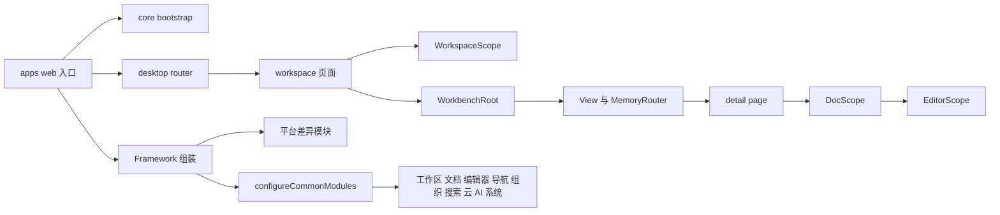
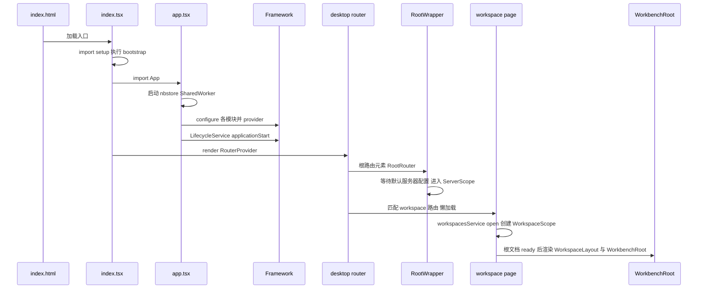
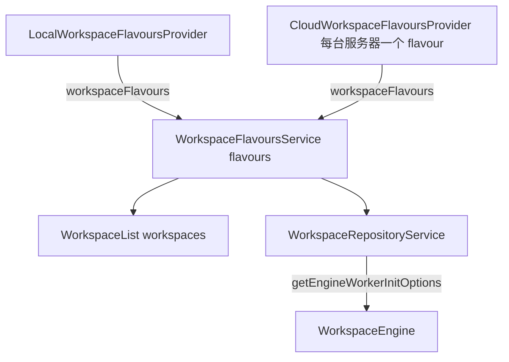
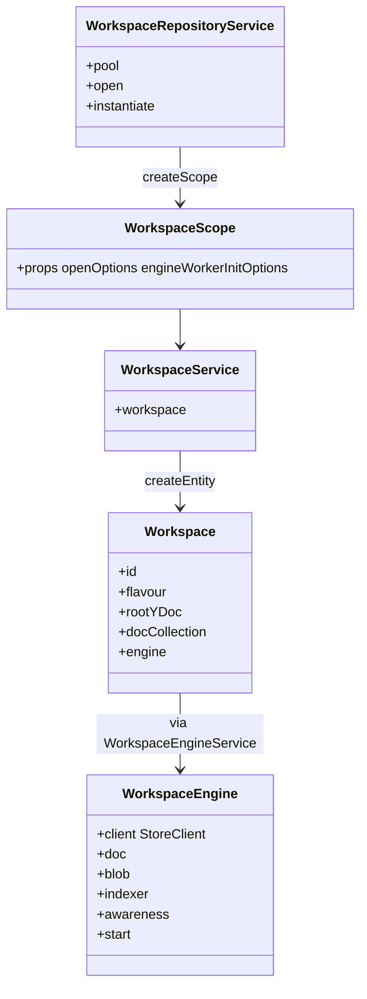
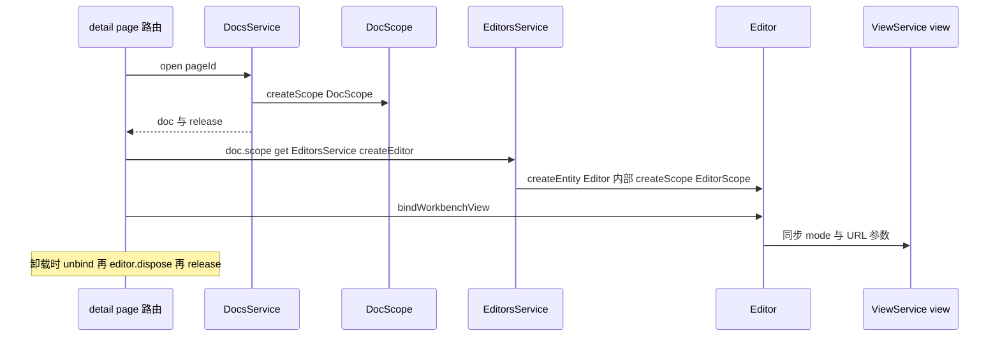
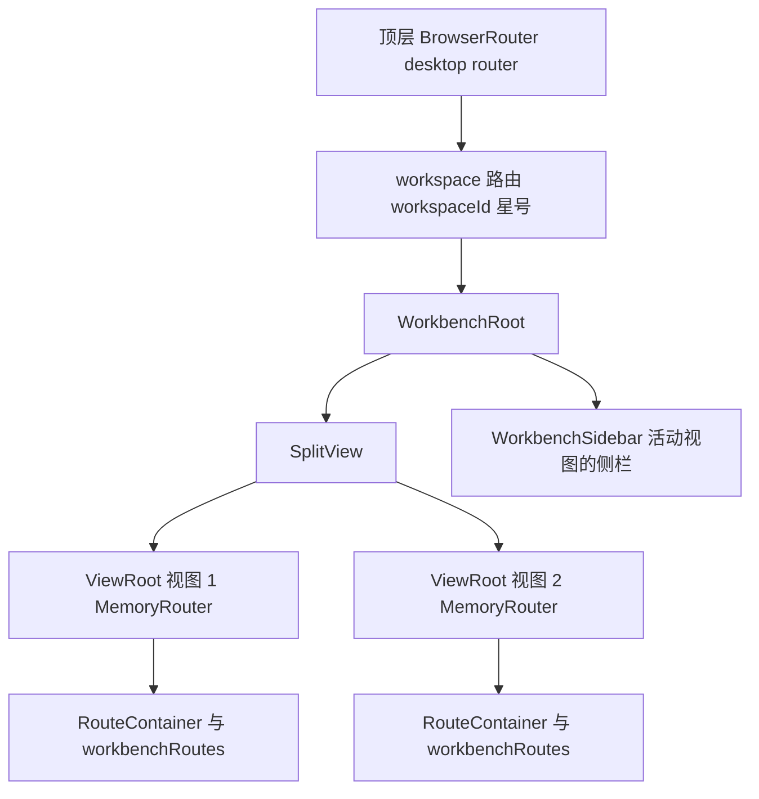
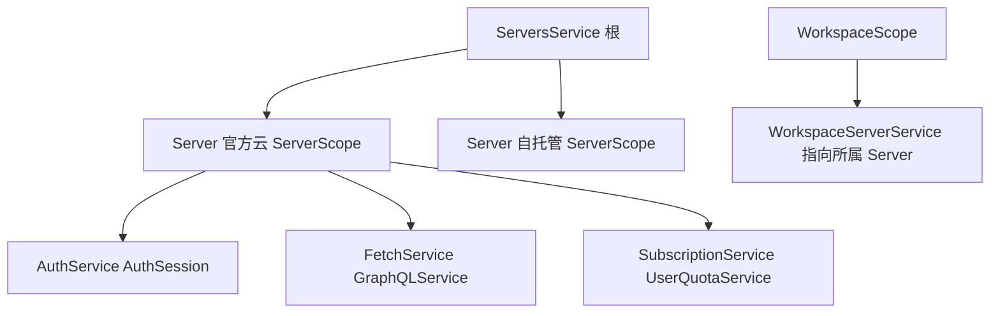

# 第 21 章 Core 业务模块与路由

> **所属部分**：第 6 部分 · 前端应用 ｜ **难度**：★★★★☆ ｜ **建议学时**：12 小时 ｜ **前置章节**：第 20 章 前端基础设施-DI与LiveData

## 本章导读

第 20 章我们拆开了 `@toeverything/infra` 这把"螺丝刀"。本章要用它去看清整台机器——`@affine/core`（目录 `packages/frontend/core`）。这是 AFFiNE 前端体量最大的包：桌面版与移动版的所有页面、69 个业务模块、编辑器集成、命令系统都在这里；而 `packages/frontend/apps/web`、`apps/electron-renderer`、`apps/mobile` 等"应用壳"只做一件事——**按平台挑选模块并组装 Framework，然后把根组件挂到 DOM 上**。

读完本章，你应当能回答三个问题：

1. 浏览器打开 `https://app.affine.pro/workspace/abc/xyz` 时，从 `index.tsx` 到编辑器渲染，中间经过了哪些文件、创建了哪些作用域？
2. 69 个模块分别属于哪个业务领域？哪些挂在根作用域，哪些挂在工作区/文档作用域？
3. AFFiNE 为什么有"两层路由"？Workbench 的多视图、分屏、多标签是如何与 React Router 共存的？

本章先走通启动链路，再按领域把模块"摊开"，重点深读 workspace、doc、editor、workbench 四个骨干模块，最后梳理路由、命令系统与移动端差异。

## 学习目标

- [ ] 能够说出 `packages/frontend/core/src` 下 bootstrap、modules、components、desktop、mobile、blocksuite、commands、utils、types 各目录职责
- [ ] 能够画出 Web 端从 `apps/web/src/index.tsx` 到 `WorkbenchRoot` 的启动与渲染链路
- [ ] 能够列出 `configureCommonModules` 组装的全部模块并按领域分组，说明 Web/Electron/Mobile 入口额外组装了哪些模块
- [ ] 能够解释 workspace 模块的 flavour 机制、`WorkspaceRepositoryService.open` 的对象池与作用域创建过程
- [ ] 能够描述 `DocsService.open` → `DocScope` → `EditorsService.createEditor` → `EditorScope` 的文档打开链路
- [ ] 能够说明 Workbench/View 的设计，以及"顶层 BrowserRouter + 每个 View 一个 MemoryRouter"的双层路由
- [ ] 能够使用 `packages/frontend/routes` 的 `routes.json` + `build.ts` 理解类型安全路由的代码生成
- [ ] 能够描述 CMD-K 命令系统（`AffineCommandRegistry`）与 quicksearch 会话的协作

## 知识地图



## 17.1 core/src 目录结构

```
packages/frontend/core/src
├── bootstrap/    # 启动副作用：env、public-path、polyfill、telemetry、cleanup、electron
├── modules/      # 69 个 DI 业务模块 + index.ts（configureCommonModules）
├── components/   # 跨端共享的 React 组件（page-list、providers、hooks、guard……）
├── desktop/      # 桌面/Web 版页面、对话框、路由
├── mobile/       # 移动版页面、组件、路由、移动专属模块
├── blocksuite/   # BlockSuite 编辑器集成：editors、view-extensions、ai、manager……
├── commands/     # CMD-K 命令定义与注册表
├── utils/        # 纯函数工具（navigable-history、island、fuzzy-match……）
├── types/        # 全局类型声明（types.d.ts、dnd.ts）
└── __tests__/
```

| 目录 | 是否依赖 DI | 典型内容 | 被谁引用 |
|---|---|---|---|
| `bootstrap` | 否 | 只有副作用 import，**顺序敏感** | 各 app 的 `setup.ts` |
| `modules` | 是 | Service/Store/Entity/Scope + 少量 `view/` | 全部 UI |
| `components` | 通过 hooks | 通用业务组件 | desktop、mobile |
| `desktop` / `mobile` | 通过 hooks | 页面级组件、路由表 | apps |
| `blocksuite` | 部分 | 编辑器扩展、AI 面板 | detail page |
| `commands` | 否（参数注入） | 命令工厂函数 | `components/hooks/use-register-workspace-commands.ts` |

`modules` 内部遵循统一约定：`entities/`、`services/`、`stores/`、`scopes/`、`providers/`（接口标识符）、`impls/`（接口实现）、`events/`、`view/`（与模块强绑定的 React 组件），以及唯一出口 `index.ts`（导出 + `configureXxxModule`）。

`bootstrap/browser.ts` 的注释直接写着 `// ORDER MATTERS`：

```ts
// 来源：packages/frontend/core/src/bootstrap/browser.ts
// ORDER MATTERS
import './env';
import './public-path';
import './polyfill/browser';
import './telemetry';
```

`env.ts` 调用 `setupGlobal()` 设置 `environment` 等全局对象，后续模块在顶层就会读取它们，所以必须最先执行。`cleanup.ts` 则清理历史版本遗留的 IndexedDB 库（如以 `:server-clock`、`:sync-metadata` 结尾的库），属于"静默迁移"。

## 17.2 Web 入口链路

### 17.2.1 三个文件

```tsx
// 来源：packages/frontend/apps/web/src/index.tsx（节选）
import './setup';

import { Telemetry } from '@affine/core/components/telemetry';
import { StrictMode } from 'react';
import { createRoot } from 'react-dom/client';

import { App } from './app';

function mountApp() {
  const root = document.getElementById('app')!;
  createRoot(root).render(
    <StrictMode>
      <Telemetry />
      <App />
    </StrictMode>
  );
}
```

```ts
// 来源：packages/frontend/apps/web/src/setup.ts
import '@affine/core/bootstrap/browser';
import '@affine/core/bootstrap/cleanup';
import '@affine/component/theme';
```

`app.tsx` 是真正的"组装车间"，分三步：

```tsx
// 来源：packages/frontend/apps/web/src/app.tsx（节选）
// ① 启动存储 Worker（优先 SharedWorker，多标签共享）
const workerUrl = getWorkerUrl('nbstore');
if (window.SharedWorker && localStorage.getItem('disableSharedWorker') !== 'true') {
  const worker = new SharedWorker(workerUrl, { name: 'affine-shared-worker' });
  storeManagerClient = new StoreManagerClient(new OpClient(worker.port));
} else {
  const worker = new Worker(workerUrl);
  storeManagerClient = new StoreManagerClient(new OpClient(worker));
}
// ② 组装 Framework
const framework = new Framework();
configureCommonModules(framework);
configureBrowserWorkbenchModule(framework);
configureLocalStorageStateStorageImpls(framework);
configureBrowserWorkspaceFlavours(framework);
framework.impl(NbstoreProvider, {
  realtime: storeManagerClient.realtime,
  openStore(key, options) {
    return storeManagerClient.open(key, options);
  },
});
// ③ 创建根 Provider，触发生命周期事件
const frameworkProvider = framework.provider();
window.addEventListener('focus', () => {
  frameworkProvider.get(LifecycleService).applicationFocus();
});
frameworkProvider.get(LifecycleService).applicationStart();
```

`App` 组件依次包裹 `Suspense` → `FrameworkRoot` → emotion `CacheProvider` → `I18nProvider` → `AffineContext`（Jotai、ThemeProvider、ConfirmModalProvider、PromptModalProvider）→ `RouterProvider router={router}`。`nbstore.worker.ts` 是 Worker 侧入口（注册 idb、broadcast-channel、cloud 存储实现），第 23 章展开。

### 17.2.2 启动到渲染的时序



`RootWrapper`（`desktop/pages/root/index.tsx`）在最外层包了 `<FrameworkScope scope={defaultServerService.server.scope}>`，挂载 `GlobalDialogs`、`NotificationCenter`、`CustomThemeModifier`，Electron 下还有 `FindInPagePopup`。

### 17.2.3 三端组装差异

| 入口 | 共同部分 | 平台专属 configure |
|---|---|---|
| `apps/web/src/app.tsx` | `configureCommonModules` | `configureBrowserWorkbenchModule`、`configureLocalStorageStateStorageImpls`、`configureBrowserWorkspaceFlavours`；`impl(NbstoreProvider)`、`impl(PopupWindowProvider)` |
| `apps/electron-renderer/src/app/effects/modules.ts` | `configureCommonModules` | `configureElectronStateStorageImpls`、`configureBrowserWorkspaceFlavours`、`configureDesktopWorkbenchModule`、`configureAppTabsHeaderModule`、`configureFindInPageModule`、`configureDesktopApiModule`、`configureSpellCheckSettingModule`、`configureTraySettingModule`、`configureDesktopBackupModule` 等 |
| `apps/mobile/src/app.tsx` | `configureCommonModules` | `configureBrowserWorkbenchModule`、`configureLocalStorageStateStorageImpls`、`configureBrowserWorkspaceFlavours`、`configureMobileModules` |

workbench 有 Browser/Desktop 两套实现，区别在于 `WorkbenchDefaultState`（是否从桌面端恢复视图）与 `WorkbenchNewTabHandler`（`window.open` 还是 Electron `addTab`）：

```ts
// 来源：packages/frontend/core/src/modules/workbench/index.ts（节选）
export function configureBrowserWorkbenchModule(services: Framework) {
  configureWorkbenchCommonModule(services);
  services
    .scope(WorkspaceScope)
    .impl(WorkbenchDefaultState, InMemoryWorkbenchDefaultState)
    .impl(WorkbenchNewTabHandler, () => BrowserWorkbenchNewTabHandler);
}
```

这就是"同一份业务代码，多端换实现"的落地方式。第 24 章会展开 Electron 与移动端。

## 17.3 modules 全景：configureCommonModules

`packages/frontend/core/src/modules/index.ts` 的 `configureCommonModules` 依次调用了 60 余个 `configureXxx`。把 69 个模块目录按领域分组：

| 领域 | 模块目录 | 主要作用域 | 说明 |
|---|---|---|---|
| 工作区 | `workspace`、`workspace-engine`、`workspace-property`、`workspace-indexer-embedding`、`db`、`userspace`、`storage` | 根 + Workspace | 工作区生命周期、flavour、存储接入、结构化数据库 |
| 文档 | `doc`、`doc-info`、`doc-link`、`doc-display-meta`、`doc-summary`、`journal`、`template-doc`、`comment`、`blob-management`、`media`、`pdf` | Workspace + Doc | 文档记录、属性、反链、日记、模板、评论、附件 |
| 导入 | `import`、`import-template`、`import-clipper` | 根/Workspace | Markdown/Notion/模板/剪藏导入 |
| 编辑器 | `editor`、`editor-setting`、`at-menu-config`、`search-menu`、`code-block-preview-renderer`、`mermaid`、`typst`、`icon-picker`、`explorer-icon`、`system-font-family` | Doc + Editor | 编辑器实体、设置、@ 菜单、代码块预览 |
| 导航与布局 | `workbench`、`navigation`、`navigation-panel`、`app-sidebar`、`app-tabs-header`、`peek-view`、`dnd`、`url`、`open-in-app`、`find-in-page` | Workspace + View | 窗口管理、前进后退、侧栏、预览弹层、拖拽 |
| 组织 | `collection`、`collection-rules`、`tag`、`favorite`、`organize` | Workspace | 收藏夹、规则引擎、标签、收藏、文件夹 |
| 搜索 | `quicksearch`、`docs-search` | Workspace | CMD-K 与全文索引查询 |
| 云与协作 | `cloud`、`permissions`、`quota`、`share-doc`、`share-menu`、`share-setting`、`notification`、`integration`、`paywall` | 根 + Server + Workspace | 认证、服务器、订阅、权限、分享、通知 |
| AI | `ai-button` | 根/Workspace | AI 按钮、推理、草稿、模型、工具配置（多个 configure 函数） |
| 系统 | `lifecycle`、`global-context`、`feature-flag`、`dialogs`、`i18n`、`theme`、`theme-editor`、`telemetry`、`desktop-api`、`backup`、`shared` | 根 | 生命周期事件、全局上下文、实验开关、对话框、主题、埋点、桌面 API |

几点说明：

- 不在 `configureCommonModules` 里的：`workbench`、`workspace-engine`（由平台入口调用）、`app-tabs-header`、`find-in-page`、`desktop-api`、`backup`（Electron 专属）；`share-menu`、`mermaid`、`typst`、`shared` 只提供视图/渲染器/工具，没有 configure 函数；
- `configureCommonModules` 的**调用顺序不影响依赖解析**（注册的是工厂），但会影响 `DuplicateDefinitionError`——同一标识符只能有一个模块注册。

## 17.4 workspace 模块：工作区的生与死

### 17.4.1 目录与注册

```
modules/workspace/
├── entities/   engine.ts  list.ts  profile.ts  workspace.ts
├── impls/      doc.ts  meta.ts  storage.ts  workspace.ts   # BlockSuite Workspace 接口实现
├── providers/  flavour.ts  storage.ts                      # 接口标识符
├── services/   repo.ts  flavours.ts  list.ts  profile.ts  factory.ts  transform.ts  destroy.ts  engine.ts  workspace.ts  workspaces.ts
├── scopes/workspace.ts   events/index.ts   metadata.ts   open-options.ts   global-schema.ts
```

`configureWorkspaceModule` 把一半组件注册在根作用域（`WorkspacesService`、`WorkspaceFlavoursService`、`WorkspaceListService`、`WorkspaceRepositoryService` 等），另一半注册在 `WorkspaceScope`（`WorkspaceService`、`Workspace`、`WorkspaceEngineService`、`WorkspaceEngine`、`WorkspaceLocalState`/`WorkspaceLocalCache` 实现）。**根作用域负责"管理所有工作区"，工作区作用域负责"一个工作区的内部"**。

### 17.4.2 元数据与 flavour

```ts
// 来源：packages/frontend/core/src/modules/workspace/metadata.ts
export type WorkspaceMetadata = {
  id: string;
  flavour: string;
  initialized?: boolean;
};

export const workspaceMetadataKey = (metadata: WorkspaceMetadata) =>
  `${metadata.flavour}:${metadata.id}`;
```

`flavour` 表示工作区"住在哪"：本地工作区为 `'local'`（`workspace-engine/impls/local.ts` 中 `readonly flavour = 'local'`），云工作区为**服务器 id**（`impls/cloud.ts` 中 `readonly flavour = this.server.id`）。一个用户可以同时连接官方云与自托管服务器，每台服务器就是一个 flavour。

`WorkspaceFlavourProvider` 接口（`providers/flavour.ts`）定义了每种 flavour 必须实现的能力：`createWorkspace`、`deleteWorkspace`、`workspaces$`、`getWorkspaceProfile`、`getWorkspaceBlob`、`listManageableBlobs`、`getEngineWorkerInitOptions` 等。三层聚合关系如下：



`WorkspaceFlavoursService` 用依赖 `[[WorkspaceFlavoursProvider]]` 收集所有变体并 `combineLatest` 拍平；`WorkspaceList.workspaces$` 再把每个 flavour 的 `workspaces$` 合并成总列表。云端 provider 内部用 `ObjectPool` 按服务器缓存 `CloudWorkspaceFlavourProvider` 实例。

### 17.4.3 open：对象池 + 作用域

```ts
// 来源：packages/frontend/core/src/modules/workspace/services/repo.ts（open 节选；部分 return 语句压缩为单行）
open = (options: WorkspaceOpenOptions, customEngineWorkerInitOptions?: WorkerInitOptions) => {
  if (options.isSharedMode) {
    const workspace = this.instantiate(options, customEngineWorkerInitOptions);
    return { workspace, dispose: () => { workspace.scope.dispose(); } };
  }

  const exist = this.pool.get(workspaceMetadataKey(options.metadata));
  if (exist) {
    return { workspace: exist.obj, dispose: exist.release };
  }

  const workspace = this.instantiate(options, customEngineWorkerInitOptions);
  const ref = this.pool.put(workspaceMetadataKey(workspace.meta), workspace);
  return { workspace: ref.obj, dispose: ref.release };
};
```

- 同一工作区被多处 `open` 时共享实例，引用计数归零后由 `ObjectPool` 的 GC 调用 `onDelete → workspace.scope.dispose()`；
- 分享页（`isSharedMode`）不进池，每次独立实例；
- `instantiate` 依次：找到 flavour provider → 取 `engineWorkerInitOptions` → `createScope(WorkspaceScope, {...})` → `workspace.engine.start()` → `emitEvent(WorkspaceInitialized)` → `flavourProvider.onWorkspaceInitialized` → 同步 profile。

### 17.4.4 Workspace 与 WorkspaceEngine 实体

```ts
// 来源：packages/frontend/core/src/modules/workspace/entities/workspace.ts（节选）
export class Workspace extends Entity {
  constructor(
    public readonly scope: WorkspaceScope,
    public readonly featureFlagService: FeatureFlagService
  ) {
    super();
  }

  readonly id = this.scope.props.openOptions.metadata.id;
  readonly meta = this.scope.props.openOptions.metadata;
  readonly flavour = this.meta.flavour;
  readonly rootYDoc = new YDoc({ guid: this.openOptions.metadata.id });

  // get docCollection(): 懒创建 WorkspaceImpl（BlockSuite Workspace 接口实现），
  //   onLoadDoc 时 engine.doc.connectDoc(doc)，blobSource 委托给 engine.blob
  get docs() {
    return this.scope.get(DocsService);
  }
  get engine() {
    return this.framework.get(WorkspaceEngineService).engine;
  }
}
```

`Workspace` 是工作区作用域内的"根实体"：持有根 YDoc（guid = 工作区 id），懒创建 BlockSuite 的 `docCollection`（`impls/workspace.ts` 的 `WorkspaceImpl`），并把文档加载、Blob 读写、Awareness 全部委托给 `engine`。`WorkspaceEngine.start()` 通过 `NbstoreService.openStore` 打开存储（key 形如 `workspace:<flavour>:<id>`），得到 `StoreClient`，再暴露 `doc`/`blob`/`indexer`/`awareness` 四个 frontend——这正是第 23 章的入口。



### 17.4.5 页面中如何使用

```tsx
// 来源：packages/frontend/core/src/desktop/pages/workspace/index.tsx（WorkspacePage 节选）
const [workspace, setWorkspace] = useState<Workspace | null>(null);

useLayoutEffect(() => {
  const ref = workspacesService.open({ metadata: meta });
  setWorkspace(ref.workspace);
  return () => {
    ref.dispose();
  };
}, [meta, workspacesService]);
// ... rootDocReady$ = engine.doc.docState$(workspace.id).pipe(map(v => v.ready))
return (
  <FrameworkScope scope={workspace.scope}>
    <DNDContextProvider>
      <OpenInAppGuard>
        <AffineErrorBoundary height="100vh">
          <WorkspaceLayout>
            <WorkbenchRoot />
          </WorkspaceLayout>
        </AffineErrorBoundary>
      </OpenInAppGuard>
    </DNDContextProvider>
  </FrameworkScope>
);
```

组件卸载即 `dispose`，工作区引用计数 -1。根文档就绪前只渲染 `<AppContainer fallback />` 骨架。页面还把 `workspaceId`/`workspaceFlavour` 写入 `GlobalContextService.globalContext`，并挂了 `window.currentWorkspace`、`exportWorkspaceSnapshot` 等调试入口。

## 17.5 doc 模块：文档记录与文档作用域

### 17.5.1 两类对象：DocRecord 与 Doc

```ts
// 来源：packages/frontend/core/src/modules/doc/index.ts（节选）
export function configureDocModule(framework: Framework) {
  framework
    .scope(WorkspaceScope)
    .service(DocsService, [DocsStore, DocPropertiesStore, [DocCreateMiddleware]])
    .store(DocPropertiesStore, [WorkspaceService, WorkspaceDBService])
    .store(DocsStore, [WorkspaceService, DocPropertiesStore])
    .entity(DocRecord, [DocsStore, DocPropertiesStore])
    .entity(DocRecordList, [DocsStore])
    .scope(DocScope)
    .entity(Doc, [DocScope, DocsStore, WorkspaceService])
    .service(DocService);
}
```

| 对象 | 作用域 | 代表什么 | 典型 API |
|---|---|---|---|
| `DocRecordList` / `DocRecord` | Workspace | 文档"元信息记录"，来自根文档 meta 与 db 属性，**不加载内容** | `title$`、`trash$`、`meta$`、`properties$`、`setPrimaryMode`、`moveToTrash` |
| `Doc` | Doc | 一个**已打开**的文档，持有 BlockSuite `Store` 与 YDoc | `blockSuiteDoc`、`yDoc`、`record`、`setUpdatedAt` |

列表页只需要 `DocRecord`（轻量），打开文档才创建 `DocScope` + `Doc`。

### 17.5.2 DocsService.open

```ts
// 来源：packages/frontend/core/src/modules/doc/services/docs.ts（open 节选）
open(docId: string) {
  const docRecord = this.list.doc$(docId).value;
  if (!docRecord) {
    throw new Error('Doc record not found');
  }
  const blockSuiteDoc = this.store.getBlockSuiteDoc(docId);
  if (!blockSuiteDoc) {
    throw new Error('Doc not found');
  }

  const exists = this.pool.get(docId);
  if (exists) {
    return { doc: exists.obj, release: exists.release };
  }

  const docScope = this.framework.createScope(DocScope, {
    docId,
    blockSuiteDoc,
    record: docRecord,
  });
  // ... blockSuiteDoc.load()（try/catch 记录错误）
  const doc = docScope.get(DocService).doc;
  doc.scope.emitEvent(DocInitialized, doc);

  const { obj, release } = this.pool.put(docId, doc);
  return { doc: obj, release };
}
```

与工作区完全同构：**对象池 + createScope + 事件**。`Doc` 实体构造时会 `engine.doc.addPriority(this.id, 100)` 与 `engine.indexer.addPriority(this.id, 100)`——打开的文档在同步与索引队列中优先，`dispose` 时自动撤销优先级。它还监听 YDoc 的 `afterTransaction`，本地事务节流 1 秒更新 `updatedAt`。

### 17.5.3 createDoc 与中间件

`createDoc(options)` 先依次执行所有 `DocCreateMiddleware.beforeCreate`，调用 `store.createDoc` 创建 BlockSuite 文档，`initDocFromProps` 初始化内容，设置 `primaryMode`/`isTemplate`，执行 `afterCreate`，写入创建/更新时间，最后 `this.eventBus.emit(DocCreated, ...)`。`DocCreateMiddleware` 是一个标识符，依赖写成 `[DocCreateMiddleware]` 收集所有实现——又一个"开放扩展、封闭修改"的例子。`cloud` 模块的 `DocCreatedByService` 订阅 `DocCreated` 写入"创建者"。

## 17.6 editor 模块与"打开文档"全链路

```ts
// 来源：packages/frontend/core/src/modules/editor/index.ts（节选）
export function configureEditorModule(framework: Framework) {
  framework
    .scope(WorkspaceScope)
    .scope(DocScope)
    .service(EditorsService)
    .entity(Editor, [DocService, WorkspaceService])
    .scope(EditorScope)
    .service(EditorService, [EditorScope]);
}
```

`EditorsService.createEditor()` 只做两件事：`createEntity(Editor)` 并 `emitEvent(EditorInitialized)`。`Editor` 实体构造时立即 `createScope(EditorScope, { editor: this })`，持有 `mode$`（page/edgeless）、`selector$`、`editorContainer$`、`isPresenting$` 等，并提供 `bindWorkbenchView(view)`（把编辑器模式、聚焦位置与 URL 查询参数双向同步）与 `bindEditorContainer(...)`。

详情页通过 `detail-page-wrapper.tsx` 的 `useLoadDoc` 串起整条链：

```tsx
// 来源：packages/frontend/core/src/desktop/pages/workspace/detail-page/detail-page-wrapper.tsx（节选）
useLayoutEffect(() => {
  if (!docRecord) {
    return;
  }
  const { doc, release } = docsService.open(pageId);
  setDoc(doc);
  const editor = doc.scope.get(EditorsService).createEditor();
  const unbind = editor.bindWorkbenchView(viewService.view);
  setEditor(editor);
  return () => {
    unbind();
    editor.dispose();
    release();
  };
}, [docRecord, docsService, pageId, viewService.view]);

// set sync engine priority target
useEffect(() => {
  return currentWorkspace.engine.doc.addPriority(pageId, 10);
}, [currentWorkspace, pageId]);
```

渲染时再嵌两层 `FrameworkScope`：`<FrameworkScope scope={doc.scope}><FrameworkScope scope={editor.scope}>{children}</FrameworkScope></FrameworkScope>`。于是编辑器内部组件 `useService(EditorService)` 就能拿到当前编辑器。



## 17.7 workbench：AFFiNE 的窗口管理器

### 17.7.1 概念

`modules/workbench/README.md` 用一张 ASCII 图描述了 Workbench：顶部若干 Tab，主区若干并排的 View，右侧 Sidebar。要点：

- **Workbench** 是窗口管理器，包含主区与右侧栏；
- **View** 是被管理的窗口，每个 View 有**自己的历史栈**（可前进后退）与当前 URL，内容由 workbench 路由渲染；
- 每个路由可通过 **ViewIsland** 渲染自己的 `Header`、`Body` 与多个 `Sidebar`；
- 永远有一个**活动 View**，其 URL 被视为整个应用的 URL；
- 只显示活动 View 的侧栏；浏览器中，Workbench 把浏览器前进/后退转发给活动 View。

### 17.7.2 实体

```ts
// 来源：packages/frontend/core/src/modules/workbench/entities/workbench.ts（节选）
export class Workbench extends Entity {
  constructor(
    private readonly defaultState: WorkbenchDefaultState,
    private readonly newTabHandler: WorkbenchNewTabHandler,
    private readonly globalState: GlobalState
  ) {
    super();
  }

  readonly activeViewIndex$ = new LiveData(this.defaultState.activeViewIndex);
  readonly basename$ = new LiveData(this.defaultState.basename);

  readonly views$: LiveData<View[]> = new LiveData(
    this.defaultState.views.map(meta => {
      return this.framework.createEntity(View, {
        id: meta.id,
        defaultLocation: meta.path,
        icon: meta.icon,
        title: meta.title,
      });
    })
  );
  // activeView$ / location$ = LiveData.computed(...)
  // sidebarOpen$ / sidebarWidth$ 持久化在 GlobalState
}
```

`Workbench` 的公开方法：`active`、`createView`、`open(to, { at, replaceHistory, show })`、`newTab`、`openDoc`、`openAttachment`、`openCollections/openCollection/openAll/openTrash/openTags/openTag`、`viewAt`、`close`、`closeOthers`、`moveView`、`resize`、侧栏与工作区选择器开关等。`open` 的 `at` 参数取 `'beside' | 'active' | 'head' | 'tail' | number | 'new-tab'`——`beside` 就是"在旁边分屏打开"，`new-tab` 交给 `WorkbenchNewTabHandler`（浏览器 `window.open`，桌面端 Electron `addTab`）。

`View` 实体（`entities/view.ts`）构造时 `createScope(ViewScope, { view: this })`，用 `createNavigableHistory`（`utils/navigable-history.ts`）创建内存历史，暴露 `location$`、`entries$`、`sidebarTabs$` 等。

`WorkbenchService` 监听 `location$` 变化后通过 **`this.eventBus.root.emit(WorkbenchLocationChanged, ...)`** 向根总线广播（第 20 章讲过，根总线发出的事件能到达所有已创建子作用域），`PeekViewService` 用 `@OnEvent(WorkbenchLocationChanged, e => () => e.peekView.close())` 在路由变化时关闭预览层。

### 17.7.3 渲染：SplitView + 每个 View 一个 MemoryRouter

```tsx
// 来源：packages/frontend/core/src/modules/workbench/view/view-root.tsx（节选）
export const ViewRoot = ({ view, routes }: { view: View; routes: RouteObject[] }) => {
  const viewRouter = useMemo(() => createMemoryRouter(routes), [routes]);
  const routeContextValue = useMemo(
    () => ({ outlet: null, matches: [], isDataRoute: false }),
    []
  );
  const location = useLiveData(view.location$);

  useLayoutEffect(() => {
    viewRouter.navigate(location).catch(err => {
      console.error('navigate error', err);
    });
  }, [location, view, viewRouter]);

  // https://github.com/remix-run/react-router/issues/7375#issuecomment-975431736
  return (
    <FrameworkScope scope={view.scope}>
      <UNSAFE_LocationContext.Provider value={null as any}>
        <UNSAFE_RouteContext.Provider value={routeContextValue}>
          <RouterProvider router={viewRouter} />
        </UNSAFE_RouteContext.Provider>
      </UNSAFE_LocationContext.Provider>
    </FrameworkScope>
  );
};
```

这是整个前端最"巧"的一段代码：

- `WorkbenchRoot`（`view/workbench-root.tsx`）把 `views$` 交给 `SplitView` 渲染，每个面板里放一个 `ViewRoot`；
- 每个 View 拥有**独立的 MemoryRouter**，路由表是 `workbenchRoutes`（包在 `RouteContainer` 下）；View 的 `location$` 一变，就 `viewRouter.navigate`；
- 嵌套 `RouterProvider` 在 React Router 中本不被允许，作者通过把 `UNSAFE_LocationContext`/`UNSAFE_RouteContext` 重置为空来"隔离"父路由（注释附了 issue 链接）；
- 外面包 `FrameworkScope scope={view.scope}`，路由页面里 `useService(ViewService).view` 拿到"我所在的 View"。



### 17.7.4 与浏览器 URL 同步

`useBindWorkbenchToBrowserRouter`（`view/browser-adapter.ts`）的注释说明了策略：活动 View 历史与浏览器历史是**两个栈**。View 历史 PUSH/REPLACE 时同步到浏览器（POP 无法同步，跳过）；浏览器地址变化时仅以 PUSH 更新活动 View；为避免死循环，在 location state 上标记来源（`'fromView,'`、`'fromBrowser'`）。Electron 下改用 `useBindWorkbenchToDesktopRouter`（`view/desktop-adapter.ts`），由 `WorkbenchRoot` 依据 `BUILD_CONFIG.isElectron` 选择。

### 17.7.5 ViewIsland

`view/view-islands.tsx` 导出 `ViewHeader`、`ViewBody`、`ViewSidebarTab` 及对应的 `*Target`。路由页面写 `<ViewHeader>...</ViewHeader>`，内容会被"传送"到 `RouteContainer` 中的 `ViewHeaderTarget` 位置（基于 `utils/island.tsx` 的 `createIsland`，思路类似 Portal）。这样页面组件只关心"我要什么头部和侧栏"，布局由 Workbench 统一控制。

## 17.8 路由体系

### 17.8.1 顶层路由：desktop/router.tsx

```ts
// 来源：packages/frontend/core/src/desktop/route-paths.ts
export const WORKSPACE_ROUTE_PATH = '/workspace/:workspaceId/*';
export const SHARE_ROUTE_PATH = '/share/:workspaceId/:pageId';
export const NOT_FOUND_ROUTE_PATH = '/404';
export const CATCH_ALL_ROUTE_PATH = '*';

export function getWorkspaceDocPath(workspaceId: string, docId: string) {
  return `/workspace/${workspaceId}/${docId}`;
}
```

`desktop/router.tsx` 的 `topLevelRoutes` 以 `<RootRouter />`（提供 `NavigateContext` 并渲染 `RootWrapper`）为根元素，`errorElement` 为 `AffineErrorComponent`，子路由几乎都用 `lazy: () => import('./pages/...')` 按需加载。最终用 `createBrowserRouter`（有 `window.SENTRY_RELEASE` 时用 Sentry 包装版）创建 `router`，`basename: environment.subPath` 支持部署在子路径。

| 路径 | 页面目录（`desktop/pages/`） | 说明 |
|---|---|---|
| `/` | `index` | 自动跳转到最近工作区或引导创建 |
| `/workspace/:workspaceId/*` | `workspace` | 工作区，内部交给 Workbench |
| `/share/:workspaceId/:pageId` | —（loader 重定向） | 兼容旧分享链接 |
| `/404`、`*` | `404` | 未找到 |
| `/expired` | `expired` | 链接过期 |
| `/invite/:inviteId` | `invite` | 接受邀请 |
| `/upgrade-success`、`/upgrade-success/team`、`/upgrade-success/self-hosted-team`、`/ai-upgrade-success` | `upgrade-success`、`ai-upgrade-success` | 支付成功 |
| `/onboarding` | `onboarding` | 引导 |
| `/redirect-proxy` | `redirect` | 外链跳转代理（配合 `PopupWindowProvider`） |
| `/subscribe`、`/upgrade-to-team` | `subscribe`、`upgrade-to-team` | 订阅流程 |
| `/try-cloud`、`/template/preview` | —（loader 重定向） | 营销入口 |
| `/theme-editor` | `theme-editor` | 主题编辑器（第 22 章） |
| `/clipper/import`、`/template/import` | `import-clipper`、`import-template` | 导入 |
| `/auth/:authType`、`/sign-In`、`/magic-link`、`/oauth/login`、`/oauth/callback` | `auth` | 认证（同一 webpackChunkName `auth`） |
| `/desktop-signin`、`/signIn` | `auth` | 已废弃，兼容旧客户端 |
| `/open-app/:action` | `open-app` | 唤起桌面端 |

`desktop/pages/root` 不是路由页面，而是根包装（含 `custom-theme`、`find-in-page`、`global-loading`）。

### 17.8.2 工作台路由：workbench-router.ts

```ts
// 来源：packages/frontend/core/src/desktop/workbench-router.ts（节选；为节省篇幅，每个路由对象压缩为单行）
export const workbenchRoutes = [
  { path: '/chat', lazy: () => import('./pages/workspace/chat/index') },
  { path: '/all', lazy: () => import('./pages/workspace/all-page/all-page') },
  { path: '/collection', lazy: () => import('./pages/workspace/all-collection') },
  { path: '/collection/:collectionId', lazy: () => import('./pages/workspace/collection/index') },
  { path: '/tag', lazy: () => import('./pages/workspace/all-tag') },
  { path: '/tag/:tagId', lazy: () => import('./pages/workspace/tag') },
  { path: '/trash', lazy: () => import('./pages/workspace/trash-page') },
  { path: '/:pageId', lazy: () => import('./pages/workspace/detail-page/detail-page') },
  { path: '/:pageId/attachments/:attachmentId', lazy: () => import('./pages/workspace/attachment/index') },
  { path: '/journals', lazy: () => import('./pages/workspace/journals') },
  { path: '/settings', lazy: () => import('./pages/workspace/settings') },
  { path: '*', lazy: () => import('./pages/404') },
] satisfies RouteObject[];
```

注意这些路径**没有** `/workspace/:id` 前缀——它们是 View 内部 MemoryRouter 的路径，前缀由 `basename$` 补上。`/:pageId` 会吞掉所有未匹配的单段路径，所以 `desktop/pages/workspace/index.tsx` 判断"是否是文档详情页"时，会用 `workbenchRoutes.find(route => matchPath(route.path, '/' + docId))?.path === '/:pageId'`（注释里也写了 TODO 希望有更好的方式）。

### 17.8.3 packages/frontend/routes：类型安全路由生成

`@affine/routes` 是一个小型代码生成器：

- `routes.json`：用嵌套 JSON 描述路由树（当前只描述了 admin 后台：`admin/auth`、`setup`、`dashboard`、`accounts`、`workspaces`、`queue`、`ai`、`settings/:module`、`about`、`404`）；
- `build.ts`：读取 JSON，用 `path-to-regexp` 的 `parse` 解析参数，生成 `src/routes.ts`，包含四个 region：`RouteParamsTypes`（参数类型）、`ROUTES`（绝对路径）、`RELATIVE_ROUTES`（相对路径）、`FACTORIES`（带类型的路径工厂函数）；
- `src/lazy.ts`：`lazy(factory, fallback)`，把"命名导出"的模块也能当默认导出懒加载，并包一层 `Suspense`。

```ts
// 来源：packages/frontend/routes/build.ts（buildRoutes 节选）
const { tokens } = parse(schema.fromRoot);
const types: string[] = [];
const factories: string[] = [];

for (const token of tokens) {
  switch (token.type) {
    case 'param':
    case 'wildcard':
      types.push(token.name);
      factories.push(`\${params.${token.name}}`);
      break;
    case 'text': {
      factories.push(token.value);
      break;
    }
  }
}
```

运行方式是包内 `yarn build`（`r build.ts`）。admin 的 `app.tsx` 用 `ROUTES.admin.accounts` 等常量注册路由。**注意**：仓库当前的 `src/routes.ts` 中没有 `queue`，而 `routes.json` 已经有了——说明生成产物与源 JSON 暂时不同步，修改 `routes.json` 后务必重新生成。主应用（desktop/mobile）目前仍使用手写的 `route-paths.ts` 与 `workbench-router.ts`。

## 17.9 导航与组织

### 17.9.1 navigation

`modules/navigation/README.md` 只有一句："Provide support for forward and back buttons."。`Navigator` 实体（`entities/navigator.ts`）从 `workbench.activeView$` 取出 `history`，派生 `backable$`、`forwardable$`；`back()` 在浏览器中直接 `window.history.back()`，在 Electron 中调用活动 View 的 `history.back()`。`navigation/utils.ts` 的 `toDocSearchParams` 负责把编辑器定位参数（mode、blockIds 等）编码进 URL。

### 17.9.2 collection 与 collection-rules

收藏夹（Collection，即"智能文件夹"）数据存在根 YDoc 的 `setting` Map 里（`collection/stores/collection.ts`），`Collection` 实体的 `watch()` 把规则交给 `CollectionRulesService.watch`，并额外追加"不在回收站""不是空日记"两条系统过滤器。

规则引擎由三个接口组成（`collection-rules/provider/index.ts`）：

```ts
// 来源：packages/frontend/core/src/modules/collection-rules/provider/index.ts（节选；方法签名压缩为单行）
export interface FilterProvider {
  filter$(params: FilterParams): Observable<Set<string>>;
}
export interface GroupByProvider {
  groupBy$(items$: Observable<Set<string>>, params: GroupByParams): Observable<Map<string, Set<string>>>;
}
export interface OrderByProvider {
  orderBy$(items$: Observable<Set<string>>, params: OrderByParams): Observable<string[]>;
}
```

`configureCollectionRulesModule` 用 `FilterProvider('system:tags')`、`GroupByProvider('property:date')`、`OrderByProvider('system:title')` 等几十个变体注册实现（目录 `collection-rules/impls/{filters,group-by,order-by}`），服务按 `${type}:${key}` 查找对应变体。新增一种过滤条件 = 新写一个 Provider + 注册一个变体，**无需修改引擎本身**。"所有文档"页的筛选、分组、排序也复用这套引擎。

### 17.9.3 tag、favorite、organize

| 模块 | 存储位置 | 核心实体 | 备注 |
|---|---|---|---|
| `tag` | 根 YDoc `meta.properties.tags.options`（`TagStore` 用 `yjsGetPath` 观察） | `TagList`、`Tag` | 标签与文档的关联存在文档 meta 的 tags 字段 |
| `favorite` | userdata DB `favorite` 表 | `FavoriteList` | 按用户隔离（第 20 章案例） |
| `organize` | workspace DB `folders` 表 | `FolderTree`、`FolderNode` | 文件夹树，`index` 为分数索引 |

`navigation-panel` 模块管理左侧导航树的展开/折叠状态，`desktop/components/navigation-panel` 与 `mobile/components/navigation` 消费上述三个模块渲染"收藏 / 文件夹 / 标签 / 收藏夹"分区。

## 17.10 quicksearch、peek-view 与 commands

### 17.10.1 quicksearch：会话插件化

`QuickSearch` 实体（`quicksearch/entities/quick-search.ts`）维护一个 `state$`，`show(sources, callback, options)` 接收一组"会话"（Session），每个会话负责一类结果。CMD-K 就是把七种会话一起塞进去：

```ts
// 来源：packages/frontend/core/src/modules/quicksearch/services/cmdk.ts（节选）
this.quickSearchService.quickSearch.show(
  [
    this.framework.createEntity(RecentDocsQuickSearchSession),
    this.framework.createEntity(CollectionsQuickSearchSession),
    this.framework.createEntity(CommandsQuickSearchSession),
    this.framework.createEntity(CreationQuickSearchSession),
    this.framework.createEntity(DocsQuickSearchSession),
    this.framework.createEntity(LinksQuickSearchSession),
    this.framework.createEntity(TagsQuickSearchSession),
  ],
  result => { /* 按结果类型 openDoc / 运行命令 / 创建文档…… */ }
);
```

`DocsQuickSearchSession` 依赖 `DocsSearchService`（`docs-search` 模块，查询 nbstore 索引，见第 23 章）；`CommandsQuickSearchSession`（`impls/commands.ts`）通过 `AffineCommandRegistry.getAll()` 取出所有命令；`JournalsQuickSearchSession`、`ExternalLinksQuickSearchSession` 等则在编辑器侧（`blocksuite/view-extensions/editor-view/quick-search-service.ts`）按需组合使用。

### 17.10.2 commands：VSCode 风格的命令注册表

`commands/registry/README.md` 说明该抽象"highly inspired by VSCode Command Abstractions"。

```ts
// 来源：packages/frontend/core/src/commands/registry/command.ts（AffineCommandOptions 节选；label 联合类型与部分注释压缩）
export interface AffineCommandOptions {
  id: string;
  preconditionStrategy?: PreconditionStrategy | (() => boolean);
  label: string | (() => string) | { title: string; subTitle?: string } | (() => { title: string; subTitle?: string });
  icon: ReactNode;
  category?: CommandCategory;
  // we use https://github.com/jamiebuilds/tinykeys so that we can use the same keybinding definition
  // for both mac and windows
  keyBinding?: KeybindingOptions | string;
  run: () => void | Promise<void>;
}
```

`AffineCommandRegistry`（`registry/registry.ts`）是一个单例：`register` 时若有 `keyBinding` 就用 tinykeys 的 `createKeybindingsHandler` 绑定到 `window`，返回注销函数。`commands/affine-*.tsx` 按类别提供 `registerAffineXxxCommands(deps)` 工厂（creation、help、i18n、layout、navigation、settings、updates），依赖通过参数注入（如 `appSidebarService`、`t`），由 `components/hooks/use-register-workspace-commands.ts` 的 `useRegisterWorkspaceCommands` 在工作区挂载时统一注册：

```ts
// 来源：packages/frontend/core/src/commands/affine-layout.tsx（节选）
registerAffineCommand({
  id: 'affine:toggle-left-sidebar',
  category: 'affine:layout',
  icon: <SidebarIcon />,
  label: () =>
    appSidebarService.sidebar.open$.value
      ? t['com.affine.cmdk.affine.left-sidebar.collapse']()
      : t['com.affine.cmdk.affine.left-sidebar.expand'](),
  keyBinding: {
    binding: '$mod+/',
  },
  run() {
    // track 埋点后
    appSidebarService.sidebar.toggleSidebar();
  },
})
```

`$mod` 在 macOS 上是 ⌘，其他系统是 Ctrl。`preconditionStrategy`（`Always`、`InPaper`、`InEdgeless` 等）只控制命令在 CMD-K 中是否可见，不影响快捷键。

### 17.10.3 peek-view

`PeekViewEntity.open(target)` 以浮层预览文档、图片、附件、AI 对话块等，`view/peek-view-manager.tsx` 负责渲染。它注册在 `WorkspaceScope`，依赖 `WorkbenchService`（从预览"展开"时调用 `workbench.openDoc`）。如前所述，路由变化时由 `@OnEvent(WorkbenchLocationChanged)` 自动关闭。

## 17.11 cloud、permissions 与系统模块

### 17.11.1 cloud：服务器即作用域

`configureCloudModule` 在根作用域注册 `ServersService`、`DefaultServerService`、`RealtimeService`、`Server` 实体；然后 `.scope(ServerScope)` 下注册**每台服务器一套**的 `ServerService`、`FetchService`、`GraphQLService`、`AuthService`、`AuthStore`、`AuthSession`、`SubscriptionService`、`UserQuotaService`、`UserFeatureService`、`InvoicesService` 等；再在 `WorkspaceScope` 下注册 `WorkspaceServerService`（把工作区与所属服务器关联）、`WorkspaceSubscriptionService` 等，在 `DocScope` 下注册 `DocUpdatedByService`、`CloudDocMetaService`。



这让"同时登录官方云与自托管服务器，各自有独立会话与订阅"成为自然的结构。`AuthSession.revalidate` 是一个 effect；登录状态变化发出 `AccountChanged` 等事件（`cloud/events/`），`UserQuotaService`、`SubscriptionService` 等通过 `@OnEvent(AccountChanged, ...)` 刷新。

### 17.11.2 permissions

在 `WorkspaceScope` 注册 `WorkspacePermissionService`、`WorkspaceMembersService`、`MemberSearchService`、`GuardService`；在 `DocScope` 注册 `DocGrantedUsersService`。UI 侧最常用的是 `components/guard/use-guard.tsx` 的 `useGuard(action, docId?)`，详情页入口就调用了 `useGuard('Doc_Read', pageId)` 决定显示内容还是"无权限"页面。

### 17.11.3 feature-flag、dialogs、global-context、lifecycle

- **feature-flag**：`constant.ts` 的 `AFFINE_FLAGS` 定义了 34 个开关（`enable_ai`、`enable_edgeless_text`、`enable_theme_editor` 等），字段包括 `category`、`displayName`（i18n key）、`configurable`、`defaultState`、可选 `bsFlag`（同步给 BlockSuite）。`FeatureFlagService.flags.enable_xxx.$` 是 LiveData；`enable_ai`、`enable_disk_sync` 变化时自动刷新页面（`bindReloadOnFlagChange`）。
- **dialogs**：`GlobalDialogService`（根）与 `WorkspaceDialogService`（工作区）维护 `dialogs$` 列表，`open(type, props, callback)` 返回 id。对话框类型由 `constant.ts` 的 `GLOBAL_DIALOG_SCHEMA`/`WORKSPACE_DIALOG_SCHEMA` 以"函数签名"描述 props 与返回值，`desktop/dialogs/index.tsx` 把类型映射到组件并用 `satisfies` 保证类型一致。**调用方不需要渲染对话框组件**，只需 `globalDialogService.open('sign-in', {})`。
- **global-context**：`GlobalContext` 实体用 `MemoryMemento` 定义 `workspaceId`、`workspaceFlavour`、`serverId`、`docId`、`docMode`、`isDoc`、`isCollection`、`isTrash`、`isTag` 等键，每个键返回 `{ get, set, $ }`。页面写入，命令前置条件、埋点等读取——它是"当前在哪"的唯一真相来源。
- **lifecycle**：`ApplicationStarted`、`ApplicationFocused` 两个事件，由 app 入口触发。

## 17.12 mobile 差异与本章小结

### 17.12.1 mobile：同一套模块，另一套界面

`packages/frontend/core/src/mobile` 与 `desktop` 平行：

| 方面 | desktop | mobile |
|---|---|---|
| 顶层路由 | `desktop/router.tsx`（约 30 条） | `mobile/router.tsx`（`/`、`/workspace/:workspaceId/*`、`/share/...`、`/404`、`/auth/:authType`、`/sign-in` 等） |
| 工作台路由 | `desktop/workbench-router.ts`，全部 `lazy` | `mobile/workbench-router.ts`，`/home`、`/search`、`/all`、`/collection`、`/tag` 等，多为直接 `Component` 引入 |
| 工作台根 | `modules/workbench/view/workbench-root.tsx`（SplitView） | `mobile/pages/workspace/workbench-root.tsx`（单视图，复用 `ViewRoot`） |
| 专属模块 | Electron 专属在 apps 层 configure | `mobile/modules`：`configureMobileBackCoordinator`、`configureMobileSearchModule`、`configureMobileVirtualKeyboardModule`、`configureMobileNavigationProjection`、`configureMobileHapticsModule` |
| UI 组件 | `desktop/components` | `mobile/components`（`app-tabs` 底部标签栏、`swipe-menu`、`page-header` 等）与 `mobile/views` |

`@affine/component` 内部也有移动分支：如 `ui/menu/index.ts` 根据 `BUILD_CONFIG.isMobileEdition` 导出 `MobileMenu` 或 `DesktopMenu`（第 22 章）。**业务模块（modules）完全共享**，差异只在页面与少量平台模块。

### 17.12.2 本章小结

- 应用壳只负责"启动 Worker + 组装 Framework + 挂载路由"，业务全部在 `@affine/core`；
- 作用域树 Root → Server / Workspace → Doc → Editor、Workspace → View 是理解所有模块的骨架，`ObjectPool + createScope + emitEvent` 是工作区与文档打开的统一套路；
- Workbench 用"每个 View 一个 MemoryRouter"实现多视图与分屏，顶层 BrowserRouter 只负责到工作区为止；
- 组织（collection-rules）、搜索（quicksearch 会话）、命令（registry）、对话框（schema）都是"注册表 + 插件"的设计；
- 移动端复用全部业务模块，仅替换页面、工作台根与少量平台模块。

## 源码导读清单

| 优先级 | 路径 | 阅读重点 |
|---|---|---|
| P0 | `packages/frontend/apps/web/src/app.tsx` | Worker 启动、Framework 组装、根组件 |
| P0 | `packages/frontend/core/src/modules/index.ts` | 全部模块的 configure 调用 |
| P0 | `packages/frontend/core/src/modules/workspace/services/repo.ts` | 对象池、`instantiate` |
| P0 | `packages/frontend/core/src/modules/doc/services/docs.ts` | `open`、`createDoc` |
| P0 | `packages/frontend/core/src/modules/workbench/view/view-root.tsx`、`workbench-root.tsx` | 双层路由 |
| P0 | `packages/frontend/core/src/desktop/pages/workspace/index.tsx` | 工作区页面挂载 |
| P1 | `packages/frontend/core/src/modules/workbench/entities/workbench.ts`、`README.md` | View 管理、`open` 的 `at` 参数 |
| P1 | `packages/frontend/core/src/desktop/router.tsx`、`workbench-router.ts`、`route-paths.ts` | 路由表 |
| P1 | `packages/frontend/core/src/desktop/pages/workspace/detail-page/detail-page-wrapper.tsx` | 文档到编辑器链路 |
| P1 | `packages/frontend/core/src/modules/workspace-engine/impls/local.ts`、`cloud.ts` | flavour 实现与 Worker 选项 |
| P1 | `packages/frontend/core/src/modules/cloud/index.ts` | ServerScope 与服务分层 |
| P2 | `packages/frontend/core/src/modules/collection-rules/index.ts` | variant 插件注册表 |
| P2 | `packages/frontend/core/src/commands/registry/registry.ts` | 命令与快捷键 |
| P2 | `packages/frontend/routes/build.ts`、`routes.json` | 路由代码生成 |
| P2 | `packages/frontend/core/src/mobile/router.tsx`、`mobile/modules/index.ts` | 移动端差异 |

## 动手实践

### 练习 1：画出你自己的启动时序（基础）

- **目标**：熟悉入口链路。
- **步骤**：从 `apps/web/src/index.tsx` 出发，跟读 `setup.ts`、`bootstrap/browser.ts`、`app.tsx`、`desktop/router.tsx`、`desktop/pages/root/index.tsx`、`desktop/pages/workspace/index.tsx`，记录每一步创建的 Provider/Scope。
- **验收标准**：时序图中至少包含根 Provider、ServerScope、WorkspaceScope 三个作用域的创建点，并标出"根文档 ready"这一等待条件。

### 练习 2：模块归属调查（基础）

- **目标**：熟悉模块分组与作用域。
- **步骤**：任选 5 个模块（建议 `tag`、`peek-view`、`permissions`、`doc-link`、`journal`），阅读其 `index.ts`，填写"注册作用域 / Service / Store / Entity / 依赖的外部模块"表格。
- **验收标准**：表格无误；能说明为什么 `permissions` 同时在 WorkspaceScope 与 DocScope 注册组件。

### 练习 3：在 Workbench 中分屏打开（进阶）

- **目标**：理解 `Workbench.open` 的 `at` 参数。
- **步骤**：本地启动开发环境（参考第 15 章）后，在浏览器控制台利用 `WorkbenchRoot` 挂出的调试变量 `window.workbench` 执行 `workbench.openAll({ at: 'beside' })`，再执行 `workbench.views$.value.length`、`workbench.active(0)`。
- **验收标准**：界面出现两个并排 View；能解释浏览器地址栏为什么跟随活动 View 变化。

### 练习 4：新增一个 CMD-K 命令（进阶）

- **目标**：掌握命令注册表。
- **步骤**：仿照 `commands/affine-layout.tsx`，写一个 `registerAffineDemoCommands({ workbenchService })`，注册 id 为 `affine:open-trash` 的命令，`run` 中 `workbenchService.workbench.openTrash()`；在 `use-register-workspace-commands.ts` 中注册（仅本地实验，不提交）。
- **验收标准**：CMD-K 中能搜到并执行；设置 `keyBinding` 后快捷键生效。

### 练习 5：为 collection-rules 增加一个过滤器（挑战）

- **目标**：理解 variant 插件化。
- **步骤**：阅读 `collection-rules/impls/filters` 中一个简单实现（如 trash 或 template），设计一个"标题长度大于 N"的 `system:title-length` 过滤器，实现 `FilterProvider.filter$` 并在 `configureCollectionRulesModule` 中注册变体。
- **验收标准**：能写出实现与注册代码，并说明引擎如何按 `type:key` 找到它。

## 自测题

1. `bootstrap/browser.ts` 为什么强调 "ORDER MATTERS"？
2. Web 入口为什么优先使用 SharedWorker？在什么情况下回退到普通 Worker？
3. 云工作区的 `flavour` 值是什么？为什么不是固定字符串 `'cloud'`？
4. `WorkspaceRepositoryService.open` 对分享模式与普通模式的处理有何不同？
5. `DocRecord` 与 `Doc` 的区别是什么？列表页为什么不直接用 `Doc`？
6. 一个 View 内部为什么使用 MemoryRouter？如何与浏览器地址同步？
7. `workbenchRoutes` 中的 `/:pageId` 会带来什么问题？代码中如何处理？
8. `@affine/routes` 生成了哪四类导出？当前仓库的生成产物有什么需要注意的地方？
9. `WorkbenchLocationChanged` 为什么用 `eventBus.root.emit` 发出？
10. 移动端与桌面端在业务模块层面有何差异？

<details><summary>参考答案</summary>

1. 后续模块在顶层会读取 `environment`、`BUILD_CONFIG` 衍生的全局对象与 polyfill，`env.ts`（`setupGlobal`）、`public-path`、polyfill 必须先执行，否则后面的 import 在求值时就会出错。
2. SharedWorker 能让同源多个标签页共享同一个存储实例与同步连接，避免重复同步与冲突。浏览器不支持 SharedWorker 或 `localStorage.disableSharedWorker === 'true'` 时回退为普通 Worker。
3. 是服务器 id（`this.server.id`）。因为用户可同时连接多台服务器（官方云、自托管），每台服务器的工作区需要区分，flavour 即"工作区所属的存储提供方"。
4. 分享模式不进对象池，每次 `instantiate` 新实例，`dispose` 直接销毁作用域；普通模式按 `flavour:id` 放入 `ObjectPool`，已存在则复用并增加引用计数，`dispose` 只是 `release`。
5. `DocRecord` 是工作区作用域内的轻量元信息记录（标题、回收站、属性），不加载文档内容；`Doc` 是 DocScope 内已打开的文档，持有 BlockSuite Store 与 YDoc 并提升同步优先级。列表页文档数量多，打开每个文档成本极高。
6. 因为一个窗口里有多个 View，每个需要独立的历史与路由状态，浏览器只有一个地址栏。`useBindWorkbenchToBrowserRouter` 把活动 View 的 PUSH/REPLACE 同步给浏览器，浏览器变化时以 PUSH 更新活动 View，并用 location state 标记来源防止循环。
7. 它会匹配任何单段路径，需要区分"真正的文档 id"与其他路径。`desktop/pages/workspace/index.tsx` 通过 `workbenchRoutes.find(route => matchPath(route.path, '/' + docId))?.path === '/:pageId'` 判断，注释中留有 TODO。
8. `RouteParamsTypes`、`ROUTES`、`RELATIVE_ROUTES`、`FACTORIES`（另有 `lazy` 工具）。当前 `routes.json` 含 `queue`，而生成的 `src/routes.ts` 中没有，说明产物未重新生成，修改后需执行包内 `build`。
9. 路由变化需要通知所有关心它的服务（如工作区作用域里的 `PeekViewService`、`open-in-app` 服务），从根总线发出可以到达所有已创建子作用域的 handler。
10. 业务模块完全共享（同样调用 `configureCommonModules`），移动端额外调用 `configureMobileModules`（返回手势协调、搜索、虚拟键盘、导航投影、触感反馈），页面、路由表与工作台根组件不同。

</details>

## 常见坑与排错

| 现象 | 原因 | 解决 |
|---|---|---|
| 新增模块后 `ComponentNotFoundError` | 只写了 `configureXxxModule`，没在 `configureCommonModules` 或平台入口调用 | 在 `modules/index.ts` 中加调用，Electron/Mobile 专属则在 apps 中加 |
| 页面里 `useService(WorkspaceService)` 报错 | 组件渲染在 `WorkspacePage` 的 `FrameworkScope` 之外（如全局对话框） | 改用根作用域服务，或把组件移到工作区布局内 |
| `Doc record not found` | 在文档记录尚未加载（根文档未 ready）时调用 `docsService.open` | 等待 `docsService.list.isReady$` 或 `doc$(id)` 非空 |
| 分屏后某个 View 的页面拿到别的 View 的状态 | 使用了全局 `useLocation` 而非 View 内的路由，或用了 `window.location` | 在 View 内使用 React Router hooks 或 `ViewService.view.location$` |
| 浏览器后退行为异常 | 直接调用 `view.history` 与浏览器历史产生分叉 | 通过 `Workbench.open`/`Navigator` 操作，遵循适配器约定 |
| 修改 `routes.json` 无效 | 未重新生成 `src/routes.ts` | 在 `packages/frontend/routes` 执行 `build` 脚本 |
| 快捷键与编辑器冲突 | BlockSuite 已注册同一组合键 | 在 `keyBinding` 中设置 `skipRegister: true` 或更换按键 |
| 工作区切换后旧工作区服务仍在运行 | 某处 `open` 后没有调用 `dispose/release` | 检查 `useLayoutEffect` 清理函数，确保对象池引用归零 |

## 延伸阅读

- `packages/frontend/core/src/modules/workbench/README.md`：Workbench 设计说明；
- `packages/frontend/routes/README.md`：路由工厂与参数类型用法；
- `packages/frontend/core/src/commands/registry/README.md`：命令抽象说明；
- 第 20 章：作用域、事件、LiveData 原理；
- 第 22 章：组件库与 i18n（命令 label、对话框 UI）；
- 第 23 章：`WorkspaceEngine` 背后的 nbstore；
- 第 24 章：Electron 与移动端入口的完整组装；
- React Router 文档 `createMemoryRouter`、`lazy` 路由；VSCode 文档 Commands。

## 学时拆分

| 内容 | 建议时长 |
|---|---|
| 17.1–17.3 目录结构、入口链路、模块全景 | 2 小时 |
| 17.4 workspace 模块精读 | 2 小时 |
| 17.5–17.6 doc 与 editor、打开文档链路 | 1.5 小时 |
| 17.7 workbench 与双层路由 | 2 小时 |
| 17.8 路由体系与 routes 代码生成 | 1 小时 |
| 17.9–17.12 组织、搜索、命令、云、系统模块、移动端 | 1.5 小时 |
| 动手实践与自测 | 2 小时 |
| **合计** | **12 小时** |

---
上一章：[第 20 章 前端基础设施：DI 与 LiveData](./20-前端基础设施-DI与LiveData.md) ｜ 下一章：[第 22 章 组件库、主题与国际化](./22-组件库主题与国际化.md) ｜ [返回目录](../README.md)
