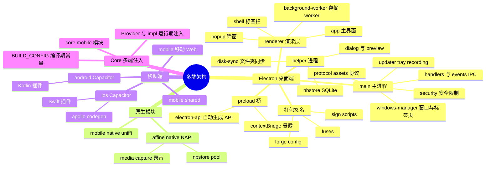
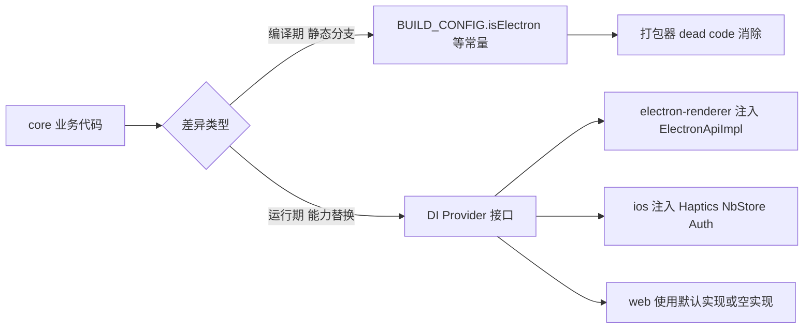
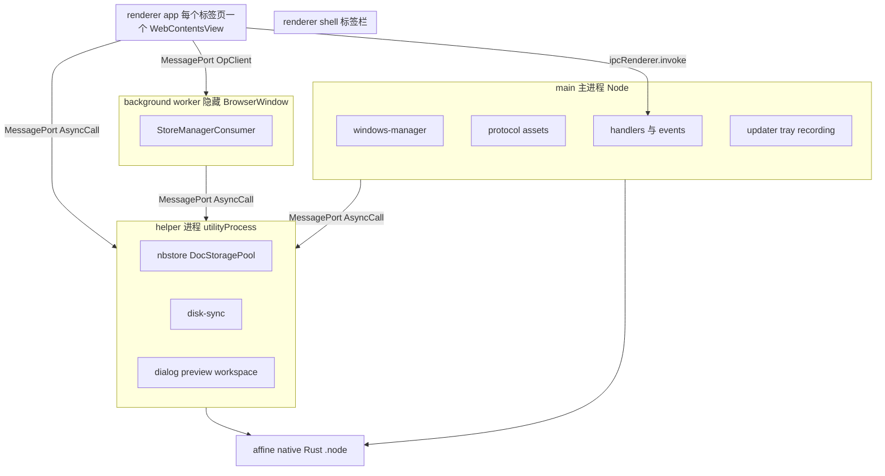
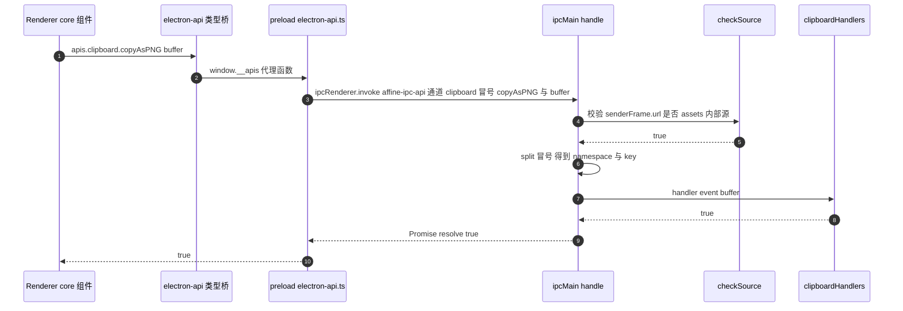
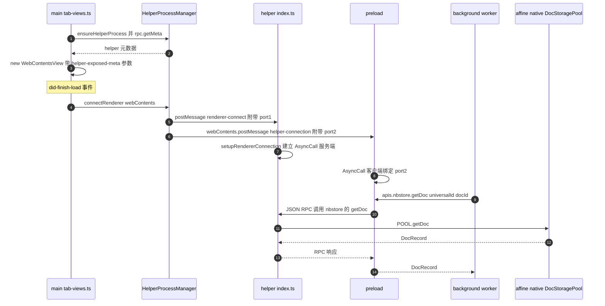
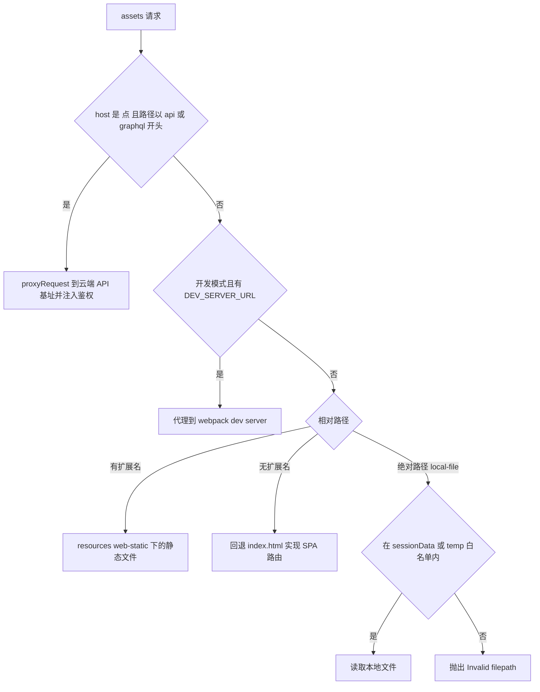
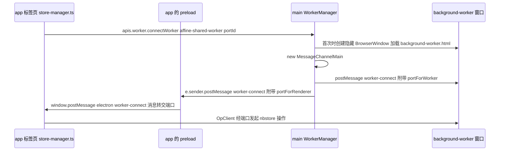
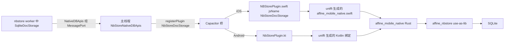

# 第 24 章 多端：Electron 与移动端

> **所属部分**：第 6 部分 · 前端应用 ｜ **难度**：★★★★☆ ｜ **建议学时**：10 小时 ｜ **前置章节**：第 21 章 Core 业务模块与路由、第 23 章 存储与同步引擎 nbstore

## 本章导读

AFFiNE 的一句口号是"Local-first，随处可用"。同一份 `@affine/core` 业务代码，要跑在：

- 浏览器（`@affine/web`、移动浏览器 `@affine/mobile`）；
- 桌面端 Electron（`@affine/electron` 主进程 + `@affine/electron-renderer` 渲染层）；
- iOS / Android 原生壳（`@affine/ios`、`@affine/android`，基于 Capacitor 8）。

这件事听起来像"把网页套个壳"，但真正难的是三件事：

1. **能力差异**：桌面端要直接读写 SQLite、录制系统音频、托盘、自动更新；移动端要震动反馈、虚拟键盘、原生登录、原生 SQLite；浏览器端只能用 IndexedDB。
2. **安全边界**：Electron 的渲染进程本质是一个 Chromium 页面，一旦把 Node 能力随手暴露出去，任何 XSS 都会变成 RCE。
3. **类型与工程**：IPC 接口两侧（主进程/渲染进程、JS/Swift/Kotlin/Rust）要保持类型一致，还要能被打包、签名、发布。

本章从 Electron 进程模型讲起，逐目录解读 `packages/frontend/apps/electron/src`，画出 IPC 调用时序；再讲类型桥 `@affine/electron-api`、渲染层 `electron-renderer`、打包签名、Rust 原生模块；最后转到移动端，讲清 Capacitor 插件、uniffi 绑定，以及 `@affine/core` 是怎么通过 DI "注入"多端差异的。

读完本章，你应该能回答："我在桌面端点了一下'导出数据库'，这条调用究竟穿过了几个进程？"

## 学习目标

- [ ] 能够说出 AFFiNE 桌面端的四类进程（main、helper、renderer、background worker）及其职责边界
- [ ] 能够解释 `handlers.ts` / `exposed.ts` / `preload/electron-api.ts` 三者如何协作，实现"主进程声明一次、渲染进程自动获得类型安全 API"
- [ ] 能够画出 renderer → main 与 renderer → helper 两条 IPC 链路的时序图，并指出 `checkSource` 的安全作用
- [ ] 能够说明 `assets://` 自定义协议如何加载静态资源、代理 API 请求并注入鉴权头
- [ ] 能够读懂 `forge.config.mjs` 中的 makers、Fuses、签名与公证配置
- [ ] 能够说明 `@affine/native`（NAPI-RS）与 `affine_mobile_native`（uniffi）的关系与差异
- [ ] 能够描述 Capacitor 自定义插件从 TS `registerPlugin` 到 Swift/Kotlin 实现的完整链路
- [ ] 能够用 `framework.impl(Provider, ...)` 的方式为某个平台注入差异化实现

## 知识地图



## 20.1 为什么是"多个壳 + 一个核"

先建立整体印象。AFFiNE 把所有 UI 与业务都放在 `packages/frontend/core`（第 21 章），而"应用"目录 `packages/frontend/apps/*` 只是一层很薄的**入口壳**：

| 包名 | 目录 | 运行环境 | distribution |
| --- | --- | --- | --- |
| `@affine/web` | `packages/frontend/apps/web` | 桌面浏览器 | `web` |
| `@affine/mobile` | `packages/frontend/apps/mobile` | 移动浏览器 | `mobile` |
| `@affine/electron` | `packages/frontend/apps/electron` | Electron main/helper/preload | `desktop` |
| `@affine/electron-renderer` | `packages/frontend/apps/electron-renderer` | Electron 渲染进程 | `desktop` |
| `@affine/ios` | `packages/frontend/apps/ios` | WKWebView + Swift | `ios` |
| `@affine/android` | `packages/frontend/apps/android` | Android WebView + Kotlin | `android` |
| `@affine/admin` | `packages/frontend/admin` | 浏览器（后台） | `admin` |

"distribution" 这一列来自 `tools/utils/src/distribution.ts`：

```ts
// 来源：tools/utils/src/distribution.ts
export const PackageToDistribution = new Map<
  PackageName,
  BUILD_CONFIG_TYPE['distribution']
>([
  ['@affine/admin', 'admin'],
  ['@affine/web', 'web'],
  ['@affine/electron-renderer', 'desktop'],
  ['@affine/electron', 'desktop'],
  ['@affine/mobile', 'mobile'],
  ['@affine/ios', 'ios'],
  ['@affine/android', 'android'],
]);
```

构建时，`tools/utils/src/build-config.ts` 根据 distribution 计算出一组布尔常量并通过 `define` 注入为 `BUILD_CONFIG.*`：

```ts
// 来源：tools/utils/src/build-config.ts（节选）
isDesktopEdition: (
  ['web', 'desktop', 'admin'] as BUILD_CONFIG_TYPE['distribution'][]
).includes(distribution),
isMobileEdition: (
  ['mobile', 'ios', 'android'] as BUILD_CONFIG_TYPE['distribution'][]
).includes(distribution),
isElectron: distribution === 'desktop',
isWeb: distribution === 'web',
isMobileWeb: distribution === 'mobile',
isIOS: distribution === 'ios',
isAndroid: distribution === 'android',
isNative:
  distribution === 'desktop' ||
  distribution === 'ios' ||
  distribution === 'android',
```

于是多端差异有两条注入通道：



> 经验法则：**"有没有"用 BUILD_CONFIG，"怎么做"用 Provider**。例如"移动端不显示某个菜单"适合编译期常量；"震动反馈调用哪个 API"适合 Provider。

## 20.2 Electron 进程模型总览

Electron 应用天生是多进程的：一个 Node.js 环境的**主进程**，若干 Chromium 的**渲染进程**。AFFiNE 在此基础上又加了一个 `utilityProcess` 形式的 **helper 进程**，以及一个隐藏窗口形式的 **background worker**。



| 进程 | 创建位置 | 运行内容 | 典型职责 |
| --- | --- | --- | --- |
| main | Electron 启动 `dist/main.js` | `src/main/**` | 窗口、协议、菜单、托盘、更新、录音、鉴权令牌、IPC 路由 |
| helper | `src/main/helper-process.ts` 中 `utilityProcess.fork` | `dist/helper.js`（`src/helper/**`） | SQLite 读写、磁盘同步、文件对话框、Mermaid/Typst 预览 |
| renderer（app） | `src/main/windows-manager/tab-views.ts` 中 `new WebContentsView` | `electron-renderer/src/app` | 编辑器 UI，每个标签页一个 view |
| renderer（shell） | 同上，`type === 'shell'` | `electron-renderer/src/shell` | 顶部标签栏、侧边栏占位 |
| popup | `src/main/windows-manager/popup.ts` | `electron-renderer/src/popup` | 录音提示等小窗 |
| background worker | `src/main/worker/pool.ts` 中隐藏 `BrowserWindow` | `electron-renderer/src/background-worker` | 共享的 nbstore 消费者（替代浏览器端 SharedWorker） |

为什么要把 SQLite 放进 helper，而不是主进程？主进程负责所有窗口的事件循环，一旦被同步磁盘 IO 或大量 CRDT 合并阻塞，整个应用（包括窗口拖动、菜单）都会卡顿。utilityProcess 是 Electron 官方提供的"Node 子进程 + MessagePort"方案，崩溃了也不会拖垮主进程——`helper-process.ts` 中监听了 `exit` 事件并把单例置空，下次 `ensureHelperProcess()` 会重新拉起。

## 20.3 主进程启动流程：src/main/index.ts

主进程入口做的事情可以分成"ready 之前"和"ready 之后"两段：

```ts
// 来源：packages/frontend/apps/electron/src/main/index.ts（节选）
app.enableSandbox();

ensureSecureLinuxPasswordStore();
// ...
const isSingleInstance = app.requestSingleInstanceLock();
if (!isSingleInstance) {
  logger.info(
    'Another instance is running or responding deep link, exiting...'
  );
  app.quit();
  process.exit(0);
}
// ...
setupDeepLink(app);
registerSecurityRestrictions();

app
  .whenReady()
  .then(registerProtocol)
  .then(registerHandlers)
  .then(registerEvents)
  .then(launch)
  .then(createApplicationMenu)
  .then(registerUpdater)
  .then(setupRecordingFeature)
  .then(setupTrayState)
  .catch(e => console.error('Failed create window:', e));
```

逐行解读：

1. `app.enableSandbox()`：全局强制所有渲染进程开启 Chromium 沙箱，这是比单个窗口 `sandbox: true` 更强的兜底。
2. `ensureSecureLinuxPasswordStore()`（`src/main/secure-storage.ts`）：Linux 下根据 `XDG_CURRENT_DESKTOP` 选择 `gnome-libsecret` 或 `kwallet*` 作为 `password-store`，保证 `safeStorage` 不退化成明文 `basic_text`。
3. `requestSingleInstanceLock()`：单实例。第二个实例启动时（比如点击 `affine://` 链接）会把命令行转发给第一个实例的 `second-instance` 事件，然后自己退出。
4. `setupDeepLink`、`registerSecurityRestrictions` 必须在 ready 前注册，因为 `open-url`、`web-contents-created` 事件可能在 ready 前就触发。
5. ready 之后的 Promise 链是严格有序的：先有协议（否则窗口加载 `assets://` 会失败），再有 IPC handler，再有事件广播，最后才 `launch()` 创建窗口。

此外文件里还有大量 `app.commandLine.appendSwitch`：禁用 Chrome 自动填充与保存密码气泡（`AutofillServerCommunication`、`SavePasswordBubble` 等），开启 `WebCodecs`、`CSSTextAutoSpace` 等 Blink 特性；以及在设置了 `SENTRY_RELEASE` 时初始化 `@sentry/electron/main`。最后，`protocol.registerSchemesAsPrivileged` 把 `assets` 注册为 `secure`、`standard`、`supportFetchAPI` 的特权协议——这一步必须在 ready 前完成。

## 20.4 src/main 逐目录解读

`src/main` 下的目录基本是"一个能力一个目录"，大多数目录都导出一组 `xxxHandlers`（供渲染进程调用）和/或 `xxxEvents`（向渲染进程推送）。

| 路径 | 职责 | 关键点 |
| --- | --- | --- |
| `windows-manager/` | 主窗口、标签页、onboarding、弹窗、主题编辑器窗口、右键菜单 | `main-window.ts` 创建 `BrowserWindow`；`tab-views.ts`（约 1300 行）用 `WebContentsView` 实现多标签；`popup.ts` 管理录音弹窗；`launcher.ts` 根据 `stage.ts` 决定先显示 onboarding 还是主窗口 |
| `protocol.ts` | `assets://` 协议处理与请求头改写 | 见 20.6 |
| `deep-link.ts` | 注册 `affine://`（按渠道区分 `affine-canary`、`affine-beta`、`affine-dev`）并处理 `open-url` / `second-instance` | `handleAffineUrl` 识别 `authentication` 等 action，`summarizeDeepLink` 只记录摘要避免泄漏 token 到日志 |
| `updater/` | 自动更新 | `electron-updater.ts` 封装 `electron-updater`；`affine-update-provider.ts` 是自定义 Provider（`resources/app-update.yml` 中 `provider: custom`）；`windows-updater.ts` 处理 Windows 特例 |
| `tray/` | 系统托盘菜单 | 与 `recording/feature.ts` 联动，展示"可录制的会议应用" |
| `recording/` | 会议录音 | `feature.ts`、`coordinator.ts` 管理状态机，`state-transitions.md` 文档描述 `new → starting → recording → finalizing → finalized` 等状态；底层调用 `@affine/native` 的 `startRecording` |
| `security-restrictions.ts` | 导航/新窗口拦截、IPC 来源校验 `checkSource` | 见 20.7 |
| `security/` | `open-external.ts`（协议白名单）、`redirect-proxy.ts`、`url-safety.ts` | 只允许 `http:`、`https:`、`mailto:` 被 `shell.openExternal` |
| `web-preferences.ts` | 所有窗口统一的 `webPreferences` 默认值 | `sandbox: true`、`contextIsolation: true`、`nodeIntegration: false` |
| `shared-storage/` | 跨窗口共享的全局状态/缓存（JSON 文件持久化） | `storage.ts` 中的 `globalStateStorage`；`json-file.ts` 封装 `PersistentJSONFileStorage` |
| `config-storage/` | 应用配置（如 onboarding 标记）持久化 | `persist.ts` 的 `persistentConfig` |
| `helper-process.ts` | 拉起 helper、建立 MessagePort 桥 | 见 20.5 |
| `handlers.ts` / `events.ts` / `exposed.ts` | IPC 注册中心 | 见 20.5 |
| `auth/` | 桌面端鉴权会话 | `auth-session.ts` 用 `safeStorage` 加密存储 token 对到 `auth-sessions.json`（权限 `0o600`）；`transport.ts` 封装请求 |
| `byok-storage/` | 用户自带 AI Key（BYOK）的加密存储 | `safeStorage.encryptString` 存到 `workspace-byok-keys.json`，并用白名单校验 provider（`openai`、`anthropic`、`gemini`、`fal`） |
| `secure-storage.ts` | Linux 密码后端探测 | 见 20.3 |
| `find-in-page/` | 页内查找 | 包装 `webContents.findInPage` 与 `found-in-page` 事件 |
| `clipboard/` | 复制 PNG 到剪贴板 | `nativeImage.createFromBuffer` |
| `import/` | 原生导入（Notion/Markdown 等批量导入） | 调用 `@affine/native` 的 `createImportSession`、`nextImportBatch` |
| `power/` | 电源事件 | `power-source` 事件推送是否使用电池，渲染层据此给 body 加 `on-battery` class 降低动画 |
| `worker/` | background worker 池 | `pool.ts` 中 `WorkerManager`，见 20.8 |
| `ui/` | 窗口控制、主题、外链等杂项 UI handler | `handlers.ts` 约 230 行 |
| `application-menu/` | 应用菜单 | `create.ts` |
| `cleanup.ts` | `beforeAppQuit` 钩子注册 | 退出前释放 helper、订阅等 |
| `logger.ts` | `electron-log` 封装 | `revealLogFile`、`getLogFilePath` 被 `debugHandlers` 暴露 |

注意：仓库里**没有**独立的 `tabs` 目录，多标签逻辑全部在 `windows-manager/tab-views.ts` 中；与之配套的共享状态 Schema（如 `TabViewsMetaSchema`）在 `src/main/shared-state-schema.ts`。

## 20.5 IPC 暴露机制：一次声明，处处可调

这是本章最值得反复读的设计。目标是：**在主进程写一个普通 async 函数，渲染进程就能以 `apis.namespace.method(...)` 调用，且有完整 TS 类型**。

### 20.5.1 第一步：主进程声明 handler 字典

```ts
// 来源：packages/frontend/apps/electron/src/main/handlers.ts（节选）
// Note: all of these handlers will be the single-source-of-truth for the apis exposed to the renderer process
export const allHandlers = {
  debug: debugHandlers,
  ui: uiHandlers,
  clipboard: clipboardHandlers,
  updater: updaterHandlers,
  configStorage: configStorageHandlers,
  findInPage: findInPageHandlers,
  import: importHandlers,
  sharedStorage: sharedStorageHandlers,
  worker: workerHandlers,
  recording: recordingHandlers,
  popup: popupHandlers,
  i18n: i18nHandlers,
  byokStorage: byokStorageHandlers,
  auth: authHandlers,
};
```

每个 handler 的签名统一由 `src/main/type.ts` 约束：第一个参数永远是 `Electron.IpcMainInvokeEvent`，其余是业务参数。

```ts
// 来源：packages/frontend/apps/electron/src/main/type.ts
export type MainEventRegister = (...args: any[]) => () => void;

export type IsomorphicHandler = (
  e: Electron.IpcMainInvokeEvent,
  ...args: any[]
) => Promise<any>;

export type NamespaceHandlers = {
  [key: string]: IsomorphicHandler;
};
```

例如剪贴板 handler 用 `satisfies NamespaceHandlers` 既保留了精确类型，又保证了形状正确：

```ts
// 来源：packages/frontend/apps/electron/src/main/clipboard/index.ts
export const clipboardHandlers = {
  copyAsPNG: async (_, arrayBuffer: ArrayBuffer) => {
    const image = nativeImage.createFromBuffer(Buffer.from(arrayBuffer));
    if (image.isEmpty()) return false;
    clipboard.writeImage(image);
    return true;
  },
} satisfies NamespaceHandlers;
```

### 20.5.2 第二步：单通道路由 + 来源校验

所有调用走同一个 channel `AFFINE_API_CHANNEL_NAME = 'affine-ipc-api'`（定义在 `src/shared/type.ts`），第一个参数是 `"namespace:key"` 字符串：

```ts
// 来源：packages/frontend/apps/electron/src/main/handlers.ts（节选）
const handleIpcMessage = async (
  e: Electron.IpcMainInvokeEvent,
  ...args: any[]
) => {
  // args[0] is the `{namespace:key}`
  if (!checkSource(e) || typeof args[0] !== 'string') {
    logger.error('invalid ipc message', args);
    return;
  }
  const channel = args[0] as string;
  const [namespace, key] = channel.split(':');
  // ...
  // @ts-expect-error - ignore here
  const handler = allHandlers[namespace]?.[key];
  // ...
  const result = await handler(e, ...realArgs);
  // ...
  return result;
};

ipcMain.handle(AFFINE_API_CHANNEL_NAME, async (e, ...args: any[]) => {
  try {
    return await handleIpcMessage(e, ...args);
  } catch (error) {
    logger.error(`error in ipc handler when calling ${args[0]}`, error);
    throw error;
  }
});
```

单通道的好处：只需要在一个地方做 `checkSource`，不会因为新增 handler 忘记校验；日志也统一打印耗时。同时它还注册了 `ipcMain.on` 版本支持同步调用（`e.returnValue`），用于少量必须同步的场景（如 shared-storage 初始化读取）。

### 20.5.3 第三步：把"元数据"而不是"函数"传给 preload

preload 运行在沙箱里，无法 `import` 主进程代码。AFFiNE 的做法是：主进程把 handler 字典压缩成"命名空间 → 方法名列表"的元数据，通过 `additionalArguments` 命令行参数传给 preload。

```ts
// 来源：packages/frontend/apps/electron/src/main/exposed.ts（节选）
export const getExposedMeta = () => {
  const handlersMeta = Object.entries(handlers).map(
    ([namespace, namespaceHandlers]) => {
      return [namespace, Object.keys(namespaceHandlers)];
    }
  );
  // ... eventsMeta 同理
  return {
    handlers: handlersMeta,
    events: eventsMeta,
  };
};

export type MainIPCHandlerMap = typeof handlers;
export type MainIPCEventMap = typeof events;
```

```ts
// 来源：packages/frontend/apps/electron/src/main/windows-manager/tab-views.ts（节选）
async function getAdditionalArguments() {
  const { getExposedMeta } = await import('../exposed');
  const mainExposedMeta = getExposedMeta();
  const helperProcessManager = await ensureHelperProcess();
  const helperExposedMeta = await helperProcessManager.rpc?.getMeta();
  return [
    `--main-exposed-meta=` + JSON.stringify(mainExposedMeta),
    `--helper-exposed-meta=` + JSON.stringify(helperExposedMeta),
    `--window-name=main`,
  ];
}
```

注意 helper 的元数据是通过 `rpc.getMeta()` 从 helper 进程**异步拉取**的（`src/helper/main-rpc.ts` 中 `helperToMainServer.getMeta`），所以只有需要访问 helper 的窗口（tab view、worker）才会带 `--helper-exposed-meta`；onboarding、popup、主题编辑器窗口只带 main 元数据。

### 20.5.4 第四步：preload 动态生成代理函数并 exposeInMainWorld

```ts
// 来源：packages/frontend/apps/electron/src/preload/electron-api.ts（节选）
const all = handlersMeta.map(([namespace, functionNames]) => {
  const namespaceApis = functionNames.map(name => {
    const channel = `${namespace}:${name}`;
    return [
      name,
      (...args: any[]) => {
        return ipcRenderer.invoke(
          AFFINE_API_CHANNEL_NAME,
          channel,
          ...args
        );
      },
    ];
  });
  return [namespace, Object.fromEntries(namespaceApis)];
});
```

```ts
// 来源：packages/frontend/apps/electron/src/preload/index.ts（节选）
if (currentUrl && isInternalUrl(currentUrl)) {
  contextBridge.exposeInMainWorld('__appInfo', appInfo);
  contextBridge.exposeInMainWorld('__apis', apis);
  contextBridge.exposeInMainWorld('__events', events);
  contextBridge.exposeInMainWorld('__sharedStorage', sharedStorage);

  listenWorkerApis();
}
```

两层防护：preload 只在 `isInternalUrl` 为真时才暴露 API（外部页面拿不到 `__apis`）；即使被绕过，主进程的 `checkSource` 还会再校验一次。

### 20.5.5 第五步：类型桥 @affine/electron-api

渲染层从 `window.__apis` 拿到的是 `any`。类型从哪里来？`packages/frontend/electron-api/src/index.ts` 只做**类型层面**的引用：

```ts
// 来源：packages/frontend/electron-api/src/index.ts（节选）
import type {
  events as helperEvents,
  handlers as helperHandlers,
} from '@affine/electron/helper/exposed';
import type {
  events as mainEvents,
  handlers as mainHandlers,
} from '@affine/electron/main/exposed';
// ...
type MainClientHandlers = {
  [namespace in keyof MainHandlers]: {
    [
      method in keyof MainHandlers[namespace]
    ]: MainHandlers[namespace][method] extends (
      arg0: any,
      ...rest: infer A
    ) => any
      ? (
          ...args: A
        ) => ReturnType<MainHandlers[namespace][method]> extends Promise<any>
          ? ReturnType<MainHandlers[namespace][method]>
          : Promise<ReturnType<MainHandlers[namespace][method]>>
      : never;
  };
};
// ...
export const apis = (globalThis as any).__apis as ClientHandler | undefined;
export const events = (globalThis as any).__events as ClientEvents | undefined;
```

这个映射类型做了两件事：**去掉第一个参数**（`IpcMainInvokeEvent` 由 Electron 注入，调用方不传），并**统一包装成 Promise**。由于全部是 `import type`，打包渲染层时不会把任何主进程代码打进来。这也是 `@affine/electron/package.json` 里 `exports` 专门暴露 `./main/exposed`、`./helper/exposed`、`./preload/electron-api` 的原因。

### 20.5.6 事件：按需订阅的广播

事件方向是 main → renderer。`src/main/events.ts` 维护 `webContents.id → Set<channel>` 的订阅表，preload 在第一个监听者注册时发送 `subscribe`，最后一个取消时发送 `unsubscribe`（引用计数），主进程只向订阅了该 channel 的 webContents 发送 `AFFINE_EVENT_CHANNEL_NAME`。这避免了"一个托盘状态变化广播给 10 个标签页"的浪费。`power:power-source` 还会在订阅时立刻推送一次当前值。

## 20.6 IPC 调用时序图

下面把两条最重要的链路画出来。

### 20.6.1 renderer → main（以"复制图片为 PNG"为例）



### 20.6.2 renderer → helper（以 nbstore 读文档为例）



对应源码要点：

```ts
// 来源：packages/frontend/apps/electron/src/main/helper-process.ts（节选）
// bridge renderer <-> helper process
connectRenderer(renderer: WebContents) {
  // connect to the helper process
  const { port1: helperPort, port2: rendererPort } = new MessageChannelMain();
  this.#process.postMessage({ channel: 'renderer-connect' }, [helperPort]);
  renderer.postMessage('helper-connection', null, [rendererPort]);

  return () => {
    try {
      helperPort.close();
      rendererPort.close();
    } catch (err) {
      logger.error('[helper] close port error', err);
    }
  };
}
```

关键洞察：**renderer 与 helper 之间的数据不经过主进程**。主进程只负责"牵线"——创建一对 `MessageChannelMain` 端口分别递给两边，之后大块的 Yjs update、Blob 二进制直接在两端之间传输。这比 `ipcRenderer.invoke` 绕道主进程少一次序列化与一次事件循环排队。

反方向，helper 需要弹出系统对话框（`dialog.showSaveDialog` 只能在主进程调用）时，走 `src/helper/main-rpc.ts` 中的 `mainRPC`，主进程在 `connectMain` 中暴露 `MainToHelper` 类型的服务端（`showOpenDialog`、`showSaveDialog`、`openExternal`、`showItemInFolder`、`getPath`）。

## 20.7 assets 协议与安全限制

### 20.7.1 assets:// 是什么

渲染进程加载的 URL 不是 `file://`，也不是 `http://localhost`，而是 `assets://./` 这样的自定义协议：

```ts
// 来源：packages/frontend/apps/electron/src/shared/internal-origin.ts（节选）
export const mainHost = '.';
export const anotherHost = 'another-host';
export const internalHosts = new Set([mainHost, anotherHost]);

export const mainWindowOrigin = `assets://${mainHost}`;
export const anotherOrigin = `assets://${anotherHost}`;
// ...
export const popupViewUrl = `${anotherOrigin}/popup.html`;

export const isInternalUrl = (url: string) => {
  try {
    const parsed = new URL(url);
    return parsed.protocol === 'assets:' && internalHosts.has(parsed.hostname);
  } catch {
    return false;
  }
};
```

`another-host` 的存在是为了绕开 Chromium "同源共享缩放级别"的问题——弹窗换一个 host，缩放就不会和主窗口联动（源码注释里引用了 Electron 官方文档说明）。

`protocol.ts` 的 `handleFileRequest` 对一个 `assets://` 请求做三种分流：



API 基址按渠道区分：

```ts
// 来源：packages/frontend/apps/electron/src/main/protocol.ts（节选）
const apiBaseByBuildType: Record<typeof buildType, string> = {
  stable: 'https://app.affine.pro',
  beta: 'https://insider.affine.pro',
  internal: 'https://insider.affine.pro',
  canary: 'https://affine.fail',
};
```

`registerProtocol` 还挂了两个 `session.defaultSession.webRequest` 钩子：

- `onHeadersReceived`：对 `assets:` 响应强制 `X-Frame-Options: SAMEORIGIN` 并补 `frame-ancestors 'self'`；对 AFFiNE 自有域名（`affine.pro`、`affine.fail`、`affine.run`、`usercontent.affine.pro`）补 CORS 头，因为对象存储上传 URL 本身没有 CORS 配置。
- `onBeforeSendHeaders`：对受管鉴权端点删掉渲染层带来的 `Authorization`，改由主进程 `getAccessTokenForUrl` 注入 `Bearer` token——**token 永远不进渲染进程**；对 YouTube 等域名补 `Referer`，否则嵌入视频会被拒。

### 20.7.2 security-restrictions.ts：导航与新窗口

```ts
// 来源：packages/frontend/apps/electron/src/main/security-restrictions.ts（节选）
contents.on('will-navigate', (event, url) => {
  if (isInternalUrl(url)) {
    return;
  }
  // Prevent navigation
  event.preventDefault();
  openExternalSafely(url).catch(error => {
    console.error('[security] Failed to open external URL:', error);
  });
});
// ...
contents.setWindowOpenHandler(({ url }) => {
  if (!isInternalUrl(url)) {
    openExternalSafely(url).catch(/* ... */);
  } else if (url.includes('/redirect-proxy')) {
    const result = validateRedirectProxyUrl(url);
    // ...
  }
  // Prevent creating new window in application
  return { action: 'deny' };
});
```

即：**应用内永远不会被导航到外部网页，也永远不会创建新窗口**；外链一律交给系统浏览器，且 `openExternalSafely` 只放行 `http:`、`https:`、`mailto:`，防止 `file://`、`smb://` 之类协议被滥用。

`checkSource` 则是 IPC 层的守门人：它取 `e.senderFrame.url`（子 frame 场景下不信任 `sender.getURL()`），并考虑了"正在导航中"的 pending 状态，确保只有内部源的 frame 能调用 IPC。第 32 章会从安全角度再展开。

### 20.7.3 web-preferences.ts：统一默认值

```ts
// 来源：packages/frontend/apps/electron/src/main/web-preferences.ts
const DEFAULT_WEB_PREFERENCES: Pick<
  WebPreferences,
  'contextIsolation' | 'nodeIntegration' | 'sandbox'
> = {
  sandbox: true,
  contextIsolation: true,
  nodeIntegration: false,
};

export function buildWebPreferences(
  overrides: Partial<WebPreferences> = {}
): WebPreferences {
  return {
    ...DEFAULT_WEB_PREFERENCES,
    ...overrides,
  };
}
```

`main-window.ts`、`tab-views.ts`、`popup.ts`、`onboarding.ts`、`custom-theme-window.ts`、`worker/pool.ts` 全部通过 `buildWebPreferences(...)` 创建窗口，避免某个新窗口"忘了"开启隔离。

## 20.8 窗口、标签页与 background worker

### 20.8.1 主窗口 + WebContentsView 多标签

`main-window.ts` 中的 `BrowserWindow` 本身几乎不加载内容，它是一个"容器"：

```ts
// 来源：packages/frontend/apps/electron/src/main/windows-manager/main-window.ts（节选）
const browserWindow = new BrowserWindow({
  titleBarStyle: isMacOS()
    ? 'hiddenInset'
    : isWindows()
      ? 'hidden'
      : 'default',
  // ...
  minWidth: 640,
  minHeight: 480,
  visualEffectState: 'active',
  vibrancy: 'under-window',
  height: mainWindowState.height,
  show: false, // Use 'ready-to-show' event to show window
  webPreferences: buildWebPreferences({
    webgl: true,
  }),
});
const helper = await ensureHelperProcess();
helper.connectMain(browserWindow);
```

真正的内容由 `tab-views.ts` 创建若干 `WebContentsView` 叠加在窗口上：一个 `shell` view（加载 `shell.html`，渲染标签栏），以及 N 个 `app` view（每个标签页一个，加载 `index.html`）。切换标签只是改变 view 的可见性与层级，不需要重新加载页面，这就是桌面端标签切换"秒开"的原因。`backgroundThrottling: type === 'app'` 让后台标签降频以省电。

### 20.8.2 background worker：替代 SharedWorker

在浏览器里，多个标签页共享一个 `SharedWorker` 运行 nbstore（第 23 章）。Electron 每个 WebContentsView 是独立进程，AFFiNE 用一个**隐藏 BrowserWindow** 扮演 SharedWorker：



`electron-renderer/src/background-worker/index.ts` 在这个隐藏窗口中把 helper 的 nbstore API 绑定为 SQLite 存储实现：

```ts
// 来源：packages/frontend/apps/electron-renderer/src/background-worker/index.ts（节选）
bindNativeDBApis(apis!.nbstore);
bindNativeDBV1Apis(apis!.db);
bindDiskSyncApis(createDiskSyncApis(apis!.diskSync, events!.diskSync));
// ...
const storeManager = new StoreManagerConsumer([
  ...sqliteStorages,
  ...sqliteV1Storages,
  ...diskStorages,
  ...broadcastChannelStorages,
  ...cloudStorages,
]);

window.addEventListener('message', ev => {
  if (ev.data.type === 'electron:worker-connect') {
    const port = ev.ports[0];
    const consumer = new OpConsumer<WorkerManagerOps>(port);
    storeManager.bindConsumer(consumer);
  }
});
```

所以完整的存储路径是：**app 标签页（OpClient）→ background worker（StoreManagerConsumer + SqliteDocStorage）→ helper（nbstoreHandlers）→ `@affine/native` DocStoragePool → SQLite 文件**。`WorkerManager.disconnectWorker` 在端口数降为 0 时销毁隐藏窗口，并监听 `render-process-gone`、`unresponsive` 做故障清理。

## 20.9 src/helper 与 src/preload 逐目录解读

### 20.9.1 helper

```ts
// 来源：packages/frontend/apps/electron/src/helper/exposed.ts（节选）
export const handlers = {
  db: dbHandlersV1,
  nbstore: nbstoreHandlers,
  diskSync: diskSyncHandlers,
  workspace: workspaceHandlers,
  dialog: dialogHandlers,
  preview: previewHandlers,
};

export const events = {
  db: dbEventsV1,
  diskSync: diskSyncEvents,
  workspace: workspaceEvents,
};
```

| 目录/文件 | 职责 |
| --- | --- |
| `helper/index.ts` | 监听 `process.parentPort` 的 `renderer-connect`，为每个端口建立 AsyncCall 服务端，并把 events 通过 `rpc.postEvent` 推回渲染层 |
| `helper/main-rpc.ts` | helper → main 的 RPC 客户端（调用对话框、`getPath`） |
| `helper/provide.ts` | 极简"DI"，用模块级变量 `exposed` 打破 `exposed.ts` 与 `main-rpc.ts` 的循环依赖 |
| `helper/nbstore/handlers.ts` | 新版存储：`new DocStoragePool()` 并把 Rust 方法逐一 `bind` 成 `NativeDBApis` |
| `helper/nbstore/v1/` | 旧版 SQLite 存储兼容层（`db-adapter.ts`、`ensure-db.ts`、`merge-update.ts`） |
| `helper/disk-sync/` | "与本地 Markdown 文件夹同步"会话：`startSession`、`applyLocalUpdate`、`prepareSourceDoc` 等 |
| `helper/workspace/` | 工作区目录、删除、元数据；`meta.ts` 中 `getSpaceDBPath` 以 `sessionData/workspaces` 或 `userspaces` 为根 |
| `helper/dialog/` | `loadDBFile`、`saveDBFileAs`、`selectMarkdownSyncFolder` |
| `helper/preview/` | 调用 Rust `renderMermaidSvg`、`renderTypstSvg`，支持 `AFFINE_TYPST_FONT_DIRS` 环境变量指定字体目录 |

```ts
// 来源：packages/frontend/apps/electron/src/helper/nbstore/handlers.ts（节选）
const POOL = new DocStoragePool();

export const nbstoreHandlers: NativeDBApis = {
  connect: async (universalId: string) => {
    const { peer, type, id } = parseUniversalId(universalId);
    const dbPath = await getSpaceDBPath(peer, type, id);
    await fs.ensureDir(path.dirname(dbPath));
    await POOL.connect(universalId, dbPath);
    await POOL.setSpaceId(universalId, id);
  },
  disconnect: POOL.disconnect.bind(POOL),
  pushUpdate: POOL.pushUpdate.bind(POOL),
  getDoc: POOL.getDoc.bind(POOL),
  // ... 省略 30 余个方法
};
```

注意这里的类型是 `NativeDBApis`（来自 `@affine/nbstore/sqlite`）——**同一个接口**在 iOS/Android 由 Capacitor 插件实现（见 20.13），在 Electron 由 helper 实现。这就是 nbstore 可以"一套存储逻辑三端复用"的关键。

### 20.9.2 preload

| 文件 | 职责 |
| --- | --- |
| `preload/index.ts` | 入口：`bootstrap`、Sentry preload，内部源校验后 `exposeInMainWorld` |
| `preload/electron-api.ts` | 解析 `--main-exposed-meta`、`--helper-exposed-meta`，生成 `apis`/`events`；`appInfo` 中解析 `--window-name`、`--view-id` 与 deep link scheme；对 `import.createImportSessionFromSource` 做特殊处理（用 `webUtils.getPathForFile` 把 `File` 对象转换为本地路径） |
| `preload/shared-storage.ts` | 暴露 `__sharedStorage`（全局状态与缓存的同步读、异步写） |
| `preload/worker.ts` | 把 `worker-connect` 端口转发到页面 `window.postMessage` |
| `preload/bootstrap.ts` | 早期引导 |

为什么 `import` 需要在 preload 特殊处理？因为沙箱渲染进程里的 `File` 对象拿不到磁盘路径，只有 preload 能调用 `webUtils.getPathForFile`。这是一个"能力只在某一层存在"的典型例子。

## 20.10 渲染层 electron-renderer

`packages/frontend/apps/electron-renderer/src` 有四个入口，在 `tools/cli/src/bundle.ts` 中定义：

```ts
// 来源：tools/cli/src/bundle.ts（节选）
case '@affine/electron-renderer': {
  // ...
  return [
    createRspackHTMLTargetConfig(
      pkg,
      {
        index: pkg.srcPath.join('app/index.tsx').value,
        shell: pkg.srcPath.join('shell/index.tsx').value,
        popup: pkg.srcPath.join('popup/index.tsx').value,
        backgroundWorker: pkg.srcPath.join('background-worker/index.ts')
          .value,
      },
      // ...
```

| 入口 | 产物 | 加载者 | 内容 |
| --- | --- | --- | --- |
| `app/` | `index.html` | 每个 app tab view | 完整 `@affine/core` 桌面路由 + 桌面专属模块 |
| `shell/` | `shell.html` | shell view | 只配置 `AppTabsHeader`、侧边栏占位、主题、i18n |
| `popup/` | `popup.html` | 录音弹窗 | 按 `appInfo.windowName` 渲染 `Recording` |
| `background-worker/` | `background-worker.html` | 隐藏 worker 窗口 | nbstore 消费者 |

`app/effects/modules.ts` 是理解"桌面端额外注入了什么"的最佳入口：

```ts
// 来源：packages/frontend/apps/electron-renderer/src/app/effects/modules.ts（节选）
export function setupModules() {
  const framework = new Framework();
  configureCommonModules(framework);
  configureElectronStateStorageImpls(framework);
  configureBrowserWorkspaceFlavours(framework);
  configureDesktopWorkbenchModule(framework);
  configureAppTabsHeaderModule(framework);
  configureFindInPageModule(framework);
  configureDesktopApiModule(framework);
  configureSpellCheckSettingModule(framework);
  configureTraySettingModule(framework);
  configureDesktopBackupModule(framework);

  framework.impl(PopupWindowProvider, p => {
    const apis = p.get(DesktopApiService).api;
    return {
      open: (url: string) => {
        apis.handler.ui.openExternal(url).catch(e => {
          console.error('Failed to open external URL', e);
        });
      },
    };
  });
  // ...
```

而 `configureDesktopApiModule`（`packages/frontend/core/src/modules/desktop-api/index.ts`）把 `window.__apis` 包装成 DI 服务：

```ts
// 来源：packages/frontend/core/src/modules/desktop-api/impl/index.ts
export class ElectronApiImpl extends Service implements DesktopApiProvider {
  constructor() {
    super();

    if (!apis || !events || !sharedStorage || !appInfo) {
      throw new Error('Failed to initialize DesktopApiImpl');
    }
  }
  handler = apis;
  events = events;
  sharedStorage = sharedStorage;
  appInfo = appInfo!;
}
```

core 中任何模块想调桌面能力，都应该依赖 `DesktopApiService` 而不是直接 `import { apis } from '@affine/electron-api'`——前者在非 Electron 环境下根本不会被注册，从依赖图上就把"桌面专属"约束住了。

另外 `app/app.tsx` 中有一个防误用检查：如果 `!BUILD_CONFIG.isElectron && BUILD_CONFIG.debug` 且不在白名单路径，会直接把页面替换成红字 "Don't run electron entry in browser."。

## 20.11 打包、签名与发布：forge.config.mjs

### 20.11.1 构建分层

`@affine/electron/package.json` 的脚本清晰地展示了流水线：

| 脚本 | 作用 |
| --- | --- |
| `dev` | `DEV_SERVER_URL=http://localhost:8080 r ./scripts/dev.ts`，esbuild watch + 自动重启 Electron |
| `build` | `scripts/build-layers.ts`：用 esbuild 把 `src/main/index.ts`、`src/preload/index.ts`、`src/helper/index.ts` 打成 `dist/main.js`、`dist/preload.js`、`dist/helper.js` |
| `generate-assets` | `scripts/generate-assets.ts`：构建 `@affine/electron-renderer` 并拷贝到 `resources/web-static` |
| `package` / `make` | `electron-forge package/make` |
| `make-squirrel` / `make-nsis` | Windows 安装包 |
| `sign-macos` / `sign-windows` | 签名 |

`scripts/common.ts` 中的 esbuild 配置要点：`target: node22`、`platform: 'node'`、`format: 'cjs'`、`external: ['electron', 'electron-updater', 'yjs', 'semver']`、`.node` 文件用 `copy` loader，并在提供 `SENTRY_AUTH_TOKEN`、`SENTRY_ORG`、`SENTRY_PROJECT` 时启用 `sentryEsbuildPlugin` 上传 sourcemap。`build-layers.ts` 还有一个工程约束检查 `assertNoRuntimeWorkspaceDependencies`：**所有 `workspace:*` 依赖必须放在 devDependencies 并被打包**，否则抛错——因为最终 asar 包里不会有 monorepo 的 workspace 链接。

### 20.11.2 makers 与平台产物

| maker | 平台 | 产物 |
| --- | --- | --- |
| `@electron-forge/maker-dmg` | macOS | `.dmg`（ULMO 格式，自定义背景） |
| `@electron-forge/maker-zip` | 全平台 | `.zip` |
| `@electron-forge/maker-squirrel` | Windows | Squirrel 安装器 |
| `@reforged/maker-appimage` | Linux | AppImage（zstd 压缩） |
| `@electron-forge/maker-deb` | Linux | `.deb`，带 `resources/deb/postinst`、`prerm` 脚本 |
| `@electron-forge/maker-flatpak` | Linux | Flatpak，声明 `--talk-name=org.freedesktop.secrets` 等以支持加密存储 |

设置 `SKIP_BUNDLE` 时只产出 zip，CI 测试场景常用。

### 20.11.3 Fuses：编译期锁死危险能力

```js
// 来源：packages/frontend/apps/electron/forge.config.mjs（节选）
plugins: [
  { name: '@electron-forge/plugin-auto-unpack-natives', config: {} },
  new FusesPlugin({
    version: FuseVersion.V1,
    [FuseV1Options.RunAsNode]: false,
    [FuseV1Options.EnableCookieEncryption]: true,
    [FuseV1Options.EnableNodeOptionsEnvironmentVariable]: false,
    [FuseV1Options.EnableNodeCliInspectArguments]: false,
    [FuseV1Options.EnableEmbeddedAsarIntegrityValidation]: true,
    [FuseV1Options.OnlyLoadAppFromAsar]: true,
  }),
],
```

Fuse 是写进 Electron 二进制的开关，运行期无法修改：

- `RunAsNode: false`：禁止 `ELECTRON_RUN_AS_NODE` 把应用当 Node 解释器用（常见提权手段）；
- `EnableNodeOptionsEnvironmentVariable: false`、`EnableNodeCliInspectArguments: false`：禁止通过 `NODE_OPTIONS`、`--inspect` 注入代码；
- `EnableEmbeddedAsarIntegrityValidation` + `OnlyLoadAppFromAsar`：只加载经完整性校验的 asar，防止篡改；
- `EnableCookieEncryption`：Cookie 落盘加密。

`plugin-auto-unpack-natives` 会把 `.node` 原生模块解包到 `app.asar.unpacked`，因为原生模块无法从 asar 内直接 `dlopen`。

### 20.11.4 签名与公证

- macOS：`packagerConfig.osxSign` 指定 `Developer ID Application: TOEVERYTHING PTE. LTD.` 与 `hardened-runtime`；当设置 `APPLE_ID` 时用 `notarytool` 公证（`APPLE_PASSWORD`、`APPLE_TEAM_ID`）；设置 `AFFINE_UNSIGNED_PACKAGE` 可跳过签名（本地打包）。`extendInfo.NSAudioCaptureUsageDescription` 是录音功能必需的权限描述。
- Windows：`scripts/sign-windows.ts` 不在 CI 机器上放私钥，而是下载一个签名客户端（按 `AFFINE_SIGN_CLIENT_HASH` 从 CDN 获取），用 `AFFINE_SIGNER_ADDR`、`AFFINE_SIGNER_TOKEN` 连接远程签名服务，`WINDOWS_SIGNER_PUBLIC_CERT_BASE64` 为公钥证书。第 30 章会讲 CI 中的 `scripts/check-windows-signer.mjs` 如何校验。
- 渠道隔离：`scripts/make-env.ts` 中 `productName` 对非 stable 渠道为 `AFFiNE-${buildType}`，`hooks.readPackageJson` 覆写 productName，使 stable 与 canary 的应用数据目录互不干扰。

## 20.12 桌面原生能力：@affine/native

`packages/frontend/native` 是一个 NAPI-RS 包（第 11 章），`package.json` 的 `napi.targets` 覆盖 macOS/Linux/Windows 的 x64 与 arm64。它本身是一个"聚合 crate"：

```rust
// 来源：packages/frontend/native/src/lib.rs
pub mod disk_sync;
pub mod hashcash;
mod import;
#[cfg(not(any(target_os = "android", target_os = "ios")))]
pub mod preview;

#[cfg(not(target_arch = "arm"))]
#[global_allocator]
static ALLOC: mimalloc::MiMalloc = mimalloc::MiMalloc;

#[allow(unused_imports)]
pub use affine_media_capture::*;
pub use affine_nbstore::*;
pub use affine_sqlite_v1::*;
pub use disk_sync::*;
pub use import::*;
```

| 子目录 | crate | 能力 |
| --- | --- | --- |
| `native/nbstore` | `affine_nbstore` | SQLite 文档/Blob/时钟/索引存储，`pool.rs` 中 `SqliteDocStoragePool` 用 `RwLock<HashMap>` 管理多个连接 |
| `native/sqlite_v1` | `affine_sqlite_v1` | 旧版 SQLite 格式 |
| `native/media_capture` | `affine_media_capture` | 系统音频捕获：`src/macos/` 基于 ScreenCaptureKit 与 Core Audio Tap（`tap_audio.rs`、`ca_tap_description.rs`），`src/windows/` 基于 WASAPI（`audio_capture.rs`、`microphone_listener.rs`），`recording.rs` 编码为 Ogg/Opus |
| `native/schema` | `affine_schema` | SQLite 迁移 schema |
| `native/src/disk_sync` | — | 本地 Markdown 文件夹同步（frontmatter、state_db） |
| `native/src/hashcash.rs` | — | 工作量证明 |
| `native/src/preview.rs` | — | Mermaid/Typst 渲染（移动端不编译） |

`affine_nbstore` 的一个巧妙设计是 `use-as-lib` feature：

```rust
// 来源：packages/frontend/native/nbstore/src/lib.rs（节选）
#[cfg(not(feature = "use-as-lib"))]
#[napi]
pub struct DocStoragePool {
  pool: SqliteDocStoragePool,
}

#[cfg(not(feature = "use-as-lib"))]
#[napi]
impl DocStoragePool {
  #[napi(constructor)]
  pub fn new() -> Result<Self> {
    Ok(Self {
      pool: SqliteDocStoragePool::default(),
    })
  }
  // ...
  #[napi]
  /// Initialize the database and run migrations.
  pub async fn connect(&self, universal_id: String, path: String) -> Result<()> {
    self.pool.connect(universal_id, path).await?;
    Ok(())
  }
```

默认（桌面）编译出 NAPI 绑定；开启 `use-as-lib` 时去掉 NAPI 宏，仅作为普通 Rust 库被移动端的 uniffi crate 依赖。**同一份 SQLite 存储实现，桌面走 NAPI、移动走 uniffi**。

录音能力的 NAPI 导出示例：

```rust
// 来源：packages/frontend/native/media_capture/src/recording.rs（节选）
#[napi]
pub async fn start_recording(opts: RecordingStartOptions) -> Result<RecordingSessionMeta> {
  start_recording_inner(opts).await
}
// ...
#[napi]
pub async fn stop_recording(id: String) -> Result<RecordingArtifact> {
  stop_recording_inner(id).await
}
```

主进程 `src/main/recording/feature.ts` 调用它们，结果通过 `recording` 事件推给 popup 与 app。

## 20.13 移动端：mobile Web、Capacitor 与 uniffi

### 20.13.1 三种移动形态

| 形态 | 包 | 存储 | 原生能力 |
| --- | --- | --- | --- |
| 移动浏览器 | `@affine/mobile`（`apps/mobile/src`） | IndexedDB（SharedWorker 或 Worker 中跑 nbstore） | 无 |
| iOS App | `@affine/ios`（`apps/ios`） | 原生 SQLite（Swift 插件 → uniffi → Rust） | 震动、键盘、原生登录、内购、分享扩展等 |
| Android App | `@affine/android`（`apps/android`） | 原生 SQLite（Kotlin 插件 → uniffi → Rust） | 主题、AI 按钮、返回键、原生登录等 |

`apps/mobile/src/app.tsx` 的 Worker 选择逻辑：有 `SharedWorker` 就用（多标签共享），否则退化为 `Worker`。iOS/Android 共享代码放在 `apps/mobile-shared/src`（`auth/` 鉴权通道与请求代理、`nbstore/` 负载编解码 `payload.ts`），两个原生端都依赖 `@affine/mobile-shared`。

### 20.13.2 Capacitor 配置

```ts
// 来源：packages/frontend/apps/ios/capacitor.config.ts（节选）
const config: CapacitorConfig & AppConfig = {
  appId: 'app.affine.pro',
  appName: 'AFFiNE',
  webDir: 'dist',
  affineVersion: packageJson.version,
  ios: {
    scheme: 'AFFiNE',
    path: '.',
    appendUserAgent: `iOS AFFiNE/${packageJson.version}`,
    webContentsDebuggingEnabled: true,
    // Silence Capacitor's bridge logging (⚡️ TO JS / ⚡️ To Native -> / ⚡️ [log]).
    loggingBehavior: 'none',
  },
  // ...
  plugins: {
    CapacitorCookies: {
      enabled: false,
    },
    CapacitorHttp: {
      enabled: false,
    },
    Keyboard: {
      resize: KeyboardResize.None,
    },
  },
};

if (process.env.CAP_SERVER_URL) {
  Object.assign(config, {
    server: {
      url: process.env.CAP_SERVER_URL,
    },
  });
}
```

要点：

- `webDir: 'dist'`：`yarn build`（即 `affine bundle`）的输出被 `cap sync` 拷进原生工程；
- `CAP_SERVER_URL`：开发时让 WebView 直接加载 dev server 实现热更新（`sync:dev` 脚本，iOS 用 `localhost:8080`，Android 用模拟器宿主地址 `10.0.2.2:8080`）；
- 禁用 `CapacitorHttp`、`CapacitorCookies`：不让 Capacitor 劫持 `fetch` 与 cookie，鉴权由自定义 `Auth` 插件与 `mobile-shared/auth` 管理；
- Android 的 `android.buildOptions` 从 `AFFINE_ANDROID_KEYSTORE_PASSWORD`、`AFFINE_ANDROID_KEYSTORE_ALIAS_PASSWORD` 读取签名密码，`releaseType: 'AAB'`；`CAP_SERVER_URL` 以 `http://` 开头时才允许 `cleartext`。

### 20.13.3 自定义插件全链路：以 NbStore 为例



TS 侧：

```ts
// 来源：packages/frontend/apps/ios/src/plugins/nbstore/index.ts（节选）
import { registerPlugin } from '@capacitor/core';

import type { NbStorePlugin } from './definitions';

export * from './definitions';

export const NbStore = registerPlugin<NbStorePlugin>('NbStoreDocStorage');

export const NbStoreNativeDBApis: NativeDBApis = {
  connect: async function (id: string): Promise<void> {
    const { peer, type, id: spaceId } = parseUniversalId(id);
    return await NbStore.connect({ id, spaceId, spaceType: type, peer });
  // ...
```

Swift 侧：

```swift
// 来源：packages/frontend/apps/ios/App/App/Plugins/NBStore/NBStorePlugin.swift（节选）
@objc(NbStorePlugin)
public class NbStorePlugin: CAPPlugin, CAPBridgedPlugin {
  private let docStoragePool: DocStoragePool = newDocStoragePool()

  public let identifier = "NbStorePlugin"
  public let jsName = "NbStoreDocStorage"
  public let pluginMethods: [CAPPluginMethod] = [
    CAPPluginMethod(name: "connect", returnType: CAPPluginReturnPromise),
    CAPPluginMethod(name: "disconnect", returnType: CAPPluginReturnPromise),
    // ...
  ]
```

`jsName` 必须与 TS `registerPlugin('NbStoreDocStorage')` 的名字一致。插件实例在 `AffineViewController.swift` 的 `capacitorDidLoad` 中手动注册：

```swift
// 来源：packages/frontend/apps/ios/App/App/AffineViewController.swift（节选）
override func capacitorDidLoad() {
  let plugins: [CAPPlugin] = [
    AffineThemePlugin(associatedController: self),
    AuthPlugin(),
    CookiePlugin(),
    HashcashPlugin(),
    ImagePickerPlugin(associatedController: self),
    NavigationGesturePlugin(),
    NbStorePlugin(),
    PayWallPlugin(associatedController: self),
    PreviewPlugin(),
    ShareInboxPlugin(),
  ]
  plugins.forEach { bridge?.registerPluginInstance($0) }
}
```

Android 对应 `apps/android/App/app/src/main/java/app/affine/pro/MainActivity.kt` 中的 `registerPlugins(listOf(AFFiNEThemePlugin::class.java, AIButtonPlugin::class.java, AuthPlugin::class.java, HashCashPlugin::class.java, NbStorePlugin::class.java, MobileBackPlugin::class.java, PreviewPlugin::class.java))`，插件源码在同包 `plugin/` 子目录。

两端插件清单对比：

| 能力 | iOS `src/plugins` | Android `src/plugins` |
| --- | --- | --- |
| 存储 | `nbstore` | `nbstore` |
| 鉴权 | `auth` | `auth` |
| 工作量证明 | `hashcash` | `hashcash` |
| 主题 | `affine-theme` | `affine-theme` |
| 预览 | `preview` | `preview` |
| 平台特有 | `navigation-gesture`、`image-picker`、`share-inbox`、`paywall` | `ai-button`、`mobile-back.ts` |

### 20.13.4 Worker 与原生插件之间的"中转"

Capacitor 插件只能在主线程（有 `window.Capacitor` 的地方）调用，而 nbstore 跑在 Web Worker 里。iOS 的 `app.tsx` 用一对 `MessageChannel` 把插件 API "借"给 worker：

```ts
// 来源：packages/frontend/apps/ios/src/app.tsx（节选）
function createStoreManagerClient() {
  const worker = new Worker(getWorkerUrl('nbstore'));
  const { port1: nativeDBApiChannelServer, port2: nativeDBApiChannelClient } =
    new MessageChannel();
  AsyncCall<typeof NbStoreNativeDBApis>(NbStoreNativeDBApis, {
    channel: {
      on(listener) {
        const f = (e: MessageEvent<any>) => listener(e.data);
        nativeDBApiChannelServer.addEventListener('message', f);
        return () => nativeDBApiChannelServer.removeEventListener('message', f);
      },
      send(data) {
        nativeDBApiChannelServer.postMessage(data);
      },
    },
    log: false,
  });
  nativeDBApiChannelServer.start();
  worker.postMessage(
    { type: 'native-db-api-channel', port: nativeDBApiChannelClient },
    [nativeDBApiChannelClient]
  );
  // ... auth-access-token-channel 同理
  return new StoreManagerClient(new OpClient(worker));
}
```

对比 Electron：Electron 中 nbstore worker 通过 preload 直接拿到 helper 的 `apis.nbstore`；iOS 中 worker 通过 MessagePort 回调主线程的 Capacitor 插件。**两者最终都调用 `bindNativeDBApis(...)` 喂给同一个 `sqliteStorages`**——这就是第 23 章抽象接口的价值。

### 20.13.5 mobile-native：uniffi 绑定

`packages/frontend/mobile-native/Cargo.toml` 定义 crate `affine_mobile_native`，`crate-type = ["cdylib", "staticlib"]`，默认开启 `use-as-lib`（从而依赖 `affine_nbstore/use-as-lib`），并带一个 `uniffi-bindgen` 二进制：

```rust
// 来源：packages/frontend/mobile-native/src/lib.rs（节选）
pub use storage::{DocStoragePool, new_doc_storage_pool};

uniffi::setup_scaffolding!("affine_mobile_native");

#[uniffi::export]
pub fn hashcash_mint(resource: String, bits: u32) -> String {
  Stamp::mint(resource, Some(bits)).format()
}
```

iOS 的 `codegen.ts` 串起了两类代码生成：

```ts
// 来源：packages/frontend/apps/ios/codegen.ts（节选）
console.log('[*] graphql...');
execSync(`${PackageRoot}/apollo-codegen-chore.sh "${version}"`, {
  stdio: 'inherit',
});

console.log('[*] rust...');
execSync(
  'cargo build -p affine_mobile_native --features use-as-lib --lib --release --target aarch64-apple-ios',
  {
    stdio: 'inherit',
    env: { ...process.env, IPHONEOS_DEPLOYMENT_TARGET: '16.5' },
  }
);

execSync(
  `cargo run -p affine_mobile_native --features use-as-lib --bin uniffi-bindgen generate \
  --library ${ProjectRoot}/target/aarch64-apple-ios/release/libaffine_mobile_native.a \
  --language swift --out-dir ${PackageRoot}/App/App/uniffi`,
  { stdio: 'inherit' }
);
```

生成物 `apps/ios/App/App/uniffi/affine_mobile_native.swift`、`affine_mobile_nativeFFI.h`、`affine_mobile_nativeFFI.modulemap` 已提交到仓库；Android 侧生成到 `apps/android/App/app/src/main/java/uniffi/affine_mobile_native/`。

GraphQL 方面，`apollo-codegen-chore.sh` 下载 `apollo-ios-cli`，按 `apollo-codegen-config.json` 读取 `packages/common/graphql/src/graphql/**/*.gql` 操作与 `packages/backend/server/src/schema.gql` schema，生成 Swift Package `App/Packages/AffineGraphQL`——iOS 原生页面（如 `App/Packages/Intelligents` AI 助手）可直接用强类型 GraphQL 访问后端。

`apps/ios/AGENTS.md` 是给 AI 编码助手的项目说明（文件标题写作 `CLAUDE.md`），里面列出了构建命令、窗口桥接函数（`getCurrentServerBaseUrl`、`getCurrentDocContentInMarkdown` 等）以及 Swift 代码风格约定（2 空格缩进、`@Observable`、`async/await` 等）。注意其中写的 "Capacitor 7.x" 已过时，`apps/ios/package.json` 实际依赖 `@capacitor/core` `^8.4.2`。

| 对比维度 | NAPI-RS（`@affine/native`） | uniffi（`affine_mobile_native`） |
| --- | --- | --- |
| 宿主 | Node.js / Electron | Swift / Kotlin |
| 产物 | `.node` 动态库 + `index.d.ts` | `.a`/`.so` + 生成的 Swift/Kotlin 源码 |
| 异步 | 返回 JS Promise | 生成 `async` 函数（`uniffi` 的 `tokio` feature） |
| 共享核心 | `affine_nbstore` 默认 feature | `affine_nbstore` 的 `use-as-lib` feature |

## 20.14 core 中的多端差异注入

把前面的零散例子归纳成模式。

### 20.14.1 Provider 接口 + 可选依赖

`packages/frontend/core/src/mobile/modules/haptics` 是最小范例：

```ts
// 来源：packages/frontend/core/src/mobile/modules/haptics/providers/haptic.ts
export interface HapticProvider {
  impact: (options?: { style?: 'HEAVY' | 'LIGHT' | 'MEDIUM' }) => Promise<void>;
  notification: (options?: {
    type?: 'SUCCESS' | 'ERROR' | 'WARNING';
  }) => Promise<void>;
  vibrate: (options?: { duration?: number }) => Promise<void>;
  selectionStart: () => Promise<void>;
  selectionChanged: () => Promise<void>;
  selectionEnd: () => Promise<void>;
}

export const HapticProvider =
  createIdentifier<HapticProvider>('HapticProvider');
```

```ts
// 来源：packages/frontend/core/src/mobile/modules/haptics/index.ts
export function configureMobileHapticsModule(framework: Framework) {
  framework.service(
    HapticsService,
    f => new HapticsService(f.getOptional(HapticProvider))
  );
}
```

`getOptional`：移动 Web 不提供 `HapticProvider`，服务照样能创建，只是调用变成空操作；iOS 在 `app.tsx` 中 `framework.impl(HapticProvider, { impact: options => Haptics.impact(options as any), ... })` 接上 `@capacitor/haptics`。

`core/src/mobile/modules/index.ts` 中 `configureMobileModules` 统一注册移动端模块：`back-coordinator`、`search`、`virtual-keyboard`、`navigation-projection`、`haptics`。

### 20.14.2 各入口的注入清单

| 注入点 | web | electron-renderer app | ios / android |
| --- | --- | --- | --- |
| 状态存储 | `configureLocalStorageStateStorageImpls` | `configureElectronStateStorageImpls`（`core/src/desktop/storage.ts`，基于 `DesktopApiService`） | `configureLocalStorageStateStorageImpls` |
| 工作台 | `configureBrowserWorkbenchModule` | `configureDesktopWorkbenchModule`（多标签） | `configureBrowserWorkbenchModule` |
| 桌面 API | 无 | `configureDesktopApiModule` | 无 |
| 移动模块 | 无 | 无 | `configureMobileModules` |
| `NbstoreProvider` | SharedWorker 客户端（可用 `localStorage.disableSharedWorker` 关闭） | background worker 客户端（`effects/store-manager.ts`） | Worker 客户端 + 原生插件中转 |
| `PopupWindowProvider` | 同源直接打开，跨源经 `/redirect-proxy` | `apis.handler.ui.openExternal` | `@capacitor/browser` 的 `Browser.open` |
| `ValidatorProvider`（人机验证） | 不注入，`getOptional` 走默认逻辑 | `apis.handler.ui.getChallengeResponse` | 原生 `Hashcash` 插件 |
| `AuthProvider` | 不覆盖，使用 core 默认实现 | `framework.scope(ServerScope).override(AuthProvider, ...)` 调主进程 `auth` handler | 同样 `override`，调原生 `Auth` 插件 |
| 路由 | `core/src/desktop/router` | `core/src/desktop/router` | `core/src/mobile/router.tsx` |

> 小结：core 只定义"接口 + 默认/可选实现"，各 app 入口像"装配车间"，按平台把具体实现插进去。新增一个平台能力时，标准做法是：① 在 core 定义 `createIdentifier` 接口；② 服务用 `getOptional` 或强依赖；③ 在各入口 `framework.impl`。

## 源码导读清单

| 优先级 | 路径 | 阅读重点 |
| --- | --- | --- |
| P0 | `packages/frontend/apps/electron/src/main/index.ts` | 启动顺序、命令行开关、单实例、特权协议注册 |
| P0 | `packages/frontend/apps/electron/src/main/handlers.ts` | 单通道 IPC 路由、`checkSource`、`allHandlers` |
| P0 | `packages/frontend/apps/electron/src/preload/electron-api.ts` | 元数据驱动的 API 生成、事件引用计数、helper AsyncCall |
| P0 | `packages/frontend/electron-api/src/index.ts` | 映射类型去掉首参并包装 Promise |
| P0 | `packages/frontend/apps/electron/src/main/helper-process.ts` | `utilityProcess.fork`、`connectRenderer`、`connectMain` |
| P1 | `packages/frontend/apps/electron/src/main/protocol.ts` | `assets://` 分流、API 代理、请求头改写 |
| P1 | `packages/frontend/apps/electron/src/main/security-restrictions.ts` | 导航拦截、新窗口拦截、来源校验 |
| P1 | `packages/frontend/apps/electron/src/main/windows-manager/tab-views.ts` | `WebContentsView` 多标签与 helper 连接时机 |
| P1 | `packages/frontend/apps/electron/src/main/worker/pool.ts` | 隐藏窗口 worker 与端口生命周期 |
| P1 | `packages/frontend/apps/electron-renderer/src/background-worker/index.ts` | 把 helper API 绑定为 nbstore 存储 |
| P1 | `packages/frontend/apps/electron/forge.config.mjs` | makers、Fuses、签名公证 |
| P1 | `packages/frontend/native/nbstore/src/lib.rs` | `use-as-lib` 双形态 |
| P2 | `packages/frontend/apps/ios/src/app.tsx` | 多个 `framework.impl` 注入、worker 与插件中转 |
| P2 | `packages/frontend/apps/ios/App/App/Plugins/NBStore/NBStorePlugin.swift` | Capacitor 插件声明 |
| P2 | `packages/frontend/mobile-native/src/lib.rs` | uniffi scaffolding 与导出 |

## 动手实践

### 练习 1：数一数桌面端暴露了多少 IPC 方法（入门）

- **目标**：理解 handler 字典即 API 清单。
- **步骤**：
  1. 打开 `packages/frontend/apps/electron/src/main/handlers.ts`，列出 `allHandlers` 的所有命名空间。
  2. 运行 `ls packages/frontend/apps/electron/src/main` 对照目录。
  3. 打开 `packages/frontend/apps/electron/src/helper/exposed.ts`，列出 helper 的命名空间。
  4. 在 `packages/frontend/core/src` 中用编辑器全局搜索 `handler.clipboard`、`handler.nbstore` 等，找到至少 3 处调用点。
- **验收标准**：画出一张表，左列命名空间，中列所属进程（main 或 helper），右列至少一个调用点的文件路径。

### 练习 2：跟踪一次 helper 调用（进阶）

- **目标**：掌握 renderer → helper 的端口建立时机。
- **步骤**：
  1. 阅读 `tab-views.ts` 中 `did-finish-load` 回调与 `helper-process.ts` 的 `connectRenderer`。
  2. 阅读 `preload/electron-api.ts` 中 `helperPort` Promise 与 `getHelperAPIs`。
  3. 阅读 `helper/index.ts` 的 `setupRendererConnection`。
  4. 按照 20.6.2 的时序图，用自己的话写出 8 步以内的调用流程，并标注每一步所在的文件与行号。
- **验收标准**：能解释"为什么页面刷新后 helper 调用仍然可用"（提示：`did-finish-load` 会先调用旧的 `disconnectHelperProcess` 再重新连接）。

### 练习 3：本地运行桌面端并观察 IPC 日志（进阶）

- **目标**：亲眼看到 `[ipc-api]` 与 `[async-api]` 日志。
- **步骤**：
  1. 按 `packages/frontend/apps/electron/README.md`：在仓库根执行 `yarn affine @affine/native build`，再 `yarn dev` 启动 web dev server。
  2. 另开终端在 `packages/frontend/apps/electron` 下执行 `yarn generate-assets`，然后 `yarn dev`。
  3. 在应用中打开 DevTools，执行 `await window.__apis.debug.logFilePath()`，打开日志文件。
  4. 在应用里新建文档、切换标签，观察日志中的 `[ipc-api]`、`[async-api]` 行与耗时。
- **验收标准**：在日志中找到至少一条 `nbstore.` 开头的 helper 调用与一条 `ui:` 开头的 main 调用。

### 练习 4：新增一个 main handler（实战）

- **目标**：完整走一遍"声明—暴露—类型—调用"。
- **步骤**：
  1. 在本地分支中新建 `src/main/system-info/index.ts`，导出 `systemInfoHandlers = { platform: async () => process.platform } satisfies NamespaceHandlers`。
  2. 在 `src/main/handlers.ts` 的 `allHandlers` 中加入 `systemInfo: systemInfoHandlers`。
  3. 不修改 preload 与 electron-api，重启桌面端，在 DevTools 执行 `await window.__apis.systemInfo.platform()`。
  4. 在 core 某组件中通过 `useService(DesktopApiService).api.handler.systemInfo.platform()` 调用，确认 TS 自动补全可用。
  5. 完成后丢弃改动（这只是练习，不要提交）。
- **验收标准**：无需改动 preload 即可调用；TS 能推断出返回类型 `Promise<NodeJS.Platform>`。

### 练习 5：对比三端 nbstore 实现（综合）

- **目标**：理解 `NativeDBApis` 接口的多端复用。
- **步骤**：
  1. 打开 `packages/frontend/apps/electron/src/helper/nbstore/handlers.ts`、`packages/frontend/apps/ios/src/plugins/nbstore/index.ts`、`packages/frontend/apps/android/src/plugins/nbstore/index.ts`。
  2. 对比 `getBlob` 在三处的实现差异（重点关注 iOS/Android 中 base64 与 `MOBILE_BLOB_FILE_PREFIX` 的处理）。
  3. 打开 `packages/frontend/apps/mobile-shared/src/nbstore/payload.ts`，理解为什么移动端需要额外编解码。
- **验收标准**：写一段 200 字说明"为什么 Electron 可以直接传 `Uint8Array`，而 Capacitor 插件需要 base64 或文件路径"。

## 自测题

1. AFFiNE 桌面端为什么把 SQLite 读写放在 helper 进程而不是主进程？
2. `--main-exposed-meta` 参数里传的是什么？为什么不直接把函数传给 preload？
3. `@affine/electron-api` 中的映射类型做了哪两件变换？
4. `checkSource` 和 preload 中的 `isInternalUrl` 判断分别在哪一层起作用？为什么需要两层？
5. renderer 与 helper 之间的数据是否经过主进程？请说明端口是怎样建立的。
6. 列出 `forge.config.mjs` 中至少 3 个 Fuse 配置及其安全意义。
7. `affine_nbstore` 的 `use-as-lib` feature 解决了什么问题？
8. Capacitor 插件 TS 侧的 `registerPlugin` 名称需要与 Swift 侧哪个属性对应？
9. iOS 中 nbstore worker 如何调用只能在主线程使用的 Capacitor 插件？
10. 在 core 中为某平台新增能力时，推荐的"接口—实现—注入"三步是什么？

<details><summary>参考答案</summary>

1. 主进程负责所有窗口的事件循环，磁盘 IO 与 CRDT 合并会阻塞 UI；utilityProcess 崩溃不影响主进程，`helper-process.ts` 监听 `exit` 后会重置单例以便重新拉起。
2. 传的是 `[namespace, methodNames[]][]` 形式的 JSON 元数据（来自 `exposed.ts` 的 `getExposedMeta`）。preload 运行在沙箱中，不能 import 主进程模块，函数也无法跨进程序列化，所以只传"名字"，由 preload 生成调用 `ipcRenderer.invoke` 的代理函数。
3. 去掉 handler 的第一个参数（`IpcMainInvokeEvent`），并把返回值统一包装为 Promise。
4. preload 的判断决定是否 `exposeInMainWorld`，外部页面拿不到 API；`checkSource` 在主进程对每条 IPC 消息校验发送方 frame URL。纵深防御：即使某个 frame 绕过了 preload 判断或 iframe 中加载了外部内容，主进程仍会拒绝。
5. 不经过。主进程用 `MessageChannelMain` 创建一对端口，一个通过 `utilityProcess.postMessage` 给 helper（`renderer-connect`），一个通过 `webContents.postMessage` 给 preload（`helper-connection`），之后两端直接通信。
6. `RunAsNode: false` 防止把应用当 Node 解释器执行任意脚本；`EnableNodeOptionsEnvironmentVariable: false` 防止 `NODE_OPTIONS` 注入；`EnableNodeCliInspectArguments: false` 禁止 `--inspect` 调试注入；`EnableEmbeddedAsarIntegrityValidation` 与 `OnlyLoadAppFromAsar` 防止篡改应用代码；`EnableCookieEncryption` 加密 Cookie。
7. 同一份 Rust 存储实现既要导出 NAPI 绑定给 Electron，又要作为普通库被移动端 uniffi crate 依赖；`use-as-lib` 关闭 NAPI 宏，避免移动端编译 NAPI 相关代码。
8. Swift 插件类的 `jsName` 属性（如 `NbStoreDocStorage`）。
9. 主线程创建 `MessageChannel`，在 port1 上用 `AsyncCall` 暴露 `NbStoreNativeDBApis`，把 port2 通过 `native-db-api-channel` 消息发给 worker；worker 中再 `bindNativeDBApis` 到这个远程代理。
10. ① 用 `createIdentifier` 在 core 定义 Provider 接口；② 服务通过 `getOptional` 或构造参数依赖该接口；③ 在各 app 入口用 `framework.impl(Provider, 实现)` 注入。

</details>

## 常见坑与排错

| 现象 | 可能原因 | 排查与解决 |
| --- | --- | --- |
| 桌面端启动后白屏，日志出现 `invalid source` | 页面不是从 `assets://./` 或 `assets://another-host` 加载，`checkSource` 拒绝 | 检查 `DEV_SERVER_URL` 与 `protocol.ts` 代理逻辑，确认窗口 `loadURL` 使用 `shared/internal-origin.ts` 中的常量 |
| `window.__apis` 为 `undefined` | preload 未加载或当前 URL 非内部源 | 确认窗口 `webPreferences.preload` 指向 `dist/preload.js`；在 DevTools 中查看 `location.href` |
| 调用 `apis.nbstore.*` 一直 pending | helper 端口尚未建立（`did-finish-load` 之前调用），或 helper 进程崩溃 | 查日志 `[helper] process exited`；确认调用方等待了 store manager 初始化 |
| 新加的 handler 调用报 `handler not found` | 没加入 `allHandlers`，或命名空间与方法名含冒号 | 检查 `handlers.ts`；方法名不要含 `:` |
| `yarn dev` 时报找不到 `@affine/native` 二进制 | 没有本地编译 Rust 模块 | 先执行 `yarn affine @affine/native build`（需要 Rust 工具链） |
| `electron` 安装失败 | 网络问题 | 按 README 设置 `ELECTRON_MIRROR` |
| Linux 下每次重启都要重新登录，提示 "Sign-in is only valid for this session" | `safeStorage` 后端为 `basic_text`，`auth-session.ts` 拒绝落盘 | 安装并启动 gnome-keyring 或 KWallet，或用 `--password-store` 指定 |
| 打包时报 "Electron workspace dependencies must be bundled..." | 在 `dependencies` 中声明了 `workspace:*` 包 | 移到 `devDependencies`，由 esbuild 打包进 dist |
| iOS 修改 Rust 后无效果 | 未重新生成 uniffi 绑定 | 运行 `yarn affine @affine/ios codegen` |
| Android 模拟器连不上 dev server | 使用了 `localhost` | 使用 `sync:dev` 脚本中的 `10.0.2.2:8080` |

## 延伸阅读

- Electron 官方安全清单：Security Tutorial（`contextIsolation`、`sandbox`、导航限制等），本章 `security-restrictions.ts` 注释中引用了其中第 13–15 条。
- Electron `utilityProcess` 与 `MessageChannelMain` 文档。
- Electron Fuses 文档与 `@electron/fuses`。
- `async-call-rpc` 项目文档（AFFiNE 用它在 MessagePort 上跑 JSON-RPC）。
- Capacitor 8 官方文档：Creating Plugins、iOS/Android 自定义原生代码。
- Mozilla uniffi-rs 用户指南。
- 本书第 11 章（NAPI-rs）、第 20 章（DI 与 LiveData）、第 23 章（nbstore）、第 32 章（Electron 安全）。

## 学时拆分

| 内容 | 建议时长 |
| --- | --- |
| 20.1–20.3 多端总览与主进程启动 | 1 小时 |
| 20.4–20.6 main 目录、IPC 机制与时序 | 2.5 小时 |
| 20.7–20.10 协议安全、窗口 worker、helper preload、渲染层 | 2 小时 |
| 20.11–20.12 打包签名与原生模块 | 1 小时 |
| 20.13–20.14 移动端与多端注入 | 1.5 小时 |
| 动手实践与自测 | 2 小时 |
| **合计** | **10 小时** |

---
上一章：[第 23 章 存储与同步引擎 nbstore](./23-存储与同步引擎nbstore.md) ｜ 下一章：[第 25 章 后端架构与基础设施层](../07-后端服务/25-后端架构与基础设施层.md) ｜ [返回目录](../README.md)
