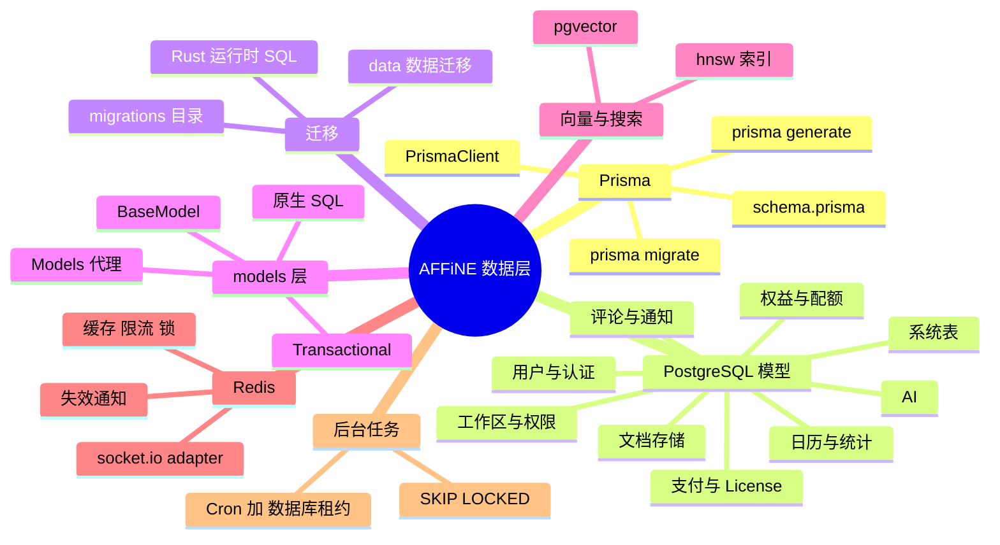
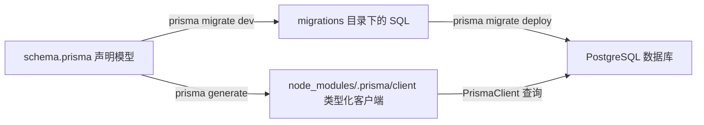
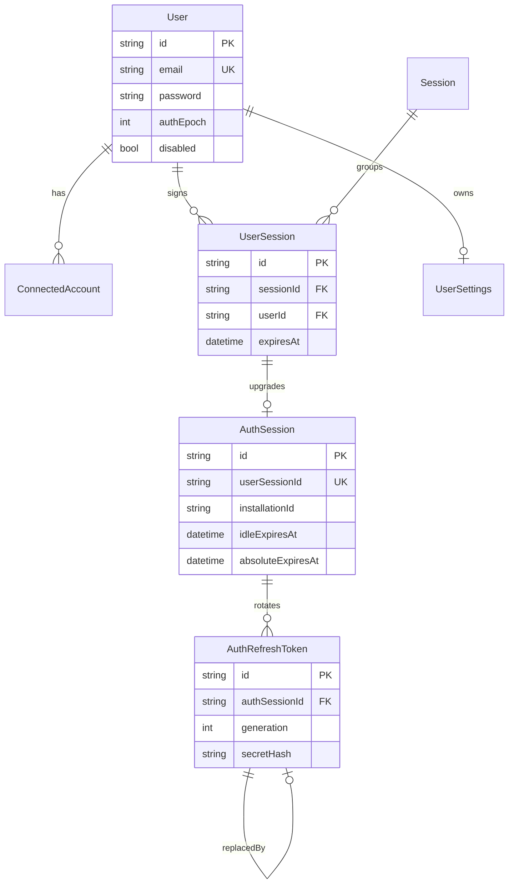
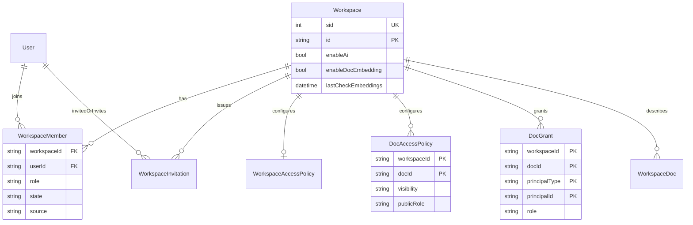
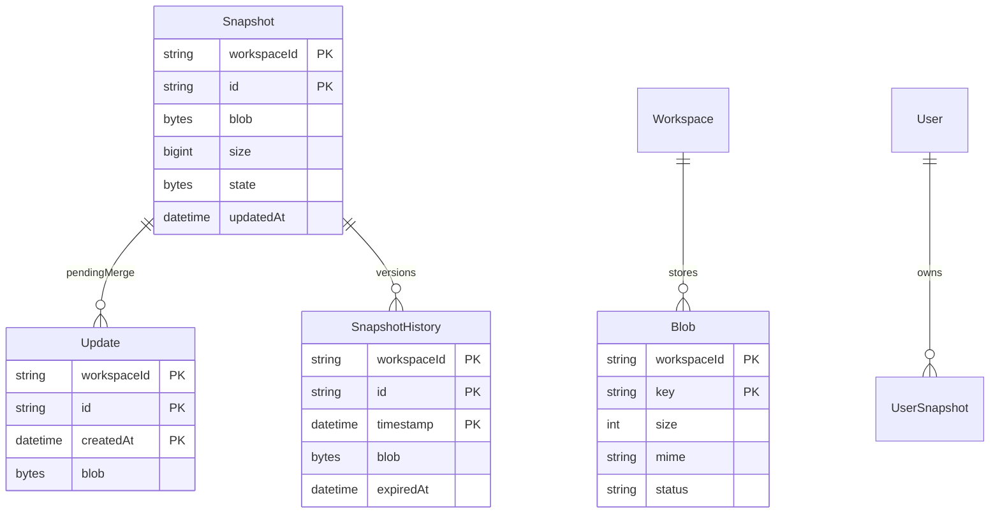
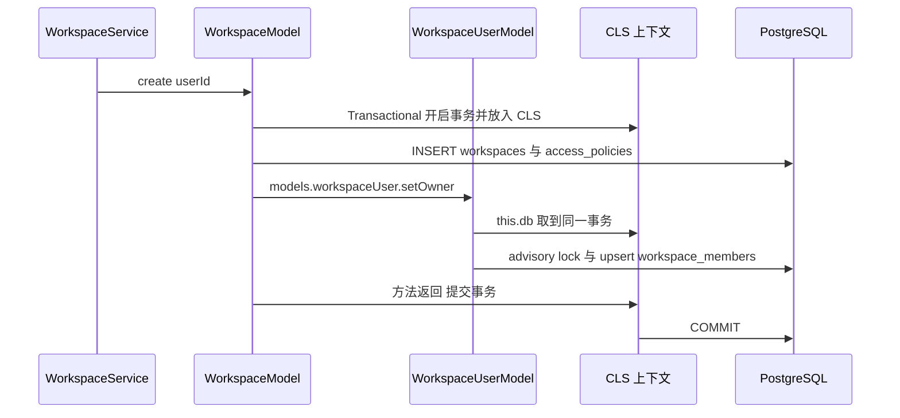
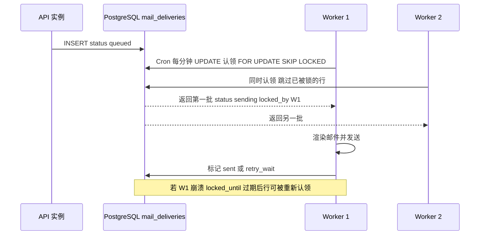

# 第 22 章 数据层：Prisma、PostgreSQL、Redis

> **所属部分**：第 7 部分 · 后端服务 ｜ **难度**：★★★☆☆ ｜ **建议学时**：8 小时 ｜ **前置章节**：[第 21 章 后端架构与基础设施层](21-后端架构与基础设施层.md)

## 本章导读

前端开发者习惯把数据放在 `useState`、IndexedDB 或者第 19 章讲过的 nbstore 里；而后端的数据最终都要落到**数据库**。AFFiNE 服务端的数据层由三部分组成：

- **PostgreSQL**：唯一的权威数据源（Source of Truth），存用户、工作区、权限、文档快照、AI 会话、支付记录……还借助 **pgvector** 扩展存向量；
- **Prisma 6**：TypeScript ORM，负责描述表结构（`schema.prisma`）、生成类型安全的客户端、管理 Schema 迁移；
- **Redis**：缓存、限流、分布式锁、socket.io 跨实例消息、Rust 运行时的失效通知。

本章先用最短篇幅讲清 Prisma 的四个核心动作（schema、generate、migrate、client），再把 `packages/backend/server/schema.prisma` 中的 **65 个模型、11 个枚举**按领域分组逐一讲解，配 3 张 ER 图；然后看 `migrations/` 目录如何记录 AFFiNE 三年多的数据库演进；接着深入 `src/models` 数据访问层的设计；最后讨论 pgvector 向量存储、Redis 的真实用途清单，以及 AFFiNE **没有用消息队列**、而是用"数据库租约 + 定时任务"实现后台任务的设计取舍。

> 与上一章呼应：0.27.x 中有一部分表**不在 `schema.prisma` 里**，而是由 Rust 原生运行时（`packages/backend/native/src/runtime/sql/*.sql`）自行建表和迁移，例如向量表 `embedding_chunks`、搜索投影 `search_projection.*`、运行时租约 `runtime_leases`。这是理解本章的关键背景。

## 学习目标

- [ ] 能够解释 Prisma 的 schema、generate、migrate、client 四个环节，并说出 AFFiNE 中对应的文件与命令
- [ ] 能够按领域说出 `schema.prisma` 中主要模型的职责，并画出用户认证、工作区权限、文档存储三张 ER 图
- [ ] 能够解释 `Snapshot` + `Update` + `SnapshotHistory` 三表如何共同表示一篇 CRDT 文档
- [ ] 能够通过 `migrations/` 目录梳理关键的 Schema 演进节点，并区分 Prisma 迁移与 Rust 运行时迁移
- [ ] 能够描述 `BaseModel`、`Models` 代理、`@Transactional()` 三者如何协作，并照着 `WorkspaceModel`、`DocModel` 写出风格一致的 Model 方法
- [ ] 能够说明 pgvector 的向量表在哪里定义、用什么索引、如何被查询
- [ ] 能够列出 Redis 在项目中的至少 6 种真实用途
- [ ] 能够解释 `FOR UPDATE SKIP LOCKED` 租约模式，并说明 AFFiNE 为什么不用 BullMQ 一类队列

## 知识地图



## 22.1 Prisma 基础：四个动作

### 22.1.1 为什么需要 ORM

直接写 SQL 当然可以，但会遇到：字段名拼错只能运行时发现、查询结果没有类型、表结构变更难以追踪。**ORM（对象关系映射）**把"表"映射成"类型"，Prisma 的做法是：



| 动作 | 命令 | AFFiNE 中的位置 |
| --- | --- | --- |
| 声明 | 编辑 `schema.prisma` | `packages/backend/server/schema.prisma`（1537 行） |
| 生成客户端 | `prisma generate` | `package.json` 的 `postinstall` 自动执行；输出到仓库根 `node_modules/.prisma/client` |
| 开发迁移 | `prisma migrate dev` | `yarn init` = `prisma migrate dev && yarn data-migration run` |
| 生产迁移 | `prisma migrate deploy` | `predeploy` 脚本中执行 |

### 22.1.2 schema 文件头

```prisma
// 来源：packages/backend/server/schema.prisma
generator client {
  provider        = "prisma-client-js"
  output          = "../../../node_modules/.prisma/client"
  binaryTargets   = ["native", "debian-openssl-3.0.x", "linux-arm64-openssl-3.0.x"]
  previewFeatures = ["metrics", "relationJoins", "nativeDistinct", "postgresqlExtensions"]
}

datasource db {
  provider   = "postgresql"
  url        = env("DATABASE_URL")
  extensions = [pgvector(map: "vector")]
}
```

- `binaryTargets` 让同一份生成物能在 macOS 开发机与 Linux x64/arm64 容器中运行；
- `previewFeatures` 中的 `metrics` 被 `src/base/metrics/prisma.ts` 的 `PrismaMetricProducer` 用于导出连接池指标；`relationJoins` 让关联查询用 SQL JOIN 而不是多次往返；`postgresqlExtensions` 允许声明 `pgvector` 扩展。

### 22.1.3 读懂一个模型

```prisma
// 来源：packages/backend/server/schema.prisma
model User {
  id              String    @id @default(uuid()) @db.VarChar
  name            String    @db.VarChar
  email           String    @unique @db.VarChar
  emailVerifiedAt DateTime? @map("email_verified") @db.Timestamptz(3)
  avatarUrl       String?   @map("avatar_url") @db.VarChar
  createdAt       DateTime  @default(now()) @map("created_at") @db.Timestamptz(3)
  /// Not available if user signed up through OAuth providers
  password        String?   @db.VarChar
  registered      Boolean   @default(true)
  disabled        Boolean   @default(false)
  authEpoch       Int       @default(0) @map("auth_epoch")

  features                    UserFeature[]
  workspaceMembers            WorkspaceMember[]
  sessions                    UserSession[]
  // ... 共 20 余个反向关联
  @@index([email])
  @@map("users")
}
```

| 语法 | 含义 |
| --- | --- |
| `String?` | 可空列 |
| `@id` / `@@id([a, b])` | 主键 / 复合主键 |
| `@default(uuid())`、`@default(now())`、`@default(dbgenerated(...))` | 默认值，后者交给数据库生成 |
| `@map("snake_case")` / `@@map("table")` | TS 用驼峰、数据库用下划线 |
| `@db.Timestamptz(3)` | 精确指定 PG 类型：带时区、毫秒精度 |
| `@unique` / `@@unique([...])` | 唯一约束 |
| `@@index([...])` | 普通索引 |
| `@relation(fields, references, onDelete)` | 外键与级联策略 |

AFFiNE 的约定非常统一：**所有时间列都是 `Timestamptz(3)`**（2024 年的迁移 `20240813053919_use_timestamp_with_timezone` 统一改造），**表名和列名一律 snake_case**（`20240731043837_standardize_table_columns`）。

### 22.1.4 Prisma Client 速览

```ts
// 教学示例：Prisma Client 常用 API（与项目 models 写法一致）
await db.workspace.findUnique({ where: { id }, include: { accessPolicy: true } });
await db.update.findMany({ where: { workspaceId, id: docId }, orderBy: { createdAt: 'asc' }, take: 100 });
await db.update.groupBy({ by: ['workspaceId', 'id'], _count: true });
await db.$transaction(async tx => { /* 多条写入 */ });
await db.$queryRaw`SELECT ... WHERE id = ${id}`; // 模板字符串参数自动参数化，防 SQL 注入
```

## 22.2 模型全景：65 个模型按领域分组

| 领域 | 模型 | 数量 |
| --- | --- | --- |
| 用户与认证 | `User`、`ConnectedAccount`、`Session`、`UserSession`、`AuthSession`、`AuthRefreshToken`、`VerificationToken`、`MagicLinkOtp`、`UserSettings` | 9 |
| 工作区与权限 | `Workspace`、`WorkspaceMember`、`WorkspaceInvitation`、`WorkspaceAccessPolicy`、`DocAccessPolicy`、`DocGrant`、`WorkspaceDoc` | 7 |
| 文档与文件存储 | `Snapshot`、`UserSnapshot`、`Update`、`SnapshotHistory`、`Blob` | 5 |
| 权益与配额 | `Entitlement`、`EffectiveUserQuotaState`、`EffectiveWorkspaceQuotaState`、`UserFeature`、`WorkspaceFeature` | 5 |
| AI | `AiSession`、`AiSessionMessage`、`WorkspaceArtifact`、`AiMessageArtifact`、`AiActionRun`、`AiTranscriptTask`、`AiWorkspaceIgnoredDocs`、`AiWorkspaceByokConfig`、`AiUsageEvent`、`AiJobs`、`McpCredential` | 11 |
| 支付 | `UserStripeCustomer`、`ProviderSubscription`、`Invoice`、`PaymentEvent`、`SubscriptionTrialUsage`、`PaymentFinancialFact`、`PaymentOperation` | 7 |
| License | `License`、`InstalledLicense` | 2 |
| 评论与通知 | `Comment`、`Reply`、`CommentAttachment`、`Notification`、`MailDelivery` | 5 |
| 日历 | `CalendarAccount`、`CalendarSubscription`、`WorkspaceCalendar`、`WorkspaceCalendarItem`、`CalendarEvent`、`CalendarEventInstance` | 6 |
| 统计 | `WorkspaceAdminStats`、`WorkspaceAdminStatsDirty`、`WorkspaceAdminStatsDaily`、`SyncActiveUsersMinutely`、`WorkspaceDocViewDaily`、`WorkspaceMemberLastAccess` | 6 |
| 系统 | `AppConfig`、`DataMigration` | 2 |

枚举 11 个：`WorkspaceMemberStatus`、`WorkspaceMemberSource`、`AiSessionMessageRole`、`AiJobStatus`、`AiJobType`、`Provider`（`stripe`、`revenuecat`）、`IapStore`、`BlobStatus`、`NotificationType`、`NotificationLevel`、`McpAccessMode`。

> 一个值得注意的现象：新近的模型大量使用 `String` + `@db.Text` 存状态（如 `WorkspaceMember.role`、`Entitlement.status`），而不是 Prisma `enum`。原因是 PG 枚举类型修改需要迁移、且新旧版本共存时容易冲突；`AiSessionMessageRole` 上的 `@@map("AiPromptRole")` 注释就记录了一次"为兼容旧版本客户端而保留数据库枚举名"的痛苦经历。状态值的合法性改由应用层（以及 Rust 运行时）校验。

## 22.3 用户与认证域



| 模型 | 表名 | 职责与要点 |
| --- | --- | --- |
| `User` | `users` | 账号主体。`password` 为空表示 OAuth 注册；`registered=false` 表示被邀请但未完成注册；`authEpoch` 自增可让该用户全部旧凭证失效 |
| `ConnectedAccount` | `user_connected_accounts` | OAuth 绑定（provider + providerAccountId），存 access/refresh token |
| `Session` | `multiple_users_sessions` | 浏览器级"会话容器"，一个 cookie 可挂多个账号（多账号切换） |
| `UserSession` | `user_sessions` | 会话中的某个用户；记录 `signInClientVersion`、`refreshClientVersion`，第 21 章 `AuthGuard` 的版本检查就读它们 |
| `AuthSession` | `auth_sessions` | 原生客户端（桌面/移动）的设备会话：`installationId`、`platform`、空闲过期 `idleExpiresAt` 与绝对过期 `absoluteExpiresAt`，可单独吊销 |
| `AuthRefreshToken` | `auth_refresh_tokens` | 刷新令牌**轮换链**：`generation` 递增，`replacedById` 自关联指向继任者，只存 `secretHash` |
| `VerificationToken` | `verification_tokens` | 邮箱验证、改密等一次性令牌，`@@unique([type, token])` |
| `MagicLinkOtp` | `magic_link_otps` | 魔法链接 + 6 位 OTP，只存 `otpHash`，`attempts` 计数防爆破 |
| `UserSettings` | `user_settings` | 用户偏好，整块 `JsonB` 存储 |

设计亮点是**刷新令牌轮换（Refresh Token Rotation）**：每次刷新都签发新令牌、旧令牌标记 `usedAt`；若一个已用过的旧令牌再次出现，说明可能被盗，可整条链吊销。`graceUsedAt`、`successorCiphertext` 字段则为"网络抖动导致客户端没收到新令牌、用旧令牌重试"的情况留了宽限窗口。认证流程本身在第 23 章展开。

## 22.4 工作区与权限域



| 模型 | 职责与要点 |
| --- | --- |
| `Workspace` | 工作区。`id` 是 UUID 主键，`sid` 是自增整数（迁移中手工改为 `GENERATED BY DEFAULT AS IDENTITY`），用作稳定的游标排序键；`enableAi`、`enableDocEmbedding` 是工作区级开关；`lastCheckEmbeddings` 供第 21 章 `DocJobRunner.syncEmbeddingDocuments` 判断哪些工作区需要重新向量化 |
| `WorkspaceMember` | 成员关系。`role` 取值 `owner`/`admin`/`member`；`state` 默认 `active`；`@@unique([workspaceId, userId, state])` |
| `WorkspaceInvitation` | 邀请（邮件或链接）。`status` 有 `pending`/`waiting_review`/`waiting_seat` 等；链接邀请只存 `tokenHash` |
| `WorkspaceAccessPolicy` | 工作区级策略：`visibility`、`sharingEnabled`、`urlPreviewEnabled`、`memberDefaultDocRole`（默认 `manager`） |
| `DocAccessPolicy` | 文档级策略：公开与否、公开角色、成员默认角色、发布时间 |
| `DocGrant` | 文档级授权：四元复合主键 `(workspaceId, docId, principalType, principalId)`，`role` 为 `owner`/`manager`/`editor`/`commenter`/`reader` |
| `WorkspaceDoc` | 文档元信息（表名 `workspace_pages`）：`mode`（页面/白板）、`title`、`summary`、`blocked`、`publishedAt`。注释写明"只有变更过的文档才有记录" |

**为什么权限表这么"散"？** 这是 2026 年中一次大重构的结果：迁移 `20260512133700_workspace_runtime_states` 引入了新表，`20260714000000_backfill_legacy_permission_and_subscription` 回填数据，`20260714000001_drop_legacy_permission_and_subscription` 最终 `DROP TABLE "workspace_user_permissions"` 与 `"workspace_page_user_permissions"`。新模型把"谁是成员"（`WorkspaceMember`）、"邀请流程"（`WorkspaceInvitation`）、"默认策略"（`*AccessPolicy`）、"显式授权"（`DocGrant`）拆成职责单一的表，权限计算交给 Rust 运行时统一完成（第 23 章）。

很多唯一性约束 Prisma 表达不了，只存在于迁移 SQL 中，例如**部分唯一索引**：

```sql
-- 来源：packages/backend/server/migrations/20260512133700_workspace_runtime_states/migration.sql
CREATE UNIQUE INDEX "workspace_members_active_owner_key" ON "workspace_members"("workspace_id") WHERE "role" = 'owner' AND "state" = 'active';
CREATE UNIQUE INDEX "workspace_members_active_user_key" ON "workspace_members"("workspace_id", "user_id") WHERE "state" = 'active';
CREATE UNIQUE INDEX "doc_grants_owner_key" ON "doc_grants"("workspace_id", "doc_id") WHERE "principal_type" = 'user' AND "role" = 'owner';
```

第一条在**数据库层面**保证"每个工作区最多一个活跃 owner"——即便应用代码有 bug，也写不进第二个 owner。结合第 21 章看到的 `WorkspaceMemberModel.setOwner` 中的 `pg_advisory_xact_lock`，这是"应用层串行化 + 数据库约束兜底"的双保险。

## 22.5 文档存储域：Snapshot + Update + History

这是与第 8 章 CRDT/Yjs 最紧密相关的部分。



```prisma
// 来源：packages/backend/server/schema.prisma
// the latest snapshot of each doc that we've seen
// Snapshot + Updates are the latest state of the doc
model Snapshot {
  workspaceId String   @map("workspace_id") @db.VarChar
  id          String   @default(uuid()) @map("guid") @db.VarChar
  blob        Bytes    @db.ByteA
  // persisted size of blob to avoid summing over bytea
  size        BigInt?  @map("size") @db.BigInt
  state       Bytes?   @db.ByteA
  createdAt   DateTime @default(now()) @map("created_at") @db.Timestamptz(3)
  // the `updated_at` field will not record the time of record changed,
  // but the created time of last seen update that has been merged into snapshot.
  updatedAt   DateTime @map("updated_at") @db.Timestamptz(3)
  // ...
  @@id([workspaceId, id])
  @@index([workspaceId, updatedAt])
  @@map("snapshots")
}
```

工作原理：

1. 客户端通过 WebSocket 推送 Yjs 增量（`space:push-doc-update`），服务端**先追加写入 `updates` 表**——写入快、无冲突；
2. Worker 上的 `DocJobRunner.compactPendingDocUpdates`（每 30 秒）把积压的 update 交给 Rust 运行时合并进 `snapshots.blob`，同时按 `historyMinInterval` 决定是否往 `snapshot_histories` 存一个历史版本；
3. 读取文档时：`Snapshot.blob` + 尚未合并的 `Update` 合起来才是最新状态（注释原话："Snapshot + Updates are the latest state of the doc"）。

| 字段/设计 | 原因 |
| --- | --- |
| `Update` 主键 `(workspaceId, id, createdAt)` | 同一文档的多条增量按时间区分；合并后按 `createdAt` 精确删除 |
| `Snapshot.updatedAt` 语义特殊 | 记录"最后一条被合并的 update 的时间"，不是行修改时间，用于判断快照新旧 |
| `Snapshot.size` | 避免在 `bytea` 上求和来统计存储占用（迁移 `20251231145656_snapshot_size`） |
| `SnapshotHistory.expiredAt` | 按订阅计划决定历史保留期，`DocStorageCronJob.nightlyJob` 每晚调用 `cleanupExpiredSnapshotHistories` 批量清理 |
| `Snapshot` 未声明到 `Workspace` 的外键 | 注释说明：需要先清理历史遗留的悬挂数据才能启用 |
| `UserSnapshot` | 用户级存储（个人设置等），"不分叉 updates 队列，所有操作就地完成" |
| `Blob` | **只存元数据**（大小、MIME、状态），文件本体在对象存储；`status` 为 `pending`/`completed`，配合 `reservationId`、`reservationExpiresAt` 实现"先预留配额、上传完成再确认" |

`DocModel.upsert` 展示了一个 Prisma 做不到、只能写原生 SQL 的场景：

```ts
// 来源：packages/backend/server/src/models/doc.ts
  async upsert(doc: Doc) {
    const { spaceId, docId, blob, timestamp, editorId } = doc;
    const updatedAt = new Date(timestamp);
    const size = blob.byteLength ?? blob.length;
    //  ii. Prisma doesn't support `upsert` with additional `where` condition along side unique constraint.
    //      In our case, we need to manually check the `updatedAt` to avoid overriding the newer snapshot.
    const result: { updatedAt: Date }[] = await this.db.$queryRaw`
      INSERT INTO "snapshots" ("workspace_id", "guid", "blob", "size", "created_at", "updated_at", "created_by", "updated_by")
      VALUES (${spaceId}, ${docId}, ${blob}, ${size}, ${updatedAt}, ${updatedAt}, ${editorId}, ${editorId})
      ON CONFLICT ("workspace_id", "guid")
      DO UPDATE SET "blob" = ${blob}, "size" = ${size}, "updated_at" = ${updatedAt}, "updated_by" = ${editorId}
      WHERE "snapshots"."workspace_id" = ${spaceId} AND "snapshots"."guid" = ${docId} AND "snapshots"."updated_at" <= ${updatedAt}
      RETURNING "snapshots"."workspace_id" as "workspaceId", "snapshots"."guid" as "id", "snapshots"."updated_at" as "updatedAt"
    `;

    return result.at(0);
  }
```

`ON CONFLICT ... DO UPDATE ... WHERE updated_at <= 新时间`：**只有更新的快照才能覆盖旧快照**，并发写入时旧数据永远不会覆盖新数据。这是一种"乐观并发控制"。

## 22.6 权益与配额域

| 模型 | 职责 |
| --- | --- |
| `Entitlement` | **统一权益表**：`targetType`+`targetId` 指向用户或工作区，`source` 说明来源（订阅、自托管 License 等），`plan`、`status`、`quantity`、有效期、`signedPayload`（自托管 License 的签名原文）、`graceUntil` 宽限期 |
| `EffectiveUserQuotaState` / `EffectiveWorkspaceQuotaState` | 由权益推导出的"生效配额"投影：存储上限、单文件上限、历史保留期、席位数、只读原因……带 `known`、`stale`、`staleAfter` 标记 |
| `UserFeature` / `WorkspaceFeature` | 功能开关（如管理员、早期体验），`WorkspaceFeature.configs` 可覆盖默认配置；注释提到 `(workspace_id, name) WHERE activated = true` 的部分索引只存在于 SQL 迁移中 |

两个 `Effective*QuotaState` 模型头上都有这样一行注释：

```prisma
// 来源：packages/backend/server/schema.prisma
// TODO(gc-convergence): drop this v0.27.4 projection after old readers and predeploy retire; current quota reads use canonical facts and bounded memory cache.
```

也就是说，这两张投影表**正在退役**：当前版本的配额读取已改为"从权威事实（`Entitlement` 等）计算 + 有界内存缓存"，表仅为兼容旧版本保留。这是一个很好的案例——**派生数据（projection）可以加速读取，但要承担一致性维护成本**；当计算足够快时，团队选择回归"单一事实来源"。第 23 章的 `core/quota`、`core/entitlement` 会讲如何读取配额。

## 22.7 AI、支付、License 与其他领域

### 22.7.1 AI

| 模型 | 表名 | 职责 |
| --- | --- | --- |
| `AiSession` | `ai_sessions_metadata` | 一次对话会话：`promptName`、`docId`、`pinned`、`parentSessionId`（分叉会话）、软删除 `deletedAt`、`focus` |
| `AiSessionMessage` | `ai_sessions_messages` | 消息：`role`、`content`、`streamObjects`（流式输出中的工具调用等结构化片段）、`attachments`、`scopeSnapshot` |
| `WorkspaceArtifact` / `AiMessageArtifact` | `workspace_artifacts` / `ai_message_artifacts` | 工作区级的 AI 附件制品（按 `contentHash` 去重）及其与消息的关联 |
| `AiActionRun` | `ai_action_runs` | 一次 AI Action 的执行记录：版本、尝试次数、`retryOf`、输入快照、结果、`trace` |
| `AiTranscriptTask` | `ai_transcript_tasks` | 音频转写任务，`dispatchGeneration` 防止重复派发 |
| `AiJobs` | `ai_jobs` | 旧版转写任务表（`AiJobType` 只有 `transcription`） |
| `AiWorkspaceIgnoredDocs` | `ai_workspace_ignored_docs` | 工作区中不参与向量化的文档 |
| `AiWorkspaceByokConfig` | `ai_workspace_byok_configs` | 工作区自带密钥（BYOK）配置，只存 `encryptedApiKey` |
| `AiUsageEvent` | `ai_usage_events` | 用量计量：provider、模型、token 数 |
| `McpCredential` | `mcp_credentials` | MCP 服务端访问凭证：`familyId`+`generation` 轮换、`secretHash`、`accessMode` |

注意：**schema.prisma 中没有任何向量字段**。早期的 `ai_context_embeddings`、`ai_workspace_embeddings` 表在 `20260820120000_cleanup_legacy_copilot_runtime` 中已被 `DROP TABLE`，向量存储迁到了 Rust 运行时自管的表中（22.9）。

### 22.7.2 支付与 License

| 模型 | 职责 |
| --- | --- |
| `UserStripeCustomer` | 用户与 Stripe Customer 的映射 |
| `ProviderSubscription` | 统一订阅表，`provider` 为 `stripe` 或 `revenuecat`（移动端内购），`iapStore` 区分 App Store / Play Store；多个复合唯一键保证外部订阅不重复入库 |
| `Invoice` | 发票，金额以最小货币单位整数存储（注释："CNY 12.50 stored as 1250"） |
| `PaymentEvent` | Webhook 事件收件箱：`@@unique([provider, externalEventId])` 保证**幂等**，`processingStatus`、`processingAttempts`、`nextAttemptAt` 支持重试 |
| `SubscriptionTrialUsage` | 试用记录，`@@unique([targetType, targetId, plan])` 防止重复试用 |
| `PaymentFinancialFact` | 从支付平台同步来的财务事实 |
| `PaymentOperation` | 对外部支付平台的"操作意图"记录：`intentId` 唯一、`steps`、`replayDeadline`，用于安全重放 |
| `License` / `InstalledLicense` | 云端签发的 License 与自托管实例安装的 License（`license` 字段存原文） |

`PaymentEvent` 体现了支付系统的铁律——**Webhook 一定会重复投递**，必须以外部事件 ID 做唯一约束实现幂等。

### 22.7.3 评论、通知、日历、统计、系统

- **评论**：`Comment` 与 `Reply` 都有自增 `sid`（同样手工改为 IDENTITY 列）用作增量拉取游标，`@@index([workspaceId, docId, sid])`；`CommentAttachment` 复用 `BlobStatus` 预留机制。
- **通知**：`Notification` 的 `type` 枚举覆盖提及、邀请各状态、评论；`body` 为 `JsonB`；`@@index([userId, createdAt, read])` 服务"按时间倒序的通知列表"。
- **邮件投递**：`MailDelivery` 是一张"发件箱"表（22.11 详述）。
- **日历**：`CalendarAccount`（Google/CalDAV 账号）→ `CalendarSubscription`（具体日历，带 `syncToken`、`nextSyncAt`、`syncClaimedUntil`）→ `CalendarEvent` → `CalendarEventInstance`（重复事件展开）；`WorkspaceCalendar` + `WorkspaceCalendarItem` 把日历挂到工作区。
- **统计**：`WorkspaceAdminStats`（管理后台排行，多个 `sort: Desc` 索引）、`WorkspaceAdminStatsDirty`（脏标记，增量重算）、`WorkspaceAdminStatsDaily`、`SyncActiveUsersMinutely`（第 21 章 `SpaceSyncGateway` 每分钟刷写在线人数）、`WorkspaceDocViewDaily`、`WorkspaceMemberLastAccess`。
- **系统**：`AppConfig`（第 21 章在线配置覆盖值，`id` 即 `module.key` 路径）、`DataMigration`（表名 `_data_migrations`，记录已执行的数据迁移）。

## 22.8 迁移演进史：读 `migrations/` 目录

`packages/backend/server/migrations/` 下有 122 个迁移目录 + `migration_lock.toml`。每个目录名是 `时间戳_描述`，内含一个 `migration.sql`。按时间线挑出关键节点：

| 时间 | 迁移 | 意义 |
| --- | --- | --- |
| 2023-04 | `20230425035217_init` | 初始 Schema |
| 2023-06 | `20230628074203_workspace` | 工作区 |
| 2023-10 | `20231018074747_payment`、`20231027090128_data_migration` | 支付上线；数据迁移记录表 |
| 2023-11 | `20231103080802_permission`、`20231121033532_history` | 权限、文档历史 |
| 2024-02 | `20240228065558_new_auth` | 认证体系重写（多账号会话） |
| 2024-03 | `20240321065017_ai_prompts`、`20240325125057_ai_sessions` | Copilot 起步 |
| 2024-07/08 | `20240731043837_standardize_table_columns`、`20240813053919_use_timestamp_with_timezone` | 命名与时间类型标准化 |
| 2024-08 | `20240815064332_userspace` | 用户级快照 |
| 2024-10 | `20241023065619_blobs` | Blob 元数据表 |
| 2025-01 | `20250110034441_licenses` | 自托管 License |
| 2025-02 | `20250210083416_ai_context`、`20250210090228_ai_context_embedding` | 首次引入 pgvector（会检测扩展是否存在并给出提示） |
| 2025-03 | `20250303105325-notification`、`20250325075341_new_app_config` | 通知、新配置系统 |
| 2025-06 | `20250609050058_add_comment`、`20250624051534_add_comment_attachments` | 评论 |
| 2026-01 | `20260102181003_cleanup_table`、`20260105175128_calendar`、`20260109090137_tokens_and_otp` | 清理旧表、日历、OTP |
| 2026-05 | `20260512133700_workspace_runtime_states`、`20260514000000_entitlement_quota_states` | 新权限模型、统一权益 |
| 2026-06/07 | `20260604000000_payment_provider_facts`、`20260706010719_mail_deliveries_and_invite_quota_indexes`、`20260711080000_auth_sessions`、`20260712093000_mcp_credentials` | 支付事实、邮件发件箱、设备会话、MCP 凭证 |
| 2026-07 | `20260714000000_backfill_*`、`20260714000001_drop_legacy_permission_and_subscription` | **两步走**：先回填、后删旧表 |
| 2026-08 | `20260803095500_converge_copilot_runtime`、`20260820120000_cleanup_legacy_copilot_runtime` | Copilot 运行时收敛，删除旧向量表 |
| 2026-08/09 | `20260829120000_terminal_authority_and_resource_ledger`、`20260906090000_payment_auth_runtime` | 权威数据与资源账本、支付认证运行时 |

规律：**"扩展 → 回填 → 收缩"（expand/contract）**。破坏性变更总是拆成多个版本：先加新表/新列让新旧代码都能跑，再用数据迁移或 SQL 回填，最后在后续版本删除旧结构。这样滚动发布时，新旧 Pod 可以同时连同一个数据库而不出错。`schema.prisma` 中随处可见的 `TODO(0.27.5)`、`TODO(gc-convergence)` 注释，就是"等旧版本退场后再收缩"的待办。

### 22.8.1 三套迁移机制并存

| 机制 | 管理的对象 | 定义位置 | 执行入口 | 记录表 |
| --- | --- | --- | --- | --- |
| Prisma Migrate | `schema.prisma` 中的表 | `migrations/*/migration.sql` | `prisma migrate deploy` | `_prisma_migrations` |
| Rust 运行时迁移 | 运行时自管表（向量、搜索投影、租约等） | `packages/backend/native/src/runtime/sql/*.sql`，由 `migrations.rs` 用 `include_str!` 内嵌 | `RunCommand.execute` 中的 `BackendRuntimeProvider.runMigrations()` | `native_schema_migrations`（按 component + version + checksum） |
| 数据迁移 | 数据内容 | `src/data/migrations/*.ts` | `yarn cli run` | `_data_migrations`（`DataMigration` 模型） |

`runtime_migrations.sql` 中创建的表包括 `runtime_states`、`runtime_gates`、`runtime_leases`、`doc_blob_refs`、`blob_cleanup_candidates`、`runtime_rolling_quota_counters`、`runtime_invite_abuse_*` 等。用 `psql \dt` 看到"schema.prisma 里没有的表"时，先去这里找。

## 22.9 pgvector 与 embedding 存储

### 22.9.1 概念

**Embedding（向量嵌入）**把一段文本变成一个高维浮点数组，语义相近的文本向量距离也近。AI 问答时先把问题向量化，再在库中找"最近"的文档片段塞给大模型——这就是 RAG（检索增强生成）。**pgvector** 是 PostgreSQL 扩展，提供 `vector(n)` 类型、距离运算符（`<=>` 余弦距离）和近似最近邻索引（HNSW、IVFFlat）。

开发环境的 `.docker/dev/compose.yml.example` 与自托管 `.docker/selfhost/compose.yml` 都使用 `pgvector/pgvector:pg16` 镜像，正是为此。

### 22.9.2 表结构（Rust 运行时自管）

```sql
-- 来源：packages/backend/native/src/runtime/sql/embedding.sql
CREATE TABLE embedding_chunks (
  generation_token UUID NOT NULL,
  workspace_id TEXT NOT NULL,
  index_id UUID NOT NULL REFERENCES embedding_indexes(id) ON DELETE CASCADE,
  source_id UUID NOT NULL REFERENCES embedding_sources(id) ON DELETE CASCADE,
  chunk_index INTEGER NOT NULL CHECK (chunk_index >= 0),
  content TEXT NOT NULL,
  embedding vector(1024) NOT NULL,
  source_kind TEXT NOT NULL CHECK (source_kind IN ('document', 'artifact')),
  doc_id TEXT,
  artifact_id UUID,
  -- ... unit_id visibility block_id element_id frame_id created_at
  PRIMARY KEY (generation_token, chunk_index),
  -- ... CHECK 约束
);
-- ...
CREATE INDEX embedding_chunks_hnsw
  ON embedding_chunks USING hnsw (embedding vector_cosine_ops)
  WITH (m = 32, ef_construction = 200);
```

四张核心表的关系：

| 表 | 作用 |
| --- | --- |
| `embedding_workspace_states` | 工作区级向量化状态 |
| `embedding_indexes` | 索引定义（不同模型/维度对应不同索引，可停用） |
| `embedding_sources` | 待向量化的源：`document` 或 `artifact`，带 `content_revision`、`descriptor_revision`、`recipe_revision` 三种版本号 |
| `embedding_projections` | 源 × 索引的投影任务：`status`（`pending`/`running`/`retry_wait`/`ready`/`failed`）+ 租约字段 `lease_owner`、`lease_until` |
| `embedding_chunks` | 最终的文本块与 1024 维向量，`generation_token` 支持"新一代写完再切换" |

`embedding_v2.sql` 还加了一个触发器：任一 revision 变化时，自动把对应投影重新置为 `pending`——**用数据库触发器保证"内容变了就一定会重新向量化"**。

查询在 Rust 中完成：

```rust
// 来源：packages/backend/native/src/runtime/backend_runtime/embedding/candidate.rs（第 119–129 行片段）
      (chunk.embedding <=> $5::vector)::float8 AS distance,chunk.doc_id,chunk.artifact_id,
    // ...
    FROM embedding_chunks chunk
    // ...
    ORDER BY chunk.embedding <=> $5::vector,source.source_key,chunk.chunk_index LIMIT $6
```

TS 侧只通过 `BackendRuntimeEmbeddingService`（`src/core/backend-runtime/job.ts`，方法如 `inspectWorkspaceRoot`、`syncDocument`、`prepareSelectedDocuments`、`reconcileDocuments`）驱动。迁移代码会检测 pgvector 版本（`pgvector_at_least_0_8`），不满足时 `EmbeddingHealth::disabled(...)`——**没有 pgvector 的自托管实例 AI 检索功能降级，但服务照常启动**。第 24 章 Copilot 部分会继续讲检索与 rerank。

## 22.10 models 层：数据访问的统一入口

### 22.10.1 为什么不直接在 Service 里用 Prisma

如果每个 Service 都直接 `prisma.workspace.update(...)`，就会出现：同一业务规则（比如"创建工作区时同时创建默认访问策略"）散落多处、事务边界难以控制、事件在不同地方被重复发出。`src/models` 把"一张表（或一组强相关表）"的读写封装成一个 Model 类，Service 只调用语义化方法。

### 22.10.2 `Models` 代理：一个注入拿到全部 Model

```ts
// 来源：packages/backend/server/src/models/index.ts
const MODELS = {
  user: UserModel,
  mailDelivery: MailDeliveryModel,
  feature: FeatureModel,
  workspace: WorkspaceModel,
  // ... 共 35 个
  workspaceAnalytics: WorkspaceAnalyticsModel,
};

type ModelsType = {
  [K in keyof typeof MODELS]: InstanceType<(typeof MODELS)[K]>;
};

export class Models extends ApplyType<ModelsType>() {}

const ModelsProvider: FactoryProvider = {
  provide: Models,
  useFactory: (ref: ModuleRef) => {
    return new Proxy({} as any, {
      get: (target, prop) => {
        if (prop in target) {
          return target[prop];
        }
        const Model = MODELS[prop];
        if (!Model) {
          return undefined;
        }
        const model = ref.get(Model);
        // ...
        target[prop] = model;
        return model;
      },
    });
  },
  inject: [ModuleRef],
};
```

几个巧思：

- **映射类型** `ModelsType` 从 `MODELS` 对象自动推导出 `models.workspace` 的类型是 `WorkspaceModel`，新增 Model 只需在对象里加一行；
- **`Proxy` 懒加载**：访问 `models.xxx` 时才通过 `ModuleRef` 取实例并缓存，避免 Model 之间互相注入造成循环依赖；
- **`MODELS_SYMBOL`** 用 `useExisting` 指向 `Models`，`BaseModel` 通过 `@Inject(MODELS_SYMBOL)` 拿到它——所以任何 Model 内部都能写 `this.models.workspaceUser.setOwner(...)` 调用其他 Model。

### 22.10.3 `BaseModel` 与事务

第 21 章已经见过 `BaseModel`：`this.db` 返回 `TransactionHost.tx`，在事务内是事务客户端、事务外是普通 `PrismaClient`。看 `WorkspaceModel.create` 如何利用它：

```ts
// 来源：packages/backend/server/src/models/workspace.ts
  @Transactional()
  async create(userId: string) {
    const workspace = await this.db.workspace.create({
      data: {
        accessPolicy: {
          create: {
            visibility: 'private',
            sharingEnabled: true,
            urlPreviewEnabled: false,
          },
        },
      },
      include: { accessPolicy: true },
    });
    this.logger.log(`Workspace created with id ${workspace.id}`);
    await this.models.workspaceUser.setOwner(workspace.id, userId);
    return this.withAccessPolicy(workspace);
  }
```

一个事务里完成三件事：建工作区、建默认访问策略（Prisma 嵌套写入）、设置 owner（跨 Model 调用，`setOwner` 内部的 `this.db` 自动是同一个事务）。任何一步失败全部回滚，不会出现"有工作区没 owner"的脏数据。



### 22.10.4 Model 方法设计规范（从源码归纳）

| 规范 | 例子 |
| --- | --- |
| 方法名是业务语义而非 SQL 语义 | `WorkspaceModel.allowUrlPreview`、`isTeamWorkspace`；`DocModel.publish`、`unpublish`、`isPublic` |
| 多表写入加 `@Transactional()` | `WorkspaceModel.create/update/delete`、`DocModel.delete`、`deleteAllByWorkspaceId`、`upsertMeta` |
| 领域事件由 Model 发出，并在同文件 `declare global` | `workspace.ts` 声明 `workspace.updated`、`workspace.deleted`；`user.ts` 声明 `user.created`、`user.deleted` 等 |
| 发事件可选 | `WorkspaceModel.update(workspaceId, data, notifyUpdate = true)` |
| 泛型 select 保持返回类型精确 | `DocModel.getSnapshot<Select extends Prisma.SnapshotSelect>(..., options?: { select?: Select })` 返回 `Prisma.SnapshotGetPayload<{ select: Select }>` |
| Prisma 表达不了的用 `$queryRaw` / `$executeRaw` | `DocModel.upsert`（条件 upsert）、`DocModel.lockDocContent`（advisory lock） |
| 批量操作设上限 | `DocModel.findUpdates` 固定 `take: 100`；`groupedUpdatesCount(limit = 100)` |

`DocModel.delete` 是"多表一致删除"的典型：

```ts
// 来源：packages/backend/server/src/models/doc.ts
  @Transactional()
  async delete(workspaceId: string, docId: string) {
    const ident = { where: { workspaceId, id: docId } };
    const { count: snapshots } = await this.db.snapshot.deleteMany(ident);
    const { count: updates } = await this.db.update.deleteMany(ident);
    const { count: histories } =
      await this.db.snapshotHistory.deleteMany(ident);
    this.logger.log(
      `Deleted workspace ${workspaceId} doc ${docId}, including ${snapshots} snapshots, ${updates} updates, and ${histories} histories`
    );
  }
```

## 22.11 Redis 用途清单与后台任务机制

### 22.11.1 Redis 在项目中的真实用途

以下全部经源码 grep 确认：

| 用途 | 使用位置 | Redis 实例 | 操作 |
| --- | --- | --- | --- |
| GraphQL 结果缓存 | `src/base/cache/interceptor.ts` | `CacheRedis` | `get`/`set` |
| 接口限流 | `src/base/throttler/index.ts` | `CacheRedis` | Lua `HINCRBY` + `PEXPIRE` |
| 登录频率限制 | `src/core/auth/service.ts` | `Cache` | `increaseWithTtl`（按邮箱、按 IP） |
| 分布式锁 | `src/base/mutex/locker.ts` | `SessionRedis` | Lua `SET NX EX` |
| 跨实例"只做一次" | `src/core/workspaces/resolvers/doc.ts` 的 `tryFixDocOwner` | `Cache` | `setnx` + 24 小时 TTL |
| OAuth state 暂存 | `src/plugins/calendar/oauth.ts` | `Cache` | `set` 带 TTL |
| Copilot 兼容提交暂存 | `src/plugins/copilot/compat/submission-store.ts` | `Cache` | `set`/`delete` |
| 链接预览、图片代理结果缓存 | `src/plugins/worker/controller.ts` | `Cache` | `set` 带 `CACHE_TTL` |
| 文档独立访客统计 | `src/models/workspace-analytics.ts` | `CacheRedis` | `sadd` + `expire` |
| socket.io 跨实例房间广播 | `src/base/websocket/adapter.ts` | `SocketIoRedis` | pub/sub |
| EventBus 跨实例广播 | `src/base/event/eventbus.ts` | 经 socket.io adapter | `serverSideEmit` |
| Rust 运行时缓存失效通知 | `packages/backend/native/src/runtime/backend_runtime/invalidation.rs` | Rust `redis` crate | `PUBLISH`/订阅，回调为 `backendRuntime.invalidation` 事件 |

**Redis 里没有任何"必须持久保存"的数据**——它全部是缓存、计数器、锁和消息通道。Redis 宕机时：缓存 miss、限流降级到进程内存、锁获取失败返回 `undefined`、跨实例广播暂停；`invalidation.rs` 的测试名 `degraded_redis_never_blocks_local_invalidation_and_reports_reconnects` 直白地表达了这个设计目标。

### 22.11.2 没有消息队列：Cron + 数据库租约

很多 Node 项目用 BullMQ（基于 Redis）做任务队列。AFFiNE 的 `package.json` 中**没有任何队列依赖**，后台任务统一采用"**`@Cron` 定时轮询 + 数据库表即队列 + 租约（lease）认领**"模式：



核心 SQL：

```ts
// 来源：packages/backend/server/src/models/mail-delivery.ts
    const rows = await this.db.$queryRaw<Array<Record<string, unknown>>>`
      UPDATE mail_deliveries
      SET status = 'sending',
          locked_by = ${workerId},
          locked_until = now() + (${options.leaseMs}::text || ' milliseconds')::interval,
          updated_at = now()
      WHERE id IN (
        SELECT id
        FROM mail_deliveries
        WHERE (
            status IN ('queued', 'retry_wait')
            OR (status = 'sending' AND locked_until < now())
          )
          AND send_after <= now()
          AND (expires_at IS NULL OR expires_at > now())
          AND (locked_until IS NULL OR locked_until < now())
          AND max_attempts > attempt_count
        ORDER BY
          CASE priority
            WHEN 'critical' THEN 0
            WHEN 'high' THEN 1
            WHEN 'normal' THEN 2
            ELSE 3
          END,
          send_after,
          created_at
        FOR UPDATE SKIP LOCKED
        LIMIT ${options.batchSize}
      )
      RETURNING ${SELECT_FIELDS}
    `;
```

要点解读：

- **`FOR UPDATE SKIP LOCKED`**：多个 Worker 同时执行时，已被别人锁住的行直接跳过，**天然实现"每条任务只被一个 Worker 拿到"**，无需额外的分布式锁；
- **租约 `locked_until`**：Worker 崩溃后租约到期，任务自动回到可认领状态——"至少一次"语义；
- **`attempt_count` / `max_attempts`**：有限重试；`send_after` 实现延迟与退避；`priority` 实现优先级；
- 配套索引 `@@index([status, sendAfter, lockedUntil], map: "mail_deliveries_ready_idx")` 让认领查询走索引。

同一模式在项目中反复出现：

| 任务 | 队列表 | 租约/状态字段 | 驱动者 |
| --- | --- | --- | --- |
| 邮件投递 | `mail_deliveries` | `status`、`locked_by`、`locked_until`、`attempt_count` | `MailJob`（`src/core/mail/job.ts`） |
| 文档更新合并 | `updates` 本身就是待办 | advisory lock `workspace-doc-update:...` | `DocJobRunner.compactPendingDocUpdates` |
| 向量化 | `embedding_projections` | `status`、`lease_owner`、`lease_until`、`next_attempt_at` | Rust 运行时 + `DocJobRunner.syncEmbeddingDocuments` |
| 支付 Webhook 处理 | `payment_events` | `processingStatus`、`processingAttempts`、`nextAttemptAt` | 支付运行时 |
| 支付外部操作 | `payment_operations` | `status`、`nextAttemptAt`、`replayDeadline` | 支付运行时 |
| 日历同步 | `calendar_subscriptions` | `nextSyncAt`、`syncClaimedUntil`、`syncRetryCount` | `src/plugins/calendar/cron.ts` |
| 统计重算 | `workspace_admin_stats_dirty` | 脏标记 + `updatedAt` | `src/core/workspaces/stats.job.ts` |
| 运行时通用租约 | `runtime_leases` | Rust 自管 | `BackendRuntimeHousekeepingJob` |

**取舍分析**：

| 维度 | 数据库租约 | Redis 队列（如 BullMQ） |
| --- | --- | --- |
| 与业务数据的事务一致性 | 入队可与业务写入在同一事务（"事务性发件箱"） | 需要额外处理"写库成功、入队失败" |
| 可观测性 | 一条 SQL 就能查积压、失败原因（`MailJob.recordDeliveryMetrics`） | 需专用面板 |
| 运维依赖 | 只依赖 PostgreSQL；Redis 可降级 | Redis 变成强依赖且需持久化 |
| 吞吐与延迟 | 秒级轮询，适合中低吞吐 | 毫秒级推送，高吞吐 |

对 AFFiNE 这种"自托管优先、任务量中等、强调一致性"的产品，前者是更稳妥的选择。

## 22.12 seed 脚本、性能与索引设计

### 22.12.1 seed：开发造数

`yarn seed` 运行 `src/seed/index.ts`，它复用测试用的 mock 工厂：

```ts
// 来源：packages/backend/server/src/__tests__/mocks/index.ts
export const Mockers = {
  User: MockUser,
  Workspace: MockWorkspace,
  TeamWorkspace: MockTeamWorkspace,
  WorkspaceUser: MockWorkspaceUser,
  UserSettings: MockUserSettings,
  DocMeta: MockDocMeta,
  DocSnapshot: MockDocSnapshot,
  DocUser: MockDocUser,
};
```

用法见 `seed/index.ts` 的帮助文本：`seed User 3` 创建 3 个用户，`seed User feature=administrator` 创建管理员，`seed TeamWorkspace id=xxx quantity=10n`（`n` 后缀表示数字）。`src/__tests__/mocks/factory.ts` 的注释解释了 Mocker 为什么直接用 `PrismaClient` 而不用 `Models`："the method in [Models] may introduce side effects like 'events', which may break the tests"——造数不应触发业务事件。

### 22.12.2 索引设计模式

| 模式 | 例子 | 解决的问题 |
| --- | --- | --- |
| 复合主键即聚簇访问路径 | `Update @@id([workspaceId, id, createdAt])`、`DocGrant` 四元主键 | 按"工作区→文档"前缀查询天然走主键 |
| 自增 `sid` + 索引作游标 | `Workspace.sid`、`Comment @@index([workspaceId, docId, sid])` | UUID 无序，分页/增量拉取需单调键 |
| 降序索引 | `WorkspaceAdminStats @@index([snapshotSize(sort: Desc)])` 等 | 管理后台"按大小排行" |
| 部分索引 / 部分唯一索引 | 迁移中的 `... WHERE "state" = 'active'`、`WHERE "visibility" = 'public'` | 只索引关心的子集；表达"条件唯一" |
| 状态 + 时间复合索引 | `MailDelivery @@index([status, sendAfter, lockedUntil])`、`PaymentEvent @@index([processingStatus, updatedAt])` | 租约认领与清理查询 |
| 过期时间索引 | `AuthSession @@index([idleExpiresAt])`、`MagicLinkOtp @@index([expiresAt])` | 定时清理过期数据 |
| HNSW 向量索引 | `embedding_chunks_hnsw` | 近似最近邻检索 |

其他性能实践：

- **冗余存 `size`**（`Snapshot.size`），避免对大字段做聚合；
- **`relationJoins` 预览特性**减少关联查询往返；
- **批量 + 上限**：`take: 100`、`chunk(…, 100)`、`CLEANUP_BATCH_SIZE = 1000`；
- **派生投影与回归**：`Effective*QuotaState`、`WorkspaceAdminStats` 是读优化的投影，前者因维护成本正在退役，后者通过 `*Dirty` 表增量维护；
- **大二进制放对象存储**：`Blob` 表只存元数据，文件本体走第 21 章的 `StorageRuntimeProvider`。

## 源码导读清单

| 优先级 | 路径 | 阅读重点 |
| --- | --- | --- |
| P0 | `packages/backend/server/schema.prisma` | 按本章分组通读 65 个模型，关注主键、索引、`@map`、注释 |
| P0 | `packages/backend/server/src/models/index.ts` | `MODELS` 注册表、`Models` Proxy、`MODELS_SYMBOL` |
| P0 | `packages/backend/server/src/models/base.ts` | `TransactionHost` 与 `this.db` |
| P0 | `packages/backend/server/src/models/doc.ts` | Snapshot/Update 读写、条件 upsert、advisory lock |
| P0 | `packages/backend/server/src/models/workspace.ts` | `@Transactional()` 嵌套写入与跨 Model 调用、领域事件 |
| P1 | `packages/backend/server/src/models/mail-delivery.ts` | `claimReady` 租约认领、重试与清理 |
| P1 | `packages/backend/server/src/models/permission-write.ts` | 权限写入的事务与锁 |
| P1 | `packages/backend/server/migrations/20260512133700_workspace_runtime_states/migration.sql` | 新权限模型与部分唯一索引 |
| P1 | `packages/backend/server/migrations/20260714000001_drop_legacy_permission_and_subscription/migration.sql` | expand/contract 的"收缩"一步 |
| P1 | `packages/backend/native/src/runtime/sql/embedding.sql` | pgvector 表、HNSW 索引 |
| P1 | `packages/backend/native/src/runtime/migrations.rs` | 运行时迁移与 pgvector 版本检测 |
| P2 | `packages/backend/native/src/runtime/sql/runtime_migrations.sql` | 运行时自管的租约、配额、清理表 |
| P2 | `packages/backend/server/src/core/doc-jobs/job.ts` | 文档合并与向量化同步的调度 |
| P2 | `packages/backend/server/src/seed/index.ts`、`src/__tests__/mocks/factory.ts` | 造数脚本与 Mocker 工厂 |

## 动手实践

### 练习 1：在本地数据库里"对照 schema 看表"

- **目标**：建立 Prisma 模型与真实表的映射感。
- **步骤**：
  1. 按第 11 章启动开发用 PostgreSQL（`.docker/dev/compose.yml.example`）并完成 `yarn init`；
  2. 用 `psql` 或任意 GUI 连接数据库，执行 `\dt`；
  3. 选 `User`、`Snapshot`、`DocGrant` 三个模型，对照 `schema.prisma` 中的 `@map`/`@@map` 找到表与列；
  4. 找出 3 张"`schema.prisma` 中不存在"的表，并在 `packages/backend/native/src/runtime/sql/` 中定位其定义。
- **验收标准**：能写出一张"模型名 → 表名 → 关键列"的对照表，并解释那 3 张表由谁创建。

### 练习 2：追踪一篇文档的存储生命周期

- **目标**：理解 Snapshot + Update 模型。
- **步骤**：
  1. 本地启动前后端，新建一篇文档并输入几段文字；
  2. 立刻查询 `SELECT guid, created_at FROM updates WHERE workspace_id = '...'`，观察积压的增量；
  3. 等待 30 秒以上（`DocJobRunner` 周期），再查 `updates` 与 `snapshots.updated_at`；
  4. 阅读 `DocModel.upsert` 中 `WHERE "snapshots"."updated_at" <= ...` 的条件。
- **验收标准**：能描述 update 被合并前后两张表的变化，并解释条件 upsert 防止了什么问题。

### 练习 3：写一个风格一致的 Model 方法（教学草稿）

- **目标**：掌握 models 层规范。
- **步骤**：在本地草稿中为 `WorkspaceModel` 设计一个 `rename(workspaceId, name)` 方法：使用 `this.db`、加 `@Transactional()`、成功后 `this.event.emit('workspace.updated', ...)`；再思考它与现有 `update()` 的关系。
- **验收标准**：能说清是否需要 `@Transactional()`，以及为什么现有代码选择在 `update()` 中提供 `notifyUpdate` 参数而不是新增方法。

### 练习 4：画出租约认领的竞态时间线

- **目标**：理解 `FOR UPDATE SKIP LOCKED`。
- **步骤**：阅读 `MailDeliveryModel.claimReady` 与 `markAttemptStarted`；假设两个 Worker 在同一毫秒执行认领、其中一个在发送中途崩溃，画出时间线。
- **验收标准**：能指出崩溃后哪个条件让任务重新可被认领，以及 `max_attempts > attempt_count` 如何避免无限重试。

## 自测题

1. `prisma generate` 的产物输出到哪里？什么时候会自动执行？
2. 为什么 AFFiNE 的新表大多用 `String` 存状态而不是 Prisma `enum`？
3. `Snapshot.updatedAt` 的语义与普通的"行更新时间"有何不同？为什么这样设计？
4. 如何在数据库层面保证"每个工作区最多一个活跃 owner"？
5. `schema.prisma` 中没有向量字段，AFFiNE 的 embedding 存在哪里？用什么索引？
6. 列举 AFFiNE 的三套迁移机制及各自的记录表。
7. `Models` 为什么用 `Proxy` 实现？`BaseModel` 中的 `this.models` 从何而来？
8. `WorkspaceModel.create` 中的 `setOwner` 为什么能与建工作区处于同一事务？
9. 列出至少 6 种 Redis 用途，并说明 Redis 宕机时系统的表现。
10. `FOR UPDATE SKIP LOCKED` 解决了什么问题？与 BullMQ 相比，数据库租约模式的主要优缺点是什么？

<details><summary>参考答案</summary>

1. 输出到仓库根目录的 `node_modules/.prisma/client`（由 `generator client.output` 指定）。`packages/backend/server/package.json` 的 `postinstall` 脚本会自动执行 `prisma generate`。
2. PG 枚举类型的增删值需要迁移，且滚动发布时新旧版本共存会产生类型冲突（`AiSessionMessageRole` 的 `@@map("AiPromptRole")` 就是为兼容旧客户端保留的）。用文本列 + 应用层校验更灵活。
3. 它记录的是"最后一条被合并进快照的 update 的创建时间"，而不是这行记录被修改的时间。这样可以直接比较时间判断快照新旧，`DocModel.upsert` 用它实现"只有更新的快照才能覆盖"。
4. 迁移 `20260512133700_workspace_runtime_states` 中的部分唯一索引 `workspace_members_active_owner_key ON workspace_members(workspace_id) WHERE role = 'owner' AND state = 'active'`；应用层还用 `pg_advisory_xact_lock` 串行化 owner 变更。
5. 存在 Rust 运行时自管的 `embedding_chunks` 表（`packages/backend/native/src/runtime/sql/embedding.sql`），列类型 `vector(1024)`，索引为 `USING hnsw (embedding vector_cosine_ops)`，查询使用 `<=>` 余弦距离。
6. Prisma Migrate（`_prisma_migrations`）、Rust 运行时迁移（`native_schema_migrations`）、TS 数据迁移（`_data_migrations`，即 `DataMigration` 模型）。
7. `Proxy` 实现按需懒加载并缓存 Model 实例，避免 Model 之间互相构造注入导致循环依赖；类型由映射类型从 `MODELS` 推导。`this.models` 来自 `@Inject(MODELS_SYMBOL)`，而 `MODELS_SYMBOL` 通过 `useExisting` 指向 `Models`。
8. `@Transactional()` 把事务放进 CLS 上下文；`setOwner` 内部通过 `this.db`（即 `TransactionHost.tx`）取数据库句柄，自然取到同一个事务客户端。
9. 例如：GraphQL 缓存、接口限流、登录频率限制、分布式锁、跨实例 setnx 去重、OAuth state 暂存、链接预览缓存、独立访客统计、socket.io 跨实例广播、EventBus 广播、Rust 运行时失效通知。Redis 宕机时缓存 miss、限流降级为进程内存、锁获取失败、跨实例广播暂停，但权威数据都在 PostgreSQL，服务可继续运行。
10. 它让多个 Worker 并发认领时自动跳过已被锁定的行，保证一条任务只被一个 Worker 拿到，无需额外分布式锁。优点：入队可与业务写入同事务、可观测性好、只依赖 PG；缺点：轮询带来秒级延迟，吞吐上限低于专用队列。

</details>

## 常见坑与排错

| 现象 | 可能原因 | 解决 |
| --- | --- | --- |
| `@prisma/client did not initialize yet` 或类型找不到 | 未执行 `prisma generate`，或 `schema.prisma` 修改后未重新生成 | 在 `packages/backend/server` 下执行 `yarn prisma generate` |
| 启动报某表/列不存在 | 本地库落后于迁移 | `yarn prisma migrate dev`（开发）或 `yarn init`；生产用 `prisma migrate deploy` |
| 迁移报 `pgvector extension not found` | 数据库镜像不含 pgvector | 改用 `pgvector/pgvector:pg16` 镜像，或手动安装扩展 |
| AI 检索不可用但服务正常 | pgvector 版本低于 0.8，Rust 运行时把 embedding 标记为 disabled | 升级 pgvector；查看运行时健康信息中的 disabled 原因 |
| `prisma migrate dev` 想生成删除 `embedding_*` 等表的迁移 | 这些表不在 `schema.prisma` 中，Prisma 视其为漂移 | 不要接受删除；这些表由 Rust 运行时管理 |
| 事务中写入后，事件订阅者读不到新数据 | 订阅者在事务提交前执行或处在不同连接 | 使用 `emitDetached`/在事务外发事件，或订阅者重新读取 |
| `$queryRaw` 字符串拼接报错或有注入风险 | 用了 `$queryRawUnsafe` 或字符串拼接 | 始终使用模板字符串形式 `` $queryRaw`...${param}` ``，参数会被自动参数化 |
| 本地 Redis 未启动导致部分功能异常 | 锁获取失败、广播失效 | 启动 Redis；单测环境下 Redis 为 `lazyConnect` |

## 延伸阅读

- Prisma 官方文档：Prisma Schema、Prisma Migrate、Raw queries、Preview features
- PostgreSQL 官方文档：Partial Indexes、`SELECT ... FOR UPDATE SKIP LOCKED`、Advisory Locks、`INSERT ... ON CONFLICT`
- pgvector 项目 README：HNSW 与 IVFFlat 索引参数
- 文章："Transactional Outbox Pattern"、"Expand and Contract Pattern for Database Migrations"
- 本书 [第 8 章 CRDT 与 Yjs 原理](../03-编程语言与基础技术/08-CRDT与Yjs原理.md)：理解 Snapshot 与 Update 的二进制内容
- 本书 [第 19 章 存储与同步引擎 nbstore](../06-前端应用/19-存储与同步引擎nbstore.md)：前端侧如何与这些表对应的服务端存储同步

## 学时拆分

| 内容 | 建议时长 |
| --- | --- |
| 22.1 Prisma 基础 | 0.5 小时 |
| 22.2–22.4 模型全景、用户认证域、工作区权限域 | 1.5 小时 |
| 22.5–22.7 文档存储、权益配额、AI 支付等领域 | 1.5 小时 |
| 22.8 迁移演进史与三套迁移机制 | 0.5 小时 |
| 22.9 pgvector 与 embedding | 0.5 小时 |
| 22.10 models 层设计 | 1 小时 |
| 22.11–22.12 Redis、后台任务、seed 与索引 | 1 小时 |
| 动手实践与自测 | 1.5 小时 |
| **合计** | **8 小时** |

---
上一章：[第 21 章 后端架构与基础设施层](21-后端架构与基础设施层.md) ｜ 下一章：[第 23 章 API 层：GraphQL、WebSocket、认证与权限](23-API层-GraphQL-WebSocket-认证权限.md) ｜ [返回目录](../README.md)
