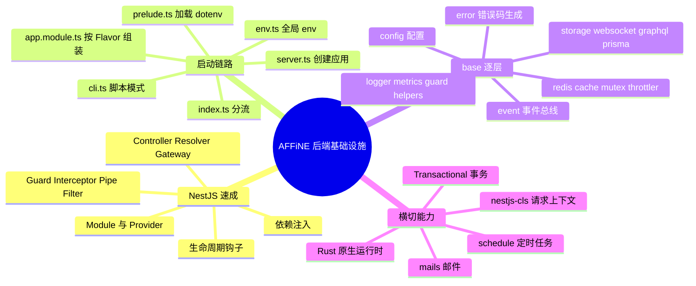
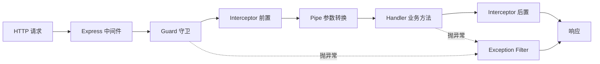
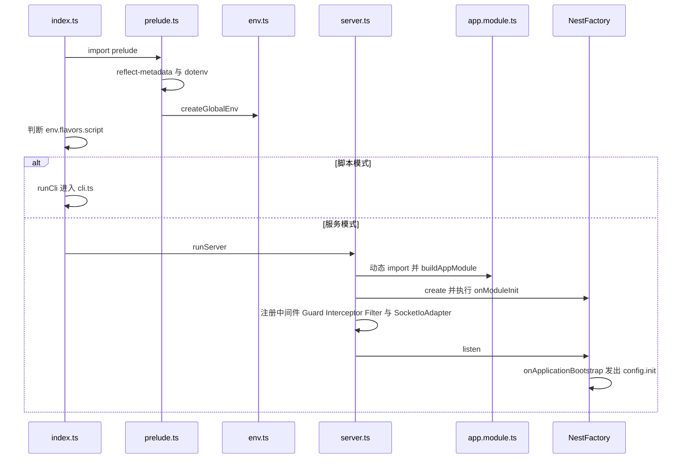
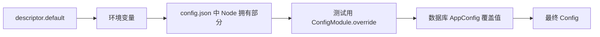
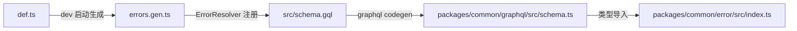

# 第 25 章 后端架构与基础设施层

> **所属部分**：第 7 部分 · 后端服务 ｜ **难度**：★★★★☆ ｜ **建议学时**：10 小时 ｜ **前置章节**：[第 9 章 TypeScript 在 AFFiNE 中的应用](../03-编程语言与基础技术/09-TypeScript在AFFiNE中的应用.md)

## 本章导读

从这一章开始，我们走到网线的另一端——`packages/backend/server`，AFFiNE Cloud 与自托管版本共用的 Node.js 服务端。

对前端开发者来说，后端的门槛往往不在语法（同样是 TypeScript），而在**思维方式**：

- 前端"一个用户一份进程"，后端"一个进程服务成千上万个用户"，于是需要请求上下文、并发控制、分布式锁；
- 前端状态丢了刷新即可，后端数据写错就是事故，于是需要事务、迁移、幂等；
- 前端组件靠 props 传依赖，后端服务靠**依赖注入（DI）容器**组装依赖。

AFFiNE 服务端基于 **NestJS 11**。本章先把 NestJS 核心概念讲清，并**每个概念挂接一段 AFFiNE 真实代码**；然后顺着 `src/index.ts → prelude.ts → env.ts → server.ts → app.module.ts` 理解一个进程如何"按角色（Flavor）拼装"；最后逐个拆解 `src/base` 基础设施层，以及 `nestjs-cls` 请求上下文与事务、`@nestjs/schedule` 定时任务、`data` 迁移命令、`mails` 邮件渲染。

> **版本特征提示**：0.27.x canary 中，大量领域逻辑（权限决策、配额、权益、认证会话、对象存储、配置持久化）已下沉到 Rust 原生模块 `@affine/server-native`（源码 `packages/backend/native`），Node 侧通过 `BackendRuntimeProvider`、`StorageRuntimeProvider`、`ServerConfigHandle` 调用。读源码时常会发现 TS 只是一层"薄壳"，第 26～28 章会继续深入。

## 学习目标

- [ ] 能够解释 NestJS 的 Module、Provider、Controller、Resolver、Gateway、Guard、Interceptor、Pipe、Filter 与依赖注入，并在 AFFiNE 源码中各找出一个例子
- [ ] 能够画出从 `src/index.ts` 到 `app.listen()` 的启动时序，说清 `prelude.ts`、`env.ts`、`server.ts` 的职责
- [ ] 能够解释 `Flavor` 与 `ServerRole` 的区别，并说出 `buildAppModule` 在不同 Flavor 下装配了哪些模块
- [ ] 能够描述 `defineModuleConfig` 注册配置、`ConfigFactory` 合并配置、`genconfig` 生成 `schema.json` 的链路
- [ ] 能够说明 `USER_FRIENDLY_ERRORS` → `errors.gen.ts` → GraphQL `ErrorNames` → 前端 `@affine/error` 的错误共享机制
- [ ] 能够区分 `EventBus` 的 `emit`、`emitAsync`、`emitDetached`、`broadcast`
- [ ] 能够说明 Redis 被拆成哪几个逻辑库，以及 `Cache`、`Mutex`、`CloudThrottlerGuard` 如何使用 Redis
- [ ] 能够在业务代码中正确使用 `@Transactional()`、`@Cron()` 与数据迁移命令

## 知识地图



## 21.1 后端先修课：一个请求经历了什么

浏览器发出 `POST /graphql` 后，Node 的 `http` 模块解析出请求，Express 跑一串**中间件**，然后路由到处理函数，处理函数调用 service 读写数据库，最后序列化响应。NestJS 在 Express 之上增加了更细的"切面"，称为**请求生命周期**：



| 生命周期环节 | AFFiNE 中的实现 | 注册位置 |
| --- | --- | --- |
| 中间件 | ClsModule 中间件、`serverTimingAndCache`、`graphqlUploadExpress`、`cookieParser` | `src/app.module.ts`、`src/server.ts` |
| 全局守卫 | `AuthGuard`（登录态）→ `CloudThrottlerGuard`（限流） | `server.ts` 的 `app.useGlobalGuards` |
| 全局拦截器 | `CacheInterceptor` | `server.ts` 的 `app.useGlobalInterceptors` |
| 管道 | `PaginationInput.decode` | `src/base/graphql/pagination.ts` |
| 异常过滤器 | `GlobalExceptionFilter` | `src/base/nestjs/exception.ts` |

（本章路径均相对 `packages/backend/server/`，表格中省略前缀。）

另有两个后端概念会反复出现：**多实例部署**——生产环境有很多 Pod，内存变量无法共享，所以需要 Redis 做共享缓存、锁与消息转发；**事务**——多条 SQL 要么全成功要么全回滚，AFFiNE 用 `@nestjs-cls/transactional` 让事务沿调用链隐式传播。

## 21.2 NestJS 速成：概念对照真实代码

### 21.2.1 Module 与 Provider

模块用 `@Module()` 声明 `imports`（依赖模块）、`providers`（本模块创建的可注入对象）、`controllers`（HTTP 控制器）、`exports`（对外暴露的 Provider）。

```ts
// 来源：packages/backend/server/src/core/user/index.ts
@Module({
  imports: [StorageModule, PermissionModule],
  providers: [
    UserResolver,
    UserManagementResolver,
    UserSettingsResolver,
    UserRealtimeProvider,
  ],
  controllers: [UserAvatarController],
})
export class UserModule {}
```

`@Global()` 模块导出的 Provider 可在任何地方注入，`base` 层几乎全是全局模块（如 `RedisModule`、`ConfigModule`、`EventModule`）。Provider 除了"类"，还可以是工厂、值或别名：

```ts
// 来源：packages/backend/server/src/core/backend-runtime/index.ts
@Global()
@Module({
  providers: [
    BackendRuntimeProvider,
    BackendRuntimeEmbeddingService,
    { provide: CRYPTO_KEY_SOURCE, useExisting: BackendRuntimeProvider },
  ],
  // ...
})
export class BackendRuntimeModule {}
```

`useExisting` 表示"有人要 `CRYPTO_KEY_SOURCE` 时，给他已有的 `BackendRuntimeProvider` 实例"。于是 `base/helpers/crypto.ts` 的 `CryptoHelper` 只依赖一个 Symbol 令牌，而不必 import `core`——保持了 `base` 不反向依赖 `core` 的分层纪律。

### 21.2.2 依赖注入

规则：**构造函数参数声明类型，容器负责创建并传入实例**。Nest 依赖 `reflect-metadata` 读取参数类型，这就是 `prelude.ts` 第一行 `import 'reflect-metadata'` 的原因。

```ts
// 来源：packages/backend/server/src/core/doc-jobs/job.ts
@Injectable()
export class DocJobRunner {
  constructor(
    private readonly docReader: DatabaseDocReader,
    private readonly prisma: PrismaClient,
    private readonly models: Models,
    private readonly runtime: BackendRuntimeProvider,
    private readonly embedding: BackendRuntimeEmbeddingService,
    private readonly storageRuntime: StorageRuntimeProvider,
    private readonly options: DocStorageOptions,
    private readonly event: EventBus
  ) {}
  // ...
}
```

类比前端：像 React Context + Hook，但它**启动期一次性装配**、默认**单例**。令牌不是类时用 `@Inject(TOKEN)`（如 `CryptoHelper` 的 `@Inject(CRYPTO_KEY_SOURCE)`）。遇到循环依赖，AFFiNE 常在 `onModuleInit` 中用 `ModuleRef` 懒加载：

```ts
// 来源：packages/backend/server/src/core/auth/guard.ts
  onModuleInit() {
    this.auth = this.ref.get(AuthService, { strict: false });
    this.accessTokens = this.ref.get(AccessTokenService, { strict: false });
    this.authSessions = this.ref.get(AuthSessionService, { strict: false });
  }
```

### 21.2.3 Controller、Resolver、Gateway：三种入口

REST 入口如 `src/core/user/controller.ts` 的 `UserAvatarController`：`@Controller('/api/avatars')` 定义前缀，`@Get('/:id')` 定义路由，`@Param('id')`、`@Res()` 从请求取值，类上的 `@Public()` 声明免登录。GraphQL 采用 **code-first**，Resolver 方法上叠加声明式横切装饰器：

```ts
// 来源：packages/backend/server/src/core/user/resolver.ts
  @Throttle('strict')
  @Query(() => PublicUserType, {
    name: 'publicUserById',
    description: 'Get public user by id',
    nullable: true,
  })
  @Public()
  async getPublicUserById(
    @Args('id', { type: () => String }) id: string
  ): Promise<PublicUserType | null> {
    return await this.models.user.getPublicUser(id);
  }
```

WebSocket 入口是 Gateway。AFFiNE 自己包了一个同名 `SubscribeMessage`，叠加错误包装与耗时指标：

```ts
// 来源：packages/backend/server/src/core/sync/gateway.ts
const SubscribeMessage = (event: string) =>
  applyDecorators(
    GatewayErrorWrapper(event),
    CallMetric('socketio', 'event_duration', { event }),
    RawSubscribeMessage(event)
  );
// ...
@WebSocketGateway()
@UseInterceptors(ClsInterceptor)
export class SpaceSyncGateway
  implements OnGatewayConnection, OnGatewayDisconnect, OnModuleInit, OnModuleDestroy
{
  @WebSocketServer()
  private readonly server!: Server;
  // ... @SubscribeMessage('space:join-batch') 等
}
```

### 21.2.4 Guard：能否进门

AFFiNE 有三类 Guard：**全局 Guard**（`AuthGuard`、`CloudThrottlerGuard`）、**装饰器 Guard**（`@Admin()` 即 `UseGuards(AdminGuard)`，见 `src/core/common/admin-guard.ts`）、**具名 Guard**（`@UseNamedGuard('version', 'captcha')`，21.11 详述）。`AuthGuard` 的核心：

```ts
// 来源：packages/backend/server/src/core/auth/guard.ts
  async canActivate(context: ExecutionContext) {
    const { req, res } = getRequestResponseFromContext(context);
    const clazz = context.getClass();
    const handler = context.getHandler();
    // api is public
    const isPublic = this.reflector.getAllAndOverride<boolean>(
      PUBLIC_ENTRYPOINT_SYMBOL,
      [clazz, handler]
    );

    const authedUser = await this.signIn(req, res, isPublic);

    if (isPublic) {
      return true;
    }

    if (!authedUser) {
      throw new AuthenticationRequired();
    }

    return true;
  }
// ...
export const Public = () => SetMetadata(PUBLIC_ENTRYPOINT_SYMBOL, true);
```

`SetMetadata` + `Reflector` 是 Nest 的"元数据通信"：装饰器贴标签，Guard 运行时读标签。即使是 `@Public()` 接口也会尝试 `signIn`，因此公开接口里仍可用 `@CurrentUser()` 拿到"可能存在"的用户。

同一个 Guard 要服务 HTTP、GraphQL、WebSocket 三种上下文，`src/base/utils/request.ts` 的 `getRequestResponseFromHost` 按 `host.getType()` 分别从 `GqlArgumentsHost`、`switchToHttp()`、`switchToWs().getClient<Socket>().request` 取出 `req`，抹平差异。

### 21.2.5 Interceptor、Pipe、Filter

**Interceptor** 环绕 handler，能替换返回值。`CacheInterceptor` 读取 `@MakeCache` 元数据，命中则直接返回：

```ts
// 来源：packages/backend/server/src/base/cache/interceptor.ts
    const cachedData = await this.cache.get(cacheKey);

    if (cachedData) {
      this.logger.verbose(`cache ${cacheKey} hit`);
      return of(cachedData);
    } else {
      this.logger.verbose(`cache ${cacheKey} miss`);
      return next.handle().pipe(
        mergeMap(async result => {
          await this.cache.set(cacheKey, result);
          return result;
        })
      );
    }
```

`next.handle()` 返回 RxJS `Observable`——第 10 章的 RxJS 在后端同样适用。

**Pipe** 在参数进入 handler 前转换/校验。GraphQL InputType 没有 resolver，无法自动解码 base64 游标，于是：

```ts
// 来源：packages/backend/server/src/base/graphql/pagination.ts
  static decode: PipeTransform<PaginationInput, PaginationInput> = {
    transform: value => {
      const input = {
        ...value,
        first: Math.min(Math.max(value?.first ?? 10, 1), 100),
        offset: Math.max(value?.offset ?? 0, 0),
        after: decode(value?.after),
      };
      assertPaginationInput(input);
      return input;
    },
  };
```

用法：`@Args('pagination', PaginationInput.decode)`（见 `src/core/notification/resolver.ts`）。顺手把 `first` 夹在 `[1, 100]`——后端必须"不信任客户端输入"。

**Filter** 是统一错误出口：

```ts
// 来源：packages/backend/server/src/base/nestjs/exception.ts
@Catch()
export class GlobalExceptionFilter extends BaseExceptionFilter {
  override catch(exception: Error, host: ArgumentsHost) {
    const error = mapAnyError(exception);
    if (host.getType<GqlContextType>() === 'graphql') {
      // let Graphql LoggerPlugin handle it
      throw error;
    } else {
      error.log('HTTP', {
        requestId: error.requestId ?? getRequestIdFromHost(host),
      });
      // ... metrics
      const res = host.switchToHttp().getResponse<Response>();
      // ...
        res.status(error.status).send(error.toJSON());
    }
  }
}
```

`mapAnyError` 把 GraphQLError、`ThrottlerException`、`ZodError`、`http-errors` 等统一映射为 `UserFriendlyError`；未知异常一律变成 `InternalServerError`，原异常挂在 `cause` 上，**绝不把内部信息泄露给客户端**。

### 21.2.6 生命周期钩子

| 钩子 | 时机 | AFFiNE 中的例子 |
| --- | --- | --- |
| `onModuleInit` | 模块内 Provider 实例化后 | `EventBus` 绑定所有 `@OnEvent`；`GuardProvider` 注册具名守卫；`ErrorModule` 生成错误类 |
| `onApplicationBootstrap` | 全部模块就绪、开始监听前 | `ServerService.setup()` 加载数据库配置并发出 `config.init`；`BackendRuntimeProvider.start()` |
| `onModuleDestroy` | 关闭时 | `PrismaFactory` 断开连接；Redis 客户端 `quit()` |
| `onApplicationShutdown` | 收到退出信号 | `BackendRuntimeProvider.stop()`、`StorageRuntimeProvider.stop()` |

`server.ts` 中 `if (env.prod) app.enableShutdownHooks()`：只有生产环境监听进程信号触发关闭钩子。

## 21.3 启动链路：从 `src/index.ts` 到 `app.listen()`

`package.json` 的 `"dev": "nodemon ./src/index.ts"` 指向入口：

```ts
// 来源：packages/backend/server/src/index.ts
/// <reference types="./global.d.ts" />
import './prelude';

import { run as runCli } from './cli';
import { run as runServer } from './server';

if (env.flavors.script) {
  await runCli();
} else {
  await runServer();
}
```

**`prelude.ts`** 最先执行：加载 `reflect-metadata`；用 `dotenv` 依次加载当前目录 `.env` 与 `~/.affine/config/.env`；读取 `~/.affine/config/private.key` 写入 `AFFINE_PRIVATE_KEY`；最后 `createGlobalEnv()`。

**`env.ts`** 往 `globalThis` 挂上 `env`、`readEnv`、`CUSTOM_CONFIG_PATH`、`CLS_REQUEST_HOST`，全项目可直接写 `env.dev`、`env.selfhosted`。最重要的是两组枚举：**`Flavor`**（`allinone`、`graphql`、`sync`、`renderer`、`front`、`worker`、`script`）由 `SERVER_FLAVOR` 决定"这个进程跑哪些功能"；**`ServerRole`**（`frontend`、`api`、`worker`、`allinone`）是粗粒度归类，`role` getter 把 `front`/`sync`/`renderer` 都归为 `frontend`、`graphql` 归为 `api`。`isFlavor()` 让 `allinone` 对任何 Flavor 都返回 `true`：

```ts
// 来源：packages/backend/server/src/env.ts
  isFlavor(flavor: Flavor) {
    return this.FLAVOR === flavor || this.FLAVOR === Flavor.AllInOne;
  }

  get flavors() {
    return {
      graphql: this.isFlavor(Flavor.Graphql),
      sync: this.isFlavor(Flavor.Sync),
      renderer: this.isFlavor(Flavor.Renderer),
      front: this.FLAVOR === Flavor.Front,
      worker: this.isFlavor(Flavor.Worker),
      // Script in a special flavor, return true only when it is set explicitly
      script: this.FLAVOR === Flavor.Script,
    };
  }
```

注意 `front` 与 `script` 是精确匹配。`Env` 的 `serverConfigHandle` getter 创建 Rust 的 `ServerConfigHandle`，读取 `config.json`（优先 `packages/backend/server/config.json`，其次 `~/.affine/config/config.json`），并据此决定 `DEPLOYMENT_TYPE` 是 `affine`（官方云）还是 `selfhosted`。

**`server.ts`** 创建并配置 Nest 应用（删减）：

```ts
// 来源：packages/backend/server/src/server.ts
export async function run() {
  const { AppModule } = await import('./app.module');

  const app = await NestFactory.create<NestExpressApplication>(AppModule, {
    cors: false,
    rawBody: true,
    bodyParser: true,
    bufferLogs: true,
  });
  const config = app.get(Config);
  configureBodyParsers(app, config.server.path);
  const logger = app.get(AFFiNELogger);
  app.useLogger(logger);
  // ... enableCors / setGlobalPrefix
  app.use(serverTimingAndCache);
  app.use(graphqlUploadExpress({ maxFileSize: 100 * OneMB, maxFiles: 32 }));
  if (env.role === ServerRole.Worker) {
    app.useGlobalGuards(app.get(CloudThrottlerGuard));
  } else {
    app.useGlobalGuards(app.get(AuthGuard), app.get(CloudThrottlerGuard));
  }
  app.useGlobalInterceptors(app.get(CacheInterceptor));
  app.useGlobalFilters(new GlobalExceptionFilter(app.getHttpAdapter()));
  app.use(cookieParser());
  // ...
  app.useWebSocketAdapter(new SocketIoAdapter(app));
  // ... dev 环境挂载 Swagger 到 /api/docs
  await app.listen(config.server.port, config.server.listenAddr);
}
```

细节：`AppModule` **动态 import**，确保 `env` 已就绪（`app.module.ts` 顶层就调用 `buildAppModule(env)`）；`bufferLogs` 先缓存早期日志，待自定义 Logger 就绪再输出；Worker 角色不装 `AuthGuard`（它不加载 `AuthModule`）；`config.server.port` 默认 3010（`src/core/config/config.ts`）。



## 21.4 `app.module.ts`：按 Flavor 动态拼装

### 21.4.1 `FunctionalityModules`：所有进程的地基

```ts
// 来源：packages/backend/server/src/app.module.ts
export const FunctionalityModules = [
  ClsModule.forRoot({
    global: true,
    middleware: {
      mount: true,
      generateId: true,
      idGenerator(req: Request) {
        return getRequestIdFromRequest(req, 'http');
      },
      setup(cls, req: Request, res: Response) {
        res.setHeader('X-Request-Id', cls.getId());
        cls.set(CLS_REQUEST_HOST, req.hostname);
      },
    },
    interceptor: { /* ... WebSocket 同理 ... */ },
    plugins: [
      new ClsPluginTransactional({
        adapter: new TransactionalAdapterPrisma({
          prismaInjectionToken: PrismaClient,
        }),
      }),
    ],
  }),
  LoggerModule, ScannerModule, PrismaModule, EventModule, ConfigModule,
  RedisModule, CacheModule, MutexModule, MetricsModule, RateLimiterModule,
  HelpersModule, ErrorModule, WebSocketModule, RealtimeModule, ModelsModule,
  BackendRuntimeModule, StorageRuntimeModule, ScheduleModule.forRoot(),
  MonitorModule,
];
```

（为节省篇幅，模块列表合并成了多行，顺序与源码一致。）`src/data/app.ts` 的 `CliAppModule` 也 `imports: [...FunctionalityModules, ServerConfigModule]`——**CLI 拥有与服务进程一致的基础设施**，只是没有业务 API。

### 21.4.2 `AppModuleBuilder` 与 `buildAppModule`

```ts
// 来源：packages/backend/server/src/app.module.ts
  useIf(predicator: () => boolean, ...modules: AFFiNEModule[]): this {
    if (predicator()) {
      this.use(...modules);
    }
    return this;
  }

  compile(): DynamicModule {
    class AppModule {}
    return {
      module: AppModule,
      imports: this.modules,
      controllers: [AppController],
    };
  }
```

`AppModuleBuilder` 只有 `use`、`useIf`、`compile` 三个方法；`compile()` 返回 **DynamicModule**——用对象在运行时描述模块，这是"按环境变量装配"的基础。`AFFiNEModule` 在 `src/global.d.ts` 中定义为 `Type | DynamicModule`。`buildAppModule` 的条件链（第 161–235 行）可以归纳为下表（✓ 表示装载）：

| 模块组 | allinone | graphql | sync | renderer | front | worker |
| --- | --- | --- | --- | --- | --- | --- |
| FunctionalityModules | ✓ | ✓ | ✓ | ✓ | ✓ | ✓ |
| `RealtimeGatewayModule`、`IndexerModule` | ✓ | ✓ | ✓ | ✓ | ✓ | |
| `DocJobsModule`、`BackendRuntimeWorkerModule`、各 `*WorkerModule`、`StorageWorkerModule` | ✓ | | | | | ✓ |
| `UserModule`、`AuthModule`、`PermissionModule`、`FeatureModule`、`NotificationModule`、`MailModule` | ✓ | ✓ | ✓ | ✓ | ✓ | |
| `ServerConfigModule`、`QuotaModule`、`DocStorageModule` | ✓ | ✓ | ✓ | ✓ | ✓ | ✓ |
| `DocRendererModule` | ✓ | | | ✓ | ✓ | |
| `SyncModule`、`TelemetryModule` | ✓ | | ✓ | | ✓ | |
| `ServerRealtimeHandlersModule` | | | ✓ | | ✓ | |
| `GqlModule`、`WorkspaceModule`、`PaymentModule`、`CopilotModule`、`OAuthModule`、`CalendarModule`、`CommentModule` 等 | ✓ | ✓ | | | | |
| `WorkerModule`、`SelfhostModule`（仅 dev 或自托管） | ✓ | ✓ | ✓ | ✓ | ✓ | |
| `StaticFileModule` | | | | | ✓ | |
`GCloudModule` 仅在 `DEPLOYMENT_PLATFORM=gcp` 时装载，与 Flavor 无关。

设计意图：

- **同一份代码，多种部署形态**：自托管跑一个 `allinone` 容器；官方云把 GraphQL、同步、渲染、Worker 拆成独立 Deployment，各自扩缩容。
- **Worker 是"无头"的**：只跑 `@Cron` 任务与后台消费，不对外提供业务 API。
- **`ServerRealtimeHandlersModule`**（`src/realtime-handlers.module.ts`）把 `WorkspaceRealtimeModule`、`CommentRealtimeModule`、`CopilotRealtimeModule` 装到同步节点上；`allinone` 已通过 `WorkspaceModule` 等间接拥有，故条件是 `!graphql && (sync || front)`。
- **`AppController`** 恒存在，提供 `GET /info` 返回版本、部署类型与 Flavor，便于探活。

## 21.5 `cli.ts` 与 `data`：脚本模式与数据迁移

后端新手常混淆两类迁移：

| 类型 | 改什么 | 工具 | 位置 |
| --- | --- | --- | --- |
| Schema 迁移 | 表结构 | Prisma Migrate（SQL） | `migrations/` |
| 数据迁移 | 已有数据内容（回填、修正） | AFFiNE 自研 CLI | `src/data/migrations/` |

`package.json` 的 `predeploy` 把它们串成部署前流程：`yarn cli admit-legacy-context-blobs && yarn prisma migrate deploy && yarn cli run && yarn cli validate-cutover`。

`cli.ts` 基于 commander，每个命令都在 `NestFactory.createApplicationContext(CliAppModule)` 创建的**无 HTTP 服务器**容器中执行：

| 命令 | 作用 | 实现 |
| --- | --- | --- |
| `create [name]` | 生成数据迁移模板并追加到 `index.ts` | `src/data/commands/create.ts` `CreateCommand` |
| `run` | 执行所有未执行的迁移 | `src/data/commands/run.ts` `RunCommand.execute` |
| `admit-legacy-context-blobs` | 清理型 schema 迁移前接纳历史 context blob | `RunCommand.admitLegacyContextBlobs` |
| `validate-cutover` | 启动前校验权威数据 | `src/data/commands/cutover.ts` `CutoverCommand` |
| `revert [name]` | 回滚指定迁移 | `RevertCommand` |
| `provision-stripe-catalog` | 开发环境创建 Stripe 价格目录 | `BackendRuntimeProvider.executePaymentCommandV1` |
| `import-config [path]` | 导入配置，下次启动生效 | `src/data/commands/import.ts` `ImportConfigCommand` |

开发时用 `yarn data-migration <命令>`（设置 `SERVER_FLAVOR=script` 运行 `src/index.ts`），生产镜像用 `yarn cli <命令>`（运行 `dist/main.js`）。

`RunCommand.execute` 先让 Rust 运行时执行自己的迁移（`BackendRuntimeProvider.runMigrations()`、`StorageRuntimeProvider.runMigrations()`），再按类名末尾时间戳排序执行 TS 迁移；`DataMigration` 表已有记录的跳过（除非设置 `always`），`up` 失败则删除记录并调用 `down`。一个真实迁移：

```ts
// 来源：packages/backend/server/src/data/migrations/1751966744168-correct-session-update-time.ts
  static async up(db: PrismaClient) {
    const sessionTime = await db.aiSessionMessage.groupBy({
      by: ['sessionId'],
      _max: { createdAt: true },
    });
    for (const s of chunk(sessionTime, 100)) {
      const sessions = s.filter((s): s is SessionTime => !!s._max.createdAt);
      await db.$transaction(async tx => {
        await Promise.all(
          sessions.map(s =>
            tx.aiSession.update({
              where: { id: s.sessionId },
              data: { updatedAt: s._max.createdAt },
            })
          )
        );
      });
    }
  }
```

**分批 + 每批一个事务**：大表回填若放进一个事务，会长时间持锁并撑爆内存。`CutoverCommand` 则用 PostgreSQL advisory lock `pg_advisory_xact_lock(hashtextextended('canonical-authority-cutover', 0))` 保证多个 Pod 同时 predeploy 时只有一个真正执行。

## 21.6 目录分层

```text
packages/backend/server/
├── schema.prisma / migrations/      # 数据模型与 SQL 迁移（第 26 章）
├── config.example.json              # 指向 .docker/selfhost/schema.json
├── scripts/genconfig.ts             # 生成配置 JSON Schema
└── src/
    ├── index.ts prelude.ts env.ts server.ts cli.ts app.module.ts
    ├── native.ts      # 对 @affine/server-native 的统一再导出
    ├── base/          # 与业务无关的基础设施
    ├── core/          # 核心业务 auth doc sync workspaces permission ...
    ├── plugins/       # 可选业务 copilot payment indexer oauth ...
    ├── models/        # 数据访问层
    ├── mails/         # react-email 模板
    ├── data/          # CLI 应用与数据迁移
    ├── middleware/    # timing.ts
    ├── seed/          # 开发造数脚本
    └── schema.gql     # 自动生成的 GraphQL Schema
```

依赖方向单向：`app.module` → `plugins` → `core` → `models` → `base` → `native`。判断标准：`base`"换个产品也能用"；`models`只关心"数据怎么存取"；`core`"没它产品跑不起来"；`plugins`"按部署形态可选"。`src/native.ts` 是一层**防腐层**：业务代码一律 `import { ... } from '../../native'`，不直接依赖 NAPI 包。

## 21.7 base/config：配置系统全链路

目标：**每个模块就近声明配置、类型安全、可被环境变量覆盖、可在管理后台在线修改、自动生成文档与 JSON Schema**。

### 21.7.1 声明

```ts
// 来源：packages/backend/server/src/base/throttler/config.ts
declare global {
  interface AppConfigSchema {
    throttle: {
      enabled: boolean;
      throttlers: {
        [key in ThrottlerType]: ConfigItem<{
          ttl: number;
          limit: number;
        }>;
      };
    };
  }
}

defineModuleConfig('throttle', {
  enabled: {
    desc: 'Whether the throttler is enabled.',
    default: true,
  },
  'throttlers.default': {
    desc: 'The config for the default throttler.',
    default: { ttl: 60_000, limit: 120 },
  },
  'throttlers.strict': {
    desc: 'The config for the strict throttler.',
    default: { ttl: 60_000, limit: 20 },
  },
});
```

两个 TS 技巧：**声明合并**让各模块向全局 `AppConfigSchema` 追加字段；**`ConfigItem<T>`（即 `Leaf<T>`）**标记叶子配置项，`AppConfigByPath`（`src/base/config/types.ts`）据此算出 `'throttlers.default'` 这样的点路径键，于是 `defineModuleConfig` 的第二个参数是强类型的。描述符支持 `desc`、`default`、`validate`/`shape`（Zod）、`env`、`link`、`schema`、`internal`。例如 `src/base/prisma/config.ts` 中 `db.datasourceUrl` 绑定 `env: 'DATABASE_URL'` 并用 `z.string().url()` 校验。

**Rust 拥有的配置**用 `defineNativeModuleConfig` 登记，描述符与校验都来自原生模块：

```ts
// 来源：packages/backend/server/src/base/redis/config.ts
defineNativeModuleConfig(
  'redis',
  serverNativeModule.appConfigDescriptors('redis'),
  serverNativeModule.validateAppConfigValue,
  {
    ioredis: {
      desc: 'The config for the ioredis client.',
      default: {},
      link: 'https://github.com/luin/ioredis',
    },
  }
);
```

与之配套，`types.ts` 中注入用的 `Config` 类型是 `NodeConfig`：它从 `AppConfig` 中 `Omit` 掉 `auth`、`copilot`、`crypto`、`db`、`indexer`、`oauth`、`payment`、`redis`、`storages`，只 `Pick` 回 Node 真正需要的少数键。**从类型层面阻止 Node 读取 Rust 拥有的敏感配置**。

### 21.7.2 合并



```ts
// 来源：packages/backend/server/src/base/config/factory.ts
  private loadDefault() {
    const config = getDefaultConfig(this.#nativeKeys);
    override(config, JSON.parse(this.serverConfig.nodeOwnedJson()));
    override(config, this.withoutNativeValues(this.overrides));
    return config;
  }
```

`getDefaultConfig`（`register.ts`）遍历 `APP_CONFIG_DESCRIPTORS`，读默认值与环境变量并校验，**校验失败直接抛错阻止启动**。数据库覆盖值由 `ServerService.setup()`（`src/core/config/service.ts`）调用 `configFactory.replaceDbOverrides()` 应用，随后 `emitAsync('config.init')`。`ConfigProvider` 用 `factory.config` 作为 `Config` 的值，**全进程共享同一个可变对象**，在线修改后所有服务立即可见。

### 21.7.3 在线修改与跨实例同步

管理员经 `AppConfigResolver`（`src/core/config/resolver.ts`）修改后，`ServerService`：写库（经 Rust `saveAppConfig`）→ 本地 `configFactory.override()` 并 `emitAsync('config.changed')` → `broadcast('config.changed.broadcast', { keys })` → 其他实例在 `@OnEvent('config.changed.broadcast')` 中按 key 重新读库并本地发出 `config.changed`。全项目有 13 处 `@OnEvent('config.init')`、10 处 `@OnEvent('config.changed')`，例如 `URLHelper.init()` 同时订阅两者。

### 21.7.4 生成 schema.json

`yarn genconfig` 运行 `scripts/genconfig.ts`：先 `import '../src/app.module'` 触发所有 `defineModuleConfig` 副作用，再调用 `getDescriptors()` 生成两份产物：`.docker/selfhost/schema.json`（自托管 `config.json` 的 JSON Schema，`config.example.json` 只有一行 `"$schema"` 指向它）与 `packages/frontend/admin/src/config.json`（管理后台配置表单元数据）。`IGNORED_MODULES`（`db`、`redis`、`graphql`）与 `internal: true` 项不会输出，`SELFHOSTED_IGNORED_MODULES`（`payment`、`telemetry`、`captcha`、`metrics`）不出现在自托管 Schema 中。**类型、默认值、校验、文档、表单全部源自同一处声明**。敏感键见 `src/base/config/secrets.ts`，`ServerService.getAdminConfig()` 会把它们剔除。

## 21.8 base/error：一处定义，前后端共享

所有业务错误集中在 `src/base/error/def.ts` 的 `USER_FRIENDLY_ERRORS`（当前生成 158 个错误类）：

```ts
// 来源：packages/backend/server/src/base/error/def.ts
export const USER_FRIENDLY_ERRORS = {
  internal_server_error: {
    type: 'internal_server_error',
    message: 'An internal error occurred.',
  },
  // ...
  doc_not_found: {
    type: 'resource_not_found',
    args: { spaceId: 'string', docId: 'string' },
    message: ({ spaceId, docId }) =>
      `Doc ${docId} under Space ${spaceId} not found.`,
  },
  // ...
```

`type` 经 `BaseTypeToHttpStatusMap` 映射状态码：`resource_not_found→404`、`no_permission→403`、`quota_exceeded→402`、`authentication_required→401`、`too_many_requests→429`。开发环境下 `ErrorModule.onModuleInit` 调用 `generateUserFriendlyErrors()` 重写 `errors.gen.ts`，为每个错误生成一个类及参数 ObjectType：

```ts
// 来源：packages/backend/server/src/base/error/errors.gen.ts
@ObjectType()
class DocNotFoundDataType {
  @Field() spaceId!: string
  @Field() docId!: string
}

export class DocNotFound extends UserFriendlyError {
  constructor(args: DocNotFoundDataType, message?: string | ((args: DocNotFoundDataType) => string)) {
    super('resource_not_found', 'doc_not_found', message, args);
  }
}
```

文件末尾还生成 `ErrorNames` 枚举与 `ErrorDataUnionType`，由 `ErrorResolver` 上一个"只为注册类型"的 `error` 查询挂进 Schema。



前端 `packages/common/error/src/index.ts` 从 `@affine/graphql` 导入 `ErrorNames`、`ErrorDataUnion`，用 `ToPascalCase<K>` 把 `DOC_NOT_FOUND` 映射到 `DocNotFoundDataType`，`ErrorData['DOC_NOT_FOUND']` 能精确推出 `{ spaceId, docId }`。

```ts
// 教学示例：在 service 中抛出业务错误
import { DocNotFound } from '../../base';

if (!doc) {
  throw new DocNotFound({ spaceId: workspaceId, docId });
}
```

`UserFriendlyError.log()` 只记录 `internal_server_error` 与 `IncludedEvents` 中少数事件，避免日志被用户行为错误淹没；`toJSON()` 仅在 5xx 时附带 `requestId`。

## 21.9 base/event：进程内事件与跨实例广播

"删除用户"会牵动删头像、发邮件、清缓存……事件总线让发布者只说"用户被删了"，订阅者各自响应。事件类型同样靠声明合并：

```ts
// 来源：packages/backend/server/src/base/event/def.ts
declare global {
  interface Events {}
}

export type EventName = keyof Events;
// ...
export const OnEvent = (event: EventName, opts?: EventOptions) => {
  const namespace = event.split('.')[0];
  return PushMetadata<EventHandlerMetadata>(EVENT_LISTENER_METADATA, {
    namespace, event, opts,
  });
};
```

例如 `src/models/user.ts` 声明 `'user.deleted': User`，`src/core/storage/wrappers/avatar.ts` 与 `src/core/mail/events.ts` 通过 `@OnEvent('user.deleted')` 订阅。`@OnEvent` 只贴元数据，`EventBus.onModuleInit` 调用 `EventHandlerScanner.scan()`（基于 `src/base/nestjs/scanner.ts` 的 `ModuleScanner`，封装 Nest `DiscoveryService`）遍历所有 Provider 方法完成注册；请求作用域 Provider 不允许挂事件处理器。

```ts
// 来源：packages/backend/server/src/base/event/eventbus.ts
@WebSocketGateway({
  namespace: 's2s',
})
@Injectable()
export class EventBus
  implements OnGatewayConnection, OnApplicationBootstrap, OnModuleInit
{
  // ...
  handleConnection(client: Socket) {
    // for internal usage only, disallow any connection from client
    this.logger.warn(
      `EventBus get suspicious connection from client ${client.id}, disconnecting...`
    );
    client.disconnect();
  }
  // ...
  broadcast<T extends EventName>(event: T, payload: Events[T]) {
    this.logger.debug(`Server Event: ${event} (Send)`);
    this.server?.serverSideEmit('broadcast', event, payload, this.cls.getId());
  }
```

| 方法 | 范围 | 等待处理完成 | 继承当前事务 | 场景 |
| --- | --- | --- | --- | --- |
| `emit` | 本实例 | 否，错误被捕获 | 是 | 通知型事件 |
| `emitAsync` | 本实例 | 是 | 是 | 必须等订阅者完成，如 `config.init` |
| `emitDetached` / `emitDetachedAsync` | 本实例 | 否 / 是 | **否**，新开 CLS 上下文 | 事务内发事件但订阅者不应加入事务 |
| `broadcast` | **集群所有实例** | 否 | 否 | 配置变更、缓存失效 |

`broadcast` 的巧妙之处：`EventBus` 本身是命名空间 `s2s` 的 socket.io Gateway，借 Redis Adapter 的 `serverSideEmit` 发往所有实例，各实例在 `onApplicationBootstrap` 监听 `broadcast` 转为本地 `emit`——**复用已有 Redis pub/sub，无需额外消息队列**。真实客户端连 `s2s` 会被立即断开以防伪造。每个处理器都被 `wrapCallMetric` 包裹并在 CLS 中执行，自带指标与 requestId。

## 21.10 Redis 四件套：redis、cache、mutex、throttler

### 21.10.1 redis：按用途拆分逻辑库

```ts
// 来源：packages/backend/server/src/base/redis/instances.ts
function redisConnection(
  handle: ServerConfigHandle,
  dbOffset: number
): [string, RedisOptions] {
  const url = new URL(handle.redisUrl() ?? 'redis://localhost:6379/0');
  const db = Number(url.pathname.slice(1) || 0) + dbOffset;
  url.pathname = `/${db}`;
  // ...
}
// CacheRedis: dbOffset 0；SessionRedis: 2；SocketIoRedis: 3
```

| 类 | DB 偏移 | 用途 |
| --- | --- | --- |
| `CacheRedis` | +0 | `Cache`、`ThrottlerStorage` |
| `SessionRedis` | +2 | `SessionCache`、分布式锁 `Locker` |
| `SocketIoRedis` | +3 | socket.io Redis Adapter；`ServerService` 监听其 `ready` 在重连后重载配置 |

基类实现 `OnModuleDestroy` 优雅 `quit()`，重写 `duplicate()` 给复制连接挂错误处理器；测试环境 `lazyConnect: true`。

### 21.10.2 cache

`CacheProvider`（`src/base/cache/provider.ts`）封装 `get`/`set`/`increase`/`increaseWithTtl`/`delete`/`has`/`ttl`/`expire` 以及 `mapIncrease` 等哈希操作，值 JSON 序列化，**Redis 错误一律吞掉返回默认值**——缓存失败不应导致业务失败。复合操作用 Lua 保证原子性，例如 `INCREASE_WITH_TTL_LUA` 在一次 `EVAL` 中完成 `INCRBY` 与"首次设置 `PEXPIRE`"，避免两条命令之间进程崩溃留下永不过期的 key。

### 21.10.3 mutex：分布式锁

```ts
// 来源：packages/backend/server/src/base/mutex/locker.ts
const lockScript = `local key = KEYS[1]
local owner = ARGV[1]

-- if the lock is not released correctly due to unexpected reasons
-- lock will be released after 60 seconds
if redis.call("get", key) == owner then
  return 0
elseif redis.call("set", key, owner, "NX", "EX", 60) then
  return 1
else
  return 0
end`;
```

要点：`SET NX EX 60` 防死锁；释放脚本校验 owner 防误删。`Mutex.acquire()` 重试 `MUTEX_RETRY = 5` 次、间隔 `MUTEX_WAIT = 100` 毫秒，失败返回 `undefined`。`Lock` 实现 `AsyncDisposable`，可配合 `await using lock = await mutex.acquire('resource-key')` 在离开代码块时自动释放（见 `src/base/mutex/mutex.ts` 注释）。`RequestMutex` 是请求作用域版本，以请求头 `x-transaction-id` 作为 owner。

### 21.10.4 throttler：Redis 限流

`RateLimiterModule`（`src/base/throttler/index.ts`）基于 `@nestjs/throttler` 做了三处定制：**存储**用 Lua 在 Redis 中实现"计数 + 封禁窗口"，Redis 不可用时降级为进程内存储；**策略** `@Throttle()` 支持 `'default'`（60 秒 120 次）、`'strict'`（60 秒 20 次）、`'authenticated'`；**登录用户豁免**：

```ts
// 来源：packages/backend/server/src/base/throttler/index.ts
  override async canActivate(context: ExecutionContext): Promise<boolean> {
    if (!this.config.throttle.enabled) {
      return true;
    }
    const { req } = this.getRequestResponse(context);
    const throttler = this.getSpecifiedThrottler(context);

    // if user is logged in, bypass non-protected handlers
    if (!throttler && req.session?.user) {
      return true;
    }
    return super.canActivate(context);
  }
```

这解释了全局守卫顺序为何是 `AuthGuard` 在前：**先认证出 `req.session`，限流器才知道是不是登录用户**。

## 21.11 其余 base 模块速览

| 模块 | 关键类/函数 | 要点 |
| --- | --- | --- |
| `logger` | `AFFiNELogger` | 继承 `ConsoleLogger`，`stringifyMessage` 自动加 `<requestId>` 前缀；业务代码统一 `new Logger(Xxx.name)` |
| `metrics` | `OpentelemetryProvider`、`metrics`、`CallMetric`、`wrapCallMetric` | 收到 `config.init` 且 `metrics.enabled` 时启动 `NodeSDK`；自动埋点 Nest、ioredis、socket.io、GraphQL、HTTP、Prisma；Prometheus 指标 + Zipkin 链路，采样率 0.1 |
| `guard` | `GuardProvider`、`UseNamedGuard`、`BasicGuard` | 具名守卫插件机制，见下文 |
| `helpers` | `CryptoHelper`、`URLHelper` | 签名/验签、AES-GCM 加解密、argon2 密码哈希、`timingSafeEqual` 比较、OTP；对外链接生成、防开放重定向的 `safeRedirect`、多域名下从 CLS 取 host |
| `storage` | `StorageProviderConfig`、`sniffMime`、`applyAttachHeaders` | 只剩类型与工具；provider 支持 `fs`、`aws-s3`、`cloudflare-r2`、`assetpack`，实际读写在 `src/core/storage-runtime/provider.ts` 包装的 Rust `StorageRuntime` |
| `websocket` | `SocketIoAdapter`、`WEBSOCKET_OPTIONS` | 合并 CORS 与配置；若有 `canActivate` 则注册握手鉴权中间件；挂 `@socket.io/redis-adapter` |
| `graphql` | `GqlModule`、`PaginationInput`、`Paginated`、`paginate` | Apollo 驱动、`sortSchema`、非生产写 `src/schema.gql`、`csrfPrevention`、`formatError` 统一映射错误 |
| `nestjs` | `ModuleScanner`、`makeMethodDecorator`、`PushMetadata`、`GatewayErrorWrapper`、`mapSseError` | 扫描器、装饰器工厂、HTTP/WS/SSE 三种错误出口 |
| `prisma` | `PrismaFactory`、`PrismaTransaction` | 单例 `PrismaClient`，`onModuleDestroy` 断开；"only `PrismaClient` can be injected" |

**具名守卫**值得单独看：

```ts
// 来源：packages/backend/server/src/base/guard/provider.ts
export interface RegisterGuardName {}

export type NamedGuards = keyof RegisterGuardName;

export const GUARD_PROVIDER: Partial<Record<NamedGuards, GuardProvider>> = {};

@Injectable()
export abstract class GuardProvider implements OnModuleInit, CanActivate {
  private readonly logger = new Logger(GuardProvider.name);
  abstract name: NamedGuards;

  onModuleInit() {
    GUARD_PROVIDER[this.name] = this;
    this.logger.log(`Guard provider [${this.name}] registered`);
  }

  abstract canActivate(context: ExecutionContext): boolean | Promise<boolean>;
}
```

`src/core/auth/controller.ts` 写 `@UseNamedGuard('version', 'captcha')` 时**不需要 import 验证码插件**；若当前部署没装 `CaptchaModule`，表中无 `captcha`，`BasicGuard` 自动跳过。现有实现：`VersionGuardProvider`（`src/core/version/guard.ts`）、`SelfhostGuard`（`src/core/selfhost/guard.ts`）、`src/plugins/captcha/guard.ts`。

**WebSocket 握手鉴权**由 `AuthModule` 中的 `AuthWebsocketOptionsProvider` 覆盖 `WEBSOCKET_OPTIONS`：它在 `canActivate(socket)` 里解析 cookie，若 `handshake.auth.tokenType === 'jwt'` 则把 token 写入 `authorization` 头，再调用 `AuthGuard.signIn()`。`SocketIoAdapter` 还会重写 `server.close` 手动断开复制出的 Redis subClient——它不受 Nest 生命周期管理。

## 21.12 横切能力：请求上下文、事务、定时任务、邮件

### 21.12.1 nestjs-cls：后端的隐式 Context

前端用 React Context 避免 props 层层传递；后端用 **CLS**（基于 Node.js `AsyncLocalStorage`）在一次异步调用链中共享数据。`ClsModule.forRoot` 有两种挂载：**middleware** 服务 HTTP/GraphQL，生成 requestId 写入 `X-Request-Id`、保存 `CLS_REQUEST_HOST`；**interceptor** 服务 WebSocket，需在 Gateway 上 `@UseInterceptors(ClsInterceptor)`（`SpaceSyncGateway`、`src/core/realtime/gateway.ts`、`src/core/telemetry/gateway.ts`）。之后 `AFFiNELogger.getRequestId()`、`UserFriendlyError.requestId`、`URLHelper.requestOrigin` 都从 CLS 取值。

### 21.12.2 `@Transactional()`：隐式传播的事务

```ts
// 来源：packages/backend/server/src/models/base.ts
export class BaseModel {
  protected readonly logger = new Logger(this.constructor.name);

  @Inject(MODELS_SYMBOL)
  protected readonly models!: Models;

  @Inject(TransactionHost)
  private readonly txHost!: TransactionHost<TransactionalAdapterPrisma>;

  protected get db() {
    // When a transaction is not active, the Transaction instance refers to the default non-transactional instance.
    return this.txHost.tx;
  }
}
```

`this.db` 在事务内返回事务客户端，事务外返回普通 `PrismaClient`。方法加 `@Transactional()` 后，它调用到的所有 Model 方法自动加入同一事务：

```ts
// 来源：packages/backend/server/src/models/permission-write.ts
@Injectable()
export class WorkspaceMemberModel extends BaseModel {
  @Transactional()
  async setOwner(workspaceId: string, userId: string, fallbackRole: WorkspaceRole) {
    await this.db
      .$executeRaw`SELECT pg_advisory_xact_lock(hashtextextended(${`permission:workspace-owner:${workspaceId}`}, 0))`;
    const ownerCount = await this.db.workspaceMember.count({
      where: { workspaceId, role: 'owner', state: 'active' },
    });
    // ... updateMany 降级旧 owner，upsert 新 owner
  }
}
```

事务级 advisory lock 在提交/回滚时自动释放，保证"同一工作区 owner 变更串行化"。全项目共 78 处 `@Transactional()`。这也是 `EventBus.emitDetached()` 存在的理由：订阅者若不应随主事务回滚，就必须脱离当前 CLS 事务。

### 21.12.3 `@nestjs/schedule`：定时任务

| 文件 | Cron | 作用 |
| --- | --- | --- |
| `src/core/doc-jobs/job.ts` | `EVERY_30_SECONDS`，`waitForCompletion` | 合并文档更新、同步 embedding、修复空摘要 |
| `src/core/mail/job.ts` | `EVERY_MINUTE` | 认领待发邮件并发送 |
| `src/core/auth/job.ts` | `EVERY_DAY_AT_MIDNIGHT` | 清理过期会话 |
| `src/core/storage/blob-job.ts` | `EVERY_MINUTE`，`waitForCompletion` | Blob 维护 |
| `src/core/notification/job.ts` | 每天零点、每 30 秒 | 通知清理与处理 |
| `src/core/workspaces/stats.job.ts` | 每分钟、每天 1 点 | 工作区统计 |
| `src/core/backend-runtime/job.ts` | 每天零点、每 30 秒 | Rust 运行时维护与搜索任务 |
| `src/plugins/copilot/cron.ts` | 每分钟、每天零点、`*/10 * * * *` | Copilot 后台任务 |
| `src/plugins/calendar/cron.ts` | `EVERY_MINUTE`，`waitForCompletion` | 日历同步 |

关键设计：**Job 类只注册在 `*WorkerModule` 中**（如 `AuthWorkerModule` 提供 `AuthCronJob`），而它们只在 `env.isWorker` 时装载——官方云只有 Worker Pod 跑定时任务，`allinone` 两者兼得。`waitForCompletion` 防止上一轮未完成下一轮又开始。`AuthCronJob.cleanExpiredUserSessions` 还演示了"分批 + 上限"：每批 `CLEANUP_BATCH_SIZE = 1000` 条、最多 `CLEANUP_MAX_BATCHES = 100` 批，避免一次清理拖垮数据库。

### 21.12.4 mails：用 React 写邮件

`src/mails` 用 `@react-email/*` 组件写模板，`render.ts` 用 `react-dom/server` 的 `renderToReadableStream` 渲染为 HTML 并补上 XHTML doctype。模板就是 React 组件，例如 `src/mails/users/sign-in.tsx` 的 `SignIn` 用 `<Template>`、`<Title>`、`<OnelineCodeBlock>{props.otp}</OnelineCodeBlock>`、`<Button href={props.url}>` 组合出登录邮件，并挂 `SignIn.PreviewProps` 供预览与测试。

`src/mails/index.tsx` 用 `make(Component, subject)` 注册进 `Renderers`（`SignIn`、`SignUp`、`MemberInvitation` 等），`yarn dev:mail` 启动 react-email 预览。实际发送由 `MailJob` 每分钟从投递表**认领（claim）**一批记录——基于数据库租约的"发件箱"模式，第 26 章讨论任务机制时再展开。

**本章小结**：请求先经中间件（CLS、计时、上传）→ `AuthGuard` → `CloudThrottlerGuard` → `CacheInterceptor` → Controller/Resolver/Gateway → Service → Model（`this.db`）→ Prisma/Rust 运行时；横向由 `EventBus`、`Mutex`、Redis 三实例支撑多实例协作；任何异常最终汇入 `mapAnyError` 统一出口。

## 源码导读清单

| 优先级 | 路径 | 阅读重点 |
| --- | --- | --- |
| P0 | `packages/backend/server/src/index.ts` | 脚本模式与服务模式分流 |
| P0 | `packages/backend/server/src/env.ts` | `Flavor`、`ServerRole`、`isFlavor`、`serverConfigHandle` |
| P0 | `packages/backend/server/src/server.ts` | 全局 Guard/Interceptor/Filter 注册顺序、SocketIoAdapter |
| P0 | `packages/backend/server/src/app.module.ts` | `FunctionalityModules`、`AppModuleBuilder`、`buildAppModule` |
| P0 | `packages/backend/server/src/base/config/register.ts` | `defineModuleConfig`、`getDefaultConfig`、`override` |
| P0 | `packages/backend/server/src/base/event/eventbus.ts` | 四种发布语义、`s2s` 广播 |
| P1 | `packages/backend/server/src/base/config/factory.ts` | 配置合并顺序、原生键过滤 |
| P1 | `packages/backend/server/src/base/error/def.ts` | `UserFriendlyError`、`USER_FRIENDLY_ERRORS`、代码生成 |
| P1 | `packages/backend/server/src/base/nestjs/exception.ts` | `mapAnyError` 与三种错误出口 |
| P1 | `packages/backend/server/src/core/auth/guard.ts` | `AuthGuard`、`@Public`、WebSocket 握手鉴权 |
| P1 | `packages/backend/server/src/base/throttler/index.ts` | Redis Lua 限流、登录用户豁免 |
| P1 | `packages/backend/server/src/base/mutex/locker.ts` | 分布式锁脚本 |
| P1 | `packages/backend/server/src/models/base.ts` | `TransactionHost` 与 `this.db` |
| P2 | `packages/backend/server/src/cli.ts`、`src/data/commands/run.ts` | CLI 命令与迁移执行模型 |
| P2 | `packages/backend/server/scripts/genconfig.ts` | `schema.json` 与后台配置元数据生成 |

## 动手实践

### 练习 1：推导 Flavor 装配

- **目标**：熟悉 `buildAppModule`。
- **步骤**：阅读 `src/app.module.ts` 与 `src/env.ts`；针对 `SERVER_FLAVOR=front` 且自托管、`SERVER_FLAVOR=worker` 两种情况逐行推导 `useIf` 结果。
- **验收标准**：能回答"front 自托管进程是否注册 GraphQL 端点？是否跑 `@Cron` 任务？"并给出行号依据。

### 练习 2：声明一个虚构模块配置

- **目标**：掌握配置声明与类型推导。
- **步骤**：在本地草稿中仿照 `src/base/throttler/config.ts` 写 `declare global { interface AppConfigSchema { demo: {...} } }`，再用 `defineModuleConfig('demo', ...)` 声明绑定 `['AFFINE_DEMO_LIMIT', 'integer']` 的配置；故意把默认值写成字符串观察报错。
- **验收标准**：能说清点路径键如何被类型检查，环境变量在 `register.ts` 哪个函数中被解析。

### 练习 3：追踪一个错误到前端

- **目标**：理解错误共享链路。
- **步骤**：依次在 `def.ts`、`errors.gen.ts`、`src/schema.gql`、`packages/common/graphql/src/schema.ts`、`packages/common/error/src/index.ts` 中搜索 `DocNotFound` / `DOC_NOT_FOUND`。
- **验收标准**：画出 5 个文件的生成/引用关系，并指出哪一步在开发环境启动时自动发生。

### 练习 4：设计一个事件订阅（阅读型）

- **目标**：理解事件声明、订阅与广播。
- **步骤**：找到 `user.deleted` 的声明（`src/models/user.ts`）、订阅者与发布点；思考若改成 `broadcast`，多实例下头像会被删几次。
- **验收标准**：写出一段教学示例：声明事件 `demo.happened` 并 `@OnEvent` 订阅，说明何时用 `emitAsync`、何时用 `emitDetached`。

### 练习 5：观察 requestId 贯穿日志

- **目标**：理解 CLS。
- **步骤**：按第 15 章启动后端，`curl -i http://localhost:3010/info`，记下 `X-Request-Id`；对照 `AFFiNELogger.stringifyMessage` 在日志中查找该前缀。
- **验收标准**：能指出 requestId 在哪个文件哪个回调中生成并写入响应头。

## 自测题

1. `allinone` 下 `env.flavors.front` 的值是什么？
2. 为什么 `server.ts` 用 `await import('./app.module')` 动态加载？
3. 注入的 `Config` 类型是 `AppConfig` 还是 `NodeConfig`？有什么好处？
4. `throttle.throttlers.default` 的最终值可能来自哪些来源？优先级如何？
5. 后端新增错误后，前端怎样拿到对应的 `ErrorNames` 成员？
6. `EventBus.broadcast` 如何跨实例投递？为何在 `handleConnection` 中断开客户端？
7. 分布式锁为什么要 `EX 60`？释放时为什么比对 owner？
8. 未标注 `@Throttle` 的查询，匿名与登录用户分别会被限流吗？
9. `BaseModel.db` 在 `@Transactional()` 内外分别返回什么？
10. 为什么 `@Cron` 任务类只注册在 `*WorkerModule` 中？

<details><summary>参考答案</summary>

1. `false`。`flavors.front` 是精确匹配 `this.FLAVOR === Flavor.Front`，`allinone` 不会自动装载 `StaticFileModule`。
2. `app.module.ts` 顶层执行 `buildAppModule(env)`，依赖全局 `env`；动态 import 保证 `prelude.ts` 先创建 `env`，同时脚本模式不必加载整个业务模块树。
3. `NodeConfig`。它剔除 Rust 拥有的 `auth`、`oauth`、`payment`、`redis`、`storages` 等大部分字段，从类型上阻止 Node 读取不归它管的敏感配置，避免两份实现不一致。
4. `default` → 环境变量（若声明 `env`）→ `config.json` 中 Node 拥有部分 → 测试中的 `ConfigModule.override()` → 数据库 `AppConfig` 覆盖值，后者覆盖前者。
5. 在 `def.ts` 添加定义 → 开发环境启动服务端，`ErrorModule` 重写 `errors.gen.ts`、`GqlModule` 更新 `src/schema.gql` → 运行前端 GraphQL codegen 更新 `packages/common/graphql/src/schema.ts`。
6. `EventBus` 是 `s2s` 命名空间的 Gateway，调用 `serverSideEmit('broadcast', ...)` 经 Redis Adapter 发到所有实例，各实例监听后转本地 `emit`。`s2s` 仅供服务端间通信，客户端连接可能伪造内部事件，必须断开。
7. `EX 60` 让持有者崩溃时锁自动过期，避免死锁；比对 owner 防止 A 的锁过期被 B 获得后，A 误删 B 的锁。
8. 匿名用户走 `default`（60 秒 120 次）；登录用户因 `!throttler && req.session?.user` 被直接放行。
9. 事务内返回 CLS 中的事务客户端，事务外返回默认 `PrismaClient`。
10. 官方云有多个 API/Sync Pod，若都跑定时任务会重复执行、互相争抢；只在 `env.isWorker` 时装载 `*WorkerModule` 保证仅 Worker（或 `allinone`）执行。

</details>

## 常见坑与排错

| 现象 | 可能原因 | 解决 |
| --- | --- | --- |
| `Nest can't resolve dependencies of XxxService (?, ...)` | 依赖所在模块未 `imports`/未 `exports`，或循环依赖 | 检查模块声明；全局模块确认 `@Global()`；循环依赖参考 `AuthGuard` 用 `ModuleRef` 懒加载 |
| `Invalid config for module [xxx] with key [yyy]` | 环境变量或 `config.json` 未通过 Zod 校验 | 按报错的 Value/Error 修正 |
| `Invalid value "xxx" for environment variable SERVER_FLAVOR` | 取值不在 `Flavor` 枚举中 | 只能是 `allinone`、`graphql`、`sync`、`renderer`、`front`、`worker`、`script` |
| 新增 `@OnEvent` 不触发 | 类不是 Provider、所在模块在当前 Flavor 未装载、或类为请求作用域 | 查看启动日志 `Event handler registered [...]` |
| 改了 `def.ts` 但 `errors.gen.ts` 未更新 | 仅 `NODE_ENV=development` 时生成 | 用 `yarn dev` 启动一次，勿手改生成文件 |
| `@Transactional()` 内写入未回滚 | 直接注入 `PrismaClient` 绕过了 `TransactionHost` | Model 中一律使用 `this.db` |
| 多实例下配置修改只在一台生效 | 自定义代码缓存了旧配置值 | 订阅 `config.changed` 后重新读取 `this.config` |

## 延伸阅读

- NestJS 官方文档：Modules、Providers、Guards、Interceptors、Pipes、Exception filters、Lifecycle events
- nestjs-cls 文档：Transactional 插件与 Prisma 适配器
- `@nestjs/schedule`、`@nestjs/throttler` 官方文档
- socket.io Redis Adapter 与 `serverSideEmit`
- OpenTelemetry Node.js SDK 文档；Redis 官方 "Distributed Locks with Redis"
- 本书 [第 11 章 Rust 与 NAPI-rs](../03-编程语言与基础技术/11-Rust与NAPI-rs.md)、[第 15 章 本地开发环境搭建与调试](../04-工程化与开发环境/15-本地开发环境搭建与调试.md)

## 学时拆分

| 内容 | 建议时长 |
| --- | --- |
| 21.1–21.2 请求模型与 NestJS 核心概念 | 2 小时 |
| 21.3–21.4 启动链路与按 Flavor 组装 | 1.5 小时 |
| 21.5–21.6 CLI、数据迁移与目录分层 | 1 小时 |
| 21.7–21.8 配置系统与错误系统 | 1.5 小时 |
| 21.9–21.10 事件总线与 Redis 四件套 | 1.5 小时 |
| 21.11–21.12 其余 base 模块、CLS、事务、定时任务、邮件 | 1.5 小时 |
| 动手实践与自测 | 1 小时 |
| **合计** | **10 小时** |

---
上一章：[第 24 章 多端：Electron 与移动端](../06-前端应用/24-多端-Electron与移动端.md) ｜ 下一章：[第 26 章 数据层：Prisma、PostgreSQL、Redis](26-数据层-Prisma-PostgreSQL-Redis.md) ｜ [返回目录](../README.md)
