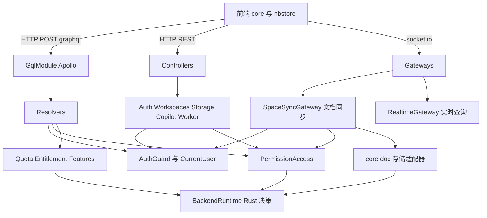
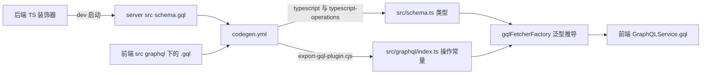
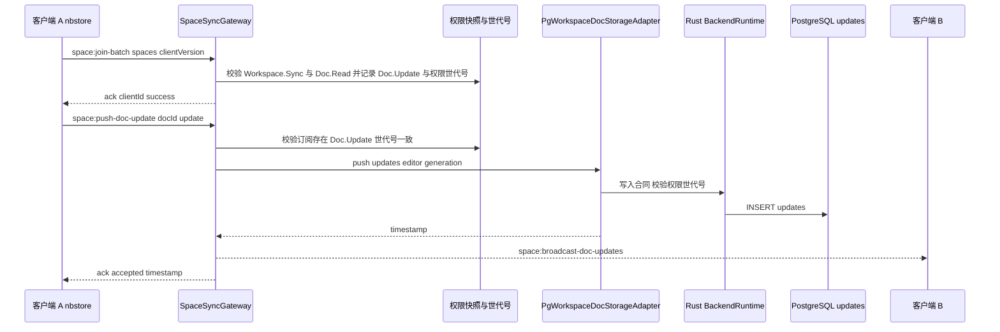
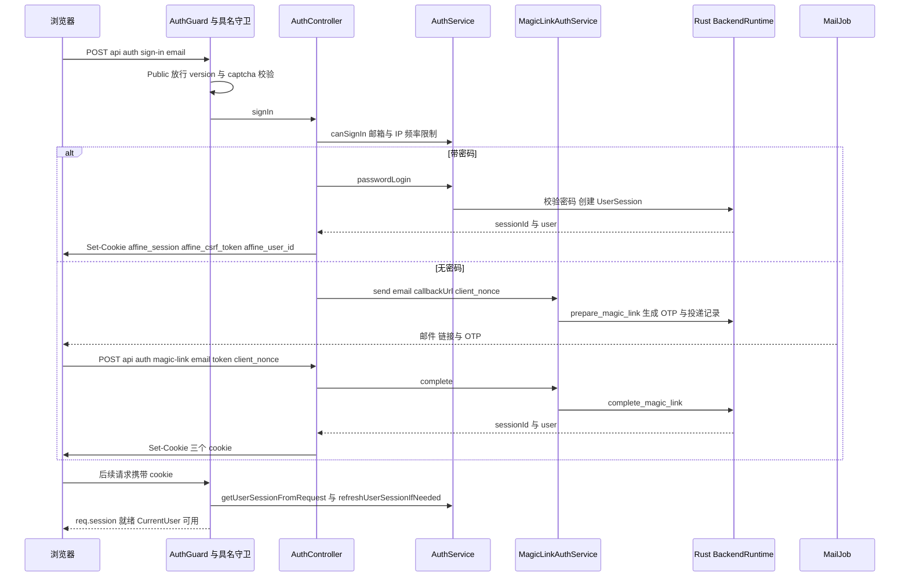
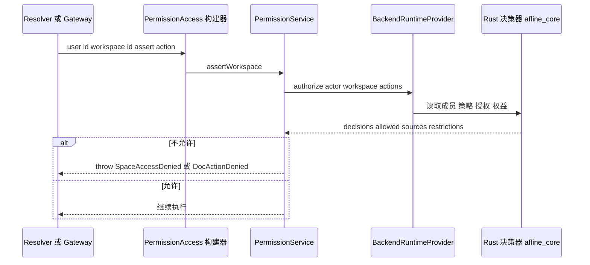

# 第 27 章 API 层：GraphQL、WebSocket、认证与权限

> **所属部分**：第 7 部分 · 后端服务 ｜ **难度**：★★★★★ ｜ **建议学时**：12 小时 ｜ **前置章节**：[第 26 章 数据层：Prisma、PostgreSQL、Redis](26-数据层-Prisma-PostgreSQL-Redis.md)

## 本章导读

第 25 章讲了"进程如何组装"，第 26 章讲了"数据存在哪里"，本章讲"**前端怎样和后端说话**"。这是全栈开发中最常打交道的一层，也是 AFFiNE 后端最复杂的一层：

- **GraphQL**：绝大多数业务 API（工作区、成员、文档元信息、评论、通知、订阅、AI 会话……），前端通过 `packages/common/graphql` 中 180 多个 `.gql` 文件调用；
- **REST**：认证、Blob 下载、文档二进制、存储上传代理、Copilot 流式输出、链接预览等不适合 GraphQL 的场景；
- **WebSocket（socket.io）**：文档实时协同同步（Yjs 增量收发、awareness 光标），以及一套新的"实时查询 / 主题订阅"协议 `realtime:*`；
- **认证与权限**：每一次调用都要先回答"你是谁"（会话 cookie、JWT、刷新令牌轮换、Magic Link、OAuth）和"你能做什么"（工作区/文档两级 action 权限）。

阅读本章时请记住第 25 章的版本特征提示：**权限决策、配额计算、会话签发、文档写入合同等核心逻辑已经下沉到 Rust 运行时**，TS 层主要负责协议适配（GraphQL/HTTP/WS）、参数校验和错误映射。理解这条"TS 协议层 → Rust 领域核心"的分界线，是读懂本章源码的钥匙。

## 学习目标

- [ ] 能够解释 GraphQL 的 Query、Mutation、ResolveField 与 code-first 模式，并说明 `src/schema.gql` 如何自动生成
- [ ] 能够读懂 `WorkspaceResolver` 中的权限断言、字段解析器与分页写法，并独立添加一个风格一致的字段
- [ ] 能够描述前端 `.gql` 文件 → `codegen.yml` → `export-gql-plugin.cjs` → `gqlFetcherFactory` → `GraphQLService.gql` 的完整调用链
- [ ] 能够列出 `SpaceSyncGateway` 的全部客户端事件与服务端推送事件，并说明一次文档更新从推送到广播的流程
- [ ] 能够解释 `core/realtime` 的 request/topic 注册机制与 `packages/common/realtime` 的类型契约
- [ ] 能够画出密码登录、Magic Link、OAuth、原生客户端令牌交换的时序图，说出三个认证 cookie 的作用
- [ ] 能够使用 `PermissionAccess` 链式 API 做工作区/文档权限检查，并说明 Action 目录与 Rust 决策器的关系
- [ ] 能够概述 quota、entitlement、features、comment、notification、doc-renderer 等核心模块的职责

## 知识地图



## 23.1 GraphQL 基础与 code-first 模式

### 23.1.1 GraphQL 速成

REST 是"一个 URL 对应一种资源"，GraphQL 是"**一个端点 `/graphql`，客户端用查询语言声明要什么字段**"。三个核心操作：

| 概念 | 作用 | 类比 |
| --- | --- | --- |
| `Query` | 读 | `GET` |
| `Mutation` | 写 | `POST`/`PUT`/`DELETE` |
| 字段解析器（Field Resolver） | 按需计算对象上的某个字段 | 懒加载的 getter |

GraphQL 的 Schema 是强类型的：每个对象类型、每个字段的类型和可空性都事先声明。前端拿到 Schema 就能生成 TS 类型——这正是 AFFiNE 前后端类型共享的基础。

### 23.1.2 code-first：从 TS 装饰器生成 Schema

有两种写 Schema 的方式：schema-first（先写 `.graphql` SDL，再写实现）和 code-first（写 TS 类 + 装饰器，框架生成 SDL）。AFFiNE 用 `@nestjs/graphql` 的 **code-first**。第 25 章讲过 `GqlModule` 的配置：非生产环境把 Schema 写入 `packages/backend/server/src/schema.gql`（当前 3026 行），`sortSchema: true` 保证输出稳定、便于 diff 审查。

一个对象类型用 `@ObjectType()` + `@Field(() => Type)` 声明，例如同文件中的 `WorkspaceRolePermissions` 有 `role`、`permissions` 两个字段。`WorkspacePermissions` 更有意思——它是**根据权限 Action 列表动态生成**的 ObjectType：

```ts
// 来源：packages/backend/server/src/core/workspaces/resolvers/workspace.ts
const WorkspacePermissions = registerObjectType<
  Record<DotToUnderline<WorkspaceAction>, boolean>
>(
  Object.fromEntries(
    WORKSPACE_ACTIONS.map(action => [
      action.replaceAll('.', '_'),
      {
        type: () => Boolean,
        options: {
          name: action.replaceAll('.', '_'),
        },
      },
    ])
  ),
  { name: 'WorkspacePermissions' }
);
```

`registerObjectType`（`src/base/graphql/register.ts`）在运行时给一个空类挂上 `@Field` 与 `@ObjectType`。于是 `Workspace.Settings.Update` 这样的 Action 会变成 GraphQL 字段 `Workspace_Settings_Update`——GraphQL 字段名不能含点号，`DotToUnderline` 类型在 TS 层同步完成这个转换。**新增一个权限 Action，GraphQL Schema 自动多一个布尔字段**。

### 23.1.3 分页：Relay 风格 Connection

`src/base/graphql/pagination.ts` 提供三件套：`PaginationInput`（`first`/`offset`/`after`）、`Paginated(classRef)`（生成 `XxxEdge` 与 `totalCount`/`edges`/`pageInfo` 结构）、`paginate(list, cursorField, input, total)`（把查询结果包装成 Connection，游标是 base64 编码的字段值）。真实用法：

```ts
// 来源：packages/backend/server/src/core/workspaces/resolvers/doc.ts
class PaginatedDocType extends Paginated(DocType) {}
// ...
  @ResolveField(() => PaginatedDocType)
  async docs(
    @CurrentUser() me: CurrentUser,
    @Parent() workspace: WorkspaceType,
    @Args('pagination', PaginationInput.decode) pagination: PaginationInput
  ): Promise<PaginatedDocType> {
    await this.ac
      .user(me.id)
      .workspace(workspace.id)
      .assert('Workspace.Users.Manage');

    const [count, rows] = await this.models.doc.paginateDocInfo(
      workspace.id,
      pagination
    );

    return paginate(rows, 'createdAt', pagination, count);
  }
```

其他 `Paginated` 用例：`PaginatedNotificationObjectType`（`src/core/notification/types.ts`）、`PaginatedCommentObjectType`、`PaginatedCommentChangeObjectType`（`src/core/comment/types.ts`）、`PaginatedGrantedDocUserType`。

## 23.2 典型 Resolver 深读：WorkspaceResolver 与 UserResolver

### 23.2.1 模块与 Resolver 拆分

`src/core/workspaces/index.ts` 的 `WorkspaceModule` 注册了 6 个 Resolver：`WorkspaceResolver`、`WorkspaceMemberResolver`、`WorkspaceDocResolver`、`DocResolver`、`DocHistoryResolver`、`WorkspaceBlobResolver`，外加 `AdminWorkspaceResolver`。它们大多以 `@Resolver(() => WorkspaceType)` 挂在同一个 GraphQL 类型上——**一个 GraphQL 类型的字段可以分散在多个 Resolver 类中实现**，按职责（成员、文档、Blob、历史）拆文件。

### 23.2.2 Query 与 Mutation：先断言权限，再调 Model

```ts
// 来源：packages/backend/server/src/core/workspaces/resolvers/workspace.ts
  @Query(() => WorkspaceType, {
    description: 'Get workspace by id',
  })
  async workspace(@CurrentUser() user: CurrentUser, @Args('id') id: string) {
    await this.ac.user(user.id).workspace(id).assert('Workspace.Read');

    const workspace = await this.models.workspace.get(id);

    if (!workspace) {
      throw new SpaceNotFound({ spaceId: id });
    }

    return workspace;
  }
  // ...
  @Mutation(() => WorkspaceType, {
    description: 'Update workspace',
  })
  async updateWorkspace(
    @CurrentUser() user: CurrentUser,
    @Args({ name: 'input', type: () => UpdateWorkspaceInput })
    { id, ...updates }: UpdateWorkspaceInput
  ) {
    await this.ac
      .user(user.id)
      .workspace(id)
      .assert('Workspace.Settings.Update');
    return this.models.workspace.update(id, updates);
  }
```

Resolver 的"三段式"几乎是固定模板：**取当前用户（`@CurrentUser`）→ 断言权限（`this.ac...assert`）→ 调 Model/Service**。没有 `@Public()` 的 Resolver 由全局 `AuthGuard` 保证 `user` 一定存在。

### 23.2.3 ResolveField：按需计算

```ts
// 来源：packages/backend/server/src/core/workspaces/resolvers/workspace.ts
  @ResolveField(() => WorkspaceRole, {
    description: 'Role of current signed in user in workspace',
    complexity: 2,
  })
  async role(
    @CurrentUser() user: CurrentUser,
    @Parent() workspace: WorkspaceType
  ) {
    // may applied in workspaces query
    if ('role' in workspace) {
      return workspace.role;
    }

    const { role } = await this.ac
      .user(user.id)
      .workspace(workspace.id)
      .permissions();

    return role ?? WorkspaceRole.External;
  }
```

`@Parent()` 是父对象（这里是 `WorkspaceType`）。只有前端查询里包含 `role` 字段时它才会执行；`workspaces` 列表查询已经批量查好了角色并放在父对象上，这里直接复用——**避免 N+1 查询**的经典手法。`complexity: 2` 为查询复杂度计算提供权重。`WorkspaceResolver` 的其他字段：`initialized`、`team`、`permissions`、`quota`。

### 23.2.4 UserResolver：防用户枚举

`src/core/user/resolver.ts` 中的 `user(email)` 查询是一个安全设计范例：它标注了 `@Throttle('strict')` 与 `@Public()`；未登录直接返回 `null`；已登录时只有查询自己、或 `models.workspaceUser.hasSharedWorkspace(currentUser.id, user.id)` 为真（与我共享工作区）才返回用户信息；"邮箱不存在"与"无权查看"同样返回 `null`，攻击者无法借此区分邮箱是否注册。源码注释直接写明 "prevent user enumeration"。`currentUser` 查询则在 `src/core/auth/resolver.ts` 的 `AuthResolver` 中。

## 23.3 前端 GraphQL 客户端：`packages/common/graphql`

### 23.3.1 目录与生成链

```text
packages/common/graphql/
├── codegen.yml              # GraphQL Code Generator 配置
├── export-gql-plugin.cjs    # 自研插件：把 .gql 导出为运行时常量
└── src/
    ├── graphql/             # 手写的 .gql 操作（含 admin/ calendar/ fragments/ license/ mcp-credentials/ 子目录）
    │   └── index.ts         # 生成：每个操作一个导出常量
    ├── schema.ts            # 生成：全部 TS 类型 + Queries/Mutations 联合类型
    ├── fetcher.ts           # gqlFetcherFactory
    └── index.ts
```

`src/graphql` 一级目录下有 141 个条目，递归统计共 182 个 `.gql` 文件。

```yaml
# 来源：packages/common/graphql/codegen.yml（节选）
schema: ../../backend/server/src/schema.gql
documents: ./src/**/*.gql
generates:
  ./src/schema.ts:
    plugins:
      - typescript
      - typescript-operations
      - ./export-gql-plugin.cjs:
          output: ./src/graphql/index.ts
```



### 23.3.2 一个 `.gql` 变成了什么

```graphql
# 来源：packages/common/graphql/src/graphql/get-current-user.gql
query getCurrentUser {
  currentUser {
    id
    name
    email
    emailVerified
    avatarUrl
    hasPassword
    features
  }
}
```

生成的运行时常量：

```ts
// 来源：packages/common/graphql/src/graphql/index.ts（生成文件）
export const getCurrentUserQuery = {
  id: 'getCurrentUserQuery' as const,
  op: 'getCurrentUser',
  query: `query getCurrentUser {
  currentUser {
    id
    // ...
  }
}`,
};
```

`export-gql-plugin.cjs` 做了几件 codegen 自带插件不做的事：按 `操作名 + Query/Mutation` 规则生成导出名并**检测重名**；解析 `#import` 行把 fragment 拼进查询；检测变量中是否含 `Upload` 类型并标记 `file`（决定是否走 multipart）；用 `parseDeprecations` 收集查询中用到的**已废弃字段**并写入 `deprecations`。

### 23.3.3 fetcher：类型从 id 推导

```ts
// 来源：packages/common/graphql/src/fetcher.ts
export type _QueryVariables<Q extends GraphQLQuery> =
  Q['id'] extends Queries['name']
    ? Extract<Queries, { name: Q['id'] }>['variables']
    : Q['id'] extends Mutations['name']
      ? Extract<Mutations, { name: Q['id'] }>['variables']
      : undefined;
// ...
export type QueryResponse<Q extends GraphQLQuery> = Extract<
  Queries | Mutations,
  { name: Q['id'] }
>['response'];
```

`schema.ts` 中有 `Queries`/`Mutations` 两个联合类型，每个成员形如 `{ name: 'getCurrentUserQuery'; variables: ...; response: ... }`。`gqlFetcherFactory` 利用常量上的 `id: 'getCurrentUserQuery' as const` 字面量类型 `Extract` 出变量与响应类型——**调用方传错变量或读错响应字段都会编译报错**。运行时它会：在 canary 构建中打印废弃字段警告；设置 `x-operation-name` 请求头；含文件时用 `transformToForm` 构造 GraphQL multipart 请求（对应后端 `graphqlUploadExpress`）；把响应中的第一个 `errors` 包装为 `@affine/error` 的 `GraphQLError`。

### 23.3.4 前端怎么调用

```ts
// 来源：packages/frontend/core/src/modules/cloud/services/graphql.ts
export class GraphQLService extends Service {
  constructor(private readonly fetcher: FetchService) {
    super();
  }

  private readonly rawGql = gqlFetcherFactory('/graphql', this.fetcher.fetch);
  // ... rxGql 将 Promise 包装为 Observable
  gql = async <Query extends GraphQLQuery>(
    options: QueryOptions<Query>
  ): Promise<QueryResponse<Query>> => {
    try {
      return await this.rawGql(options);
    } catch (anyError) {
      const error = UserFriendlyError.fromAny(anyError);

      if (error.isStatus(401)) {
        this.framework.get(AuthService).session.revalidate();
      }

      throw error;
    }
  };
}
```

业务代码（例如 `packages/frontend/core/src/modules/cloud/stores/auth.ts`）只需 `await this.gqlService.gql({ query: getCurrentUserQuery })`。401 时自动触发会话重新校验——第 25 章的 `UserFriendlyError` 在这里闭环。

## 23.4 REST Controller 全景

GraphQL 并不适合所有场景：二进制流、cookie 写入、第三方回调、SSE 流式输出、需要 HTTP 缓存语义的资源。全项目的 `@Controller` 如下（均为源码 grep 结果）：

| 路径前缀 | 控制器文件 | 主要用途 |
| --- | --- | --- |
| `/info` | `src/app.controller.ts` | 版本与 Flavor 探活 |
| `/api/auth` | `src/core/auth/controller.ts` | 登录、登出、Magic Link、会话交换/刷新/吊销 |
| `/api/auth` | `src/plugins/captcha/controller.ts` | 验证码挑战 |
| `/api/oauth` | `src/plugins/oauth/controller.ts` | OAuth preflight 与 callback |
| `/api/workspaces` | `src/core/workspaces/controller.ts` | Blob 下载、文档二进制、公开文档、历史版本、评论附件 |
| `/api/storage`（`STORAGE_PROXY_ROOT`） | `src/core/storage/r2-proxy.ts` | 上传代理 `PUT upload`、`PUT multipart` |
| `/api/avatars` | `src/core/user/controller.ts` | 本地存储头像 |
| `/workspace` | `src/core/doc-renderer/controller.ts` | 分享页 SSR / OG 元信息 / Markdown 输出 |
| `/api/setup` | `src/core/selfhost/controller.ts` | 自托管初始化管理员 |
| `/api/telemetry` | `src/core/telemetry/controller.ts` | 遥测采集 `POST /collect` |
| `/api/copilot` | `src/plugins/copilot/controller.ts`、`attachment-controller.ts` | AI 流式输出、附件 |
| `/api/workspaces/:workspaceId/mcp` | `src/plugins/copilot/mcp/controller.ts` | MCP 服务端 |
| `/api/calendar` | `src/plugins/calendar/controller.ts` | 日历 OAuth/Webhook |
| `/api/revenuecat`、`/api/team/licenses`、`/api/team/v1/licenses` 等 | `src/plugins/payment/*controller.ts` | 支付 Webhook 与 License |
| `/api/worker` | `src/plugins/worker/controller.ts` | 链接预览、图片代理 |

第 28 章会深入插件类控制器。这里看最常用的 **Blob 下载**：

```ts
// 来源：packages/backend/server/src/core/workspaces/controller.ts
  @Get('/:id/blobs/v1/:name')
  @CallMetric('controllers', 'workspace_get_blob_v1')
  async blobV1(
    @CurrentUser() user: CurrentUser | undefined,
    @Param('id') workspaceId: string,
    @Param('name') name: string,
    @Query('sourceType') sourceType: string,
    @Query('docId') docId: string,
    @Query('timestampMs') timestampMs: string | undefined,
    @Res() res: Response
  ) {
    const source = this.blobSource(workspaceId, sourceType, docId, timestampMs);
    const blob = await this.runtime.openBlobV1(user?.id, source, name);
    res.setHeader('content-type', blob.mime);
    // ... content-length、last-modified、cache-control: private, no-store
    applyAttachHeaders(res, { contentType: blob.mime, filename: name });
    const body = Readable.from(
      (async function* (runtime: BackendRuntimeProvider) {
        while (true) {
          const chunk = await runtime.readBlobStreamChunkV1(blob.streamId);
          if (chunk.body.length) yield chunk.body;
          if (chunk.done) return;
        }
      })(this.runtime)
    );
    try {
      await pipeline(body, res);
    } finally {
      await this.runtime.closeBlobStreamV1(blob.streamId);
    }
  }
```

三个设计点：

1. **"来源作用域"的 Blob 协议**：下载必须声明 Blob 来自哪篇文档（`sourceType=currentDoc&docId=...`）或哪个历史版本（`sourceType=history&timestampMs=...`），Rust 运行时据此判断"这个 Blob 是否真的被该文档引用、你是否能读这篇文档"。旧接口 `GET /:id/blobs/:name` 直接抛 `UnsupportedClientVersion`，要求客户端 `>=0.27.0`；
2. **流式传输**：用异步生成器分块从 Rust 读取，`pipeline` 写入响应，大文件不占满内存；`finally` 保证关闭流；
3. **上传走 GraphQL**：`WorkspaceBlobResolver` 提供 `setBlob`（小文件直传）以及 `createBlobUpload` → `completeBlobUpload` / `abortBlobUpload` 的分片/预签名上传流程（前端对应 `blob-upload-create.gql` 等），R2 场景再经 `/api/storage` 代理。

## 23.5 WebSocket 实时同步：`core/sync/gateway.ts`

### 23.5.1 连接与鉴权

第 25 章讲过：`SocketIoAdapter` 在握手阶段调用 `AuthWebsocketOptionsProvider.canActivate`，它复用 `AuthGuard.signIn()` 识别 cookie 会话或 `handshake.auth.tokenType === 'jwt'` 的 Bearer 令牌。未登录的连接在握手阶段就被拒绝，所以 Gateway 方法里的 `@CurrentUser()` 总是有值。测试用例名也印证了这一点：`src/__tests__/sync/gateway.spec.ts` 中有 `should reject websocket legacy session token auth`、`should connect websocket with jwt auth`。

### 23.5.2 事件清单

客户端 → 服务端（`@SubscribeMessage`，均带 ack 回包 `{ data }` 或 `{ error }`）：

| 事件 | 负载（`gateway.ts` 中的接口） | 作用 |
| --- | --- | --- |
| `space:join-batch` | `JoinSpaceBatchMessage`：`spaces: [{ spaceType, spaceId, docId? }, ...]`、`clientVersion` | 批量加入空间与文档订阅；校验客户端版本 `>=0.27.5-0`，单批上限 `MAX_SPACE_JOIN_BATCH_SIZE = 100`，需要 `Workspace.Sync` 权限 |
| `space:leave` | `LeaveSpaceMessage`：`spaceType`、`spaceId` | 离开空间 |
| `space:leave-batch` | `LeaveSpaceBatchMessage`：额外 `docIds` | 批量取消文档订阅 |
| `space:load-doc` | `LoadDocMessage`：`docId`、可选 `stateVector`（base64） | 拉取文档；返回 `missing`、`state`、`timestamp` |
| `space:push-doc-update` | `PushDocUpdateMessage`：`docId`、`update`（base64） | 推送 Yjs 增量，需要 `Doc.Update`，返回 `{ accepted, timestamp }` |
| `space:load-doc-timestamps` | `LoadDocTimestampsMessage`：可选 `timestamp` | 拉取各文档最后更新时间（过滤无权读取的文档） |
| `space:delete-doc` | `DeleteDocMessage` | 删除文档 |
| `space:doc-lifecycle` | `DocLifecycleMessage`：`lifecycle: 'trash' \| 'restore' \| 'delete'` | 回收站/恢复/彻底删除 |
| `space:load-awarenesses` | `LoadSpaceAwarenessesMessage` | 请求其他客户端上报 awareness |
| `space:update-awareness` | `UpdateAwarenessMessage`：`awarenessUpdate`（base64） | 上报自己的光标/选区 |

服务端 → 客户端（`socket.emit` / `server.to(room).emit`）：

| 事件 | 负载 | 触发时机 |
| --- | --- | --- |
| `space:broadcast-doc-updates` | `spaceType`、`spaceId`、`docId`、`updates[]`、`timestamp`、`editor?`、`compressed?` | 有人推送了更新 |
| `space:broadcast-doc-invalidation` | `spaceType`、`spaceId`、`timestamp` | 权限变化等导致订阅失效，需要重新加入 |
| `space:collect-awareness` | `spaceType`、`spaceId`、`docId` | 请求你上报 awareness |
| `space:broadcast-awareness-update` | 额外 `awarenessUpdate` | 转发他人的 awareness |
| `realtime:event` | `RealtimeEvent` | 23.6 的实时主题事件 |

前端对应的类型定义在 `packages/common/nbstore/src/impls/cloud/socket.ts` 的 `ServerEvents`/`ClientEvents`，调用在同目录 `doc.ts`（如 `socket.emitWithAck('space:push-doc-update', ...)`）——**事件名与负载在前后端各声明一份，靠测试与版本校验保证一致**。

### 23.5.3 一次推送的完整流程

```ts
// 来源：packages/backend/server/src/core/sync/gateway.ts
  @SubscribeMessage('space:push-doc-update')
  async onReceiveDocUpdate(
    @ConnectedSocket() client: Socket,
    @CurrentUser() user: CurrentUser,
    @MessageBody()
    message: PushDocUpdateMessage
  ): Promise<EventResponse<{ accepted: true; timestamp?: number }>> {
    const { spaceType, spaceId, update } = message;
    const docId = canonicalDocId(message.docId, spaceId);
    const adapter = this.selectAdapter(client, spaceType);
    // ...
    const active = this.hasActiveDocSubscription(client, spaceType, spaceId, docId);
    if (!active) {
      throw new NotInSpace({ spaceId });
    }
    if (
      !this.hasActiveDocAction(client, spaceType, spaceId, docId, 'Doc.Update')
    ) {
      throw new DocActionDenied({ action: 'Doc.Update', docId, spaceId });
    }
    const permissionGeneration = this.activeDocGeneration(client, spaceType, spaceId, docId);
    // ... 根文档走 runtime.executeDomainCommandV1({ command: 'append_root_update', ... })
    //     普通文档走 adapter.push(spaceId, docId, [Buffer.from(update, 'base64')], user.id, permissionGeneration)
    this.publishDocUpdate({ spaceType, spaceId, docId,
      updates: [Buffer.from(update, 'base64')], timestamp, editor: user.id }, client);

    return { data: { accepted: true, timestamp } };
  }
```



**权限世代号（permission generation）**是这里最精巧的设计：加入订阅时记录当时的权限世代号，此后每次推送都把它交给 Rust 写入合同核对。一旦管理员移除了某人的编辑权限，世代号变化，旧订阅推送的更新会被拒绝，并通过 `space:broadcast-doc-invalidation` 让客户端重新加入——测试 `permission revocation removes an active document subscription` 就在验证这一点。**权限不是只在"连接时"检查一次，而是在长连接的整个生命周期内持续有效**。

房间命名用 `Room(spaceId, type)` 生成 `${spaceId}:sync` 或 `${spaceId}:sync-027`，按客户端版本隔离协议；广播经第 25 章的 Redis Adapter 到达其他实例上的客户端。

## 23.6 通用实时层：`core/realtime` 与 `packages/common/realtime`

文档同步之外，前端还需要很多"实时更新的小数据"：成员列表、分享状态、通知数、配额、转写任务进度……过去这些靠 GraphQL 轮询，0.27 引入了统一的**实时查询协议**。

### 23.6.1 类型契约在共享包中

```ts
// 来源：packages/common/realtime/src/index.ts
export interface RealtimeRequestMap {
  // ...
  'workspace.members.get': {
    input: {
      workspaceId: string;
      skip?: number;
      take?: number;
      query?: string;
    };
    output: { members: WorkspaceMemberSnapshot[]; memberCount: number };
  };
  // ...
  'notification.count.get': {
    input: Record<string, never>;
    output: { count: number };
  };
  // ...
}
// ...
export interface RealtimeTopicMap {
  // ...
  'workspace.members.changed': {
    input: { workspaceId: string };
    event: { changed: true; reason: string };
  };
  // ...
}
```

前后端共同依赖 `@affine/realtime`，**一处声明，两端类型安全**。

### 23.6.2 三个 socket 事件，一个注册表

`RealtimeGateway`（`src/core/realtime/gateway.ts`）只处理三个事件：

| 事件 | 处理 |
| --- | --- |
| `realtime:request` | 校验客户端版本 `>=0.26.0-0` → `registry.getRequest(op)` → Zod 校验 `input` → `handler.handle(user, input)` |
| `realtime:subscribe` | `registry.getTopic(topic)` → 校验 → `handler.authorize(user, input)` → `client.join(handler.room(user, input))`，返回 `subscriptionId` |
| `realtime:unsubscribe` | 离开房间 |

各业务模块在 `onModuleInit` 中向 `RealtimeRegistry` 注册处理器，通常用 `registerRealtimeLiveQuery` 同时注册一对 request + topic：

```ts
// 来源：packages/backend/server/src/core/user/realtime.ts
  onModuleInit() {
    if (!this.registry) return;
    registerRealtimeLiveQuery(this.registry, {
      request: {
        name: 'user.profile.get',
        input: emptyInput,
        handle: async user => ({
          user: user ? await this.getProfile(user.id) : null,
        }),
      },
      topic: {
        name: 'user.profile.changed',
        input: emptyInput,
        authorize: async () => {},
        room: user => {
          if (!user) {
            throw new Error('Authenticated user is required');
          }
          return realtimeUserProfileRoom(user.id);
        },
      },
    });
    // ...
  }
```

数据变化时，业务代码调用 `RealtimePublisher.publishChanged(topic, input, reason)`：它先 `publishLocal`（`server.to(room).emit('realtime:event', envelope)`），再 `event.broadcast('realtime.topic.changed', payload)` 让其他实例也推送——又一次复用第 25 章的 EventBus 广播。前端收到 `{ changed: true }` 后再发一次 `realtime:request` 拉最新快照，这种"**通知 + 拉取**"模式避免了在推送里携带可能越权的数据。

### 23.6.3 完整性检查与模块装配

`src/core/realtime/required-handlers.ts` 列出了必须存在的 14 个 request（如 `workspace.access.get`、`doc.grants.get`、`comment.changes.get`、`copilot.transcript.task.get`、`user.quota-state.get`）与 13 个 topic。`RealtimeRegistryCompletenessChecker` 在 `front`/`sync` Flavor 启动时检查，缺任何一个直接抛错拒绝启动。这正是第 25 章 `ServerRealtimeHandlersModule`（装配 `WorkspaceRealtimeModule`、`CommentRealtimeModule`、`CopilotRealtimeModule`）必须存在于同步节点的原因——**把"部署形态漏装模块"这种运维错误前置到启动期**。`src/core/realtime/rooms.ts` 统一管理房间名生成函数（`realtimeWorkspaceMembersRoom`、`realtimeNotificationRoom` 等）。

## 23.7 文档存储：`core/doc`

| 文件 | 职责 |
| --- | --- |
| `storage/doc.ts` | 抽象基类 `DocStorageAdapter`：`getDoc`、`getDocDiff`、`rollbackDoc` 等模板方法，以及子类需实现的 `pushDocUpdates`、`getDocSnapshot`、`getDocUpdates`、`markUpdatesMerged`、`createDocHistory` |
| `storage/lock.ts`、`connection.ts` | 文档锁与连接抽象 |
| `adapters/workspace.ts` | `PgWorkspaceDocStorageAdapter`：工作区文档，写入走带权限合同的 `pushDocUpdatesWithContract` |
| `adapters/userspace.ts` | `PgUserspaceDocStorageAdapter`：用户级文档 |
| `reader.ts` | `DocReader` 抽象与 `DatabaseDocReader`：`getDoc`、`getDocMarkdown`、`getDocCanvas`、`getDocDiff`、`getDocContent`（带缓存，`markDocContentCacheStale` 失效） |
| `writer.ts` | `DocWriter`：服务端主动创建/更新文档（如 AI 写文档）：`createDoc`、`updateDoc`、`updateDocMeta` |
| `merge-updates.ts` | `applyUpdatesWithNative`（Rust y-octo）、`mergeUpdatesWithYjs`、`applyUpdatesWithYjs`，并记录编解码指标 |
| `codec-compare.ts` | 原生与 Yjs 编解码结果对比（灰度校验） |
| `event.ts` | `DocEventsListener`：订阅 `doc.snapshot.updated`，失效内容缓存并更新标题摘要 |
| `job.ts` | `DocStorageCronJob`：每晚清理过期历史 |
| `options.ts` | `DocStorageOptions`：按工作区计划给出历史保留期等 |

读取的核心是"快照 + 增量 = 最新状态"：

```ts
// 来源：packages/backend/server/src/core/doc/storage/doc.ts
  async getDoc(spaceId: string, docId: string): Promise<DocRecord | null> {
    await using _lock = await this.lockDocForUpdate(spaceId, docId);

    return (await this.getDocUnderLock(spaceId, docId)).doc;
  }

  protected async getDocUnderLock(
    spaceId: string,
    docId: string
  ): Promise<{ doc: DocRecord | null; snapshotUpdated: boolean }> {
    const snapshot = await this.getDocSnapshot(spaceId, docId);
    const updates = await this.getDocUpdates(spaceId, docId);

    if (updates.length) {
      const docUpdate = await this.squash(
        snapshot ? [snapshot, ...updates] : updates
      );
      return await this.squashUpdatesToSnapshot(
        spaceId, docId, updates, snapshot, docUpdate
      );
    }

    return { doc: snapshot, snapshotUpdated: false };
  }
```

`await using` 配合第 25 章的 `Lock`（`AsyncDisposable`）自动释放锁。读时如有积压增量就顺手合并回快照（读修复），配合 Worker 上 `DocJobRunner` 的定时合并（第 26 章），保证 `updates` 表不会无限膨胀。

`DocStorageAdapter` 是典型的**模板方法模式**：基类定义"加锁 → 读快照 → 读增量 → 合并 → 写回 → 记历史"的流程骨架，子类只实现存取细节。`space:load-doc` 中的 `adapter.diff(spaceId, docId, stateVector)` 利用 Yjs 状态向量只返回客户端缺失的部分（第 12 章）。

## 23.8 认证全流程：`core/auth`

### 23.8.1 三种凭证

| 凭证 | 载体 | 适用客户端 | 校验位置 |
| --- | --- | --- | --- |
| Cookie 会话 | `affine_session`（会话 ID）、`affine_user_id`（当前用户，非 httpOnly，仅供前端识别）、`affine_csrf_token`（CSRF 双提交令牌，非 httpOnly） | Web 浏览器 | `AuthGuard.signInWithCookie` → `AuthService.getUserSessionFromRequest` |
| 访问令牌 JWT | `Authorization: Bearer <jwt>` 或 socket `handshake.auth` | 桌面/移动原生客户端 | `AuthGuard.signInWithJwt` → `AccessTokenService.verify` → Rust `resolveAuthPrincipalV1` |
| 刷新令牌 | 请求体 | 原生客户端 | `POST /api/auth/session/refresh` → `AuthSessionService.refresh`（轮换） |

Cookie 名定义在 `src/core/auth/input.ts`：`SESSION_COOKIE_NAME = 'affine_session'`、`USER_COOKIE_NAME = 'affine_user_id'`、`CSRF_COOKIE_NAME = 'affine_csrf_token'`。对 cookie 会话执行"修改会话"类操作时，`AuthController.assertSessionMutationAuthorized` 要求请求头 `x-affine-csrf-token` 与 cookie 一致——**双提交 Cookie 防 CSRF**。

### 23.8.2 认证相关装饰器

| 装饰器 | 位置 | 作用 |
| --- | --- | --- |
| `@Public()` | `src/core/auth/guard.ts` | 免登录（仍会尝试识别用户） |
| `@CurrentUser()` | `src/core/auth/session.ts` | 取 `req.session?.user`，类型 `CurrentUser` |
| `@Session()` | `src/core/auth/session.ts` | 取完整会话 `UserSession & { user }` |
| `@Admin()` | `src/core/common/admin-guard.ts` | 要求管理员（`FeatureService.isAdmin`） |
| `@UseNamedGuard('version', 'captcha')` | `src/base/guard` | 客户端版本检查、验证码 |
| `@Throttle('strict')` | `src/base/throttler` | `AuthController` 类级别整体严格限流 |

### 23.8.3 `/api/auth` 路由一览

`POST /preflight`、`GET /methods`、`POST /sign-in`、`POST /sign-out`、`POST /open-app/sign-in-code`、`POST /open-app/sign-in`、`POST /session/exchange`、`POST /session/refresh`、`POST /session/revoke`、`GET /sessions`、`POST /sessions/revoke-all`、`DELETE /sessions/:id`、`POST /magic-link`、`GET /session`。

### 23.8.4 密码登录与 Magic Link

```ts
// 来源：packages/backend/server/src/core/auth/controller.ts
  @Public()
  @UseNamedGuard('version', 'captcha')
  @Post('/sign-in')
  @Header('content-type', 'application/json')
  async signIn(
    @Req() req: Request,
    @Res() res: Response,
    @Body() body?: unknown
  ) {
    const credential = SignInBodySchema.parse(body);
    validators.assertValidEmail(credential.email);
    const canSignIn = await this.auth.canSignIn(credential.email, req);
    if (!canSignIn) {
      throw new ActionForbidden();
    }

    if (credential.password) {
      await this.passwordSignIn(req, res, credential.email, credential.password);
    } else {
      await this.sendMagicLink(req, res, credential.email,
        credential.callbackUrl, credential.client_nonce);
    }
  }
```

同一个 `/sign-in` 端点：有密码走密码登录，无密码则发送 Magic Link 邮件（含链接与 6 位 OTP，见第 25 章的 `SignIn` 邮件模板）。`canSignIn` 内部用 `Cache.increaseWithTtl` 按邮箱与 IP 做登录频率限制。`MagicLinkAuthService.send` 调用 Rust `executeAuthSessionCommandV1({ action: 'prepare_magic_link', ... })` 生成 `MagicLinkOtp` 并投递邮件；用户提交 OTP 后 `POST /magic-link` 调用 `action: 'complete_magic_link'`。`client_nonce` 把"发起登录的那个浏览器"与"完成登录的请求"绑定，防止链接被转发后在别人设备上登录。

会话签发统一由 `SessionIssuer` 完成：

```ts
// 来源：packages/backend/server/src/core/auth/session-issuer.ts
  apply(res: Response, result: NativeLoginResult) {
    if (result.exchangeCode) {
      this.auth.clearCookies(res);
      return;
    }
    if (!result.sessionId || !result.sessionExpiresAt) {
      throw new Error('Native login result did not include a cookie session.');
    }
    const expires = new Date(result.sessionExpiresAt);
    res.cookie(AuthService.sessionCookieName, result.sessionId, {
      ...this.auth.cookieOptions,
      expires,
    });
    res.cookie(AuthService.csrfCookieName, randomUUID(), {
      ...this.auth.cookieOptions,
      httpOnly: false,
      expires,
    });
    this.auth.setUserCookie(res, result.user.id);
  }
```

`target(req)` 根据 `isNativeClientRequest(req)` 决定签发类型：Web 拿 cookie，原生客户端拿一次性 `exchangeCode`。



### 23.8.5 原生客户端：交换码 → 令牌对 → 轮换

桌面与移动端不依赖浏览器 cookie。登录成功后服务端返回 `exchangeCode`，客户端调用 `POST /api/auth/session/exchange`：

```ts
// 来源：packages/backend/server/src/core/auth/session-exchange.ts
  async exchange(req: Request, code: string, metadata: AuthSessionMetadata) {
    if (!isNativeClientRequest(req)) throw new ActionForbidden();
    let pair: NativeTokenPair;
    try {
      pair = await this.rt.executeAuthSessionCommandV1<NativeTokenPair>({
        action: 'exchange',
        code,
        ...metadata,
      });
    } catch (error) {
      // ... invalid_auth_state -> InvalidAuthState
    }
    this.event.emit('auth.session.created', {
      authSessionId: pair.session.id,
      platform: metadata.platform,
    });
    // ... 新设备登录时 emit('auth.security.detected', ...)
    return publicPair(pair);
  }
```

得到的令牌对对应第 26 章的 `AuthSession` + `AuthRefreshToken`：访问令牌（JWT）用于每次请求，过期后用刷新令牌调用 `/session/refresh`，服务端按 `generation` 轮换并检测重放；`/sessions`、`/sessions/:id` 让用户在"设备管理"中查看与吊销会话。`AuthGuard.checkUserSessionClientVersion` 还会在客户端版本过旧时吊销会话（硬性下限 `HARD_REQUIRED_VERSION = '>=0.25.0'`）。

### 23.8.6 OAuth

OAuth 由 `src/plugins/oauth` 提供（第 28 章介绍 provider），流程是：

1. 前端 `POST /api/oauth/preflight { provider, redirect_uri, client, client_nonce }` → `OAuthService.preflight`，返回跳转到 Google/GitHub/Apple/OIDC 的授权地址；
2. 用户授权后第三方重定向回前端页面 `/oauth/callback`（Apple 直接回到 `/api/oauth/callback`）；
3. 前端 `POST /api/oauth/callback { code, state, client_nonce }` → `OAuthService.callback`；
4. 结果为 `login` 时 `SessionIssuer.apply` 写 cookie；为 `handoff` 时（从桌面应用发起）重定向到 `/open-app/url?url=<client>://authentication?...`，把 code 交回原生应用。

`state` 校验失败、过期分别映射为 `InvalidOauthCallbackState`、`OauthStateExpired` 等 UserFriendlyError（这些错误名也在第 25 章 `IncludedEvents` 中，会被记日志）。

## 23.9 权限：`core/permission`

### 23.9.1 Action 目录

权限以"**资源 × 动作**"建模。`src/core/permission/types.ts` 用一个嵌套常量对象描述全部 Action：

```ts
// 来源：packages/backend/server/src/core/permission/types.ts
/** Action names for Node callers; Rust owns permission decisions. */
export const Actions = {
  // Workspace Actions
  Workspace: {
    Read: '',
    Preview: '',
    Sync: '',
    CreateDoc: '',
    Delete: '',
    TransferOwner: '',
    Organize: { Read: '' },
    Users: { Read: '', Manage: '' },
    Administrators: { Manage: '' },
    Properties: { Read: '', Create: '', Update: '', Delete: '' },
    Settings: { Read: '', Update: '' },
    Blobs: { Upload: '', Manage: '' },
    Copilot: '',
    Payment: { Manage: '' },
  },
  // Doc Actions
  Doc: {
    Read: '', Preview: '', Copy: '', Duplicate: '', Trash: '', Restore: '',
    Delete: '', Update: '', Publish: '', Unpublish: '',
    History: { Read: '' },
    Analytics: { Read: '', Viewers: { Read: '' } },
    TransferOwner: '',
    Properties: { Read: '', Update: '' },
    Users: { Read: '', Manage: '' },
    Comments: { Read: '', Create: '', Moderate: '' },
  },
} as const;
```

（为节省篇幅把部分子对象写成了单行，键与源码一致。）TS 类型 `WorkspaceAction`、`DocAction` 用模板字面量 + `LeafPaths` 从这棵树推导出 `'Workspace.Settings.Update'` 这样的联合类型；`Action` Proxy 让你写 `Action.Doc.Users.Manage` 得到字符串 `'Doc.Users.Manage'`；`WORKSPACE_ACTIONS`、`DOC_ACTIONS` 是全部叶子路径数组。注释写得非常直白："**Rust owns permission decisions**"——`src/core/permission/__tests__/actions.spec.ts` 中的测试 `TypeScript action facade exactly matches the native core catalog` 断言 TS 的 Action 列表与 Rust `permissionActionCatalogV1()` 返回的目录**完全一致**。

### 23.9.2 角色

```ts
// 来源：packages/backend/server/src/models/common/role.ts
export enum DocRole {
  /**
   * `None` equals to `role = null`, it only exists to give a value that API can use
   */
  None = -(1 << 15),
  External = 0,
  Reader = 10,
  Commenter = 15,
  Editor = 20,
  Manager = 30,
  Owner = 99,
}

export enum WorkspaceRole {
  External = -99,
  Collaborator = 1,
  Admin = 10,
  Owner = 99,
}
```

数值越大权限越高，便于比较。注意数据库里存的是字符串（第 26 章：`WorkspaceMember.role` 为 `owner`/`admin`/`member`，`DocGrant.role` 为 `owner`/`manager`/`editor`/`commenter`/`reader`），这两个枚举是面向 GraphQL API 的"兼容角色"（`legacyApiRole`）。

### 23.9.3 角色 × Action 矩阵在哪里

完整的"哪个角色能做哪个 Action"矩阵**不在本仓库的 TS 代码里**，而在 Rust 依赖 `affine_core`（`packages/backend/native/Cargo.toml` 中的 `affine_core = "0.0.8"`）的 `access_control` 模块中；`packages/backend/native/src/permission/mod.rs` 只负责类型转换与 NAPI 暴露（如 `doc_role_allows`、`permission_action_catalog_v1`）。Rust 决策结果会附带"来源"与"拒绝原因"，从 `map_decision` 可以看到全部取值：

| 决策来源 `source_type` | 含义 |
| --- | --- |
| `workspace-member` | 工作区成员身份 |
| `workspace-policy` / `workspace-preview-policy` | 工作区访问策略 / 预览策略 |
| `inherited-workspace-role` | 文档权限继承自工作区角色 |
| `doc-grant` | 文档显式授权（`DocGrant` 表） |
| `member-default-policy` | 成员默认文档角色（`memberDefaultDocRole`） |
| `public-policy` / `doc-preview-policy` | 公开文档策略 / 文档预览策略 |

| 拒绝原因 `restriction_type` | 含义 |
| --- | --- |
| `unknown_action` | 未知 Action |
| `workspace_not_found` | 工作区不存在 |
| `sharing-disabled` | 工作区关闭了分享 |
| `commercial_entitlement_required` | 需要商业权益（团队版） |
| `active_member_required` | 需要活跃成员 |
| `workspace_admin_required` | 需要工作区管理员 |

可以从测试用例名中读出一些可靠的事实（`src/__tests__/e2e/comment/resolver.spec.ts`、`src/__tests__/sync/gateway.spec.ts`）：Commenter 可以创建评论、Reader 不能；非成员不能评论；文档 Editor 可以更新评论；awareness 需要 `Doc.Read` 但不需要 `Doc.Update`；`space:load-doc-timestamps` 会过滤不可读文档。**要查看某个用户在某工作区的实际权限，最可靠的方式是查询 GraphQL 的 `workspace(id) { role permissions { ... } }`**——它由同一个 Rust 决策器计算。

### 23.9.4 调用方式：`PermissionAccess` 链式 API

`PermissionModule` 把 `AccessControllerBuilder` 以别名 `PermissionAccess` 导出：

```ts
// 来源：packages/backend/server/src/core/permission/builder.ts（节选）
@Injectable()
export class AccessControllerBuilder {
  constructor(private readonly permission?: PermissionService) {}
  user(userId: string) {
    return new UserAccessControllerBuilder(userId, this.permission);
  }
}
// UserAccessControllerBuilder: workspace(id) / doc(workspaceId, docId)
// WorkspaceAccessControllerBuilder: doc(id) / docs(items, action) / docPermissions / assert / can / permissions
// DocAccessControllerBuilder: assert / can / permissions
```

```ts
// 教学示例：三种常见用法（API 均来自 builder.ts）
await this.ac.user(user.id).workspace(workspaceId).assert('Workspace.Blobs.Upload'); // 无权限抛 SpaceAccessDenied
const ok = await this.ac.user(user.id).doc(workspaceId, docId).can('Doc.Read');      // 返回布尔
const visible = await this.ac.user(user.id).workspace(workspaceId).docs(items, 'Doc.Read'); // 批量过滤
```



`PermissionService`（`src/core/permission/service.ts`）只做三件事：把参数组装成 Rust 需要的输入、把结果映射为 `legacyApiRole` + `decisions`、把拒绝转换成 `SpaceAccessDenied`/`DocActionDenied`。`src/core/permission/event.ts` 的 `EventsListener` 则在成员、授权变化时触发缓存失效与实时通知。

**设计取舍**：把权限决策集中到 Rust 单点实现，好处是 GraphQL、REST、WebSocket、AI 工具、MCP 等所有入口得到**完全一致**的判定，性能也更好；代价是 TS 开发者看不到矩阵源码，需要通过测试与 API 理解行为。

## 23.10 配额、权益与功能开关

| 模块 | 关键类 | 职责 | 数据来源 |
| --- | --- | --- | --- |
| `src/core/quota` | `QuotaService`、`QuotaResolver`、`quota/realtime.ts` | 用户/工作区存储配额、单文件上限、席位数、只读状态；GraphQL 字段 `UserType.quota`、`quotaUsage`、`WorkspaceType.quota`；实时 topic `user.quota-state.changed`、`workspace.quota-state.changed` | `runtime.getUserQuotaStateV1`、`getWorkspaceQuotaStateV1` |
| `src/core/entitlement` | `EntitlementService` | `hasCommercialWorkspace`、管理员发放/撤销权益（`upsertAdminGrant`、`revokeAdminGrant`；自托管必须使用签名 License） | Rust 运行时，落库 `Entitlement` |
| `src/core/features` | `FeatureService`、`UserFeatureResolver`、`AdminFeatureManagementResolver` | `isStaff`、`isAdmin`、`addAdmin`；`UserType.features` 字段 | `Models.userFeature` 等 |

```ts
// 来源：packages/backend/server/src/core/quota/service.ts
  async getWorkspaceQuotaWithUsage(
    workspaceId: string
  ): Promise<WorkspaceQuotaWithUsage> {
    const state = await this.runtime.getWorkspaceQuotaStateV1(workspaceId);
    const quota = this.workspaceQuotaFromState(state);

    return {
      ...quota,
      usedStorageQuota: Number(state.usedStorageQuota),
      memberCount: state.memberCount,
      overcapacityMemberCount: state.overcapacityMemberCount,
    };
  }
```

注意 `Number(state.usedStorageQuota)`：Rust 侧用 64 位整数，经 NAPI 传到 JS 后需要显式转换。`WorkspaceResolver.workspaceQuota` 字段还会附上 `humanReadable`（`formatWorkspaceQuota`）。配额的"强制执行"（上传前预留、超额拒绝）发生在 Rust 运行时（第 26 章 `Blob.reservationId`、`runtime_rolling_quota_*` 表），TS 层主要负责展示。

## 23.11 其他核心模块速览

| 模块 | 关键文件 | 职责 |
| --- | --- | --- |
| `comment` | `resolver.ts`、`service.ts`、`realtime.ts`、`realtime.module.ts` | 评论与回复 CRUD（`createComment`、`resolveComment`、`createReply`、`commentChanges` 增量拉取、`uploadCommentAttachment`），实时 `comment.changed` |
| `notification` | `resolver.ts`、`service.ts`、`job.ts`、`realtime.ts` | 通知列表（`notifications` 分页）、`readNotification`、`readAllNotifications`、`mentionUser`；`NotificationWorkerModule` 定时处理 |
| `mail` | `mailer.ts`、`sender.ts`、`job.ts`、`events.ts` | 邮件入队与投递（第 26 章发件箱） |
| `doc-renderer` | `controller.ts` | `GET /workspace/*path`：分享页 SSR，注入 OG 元信息；`Accept` 为 Markdown 类型时直接返回文档 Markdown（需 `Doc.Read`）；根据 UA 选择 `static/mobile` 资源 |
| `static-files` | `static.ts` | `front` Flavor 下托管前端静态资源 |
| `selfhost` | `controller.ts`、`setup.ts`、`static.ts`、`guard.ts` | 自托管首次安装：`POST /api/setup/create-admin-user`、`SetupMiddleware`、`SelfhostGuard` |
| `version` | `service.ts`、`guard.ts` | 客户端版本范围检查（`VersionGuardProvider` 具名守卫） |
| `telemetry` | `controller.ts`、`gateway.ts`、`ga4-client.ts`、`deduper.ts` | 前端埋点采集：`POST /api/telemetry/collect` 与 socket 事件 `telemetry:batch`，去重后转发 GA4 |
| `monitor` | `service.ts` | 每分钟记录进程内存指标（`metrics.process`） |
| `storage` / `storage-runtime` | `wrappers/*`、`r2-proxy.ts`、`blob-job.ts` / `provider.ts` | 业务存储包装与上传代理 / Rust `StorageRuntime` 封装 |
| `backend-runtime` | `provider.ts`、`operations.ts`、`copilot-operations.ts`、`search-operations.ts` | 全部 Rust 领域能力的 TS 入口（第 25、26 章） |
| `config` | `resolver.ts`、`service.ts` | `serverConfig` 查询（前端获取服务端能力）、管理后台 `AppConfigResolver` |
| `user` | `resolver.ts`、`controller.ts`、`realtime.ts` | 用户资料、头像上传、设置、管理员用户管理 |

**本章小结**：所有入口——GraphQL Resolver、REST Controller、socket.io Gateway——共享同一套横切能力：`AuthGuard` 识别身份、`PermissionAccess` 判定权限、`UserFriendlyError` 统一错误、`CallMetric` 记录指标；而真正的领域规则越来越多地集中在 Rust 运行时，让多入口行为保持一致。

## 源码导读清单

| 优先级 | 路径 | 阅读重点 |
| --- | --- | --- |
| P0 | `packages/backend/server/src/core/workspaces/resolvers/workspace.ts` | Query/Mutation/ResolveField 三段式、动态 ObjectType |
| P0 | `packages/backend/server/src/core/sync/gateway.ts` | 事件接口定义、`onJoinSpaceBatch`、`onReceiveDocUpdate`、`onLoadSpaceDoc`、权限世代号 |
| P0 | `packages/backend/server/src/core/auth/guard.ts` | cookie 与 JWT 两条认证路径、客户端版本检查 |
| P0 | `packages/backend/server/src/core/auth/controller.ts` | `/api/auth` 全部路由、CSRF 校验 |
| P0 | `packages/backend/server/src/core/permission/types.ts`、`builder.ts`、`service.ts` | Action 目录、链式 API、Rust 决策映射 |
| P0 | `packages/common/graphql/src/fetcher.ts` | 从操作 id 推导类型、multipart、错误处理 |
| P1 | `packages/common/graphql/export-gql-plugin.cjs`、`codegen.yml` | 前端生成链 |
| P1 | `packages/backend/server/src/core/realtime/gateway.ts`、`publisher.ts`、`required-handlers.ts` | 实时协议与完整性检查 |
| P1 | `packages/common/realtime/src/index.ts` | `RealtimeRequestMap`、`RealtimeTopicMap` 契约 |
| P1 | `packages/backend/server/src/core/doc/storage/doc.ts`、`adapters/workspace.ts` | 模板方法、带合同的写入 |
| P1 | `packages/backend/server/src/core/auth/session-issuer.ts`、`session-exchange.ts`、`magic-link.ts` | 会话签发、令牌交换、Magic Link |
| P1 | `packages/backend/server/src/core/workspaces/controller.ts` | 来源作用域 Blob 下载、流式响应 |
| P2 | `packages/common/nbstore/src/impls/cloud/socket.ts`、`doc.ts` | 前端 socket 事件类型与调用 |
| P2 | `packages/backend/native/src/permission/mod.rs` | 决策来源与拒绝原因 |
| P2 | `packages/backend/server/src/core/quota/service.ts`、`doc-renderer/controller.ts` | 配额读取、分享页渲染 |

## 动手实践

### 练习 1：在 GraphiQL 中探索 Schema

- **目标**：熟悉 GraphQL 与 AFFiNE Schema。
- **步骤**：
  1. 本地以开发模式启动后端（`GqlModule` 在 `NODE_ENV=development` 时开启 `graphiql`），浏览器登录前端后访问 `http://localhost:3010/graphql`；
  2. 执行 `query { currentUser { id email } workspaces { id role permissions { Workspace_Settings_Update Workspace_Users_Manage } } }`；
  3. 在 `src/schema.gql` 中找到 `WorkspacePermissions` 类型，与 `types.ts` 中的 `Actions.Workspace` 对照。
- **验收标准**：能解释为什么字段名是下划线形式，以及新增一个 Workspace Action 后 Schema 会怎样变化。

### 练习 2：为 Workspace 添加一个只读字段（教学草稿）

- **目标**：掌握 Resolver 三段式与前端生成链。
- **步骤**：
  1. 在本地草稿分支中给 `WorkspaceResolver` 添加 `@ResolveField(() => Int, { name: 'memberCountDemo' })`，内部先 `this.ac.user(user.id).workspace(workspace.id).assert('Workspace.Users.Read')`，再调用 `QuotaService.getWorkspaceQuotaWithUsage` 返回 `memberCount`；
  2. 开发模式启动后端，确认 `src/schema.gql` 自动更新；
  3. 在 `packages/common/graphql/src/graphql/` 草拟一个 `.gql` 查询该字段，思考运行 codegen 后 `src/graphql/index.ts` 会多出什么导出。
- **验收标准**：能写出生成的常量名，并说明前端调用时变量和响应类型如何被推导。完成后丢弃草稿改动。

### 练习 3：抓包观察同步协议

- **目标**：把事件表与真实流量对上。
- **步骤**：
  1. 打开浏览器开发者工具 Network → WS，打开一个云端工作区文档；
  2. 找到 `space:join-batch` 的发送帧与 ack，输入文字后观察 `space:push-doc-update` 与 ack 中的 `timestamp`；
  3. 再开一个窗口同时编辑，观察 `space:broadcast-doc-updates` 与 awareness 相关事件。
- **验收标准**：能把至少 6 个事件对应到 23.5.2 的表格，并解释 `update` 字段为什么是 base64。

### 练习 4：画出你自己的认证时序

- **目标**：串起认证全流程。
- **步骤**：阅读 `AuthController.signIn`、`SessionIssuer.target/apply`、`AuthGuard.signInWithCookie/signInWithJwt`、`SessionExchangeService.exchange`，分别为"Web 密码登录"和"桌面端 Magic Link 登录"画时序图。
- **验收标准**：两张图能体现 `exchangeCode` 出现的时机、三个 cookie 的写入点、JWT 的校验位置。

### 练习 5：追踪一次权限拒绝

- **目标**：理解权限链路与错误映射。
- **步骤**：用一个 Reader 角色的账号尝试评论或编辑文档，观察 GraphQL 响应中的 `extensions.name` 与 `extensions.data`；在源码中从 Resolver 的 `assert` 追到 `PermissionService.assertDoc` 与 `DocActionDenied`。
- **验收标准**：能说出错误名、HTTP 状态码（参考第 25 章 `no_permission`/`action_forbidden` 映射）以及 `data` 中包含的字段。

## 自测题

1. code-first 模式下 `src/schema.gql` 何时生成？为什么生产环境不写文件？
2. `WorkspacePermissions` 为什么要动态生成？字段名为何是下划线？
3. `ResolveField` 中 `if ('role' in workspace) return workspace.role` 解决了什么问题？
4. 前端 `gqlFetcherFactory` 如何在不写泛型参数的情况下推导出响应类型？
5. 列出 `SpaceSyncGateway` 的 4 个服务端推送事件，并说明 `space:broadcast-doc-invalidation` 何时出现。
6. 什么是"权限世代号"？它解决了长连接中的什么问题？
7. `realtime:subscribe` 收到事件后前端为何还要再发 `realtime:request`？
8. `affine_session`、`affine_user_id`、`affine_csrf_token` 三个 cookie 各自的作用？为什么后两者不是 httpOnly？
9. 原生客户端为什么不直接使用 cookie？交换码之后发生了什么？
10. 角色 × Action 矩阵在哪里定义？TS 侧如何保证 Action 列表与 Rust 一致？

<details><summary>参考答案</summary>

1. 非生产环境下 `GqlModule` 启动时根据装饰器生成并写入 `src/schema.gql`（测试写 `node_modules/.cache/schema.gql`）；生产环境 `autoSchemaFile: true` 只在内存中生成，避免写文件且 Schema 已随代码固定。
2. 让 GraphQL 的权限字段与 Action 目录自动保持一致，新增 Action 无需手动改 Schema；GraphQL 字段名不允许点号，因此用 `replaceAll('.', '_')`，TS 侧用 `DotToUnderline` 类型同步。
3. `workspaces` 列表查询已经批量取得每个工作区的角色并放在父对象上，字段解析器直接复用，避免对每个工作区再发一次权限查询（N+1 问题）。
4. 生成的操作常量带有 `id: 'xxxQuery' as const` 字面量类型，`schema.ts` 中的 `Queries`/`Mutations` 联合类型以同名 `name` 标注，`QueryResponse<Q>` 用 `Extract<..., { name: Q['id'] }>['response']` 推导出响应类型。
5. `space:broadcast-doc-updates`、`space:broadcast-doc-invalidation`、`space:collect-awareness`、`space:broadcast-awareness-update`。当权限变化等原因导致已有文档订阅失效时广播 invalidation，客户端需要重新 `join-batch`。
6. 加入订阅时记录的权限版本号，后续每次推送都交给 Rust 写入合同核对。它保证权限撤销能立刻作用于已建立的长连接，而不是只在连接时检查一次。
7. 主题事件只携带 `{ changed: true, reason }`，不携带数据本身；前端再通过 request 拉取最新快照，这样推送通道不会泄露越权数据，也让多实例下的推送逻辑保持简单。
8. `affine_session` 是 httpOnly 的会话 ID，用于服务端认证；`affine_user_id` 让前端知道当前登录的是哪个用户（服务端仍以会话 cookie 为准）；`affine_csrf_token` 用于双提交防 CSRF，前端需读取它放入 `x-affine-csrf-token` 请求头，所以两者都不能是 httpOnly。
9. 原生应用的 WebView/系统浏览器 cookie 不可靠、跨进程难共享，且需要设备级会话管理。登录后服务端只返回一次性 `exchangeCode`，客户端调用 `/api/auth/session/exchange` 换取访问令牌（JWT）与刷新令牌，后续以 Bearer 访问，过期后用刷新令牌在 `/session/refresh` 轮换。
10. 在 Rust 依赖 `affine_core` 的 `access_control` 模块中；`src/core/permission/__tests__/actions.spec.ts` 断言 `WORKSPACE_ACTIONS`/`DOC_ACTIONS` 与 `permissionActionCatalogV1()` 返回的目录完全一致。

</details>

## 常见坑与排错

| 现象 | 可能原因 | 解决 |
| --- | --- | --- |
| 前端报某个 `xxxQuery` 不存在或类型不对 | 只改了后端或 `.gql`，没重新生成 | 开发模式启动后端更新 `schema.gql`，再运行前端 GraphQL codegen |
| GraphQL 返回 `GRAPHQL_BAD_REQUEST` | 查询字段/变量与 Schema 不符 | 查看 `extensions.data.message`；对照 `src/schema.gql` |
| GraphQL 请求被 CSRF 拦截 | 缺少 `content-type` 请求头（`csrfPrevention.requestHeaders`） | 使用 `gqlFetcherFactory`，或手动加 `content-type: application/json` |
| WebSocket 连接立即断开 | 握手阶段认证失败，或客户端版本过低 | 检查 cookie/JWT；`space:join-batch` 要求 `clientVersion >= 0.27.5-0` |
| `NotInSpace` 错误 | 未先 `space:join-batch` 加入文档订阅，或订阅因权限变化失效 | 先加入订阅；收到 invalidation 后重新加入 |
| 旧客户端下载 Blob 报 `UnsupportedClientVersion` | 旧接口 `/blobs/:name` 已废弃 | 升级客户端，使用 `/blobs/v1/:name?sourceType=...` |
| 修改会话的请求返回 `ActionForbidden` | cookie 会话缺少 `x-affine-csrf-token` 头或与 cookie 不一致 | 从 `affine_csrf_token` cookie 读取并放入请求头 |
| `sync` Flavor 启动报 `Realtime gateway missing handlers` | 缺少 `ServerRealtimeHandlersModule` 或某模块未注册 handler | 检查 `buildAppModule` 条件与各 `*RealtimeModule` 的 `onModuleInit` |
| 权限结果与预期不符 | 不了解 Rust 决策来源 | 查询 `workspace { permissions }` 或看 `decisions[].sources`、`restrictions` |

## 延伸阅读

- GraphQL 官方文档（graphql.org）：Queries、Mutations、Schema、Pagination（Connection 规范）
- NestJS 文档：GraphQL Resolvers、Field middleware、Complexity；WebSockets Gateways
- GraphQL Code Generator 文档：typescript、typescript-operations、自定义插件
- socket.io 文档：Rooms、Acknowledgements、Redis Adapter
- OWASP：Cross-Site Request Forgery Prevention Cheat Sheet（Double Submit Cookie）、Session Management；OAuth 2.0 Security Best Current Practice；Refresh Token Rotation
- 本书 [第 12 章 CRDT 与 Yjs 原理](../03-编程语言与基础技术/12-CRDT与Yjs原理.md)、[第 23 章 存储与同步引擎 nbstore](../06-前端应用/23-存储与同步引擎nbstore.md)

## 学时拆分

| 内容 | 建议时长 |
| --- | --- |
| 23.1–23.2 GraphQL 基础与典型 Resolver | 2 小时 |
| 23.3 前端 GraphQL 客户端与生成链 | 1 小时 |
| 23.4 REST Controller 与 Blob 下载 | 1 小时 |
| 23.5–23.6 WebSocket 同步与实时层 | 2 小时 |
| 23.7 文档存储 | 1 小时 |
| 23.8 认证全流程 | 1.5 小时 |
| 23.9 权限 | 1.5 小时 |
| 23.10–23.11 配额权益与其他模块 | 0.5 小时 |
| 动手实践与自测 | 1.5 小时 |
| **合计** | **12 小时** |

---
上一章：[第 26 章 数据层：Prisma、PostgreSQL、Redis](26-数据层-Prisma-PostgreSQL-Redis.md) ｜ 下一章：[第 28 章 业务插件：AI、搜索、支付等](28-业务插件-AI-搜索-支付等.md) ｜ [返回目录](../README.md)
