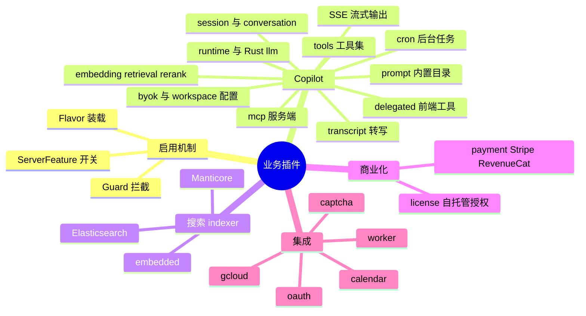
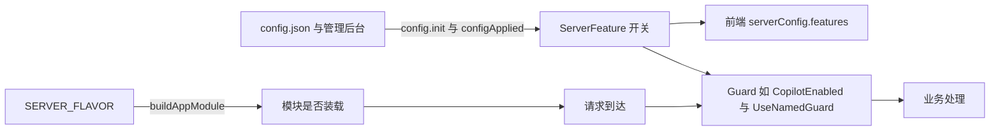
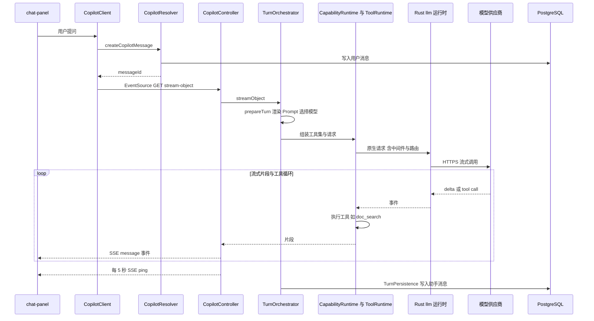
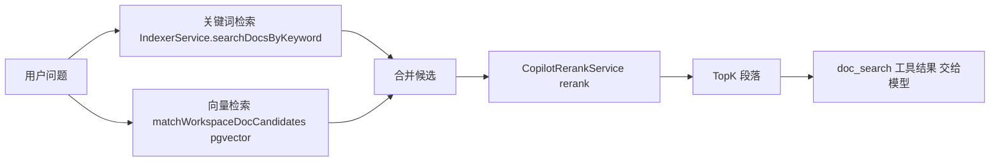
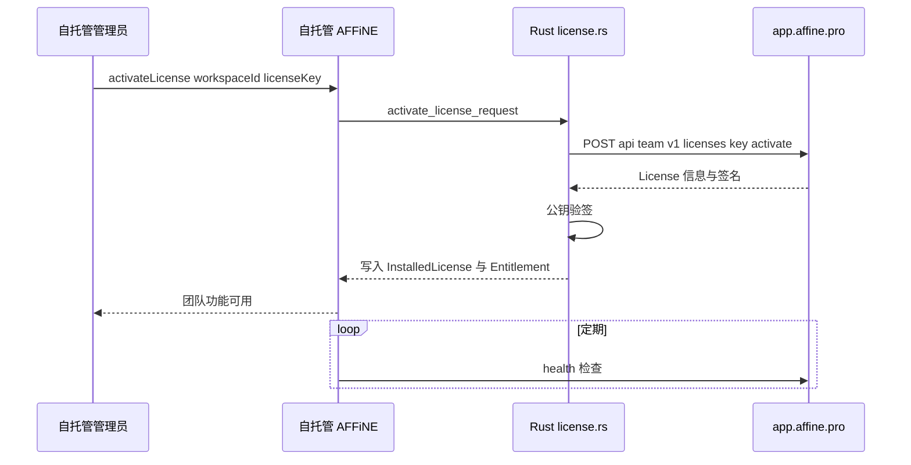

# 第 28 章 业务插件：AI、搜索、支付等

> **所属部分**：第 7 部分 · 后端服务 ｜ **难度**：★★★★☆ ｜ **建议学时**：12 小时 ｜ **前置章节**：[第 27 章 API 层：GraphQL、WebSocket、认证与权限](27-API层-GraphQL-WebSocket-认证权限.md)

## 本章导读

`packages/backend/server/src/plugins` 下有 9 个"插件"目录：`copilot`、`indexer`、`payment`、`license`、`oauth`、`calendar`、`captcha`、`worker`、`gcloud`。它们和 `core` 的区别在于：**没有它们 AFFiNE 也能作为一个协同编辑器运行**，但有了它们才有 AI 助手、全文搜索、订阅付费、第三方登录、日历集成……

这些插件的规模差异极大：`copilot` 约 1.7 万行 TS（还不算 Rust 侧的 `packages/backend/native/src/llm`），`gcloud` 只有约 100 行。本章先讲清"插件是怎么被启用的"，然后用大约一半的篇幅深读 Copilot——它是 AFFiNE 当前最复杂、演进最快的子系统；接着依次讲 indexer、payment、license、oauth、calendar、captcha、worker、gcloud，每个插件都给出"**职责 / 关键文件 / 外部依赖 / 配置项**"表。

与前几章一致，本章会反复看到同一个架构模式：**TS 负责协议入口（GraphQL/SSE/Webhook/MCP）与宿主能力（读文档、权限、存储），Rust 负责领域核心（模型路由、Prompt 渲染、搜索投影、支付状态机、License 校验）**。读懂这条分界线，比记住每个文件更重要。

## 学习目标

- [ ] 能够说明插件的三层启用机制：按 Flavor 装载模块、按配置开启能力（`ServerFeature`）、按守卫拦截请求
- [ ] 能够画出 Copilot 一次对话从前端 `createCopilotMessage` 到 SSE 流式返回的完整链路
- [ ] 能够说出 Copilot 的 Prompt、Provider、Tool、Embedding、Retrieval、Transcript、MCP、BYOK 各自的职责与关键文件
- [ ] 能够列出 Copilot 全部内置工具（`doc_read`、`doc_search` 等）及其作用、启用条件
- [ ] 能够解释 indexer 的三种 provider（embedded、Elasticsearch、Manticore）与 Rust `search_index` 的关系
- [ ] 能够描述 Stripe/RevenueCat Webhook 的处理方式与幂等设计，以及 License 的激活与离线校验
- [ ] 能够说明 OAuth、日历同步、验证码、链接预览/图片代理、GCloud 集成的实现要点

## 知识地图



## 24.1 插件机制：三层启用

### 24.1.1 第一层：按 Flavor 装载模块

插件目录下没有统一的 `index.ts` 注册表，装载规则全部写在 `src/app.module.ts` 的 `buildAppModule` 中（第 25 章）：

| 插件模块 | 装载条件 |
| --- | --- |
| `IndexerModule` | `env.isApi \|\| env.isFrontend` |
| `CopilotWorkerModule`、`CalendarWorkerModule` | `env.isWorker` |
| `LicenseModule`、`PaymentModule`、`CopilotModule`、`CaptchaModule`、`OAuthModule`、`CalendarModule` | `env.flavors.graphql` |
| `CopilotRealtimeModule`（经 `ServerRealtimeHandlersModule`） | `!graphql && (sync \|\| front)` |
| `WorkerModule` | `!workerOnly && (env.dev \|\| env.selfhosted)` |
| `GCloudModule` | `env.gcp` |

注意 `WorkerModule`（链接预览/图片代理）只在开发和自托管时装载——官方云上这部分能力由独立的边缘服务承担。

### 24.1.2 第二层：按配置开启能力

模块装载了不代表功能可用。每个插件在 `config.init` 或 `backendRuntime.configApplied` 事件中检查自己的配置，并通过 `ServerService.enableFeature/disableFeature` 告诉前端"我能用"：

```ts
// 来源：packages/backend/server/src/core/config/types.ts
export enum ServerFeature {
  Captcha = 'captcha',
  Copilot = 'copilot',
  CopilotEmbedding = 'copilot_embedding',
  Payment = 'payment',
  OAuth = 'oauth',
  Indexer = 'indexer',
  Comment = 'comment',
  LocalWorkspace = 'local_workspace',
}
```

`enableFeature` 的调用点分别在 `src/plugins/copilot/feature.ts`、`copilot/workspace/service.ts`、`payment/service.ts`、`oauth/service.ts`、`indexer/service.ts`、`captcha/service.ts`、`src/core/comment/resolver.ts`、`src/core/config/service.ts`。前端通过 `serverConfig { features }` 查询得知开关，决定是否显示 AI 面板、订阅按钮、第三方登录按钮。

### 24.1.3 第三层：守卫拦截

以 Copilot 为例：

```ts
// 来源：packages/backend/server/src/plugins/copilot/feature.ts
@Injectable()
export class CopilotFeatureService {
  constructor(
    private readonly runtime: BackendRuntimeProvider,
    private readonly server: ServerService
  ) {}
  get enabled() {
    return this.runtime.copilotEnabled();
  }
  @OnEvent('config.init')
  onConfigInit() {
    this.syncServerFeature();
  }
  @OnEvent('backendRuntime.configApplied')
  onConfigApplied(event: Events['backendRuntime.configApplied']) {
    if ('copilot' in event.updates) {
      this.syncServerFeature();
    }
  }
  // ... assertEnabled / syncServerFeature
}

@Injectable()
export class CopilotFeatureGuard implements CanActivate {
  constructor(private readonly feature: CopilotFeatureService) {}
  canActivate() {
    this.feature.assertEnabled();
    return true;
  }
}
export const CopilotEnabled = () => UseGuards(CopilotFeatureGuard);
```

`CopilotController`、`WorkspaceMcpController` 类上都有 `@CopilotEnabled()`。验证码插件则通过第 25 章的具名守卫机制注册为 `captcha`（见 24.9）。



### 24.1.4 插件配置大多由 Rust 拥有

几乎所有插件的配置都用 `defineNativeModuleConfig` 登记（第 25 章）：`copilot`、`indexer`、`payment`、`oauth` 的描述符来自 `serverNativeModule.appConfigDescriptors(...)`。只有 `captcha`、`calendar`、`worker` 仍用 TS 的 `defineModuleConfig`。这意味着在 TS 里注入的 `Config` 读不到 `oauth.providers.google.clientSecret` 之类的值——它们只存在于 Rust 运行时内存中。

## 24.2 Copilot 总览：模块拆分与目录地图

### 24.2.1 六个 Nest 模块

```ts
// 来源：packages/backend/server/src/plugins/copilot/index.ts（节选）
@Module({
  imports: [ServerConfigModule],
  providers: [CopilotFeatureService, CopilotFeatureGuard],
  exports: [CopilotFeatureService, CopilotFeatureGuard],
})
export class CopilotAvailabilityModule {}

@Module({
  imports: [...COPILOT_SHARED_IMPORTS, CopilotAvailabilityModule],
  providers: [...COPILOT_KERNEL_PROVIDERS],
  exports: [CopilotAvailabilityModule, ...COPILOT_KERNEL_PROVIDERS],
})
export class CopilotKernelModule {}
// CopilotRealtimeModule / CopilotFeatureModule / CopilotApiModule 略
@Module({
  imports: [PermissionModule, CopilotKernelModule, CopilotFeatureModule, CopilotApiModule],
  providers: [McpCredentialService, McpCredentialResolver],
  controllers: [CopilotAttachmentController, CopilotController, WorkspaceMcpController],
})
export class CopilotModule {}

@Module({
  imports: [CopilotKernelModule, CopilotFeatureModule],
  providers: [...COPILOT_JOB_PROVIDERS],
})
export class CopilotWorkerModule {}
```

| 模块 | 内容 | 用在哪里 |
| --- | --- | --- |
| `CopilotAvailabilityModule` | 开关与守卫 | 所有 Copilot 模块 |
| `CopilotKernelModule` | `COPILOT_KERNEL_PROVIDERS`：会话、Prompt、运行时、检索、存储等核心服务 | 被其余模块依赖 |
| `CopilotRealtimeModule` | 转写、embedding 进度、委托编辑器的实时处理器 | sync/front 节点 |
| `CopilotFeatureModule` | 功能级服务 | API 与 Worker |
| `CopilotApiModule` | Resolver 等 API 提供者 | graphql 节点 |
| `CopilotModule` | 三个 Controller + MCP 凭证 | graphql 节点 |
| `CopilotWorkerModule` | `CopilotCronJobs` 等 | worker 节点 |

所有 provider 数组集中在 `src/plugins/copilot/module-providers.ts`，例如 `COPILOT_RUNTIME_PROVIDERS` 里有 `ChatSessionService`、`ConversationStore`、`PromptService`、`NativeEmbeddingService`、`CopilotRerankService`、`DocumentRetrievalService`、`ArtifactRetrievalService`、`DelegatedEditorService`、`PromptRuntime`、`CapabilityRuntime`、`ToolRuntime`、`TurnPersistence` 等，并用 `{ provide: DOCUMENT_VECTOR_SEARCH, useExisting: NativeEmbeddingService }`、`{ provide: EMBEDDING_RERANK_RUNTIME, useExisting: CapabilityRuntime }` 做接口与实现的解耦。

### 24.2.2 目录地图

| 子目录/文件 | 职责 |
| --- | --- |
| `session.ts` | `ChatSession` 与 `ChatSessionService`：会话创建、更新、分叉、清理、追加轮次、生成标题 |
| `conversation/` | `ConversationStore`（持久化）、`ConversationInboxService`（消息入站）、`ConversationPolicy` |
| `compat/` | 旧版 GraphQL 历史/提交接口的兼容投影（`CompatHistoryProjector`、`CompatSubmissionStore` 等） |
| `prompt/` | `PromptService`：从 Rust 内置目录读取、渲染 Prompt |
| `runtime/` | `TurnOrchestrator`（一轮对话编排）、`CapabilityRuntime`（文本/结构化/embedding/rerank 能力）、`ToolRuntime`（组装工具集）、`PromptRuntime`、`native-request-runtime.ts`、`hosts/`（附件、图片结果、轮次持久化等宿主能力）、`contracts/` |
| `providers/` | Provider 类型、附件处理、工具函数 |
| `tools/` | 全部内置工具（24.5） |
| `embedding/`、`retrieval/` | 向量化、检索、rerank（24.6） |
| `transcript/` | 音频转写（24.7） |
| `mcp/` | MCP 服务端与凭证（24.8） |
| `byok/` | 工作区自带密钥（24.8） |
| `workspace/` | 工作区级 AI 配置：忽略文档、制品管理、embedding 开关 |
| `delegated/` | 委托前端执行工具（读编辑器实时状态） |
| `access/`、`access.ts`、`availability.ts`、`feature.ts` | 访问控制与开关 |
| `controller.ts`、`attachment-controller.ts`、`resolver.ts` | HTTP/SSE 与 GraphQL 入口 |
| `cron.ts` | 定时任务 |

## 24.3 Copilot 主链路：从提问到 SSE 流式回答

### 24.3.1 前端如何调用

前端 AI 代码在 `packages/frontend/core/src/blocksuite/ai`：

| 文件 | 作用 |
| --- | --- |
| `provider/ai-provider.ts` | `AIProvider`：前端 AI 能力的注册中心，各 action（总结、翻译、生成图片……）通过它分发 |
| `provider/setup-provider.tsx` | `setupAIProvider`：注入用户信息、图片引擎（`photoEngine`）、引导等 |
| `runtime/request/service.ts` | `AIRequestService`，经 `runtime/request/provider.ts` 的 `getAIRequestService()` 全局获取 |
| `runtime/request/copilot-client.ts` | `CopilotClient`：GraphQL 调用（`createCopilotSessionMutation`、`createCopilotMessageMutation`、`getCopilotHistoriesQuery` 等）+ 构造 SSE URL |
| `provider/event-source.ts` | `toTextStream`：把 `EventSource` 包装为 `AsyncIterable`，处理超时与错误 |
| `chat-panel/` | 侧边栏聊天面板 UI |

```ts
// 来源：packages/frontend/core/src/blocksuite/ai/runtime/request/copilot-client.ts
export enum Endpoint {
  Action = 'action',
  StreamObject = 'stream-object',
  Images = 'images',
}
// ...
    let url =
      endpoint === Endpoint.Action
        ? `/api/copilot/actions/${sessionId}/stream`
        : `/api/copilot/chat/${sessionId}/${endpoint}`;
    const queryString = this.paramsToQueryString({
      messageId, reasoning, profileId, modelId, routeTargetId,
      toolsConfig, actionId, actionVersion, runId, retry, byokLeaseId,
    });
    if (queryString) {
      url += `?${queryString}`;
    }
    return this.eventSource(url);
```

也就是说一次对话分两步：**先用 GraphQL `createCopilotMessage` 把用户消息（含附件）提交到会话、拿到 `messageId`；再用浏览器原生 `EventSource` 以 GET 方式打开 SSE 流**，参数全部放在 query string 里。

### 24.3.2 后端 SSE 端点

```ts
// 来源：packages/backend/server/src/plugins/copilot/controller.ts
export interface ChatEvent {
  type: 'event' | 'attachment' | 'message' | 'error' | 'ping';
  id?: string;
  data: string | object;
}

const PING_INTERVAL = 5000;

@CopilotEnabled()
@Controller('/api/copilot')
export class CopilotController implements BeforeApplicationShutdown {
  private readonly ongoingStreamCount$ = new BehaviorSubject(0);
  // ...
  private mergePingStream(
    messageId: string,
    source$: Observable<ChatEvent>
  ): Observable<ChatEvent> {
    const subject$ = new Subject();
    const ping$ = interval(PING_INTERVAL).pipe(
      map(() => ({ type: 'ping' as const, id: messageId, data: '' })),
      takeUntil(subject$)
    );

    return merge(source$.pipe(finalize(() => subject$.next(null))), ping$);
  }
```

| 端点 | 方法 | 用途 |
| --- | --- | --- |
| `/api/copilot/chat/:sessionId/stream` | SSE | 纯文本流 |
| `/api/copilot/chat/:sessionId/stream-object` | SSE | 结构化对象流（文本片段、工具调用、引用等） |
| `/api/copilot/actions/:sessionId/stream` | SSE | AI Action 流 |
| `/api/copilot/chat/:sessionId/images` | SSE | 图片生成，事件类型 `attachment` |
| `/api/copilot/unsplash/photos` | GET | Unsplash 图片搜索代理 |
| `/api/copilot/chat/:sessionId/attachments/:key` | — | 附件上传（`attachment-controller.ts`，`server.ts` 为它单独配置了 20MB raw body 解析） |

**SSE 协议要点**：NestJS 的 `@Sse()` 装饰器要求方法返回 `Observable<MessageEvent>`，框架会把每个元素写成 `event: <type>\nid: <id>\ndata: <data>\n\n`。AFFiNE 的事件类型有 `message`、`attachment`、`event`、`error`、`ping` 五种：

- **`ping` 每 5 秒一次**：防止代理/负载均衡器因空闲断开长连接；
- **错误也走流内事件**：`mapSseError`（第 25 章 `src/base/nestjs/exception.ts`）把异常映射成 `{ type: 'error', data: error.toJSON() }`，因为 SSE 响应头已发出，无法再改 HTTP 状态码；
- **优雅关闭**：`ongoingStreamCount$` 记录进行中的流，`beforeApplicationShutdown` 等待它归零后才允许进程退出——滚动发布时不会截断用户正在看的回答；
- **客户端断开**：`getSignal(req)`（`copilot/utils.ts`）把请求关闭转换为 `AbortSignal` 一路传给模型调用，用户关掉面板就停止计费。

### 24.3.3 一轮对话的编排：TurnOrchestrator

```ts
// 来源：packages/backend/server/src/plugins/copilot/runtime/turn-orchestrator.ts
  async streamText(
    userId: string,
    sessionId: string,
    query: Record<string, string | string[]>,
    signal?: AbortSignal,
    wasAborted: () => boolean = () => false
  ) {
    const { prepared, finalMessage, selection } =
      await this.prepareChatSelection(userId, sessionId, query, {
        responseMode: 'text',
      });

    const stream = this.streamTextResult(
      prepared.session,
      selection.conditions,
      finalMessage,
      { ...selection.providerOptions, signal },
      wasAborted
    );

    return { messageId: prepared.messageId, model: selection.model, finalMessage, stream };
  }

  private async *streamTextResult(
    session: ChatSession,
    conditions: ModelConditions,
    finalMessage: ReturnType<ChatSession['finish']>,
    options: Record<string, unknown>,
    wasAborted: () => boolean
  ) {
    let buffer = '';
    for await (const chunk of this.runtime.streamText(conditions, finalMessage, options)) {
      buffer += chunk;
      yield chunk;
    }
    await this.turnPersistence.persistTextResult(session, buffer, wasAborted());
  }
```

`prepareChatSelection` 内部会准备会话轮次（`conversations.prepareTurn`）、必要时对用户选中的文档做即时向量化（`embeddings.prepareSelectedDocuments`）、选择模型与路由。流结束后 `TurnPersistence` 把完整回答写入 `AiSessionMessage`（第 26 章），并记录是否被用户中断。



## 24.4 Prompt、Provider 与 Rust LLM 运行时

### 24.4.1 Prompt：内置目录在 Rust 资产中

```ts
// 来源：packages/backend/server/src/plugins/copilot/prompt/service.ts
@Injectable()
export class PromptService {
  protected readonly logger = new Logger(PromptService.name);
  constructor() {
    this.logger.log('Using native built-in prompt catalog.');
  }
  async get(name: string): Promise<ResolvedPrompt | null> {
    const builtInPromptSpec = this.lookupBuiltInPromptSpec(name);
    if (!builtInPromptSpec) return null;
    return this.describeBuiltInPromptSpec(builtInPromptSpec);
  }
  finish(prompt: ResolvedPrompt, params: PromptParams, sessionId?: string): PromptMessage[] {
    const rendered = renderBuiltInPromptNative({
      name: prompt.name,
      renderParams: params,
    });
    this.logWarnings(rendered.warnings, sessionId);
    return rendered.messages;
  }
  // ... renderSession / lookupBuiltInPromptSpec
}
```

Prompt 的结构（`prompt/spec.ts` 的 `PromptSpec`）是：`name`、可选 `action`、`config`、`params`（每个参数可有 `default`、`enum`）、`messages`（`role` + `template`）。实际的 Prompt 数据在 `packages/backend/native/src/llm/assets/prompts/built-in.json`（另有 `assets/partials/common.json` 共享片段），当前共 64 个，例如 `Chat With AFFiNE AI`、`Summary`、`Translate to`、`Make it longer`、`Section Edit`、`Code Artifact`、`Transcript audio`、`Summarize the meeting`、`Generate image`、`Convert to Anime style`、`mindmap.generate`、`slides.outline`、`workflow:presentation`、`workflow:brainstorm`。早期版本把 Prompt 存在数据库表里，迁移 `20260826120000_migrate_legacy_copilot_prompt_names` 之后统一改为随二进制发布的**内置目录**——Prompt 跟代码一起版本化、评审和测试。

### 24.4.2 Provider 与配置

```ts
// 来源：packages/backend/server/src/plugins/copilot/providers/types.ts
export enum CopilotProviderType {
  Anthropic = 'anthropic',
  AnthropicVertex = 'anthropicVertex',
  CloudflareWorkersAi = 'cloudflareWorkersAi',
  FAL = 'fal',
  Gemini = 'gemini',
  GeminiVertex = 'geminiVertex',
  OpenAI = 'openai',
}
```

`copilot` 配置（`src/plugins/copilot/config.ts`）中最重要的是 `providers.profiles: CopilotProviderProfile[]`：每个 profile 有 `id`、`type`、`priority`、`enabled`、`models`、`config`，以及 `middleware`：

```ts
// 来源：packages/backend/server/src/plugins/copilot/config.ts
export type RustRequestMiddleware =
  | 'normalize_messages'
  | 'clamp_max_tokens'
  | 'tool_schema_rewrite'
  | 'openai_request_compat'
  | 'omit_tool_choice';
export type RustStreamMiddleware =
  | 'stream_event_normalize'
  | 'citation_indexing';
export type NodeTextMiddleware =
  | 'citation_footnote'
  | 'callout'
  | 'thinking_format';
```

中间件分两层：请求与流事件的规范化在 Rust 中执行，面向展示的文本后处理（脚注、callout、思考过程格式化）在 Node 中执行（`runtime/hosts/response-postprocessor.ts`）。

### 24.4.3 Rust 侧：`llm_adapter` 与 `llm_runtime`

`packages/backend/native/Cargo.toml` 依赖 `llm_adapter`、`llm_runtime`（版本由仓库根 `Cargo.toml` 统一声明为 `0.3`，根文件中还保留着指向本地路径的注释行，便于联调）。仓库内的 `packages/backend/native/src/llm/` 是适配层：

| 子目录 | 内容 |
| --- | --- |
| `core/` | `capability.rs`、`model_registry.rs`、`structured_output.rs`、`prompt/`（`render.rs`、`session.rs`、`metadata.rs`）、`request_builder/`、`contracts/` |
| `route/` | 模型路由目录、合同与策略（选哪个 provider/模型） |
| `host/` | 流句柄 `stream_handle.rs`、`stream.rs`、`tool_loop/`（工具调用循环） |
| `ffi/` | NAPI 分发 `dispatch.rs`、中间件 `middleware.rs`、负载 `payload.rs` |
| `byok/` | BYOK 目录、校验、策略、密钥信封 `envelope.rs` |
| `action/` | AI Action 目录与合同 |
| `prompt_catalog.rs`、`assets/` | 内置 Prompt 目录 |

**为什么把 LLM 调用搬到 Rust？** 从代码结构可以看出几个动机：多供应商协议差异（OpenAI/Anthropic/Gemini 的流式事件格式各不相同）适合用强类型合同统一；工具循环、引用索引这类高频流处理对性能敏感；更关键的是**安全边界**——BYOK 密钥解密、私有网络端点校验（`allowPrivateEndpoint`）在原生层完成，TS 层永远拿不到明文密钥。

## 24.5 Tools：AI 能调用的工具全表

工具在 `runtime/tool-runtime.ts` 中按会话配置动态组装，每个工具由 `tools/*.ts` 中的 `createXxxTool` 工厂用 `defineTool` 定义（`tools/tool.ts` 定义了 `CopilotTool`：`description`、`jsonSchema`、`inputSchema`、`execute`）。

```ts
// 来源：packages/backend/server/src/plugins/copilot/runtime/tool-runtime.ts（节选）
      if (
        !(env.dev || env.namespaces.canary) &&
        ['docCreate', 'docUpdate', 'docUpdateMeta'].includes(tool)
      ) {
        continue;
      }

      switch (tool) {
        case 'artifactRead': {
          tools.artifact_read = createArtifactReadTool(this.artifactRetrieval, options);
          break;
        }
        // ...
        case 'docRead': {
          const getDoc = buildDocContentGetter(this.ac, this.docReader, this.models, documentScope);
          tools.doc_read = createDocReadTool(getDoc.bind(null, options));
          break;
        }
        // ...
      }
```

| 工具名（模型可见） | 定义文件 | 作用（据源码 description 归纳） | 启用条件/备注 |
| --- | --- | --- | --- |
| `doc_read` | `tools/doc-read.ts` | 读取已持久化文档的 Page 模式文本，带修订号，可能截断 | 经 `PermissionAccess` 校验可读 |
| `doc_canvas_read` | `tools/doc-canvas-read.ts` | 读取白板画布的有界结构（先 overview，再按 frame/元素/区域细读），游标与修订绑定 | 同上 |
| `doc_search` | `tools/doc-search.ts` | 搜索工作区文档，返回带 Page/画布定位的段落；运行时自选混合/关键词/向量检索 | 不搜索文件、附件与网页 |
| `artifact_search` | `tools/artifact.ts` | 在检索范围内搜索工作区制品与消息附件 | 不搜索文档与网页 |
| `artifact_read` | `tools/artifact.ts` | 读取制品提取内容，支持游标续读 | — |
| `doc_create` | `tools/doc-write.ts` | 新建文档（标题 + Markdown） | **仅 dev 或 canary** |
| `doc_update` | `tools/doc-write.ts` | 用结构化 diff 更新正文（不改标题） | **仅 dev 或 canary** |
| `doc_update_meta` | `tools/doc-write.ts` | 更新文档元数据（目前仅标题） | **仅 dev 或 canary** |
| `doc_compose` | `tools/doc-compose.ts` | 生成结构化 Markdown 新文档内容 | 内部再调用一次 Prompt |
| `section_edit` | `tools/section-edit.ts` | 在全文上下文中改写/翻译/重构某一节 | 内部再调用一次 Prompt |
| `code_artifact` | `tools/code-artifact.ts` | 生成可独立运行的单文件 HTML（内联样式与脚本） | 内部再调用一次 Prompt |
| `conversation_summary` | `tools/conversation-summary.ts` | 对话过长时生成摘要，防止上下文截断丢信息 | — |
| `web_search_exa` | `tools/exa-search.ts` | 使用 Exa 搜索网页 | 需配置 `copilot.exa.key` |
| `web_crawl_exa` | `tools/exa-crawl.ts` | 使用 Exa 抓取指定 URL | 同上 |
| `frontend_get_editor_state` | `tools/frontend-read.ts` | 获取当前活动编辑器的轻量状态（模式、只读、选区定位、`editor_state_id`） | 需要前端委托租约（24.8.3） |
| `frontend_read_selection` | `tools/frontend-read.ts` | 读取当前选区（含未同步内容） | 同上 |
| `frontend_read_nodes` | `tools/frontend-read.ts` | 按 id 读取活动编辑器中的块或画布元素 | 同上 |
| `frontend_snapshot_document` | `tools/frontend-read.ts` | 获取活动编辑器的大纲或可视区视图 | 同上 |

几点设计观察：

1. **工具描述写得像"给模型看的 API 文档"**：明确说明"不会做什么"（例如 `doc_search` "never searches files, blobs, session attachments, or the web"），减少模型误用；
2. **读写分离、写操作灰度**：所有写文档工具只在开发与 canary 开放；
3. **持久化数据 vs 编辑器实时状态**：`doc_read` 读服务端已同步内容，`frontend_*` 读用户浏览器里尚未同步的状态，二者在描述中互相引用指导模型选择；
4. **工具错误统一**：`tools/error.ts` 的 `toolError(name, message)` 返回结构化错误给模型，而不是抛异常中断对话；`tools/doc-sync.ts` 提供"工作区需要同步/文档同步中"等标准错误。

## 24.6 Embedding、检索与 Rerank

第 26 章介绍了 pgvector 表 `embedding_chunks` 与投影队列；这里看 Copilot 如何使用它们。

| 类 | 文件 | 职责 |
| --- | --- | --- |
| `NativeEmbeddingService` | `embedding/native.ts` | `health`、`progress`、`readSourceContent`、`match`、`matchWorkspaceDocCandidates`、`rerankWorkspaceDocs`、`recordQueueCounts`（向量检索全部委托 Rust） |
| `CopilotRerankService` | `embedding/rerank.ts` | 对候选结果调用 rerank 模型重排 |
| `CopilotEmbeddingRealtimeProvider` | `embedding/realtime.ts` | 实时推送工作区向量化进度（`workspace.embedding.progress.get`） |
| `DocumentRetrievalService` | `retrieval/document.ts` | 文档混合检索 |
| `ArtifactRetrievalService` | `retrieval/artifact.ts` | 制品检索 |
| `CopilotWorkspaceService` | `workspace/service.ts` | 忽略文档、制品增删、embedding 开关（`ServerFeature.CopilotEmbedding`） |

混合检索的核心片段：

```ts
// 来源：packages/backend/server/src/plugins/copilot/retrieval/document.ts
    const limit = Math.min(requestedLimit, 20);
    const routeContext = {
      userId,
      byokLeaseId: options.byokLeaseId,
    };
    const [lexicalAttempt, vectorAttempt] = await Promise.allSettled([
      this.indexer
        .searchDocsByKeyword(userId, workspaceId, query, {
          limit: Math.max(limit * 3, 20),
          docIds,
        })
        .catch(error => {
          if (error instanceof SearchProviderUnavailable) return null;
          throw error;
        }),
      this.context.canEmbedding
        ? this.context.matchWorkspaceDocCandidates(
        // ...
```



关键设计：**关键词与向量两路并行（`Promise.allSettled`），任意一路失败都能降级**——没有配置搜索服务时 `SearchProviderUnavailable` 被吞掉；工作区关闭 embedding 时 `canEmbedding` 为假只走关键词。关键词路取 3 倍候选给 rerank 留出余量，最终上限 20。权限过滤同样在检索阶段完成：搜索结果在离开 Rust 运行时之前就按权限事实过滤（见 24.10 中 Manticore provider 的注释）。

## 24.7 Transcript：音频转写

会议录音转写是一个典型的"长任务"：

| 组件 | 文件 | 职责 |
| --- | --- | --- |
| `CopilotTranscriptionResolver` | `transcript/resolver.ts` | `submitTranscriptTask`（上传 `blob`/`blobs`）、`retryTranscriptTask`、`settleTranscriptTask`、`transcriptTask` 查询 |
| `CopilotTranscriptionService` | `transcript/service.ts` | 校验作用域、持久化上传、物化负载、`submitTask`、`retryTask`、`settleTask`、`queryTask`、`transcriptTask` |
| `CopilotTranscriptionProcessor` | `transcript/processor.ts` | 构造切片转写消息、`transcribeSlice`、构造会议纪要消息、`execute` |
| `CopilotTranscriptionRetryService` | `transcript/retry.ts` | 收集待派发任务 |
| `CopilotTranscriptRealtimeProvider` | `transcript/realtime.ts` | 实时 topic `copilot.transcript.task.changed` |
| Rust 音频切片 | `packages/backend/native/src/audio_slice/`（`mp4.rs`、`ogg.rs`） | 按时长切分音频 |

数据落在第 26 章的 `AiTranscriptTask` 表（`status`、`dispatchGeneration`、`protectedResult`）。流程：前端提交录音 → 服务端存储并创建任务 → Worker 上的 `CopilotCronJobs.reconcileTranscriptDispatches`（每分钟）收集待派发任务并执行 → Processor 把音频切片后用 `Transcript audio` 等 Prompt 分段转写，再用 `Summarize the meeting` 生成纪要 → 状态变化经实时层推给前端。`dispatchGeneration` 防止同一任务被并发派发两次。

```ts
// 来源：packages/backend/server/src/plugins/copilot/cron.ts
  @Cron(CronExpression.EVERY_MINUTE)
  async reconcileTranscriptDispatches() {
    const dispatches = await this.transcriptRetry.collectPendingDispatches();
    const results = await Promise.allSettled(
      dispatches.map(dispatch => this.transcript.transcriptTask(dispatch))
    );
    const failed = results.filter(result => result.status === 'rejected');
    if (failed.length) {
      this.logger.warn(
        `Transcript dispatch failures: ${failed.length}/${dispatches.length}`
      );
    }
  }
```

`CopilotCronJobs` 的另外两个任务：`dailyCleanupJob`（每天零点清理空会话）、`generateMissingTitles`（每 10 分钟为缺标题的会话生成标题，调用 `ChatSessionService.generateSessionTitle`）。

## 24.8 MCP、BYOK、委托工具与会话 API

### 24.8.1 MCP：让外部 AI 客户端访问工作区

MCP（Model Context Protocol）是一个让 AI 客户端（如桌面 AI 助手、IDE）以标准 JSON-RPC 调用外部工具的协议。AFFiNE 把每个工作区暴露为一个 **无状态 MCP 服务端**：

```ts
// 来源：packages/backend/server/src/plugins/copilot/mcp/controller.ts
@CopilotEnabled()
@Controller('/api/workspaces/:workspaceId/mcp')
export class WorkspaceMcpController {
  // ...
  @Get('/')
  @Delete('/')
  @Public()
  @HttpCode(HttpStatus.METHOD_NOT_ALLOWED)
  async STATELESS_MCP_ENDPOINT() {
    return this.errorResponse(null, -32000, 'Method not allowed.');
  }

  @Throttle('default')
  @Public()
  @Post('/')
  async mcp(@Req() req: Request, @Res() res: Response, @Param('workspaceId') workspaceId: string) {
    const abortController = new AbortController();
    req.on('close', () => abortController.abort());
    try {
      const token = extractTokenFromHeader(req.get('authorization') ?? '') ?? '';
      const credential = await this.credentials.authenticate(token, workspaceId);
      const server = await this.provider.for(credential.userId, workspaceId, credential.accessMode);
      // ... 支持 JSON-RPC 批量请求，超过 MAX_BATCH_SIZE 返回 -32600
```

- **认证**：标注 `@Public()` 绕过会话认证，改用 `Authorization: Bearer <MCP 凭证>`，`McpCredentialService.authenticate` 校验（第 26 章 `McpCredential` 只存 `secretHash`，支持 `rotate` 轮换与 `revoke`）；
- **工具**：`WorkspaceMcpProvider.for()` 构造的工具有 `read_document`、`doc_search`；当凭证 `accessMode === READ_WRITE` **且**处于 dev/canary 时额外提供 `create_document`、`update_document`、`update_document_meta`；
- **管理**：GraphQL `McpCredentialResolver`（`mcpCredentials`、`createMcpCredential`、`rotateMcpCredential`、`revokeMcpCredential`）。

### 24.8.2 BYOK：自带密钥

| 组件 | 职责 |
| --- | --- |
| `byok/resolver.ts` `WorkspaceByokResolver` | `byokSettings`、`byokUsage` 查询；`createWorkspaceByokProfile`、`replaceWorkspaceByokProfile`、`rotateWorkspaceByokCredential`、`probeWorkspaceByokProfile`、`probeWorkspaceByokDraft`、`deleteWorkspaceByokProfile`、`reorderWorkspaceByokProfiles`、`createWorkspaceByokLocalLease` |
| `byok/policy.ts` `ByokEntitlementPolicy` | `hasAiPlan`、`hasServerEntitlement`、`hasLocalEntitlement`、`assertEntitled` 等权益判断 |
| 配置 `copilot.byok` | `enabled`、`allowedProviders`（`openai`/`anthropic`/`gemini`/`fal`）、`allowCustomEndpoint`、`allowPrivateEndpoint` |
| 数据 | `AiWorkspaceByokConfig`（只存 `encryptedApiKey`）、`AiUsageEvent`（`providerSource` 区分官方/自带） |
| Rust | `packages/backend/native/src/llm/byok/` |

"本地租约"（local lease）让密钥只在用户设备上使用：前端拿到 `byokLeaseId` 后作为 SSE query 参数传入（见 24.3.1 的 `paramsToQueryString`），后端据此路由。

### 24.8.3 委托工具：让 AI 读你的编辑器

`frontend_*` 工具需要读取**浏览器里尚未同步**的编辑器状态，服务端读不到，于是采用"委托"：

1. 前端通过实时层 request `copilot.delegated.editor.upsert` 声明"我这个编辑器可以被 AI 读"，获得租约（`DelegatedEditorService.upsert`）；
2. 模型调用 `frontend_read_selection` 等工具时，`DelegatedEditorService.execute` 通过 topic `copilot.delegated.tool.requested` 把请求推给前端；
3. 前端执行后用 request `copilot.delegated.tool.respond` 回传结果（`DelegatedEditorService.receive`）；
4. 多实例下租约变化通过事件 `copilot.delegated.editor.upserted`/`released` 同步（`onRemoteUpsert`/`onRemoteRelease`）。

这三个 request/topic 名都定义在 `packages/common/realtime/src/index.ts` 中——第 27 章的实时协议在这里被用作"**服务端调用客户端**"的 RPC 通道。

### 24.8.4 会话与历史 API

`CopilotResolver`（`src/plugins/copilot/resolver.ts`）提供 `createCopilotSessionWithHistory`、`updateCopilotSession`、`forkCopilotSession`、`cleanupCopilotSession`、`createCopilotMessage` 等 Mutation，以及会话、历史（含分页 `PaginatedCopilotHistoriesType`）、配额（`CopilotQuotaType`）、路由选项（`CopilotRouteOptionsType`）等字段。工作区级配置在 `workspace/resolver.ts`：`updateWorkspaceEmbeddingIgnoredDocs`、`addWorkspaceArtifact`、`removeWorkspaceArtifact`。

### 24.8.5 Copilot 插件卡片

| 项 | 内容 |
| --- | --- |
| 职责 | AI 对话、Action、图片生成、文档检索问答、会议转写、MCP 服务端、BYOK |
| 关键文件 | `index.ts`、`module-providers.ts`、`controller.ts`、`resolver.ts`、`session.ts`、`runtime/turn-orchestrator.ts`、`runtime/tool-runtime.ts`、`prompt/service.ts`、`retrieval/document.ts`、`mcp/controller.ts`、`transcript/service.ts`、`cron.ts` |
| 外部依赖 | OpenAI、Anthropic（含 Vertex）、Gemini（含 Vertex）、Cloudflare Workers AI、FAL；Exa；Unsplash；pgvector；Rust `llm_adapter`/`llm_runtime` |
| 配置项 | `copilot.enabled`、`copilot.providers.profiles`、`copilot.byok.*`、`copilot.exa.key`、`copilot.unsplash.key`、`copilot.storage` |
| 数据表 | `AiSession`、`AiSessionMessage`、`AiActionRun`、`AiTranscriptTask`、`WorkspaceArtifact`、`AiWorkspaceByokConfig`、`AiUsageEvent`、`McpCredential`、运行时 `embedding_*` |

## 24.9 indexer：全文搜索

```ts
// 来源：packages/backend/server/src/plugins/indexer/config.ts
export enum SearchProviderType {
  Embedded = 'embedded',
  Elasticsearch = 'elasticsearch',
  ManticoreSearch = 'manticoresearch',
}

declare global {
  interface AppConfigSchema {
    indexer: {
      enabled: boolean;
      provider: {
        type: SearchProviderType;
        endpoint: string;
        apiKey: string;
        username: string;
        password: string;
      };
    };
  }
}
```

TS 层非常薄：`IndexerService`（`search`、`aggregate`、`searchDocsByKeyword`）全部调用 `runtime.searchAuthorized`、`runtime.aggregateAuthorized`——注意名字里的 **Authorized**：权限过滤在 Rust 内完成。`IndexerResolver` 在 `WorkspaceType` 上提供 `search`、`aggregate`、`searchDocs` 三个字段。

Rust 侧分三块：

| 位置 | 作用 |
| --- | --- |
| `packages/backend/native/src/search_index/` | `EmbeddedSearchIndex`：基于 `memory-indexer` crate 的**进程内**倒排索引（`document.rs`、`query.rs`、`result.rs`、`schema.rs`），用于 `embedded` 模式，自托管无需额外服务 |
| `packages/backend/native/src/runtime/backend_runtime/search/provider/` | 外部搜索 provider：`remote.rs`（Elasticsearch 兼容）、`manticore.rs`、`manticore_query.rs` |
| `packages/backend/native/src/runtime/backend_runtime/search/worker/` 与 `projection.rs`、`generation.rs` | 搜索投影 worker：把文档变化增量写入索引，含 `anti_entropy.rs` 反熵修复；投影状态表见 `runtime/sql/search_projection*.sql` |

```rust
// 来源：packages/backend/native/src/runtime/backend_runtime/search/provider/mod.rs
pub(super) enum SearchProvider {
  /// Elasticsearch-compatible provider with the shared search projection
  /// contract.
  Elasticsearch(RemoteProvider),
  /// Manticore Search provides candidate retrieval. Canonical permission facts
  /// filter every ACL-scoped result before it leaves the runtime.
  ManticoreSearch(ManticoreSearchProvider),
}
```

"**Canonical permission facts filter every ACL-scoped result before it leaves the runtime**"——外部搜索引擎只负责召回候选，最终结果一定经过权威权限数据过滤，搜索引擎里的数据即使滞后也不会造成越权。Worker 上的 `BackendRuntimeSearchJob.reconcileProjection`（第 25 章 `src/core/backend-runtime/job.ts`）定时修复投影。

| 项 | 内容 |
| --- | --- |
| 职责 | 工作区文档全文检索与聚合；为 Copilot 提供关键词召回 |
| 关键文件 | `plugins/indexer/service.ts`、`resolver.ts`、`config.ts`；native `search_index/`、`runtime/backend_runtime/search/` |
| 外部依赖 | 可选 Elasticsearch 或 Manticore Search；`embedded` 模式无外部依赖 |
| 配置项 | `indexer.enabled`、`indexer.provider.type/endpoint/apiKey/username/password` |
| 开关 | `ServerFeature.Indexer` |

## 24.10 payment：Stripe 与 RevenueCat

### 24.10.1 结构

`PaymentModule`（`src/plugins/payment/index.ts`）包含：`SubscriptionService`、`SubscriptionResolver`、`UserSubscriptionResolver`、`WorkspaceSubscriptionResolver`、`PaymentEventHandlers`，以及四个控制器 `StripeWebhookController`、`LicenseController`、`LegacyLicenseController`、`RevenueCatWebhookController`。

| 入口 | 路由/字段 | 作用 |
| --- | --- | --- |
| GraphQL | `prices`、`createCheckoutSession`、`createCustomerPortal`、`cancelSubscription`、`resumeSubscription`、`updateSubscriptionRecurring`、`generateLicenseKey` | 前端订阅管理 |
| Stripe Webhook | `POST /api/stripe/webhook`（兼容旧路径 `/api/worker/stripeWebhook`） | 接收 Stripe 事件 |
| RevenueCat Webhook | `POST /api/revenuecat/webhook` | 接收移动端内购事件 |
| License API | `/api/team/v1/licenses/:license/{activate,deactivate,health,seats,recurring,create-customer-portal}`，旧版 `/api/team/licenses/...` | 供自托管实例回调云端（24.11） |

### 24.10.2 Webhook：先捕获，再处理

```ts
// 来源：packages/backend/server/src/plugins/payment/controller.ts
@Controller()
export class StripeWebhookController {
  constructor(private readonly runtime: BackendRuntimeProvider) {}

  @Public()
  @Post(['/api/stripe/webhook', '/api/worker/stripeWebhook'])
  async handleWebhook(@Req() req: RawBodyRequest<Request>) {
    const signature = req.headers['stripe-signature'];
    try {
      return await this.runtime.capturePaymentWebhookV1(
        'stripe',
        Buffer.from(req.rawBody ?? ''),
        typeof signature === 'string' ? signature : ''
      );
    } catch (error) {
      const message = error instanceof Error ? error.message : String(error);
      if (message.includes('invalid Stripe webhook signature')) {
        throw new BadRequest(message);
      }
      throw new InternalServerError(message);
    }
  }
}
```

要点：

- **必须用原始请求体验签**：`server.ts` 创建应用时设置了 `rawBody: true`，这里读取 `req.rawBody`——JSON 解析后再序列化会改变字节，签名就对不上了；
- **"捕获"而非"处理"**：`capturePaymentWebhookV1` 把事件写入 `PaymentEvent` 收件箱（第 26 章，`@@unique([provider, externalEventId])` 保证幂等）后立即返回 200，真正的状态变更由支付运行时异步处理并支持重试（`processingStatus`、`nextAttemptAt`）。这样 Webhook 响应快、Stripe 不会因超时重复投递，处理失败也不丢事件；
- **对外操作同样可重放**：`PaymentOperation` 记录每次调用 Stripe 的意图（`intentId` 唯一）与步骤。

### 24.10.3 业务事件联动

`src/plugins/payment/event.ts` 的 `PaymentEventHandlers` 订阅了三个事件：`@OnEvent('user.preDelete')` → `prepareSubscriptionCancellation`、`@OnEvent('workspace.members.updated')` → `updateTeamSubscriptionQuantity`、`@OnEvent('workspace.subscription.activated')` → `onWorkspaceSubscriptionUpdated`。
团队工作区成员数变化 → 自动调整订阅席位数；用户注销前 → 准备取消订阅。这正是第 25 章事件总线解耦的价值：工作区模块不需要知道支付模块的存在。

| 项 | 内容 |
| --- | --- |
| 职责 | 订阅定价、结账、客户门户、取消/恢复、按年/月切换、团队席位、License 签发；Stripe 与 RevenueCat Webhook |
| 关键文件 | `index.ts`、`service.ts`、`resolver.ts`、`read-resolver.ts`、`controller.ts`、`revenuecat-controller.ts`、`license-controller.ts`、`event.ts`、`config.ts` |
| 外部依赖 | Stripe、RevenueCat（App Store / Play Store） |
| 配置项 | `payment.enabled`、`payment.showLifetimePrice`、`payment.stripe.{apiKey,webhookKey,accountId,environment}`、`payment.revenuecat.{enabled,apiKey,projectId,webhookAuth,environment,productMap}` |
| 数据表 | `ProviderSubscription`、`Invoice`、`PaymentEvent`、`PaymentOperation`、`PaymentFinancialFact`、`SubscriptionTrialUsage`、`UserStripeCustomer`、`Entitlement` |
| 开关 | `ServerFeature.Payment`（`runtime.paymentEnabled()`） |
| CLI | `yarn cli provision-stripe-catalog`（第 25 章） |

## 24.11 license：自托管授权

自托管用户购买团队版后，需要把 License 安装到自己的服务器：

| 组件 | 职责 |
| --- | --- |
| `LicenseResolver`（`src/plugins/license/resolver.ts`） | `WorkspaceType.license` 字段；`activateLicense`（在线激活 key）、`deactivateLicense`、`installLicense`（上传离线 License 文件）、`createSelfhostWorkspaceCustomerPortal` |
| `AdminLicenseResolver` | `previewLicense`（管理员预览 License 内容） |
| `LicenseService` | `getLicense`、`installLicense`、`activateTeamLicense`、`removeTeamLicense`、`updateTeamRecurring`、`createCustomerPortal`；`@OnEvent('workspace.members.updated')` 时 `updateTeamSeats` 同步席位 |
| Rust `packages/backend/native/src/license.rs` | 与云端 `https://app.affine.pro` 通信：`activate_license_request`、`deactivate_license_request`、`check_license_health_request`、`update_license_seats_request`、`update_license_recurring_request`、`create_license_customer_portal_request`；请求有 10 秒超时与 1MB 响应上限，经 `safefetch` 发出 |
| Rust `packages/backend/native/src/license_import.rs` | `normalize_license`：解析离线 License 文件（兼容旧版 AES-GCM 信封，密钥来自构建时环境变量 `AFFINE_PRO_LICENSE_AES_KEY`） |

签名校验使用第 25 章提到的 `AFFINE_PRO_PUBLIC_KEY`：自托管模式下 `CryptoHelper.onModuleInit` 强制要求该公钥已内嵌在原生构建中。安装成功的 License 写入 `InstalledLicense`，并作为 `source = 'selfhost_license'` 的 `Entitlement`（第 25 章 `CutoverCommand` 会把缺少 `signed_payload` 的此类权益标记为 `needs_reupload`）。



`activate` 等请求的服务端正是 24.10 中云端的 `LicenseController`——**同一份代码在云端扮演 License 服务器，在自托管扮演 License 客户端**。

| 项 | 内容 |
| --- | --- |
| 职责 | 自托管团队版 License 激活、停用、离线安装、席位同步、健康检查 |
| 关键文件 | `plugins/license/service.ts`、`resolver.ts`、`adapter.ts`；native `license.rs`、`license_import.rs` |
| 外部依赖 | `app.affine.pro` License API |
| 配置项 | 无独立配置模块；依赖构建期内嵌的公钥与 AES 密钥 |

## 24.12 oauth、calendar、captcha、worker、gcloud

### 24.12.1 oauth

```ts
// 来源：packages/backend/server/src/plugins/oauth/config.ts
export enum OAuthProviderName {
  Google = 'google',
  GitHub = 'github',
  Apple = 'apple',
  OIDC = 'oidc',
}
```

流程见第 27 章 23.8.6。`OAuthService` 的 `preflight` 返回 `{ url }`（第三方授权地址），`callback` 返回 `login` 或 `handoff`；两者都经 `runtime.executeAuthSessionCommandV1({ action: 'oauth_preflight' | 'oauth_callback', ... })` 在 Rust 中完成 state 生成与校验、令牌交换、账号绑定（写 `ConnectedAccount`）。`refreshProviders` 在 `config.init` 时查询启用的 provider 列表并设置 `ServerFeature.OAuth`；`OAuthResolver` 在 `ServerConfigType` 上提供 `oauthProviders` 字段，前端据此显示登录按钮。

| 项 | 内容 |
| --- | --- |
| 职责 | 第三方登录 |
| 关键文件 | `controller.ts`（`/api/oauth/preflight`、`/api/oauth/callback`）、`service.ts`、`config.ts`、`input.ts`、`resolver.ts` |
| 外部依赖 | Google、GitHub、Apple、任意 OIDC 提供方 |
| 配置项 | `oauth.providers.{google,github,apple,oidc}`：`clientId`、`clientSecret`、`args`；OIDC 额外 `issuer`、`allowPrivateNetwork`、`args.scope/claim_*` |

### 24.12.2 calendar

日历插件把 Google 日历与 CalDAV（iCloud、Fastmail 等）事件同步进工作区。`CalendarModule`（API）与 `CalendarWorkerModule`（定时同步）共享内部的 `CalendarCoreModule`（`CalendarProviders`、`CalendarProviderFactory`、`CalendarService`）。providers 目录：`def.ts`（接口）、`google.ts`、`caldav.ts`、`factory.ts`。

```ts
// 来源：packages/backend/server/src/plugins/calendar/cron.ts
  @Cron(CronExpression.EVERY_MINUTE, { waitForCompletion: true })
  async pollAccounts() {
    for (let batch = 0; batch < CALENDAR_POLL_BATCHES; batch++) {
      const subscriptions =
        await this.models.calendarSubscription.claimDueForSync(
          new Date(),
          CALENDAR_SYNC_CONCURRENCY
        );
      await Promise.allSettled(
        subscriptions.map(({ id, claimedUntil }) =>
          this.calendar.syncSubscription(id, { reason: 'polling', claimedUntil })
        )
      );
      if (subscriptions.length < CALENDAR_SYNC_CONCURRENCY) break;
    }
  }
```

又一次见到第 26 章的"**数据库租约**"模式：`claimDueForSync` 认领到期订阅（`nextSyncAt`、`syncClaimedUntil`），每批并发 8 个、最多 25 批。Google 还支持推送通知：`POST /api/calendar/webhook/google` 收到变更后立即同步（订阅上的 `customChannelId`、`channelExpiration` 字段）。OAuth 授权走 `/api/calendar/oauth/preflight` 与 `/api/calendar/oauth/callback`（GET/POST），state 暂存在 Redis（第 26 章 Redis 用途表）。

| 项 | 内容 |
| --- | --- |
| 职责 | 日历账号绑定、日历订阅、事件同步与展开、工作区日历视图 |
| 关键文件 | `index.ts`、`service.ts`、`cron.ts`、`controller.ts`、`oauth.ts`、`resolver.ts`、`providers/*` |
| 外部依赖 | Google Calendar API、CalDAV 服务器 |
| 配置项 | `calendar.google`：`enabled`、`allowNewAccounts`、`clientId`、`clientSecret`、`externalWebhookUrl`、`webhookVerificationToken`、`requestTimeoutMs`；`calendar.caldav`：`enabled`、`allowCustomProvider`、`providers`（预设）、`allowInsecureHttp`、`allowedHosts`、`blockPrivateNetwork`、`requestTimeoutMs`、`maxRedirects` |
| 数据表 | `CalendarAccount`、`CalendarSubscription`、`CalendarEvent`、`CalendarEventInstance`、`WorkspaceCalendar`、`WorkspaceCalendarItem` |

CalDAV 允许用户填写任意服务器地址，因此配置里有 `blockPrivateNetwork`、`allowedHosts`、`maxRedirects` 等 **SSRF 防护**选项（第 25 章 `ssrf_blocked_error`）。

### 24.12.3 captcha

```ts
// 来源：packages/backend/server/src/plugins/captcha/config.ts
declare module '../../base/guard' {
  interface RegisterGuardName {
    captcha: 'captcha';
  }
}
```

这段**模块扩充（module augmentation）**把 `'captcha'` 加入第 25 章 `RegisterGuardName` 接口，使 `@UseNamedGuard('captcha')` 获得类型检查。`CaptchaGuardProvider`（`guard.ts`）在 `captcha.enabled` 时读取请求头 `x-captcha-token`、`x-captcha-challenge`、`x-captcha-provider`，经 `assertValidCredential` 校验格式后交给 `CaptchaService.verifyRequest`，后者调用 `runtime.verifyAuthCaptchaV1` 在 Rust 中完成校验。`CaptchaController` 提供 `GET /api/auth/captcha`，`getClientConfig(nativeClient)` 根据请求头 `x-affine-client-kind === 'native'` 决定方案：**Web 用 Cloudflare Turnstile，原生客户端用 Hashcash 工作量证明**（原生应用里嵌入 Turnstile 不方便；Hashcash 相关实现见 `packages/backend/native/src/hashcash.rs` 与共享 crate `affine_common` 的 `hashcash` 特性）。

| 项 | 内容 |
| --- | --- |
| 职责 | 登录等敏感操作的人机验证 |
| 关键文件 | `config.ts`、`guard.ts`、`service.ts`、`controller.ts`、`types.ts` |
| 外部依赖 | Cloudflare Turnstile |
| 配置项 | `captcha.enabled`（默认 `false`）、`captcha.config.turnstile.{secret,siteKey,action}`、`captcha.config.challenge.bits`（默认 20） |

### 24.12.4 worker：链接预览与图片代理

| 路由 | 作用 |
| --- | --- |
| `GET /api/worker/image-proxy`（含 `OPTIONS`） | 代理外部图片，解决 CORS 与混合内容问题，结果缓存于 Redis（`CACHE_TTL` 30 分钟） |
| `POST /api/worker/link-preview`（含 `OPTIONS`） | 抓取网页标题、描述、图标等生成书签卡片 |

`utils/` 下有 `encoding.ts`、`headers.ts`、`url.ts` 处理编码识别、请求头与 URL 校验。这类"服务端替用户抓取任意 URL"的功能是 SSRF 的高危区，AFFiNE 在原生层提供了 `safe_fetch.rs`、`url_policy.rs`（`packages/backend/native/src/`）统一处理。

| 项 | 内容 |
| --- | --- |
| 职责 | 图片代理、链接预览 |
| 关键文件 | `controller.ts`、`service.ts`、`config.ts`、`utils/*` |
| 外部依赖 | 任意外部网站（受 SSRF 策略约束） |
| 配置项 | `worker.allowedOrigin`（默认 `['localhost', '127.0.0.1']`） |
| 装载 | 仅 dev 或自托管 |

### 24.12.5 gcloud

`GCloudModule` 只在 `DEPLOYMENT_PLATFORM=gcp` 时装载，是一个纯粹的"**替换实现**"插件：

```ts
// 来源：packages/backend/server/src/plugins/gcloud/metrics.ts
@Injectable()
export class GCloudOpentelemetryOptionsFactory extends OpentelemetryOptionsFactory {
  override getResource(): Resource {
    // ... 附加 K8S Pod 名、容器名与 GcpDetectorSync 探测到的属性
  }
  override getSpanExporter(): SpanExporter {
    return new TraceExporter();
  }
}
const FactorProvider: Provider = {
  provide: OpentelemetryOptionsFactory,
  useClass: GCloudOpentelemetryOptionsFactory,
};
```

用 `provide: OpentelemetryOptionsFactory, useClass: GCloudOpentelemetryOptionsFactory` 覆盖第 25 章的默认工厂，把链路追踪导出到 Google Cloud Trace；`logging/` 则用 `nest-winston` 替换 `AFFiNELogger`，输出带 `requestId` 的结构化日志。这展示了 DI 的威力：**业务代码完全不感知运行在哪个云上**。

| 项 | 内容 |
| --- | --- |
| 职责 | GCP 上的链路追踪与结构化日志 |
| 关键文件 | `index.ts`、`metrics.ts`、`logging/index.ts`、`logging/service.ts`、`logging/logger.ts` |
| 外部依赖 | Google Cloud Trace、Cloud Logging、`@google-cloud/opentelemetry-*`、`winston` |
| 配置项 | 环境变量 `DEPLOYMENT_PLATFORM=gcp`，以及 `HOSTNAME`、`CONTAINER_NAME` |

**本章小结**：9 个插件虽然功能各异，却共享相同的骨架——`config.ts` 声明配置、`index.ts` 拆分 API/Worker/Realtime 模块、`service.ts` 在配置事件中设置 `ServerFeature`、领域核心委托 `BackendRuntimeProvider`、长任务用 `@Cron` + 数据库租约、外部回调做验签与幂等、对外抓取做 SSRF 防护。掌握这个骨架，阅读或新增任何一个插件都会顺手很多。

## 源码导读清单

| 优先级 | 路径 | 阅读重点 |
| --- | --- | --- |
| P0 | `packages/backend/server/src/plugins/copilot/index.ts`、`module-providers.ts` | 模块拆分与 provider 组织 |
| P0 | `packages/backend/server/src/plugins/copilot/controller.ts` | SSE 端点、ping、优雅关闭、错误事件 |
| P0 | `packages/backend/server/src/plugins/copilot/runtime/turn-orchestrator.ts` | 一轮对话编排与持久化 |
| P0 | `packages/backend/server/src/plugins/copilot/runtime/tool-runtime.ts` 与 `tools/*` | 工具组装、启用条件、工具描述 |
| P0 | `packages/backend/server/src/plugins/payment/controller.ts` | Webhook 原始体验签与捕获 |
| P1 | `packages/backend/server/src/plugins/copilot/retrieval/document.ts`、`embedding/native.ts` | 混合检索与降级 |
| P1 | `packages/backend/server/src/plugins/copilot/prompt/service.ts`、`packages/backend/native/src/llm/assets/prompts/built-in.json` | 内置 Prompt 目录 |
| P1 | `packages/backend/server/src/plugins/copilot/mcp/controller.ts`、`mcp/provider.ts` | 无状态 MCP 服务端、凭证认证 |
| P1 | `packages/backend/server/src/plugins/copilot/delegated/service.ts` | 服务端调用前端工具 |
| P1 | `packages/backend/server/src/plugins/indexer/service.ts`、`packages/backend/native/src/runtime/backend_runtime/search/provider/mod.rs` | 搜索 provider 与权限过滤 |
| P1 | `packages/backend/server/src/plugins/license/service.ts`、`packages/backend/native/src/license.rs` | License 激活与云端通信 |
| P2 | `packages/backend/server/src/plugins/calendar/cron.ts`、`providers/*` | 租约式同步与多 provider |
| P2 | `packages/backend/server/src/plugins/captcha/config.ts`、`guard.ts` | 模块扩充与具名守卫 |
| P2 | `packages/backend/server/src/plugins/gcloud/metrics.ts` | 用 DI 替换实现 |
| P2 | `packages/frontend/core/src/blocksuite/ai/runtime/request/copilot-client.ts`、`provider/event-source.ts` | 前端 SSE 与 GraphQL 调用 |

## 动手实践

### 练习 1：观察 Copilot 的 SSE 流

- **目标**：理解流式协议。
- **步骤**：
  1. 本地配置一个可用的 provider profile（`copilot.providers.profiles`，按第 15 章与管理后台操作），开启 Copilot；
  2. 在 AI 面板提问，浏览器 Network 中找到 `/api/copilot/chat/<sessionId>/stream-object` 请求，切到 EventStream 视图；
  3. 观察 `message`、`ping` 事件的时间间隔，并在回答过程中关闭面板，看后端日志是否出现中断。
- **验收标准**：能指出 `messageId` 从哪个 GraphQL 调用获得、ping 间隔是多少、错误事件长什么样。

### 练习 2：画出工具启用矩阵

- **目标**：熟悉 `ToolRuntime`。
- **步骤**：阅读 `runtime/tool-runtime.ts`，列出每个 `case` 对应的工具名、依赖的服务（如 `this.artifactRetrieval`、`this.delegated`）、额外条件（dev/canary、委托租约、Exa 配置）。
- **验收标准**：产出一张与 24.5 表格一致且补充了"依赖服务"列的表。

### 练习 3：追踪混合检索的降级路径

- **目标**：理解 RAG 的工程化。
- **步骤**：
  1. 阅读 `retrieval/document.ts` 的 `search`；
  2. 分别假设"未配置 indexer"、"工作区关闭 embedding"、"rerank 失败"三种情况，推导返回结果来自哪一路；
  3. 对照 `CopilotRerankService.rerank` 的异常处理。
- **验收标准**：写出三种情况下的结果来源，并说明为什么用 `Promise.allSettled` 而不是 `Promise.all`。

### 练习 4：用 Stripe CLI 体验 Webhook 幂等（可选）

- **目标**：理解收件箱模式。
- **步骤**：在本地配置 Stripe 测试密钥，使用 Stripe CLI 把事件转发到 `http://localhost:3010/api/stripe/webhook`，重复触发同一事件两次，查询 `payment_events` 表。
- **验收标准**：能解释为什么只有一条记录，以及签名错误时返回的 HTTP 状态码。

### 练习 5：设计一个新插件骨架（教学草稿）

- **目标**：掌握插件通用骨架。
- **步骤**：仿照 `worker` 与 `captcha`，在草稿中设计一个"天气卡片"插件：`config.ts`（`defineModuleConfig('weather', { enabled, apiKey })`）、`service.ts`（`@OnEvent('config.init')` 中设置开关）、`controller.ts`（`GET /api/weather` 并加 SSRF 注意事项）、`index.ts`，并说明应在 `buildAppModule` 的哪个 `useIf` 中装载。
- **验收标准**：骨架覆盖配置、开关、入口、装载四要素；不提交到仓库。

## 自测题

1. 插件"被启用"包含哪三层？分别由什么决定？
2. Copilot 一次对话为什么拆成"GraphQL 提交消息 + EventSource 拉流"两步？
3. SSE 中的 `ping` 事件和 `mapSseError` 分别解决什么问题？
4. 内置 Prompt 存在哪里？相比存数据库有什么好处？
5. `doc_read` 与 `frontend_read_selection` 有何区别？后者如何拿到数据？
6. 哪些工具只在 dev/canary 开放？MCP 的写工具还需要满足什么条件？
7. `DocumentRetrievalService.search` 如何做到"任何一路检索失败都不影响回答"？
8. indexer 的三种 provider 分别是什么？外部搜索引擎的结果为什么不会越权？
9. Stripe Webhook 为什么必须用 `rawBody`？"捕获"与"处理"分离带来什么好处？
10. 自托管 License 激活时，云端与自托管分别运行的是哪部分代码？

<details><summary>参考答案</summary>

1. 第一层是模块装载，由 `SERVER_FLAVOR`/部署环境在 `buildAppModule` 中决定；第二层是能力开关，插件在 `config.init`/`backendRuntime.configApplied` 时根据配置调用 `ServerService.enableFeature`，前端经 `serverConfig.features` 获知；第三层是请求拦截，如 `@CopilotEnabled()`、`@UseNamedGuard('captcha')`。
2. 浏览器原生 `EventSource` 只支持 GET 且不能携带请求体，附件和长消息不适合放 URL；因此先用 GraphQL（支持 multipart 上传）提交消息拿到 `messageId`，再用 GET 打开 SSE 流，参数放 query string。
3. `ping` 每 5 秒发送一次，防止代理和负载均衡器因连接空闲而断开；`mapSseError` 把异常转成流内 `error` 事件，因为 SSE 响应头已发送，无法再改变 HTTP 状态码。
4. 在 `packages/backend/native/src/llm/assets/prompts/built-in.json`（及 `partials/common.json`），随原生模块发布。好处是 Prompt 与代码同版本、可评审可测试，避免数据库中的 Prompt 与代码逻辑不匹配。
5. `doc_read` 读取服务端已持久化的文档文本；`frontend_read_selection` 读取用户浏览器中尚未同步的选区内容。后者通过委托机制：前端用 `copilot.delegated.editor.upsert` 建立租约，服务端经 topic `copilot.delegated.tool.requested` 推送请求，前端以 `copilot.delegated.tool.respond` 回传结果。
6. `doc_create`、`doc_update`、`doc_update_meta` 仅在 `env.dev` 或 canary 命名空间开放；MCP 的 `create_document`、`update_document`、`update_document_meta` 还要求凭证 `accessMode === READ_WRITE`。
7. 关键词检索与向量检索用 `Promise.allSettled` 并行，任一路 reject 不会使整体失败；关键词路还会吞掉 `SearchProviderUnavailable`；工作区关闭 embedding 时直接跳过向量路。
8. `embedded`（Rust `memory-indexer` 进程内索引）、`elasticsearch`、`manticoresearch`。外部引擎只负责召回候选，所有 ACL 相关结果在离开 Rust 运行时前都会用权威权限事实过滤（`searchAuthorized`/`aggregateAuthorized`）。
9. Stripe 签名基于原始字节计算，JSON 解析再序列化会改变内容导致验签失败。捕获后立即返回 200 能让 Webhook 响应迅速、避免 Stripe 超时重投；事件落入带唯一约束的 `PaymentEvent` 收件箱保证幂等，后续处理失败可重试而不丢事件。
10. 云端运行 `src/plugins/payment/license-controller.ts` 中的 `LicenseController`（`/api/team/v1/licenses/...`）作为 License 服务器；自托管运行 `src/plugins/license` 与原生 `license.rs`，通过 `activate_license_request` 等函数调用云端，并用内嵌公钥验签。

</details>

## 常见坑与排错

| 现象 | 可能原因 | 解决 |
| --- | --- | --- |
| 前端不显示 AI 入口 | `copilot.enabled` 未开启或没有可用 provider profile，`ServerFeature.Copilot` 未启用 | 在管理后台检查 Copilot 配置；查询 `serverConfig { features }` |
| SSE 请求一直挂起后断开 | 反向代理缓冲或空闲超时 | 关闭代理对 `text/event-stream` 的缓冲，调大空闲超时；确认能收到 `ping` |
| AI 回答中途出现 `error` 事件 | 模型供应商错误、配额不足或权限不足 | 查看事件 `data` 中的 `name`；对照第 25 章错误码 |
| `doc_search` 只返回关键词结果 | pgvector 不可用或工作区关闭 embedding | 检查第 26 章 `EmbeddingHealth`、工作区 `enableDocEmbedding` |
| 生产环境 AI 无法创建/修改文档 | 写工具仅 dev/canary 开放 | 属预期行为 |
| MCP 客户端报 `Method not allowed` | 使用了 GET/DELETE 或 SSE 方式连接 | 该端点为无状态 JSON-RPC，只接受 `POST` |
| Stripe Webhook 返回 400 | 签名校验失败（密钥不对或请求体被改写） | 核对 `payment.stripe.webhookKey`；确保中间件未改写 body |
| 自托管激活 License 失败 | 无法访问 `app.affine.pro` 或原生构建未内嵌公钥 | 检查出网与代理；离线环境使用 `installLicense` 上传文件 |
| CalDAV 账号添加失败 | 被 SSRF 策略拦截（私网地址、非 HTTPS、主机不在白名单） | 调整 `calendar.caldav.allowedHosts`/`allowInsecureHttp`，确认安全后再放开 |
| 登录要求验证码但前端不显示 | `captcha.enabled` 开启但 Turnstile `siteKey`/`secret` 未配置 | 补全配置或关闭验证码 |

## 延伸阅读

- MDN：Server-sent events 与 `EventSource`；NestJS 文档：Server-Sent Events
- Model Context Protocol 官方规范（modelcontextprotocol.io）：JSON-RPC 消息、Tools
- pgvector README、文章 "Hybrid Search: combining BM25 and vector search"、Rerank 模型介绍
- Stripe 文档：Webhooks（签名校验、重试与幂等）、Customer Portal；RevenueCat Webhooks 文档
- Cloudflare Turnstile 文档；Hashcash 原理
- OWASP：Server-Side Request Forgery Prevention Cheat Sheet
- 本书 [第 11 章 Rust 与 NAPI-rs](../03-编程语言与基础技术/11-Rust与NAPI-rs.md)：理解 `llm_adapter`、`search_index` 如何暴露给 Node

## 学时拆分

| 内容 | 建议时长 |
| --- | --- |
| 24.1 插件三层启用机制 | 0.5 小时 |
| 24.2–24.3 Copilot 总览与主链路、SSE | 2 小时 |
| 24.4 Prompt、Provider 与 Rust LLM 运行时 | 1 小时 |
| 24.5 Tools 全表 | 1 小时 |
| 24.6–24.7 Embedding 检索 Rerank 与转写 | 1.5 小时 |
| 24.8 MCP、BYOK、委托工具、会话 API | 1.5 小时 |
| 24.9 indexer | 1 小时 |
| 24.10–24.11 payment 与 license | 1 小时 |
| 24.12 oauth、calendar、captcha、worker、gcloud | 1 小时 |
| 动手实践与自测 | 1.5 小时 |
| **合计** | **12 小时** |

---
上一章：[第 27 章 API 层：GraphQL、WebSocket、认证与权限](27-API层-GraphQL-WebSocket-认证权限.md) ｜ 下一章：[第 29 章 测试体系](../08-质量保障/29-测试体系.md) ｜ [返回目录](../README.md)
