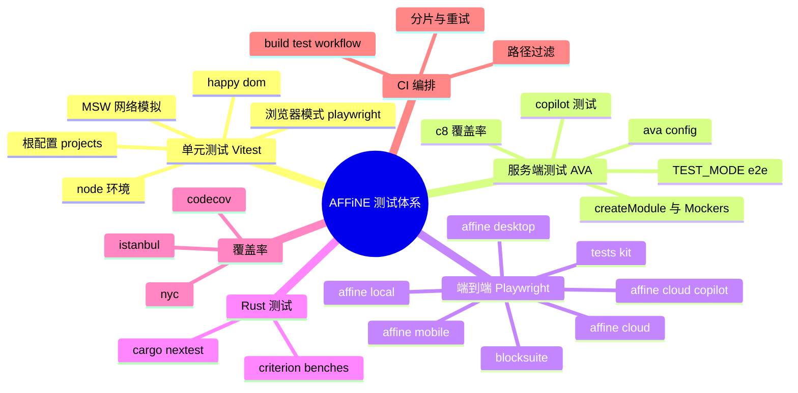
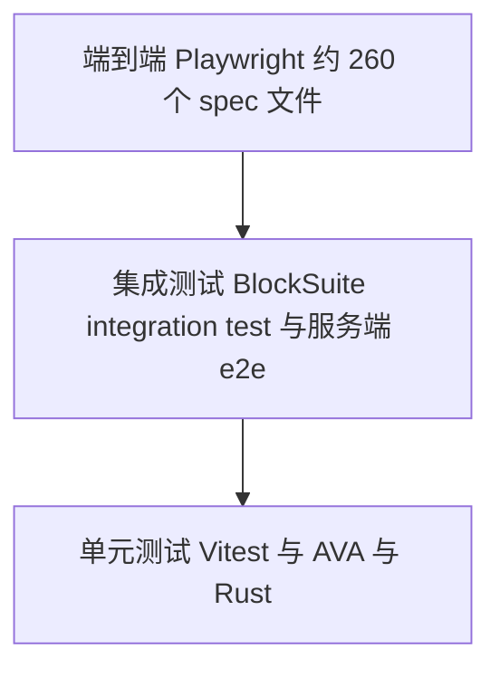

# 第 25 章 测试体系

> **所属部分**：第 8 部分 · 质量保障 ｜ **难度**：★★★☆☆ ｜ **建议学时**：6 小时 ｜ **前置章节**：第 11 章

## 本章导读

AFFiNE 是一个"本地优先 + 实时协作 + 多端 + AI"的产品，任何一个环节出错都可能导致用户数据丢失。为此仓库建立了一套覆盖面很广的测试体系：前端与 BlockSuite 用 **Vitest**（含浏览器模式与 happy-dom），服务端用 **AVA**（单元/集成与新版 e2e 两种模式），端到端用 **Playwright**（7 个测试包覆盖 Web 本地、云端、AI、桌面、移动与编辑器），Rust 用 **cargo nextest** 与 criterion 基准；覆盖率由 istanbul/c8 采集并上报 Codecov。所有这些都被编排进 `.github/workflows/build-test.yml` 的 30 多个 job 中。

本章先给出 AFFiNE 的"测试金字塔"，然后逐层打开配置与示例代码，最后带你亲手写一个单测和一个 E2E。

## 学习目标

- [ ] 能够画出 AFFiNE 的测试金字塔，说出每一层使用的框架、目录与运行命令
- [ ] 能够解读根 `vitest.config.ts` 的 projects、include、setupFiles 与覆盖率配置
- [ ] 能够区分 Vitest 的 node、happy-dom、浏览器模式三种环境，并知道何时使用
- [ ] 能够说明服务端 AVA 测试的两种模式（默认与 `TEST_MODE=e2e`）以及 `createModule`、Mockers 的用法
- [ ] 能够读懂 Playwright 配置中的 webServer、重试、分片，并使用 `@affine-test/kit` 编写 E2E
- [ ] 能够说出 CI 中 unit-test、server-test、e2e-test、desktop-test、copilot 等 job 的触发条件与依赖
- [ ] 能够独立编写并运行一个 Vitest 单测和一个 Playwright E2E

## 知识地图



## 25.1 测试金字塔与 AFFiNE 分层



用只读命令统计各层的测试文件数量（`find` 时排除 `node_modules`）：

| 层级 | 框架 | 位置 | 文件约数 | 运行命令 |
| --- | --- | --- | --- | --- |
| 前端单测 | Vitest | `packages/{common,frontend}/**/*.spec.{ts,tsx}` | 146 | `yarn test` |
| BlockSuite 单测 | Vitest（node/happy-dom/浏览器） | `blocksuite/**/src/__tests__/**/*.unit.spec.ts` | 73 | `yarn test`（作为 project） |
| Electron 单测 | Vitest | `packages/frontend/apps/electron/test/**/*.spec.ts` | — | `yarn affine @affine/electron vitest` |
| BlockSuite 集成 | Vitest 浏览器模式（3 浏览器） | `blocksuite/integration-test/src/__tests__` | — | `yarn workspace @blocksuite/integration-test test:unit` |
| 服务端单测/集成 | AVA | `packages/backend/server/src/**/*.spec.ts`、`*.e2e.ts` | 115（含 e2e 目录） | `yarn affine @affine/server test` |
| 服务端新 e2e | AVA + `TEST_MODE=e2e` | `packages/backend/server/src/__tests__/e2e/**/*.spec.ts` | 21 | `yarn affine @affine/server e2e` |
| 原生模块 | AVA / cargo nextest | `packages/frontend/native/__tests__`、各 crate 内 `tests.rs` | — | `yarn affine @affine/native test`、`cargo nextest run` |
| E2E | Playwright | `tests/*/e2e` | local 66、cloud 10、copilot 52、desktop 6、desktop-cloud 1、mobile 7、blocksuite 122 | `yarn affine @affine-test/<suite> e2e` |

设计取舍：

- **编辑器逻辑尽量下沉到 BlockSuite 单测与集成测试**：它们只依赖 playground 或直接在浏览器中运行，比完整产品 E2E 快得多；
- **服务端以"真实数据库"为默认**：AVA 测试直接连 Postgres/Redis（CI 使用 service 容器），而不是全量 mock，避免 Prisma 查询与迁移不一致；
- **E2E 覆盖关键用户路径**：本地优先（`local-first-*.spec.ts`）、协作、分享、AI 等，并通过分片与重试控制时长与不稳定性。

**小结**：AFFiNE 的金字塔底座是 Vitest/AVA/Rust 单测，中间是浏览器集成与服务端 e2e，顶端是 7 个 Playwright 测试包。

## 25.2 Vitest：根配置与多项目

### 25.2.1 根 vitest.config.ts

根 `package.json`：`"test": "vitest --run"`、`"test:ui": "vitest --ui"`、`"test:coverage": "vitest run --coverage"`。配置如下（插件部分在第 10 章讲过，此处省略）：

来源：`vitest.config.ts`

```ts
  assetsInclude: ['**/*.md', '**/*.zip'],
  resolve: {
    alias: {
      // prevent tests using two different sources of yjs
      yjs: resolve(rootDir, 'node_modules/yjs'),
      '@affine/core': fileURLToPath(
        new URL('./packages/frontend/core/src', import.meta.url)
      ),
    },
  },
  test: {
    projects: [
      '.',
      './packages/frontend/apps/electron',
      './blocksuite/**/*/vitest.config.ts',
    ],
    setupFiles: [
      resolve(rootDir, './scripts/setup/polyfill.ts'),
      resolve(rootDir, './scripts/setup/lit.ts'),
      resolve(rootDir, './scripts/setup/vi-mock.ts'),
      resolve(rootDir, './scripts/setup/global.ts'),
    ],
    include: [
      // rootDir cannot be used as a pattern on windows
      fg.convertPathToPattern(rootDir) +
        'packages/{common,frontend}/**/*.spec.{ts,tsx}',
    ],
    exclude: [
      '**/node_modules', '**/dist', '**/build', '**/out,',
      '**/packages/frontend/apps/electron',
    ],
    testTimeout: 5000,
    coverage: {
      provider: 'istanbul', // or 'istanbul'
      reporter: ['lcov'],
      reportsDirectory: resolve(rootDir, '.coverage/store'),
    },
  },
```

（`exclude` 原文为多行。）关键点：

| 配置 | 含义 |
| --- | --- |
| `projects` | Vitest 的多项目模式：`'.'` 即根项目本身；Electron 有独立配置；`blocksuite/**/*/vitest.config.ts` 匹配 14 个 BlockSuite 子项目（含 `blocksuite/integration-test`）。一次 `yarn test` 会运行所有项目 |
| `include` | 根项目只收集 `packages/common` 与 `packages/frontend` 下的 `*.spec.ts(x)`；`packages/backend` 不在其中（服务端用 AVA） |
| `exclude` 中的 electron | 避免根项目与 electron 项目重复收集 |
| `alias.yjs` | 与 rspack 一样强制单份 yjs |
| `alias['@affine/core']` | core 的 exports 较复杂，测试中直接映射到源码目录（与根 `tsconfig.json` 的 `paths` 呼应） |
| 未设置 `environment` | 根项目默认 `node` 环境，需要 DOM 的测试文件自行声明（见 25.2.3） |
| `coverage.provider: 'istanbul'` | 使用 `@vitest/coverage-istanbul`（根 devDependencies），输出 lcov 到 `.coverage/store` |

### 25.2.2 四个 setup 文件

| 文件 | 作用 |
| --- | --- |
| `scripts/setup/polyfill.ts` | 为旧环境补 `Promise.withResolvers` |
| `scripts/setup/lit.ts` | 在有 `window` 的环境下用 `vi.fn()` stub 掉 `customElements`，避免 Lit 组件重复注册报错 |
| `scripts/setup/vi-mock.ts` | mock `lottie-web`；把 `HTMLCanvasElement.prototype.getContext` 替换为简易桩 |
| `scripts/setup/global.ts` | 构造与 `@affine/web` 一致的 `globalThis.BUILD_CONFIG`（canary、development），设置 `prefixUrl`，调用 `setupGlobal()` |

来源：`scripts/setup/global.ts`

```ts
import { setupGlobal } from '@affine/env/global';
import { getBuildConfig } from '@affine-tools/utils/build-config';
import { Package } from '@affine-tools/utils/workspace';

globalThis.BUILD_CONFIG = getBuildConfig(new Package('@affine/web'), {
  mode: 'development',
  channel: 'canary',
});

if (typeof window !== 'undefined') {
  window.location.search = '?prefixUrl=http://127.0.0.1:3010/';
}

setupGlobal();
```

这里体现了一个重要原则：**测试环境复用生产构建同一份 `getBuildConfig`**，而不是另起一套假配置，保证 `BUILD_CONFIG.isWeb` 等分支在测试中与真实 Web 产物一致。

### 25.2.3 三种运行环境

**① node（默认）**：纯逻辑测试，如 LiveData：

来源：`packages/common/infra/src/livedata/__tests__/livedata.spec.ts`

```ts
import type { Subscriber } from 'rxjs';
import { combineLatest, Observable, of } from 'rxjs';
import { describe, expect, test, vitest } from 'vitest';

import { LiveData, PoisonedError } from '..';

describe('livedata', () => {
  test('LiveData', async () => {
    const livedata$ = new LiveData(0);
    expect(livedata$.value).toBe(0);
    livedata$.next(1);
    expect(livedata$.value).toBe(1);
    let subscribed = 0;
    livedata$.subscribe(v => {
      subscribed = v;
    });
    livedata$.next(2);
    expect(livedata$.value).toBe(2);
    await vitest.waitFor(() => subscribed === 2);
  });
  // ...
});
```

**② happy-dom（按文件声明）**：需要 DOM 但不需要真实浏览器渲染，例如 React Hook 测试，用文件顶部注释切换环境：

来源：`packages/common/infra/src/livedata/__tests__/react.spec.tsx`

```tsx
/**
 * @vitest-environment happy-dom
 */

import { cleanup, render, screen, waitFor } from '@testing-library/react';
// ...
import { LiveData, useLiveData } from '..';

describe('livedata', () => {
  afterEach(() => {
    cleanup();
  });
  test('react', async () => {
    const livedata$ = new LiveData(0);
    let renderCount = 0;
    const Component = () => {
      renderCount++;
      const value = useLiveData(livedata$);
      return <main>{value}</main>;
    };
    render(<Component />);
    expect(screen.getByRole('main').innerText).toBe('0');
    livedata$.next(1);
    // wait for rerender
    await waitFor(() => expect(screen.getByRole('main').innerText).toBe('1'));
    expect(renderCount).toBe(2);
  });
```

BlockSuite 的 `blocksuite/affine/all`、`affine/shared`、`affine/data-view`、`affine/gfx/group`、`affine/blocks/surface` 等子项目则在各自 `vitest.config.ts` 中整体设置 `environment: 'happy-dom'`。

**③ 浏览器模式（@vitest/browser + Playwright）**：需要真实布局、Selection、自定义元素时使用，例如 `@blocksuite/std`：

来源：`blocksuite/framework/std/vitest.config.ts`

```ts
import { playwright } from '@vitest/browser-playwright';
import { defineConfig } from 'vitest/config';

export default defineConfig({
  esbuild: {
    target: 'es2018',
  },
  test: {
    browser: {
      enabled: true,
      headless: true,
      instances: [{ browser: 'chromium' }],
      provider: playwright(),
      isolate: false,
    },
    include: ['src/__tests__/**/*.unit.spec.ts'],
    testTimeout: 500,
    coverage: {
      provider: 'istanbul',
      reporter: ['lcov'],
      reportsDirectory: '../../../.coverage/std',
    },
    restoreMocks: true,
  },
});
```

`blocksuite/affine/blocks/bookmark`、`blocksuite/affine/inlines/footnote` 也使用浏览器模式；`blocksuite/integration-test/vitest.config.ts` 更进一步，同时在 chromium、firefox、webkit 三个浏览器中运行，`fileParallelism: false`，CI 中 `retry: 3`。这就是 CI 的 unit-test job 需要 `playwright-platform: 'chromium,firefox,webkit'` 的原因。

| 环境 | 速度 | 能力 | 典型用途 |
| --- | --- | --- | --- |
| node | 最快 | 无 DOM | 纯函数、RxJS、Yjs、存储逻辑 |
| happy-dom | 快 | 模拟 DOM，无真实布局 | React 组件、Lit 模板、HTML 适配器 |
| 浏览器模式 | 慢 | 真实浏览器 | 编辑器宿主、选区、键盘、截图 |

### 25.2.4 BlockSuite 子项目的约定

BlockSuite 测试文件统一命名为 `*.unit.spec.ts`，放在 `src/__tests__/`。不少子项目通过 `globalSetup` 引用 `scripts/vitest-global.js`：

来源：`scripts/vitest-global.js`

```js
export const setup = () => {
  process.env.TZ = 'Asia/Singapore';
};
```

固定时区让涉及日期格式化的快照测试在任何机器上结果一致。`blocksuite/affine/all/vitest.config.ts` 还配置了严格的 `onConsoleLog`：除少数已知日志（Lit dev mode 提示、KaTeX quirks mode 警告）外，**测试中出现任何 console 输出都会抛错**，迫使开发者处理掉意外的警告。

### 25.2.5 常用命令

```sh
yarn test                                   # 运行全部项目（一次性）
yarn test packages/common/infra             # 按路径过滤
yarn vitest --project @blocksuite/std       # 只跑某个项目（以 Vitest 输出中显示的项目名为准）
yarn test:ui                                # 打开 Vitest UI
yarn test:coverage                          # 覆盖率，输出 .coverage/store/lcov.info
yarn workspace @blocksuite/integration-test test:unit
yarn workspace @blocksuite/integration-test test:debug   # PWDEBUG=1 有头调试
```

`.vscode/settings.template.json` 中的 `"vitest.include": ["packages/**/*.spec.ts", "packages/**/*.spec.tsx"]` 让 VSCode Vitest 插件能识别测试文件。

**小结**：一个根配置 + 多 projects 统一驱动 16 个 Vitest 项目（根、electron 与 14 个 BlockSuite 子项目），按需选择 node、happy-dom 或浏览器模式；setup 文件复用生产 `BUILD_CONFIG`。

## 25.3 前端与存储层单测示例

### 25.3.1 nbstore：用 fake-indexeddb 测真实存储逻辑

来源：`packages/common/nbstore/src/__tests__/frontend.spec.ts`

```ts
import 'fake-indexeddb/auto';

import { expect, test, vitest } from 'vitest';
import { Awareness } from 'y-protocols/awareness.js';
import { Doc as YDoc } from 'yjs';

import { AwarenessFrontend } from '../frontend/awareness';
import { DocFrontend } from '../frontend/doc';
import { BroadcastChannelAwarenessStorage } from '../impls/broadcast-channel/awareness';
import { IndexedDBDocStorage } from '../impls/idb';
import { AwarenessSyncImpl } from '../sync/awareness';
import { DocSyncImpl } from '../sync/doc';
import { expectYjsEqual } from './utils';

test('doc', async () => {
  const doc1 = new YDoc({
    guid: 'test-doc',
  });
  doc1.getMap('test').set('hello', 'world');

  const docStorage = new IndexedDBDocStorage({
    id: 'ws1',
    flavour: 'a',
    type: 'workspace',
  });

  docStorage.connection.connect();

  await docStorage.connection.waitForConnected();

  const frontend1 = new DocFrontend(docStorage, DocSyncImpl.dummy);
  frontend1.start();
  frontend1.connectDoc(doc1);
  await vitest.waitFor(async () => {
    const doc = await docStorage.getDoc('test-doc');
    expectYjsEqual(doc!.bin, {
      test: {
        hello: 'world',
      },
    });
  });
  // ...
```

亮点：

- `import 'fake-indexeddb/auto'` 在 Node 中提供一个内存版 IndexedDB，**不 mock 存储层本身**，而是给它一个可用的底座，测试的是真实的 `IndexedDBDocStorage`；
- `DocSyncImpl.dummy` 作为"空同步实现"，把测试范围限定在 frontend ↔ storage；
- `vitest.waitFor` 处理异步写入；`expectYjsEqual`（`__tests__/utils.ts`）把 Yjs 二进制解码后与普通对象比较，断言可读性高；
- 同目录下还有 `sync.spec.ts`（多存储同步）、`cloud-doc-updates.spec.ts`、`cloud-blob.spec.ts`，以及 `base64.bench.ts`（Vitest bench 基准）和 `__snapshots__`。

### 25.3.2 BlockSuite std：最小化依赖的命令测试

来源：`blocksuite/framework/std/src/__tests__/command.unit.spec.ts`

```ts
describe('CommandManager', () => {
  let std: BlockStdScope;
  let commandManager: CommandManager;

  beforeEach(() => {
    // @ts-expect-error FIXME: ts error
    std = {};
    commandManager = new CommandManager(std);
  });

  test('can add and execute a command', () => {
    const command1: Command1 = vi.fn((_ctx, next) => next());
    const command2: Command2 = vi.fn((_ctx, _next) => {});

    const [success1] = commandManager.chain().pipe(command1, {}).run();
    const [success2] = commandManager
      .chain()
      .pipe(command1, {})
      .pipe(command2)
      .run();

    expect(command1).toHaveBeenCalled();
    expect(command2).toHaveBeenCalled();
    // ...
```

`CommandManager` 只需要一个 `std` 引用，测试用空对象 + `@ts-expect-error`（带说明，符合 oxlint 的 `ban-ts-comment` 规则）替代，命令本身用 `vi.fn` 记录调用。同目录的 `test-editor.ts`、`test-schema.ts`、`test-block.ts` 则为需要完整编辑器的测试提供了最小化的 schema 与块定义。

### 25.3.3 MSW：在单测中模拟 HTTP

根 `devDependencies` 有 `msw`（`dependenciesMeta` 中 `built: false`，不需要安装脚本）。仓库中两处使用：

来源：`packages/frontend/apps/electron/test/main/updater.spec.ts`

```ts
  const basicRequestHandlers = [
    http.get('https://affine.pro/api/worker/releases', async ({ request }) => {
      const url = new URL(request.url);
      const buffer = await fs.readFile(
        path.join(
          __dirname,
          'fixtures',
          'candidates',
          `${url.searchParams.get('channel')}.json`
        )
      );
      const content = buffer.toString();
      return HttpResponse.text(content);
    }),
    // ... GitHub releases 的 latest.yml
  ];

  describe('release api request successfully', () => {
    const server = setupServer(...basicRequestHandlers);
    beforeAll(() => server.listen({ onUnhandledRequest: 'error' }));
    afterAll(() => server.close());
    afterEach(() => server.resetHandlers());
```

MSW 在网络层拦截请求，被测代码（Electron 自动更新器）无需任何改造。`onUnhandledRequest: 'error'` 保证测试不会意外访问真实网络。另一处是 `blocksuite/affine/all/src/__tests__/adapters/notion-html.unit.spec.ts`，用来模拟 Notion 导入时的图片下载。

**小结**：前端单测的风格是"给真实实现一个可控的底座"（fake-indexeddb、MSW、dummy 同步），而不是大面积 mock 内部模块。

## 25.4 服务端测试：AVA

### 25.4.1 ava.config.js 与两种模式

来源：`packages/backend/server/ava.config.js`

```js
const newE2E = process.env.TEST_MODE === 'e2e';
const newE2ETests = './src/__tests__/e2e/**/*.spec.ts';

const preludes = ['./src/prelude.ts'];

if (newE2E) {
  preludes.push('./src/__tests__/e2e/prelude.ts');
}

export default {
  timeout: '1m',
  extensions: {
    ts: 'module',
  },
  watchMode: {
    ignoreChanges: ['**/*.gen.*'],
  },
  files: newE2E
    ? [newE2ETests]
    : ['**/*.spec.ts', '**/*.e2e.ts', '!' + newE2ETests],
  require: preludes,
  environmentVariables: {
    NODE_ENV: 'test',
    DEPLOYMENT_TYPE: 'affine',
    MAILER_HOST: '0.0.0.0',
    MAILER_PORT: '1025',
    MAILER_USER: 'noreply@toeverything.info',
    MAILER_PASSWORD: 'affine',
    MAILER_SENDER: 'noreply@toeverything.info',
  },
};
```

| 模式 | 命令 | 收集文件 | 额外 prelude |
| --- | --- | --- | --- |
| 默认 | `yarn affine @affine/server test`（`ava --concurrency 1 --serial`） | `**/*.spec.ts`、`**/*.e2e.ts`，排除新 e2e 目录 | `src/prelude.ts` |
| 新 e2e | `yarn affine @affine/server e2e`（`cross-env TEST_MODE=e2e ava --serial`） | `src/__tests__/e2e/**/*.spec.ts` | 再加 `src/__tests__/e2e/prelude.ts` |
| Copilot | `yarn affine @affine/server test:copilot` | `src/__tests__/copilot/copilot-*.spec.ts` | 同默认 |
| 覆盖率 | `test:coverage`、`e2e:coverage`、`test:copilot:coverage` | 同上，外层套 `c8` | — |

`extensions: { ts: 'module' }` 告诉 AVA 把 `.ts` 当 ESM 加载，但**真正把 TS 转成 JS 的是 CLI 注入的 SWC 加载器**（第 10 章：`ava` 不在 `ignoreLoaderScripts` 中，`@affine/server` 使用 `tools/cli/register.js`）。所以服务端测试必须通过 `yarn affine @affine/server ...` 运行。`packages/backend/server/src/prelude.ts` 首行 `import 'reflect-metadata'` 并加载 `.env`，与正式启动一致。

为什么默认 `--concurrency 1 --serial`？因为测试共享同一个 Postgres 与 Redis，串行可以避免数据互相污染；CI 通过 4 个 runner 分片（`CI_NODE_INDEX`/`CI_NODE_TOTAL`，AVA 内置支持）弥补速度。

### 25.4.2 src/__tests__ 结构

| 目录/文件 | 作用 |
| --- | --- |
| `create-module.ts` | `createModule()`：基于 `@nestjs/testing` 构建只含 `FunctionalityModules` 的测试模块，替换 `EventBus` 为 `MockEventBus`，注入测试运行时配置 |
| `utils/testing-module.ts` | `createTestingModule()`：更完整的模块（含 GraphQL、Auth、Mail 等），附带 `initTestingDB()`、`mails: MockMailer` |
| `utils/testing-app.ts` | 启动 HTTP 应用并提供 `gql`、`signup`、`login` 等便捷方法 |
| `mocks/` | `factory.ts` 定义 `Mocker` 基类与 `createFactory`；`user.mock.ts`、`workspace.mock.ts`、`team-workspace.mock.ts` 等实体工厂；`mailer.mock.ts`、`eventbus.mock.ts` |
| `__fixtures__/`、`__snapshots__/` | 测试数据与 AVA 快照 |
| `e2e/` | 新版 e2e：`create-app.ts`、`prelude.ts`、`test.ts` 与按领域划分的子目录（user、workspace、doc、comment、storage、oauth…） |
| `auth/`、`doc/`、`workspace/`、`copilot/`、`payment/`… | 按领域组织的单元/集成测试 |
| `*.e2e.ts`（如 `workspace.e2e.ts`、`user.e2e.ts`） | 旧版 e2e，仍由默认模式收集 |

### 25.4.3 示例：用 createTestingModule 测分布式锁

来源：`packages/backend/server/src/__tests__/mutex.spec.ts`

```ts
const test = ava as TestFn<{
  module: TestingModule;
  mutex: Mutex;
  locker: Locker;
  session: SessionRedis;
}>;

test.beforeEach(async t => {
  const module = await createTestingModule();

  t.context.module = module;
  t.context.mutex = module.get(Mutex);
  t.context.locker = module.get(Locker);
  t.context.session = module.get(SessionRedis);
});

test.afterEach(async t => {
  await t.context.module.close();
});

const lockerPrefix = randomUUID();
test('should be able to acquire lock', async t => {
  const { mutex } = t.context;

  {
    t.truthy(
      await mutex.acquire(`${lockerPrefix}1`),
      'should be able to acquire lock'
    );
    t.falsy(
      await mutex.acquire(`${lockerPrefix}1`),
      'should not be able to acquire lock again'
    );
  }
  // ...
```

AVA 的写法要点：用 `ava as TestFn<Context>` 给 `t.context` 加类型；`beforeEach` 创建 Nest 测试模块并从 DI 容器取出被测服务；断言用 `t.truthy`、`t.is`、`t.like`、`t.throwsAsync`、`t.snapshot`；用随机前缀隔离 Redis 键。这里的 Mutex 背后是真实 Redis。

`createModule` 的核心逻辑：

来源：`packages/backend/server/src/__tests__/create-module.ts`

```ts
export async function createModule(
  metadata: TestingModuleMetadata = {}
): Promise<TestingModule> {
  const config = getDefaultConfig();
  const runtimeConfig = await createTestRuntimeConfig(
    config.db.datasourceUrl,
    config.indexer
  );
  const { tapModule, ...meta } = metadata;
  const functionalityModules = [...FunctionalityModules];

  const builder = Test.createTestingModule({
    ...meta,
    imports: [...functionalityModules, ...(meta.imports ?? [])],
  });

  builder.overrideProvider(EventBus).useValue(new MockEventBus());
  builder.overrideProvider(ServerConfigHandle).useFactory({
    factory: (overrides?: DeepPartial<AppConfig>) => {
      applyTestConfigOverrides(runtimeConfig.configPath, overrides);
      return new ServerConfigHandle(runtimeConfig.configPath);
    },
    inject: [{ token: OVERRIDE_CONFIG_TOKEN, optional: true }],
  });

  // when custom override happens
  if (tapModule) {
    tapModule(builder);
  }
  // ... compile、设置日志级别、包装 close
```

`tapModule` 钩子允许单个测试再覆盖任意 provider（例如把第三方支付 SDK 换成桩）。`MockEventBus` 让测试可以断言"某事件是否被发出"，而不触发真实的事件处理链。

### 25.4.4 Mockers：造数据的工厂

来源：`packages/backend/server/src/__tests__/mocks/factory.ts`

```ts
export abstract class Mocker<In, Out> {
  // NOTE(@forehalo):
  //   The reason why we don't inject [Models] to Mocker for more easier data creation with built in logic is,
  //   the method in [Models] may introduce side effects like 'events',
  //   which may break the tests with event emitting asserts.
  protected db!: PrismaClient;

  abstract create(input?: Partial<In>): Promise<Out>;
}
```

注释说明了设计取舍：Mocker 直接用 PrismaClient 写库，而不调用业务 Model，避免造数据时触发事件、干扰"事件断言"。第 11 章提到的 `yarn affine server seed` 复用的正是这些 Mocker。

### 25.4.5 新版 e2e：一个进程一个 App

来源：`packages/backend/server/src/__tests__/e2e/prelude.ts`

```ts
import { getBuildConfig } from '@affine-tools/utils/build-config';
import { Package } from '@affine-tools/utils/workspace';

import { createApp } from './create-app';

globalThis.BUILD_CONFIG = getBuildConfig(new Package('@affine/web'), {
  mode: 'development',
  channel: 'canary',
});
// @ts-expect-error testing
globalThis.app = await createApp();
```

`TEST_MODE=e2e` 时，prelude 在每个 AVA worker 中创建一次完整应用，`e2e/test.ts` 导出 `e2e`（即 `ava` 的 test）与 `app`，并在 `registerCompletionHandler` 中关闭应用。测试直接用 `@affine/graphql` 中的查询常量调用 API：

来源：`packages/backend/server/src/__tests__/e2e/user/account.spec.ts`

```ts
import {
  deleteAccountMutation,
  disableUserMutation,
  getCurrentUserQuery,
  getWorkspaceQuery,
} from '@affine/graphql';
// ...
import { app, e2e, Mockers } from '../test';

e2e('should be able to delete account', async t => {
  const user = await app.signup();
  const user2 = await app.create(Mockers.User);
  const ws = await app.create(Mockers.Workspace, {
    owner: user,
  });
  // ...
  await app.gql({
    query: deleteAccountMutation,
  });

  // assert session removed
  const { currentUser } = await app.gql({
    query: getCurrentUserQuery,
  });

  t.is(currentUser, null);
```

这让服务端 e2e 与前端使用**完全相同的 GraphQL 文档**，一旦 schema 变更导致前端查询失效，服务端 e2e 会第一时间发现。CI 中 `server-e2e-test` 的注释写着"the new version of server e2e test should be super fast, so sharding testing is not needed"。

### 25.4.6 覆盖率：c8

服务端 `package.json` 中的 c8 配置：

来源：`packages/backend/server/package.json`

```json
  "c8": {
    "reporter": ["text-summary", "lcov"],
    "report-dir": ".coverage",
    "exclude": ["scripts", "node_modules", "**/*.spec.ts", "**/*.e2e.ts"]
  },
```

（原文数组为多行。）c8 基于 V8 原生覆盖率，不需要插桩，输出 `packages/backend/server/.coverage/lcov.info`，CI 以 `flags: server-test` 上传到 Codecov。

**小结**：服务端测试以真实 Postgres/Redis 为底座，`createModule`/`createTestingModule` 负责装配 Nest 模块，Mockers 负责造数据，`TEST_MODE=e2e` 提供"共享 App + GraphQL 文档"的快速 e2e。

## 25.5 E2E：Playwright

### 25.5.1 测试包一览

| 包 | 被测对象 | webServer | 关键配置 |
| --- | --- | --- | --- |
| `tests/affine-local` | Web 本地模式 | `yarn run -T affine dev -p @affine/web`（8080） | `fullyParallel`、workers 4，CI 中 `retries: 3`、`workers: '50%'` |
| `tests/affine-cloud` | Web + 服务端 | web 与 `affine dev -p @affine/server`（检测 `http://localhost:3010/graphql`） | 超时 120s；CI 且非 `COPILOT` 时 workers 1 |
| `tests/affine-cloud-copilot` | AI 功能 | 同 cloud（web + server） | 用例按 basic、chat-with、ai-action、insertion 分组 |
| `tests/affine-desktop` | Electron | 设置 `DEV_SERVER_URL` 时起 `affine bundle -p @affine/electron-renderer --dev` | CI 中 `retries: 5`、workers 1 |
| `tests/affine-desktop-cloud` | Electron + 服务端 | `affine dev -p @affine/electron-renderer` + server | — |
| `tests/affine-mobile` | 移动 Web | `yarn run -T affine dev -p @affine/mobile` | — |
| `tests/blocksuite` | BlockSuite playground | 本地 `@blocksuite/playground dev`（5173），CI 中 `preview`（4173） | `snapshotDir: 'snapshots'`、`timezoneId: 'Asia/Tokyo'` |

`tests/fixtures/` 存放测试素材（图片、PDF、SVG、zip），不是 workspace 包。

### 25.5.2 playwright.config.ts 解读

来源：`tests/affine-local/playwright.config.ts`

```ts
const config: PlaywrightTestConfig = {
  testDir: './e2e',
  fullyParallel: true,
  timeout: process.env.CI ? 50_000 : 30_000,
  outputDir: testResultDir,
  use: {
    baseURL: 'http://localhost:8080/',
    browserName:
      (process.env.BROWSER as PlaywrightWorkerOptions['browserName']) ??
      'chromium',
    permissions: ['clipboard-read', 'clipboard-write'],
    viewport: { width: 1440, height: 800 },
    actionTimeout: 5 * 1000,
    locale: 'en-US',
    trace: 'retain-on-failure',
    video: 'retain-on-failure',
  },
  forbidOnly: !!process.env.CI,
  workers: 4,
  retries: 1,
  reporter: process.env.CI ? 'github' : 'list',
  webServer: [
    {
      command: 'yarn run -T affine dev -p @affine/web',
      timeout: 120 * 1000,
      reuseExistingServer: !process.env.CI,
      env: { COVERAGE: process.env.COVERAGE || 'false' },
      url: 'http://localhost:8080',
    },
  ],
};
```

（注释与 CI 分支已删减。）要点：

- **webServer 自动拉起被测应用**：`yarn run -T affine` 中 `-T`（top-level）表示使用根 workspace 的脚本；本地 `reuseExistingServer` 为真，若你已开着 `yarn dev`，测试会直接复用；
- **失败留证据**：`trace`、`video` 均为 `retain-on-failure`，输出到根目录 `test-results/`（`testResultDir` 来自 `@affine-test/kit/playwright`）。用 `npx playwright show-trace <zip>` 回放；
- **`forbidOnly`**：CI 中禁止残留 `test.only`；CI 命令还显式加了 `--forbid-only`；
- **`BROWSER` 环境变量**可切换到 firefox/webkit；
- `affine-cloud` 的 webServer 还给服务端注入 `AFFINE_BACKEND_RUNTIME_CONFIG_PATH` 指向 `tests/affine-cloud/runtime-config.json`，以及 MAILER 配置。

### 25.5.3 tests/kit：公共 fixture 与工具

`@affine-test/kit` 通过 `exports` 暴露 `./playwright`、`./electron`、`./mobile`、`./utils/*`、`./bs/*`。核心是扩展过的 `test`：

来源：`tests/kit/src/playwright.ts`

```ts
export const test = baseTest.extend<{
  workspace: {
    current: () => Promise<CurrentDocCollection>;
  };
}>({
  workspace: async ({ page }, use) => {
    await use({
      current: async () => {
        return await page.evaluate(async () => {
          if (!(globalThis as any).currentWorkspace) {
            await new Promise<void>((resolve, reject) => {
              globalThis.addEventListener(
                'affine:workspace:change',
                () => resolve(),
                { once: true }
              );
              setTimeout(() => reject(new Error('timeout')), 5000);
            });
          }
          const currentWorkspace = (globalThis as any).currentWorkspace;
          return { meta: currentWorkspace.meta };
        });
      },
    });
  },
  // page: 支持 CPU_THROTTLE 模拟低速 CPU
  // context: 给 body 加 playwright-test class、跳过 onboarding、收集覆盖率
});
```

`context` fixture 做了三件事：注入 `playwright-test` class（注释说明用于让 CSS 动画在测试中保持 0.1s）；调用 `skipOnboarding` 在 localStorage 中写入跳过引导的标记；在 `enableCoverage`（`CI` 或 `COVERAGE` 为真）时，把页面的 `window.__coverage__` 写到 `.nyc_output/playwright_coverage_<uuid>.json`。

`tests/kit/src/utils/` 下按领域组织了大量操作函数：

| 文件 | 典型函数 |
| --- | --- |
| `load-page.ts` | `openHomePage`、`open404Page`、`openJournalsPage` |
| `page-logic.ts` | `waitForEditorLoad`（等待 `v-line` 出现）、`clickNewPageButton`、`getBlockSuiteEditorTitle`、`type`、`addDatabase`、`dragTo` |
| `workspace.ts` | `createLocalWorkspace` |
| `cloud.ts` | `createRandomUser`、`loginUser`、`enableCloudWorkspace`、`runPrisma`（直接用服务端的 PrismaClient 操作数据库） |
| `keyboard.ts`、`clipboard.ts`、`selection.ts` | 跨平台快捷键、剪贴板、选区 |
| `tests/kit/src/electron.ts` | 基于 `electron.launch` 的 Electron fixture |

一个真实用例：

来源：`tests/affine-local/e2e/local-first-new-page.spec.ts`

```ts
import { test } from '@affine-test/kit/playwright';
import { openHomePage } from '@affine-test/kit/utils/load-page';
import {
  clickNewPageButton,
  getBlockSuiteEditorTitle,
  getPageByTitle,
  waitForEditorLoad,
} from '@affine-test/kit/utils/page-logic';
import { getCurrentDocIdFromUrl } from '@affine-test/kit/utils/url';
import { expect } from '@playwright/test';

test('click btn new page', async ({ page, workspace }) => {
  await openHomePage(page);
  await waitForEditorLoad(page);
  const originPageId = getCurrentDocIdFromUrl(page);
  await clickNewPageButton(page);
  const newPageId = getCurrentDocIdFromUrl(page);
  expect(newPageId).not.toBe(originPageId);
  const currentWorkspace = await workspace.current();

  expect(currentWorkspace.meta.flavour).toContain('local');
});
```

定位元素优先使用 `getByTestId`（产品代码中的 `data-testid`），其次是语义化的 `getByRole`、自定义元素选择器（如 `doc-title .inline-editor`）。

### 25.5.4 运行与调试

```sh
npx playwright install                          # 首次安装浏览器
yarn affine @affine-test/affine-local e2e       # 跑全部（会自动启动 web dev server）
yarn affine @affine-test/affine-local e2e theme # 按文件名过滤
yarn affine @affine-test/affine-local e2e --ui  # Playwright UI 模式
yarn affine @affine-test/affine-local e2e --debug
yarn workspace @affine-test/blocksuite test     # BlockSuite E2E
```

`docs/BUILDING.md` 中的写法是 `yarn workspace @affine-test/affine-local e2e`，CI 中是 `yarn affine @affine-test/affine-local e2e`，两者对 Playwright 测试都可用（Playwright 自带 TS 支持）。云端测试需要先按第 11 章准备好 Postgres/Redis 与 `@affine/server-native`。

**小结**：Playwright 配置统一了 webServer、重试、trace 与报告；`@affine-test/kit` 封装了 fixture 与领域操作，写 E2E 时应优先复用它。

## 25.6 Rust 测试与基准

CI 的 `rust-test` job（仅当 `rust-test-filter` 判定有 Rust 相关改动时运行）：

来源：`.github/workflows/build-test.yml`

```yaml
      - name: Initialize server-native test database
        run: |
          psql -h localhost -U postgres -c "CREATE DATABASE affine;"
          psql -h localhost -U postgres -c "CREATE USER affine WITH PASSWORD 'affine';"
          psql -h localhost -U postgres -c "ALTER USER affine WITH SUPERUSER;"
          yarn affine @affine/server prisma migrate deploy
        env:
          PGPASSWORD: affine

      - name: Run workspace Rust tests
        run: cargo nextest run --workspace --exclude affine_server_native --features use-as-lib --no-fail-fast

      - name: Run server-native Rust tests with PostgreSQL and Redis
        run: cargo nextest run -p affine_server_native --no-fail-fast --test-threads=1

      - name: Run native storage cleanup integration tests
        run: cargo test -p affine_server_native blob_cleanup_projection_ -- --ignored --nocapture
```

| 要点 | 说明 |
| --- | --- |
| cargo-nextest | 比 `cargo test` 更快、输出更清晰的测试运行器（CI 固定 `nextest@0.9.98`） |
| `--features use-as-lib` | 定义在 `packages/frontend/native/nbstore/Cargo.toml`（`mobile-native` 默认开启），让 nbstore 以库形式编译测试 |
| server-native 单线程 | 其测试连接真实 Postgres/Redis（job 中 `DATABASE_URL`、`INVALIDATION_REDIS_URL`），需串行 |
| `--ignored` | 耗时较长的集成测试平时用 `#[ignore]` 标记，CI 单独显式运行 |

Rust 测试代码多以同目录 `tests.rs` 或 `#[cfg(test)] mod tests` 形式存在，例如 `packages/frontend/native/src/disk_sync/tests.rs`、`packages/frontend/native/nbstore/src/indexer/tests.rs`、`packages/backend/native/src/llm/tests.rs`。

基准测试：

- `packages/common/native/benches/hashcash.rs`：使用 criterion，`Cargo.toml` 中以 `[[bench]] name = "hashcash" harness = false` 注册，运行 `cargo bench -p affine_common`；
- `packages/frontend/native/media_capture/benches/mix_audio_samples.rs`：音频混音性能；
- JS 侧：`packages/common/nbstore/src/__tests__/base64.bench.ts`（Vitest bench）、`packages/backend/native/benchmark/index.js`（`yarn affine @affine/server-native bench`）。

原生模块的 JS 绑定测试：`packages/frontend/native/package.json` 中 `"test": "ava --no-worker-threads --concurrency=2"`，收集 `__tests__/*.spec.mts`（`db.spec.mts`、`pool.spec.mts`），CI 的 `native-unit-test` job 执行 `yarn affine @affine/native test`。

**小结**：Rust 侧以 nextest 跑单测/集成测试，依赖数据库的测试串行执行，长耗时测试以 `--ignored` 单独运行；criterion 与 Vitest bench 负责性能基准。

## 25.7 Copilot 测试

AI 功能测试的特殊性在于：依赖外部大模型 API（需要密钥、有成本、结果不完全确定）。AFFiNE 的处理方式：

| 层级 | 位置 | 运行方式 |
| --- | --- | --- |
| 服务端 Copilot 单测 | `packages/backend/server/src/__tests__/copilot/`（`byok.spec.ts`、`capability-runtime.spec.ts`、`copilot-provider.spec.ts` 等，以及 `copilot.e2e.ts`） | 默认 `test` 会运行其中大部分；`test:copilot` 专门运行 `copilot-*.spec.ts` |
| 前端 Copilot E2E | `tests/affine-cloud-copilot/e2e`（basic、chat-with、ai-action、insertion 等，见其 README） | `yarn affine @affine-test/affine-cloud-copilot e2e` |

CI 编排分两条线：

1. **PR 中按路径触发**：`build-test.yml` 的 `copilot-test-filter` 用 `dorny/paths-filter` 判断改动是否涉及 `packages/backend/server/src/plugins/copilot/**`、`packages/frontend/core/src/blocksuite/ai/**`、`tests/affine-cloud-copilot/**` 等，再决定是否运行 `copilot-api-test` 与 `copilot-e2e-test`（5 个分片）。真实模型配置通过 secret `TEST_SERVER_CONFIG` 注入 `server-test-env` action，写入 `packages/backend/server/config.json`；
2. **定时/打 tag 全量跑**：`copilot-test-automatically.yml` 在每天 08:00（UTC，`cron: '0 8 * * *'`）或推送 canary tag 时，通过 `benc-uk/workflow-dispatch` 触发 `copilot-test.yml`。后者跑 API 测试与 10 分片的 E2E，最后在 `test-done` job 中执行 `node ./tools/copilot-result/index.js`，根据 success/failed/canceled 把结果发到 Slack。

`.github/actions/copilot-test/action.yml` 是一个复合 action：设置 `COPILOT: true` 与 `DEV_SERVER_URL`，运行脚本，失败时上传 `test-results`。`COPILOT` 变量在 `tests/affine-cloud/playwright.config.ts` 中用于调整 workers 与重试次数（`workers: process.env.CI && !process.env.COPILOT ? 1 : 4`）。

**小结**：AI 测试"平时按路径触发、每日与发版全量跑、结果推送 Slack"，在成本、速度与覆盖之间取得平衡。

## 25.8 覆盖率

| 来源 | 工具 | 输出 | 上传 flag |
| --- | --- | --- | --- |
| 根 Vitest | `@vitest/coverage-istanbul` | `.coverage/store/lcov.info` | `unittest` |
| BlockSuite 子项目 | istanbul | `.coverage/<子项目>/`（如 `.coverage/std`、`.coverage/integration-test`） | — |
| Electron | istanbul | `.coverage/electron` | — |
| 服务端 | c8 | `packages/backend/server/.coverage/lcov.info` | `server-test` |
| E2E | 页面内 istanbul 插桩 + kit fixture | `.nyc_output/playwright_coverage_*.json` | — |

`nyc.config.js` 只做了一件事——使用 `@istanbuljs/schema` 的默认排除列表（根 devDependencies 中有 `@istanbuljs/schema`），供 nyc 合并、生成 E2E 覆盖率报告使用：

来源：`nyc.config.js`

```js
'use strict';

// oxlint-disable-next-line typescript/no-var-requires
const defaultExclude = require('@istanbuljs/schema/default-exclude');

module.exports = {
  exclude: [...defaultExclude],
};
```

BlockSuite playground 在 `COVERAGE` 为真时启用 `vite-plugin-istanbul` 插桩（第 10 章），配合 `tests/blocksuite/e2e/utils/playwright.ts` 中的 `enableCoverage` 收集。

`codecov.yml` 的策略值得注意：

来源：`codecov.yml`

```yaml
coverage:
  # coverage decreases are allowed
  status:
    project: false
    patch: false
```

即**覆盖率只作为参考，不作为合并门槛**：Codecov 不会因为覆盖率下降而让 PR 状态变红。CI 上传步骤也都设置了 `fail_ci_if_error: false`。这是一个务实的取舍——在快速迭代的产品中，用 E2E 与关键单测保证质量，而不强求数字。

**小结**：多套覆盖率工具分别覆盖前端、服务端与 E2E，统一以 lcov 上报 Codecov，但不设门禁。

## 25.9 CI 中的测试 job

`.github/workflows/build-test.yml` 中与测试相关的主要 job：

| job | 依赖（needs） | 做什么 | 分片 |
| --- | --- | --- | --- |
| `unit-test` | `build-native-linux` | 下载 `affine.linux-x64-gnu.node`，安装三种浏览器，`yarn test:coverage --shard=i/5` | 5 |
| `native-unit-test` | `build-native-linux` | `yarn affine @affine/native test` | — |
| `server-test` | `build-server-native` | Postgres（pgvector）+ Redis + mailhog，`yarn affine @affine/server test:coverage --forbid-only` | 4（`CI_NODE_INDEX`） |
| `server-test-elasticsearch` / `server-test-manticoresearch` / `server-test-embedded` | `build-server-native` | 以不同搜索后端运行服务端测试（`server-test-env` 的 `indexer-provider` 输入） | — |
| `server-e2e-test` | `build-server-native` | `yarn affine @affine/server e2e:coverage --forbid-only`，indexer 关闭 | 无 |
| `rust-test` | `rust-test-filter` | nextest（25.6） | — |
| `e2e-test` | — | `yarn affine @affine-test/affine-local e2e --shard=i/5`，`DISTRIBUTION: web`、`IN_CI_TEST: true` | 5 |
| `e2e-mobile-test` | — | affine-mobile | 2 |
| `e2e-blocksuite-test` | — | 先 `yarn workspace @blocksuite/playground build`，再跑 BlockSuite E2E | 5 |
| `e2e-blocksuite-cross-browser-test` | — | integration-test 三浏览器 + `cross-platform/` E2E | — |
| `cloud-e2e-test` | `build-server-native`、`build-native-linux` | matrix：Cloud E2E 1/2、2/2、Cloud Desktop E2E（`xvfb-run`） | 3 |
| `copilot-api-test` / `copilot-e2e-test` | `copilot-test-filter` 等 | 25.7 | e2e 5 |
| `desktop-test` | renderer 与三平台 native | macOS/Linux/Windows 矩阵：`yarn affine @affine/electron vitest` 单测、`yarn affine @affine-test/affine-desktop e2e`、打包检查 | 4 平台 |
| `test-done` | 以上全部 | 名为 "3, 2, 1 Launch"，任一 needs 失败或取消即 `exit 1` | — |

服务端测试环境由复合 action 准备：

来源：`.github/actions/server-test-env/action.yml`

```yaml
    - name: Initialize database
      shell: bash
      run: |
        psql -h localhost -U postgres -c "CREATE DATABASE affine;"
        psql -h localhost -U postgres -c "CREATE USER affine WITH PASSWORD 'affine';"
        psql -h localhost -U postgres -c "ALTER USER affine WITH SUPERUSER;"
      env:
        PGPASSWORD: affine
    # - name: Import config  （按 indexer-provider 生成 config.json）
    - name: Run init-db script
      shell: bash
      env:
        NODE_ENV: test
      run: |
        yarn affine @affine/server prisma generate
        yarn affine @affine/server prisma migrate deploy
        yarn affine @affine/server data-migration run
```

几个值得学习的 CI 技巧：

- **构建产物复用**：原生模块只在 `build-native-*`、`build-server-native` 中编译一次，通过 `actions/upload-artifact`/`download-artifact` 分发给各测试 job；
- **按需安装**：`setup-node` action 的 `extra-flags: workspaces focus ...` 只安装测试所需的 workspace；`playwright-platform` 只装需要的浏览器；
- **Linux 上跑 Electron**：`sudo sysctl -w kernel.apparmor_restrict_unprivileged_userns=0`（注释引用 electron/electron#42510）+ `xvfb-run` 提供虚拟显示；
- **失败留档**：E2E job 均 `if: always()` 上传 `./test-results`；
- **汇总门禁**：`test-done` 把 30 多个 job 汇成一个必需检查，分支保护只需配置这一项。

**小结**：CI 用"编译一次、多处复用 + 分片 + 路径过滤 + 汇总门禁"把庞大的测试矩阵控制在可接受的时长内。

## 源码导读清单

| 优先级 | 路径 | 阅读重点 |
| --- | --- | --- |
| P0 | `vitest.config.ts` | projects、include、setupFiles、覆盖率 |
| P0 | `packages/backend/server/ava.config.js` | 两种模式、prelude、环境变量 |
| P0 | `tests/affine-local/playwright.config.ts` | webServer、重试、trace |
| P0 | `tests/kit/src/playwright.ts` | 扩展 fixture、覆盖率收集 |
| P0 | `.github/workflows/build-test.yml` | 测试 job 编排 |
| P1 | `scripts/setup/global.ts`、`scripts/setup/lit.ts` | 全局测试环境 |
| P1 | `blocksuite/framework/std/vitest.config.ts` | 浏览器模式 |
| P1 | `blocksuite/integration-test/vitest.config.ts` | 三浏览器集成测试 |
| P1 | `packages/backend/server/src/__tests__/create-module.ts` | Nest 测试模块装配 |
| P1 | `packages/backend/server/src/__tests__/mocks/factory.ts` | Mocker 工厂 |
| P1 | `packages/backend/server/src/__tests__/e2e/test.ts` | 新版 e2e 入口 |
| P1 | `tests/kit/src/utils/page-logic.ts` | 常用 E2E 操作 |
| P2 | `packages/common/nbstore/src/__tests__/frontend.spec.ts` | fake-indexeddb 用法 |
| P2 | `packages/frontend/apps/electron/test/main/updater.spec.ts` | MSW 用法 |
| P2 | `.github/workflows/copilot-test.yml`、`.github/actions/server-test-env/action.yml` | Copilot 与服务端测试环境 |

## 动手实践

### 练习 1：运行现有单测

- **目标**：熟悉 Vitest 的过滤与 UI。
- **步骤**：
  ```sh
  yarn test packages/common/infra/src/livedata
  yarn test:ui
  ```
- **验收标准**：`livedata.spec.ts` 与 `react.spec.tsx` 全部通过；能在 Vitest UI 中看到测试树并单独重跑一个用例。

### 练习 2：写一个单测

- **目标**：为尚无测试的 `packages/common/infra/src/utils/shallow-equal.ts` 补测试。
- **步骤**：
  1. 新建 `packages/common/infra/src/utils/__tests__/shallow-equal.spec.ts`（同目录已有 `async-lock.spec.ts` 等可参考）：
     ```ts
     import { describe, expect, test } from 'vitest';

     import { shallowEqual } from '../shallow-equal';

     describe('shallowEqual', () => {
       test('same reference and primitives', () => {
         const obj = { a: 1 };
         expect(shallowEqual(obj, obj)).toBe(true);
         expect(shallowEqual(1, 1)).toBe(true);
         expect(shallowEqual(NaN, NaN)).toBe(true);
         expect(shallowEqual(0, -0)).toBe(false);
       });

       test('compares first-level keys only', () => {
         expect(shallowEqual({ a: 1, b: 'x' }, { a: 1, b: 'x' })).toBe(true);
         expect(shallowEqual({ a: 1 }, { a: 1, b: 2 })).toBe(false);
         expect(shallowEqual({ a: { c: 1 } }, { a: { c: 1 } })).toBe(false);
       });

       test('null and non-object', () => {
         expect(shallowEqual(null, {})).toBe(false);
         expect(shallowEqual({}, undefined)).toBe(false);
       });
     });
     ```
  2. 运行 `yarn test packages/common/infra/src/utils/__tests__/shallow-equal.spec.ts`；
  3. 运行 `yarn lint:ox packages/common/infra/src/utils/__tests__`，确认 import 排序等规则通过。
- **验收标准**：3 个用例通过；能解释 `0` 与 `-0` 为何不相等（`Object.is`）；lint 无警告。

### 练习 3：运行服务端测试

- **目标**：体验 AVA 与真实数据库。
- **步骤**：按第 11 章启动 `.docker/dev` 服务、构建 `@affine/server-native`、完成 `yarn affine server init`，然后：
  ```sh
  yarn affine @affine/server test src/__tests__/mutex.spec.ts
  yarn affine @affine/server e2e src/__tests__/e2e/user/account.spec.ts
  ```
- **验收标准**：两个命令均通过；能说出第二个命令为什么会额外加载 `src/__tests__/e2e/prelude.ts`。

### 练习 4：写一个 E2E

- **目标**：用 kit 写出"新建文档并输入标题"的端到端测试。
- **步骤**：
  1. 新建 `tests/affine-local/e2e/my-first.spec.ts`：
     ```ts
     import { test } from '@affine-test/kit/playwright';
     import { openHomePage } from '@affine-test/kit/utils/load-page';
     import {
       clickNewPageButton,
       getBlockSuiteEditorTitle,
       waitForEditorLoad,
     } from '@affine-test/kit/utils/page-logic';
     import { expect } from '@playwright/test';

     test('create a page with title', async ({ page, workspace }) => {
       await openHomePage(page);
       await waitForEditorLoad(page);
       await clickNewPageButton(page, 'Hello E2E');
       await expect(getBlockSuiteEditorTitle(page)).toHaveText('Hello E2E');
       const ws = await workspace.current();
       expect(ws.meta.flavour).toContain('local');
     });
     ```
  2. 运行 `yarn affine @affine-test/affine-local e2e my-first --headed`；
  3. 故意把期望改成 `'Hello'` 让它失败，用 `npx playwright show-trace test-results/<目录>/trace.zip` 查看失败现场。
- **验收标准**：测试通过；失败时能在 trace 中看到每一步的截图与 DOM 快照。练习后删除该文件。

### 练习 5：阅读一次 CI 运行（只读）

- **目标**：把本章内容与真实 CI 对应。
- **步骤**：在 GitHub 上打开任意一个 canary 上的 "Build & Test" 运行记录，对照 25.9 的表格找到 `unit-test`、`server-test`、`e2e-test` 的分片，下载一个 `test-results-e2e-*` artifact（如有）。
- **验收标准**：能说出 `test-done` 为何能作为唯一必需检查；能找到 Codecov 上传步骤的 `flags`。

## 自测题

1. 根 `vitest.config.ts` 的 `projects` 包含哪三类？`yarn test` 会运行服务端测试吗？
2. 一个 `.spec.tsx` 需要 DOM，但根项目默认是 node 环境，应该怎么做？
3. BlockSuite 的 `@blocksuite/std` 为什么使用浏览器模式？这对 CI 有什么要求？
4. `scripts/setup/global.ts` 为什么调用 `getBuildConfig` 而不是手写一个 `BUILD_CONFIG` 对象？
5. 服务端测试为什么必须用 `yarn affine @affine/server test` 而不是 `yarn workspace @affine/server test`？
6. `TEST_MODE=e2e` 改变了 AVA 的哪些行为？
7. Mocker 为什么直接用 PrismaClient 而不调用业务 Model？
8. Playwright 的 `reuseExistingServer: !process.env.CI` 在本地可能带来什么"坑"？
9. Copilot E2E 在 PR 中什么时候会运行？每日全量测试的结果如何通知团队？
10. `codecov.yml` 中 `project: false`、`patch: false` 意味着什么？

<details><summary>参考答案</summary>

1. 根项目 `'.'`（`packages/{common,frontend}/**/*.spec.{ts,tsx}`）、`./packages/frontend/apps/electron`、`./blocksuite/**/*/vitest.config.ts`（14 个 BlockSuite 子项目）。不会运行服务端测试，服务端使用 AVA。
2. 在文件顶部加 `/** @vitest-environment happy-dom */` 注释，如 `packages/common/infra/src/livedata/__tests__/react.spec.tsx`。
3. 它测试 EditorHost、选区、键盘、自定义元素等，需要真实浏览器的布局与事件；CI 需要安装 Playwright 浏览器（unit-test job 安装 chromium、firefox、webkit）。
4. 复用与生产构建同一份逻辑，保证测试中 `BUILD_CONFIG` 的字段与真实 `@affine/web` 产物一致，避免测试与线上分支行为不同。
5. 只有经过 CLI 才会在 `NODE_OPTIONS` 中注入 `tools/cli/register.js`（SWC，支持 legacy 装饰器与 metadata），AVA 才能加载 NestJS 的 TS 源码。
6. `files` 只收集 `src/__tests__/e2e/**/*.spec.ts`；`require` 额外加入 `src/__tests__/e2e/prelude.ts`，在 worker 中预先创建全局 `app`。
7. 业务 Model 可能触发事件等副作用，会干扰测试中对事件的断言；Mocker 直接写库，副作用可控。
8. 若本地已运行的 dev server 是旧代码或不同配置（例如连着别的后端），测试会直接复用它，结果与 CI 不一致。
9. 当 `copilot-test-filter` 检测到改动涉及 copilot 插件、前端 AI 目录、copilot 测试目录等路径时运行；每日由 `copilot-test-automatically.yml` 触发 `copilot-test.yml`，最后用 `tools/copilot-result/index.js` 把结果发送到 Slack。
10. Codecov 不为整体覆盖率和补丁覆盖率设置状态检查，覆盖率下降不会导致 PR 失败，仅作参考。

</details>

## 常见坑与排错

| 现象 | 原因 | 处理 |
| --- | --- | --- |
| `yarn test` 报找不到浏览器 | BlockSuite 浏览器模式项目需要 Playwright 浏览器 | `npx playwright install`（integration-test 需 chromium/firefox/webkit） |
| 单测报原生模块缺失 | 部分测试依赖 `@affine/native` | `yarn affine @affine/native build`（CI 会预先下载产物） |
| BlockSuite 测试因 console 输出失败 | `blocksuite/affine/all/vitest.config.ts` 的 `onConsoleLog` 把意外日志转为错误 | 修复警告源头，而不是删掉断言 |
| 日期相关快照在本地失败 | 未经 `scripts/vitest-global.js` 固定时区的项目受本机 TZ 影响 | 在对应项目配置 `globalSetup` 或固定时区 |
| 服务端测试连接失败 | Postgres/Redis 未启动或未迁移 | 第 11 章的 docker compose 与 `yarn affine server init` |
| 服务端测试数据互相干扰 | 自行加了并发 | 保持 `--concurrency 1 --serial`；键名使用随机前缀 |
| 邮件相关测试失败 | 1025 端口无 SMTP 服务 | 启动 mailpit/mailhog（`ava.config.js` 把 MAILER 指向 `0.0.0.0:1025`） |
| E2E 本地通过 CI 失败 | CI 中 workers、重试、超时不同；本地复用了旧 server | 本地设 `CI=1` 复现，或关闭已有 dev server |
| E2E 残留 `test.only` 导致 CI 失败 | `forbidOnly` + `--forbid-only` | 删除 `.only` |
| Electron E2E 在 Linux 无法启动 | AppArmor 限制与无显示 | 参照 CI：`sysctl` 调整 + `xvfb-run` |

## 延伸阅读

- Vitest 指南：https://vitest.dev/guide/
- Vitest 多项目（Projects）：https://vitest.dev/guide/projects
- Vitest 浏览器模式：https://vitest.dev/guide/browser/
- Vitest 覆盖率：https://vitest.dev/guide/coverage
- happy-dom：https://github.com/capricorn86/happy-dom
- AVA 文档：https://github.com/avajs/ava/tree/main/docs
- NestJS 测试：https://docs.nestjs.com/fundamentals/testing
- Playwright 入门：https://playwright.dev/docs/intro
- Playwright 分片：https://playwright.dev/docs/test-sharding
- Playwright Trace Viewer：https://playwright.dev/docs/trace-viewer
- Playwright Fixtures：https://playwright.dev/docs/test-fixtures
- MSW：https://mswjs.io/docs/
- fake-indexeddb：https://github.com/dumbmatter/fakeIndexedDB
- cargo-nextest：https://nexte.st/
- Criterion.rs：https://bheisler.github.io/criterion.rs/book/
- c8：https://github.com/bcoe/c8
- Istanbul：https://istanbul.js.org/
- Codecov YAML：https://docs.codecov.com/docs/codecov-yaml

## 学时拆分

| 内容 | 建议时长 |
| --- | --- |
| 25.1 测试金字塔与分层 | 0.25 小时 |
| 25.2–25.3 Vitest 配置与单测示例（练习 1、2） | 1.5 小时 |
| 25.4 服务端 AVA 测试（练习 3） | 1.25 小时 |
| 25.5 Playwright E2E（练习 4） | 1.25 小时 |
| 25.6–25.7 Rust 测试与 Copilot 测试 | 0.5 小时 |
| 25.8–25.9 覆盖率与 CI 编排（练习 5） | 0.75 小时 |
| 自测与复盘 | 0.5 小时 |
| **合计** | **6 小时** |

---
上一章：[第 24 章 业务插件：AI、搜索、支付等](../07-后端服务/24-业务插件-AI-搜索-支付等.md) ｜ 下一章：[第 26 章 CI/CD 与 GitHub Actions](../09-运维与部署/26-CICD与GitHubActions.md) ｜ [返回目录](../README.md)
