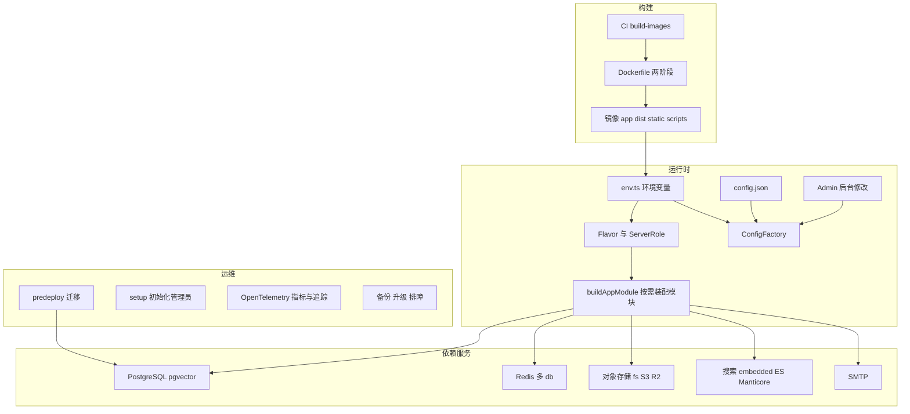
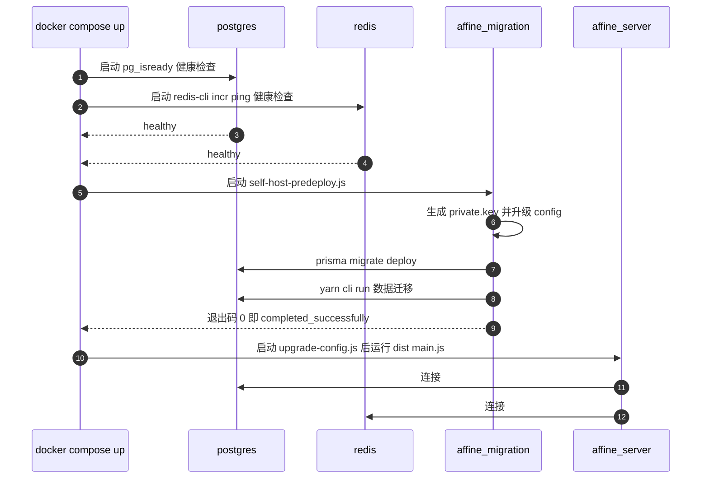
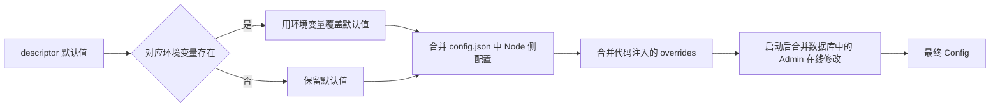
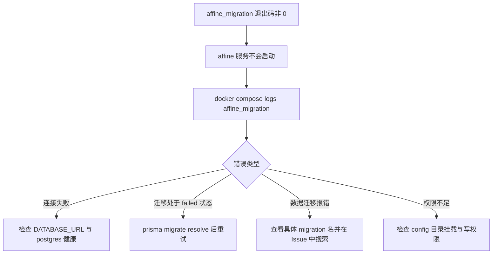
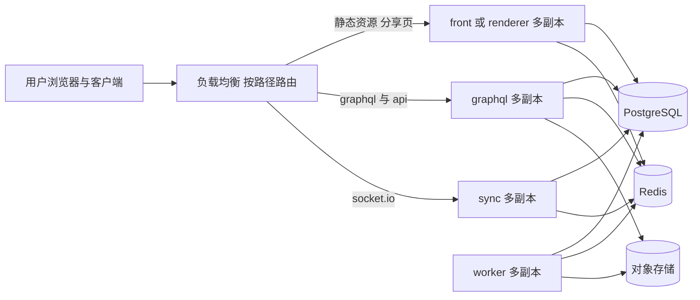
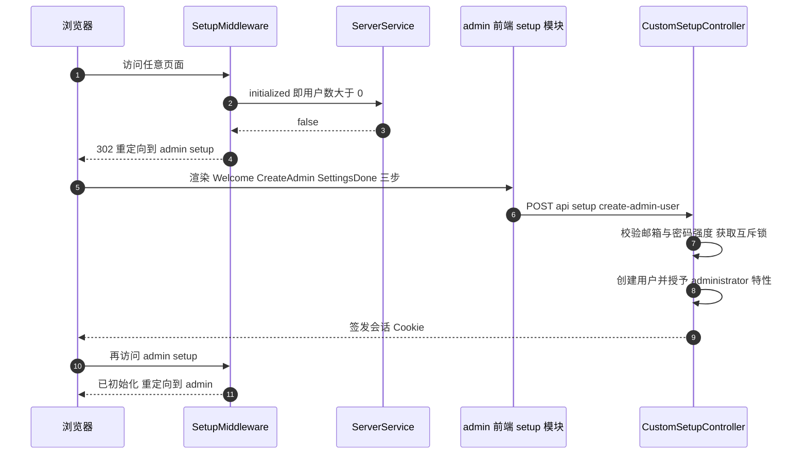
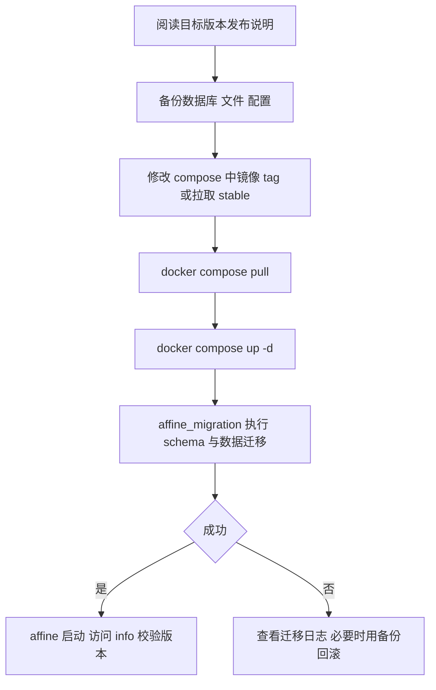

# 第 27 章 部署与运维

> **所属部分**：第 9 部分 · 运维与部署 ｜ **难度**：★★★★☆ ｜ **建议学时**：8 小时 ｜ **前置章节**：第 21 章 后端架构与基础设施层、第 22 章 数据层 Prisma PostgreSQL Redis、第 26 章 CI/CD 与 GitHub Actions

## 本章导读

第 26 章我们看到 CI 产出了一个多架构镜像 `ghcr.io/toeverything/affine`。本章回答下一个问题：**这个镜像里有什么、怎样把它跑起来、跑起来后怎么运维？**

对于"从前端走向全栈"的你，本章是从"写代码"到"对线上负责"的关键一跃。你会学到：

1. **镜像**：`.github/deployment/node/Dockerfile` 如何把 server、web、admin、mobile 四类产物装进一个镜像；
2. **自托管**：`.docker/selfhost/compose.yml` 中四个服务的职责与启动顺序，数据卷里存了什么；
3. **配置系统**：`config.json` + 环境变量 + JSON Schema + Admin 后台在线修改，以及 `yarn affine server genconfig`；
4. **启动前迁移**：`predeploy`、`self-host-predeploy.js`、Prisma 迁移与数据迁移；
5. **服务角色拆分**：`SERVER_FLAVOR` 让同一份代码扮演 graphql/sync/renderer/front/worker 等角色，以及 socket.io 的 Redis adapter 水平扩展；
6. **存储、搜索、邮件、可观测性**：本地 fs / S3 / R2、embedded / Elasticsearch / Manticore、SMTP、OpenTelemetry；
7. **初始化与版本兼容**：Admin setup 流程、客户端版本控制；
8. **备份、升级、排障手册**。

## 学习目标

- [ ] 能够说明 AFFiNE 服务端镜像的分层结构，以及 web/admin/mobile 静态资源在镜像中的位置
- [ ] 能够用 `.docker/selfhost/compose.yml` 部署一套自托管实例，并解释 `affine_migration` 服务的作用
- [ ] 能够区分 `NODE_ENV`、`AFFINE_ENV`（NAMESPACE）、`DEPLOYMENT_TYPE`、`SERVER_FLAVOR`、`DEPLOYMENT_PLATFORM` 的含义与取值
- [ ] 能够描述配置项从 `defineModuleConfig` 定义到 `config.json`、环境变量、`schema.json` 生成的完整链路
- [ ] 能够根据负载规划按 Flavor 拆分的多实例部署，并说明 Redis 在其中的作用
- [ ] 能够为自托管实例配置 S3 兼容存储、外部搜索引擎、SMTP 邮件与 OpenTelemetry 指标
- [ ] 能够制定备份恢复与升级方案，并使用排障手册定位常见故障

## 知识地图



## 27.1 部署形态总览

AFFiNE 服务端（`packages/backend/server`，包名 `@affine/server`）是一个 NestJS 应用，依赖 Rust 原生模块 `@affine/server-native`（`packages/backend/native`）。它有三类典型部署形态：

| 形态 | 入口文件 | 适用场景 | 特点 |
| --- | --- | --- | --- |
| 本地开发 | `.docker/dev/compose.yml.example` + `yarn affine server dev` | 开发调试 | 只用 Docker 跑依赖（Postgres、Redis、Mailpit），服务端在本机运行 |
| 单机自托管 | `.docker/selfhost/compose.yml` | 个人、小团队 | 一个 `allinone` 容器 + 迁移容器 + Redis + Postgres |
| PaaS 一键部署 | `render.yaml` + `.render/` | Render 平台 | 第 26 章已介绍，复用 stable 镜像 |
| 云端多角色 | 同一镜像 + 不同 `SERVER_FLAVOR` | AFFiNE Cloud 等大规模部署 | 按 graphql/sync/renderer/front/worker 拆分，水平扩展 |

> 云端（affine.pro）的具体编排清单不在本仓库中，本章只依据仓库代码讲清"支持怎样的拆分"。

## 27.2 镜像构建：Dockerfile 解读

### 27.2.1 产物如何进镜像

第 26 章 `build-images.yml` 的 `build-images` job 在执行 `docker build` 之前，已经把所有产物放到了约定位置：

| 产物 | CI 中的来源 job | 构建上下文中的路径 |
| --- | --- | --- |
| 服务端编译结果 | `build-server`（`yarn workspace @affine/server build`） | `packages/backend/server/dist` |
| 服务端原生模块（三架构） | `build-server-native` | `packages/backend/native/server-native.{x64,arm64,armv7}.node` |
| 生产依赖 | `yarn workspaces focus @affine/server --production` 后 `mv ./node_modules ./packages/backend/server` | `packages/backend/server/node_modules` |
| Prisma Client | `yarn workspace @affine/server prisma generate` | `node_modules` 内 |
| Web 前端 | `build-web` | `packages/frontend/apps/web/dist` |
| Admin 后台 | `build-admin` | `packages/frontend/admin/dist` |
| 移动 Web | `build-mobile` | `packages/frontend/apps/mobile/dist` |

### 27.2.2 两阶段 Dockerfile

```dockerfile
# 来源：.github/deployment/node/Dockerfile
# syntax=docker/dockerfile:1.7

FROM node:22-bookworm-slim AS assets
WORKDIR /app

COPY ./packages/backend/server /app
COPY ./packages/frontend/apps/web/dist /app/static
COPY ./packages/frontend/admin/dist /app/static/admin
COPY ./packages/frontend/apps/mobile/dist /app/static/mobile

# Keep server sourcemap for stacktraces, but don't ship frontend/node_modules sourcemaps.
ARG TARGETARCH
ARG TARGETVARIANT
# Needed for Prisma engine resolution (and potential engine download during cleanup).
RUN apt-get update && \
  apt-get install -y --no-install-recommends openssl ca-certificates && \
  rm -rf /var/lib/apt/lists/*

RUN AFFINE_DOCKER_CLEAN=1 TARGETARCH="${TARGETARCH}" TARGETVARIANT="${TARGETVARIANT}" node ./scripts/docker-clean.mjs

FROM node:22-bookworm-slim
WORKDIR /app

COPY --from=assets /app /app

RUN apt-get update && \
  apt-get install -y --no-install-recommends openssl libjemalloc2 ca-certificates && \
  rm -rf /var/lib/apt/lists/*

# Enable jemalloc by preloading the library
ENV LD_PRELOAD=libjemalloc.so.2

EXPOSE 3010

CMD ["sh", "-c", "node ./scripts/upgrade-config.js && exec node ./dist/main.js"]
```

逐段解读：

1. **assets 阶段**：把整个 `packages/backend/server` 目录（含 `dist`、`node_modules`、`scripts`、`schema.prisma`、`migrations`）拷到 `/app`；三个前端 dist 分别放到 `/app/static`、`/app/static/admin`、`/app/static/mobile`。这正是 `core/selfhost/static.ts` 中 `join(env.projectRoot, 'static')` 读取的位置。
2. **docker-clean.mjs**：根据 `TARGETARCH`/`TARGETVARIANT`（buildx 自动注入）删掉其他架构的原生模块与无用文件、前端 sourcemap，只保留服务端 sourcemap 以便看到可读的堆栈。脚本要求 `AFFINE_DOCKER_CLEAN=1` 才执行，防止本地误运行。
3. **运行阶段**：从干净的 `node:22-bookworm-slim` 开始，只拷贝清理后的 `/app`；安装 `openssl`（Prisma 引擎依赖）、`libjemalloc2` 并通过 `LD_PRELOAD` 启用 jemalloc（降低 Node 长时间运行的内存碎片）。
4. **CMD**：先执行 `scripts/upgrade-config.js`（把旧版环境变量迁移进 `config.json`，见 27.4.5），再 `exec node ./dist/main.js`。`exec` 让 Node 成为 PID 1 的直接替换者，能正确接收 `SIGTERM` 优雅退出。
5. **端口**：`EXPOSE 3010`，与 `server.port` 默认值一致。

> 注意：镜像 CMD **不执行数据库迁移**。迁移由独立的 `affine_migration` 容器或 `predeploy` 步骤负责（27.5）。这是"迁移与服务分离"的经典做法：多副本同时启动时不会并发跑迁移。

## 27.3 自托管：compose.yml 逐服务解读

```yaml
# 来源：.docker/selfhost/compose.yml（节选）
name: affine
services:
  affine:
    image: ghcr.io/toeverything/affine:stable
    container_name: affine_server
    ports:
      - '3010:3010'
    depends_on:
      redis:
        condition: service_healthy
      postgres:
        condition: service_healthy
      affine_migration:
        condition: service_completed_successfully
    volumes:
      - ./data/storage:/root/.affine/storage
      - ./config:/root/.affine/config
    environment:
      - REDIS_SERVER_HOST=redis
      - DATABASE_URL=postgresql://affine@postgres:5432/affine
      - DEPLOYMENT_TYPE=selfhosted
    restart: unless-stopped

  affine_migration:
    image: ghcr.io/toeverything/affine:stable
    container_name: affine_migration_job
    volumes:
      - ./data/storage:/root/.affine/storage
      - ./config:/root/.affine/config
    command: ['sh', '-c', 'node ./scripts/self-host-predeploy.js']
    # ... environment 同上；depends_on postgres 与 redis 健康
```



四个服务一览：

| 服务 | 镜像 | 作用 | 关键配置 |
| --- | --- | --- | --- |
| `affine` | `ghcr.io/toeverything/affine:stable` | 主服务（默认 `allinone`） | 端口 3010；挂载 storage 与 config；等待迁移成功 |
| `affine_migration` | 同上 | 一次性任务：生成密钥、跑迁移 | `command` 覆盖为 `node ./scripts/self-host-predeploy.js` |
| `redis` | `redis` | 缓存、会话、socket.io 广播、队列等 | 健康检查 `redis-cli --raw incr ping` |
| `postgres` | `pgvector/pgvector:pg16` | 主数据库，带 pgvector 扩展（AI 向量检索） | `POSTGRES_INITDB_ARGS: '--data-checksums'`；`POSTGRES_HOST_AUTH_METHOD: trust` |

数据卷：

| 宿主机路径 | 容器路径 | 内容 | 是否必须备份 |
| --- | --- | --- | --- |
| `./data/storage` | `/root/.affine/storage` | 默认 fs 存储：上传的图片、附件（`blobs` 桶）、头像（`avatars` 桶） | 是 |
| `./config` | `/root/.affine/config` | `config.json`、`private.key`（服务端签名私钥）、可选 `.env` | 是，尤其 `private.key` |
| `./data/postgres` | `/var/lib/postgresql/data` | 数据库文件 | 是（建议用 `pg_dump` 逻辑备份） |

两个安全提示（第 28 章展开）：

- `POSTGRES_HOST_AUTH_METHOD: trust` 表示**无密码连接**。它只在 Postgres 不暴露端口、仅 compose 内网可达时可接受；compose 中 postgres 与 redis 都没有 `ports` 映射，正是为此。若你要把数据库端口映射出去，务必设置密码并改 `DATABASE_URL`。
- `private.key` 丢失会导致已签发的令牌、加密数据无法验证/解密，必须与数据库一起备份。

`.docker/selfhost/` 下的三个配置相关文件：

| 文件 | 内容 | 用途 |
| --- | --- | --- |
| `config.example.json` | 最小示例：`deployment.type: selfhosted`、`server.name`、`indexer.enabled: true`、`indexer.provider.type: embedded` | 复制为 `./config/config.json` 起步 |
| `config.json.example` | 更完整：增加 `server.externalUrl` 与 `copilot.enabled`、`copilot.byok` 段 | 需要 AI 功能时参考 |
| `schema.json` | 约 12 万字节的 JSON Schema，由 `yarn affine server genconfig` 生成 | 编辑器校验与补全（`config.json` 的 `$schema` 字段） |

```json
// 来源：.docker/selfhost/config.json.example
{
  "$schema": "https://github.com/toeverything/affine/releases/latest/download/config.schema.json",
  "deployment": {
    "type": "selfhosted"
  },
  "server": {
    "name": "AFFiNE Self-hosted",
    "externalUrl": "http://localhost:3010"
  },
  "copilot": {
    "enabled": true,
    "byok": {
      "enabled": true,
      "allowCustomEndpoint": true
    }
  },
  "indexer": {
    "enabled": true,
    "provider.type": "embedded"
  }
}
```

注意 `"provider.type"` 这种**带点的键名**：配置系统以"模块 + 点分键"作为最小配置单元（见 27.4），所以 JSON 中既可以写嵌套对象，也可以直接写点分键。

## 27.4 配置系统：从定义到生效

### 27.4.1 环境变量：env.ts

`packages/backend/server/src/env.ts` 定义了**进程级**的运行环境，它们在 Nest 应用启动前就确定，不能在线修改：

```ts
// 来源：packages/backend/server/src/env.ts（节选）
export enum Flavor {
  AllInOne = 'allinone',
  Graphql = 'graphql',
  Sync = 'sync',
  Renderer = 'renderer',
  Front = 'front',
  Worker = 'worker',
  Script = 'script',
}

export enum ServerRole {
  Frontend = 'frontend',
  Api = 'api',
  Worker = 'worker',
  AllInOne = 'allinone',
}

export enum Namespace {
  Dev = 'dev',
  Beta = 'beta',
  Production = 'production',
}
// ...
export class Env implements AppEnv {
  // ...
  NODE_ENV = (process.env.NODE_ENV ?? NodeEnv.Production) as NodeEnv;
  NAMESPACE = readEnv(
    'AFFINE_ENV',
    Namespace.Production,
    Object.values(Namespace)
  );
  DEPLOYMENT_TYPE = this.dev
    ? DeploymentType.Affine
    : DeploymentType.Selfhosted;
  FLAVOR = readEnv('SERVER_FLAVOR', Flavor.AllInOne, Object.values(Flavor));
  platform = readEnv('DEPLOYMENT_PLATFORM', Platform.Unknown);
  version = pkg.version;
```

| 环境变量 | 字段 | 取值 | 默认 | 影响 |
| --- | --- | --- | --- | --- |
| `NODE_ENV` | `NODE_ENV` | `development` / `test` / `production` | `production` | `env.dev`、`env.testing`、`env.prod`；非法值直接抛错 |
| `AFFINE_ENV` | `NAMESPACE` | `dev` / `beta` / `production` | `production` | `env.namespaces.canary/beta/production`；OTel 资源属性 `k8s.namespace.name` |
| `DEPLOYMENT_TYPE` | `DEPLOYMENT_TYPE` | `affine` / `selfhosted` | 开发时 `affine`，否则 `selfhosted` | 是否自托管（决定 Setup、SelfhostModule、配置可见范围等） |
| `SERVER_FLAVOR` | `FLAVOR` | `allinone` / `graphql` / `sync` / `renderer` / `front` / `worker` / `script` | `allinone` | 装配哪些模块（27.6） |
| `DEPLOYMENT_PLATFORM` | `platform` | `gcp` / 其他 | `unknown` | `env.gcp` 为 true 时加载 `GCloudModule` |

`readEnv` 会校验取值范围，例如 `SERVER_FLAVOR=api` 会直接报 `Invalid value "api" for environment variable SERVER_FLAVOR`。

**DEPLOYMENT_TYPE 的优先级**有点绕，需要细看构造函数：

```ts
// 来源：packages/backend/server/src/env.ts（节选）
constructor(configPath?: string) {
  // ...
  this.#configPath = configPath;
  const appPath = join(this.projectRoot, 'config.json');
  const homePath = join(homedir(), '.affine/config/config.json');
  if (configPath || existsSync(appPath) || existsSync(homePath)) {
    this.DEPLOYMENT_TYPE =
      this.serverConfigHandle.deploymentType === 'selfhosted'
        ? DeploymentType.Selfhosted
        : DeploymentType.Affine;
  } else {
    this.DEPLOYMENT_TYPE = readEnv(
      'DEPLOYMENT_TYPE',
      this.DEPLOYMENT_TYPE,
      Object.values(DeploymentType)
    );
  }
}
```

即：**只要存在 `config.json`，就以其中 `deployment.type` 为准**（`selfhosted` 或 `cloud`）；否则才读 `DEPLOYMENT_TYPE` 环境变量。源码中有 `TODO(0.27.5)` 注释，说明 home 路径回退与环境变量回退是为兼容旧部署保留的过渡逻辑。

`config.json` 的查找顺序是：项目根（镜像中为 `/app/config.json`）优先，其次 `~/.affine/config/config.json`（compose 中挂载的 `./config` 目录）。

### 27.4.2 应用配置：defineModuleConfig

**应用级**配置按"模块"组织，每个模块用 `defineModuleConfig` 声明自己的配置项、默认值、校验与对应环境变量。以 `server` 模块为例：

```ts
// 来源：packages/backend/server/src/core/config/config.ts（节选）
defineModuleConfig('server', {
  externalUrl: {
    desc: `Base url of AFFiNE server, used for generating external urls.
Default to be \`[server.protocol]://[server.host][:server.port]\` if not specified.
    `,
    default: '',
    env: 'AFFINE_SERVER_EXTERNAL_URL',
    // ... validate: 允许空串或合法 URL
  },
  https: {
    desc: 'Whether the server is hosted on a ssl enabled domain (https://).',
    default: false,
    env: ['AFFINE_SERVER_HTTPS', 'boolean'],
    shape: z.boolean(),
  },
  host: {
    desc: 'Where the server get deployed(FQDN).',
    default: 'localhost',
    env: 'AFFINE_SERVER_HOST',
  },
  // ... hosts、listenAddr(LISTEN_ADDR)、port(AFFINE_SERVER_PORT)、path(AFFINE_SERVER_SUB_PATH)
});
```

这段代码同时完成了四件事：TS 类型（通过 `declare global { interface AppConfigSchema { server: ... } }` 扩充）、默认值、运行时校验（zod）、环境变量映射。所有声明汇总到 `packages/backend/server/src/base/config/register.ts` 的 `APP_CONFIG_DESCRIPTORS`。

一部分模块（`redis`、`storages`、`indexer` 等）改用 `defineNativeModuleConfig`：配置描述符来自 Rust 原生模块 `serverNativeModule.appConfigDescriptors('<module>')`，校验也由 Rust 的 `validateAppConfigValue` 完成——这是 AFFiNE 近期把存储、搜索等运行时下沉到 Rust（`packages/backend/native/src/runtime/`）的体现。

### 27.4.3 配置合并顺序



对应源码：

```ts
// 来源：packages/backend/server/src/base/config/factory.ts（节选）
private loadDefault() {
  const config = getDefaultConfig(this.#nativeKeys);
  override(config, JSON.parse(this.serverConfig.nodeOwnedJson()));
  override(config, this.withoutNativeValues(this.overrides));
  return config;
}
```

```ts
// 来源：packages/backend/server/src/base/config/register.ts（节选，getDefaultConfig）
for (const [key, desc] of Object.entries(defs)) {
  if (excludedKeys.has(`${module}.${key}`)) {
    continue;
  }
  let defaultValue = desc.default;

  if (desc.env) {
    const [env, parser] = desc.env;
    const envValue = envs[env];
    if (envValue) {
      defaultValue = parseEnvValue(envValue, parser);
    }
  }

  const { success, error } = desc.validate(defaultValue);
  // ... 校验失败直接抛出 Invalid config for module [...] with key [...]
```

要点：

- **环境变量 < config.json**：环境变量只是改变"默认值"，`config.json` 中写了的键会覆盖它；
- `nativeKeys`（由 Rust 管理的配置键）在 Node 侧被排除，由 `ServerConfigHandle`（`packages/backend/server/src/native.ts` 导出的 Rust 对象）统一读取；
- `ConfigFactory` 还提供 `replaceDbOverrides`、`validate`，供 Admin 后台在线修改配置时使用（`core/config` 模块与 `ServerService` 在 Redis 重连后会 `revalidateConfig`）；
- `boolean` 类型的环境变量解析规则是 `value === '1' || value.toLowerCase() === 'true'`（`base/config/env.ts`）。

### 27.4.4 yarn affine server genconfig

`packages/backend/server/package.json` 中 `"genconfig": "r ./scripts/genconfig.ts"`。脚本会加载 `app.module`（从而触发所有 `defineModuleConfig`），然后生成两份文件：

```ts
// 来源：packages/backend/server/scripts/genconfig.ts（节选）
const IGNORED_MODULES = new Set(['db', 'redis', 'graphql']);
const SELFHOSTED_IGNORED_MODULES = new Set([
  'payment',
  'telemetry',
  'captcha',
  'metrics',
]);
const SELFHOSTED_IGNORED_KEYS = new Set(['auth.trustedCloudflareHeaders']);
// ...
function main() {
  generateJsonSchema(
    ProjectRoot.join('.docker', 'selfhost', 'schema.json').toString()
  );
  generateAdminConfigJson(
    new Package('@affine/admin').join('src/config.json').toString()
  );
}
```

| 输出 | 路径 | 用途 |
| --- | --- | --- |
| JSON Schema | `.docker/selfhost/schema.json` | 自托管用户编辑 `config.json` 时的校验与补全；描述中包含 `@default`、`@environment`、`@link` |
| Admin 配置元数据 | `packages/frontend/admin/src/config.json` | Admin 后台"设置"页面据此渲染表单（类型、描述、对应环境变量） |

`db`、`redis`、`graphql` 被整体忽略（这些靠 `DATABASE_URL` 等环境变量或内部配置，不希望在 Admin 中修改）；`payment`、`telemetry`、`captcha`、`metrics` 只对云端有意义，不写入自托管 schema。描述字段 `internal: true` 的配置也被过滤。第 26 章 `check-git-status` job 会重跑 genconfig 确认这两份文件已提交。

`packages/backend/server/config.example.json` 只有一行 `"$schema": "../../../.docker/selfhost/schema.json"`，是给本地开发者复制为 `packages/backend/server/config.json` 的起点（`env.ts` 中项目根 `config.json` 优先）。

从 schema 中可以一览自托管可配置的模块：`crypto`、`throttle`、`auth`、`mailer`、`doc`、`storages`、`websocket`、`server`、`flags`、`client`、`calendar`、`copilot`、`indexer`、`oauth`、`worker`。

### 27.4.5 旧环境变量的自动迁移：upgrade-config.js

早期版本的自托管主要用环境变量配置。`packages/backend/server/scripts/upgrade-config.js` 在每次容器启动（Dockerfile CMD）和 `self-host-predeploy.js` 中被调用，把一批"别名环境变量"写入 `config.json`：

```js
// 来源：packages/backend/server/scripts/upgrade-config.js（节选）
const aliases = [
  ['mailer', 'SMTP.host', 'MAILER_HOST'],
  ['mailer', 'SMTP.ignoreTLS', 'MAILER_IGNORE_TLS', 'boolean'],
  ['mailer', 'SMTP.name', 'MAILER_SERVERNAME'],
  ['mailer', 'SMTP.password', 'MAILER_PASSWORD'],
  ['mailer', 'SMTP.port', 'MAILER_PORT', 'integer'],
  ['mailer', 'SMTP.sender', 'MAILER_SENDER'],
  ['mailer', 'SMTP.username', 'MAILER_USER'],
  ['redis', 'db', 'REDIS_SERVER_DATABASE', 'integer'],
  ['redis', 'host', 'REDIS_SERVER_HOST'],
  ['redis', 'password', 'REDIS_SERVER_PASSWORD'],
  ['redis', 'port', 'REDIS_SERVER_PORT', 'integer'],
  ['redis', 'username', 'REDIS_SERVER_USERNAME'],
  ['server', 'externalUrl', 'AFFINE_SERVER_EXTERNAL_URL'],
  ['server', 'host', 'AFFINE_SERVER_HOST'],
  ['server', 'https', 'AFFINE_SERVER_HTTPS', 'boolean'],
  ['server', 'listenAddr', 'LISTEN_ADDR'],
  ['server', 'path', 'AFFINE_SERVER_SUB_PATH'],
  ['server', 'port', 'AFFINE_SERVER_PORT', 'integer'],
  ['telemetry', 'ga4.apiSecret', 'GA4_API_SECRET'],
  ['telemetry', 'ga4.measurementId', 'GA4_MEASUREMENT_ID'],
];
```

行为要点：

- 先用 `dotenv` 加载项目根 `.env` 与 `~/.affine/config/.env`；
- 若 `config.json` 缺少 `deployment.type`，根据 `DEPLOYMENT_TYPE` 写入 `cloud` 或 `selfhosted`；
- 只有当 `config.json` 中**还没有**对应键时才写入（不覆盖用户显式配置）；
- 写入采用"临时文件 + rename"的原子方式，权限 `0o600`；若项目根目录只读（`EACCES`、`EROFS`、`EBUSY`）则静默跳过。

> 这意味着：在新版本中，即使你仍用 `REDIS_SERVER_HOST=redis` 这类环境变量，首次启动后它们也会被"固化"到 `config.json`。之后若只改环境变量而不改 `config.json`，**新值不会生效**——这是升级后常见的困惑点（见 27.13 排障表）。

## 27.5 启动前迁移：predeploy 与 self-host-predeploy

### 27.5.1 两套脚本

| 脚本 | 位置 | 调用者 | 步骤 |
| --- | --- | --- | --- |
| `predeploy` | `packages/backend/server/package.json` scripts | 云端部署流程 / 手动 | `yarn cli admit-legacy-context-blobs` → `yarn prisma migrate deploy` → `yarn cli run` → `yarn cli validate-cutover` |
| `self-host-predeploy.js` | `packages/backend/server/scripts/self-host-predeploy.js` | compose 的 `affine_migration`、`.render/start.sh` | 准备配置目录与私钥 → 修复已知失败迁移 → `yarn prisma migrate deploy` → `yarn cli run` |

`yarn cli` 对应 `"cli": "cross-env SERVER_FLAVOR=script node ./dist/main.js"`——以 **script flavor** 启动同一个入口，`src/index.ts` 中 `if (env.flavors.script) await runCli()` 进入 `src/cli.ts` 的 commander 命令行。

```ts
// 来源：packages/backend/server/src/index.ts
/// <reference types="./global.d.ts" />
import './prelude';

import { run as runCli } from './cli';
import { run as runServer } from './server';

if (env.flavors.script) {
  await runCli();
} else {
  await runServer();
}
```

`src/cli.ts` 注册的命令：

| 命令 | 作用 |
| --- | --- |
| `create [name]` | 创建一个数据迁移脚本 |
| `run` | 运行所有未执行的数据迁移（`src/data/commands/run.ts`） |
| `revert [name]` | 回滚指定数据迁移 |
| `admit-legacy-context-blobs` | 在清理类 schema 迁移前登记旧的 Copilot 上下文 Blob |
| `validate-cutover` | 启动前校验权威数据（`src/data/commands/cutover.ts`） |
| `provision-stripe-catalog` | 开发环境创建 Stripe 价格目录 |
| `import-config [path]` | 从文件导入配置，下次启动生效 |

### 27.5.2 self-host-predeploy.js 详解

```js
// 来源：packages/backend/server/scripts/self-host-predeploy.js（节选）
const SELF_HOST_CONFIG_DIR = `${homedir()}/.affine/config`;

function generatePrivateKey() {
  const key = generateKeyPairSync('ec', {
    namedCurve: 'prime256v1',
  }).privateKey.export({
    type: 'sec1',
    format: 'pem',
  });
  // ...
}

const files = [{ to: 'private.key', generator: generatePrivateKey }];

function prepare() {
  fs.mkdirSync(SELF_HOST_CONFIG_DIR, { recursive: true });

  upgradeConfig();

  for (const { to, generator } of files) {
    const targetFilePath = path.join(SELF_HOST_CONFIG_DIR, to);
    if (!fs.existsSync(targetFilePath)) {
      console.log(`creating config file [${targetFilePath}].`);
      fs.writeFileSync(targetFilePath, generator(), 'utf-8');
    }
  }
}
// ...
prepare();
fixFailedMigrations();
runPrismaMigrations();
runDataMigrations();
```

- **私钥**：首次运行时生成 P-256（`prime256v1`）EC 私钥，写入 `~/.affine/config/private.key`（即宿主机 `./config/private.key`），已存在则不覆盖。它对应 schema 中的 `crypto.privateKey`（`@environment AFFINE_PRIVATE_KEY`），用于签名与加密（第 28 章）。
- **fixFailedMigrations**：对已知可能失败的迁移 `20250521083048_fix_workspace_embedding_chunk_primary_key` 执行 `prisma migrate resolve --rolled-back`，让 `migrate deploy` 可以重试。这是"在发布工具中内置补救措施"的实用做法。
- **两类迁移**：
  - **Schema 迁移**：`prisma migrate deploy` 应用 `packages/backend/server/migrations/` 下的 SQL（第 22 章）；
  - **数据迁移**：`yarn cli run` 执行 `src/data/migrations/` 下按时间戳排序的 TS 脚本（如 `1765500000000-backfill-permission-projection.ts`），用于回填/转换数据。迁移名以数字结尾作为排序依据（`collectMigrations` 中 `migration.name.match(/([\d]+)$/)`）。

> 值得注意：自托管脚本**没有**执行 `predeploy` 中的 `admit-legacy-context-blobs` 与 `validate-cutover` 两步。如果你自己编排部署（如 Kubernetes Job），以 `package.json` 的 `predeploy` 为更完整的参考，并关注这两步在新版本中的要求。

### 27.5.3 迁移失败时



## 27.6 服务角色拆分与水平扩展

### 27.6.1 Flavor 到模块的映射

同一个镜像，通过 `SERVER_FLAVOR` 决定装配哪些 Nest 模块。核心在 `packages/backend/server/src/app.module.ts` 的 `buildAppModule`：

```ts
// 来源：packages/backend/server/src/app.module.ts（节选）
export function buildAppModule(env: Env) {
  const factor = new AppModuleBuilder();
  const workerOnly = env.role === ServerRole.Worker;

  factor
    // basic
    .use(...FunctionalityModules)
    .useIf(() => !workerOnly, RealtimeGatewayModule)
    .useIf(() => env.isApi || env.isFrontend, IndexerModule)
    .useIf(() => env.isWorker, DocJobsModule)
    // ... worker 专属模块
    .useIf(() => !workerOnly, UserModule, AuthModule, PermissionModule)
    .use(ServerConfigModule, QuotaModule, DocStorageModule)
    .useIf(() => !workerOnly, FeatureModule, NotificationModule, MailModule)
    .useIf(() => env.flavors.renderer || env.flavors.front, DocRendererModule)
    .useIf(
      () => env.flavors.sync || env.flavors.front,
      SyncModule,
      TelemetryModule
    )
    // ...
    .useIf(
      () => env.flavors.graphql,
      GqlModule,
      VersionModule,
      // ... WorkspaceModule、LicenseModule、PaymentModule、CopilotModule、OAuthModule 等
    )
    .useIf(
      () => !workerOnly && (env.dev || env.selfhosted),
      WorkerModule,
      SelfhostModule
    )
    .useIf(() => env.flavors.front, StaticFileModule)
    .useIf(() => env.gcp, GCloudModule);

  return factor.compile();
}
```

结合 `env.ts` 中 `isFlavor(flavor)`（`allinone` 时对任何 flavor 都返回 true，但 `front` 与 `script` 例外，需显式设置）整理成表：

| Flavor | ServerRole | 主要加载的模块 | 职责 |
| --- | --- | --- | --- |
| `allinone` | `allinone` | 几乎全部（graphql、sync、renderer、worker 相关） | 单机部署默认 |
| `graphql` | `api` | `GqlModule`、业务 API、Copilot、OAuth、支付、Indexer | GraphQL 与 REST API |
| `sync` | `frontend` | `SyncModule`、`TelemetryModule`、`ServerRealtimeHandlersModule` | WebSocket 文档同步（第 23 章） |
| `renderer` | `frontend` | `DocRendererModule` | 分享页 SSR / OG 渲染 |
| `front` | `frontend` | `DocRendererModule`、`SyncModule`、`StaticFileModule` | 前端静态资源 + 渲染 + 同步 |
| `worker` | `worker` | `DocJobsModule`、各类 `*WorkerModule`、`StorageWorkerModule` | 后台队列、定时任务，不加载 `UserModule`/`AuthModule`、不挂 `RealtimeGatewayModule` |
| `script` | 无 | CLI 模块 | 迁移与运维命令 |

> 静态文件：`front` flavor 由 `StaticFileModule` 提供；`allinone` 自托管则由 `SelfhostModule` 中的 `StaticFilesResolver`（`core/selfhost/static.ts`）提供，并区分 `index.html` 与 `selfhost.html` 入口。

### 27.6.2 多实例拓扑



### 27.6.3 socket.io 的 Redis adapter

`sync` 拆成多副本后，A 用户连在副本 1、B 用户连在副本 2，副本 1 收到的文档更新如何广播给 B？答案是 `@socket.io/redis-adapter`：

```ts
// 来源：packages/backend/server/src/base/websocket/adapter.ts（节选）
    const pubClient = this.app.get(SocketIoRedis);
    const subClient = pubClient.duplicate();

    server.adapter(createAdapter(pubClient, subClient));
    const close = server.close;

    server.close = async fn => {
      await close.call(server, fn);
      // NOTE(@forehalo):
      //   the lifecycle of duplicated redis client will not be controlled by nestjs lifecycle
      //   we've got to manually disconnect it
      subClient.disconnect();
    };
```

每个副本既 publish 也 subscribe，`room` 广播通过 Redis Pub/Sub 扩散到所有副本。注意注释：`duplicate()` 出来的订阅客户端不受 Nest 生命周期管理，需手动断开。

Redis 的 db 编号是按用途偏移的：

```ts
// 来源：packages/backend/server/src/base/redis/instances.ts（节选）
@Injectable()
export class CacheRedis extends Redis {
  constructor(handle: ServerConfigHandle) {
    super(...redisConnection(handle, 0));
  }
}

@Injectable()
export class SessionRedis extends Redis {
  constructor(handle: ServerConfigHandle) {
    super(...redisConnection(handle, 2));
  }
}

@Injectable()
export class SocketIoRedis extends Redis {
  constructor(handle: ServerConfigHandle) {
    super(...redisConnection(handle, 3));
  }
}
```

| 实例 | db 偏移 | 用途 |
| --- | --- | --- |
| `CacheRedis` | +0 | 缓存 |
| `SessionRedis` | +2 | 会话相关 |
| `SocketIoRedis` | +3 | socket.io adapter Pub/Sub |

`assertValidDBIndex` 要求基础 db 不超过 11（Redis 默认 16 个库，预留偏移空间）。偏移 +1 在 Node 侧未使用，推测留给其他组件。因此**配置 `redis.db` 时不要用 12 以上的值**；如果使用托管 Redis（某些只提供 db 0），需确认其支持多 db。

此外 `websocket.maxHttpBufferSize` 默认 `1e8`（100MB），`websocket.transports` 默认 `['websocket', 'polling']`；在负载均衡后面使用 `polling` 时需要会话粘滞（sticky session），否则建议只启用 `websocket`。

## 27.7 存储：fs、S3、R2

### 27.7.1 存储配置结构

```ts
// 来源：packages/backend/server/src/base/storage/providers/index.ts（节选）
export type StorageProviderName =
  | 'fs'
  | 'aws-s3'
  | 'cloudflare-r2'
  | 'assetpack';

export interface FsStorageConfig {
  path: string;
}
// ...
export interface S3StorageConfig {
  endpoint?: string;
  region: string;
  credentials?: {
    accessKeyId?: string;
    secretAccessKey?: string;
    sessionToken?: string;
  };
  forcePathStyle?: boolean;
  requestTimeoutMs?: number;
  minPartSize?: number;
  presign?: {
    expiresInSeconds?: number;
    signContentTypeForPut?: boolean;
  };
  usePresignedURL?: {
    enabled: boolean;
    urlPrefix?: string;
    signKey?: string;
  };
}

export interface R2StorageConfig extends Omit<S3StorageConfig, 'endpoint'> {
  accountId: string;
  jurisdiction?: (typeof R2_JURISDICTIONS)[number];
}
```

`storages` 模块（`packages/backend/server/src/core/storage/config.ts`，`defineNativeModuleConfig`）有两个存储位：

| 键 | 默认值（来自 schema.json） | 说明 |
| --- | --- | --- |
| `storages.blob.storage` | `{"provider":"fs","bucket":"blobs","config":{"path":"~/.affine/storage"}}` | 文档中的图片、附件等 |
| `storages.avatar.storage` | `{"provider":"fs","bucket":"avatars","config":{"path":"~/.affine/storage"}}` | 用户头像 |
| `storages.avatar.publicPath` | `/api/avatars/` | 头像公开访问路径前缀 |

切换到 S3 兼容存储（如 MinIO）的 `config.json` 片段示意（键名按上述类型，具体字段请以 `schema.json` 校验为准）：

```json
{
  "storages": {
    "blob.storage": {
      "provider": "aws-s3",
      "bucket": "affine-blobs",
      "config": {
        "endpoint": "https://minio.example.com",
        "region": "us-east-1",
        "forcePathStyle": true,
        "credentials": { "accessKeyId": "...", "secretAccessKey": "..." }
      }
    }
  }
}
```

### 27.7.2 实现位置：从 TS 到 Rust

| 组件 | 路径 | 说明 |
| --- | --- | --- |
| 类型与常量 | `packages/backend/server/src/base/storage/` | Provider 类型、`STORAGE_PROXY_ROOT` 等 |
| 运行时封装 | `packages/backend/server/src/core/storage-runtime/provider.ts` | `StorageRuntimeProvider` 包装 Rust 的 `StorageRuntime`，并用 `wrapCallMetric` 记录指标 |
| Rust 实现 | `packages/backend/native/src/runtime/object_storage/` | `fs.rs`、`client.rs`（S3 客户端）、`assetpack.rs`、`backend.rs`、`service.rs` |
| 上传代理 | `packages/backend/server/src/core/storage/r2-proxy.ts` | `R2UploadController`：当 `uploadUrlConfig('blob').proxyUpload` 开启时，由服务端代理分片上传到对象存储 |
| S3 兼容 TS 库 | `packages/common/s3-compat` | 基于 `s3mini` + `aws4` 的轻量 S3 客户端；目前在 `@affine/server` 的 `package.json` 中仍被声明为依赖，但服务端 `src` 中已无直接 import，对象存储逻辑已主要迁入 Rust |

**r2-proxy 的意义**：浏览器直传对象存储需要对象存储配置 CORS，且预签名 URL 的域名可能被企业网络拦截；通过 `/api/storage` 下的代理端点（`PROXY_UPLOAD_PATH`、`PROXY_MULTIPART_PATH`），客户端只与 AFFiNE 服务端通信。代价是流量经过服务端。第 20 章 Electron `protocol.ts` 中为 AFFiNE 自有对象存储域名补 CORS 头，正是为了另一种"直传"路径。

### 27.7.3 本地 fs 的注意事项

- 默认路径 `~/.affine/storage` 在容器中即 `/root/.affine/storage`，compose 已挂载到 `./data/storage`；
- 多副本部署**不能**用本地 fs（除非是共享文件系统），否则不同副本看到的文件不一致；
- 备份时与数据库保持时间点一致（先停写或先备份数据库再备份文件，接受少量孤儿文件）。

## 27.8 搜索后端：indexer

```ts
// 来源：packages/backend/server/src/plugins/indexer/config.ts（节选）
export enum SearchProviderType {
  Embedded = 'embedded',
  Elasticsearch = 'elasticsearch',
  ManticoreSearch = 'manticoresearch',
}

declare global {
  interface AppConfigSchema {
    indexer: {
      enabled: boolean;
      provider: {
        type: SearchProviderType;
        endpoint: string;
        apiKey: string;
        username: string;
        password: string;
      };
    };
  }
}
```

| provider | 外部依赖 | endpoint 示例（CI 中使用） | 适用 |
| --- | --- | --- | --- |
| `embedded` | 无，内置于服务端（Rust `packages/backend/native/src/search_index`） | 空 | 自托管默认推荐，部署最简单 |
| `elasticsearch` | Elasticsearch（CI 用 9.0.1） | `http://localhost:9200` | 大规模、已有 ES 集群 |
| `manticoresearch` | Manticore Search（CI 用 29.0.2） | `http://localhost:9308` | 轻量全文检索服务 |

- `indexer.enabled` 在 schema 中默认 `false`，但 `.docker/selfhost/config.example.json` 显式开启并选择 `embedded`；
- 认证字段：`apiKey`（ES API Key）或 `username`/`password`；
- `IndexerModule` 只在 `env.isApi || env.isFrontend` 时加载（worker 不提供搜索 API）。
- 第 26 章 `server-test-env` 的 `indexer-provider` 输入就是在 CI 中切换这四种模式（含 `disabled`）。

## 27.9 邮件：SMTP

邮件用于魔法链接登录、邀请、通知等。配置在 `mailer` 模块（`packages/backend/server/src/core/mail/config.ts`）：

| 键 | 默认 | 环境变量 | 说明 |
| --- | --- | --- | --- |
| `mailer.SMTP.host` | `""` | `MAILER_HOST` | 为空则不发信 |
| `mailer.SMTP.port` | `465` | `MAILER_PORT` | 常见 25/465/587 |
| `mailer.SMTP.username` / `password` | `""` | `MAILER_USER` / `MAILER_PASSWORD` | 认证 |
| `mailer.SMTP.sender` | `AFFiNE Self Hosted <noreply@example.com>` | `MAILER_SENDER` | 发件人 |
| `mailer.SMTP.name` | `""` | `MAILER_SERVERNAME` | HELO/EHLO 主机名 |
| `mailer.SMTP.ignoreTLS` | `false` | `MAILER_IGNORE_TLS` | 自签证书时可开启 |
| `mailer.fallbackDomains` | `[]` | — | 这些域名的收件人走备用 SMTP |
| `mailer.fallbackSMTP.*` | — | — | 备用 SMTP，结构同上 |
| `mailer.deliveryWorker.batchSize` / `leaseMs` / `retentionDays` | `50` / `120000` / `30` | — | 投递 worker：每次领取条数、租约时长、投递记录保留天数 |

`core/mail` 目录中 `job.ts`、`sender.ts`、`mailer.ts` 体现了"写入投递表 → worker 租约领取 → 发送"的异步模型（`MailWorkerModule` 只在 worker 角色加载），所以**拆分部署时必须有 worker 实例**，否则邮件不会发出。

开发时 `.docker/dev/compose.yml.example` 提供 Mailpit（`1025` SMTP、`8025` Web UI），CI 中使用 MailHog；`packages/backend/server/.env.example` 中有 `MAILER_HOST=127.0.0.1`、`MAILER_PORT=1025` 等注释示例。

## 27.10 可观测性

### 27.10.1 日志

```ts
// 来源：packages/backend/server/src/base/logger/service.ts（节选）
@Injectable()
export class AFFiNELogger extends ConsoleLogger {
  override stringifyMessage(message: unknown, logLevel: LogLevel) {
    const messageString = super.stringifyMessage(message, logLevel);
    const requestId = AFFiNELogger.getRequestId();
    if (!requestId) {
      return messageString;
    }
    return `<${requestId}> ${messageString}`;
  }

  static getRequestId(): string | undefined {
    return ClsServiceManager.getClsService()?.getId();
  }
```

每条日志前缀 `<requestId>`。requestId 由 `app.module.ts` 中 `ClsModule` 为每个 HTTP 请求与 WebSocket 连接生成，并通过响应头 `X-Request-Id` 返回给客户端。**排障时让用户提供 `X-Request-Id`，即可在日志中 grep 到整条请求链路**。

在 GCP（`DEPLOYMENT_PLATFORM=gcp`）上，`plugins/gcloud/logging` 替换为适配 Cloud Logging 的结构化日志。

### 27.10.2 指标与追踪：OpenTelemetry

`metrics.enabled`（默认 `false`）开启后，`OpentelemetryProvider` 在 `config.init` 事件中启动 Node SDK：

```ts
// 来源：packages/backend/server/src/base/metrics/opentelemetry.ts（节选）
  getInstractions(): Instrumentation[] {
    return [
      new NestInstrumentation(),
      new IORedisInstrumentation(),
      new SocketIoInstrumentation({ traceReserved: true }),
      new GraphQLInstrumentation({ mergeItems: true }),
      new HttpInstrumentation(),
      new PrismaInstrumentation(),
    ];
  }
// ...
  create(): Partial<NodeSDKConfiguration> {
    const traceExporter = this.getSpanExporter();
    return {
      resource: this.getResource(),
      sampler: new TraceIdRatioBasedSampler(0.1),
      traceExporter,
      metricReader: this.getMetricReader(),
      spanProcessor: new BatchSpanProcessor(traceExporter),
      // ... W3C Baggage 与 TraceContext 传播
      instrumentations: this.getInstractions(),
      serviceName: 'affine-cloud',
    };
  }
// ...
export class OpentelemetryOptionsFactory extends BaseOpentelemetryOptionsFactory {
  override getMetricReader(): IMetricReader {
    return new PrometheusExporter({
      metricProducers: this.getMetricsProducers(),
    });
  }

  override getSpanExporter(): SpanExporter {
    return new ZipkinExporter();
  }
}
```

| 维度 | 默认实现 | GCP 实现（`plugins/gcloud/metrics.ts`） |
| --- | --- | --- |
| 指标 | `PrometheusExporter`（未传端口参数，使用 OpenTelemetry 库默认值，通常为 `9464` 端口的 `/metrics`） | 继承默认的指标 reader |
| 追踪 | `ZipkinExporter`（使用库默认 endpoint） | Google Cloud Trace `TraceExporter` |
| 资源属性 | `k8s.namespace.name`=NAMESPACE、`service.name`=FLAVOR、`service.version` | 额外合并 `HOSTNAME`、`CONTAINER_NAME` 与 GCP 探测结果 |
| 采样 | 10%（`TraceIdRatioBasedSampler(0.1)`） | 同 |
| 自动埋点 | Nest、ioredis、socket.io、GraphQL、HTTP、Prisma | 同 |

`service.name` 用 FLAVOR，意味着在拆分部署时可在 Grafana 中按角色分别看延迟与错误率。`metrics` 模块在自托管 schema 中被忽略（`SELFHOSTED_IGNORED_MODULES`），但仍可通过 `config.json` 的 `metrics.enabled` 开启（schema 校验会提示未知键，可忽略或自行扩展）。

`config.changed` 事件中如果涉及 `metrics`，会动态启动或关闭 SDK——支持在 Admin 中在线开关。

### 27.10.3 业务指标与进程监控

- `packages/backend/server/src/base/metrics/metrics.ts` 中的 `metrics` 对象按作用域（如 `metrics.process`）创建 gauge/counter/histogram；`wrapCallMetric`、`CallMetric` 装饰器用于给方法自动打点（如 `StorageRuntimeProvider`、`R2UploadController`）。
- `packages/backend/server/src/core/monitor/service.ts` 每分钟（`@Cron(CronExpression.EVERY_MINUTE)`）记录 `node_process_rss`、`node_process_heap_total`、`node_process_heap_used`、`node_process_external`、`node_process_array_buffers`，并输出一行内存日志——即使没开 metrics，从日志也能看出内存趋势。
- `base/metrics/prisma.ts` 的 `PrismaMetricProducer` 导出数据库连接池指标。

### 27.10.4 关于 Sentry

在本仓库中，Sentry 用于**前端与桌面端**（第 20、26 章：`@sentry/electron`、`@sentry/webpack-plugin`、`@sentry/esbuild-plugin`）。服务端 `packages/backend/server/src` 中没有 Sentry 集成，服务端错误依赖日志与 OpenTelemetry 追踪。

### 27.10.5 健康检查

`packages/backend/server/src/app.controller.ts` 提供 `GET /info`：

```ts
// 来源：packages/backend/server/src/app.controller.ts（节选）
@Controller('/info')
export class AppController {
  constructor(private readonly serverConfig: ServerConfigHandle) {}

  @SkipThrottle()
  @Public()
  @Get()
  info() {
    return {
      compatibility: env.version,
      message: `AFFiNE ${env.version} Server`,
      type:
        this.serverConfig.deploymentType === 'selfhosted'
          ? DeploymentType.Selfhosted
          : DeploymentType.Affine,
      flavor: env.FLAVOR,
    };
  }
}
```

它免鉴权、跳过限流，返回版本、部署类型与 flavor，适合作为负载均衡/容器平台的健康检查（`render.yaml` 中 `healthCheckPath: /info`）。注意它只说明进程在响应 HTTP，不检查数据库与 Redis 连通性。

## 27.11 初始化与版本兼容

### 27.11.1 自托管首次初始化



源码要点：

- `packages/backend/server/src/core/selfhost/setup.ts` 的 `SetupMiddleware`：仅在 `env.selfhosted` 时生效；未初始化时除 `/admin/setup` 外全部重定向到它；
- `packages/backend/server/src/core/config/service.ts` 中 `initialized()` 的判定是 `models.user.count() > 0`，并缓存结果；
- `packages/backend/server/src/core/selfhost/controller.ts` 的 `CustomSetupController`：`@UseNamedGuard('selfhost')`（`SelfhostGuard` 只在自托管时放行）、`@Public()`；若已初始化抛 `ActionForbidden('First user already created')`；用 `mutex.acquire('createFirstAdmin')` 防止并发创建；创建失败会删除刚建的用户回滚；
- 前端 `packages/frontend/admin/src/modules/setup/`：`index.tsx` 已初始化则跳转 `/admin`；`form.tsx` 定义 `CarouselSteps`（Welcome、CreateAdmin、SettingsDone），调用 `affineFetch('/api/setup/create-admin-user', ...)`；`create-admin.tsx` 是表单。

> 安全提醒：部署完成后**立刻**完成初始化。在完成之前，任何能访问该地址的人都可以抢先创建管理员账号。

### 27.11.2 客户端版本控制

```ts
// 来源：packages/backend/server/src/core/version/config.ts（节选）
defineModuleConfig('client', {
  'versionControl.enabled': {
    desc: 'Whether check version of client before accessing the server.',
    default: false,
  },
  'versionControl.requiredVersion': {
    desc: "Allowed version range of the app that allowed to access the server. Requires 'client/versionControl.enabled' to be true to take effect.",
    default: '>=0.25.0',
  },
});
```

开启后，`packages/backend/server/src/core/version/guard.ts` 的 `VersionGuardProvider` 从请求中读取客户端版本（`getClientVersionFromRequest`），由 `VersionService.checkVersion` 按 semver 范围判断。用途：服务端升级引入不兼容协议后，强制旧版桌面/移动客户端升级。`VersionModule` 只在 graphql flavor 加载。

另外 `/info` 返回的 `compatibility` 字段供客户端判断服务端版本（例如桌面端连接自托管服务器时）。

## 27.12 备份、恢复与升级

### 27.12.1 备份清单

| 对象 | 方法 | 频率建议 |
| --- | --- | --- |
| PostgreSQL | `docker compose exec postgres pg_dump -U affine -d affine -Fc > affine.dump` | 每日 + 升级前 |
| Blob 存储（fs） | 打包 `./data/storage`；若用 S3，开启桶版本控制或跨区域复制 | 每日增量 |
| 配置与私钥 | 备份 `./config`（`config.json`、`private.key`） | 每次修改后 |
| compose 文件与镜像版本 | 纳入版本管理，记录所用镜像 tag/digest | 每次变更 |

恢复步骤：

```bash
# 1. 停止服务
docker compose -f .docker/selfhost/compose.yml down
# 2. 恢复配置与文件
tar -xzf config-backup.tar.gz -C ./
tar -xzf storage-backup.tar.gz -C ./data/
# 3. 只启动 postgres，并恢复数据库
docker compose -f .docker/selfhost/compose.yml up -d postgres
docker compose -f .docker/selfhost/compose.yml exec -T postgres pg_restore -U affine -d affine --clean --if-exists < affine.dump
# 4. 启动全部（迁移服务会把 schema 升到当前镜像版本）
docker compose -f .docker/selfhost/compose.yml up -d
```

### 27.12.2 升级流程



要点：

- compose 默认用 `:stable` tag；生产环境建议固定为具体版本号，避免意外升级；
- **只能向前迁移**：Prisma schema 迁移没有自动回滚，降级镜像版本通常不可行，回滚应依赖备份；
- 跨大版本升级时关注 `upgrade-config.js`、`env.ts` 中带 `TODO(0.27.5)` 的兼容代码——它们会在后续版本删除，届时旧的环境变量与旧挂载路径将不再被识别；
- 升级后检查 `/info` 的 `compatibility`，并在 Admin 中确认配置无误。

## 27.13 常见故障排查手册

| 现象 | 可能原因 | 排查命令/位置 | 解决 |
| --- | --- | --- | --- |
| `affine_server` 一直不启动 | `affine_migration` 失败（`service_completed_successfully` 未满足） | `docker compose logs affine_migration` | 按 27.5.3 处理后 `docker compose up -d` |
| 启动报 `Invalid value ... for environment variable SERVER_FLAVOR` | Flavor 拼写错误 | 检查环境变量 | 使用 `allinone`、`graphql`、`sync`、`renderer`、`front`、`worker`、`script` 之一 |
| 启动报 `Invalid NODE_ENV environment` | `NODE_ENV` 非法 | 环境变量 | 设为 `production` |
| 启动报 `Invalid config for module [...] with key [...]` | 环境变量或 `config.json` 值未通过校验 | 报错中的 module/key | 对照 `.docker/selfhost/schema.json` 修正 |
| 修改环境变量后不生效 | 已被 `upgrade-config.js` 写入 `config.json`，后者优先 | 查看 `./config/config.json` | 直接修改 `config.json` 或在 Admin 中修改 |
| 所有页面都跳转到 `/admin/setup` | 数据库中没有用户（新库或连错库） | 检查 `DATABASE_URL` | 完成初始化，或修正连接串 |
| 生成的链接（邮件、分享）域名是 localhost | 未配置 `server.externalUrl` 或 `server.host`/`https` | `config.json` 的 `server` 段 | 设置 `externalUrl`，如 `https://affine.example.com` |
| 部署在子路径下资源 404 | 未配置 `server.path` | `AFFINE_SERVER_SUB_PATH` | 设置为如 `/affine`，并确认反向代理不剥离前缀 |
| 浏览器报 CORS 被拦截 | 访问域名不在允许来源中 | 日志 `Blocked CORS request from origin` | 配置 `server.externalUrl` 与 `server.hosts` |
| 协作不实时，多副本间不同步 | Redis 不可用或副本连了不同 Redis | 日志、`redis-cli ping` | 保证所有 sync 副本共用 Redis；检查 db 偏移 |
| WebSocket 频繁断开重连 | 反向代理未支持 Upgrade 或超时过短；polling 无粘滞 | 代理配置 | 开启 WebSocket 代理、延长超时，或 `websocket.transports` 只留 `websocket` |
| 上传大文件失败 | 反向代理请求体限制；服务端 GraphQL 上传上限 100MB | `server.ts` 中 `graphqlUploadExpress` 的 `maxFileSize` | 调整代理（如 nginx `client_max_body_size`） |
| 收不到邮件 | `mailer.SMTP.host` 为空；拆分部署缺少 worker；SMTP 认证/TLS 失败 | 日志中的 mail 相关错误 | 配置 SMTP；部署 worker；自签证书时设 `ignoreTLS` |
| 搜索无结果 | `indexer.enabled` 为 false；外部引擎不可达 | `config.json` 的 `indexer` 段 | 开启并选择 provider，检查 endpoint 与凭证 |
| 重启后用户全部掉线、令牌失效 | `private.key` 丢失或被重新生成 | `./config/private.key` | 从备份恢复私钥；务必持久化 config 卷 |
| 图片/附件丢失 | 未持久化 `./data/storage`；多副本使用本地 fs | compose volumes | 持久化卷或改用 S3/R2 |
| 内存持续上涨 | 大文档合并、泄漏 | `MonitorService` 每分钟内存日志；Prometheus 指标 | 按 flavor 拆分、限制资源并排查 |
| Postgres 报 `extension "vector" is not available` | 使用了不带 pgvector 的 Postgres 镜像 | 镜像名 | 使用 `pgvector/pgvector:pg16` 或安装扩展 |
| `redis` 报 `Invalid database index` | `redis.db` 配置大于 11 | `config.json` 的 `redis` 段 | 改为 0–11 |

## 源码导读清单

| 优先级 | 路径 | 阅读重点 |
| --- | --- | --- |
| P0 | `.github/deployment/node/Dockerfile` | 两阶段构建、静态资源位置、CMD |
| P0 | `.docker/selfhost/compose.yml` | 四个服务、依赖条件、数据卷 |
| P0 | `packages/backend/server/src/env.ts` | Flavor、ServerRole、Namespace、DEPLOYMENT_TYPE 优先级 |
| P0 | `packages/backend/server/src/app.module.ts` | `buildAppModule` 按 flavor 装配 |
| P0 | `packages/backend/server/scripts/self-host-predeploy.js` | 私钥生成、迁移步骤 |
| P1 | `packages/backend/server/src/base/config/register.ts` | `defineModuleConfig`、`getDefaultConfig`、`override` |
| P1 | `packages/backend/server/src/base/config/factory.ts` | 配置合并顺序、原生配置键 |
| P1 | `packages/backend/server/scripts/upgrade-config.js` | 环境变量别名迁移 |
| P1 | `packages/backend/server/scripts/genconfig.ts` | schema.json 与 admin config.json 生成 |
| P1 | `packages/backend/server/src/base/websocket/adapter.ts` | Redis adapter 与 CORS |
| P1 | `packages/backend/server/src/base/redis/instances.ts` | db 偏移 |
| P1 | `packages/backend/server/src/base/metrics/opentelemetry.ts` | OTel SDK、Prometheus、Zipkin |
| P2 | `packages/backend/server/src/core/selfhost/` | setup 中间件、首个管理员、静态资源 |
| P2 | `packages/backend/server/src/core/storage/` 与 `src/core/storage-runtime/` | 存储配置、R2 代理、Rust 运行时 |
| P2 | `packages/backend/server/src/cli.ts` 与 `src/data/` | CLI 命令与数据迁移 |

## 动手实践

### 练习 1：用 compose 起一套自托管实例（入门）

- **目标**：完整体验部署与初始化。
- **步骤**：
  1. 新建目录 `~/affine-selfhost`，复制 `.docker/selfhost/compose.yml` 进去；创建 `config` 目录，复制 `.docker/selfhost/config.example.json` 为 `config/config.json`。
  2. 执行 `docker compose up -d`，然后 `docker compose ps` 观察 `affine_migration_job` 状态变为 `exited (0)`。
  3. `docker compose logs affine_migration` 找到 `creating config file [...private.key]` 与 `running prisma migrations.`。
  4. 访问 `http://localhost:3010`，确认被重定向到 `/admin/setup`，完成管理员创建。
  5. `curl http://localhost:3010/info`。
- **验收标准**：`/info` 返回 `type: selfhosted`、`flavor: allinone`；`./config/private.key` 存在；`./data/postgres` 有数据文件。

### 练习 2：追踪一个配置项的一生（进阶）

- **目标**：理解配置系统。
- **步骤**：
  1. 在 `packages/backend/server/src/core/config/config.ts` 找到 `server.port` 的定义，记下默认值与环境变量名。
  2. 在 `.docker/selfhost/schema.json` 中搜索 `"port"`，确认描述中的 `@default 3010` 与 `@environment` 信息。
  3. 在练习 1 的实例中，往 compose 的 `affine` 服务加 `AFFINE_SERVER_EXTERNAL_URL=http://127.0.0.1:3010`，重启后查看 `./config/config.json` 是否被写入 `server.externalUrl`。
  4. 再把环境变量改成别的值重启，观察 `config.json` 是否变化。
- **验收标准**：能用自己的话解释"为什么第二次修改环境变量不生效"。

### 练习 3：模拟服务角色拆分（进阶）

- **目标**：理解 Flavor。
- **步骤**：
  1. 在 compose 中复制 `affine` 服务为 `affine_worker`，去掉端口映射，增加环境变量 `SERVER_FLAVOR=worker`。
  2. 再复制一份为 `affine_graphql`，端口映射 `3011:3010`，`SERVER_FLAVOR=graphql`。
  3. 启动后分别 `curl http://localhost:3010/info` 与 `http://localhost:3011/info` 查看 `flavor`。
  4. 对照 27.6.1 的表格，说明 worker 实例为什么没有 `/graphql`。
- **验收标准**：画出你的三实例拓扑图，并标出它们共享的 Postgres 与 Redis。

### 练习 4：开启 OpenTelemetry 指标（进阶）

- **目标**：接入可观测性。
- **步骤**：
  1. 在 `config/config.json` 中加入 `"metrics": { "enabled": true }`，并在 compose 中把容器的 `9464` 端口映射出来（OpenTelemetry PrometheusExporter 的库默认端口）。
  2. 重启后 `curl http://localhost:9464/metrics`，搜索 `node_process_rss`。
  3. 可选：用 Docker 启动一个 Zipkin（默认 9411 端口），并让 affine 容器可以通过 localhost 访问它（如 `network_mode` 调整），观察追踪数据。
- **验收标准**：能看到 `node_process_*` 指标；能说明采样率为 10% 的含义。若端口不同，以实际日志与库文档为准并记录。

### 练习 5：备份与恢复演练（综合）

- **目标**：验证备份方案可用。
- **步骤**：
  1. 在练习 1 的实例中新建工作区与文档，上传一张图片。
  2. 按 27.12.1 执行 `pg_dump`，并打包 `./data/storage` 与 `./config`。
  3. `docker compose down` 后删除 `./data` 与 `./config`，再按 27.12.1 的恢复步骤还原。
  4. 登录确认文档与图片均在。
- **验收标准**：恢复后无需重新初始化管理员，图片正常显示；写出一份适合自己的备份脚本。

## 自测题

1. Dockerfile 中三个前端 dist 分别被放到镜像的什么位置？谁会读取它们？
2. 为什么镜像 CMD 不执行数据库迁移？compose 用什么机制保证迁移先于服务完成？
3. 同时存在 `config.json` 和 `DEPLOYMENT_TYPE` 环境变量时，以哪个为准？
4. 环境变量与 `config.json` 中同一配置项冲突时，谁优先？
5. `yarn affine server genconfig` 生成哪两个文件？为什么 CI 要检查它们是否已提交？
6. `SERVER_FLAVOR=worker` 的实例不会加载哪些模块？这对邮件发送有什么影响？
7. 多个 `sync` 副本之间如何广播文档更新？Redis 的哪个 db 偏移用于此？
8. `self-host-predeploy.js` 会生成什么文件？丢失它会有什么后果？
9. 自托管首次启动后，在管理员创建完成之前存在什么安全风险？代码中有哪些防护？
10. 服务端的 OpenTelemetry 默认使用哪种指标导出器与追踪导出器？采样率是多少？

<details><summary>参考答案</summary>

1. web 放到 `/app/static`，admin 放到 `/app/static/admin`，mobile 放到 `/app/static/mobile`。自托管 allinone 由 `core/selfhost/static.ts` 的 `StaticFilesResolver` 读取 `join(env.projectRoot, 'static')`；`front` flavor 由 `StaticFileModule` 提供。
2. 迁移应只执行一次，多副本同时启动时并发迁移有风险；且迁移失败不应导致服务反复重启。compose 中 `affine` 服务 `depends_on.affine_migration.condition: service_completed_successfully`，迁移容器以退出码 0 结束后服务才启动。
3. 以 `config.json` 的 `deployment.type` 为准。`env.ts` 构造函数中只要存在 `configPath`、项目根或 home 下的 `config.json`，就从 `serverConfigHandle.deploymentType` 读取；否则才读环境变量。
4. `config.json` 优先。环境变量只在 `getDefaultConfig` 中改变默认值，随后 `override(config, nodeOwnedJson)` 用 `config.json` 覆盖。
5. `.docker/selfhost/schema.json` 与 `packages/frontend/admin/src/config.json`。前者给自托管用户校验配置，后者给 Admin 渲染设置表单；它们是由代码生成的，若不提交会与代码中的配置定义不一致，所以 `check-git-status` 会重跑并检查 git 状态。
6. 不加载 `RealtimeGatewayModule`、`UserModule`、`AuthModule`、`PermissionModule`、`FeatureModule`、`NotificationModule`、`MailModule` 以及 graphql 相关模块；但会加载 `MailWorkerModule` 等 worker 模块。邮件采用投递表加 worker 领取的异步模型，因此拆分部署时必须有 worker 实例邮件才会真正发出。
7. 通过 `@socket.io/redis-adapter`，每个副本用 `SocketIoRedis` 作为 pub 客户端并 `duplicate()` 一个 sub 客户端，经 Redis Pub/Sub 广播。`SocketIoRedis` 使用基础 db 加 3。
8. 生成 `~/.affine/config/private.key`（P-256 EC 私钥）。丢失后服务端签名与加密相关数据（令牌等）无法验证或解密，表现为用户会话失效等，需要从备份恢复。
9. 任何能访问该地址的人都能创建首个管理员。防护包括：`initialized()` 检查用户数，已有用户时 `ActionForbidden`；`mutex.acquire('createFirstAdmin')` 防并发；`SelfhostGuard` 只在自托管时开放该接口；密码强度校验。最根本的措施是部署后立即完成初始化或在初始化前限制网络访问。
10. 指标为 `PrometheusExporter`，追踪为 `ZipkinExporter`（GCP 平台改用 Cloud Trace 的 `TraceExporter`），采样器为 `TraceIdRatioBasedSampler(0.1)` 即 10%。

</details>

## 常见坑与排错

- **把 `.docker/selfhost/compose.yml` 直接用于生产而不改 Postgres 认证**：`POSTGRES_HOST_AUTH_METHOD: trust` 只适合不暴露端口的内网场景。
- **只备份数据库不备份 `config/private.key`**：恢复后所有会话失效，甚至部分加密数据不可读。
- **使用 `:stable` 标签导致"悄悄升级"**：`docker compose pull` 会拉到新版本并触发迁移，生产请固定版本。
- **反向代理未透传 `Host`/`X-Forwarded-*` 或 WebSocket Upgrade**：表现为链接域名错误、CORS 拦截、协作断连。设置 `server.externalUrl`，并确保代理支持 WebSocket。
- **拆分部署时忘了 worker**：邮件、文档后台任务、存储清理都不会执行。
- **以为 `metrics.enabled` 会自动暴露在 3010 端口**：Prometheus exporter 是独立 HTTP 端口，需要额外映射。
- **自建 Kubernetes Job 只跑 `prisma migrate deploy`**：漏掉 `yarn cli run` 数据迁移会导致新功能数据不完整；参考 `predeploy` 完整步骤。
- **`.docker/dev` 与 `.docker/selfhost` 混用**：前者只提供开发依赖服务（含 Mailpit），不包含 AFFiNE 本身。

## 延伸阅读

- Docker 多阶段构建与 buildx 多平台构建文档（`TARGETARCH` 等自动参数）。
- Docker Compose `depends_on` 的 `condition` 说明。
- Prisma Migrate：`migrate deploy`、`migrate resolve`。
- socket.io Redis adapter 文档与"多节点部署需要 sticky session"的说明。
- OpenTelemetry JS：NodeSDK、PrometheusExporter、ZipkinExporter 的默认配置。
- PostgreSQL `pg_dump` / `pg_restore`、pgvector 扩展。
- 本书第 21 章（后端分层）、第 22 章（Prisma 与 Redis）、第 23 章（WebSocket 同步）、第 26 章（镜像构建）、第 28 章（部署安全）。

## 学时拆分

| 内容 | 建议时长 |
| --- | --- |
| 27.1–27.3 部署形态、镜像、自托管 compose | 1.5 小时 |
| 27.4 配置系统 | 1.5 小时 |
| 27.5–27.6 迁移与服务角色拆分 | 1.5 小时 |
| 27.7–27.10 存储、搜索、邮件、可观测性 | 1.5 小时 |
| 27.11–27.13 初始化、版本、备份升级、排障 | 0.5 小时 |
| 动手实践与自测 | 1.5 小时 |
| **合计** | **8 小时** |

---
上一章：[第 26 章 CI/CD 与 GitHub Actions](./26-CICD与GitHubActions.md) ｜ 下一章：[第 28 章 安全与合规](./28-安全与合规.md) ｜ [返回目录](../README.md)
