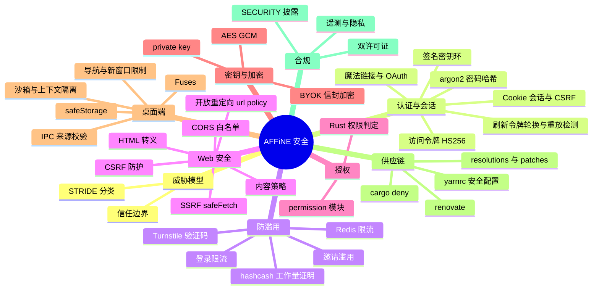
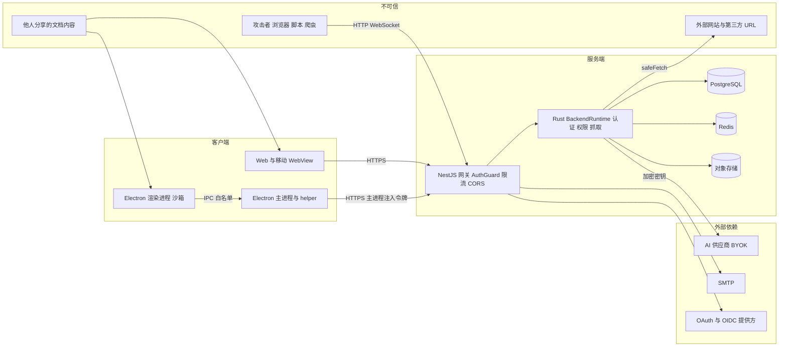
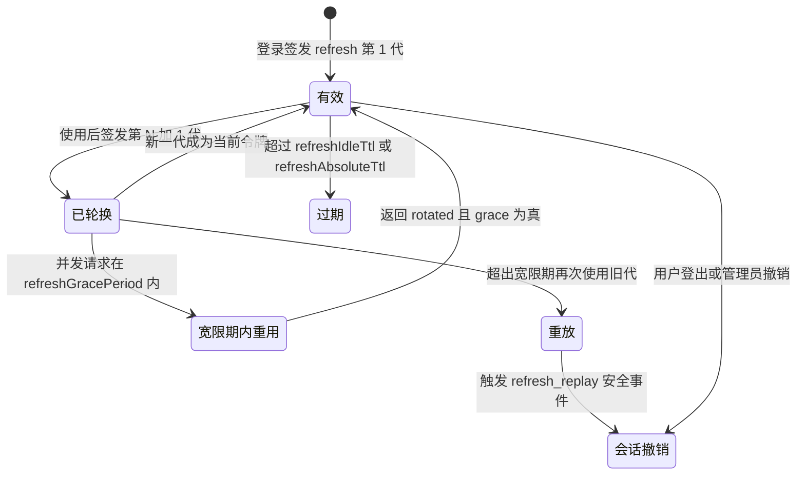

# 第 28 章 安全与合规

> **所属部分**：第 9 部分 · 运维与部署 ｜ **难度**：★★★★☆ ｜ **建议学时**：5 小时 ｜ **前置章节**：第 23 章 API 层 GraphQL WebSocket 认证权限

## 本章导读

安全不是某一个模块，而是贯穿"客户端—网络—服务端—数据—供应链—发布"的一组约束。AFFiNE 的攻击面尤其宽：

- 它是**协作应用**：要防越权访问他人的工作区与文档；
- 它支持**分享与邀请**：会给陌生人发邮件、渲染公开页面，容易被用于钓鱼与垃圾信息；
- 它有**服务端抓取**能力：链接预览、图片代理、CalDAV、自定义 AI 端点，都可能被诱导去访问内网（SSRF）；
- 它有**桌面客户端**：Electron 渲染进程一旦被 XSS，可能触及本地文件与系统能力；
- 它是**开源 monorepo**：几千个 npm 包与几百个 crate，供应链风险不可忽视；
- 它会**存储第三方密钥**（BYOK）：泄露后果直接是用户的经济损失。

本章先建立威胁模型，再按"认证会话 → 防滥用 → Web 安全 → 权限 → 密钥 → Electron → 供应链 → 漏洞披露 → 隐私 → 许可证"的顺序逐一对照源码，最后给出一份可落地的安全自查清单。

值得提前说明的一个架构趋势：AFFiNE 近期把大量安全敏感逻辑（令牌签发与校验、刷新令牌轮换、权限判定、SSRF 防护、BYOK 加密）**下沉到 Rust 原生模块** `packages/backend/native`（`@affine/server-native`），TypeScript 层更多是"编排与错误映射"。阅读安全代码时，要习惯在 TS 与 Rust 之间来回跳。

## 学习目标

- [ ] 能够画出 AFFiNE 的信任边界图，并为每条边界列举至少一种威胁与对应防护
- [ ] 能够说明 Cookie 会话与 JWT 访问令牌 + 刷新令牌两套认证机制的适用场景、存储方式与轮换策略
- [ ] 能够解释 hashcash 工作量证明、Turnstile 验证码、限流器、邀请滥用防护的协同关系
- [ ] 能够定位 CORS、CSRF、SSRF、开放重定向、HTML 转义、内容策略的实现位置
- [ ] 能够说明 BYOK 密钥在服务端（HKDF + AES-256-GCM + zeroize）与桌面端（`safeStorage`）的保护方式
- [ ] 能够列出 Electron 应用的至少 8 项安全加固措施并指出源码位置
- [ ] 能够说明 `deny.toml`、`renovate.json`、yarn `resolutions`、`.yarnrc.yml` 在供应链安全中的作用
- [ ] 能够理解 AFFiNE 的双许可证结构与遥测关闭方式，并使用本章清单完成一次自托管安全自查

## 知识地图



## 28.1 威胁模型概览

### 28.1.1 信任边界



### 28.1.2 STRIDE 对照

| 威胁类型 | 典型场景 | AFFiNE 中的主要防护 | 章节 |
| --- | --- | --- | --- |
| 伪造身份 Spoofing | 盗用会话、伪造令牌、撞库 | HttpOnly Cookie、HS256 令牌带 `kid`、argon2、登录限流、验证码 | 28.2–28.3 |
| 篡改 Tampering | CSRF 修改数据、篡改桌面应用 | CSRF 双提交、GraphQL `csrfPrevention`、Electron Fuses 与 asar 完整性 | 28.4、28.7 |
| 抵赖 Repudiation | 事后无法追溯 | 请求 ID（`X-Request-Id`）、安全事件 `auth.security.detected` | 28.2 |
| 信息泄露 Information disclosure | 越权读文档、SSRF 读内网、密钥泄露 | Rust 权限判定、`safeFetch`、BYOK 信封加密、令牌不进渲染进程 | 28.4–28.6 |
| 拒绝服务 DoS | 刷接口、大消息、注册轰炸 | Redis 限流、hashcash、`maxHttpBufferSize`、上传大小限制 | 28.3 |
| 权限提升 Elevation | XSS 升级为 RCE、普通用户成为管理员 | Electron 沙箱与 IPC 校验、初始化互斥、`administrator` 特性 | 28.5、28.7 |

## 28.2 认证与会话安全

### 28.2.1 两套凭证并存

`packages/backend/server/src/core/auth/` 下的文件分工：

| 文件 | 职责 |
| --- | --- |
| `guard.ts` | `AuthGuard`：解析 `Authorization: Bearer` 或 Cookie，决定 `req.authType` 为 `jwt` 或 `session` |
| `cookie-session.ts` | 调用 Rust `resolveAuthPrincipalV1({ type: 'cookie', ... })` 解析 Cookie 会话 |
| `access-token.ts` | `AccessTokenService.verify`：调用 Rust 校验访问令牌 |
| `auth-session.ts` | `AuthSessionService`：刷新令牌轮换、撤销，发出安全事件 |
| `session-issuer.ts` | `SessionIssuer`：根据客户端类型（原生/浏览器）签发 Cookie 或交换码 |
| `signing-key.ts` / `signing-key-resolver.ts` | `AuthSigningKeyRing`：访问令牌签名密钥环（轮换、退役、删除） |
| `magic-link.ts` | 魔法链接（邮件 OTP）登录 |
| `open-app.ts` | "在 App 中打开"：网页端生成一次性 code，桌面/移动端兑换会话 |
| `session-exchange.ts` | 交换码换取会话 |
| `config.ts` | `auth` 模块配置（TTL、注册开关、限流、密码规则） |
| `controller.ts` / `resolver.ts` / `service.ts` | REST 与 GraphQL 入口、Cookie 工具 |

| 维度 | Cookie 会话 | 访问令牌 + 刷新令牌 |
| --- | --- | --- |
| 典型客户端 | 浏览器 Web | 桌面端、移动端（原生客户端） |
| 凭证载体 | `affine_session` HttpOnly Cookie | `Authorization: Bearer <JWT>`；刷新令牌由客户端安全存储 |
| CSRF 风险 | 有，需要额外防护 | 无（浏览器不会自动附加 Authorization 头） |
| 主要 TTL（schema 默认） | `auth.session.ttl` 1296000 秒（15 天），`auth.session.ttr` 604800 秒（7 天）刷新间隔 | `auth.token.accessTokenTtl` 900 秒（15 分钟）；`refreshIdleTtl` 2592000 秒（30 天闲置）；`refreshAbsoluteTtl` 15552000 秒（180 天绝对） |

### 28.2.2 Cookie 的安全属性

```ts
// 来源：packages/backend/server/src/core/auth/session-issuer.ts（节选）
  apply(res: Response, result: NativeLoginResult) {
    if (result.exchangeCode) {
      this.auth.clearCookies(res);
      return;
    }
    // ...
    const expires = new Date(result.sessionExpiresAt);
    res.cookie(AuthService.sessionCookieName, result.sessionId, {
      ...this.auth.cookieOptions,
      expires,
    });
    res.cookie(AuthService.csrfCookieName, randomUUID(), {
      ...this.auth.cookieOptions,
      httpOnly: false,
      expires,
    });
    this.auth.setUserCookie(res, result.user.id);
  }
```

`packages/backend/server/src/core/auth/service.ts` 中 `cookieOptions` 为 `sameSite: 'lax'`、`httpOnly: true`、`secure: this.config.server.https`。三种 Cookie：

| Cookie | HttpOnly | 用途 |
| --- | --- | --- |
| 会话 Cookie（`sessionCookieName`） | 是 | 身份凭证，JS 无法读取，防 XSS 窃取 |
| CSRF Cookie（`csrfCookieName`） | 否 | 随机 UUID，供前端读取后放入 `x-affine-csrf-token` 头（双提交） |
| 用户 Cookie（`userCookieName`） | 否 | 多账号场景标识当前用户；源码注释说明"服务端会用会话 Cookie 校验，所以非 HttpOnly 是安全的" |

> 部署要点：`secure` 取决于 `server.https`。生产环境若通过 HTTPS 访问却没把 `server.https` 设为 true，Cookie 不带 `Secure` 标志，存在被明文网络窃取的风险。

### 28.2.3 CSRF 防护

两层：

1. **GraphQL**：`packages/backend/server/src/base/graphql/index.ts` 中 Apollo 配置 `csrfPrevention: { requestHeaders: ['content-type'] }`，要求请求携带非"简单请求"的头，使跨站表单无法直接发起 GraphQL 请求。
2. **敏感 REST 操作**：`core/auth/controller.ts` 中对会话类变更做双提交校验：

```ts
// 来源：packages/backend/server/src/core/auth/controller.ts（节选）
  private assertSessionMutationAuthorized(
    req: Request,
    session: Session | AuthSessionPrincipal | undefined
  ) {
    if (req.authType === 'jwt') {
      const principal = session as Partial<AuthSessionPrincipal> | undefined;
      if (principal?.authSessionId) return;
    } else if (req.authType === 'session') {
      const csrfCookie = getRequestCookie(req, AuthService.csrfCookieName);
      const csrfHeader = req.get('x-affine-csrf-token');
      if (csrfHeader && csrfCookie && csrfCookie === csrfHeader) return;
    }
    throw new ActionForbidden();
  }
```

JWT 请求天然免疫 CSRF，直接放行；Cookie 请求必须"Cookie 中的值 = 请求头中的值"，攻击站点读不到受害站点的 Cookie，无法构造正确的头。配合 `SameSite=Lax`，构成纵深防御。

### 28.2.4 访问令牌：HS256 + kid

访问令牌的签名与校验在 Rust 中完成：

```rust
// 来源：packages/backend/native/src/auth_session.rs（节选）
pub(crate) fn sign_auth_session_access_token(
  user_id: &str,
  auth_session_id: &str,
  key_id: &str,
  secret: &[u8],
  issued_at: i64,
  expires_at: i64,
) -> Result<String, &'static str> {
  if user_id.is_empty() || auth_session_id.is_empty() || key_id.is_empty() {
    return Err("access_token_invalid_identity");
  }
  if secret.len() < 32 {
    return Err("access_token_signing_key_too_short");
  }
  if expires_at <= issued_at {
    return Err("access_token_invalid_expiry");
  }
  // ... 构造 header { alg: HS256, typ: JWT, kid } 与 claims { sub, sid, typ, iss, aud, iat, exp }
  let signing_input = format!("{header}.{claims}");
  let mut mac = HmacSha256::new_from_slice(secret).map_err(|_| "access_token_signing_key_invalid")?;
  mac.update(signing_input.as_bytes());
  let signature = URL_SAFE_NO_PAD.encode(mac.finalize().into_bytes());
  Ok(format!("{signing_input}.{signature}"))
}
```

校验函数 `verify_auth_session_access_token` 的安全要点：

| 检查 | 防御的攻击 |
| --- | --- |
| `header.alg != "HS256"` 直接拒绝 | `alg: none` 与算法混淆攻击 |
| `header.kid != expected_key_id` 拒绝 | 用退役或伪造 key 签名 |
| `mac.verify_slice` 常量时间比较 | 计时攻击 |
| 校验 `typ`、`iss`、`aud` | 把其他用途的令牌当访问令牌使用 |
| `iat > now + CLOCK_TOLERANCE_SECONDS` 拒绝 | 未来签发的令牌 |
| 过期单独返回 `expired` 状态 | 让客户端区分"刷新"与"重新登录" |
| 签名密钥长度至少 32 字节 | 弱密钥 |

令牌 claims 中的 `sid` 绑定到一个**认证会话**（auth session），服务端可以按会话撤销——这弥补了"JWT 无法撤销"的经典缺陷：访问令牌只有 15 分钟寿命，撤销会话后最多 15 分钟内失效，而刷新时会被拒绝。

**签名密钥环**（`core/auth/signing-key.ts`）：密钥有 `active` 与 `retiring` 状态，`source` 为 `auto` 或 `admin`；`rotate` 需要传入 `expectedActiveKeyId` 做乐观并发控制，冲突时提示 "The active signing key changed. Reload and try again."；轮换与删除分别发出 `auth.signing_key.rotated`、`auth.signing_key.deleted` 事件便于审计。

### 28.2.5 刷新令牌：只存哈希、轮换、重放检测

```rust
// 来源：packages/backend/native/src/auth_session.rs（节选）
fn hash_refresh_secret(secret: &[u8]) -> String {
  hex::encode(Sha256::digest(secret))
}
// ...
pub(crate) fn create_auth_session_refresh_token() -> AuthSessionRefreshToken {
  let mut id = [0_u8; 18];
  let mut secret = [0_u8; 32];
  rand::rng().fill_bytes(&mut id);
  rand::rng().fill_bytes(&mut secret);
  let id = URL_SAFE_NO_PAD.encode(id);
  let encoded_secret = URL_SAFE_NO_PAD.encode(secret);
  AuthSessionRefreshToken {
    token: format!("{REFRESH_TOKEN_PREFIX}.{id}.{encoded_secret}"),
    id,
    secret_hash: hash_refresh_secret(&secret),
  }
}
```

- 刷新令牌结构为 `前缀.id.secret`，256 位随机 secret；**数据库只存 SHA-256 哈希**，数据库泄露也无法直接使用令牌；
- 解析时严格校验段数、前缀和长度（id 18 字节、secret 32 字节）。

TS 侧 `AuthSessionService.refresh` 处理轮换结果：

```ts
// 来源：packages/backend/server/src/core/auth/auth-session.ts（节选）
    if (result.status === 'rotated') {
      if (result.grace) {
        metrics.auth.counter('auth_refresh_grace').add(1, {
          platform: result.platform,
        });
      }
      this.event.emit('auth.session.refreshed', {
        authSessionId: result.authSessionId,
      });
      // ...
    }
    if (result.status === 'reused') {
      this.event.emit('auth.session.refresh_reused', {
        authSessionId: result.authSessionId,
      });
      this.event.emit('auth.security.detected', {
        type: 'refresh_replay',
        userId: result.userId,
        authSessionId: result.authSessionId,
        notification: 'policy_pending',
      });
      // ...
```



**刷新令牌轮换 + 重放检测**是 OAuth 2.0 安全最佳实践：攻击者偷到旧令牌后使用，会因"旧代被重用"暴露，系统据此撤销整个会话。`auth.token.refreshGracePeriod`（默认 30 秒）容忍客户端多个请求并发刷新的正常情况，`refreshRetention`（30 天）决定旧代记录保留多久以便检测重放。错误码集中定义在 `AuthSessionErrorCode`：`REFRESH_TOKEN_INVALID`、`AUTH_SESSION_EXPIRED`、`AUTH_SESSION_REVOKED`、`REFRESH_TOKEN_REUSED`、`AUTH_SESSION_TEMPORARILY_UNAVAILABLE`。

### 28.2.6 魔法链接、Open App 与 OAuth

**魔法链接**（`core/auth/magic-link.ts`）：

- 先 `validators.assertValidEmail(email)`；邮件服务未配置直接抛 `EmailServiceNotConfigured`；
- 回调 URL 经 `this.url.safeLink(callbackUrl)` 规范化，其中的 `redirect_uri` 参数经 `canonicalRedirectUri` 处理——防止把魔法链接变成开放重定向；
- 令牌生成、存储与校验在 Rust（`action: 'prepare_magic_link'`），并传入 `source`（请求来源信息）参与配额判断。
- 一次性数字验证码由 `packages/backend/server/src/base/helpers/crypto.ts` 的 `otp()` 用 `crypto.randomInt` 生成（密码学安全随机数）。

**Open App**（`core/auth/open-app.ts`）：网页端已登录用户调用 `create_open_app_code` 得到一次性 code，通过 `affine://` 深链（第 20 章 `deep-link.ts`）交给桌面端，桌面端 `complete_open_app` 兑换会话。code 无效时统一抛 `InvalidAuthState`，不泄露具体原因。

**OAuth/OIDC**（`packages/backend/server/src/plugins/oauth/`）：

```ts
// 来源：packages/backend/server/src/plugins/oauth/config.ts（节选）
export interface OAuthOIDCProviderConfig extends OAuthProviderConfig {
  issuer: string;
  allowPrivateNetwork?: boolean;
  args?: OIDCArgs;
}

export enum OAuthProviderName {
  Google = 'google',
  GitHub = 'github',
  Apple = 'apple',
  OIDC = 'oidc',
}
```

- 支持 Google、GitHub、Apple 与通用 OIDC；配置由 `defineNativeModuleConfig('oauth', ...)` 交给 Rust 校验；
- `OAuthService.preflight` 传入 `clientNonce`、`redirectAllowedOrigins`、`redirectTrustedDomains`，生成带 `state` 的授权 URL；`callback` 时校验 state，错误映射为 `InvalidOauthCallbackState`、`OauthStateExpired`、`InvalidOauthCallbackCode` 等；
- OIDC 的 `allowPrivateNetwork` 默认关闭：OIDC 需要服务端去拉取 issuer 的发现文档，如果允许私网地址，就可能被管理员误配或被利用进行 SSRF；
- `auth.allowSignupForOauth` 可单独关闭 OAuth 自动注册。

### 28.2.7 密码哈希：argon2

```ts
// 来源：packages/backend/server/src/base/helpers/crypto.ts（节选）
import { hash as hashPassword } from '@node-rs/argon2';
// ...
  encryptPassword(password: string) {
    return hashPassword(password);
  }

  compare(lhs: string, rhs: string) {
    if (lhs.length !== rhs.length) {
      return false;
    }

    return timingSafeEqual(Buffer.from(lhs), Buffer.from(rhs));
  }
```

- 写入用 `@node-rs/argon2`（NAPI 绑定的 Rust argon2 实现）生成 PHC 格式字符串；
- 校验在 Rust 端完成：`packages/backend/native/src/runtime/backend_runtime/auth_session/login.rs` 使用 `argon2` crate 的 `PasswordVerifier` 与 `PasswordHash`（PHC 格式两端兼容）；
- 通用字符串比较用 `timingSafeEqual` 防计时攻击；
- 密码长度规则 `auth.passwordRequirements` 默认 `{ min: 8, max: 32 }`，zod 校验保证 `min < max`、`max ≤ 100`。

> argon2 是 Password Hashing Competition 冠军，内存困难型算法，能有效抵御 GPU/ASIC 暴力破解，优于 bcrypt/PBKDF2。

## 28.3 防滥用：验证码、工作量证明与限流

### 28.3.1 两种人机验证

```ts
// 来源：packages/backend/server/src/plugins/captcha/service.ts（节选）
  async getClientConfig(nativeClient: boolean) {
    const provider = nativeClient
      ? ('hashcash' as const)
      : ('turnstile' as const);
    if (provider === 'turnstile') {
      return {
        provider,
        siteKey: this.captcha.turnstile.siteKey,
        action: this.captcha.turnstile.action,
      };
    }
    return { provider, ...(await this.runtime.createAuthCaptchaChallengeV1()) };
  }
```

| 客户端 | 验证方式 | 原因 |
| --- | --- | --- |
| 浏览器 | Cloudflare Turnstile（`captcha.config.turnstile.secret/siteKey/action`） | 用户无感或轻交互 |
| 桌面/移动原生客户端 | hashcash 工作量证明（`captcha.config.challenge.bits`，默认 20，范围 16–30） | 原生环境难以嵌入第三方验证码 |

`CaptchaGuardProvider`（`plugins/captcha/guard.ts`）在 `captcha.enabled` 为 true 时，从请求头 `x-captcha-token`、`x-captcha-challenge`、`x-captcha-provider` 读取凭证，经 zod 严格校验（token 最长 2048，challenge 最长 128，provider 只能是 `hashcash` 或 `turnstile`）后验证。`captcha` 默认关闭，且属于自托管 schema 忽略模块。

### 28.3.2 hashcash 原理与实现

hashcash 要求客户端找到一个 `counter`，使 `SHA3-256(stamp)` 的十六进制前缀有 N 个 0。服务端验证只需一次哈希，客户端则需要平均 `16^(bits/4)` 次尝试——**把"刷接口"的成本转嫁给攻击者**。

```rust
// 来源：packages/common/native/src/hashcash.rs（节选）
  fn check_expiration(&self) -> bool {
    NaiveDateTime::parse_from_str(&self.ts, "%Y%m%d%H%M%S")
      .ok()
      .map(|ts| DateTime::<Utc>::from_naive_utc_and_offset(ts, Utc))
      .and_then(|utc| {
        utc
          .checked_add_signed(Duration::minutes(5))
          .map(|utc| Utc::now() <= utc)
      })
      .unwrap_or(false)
  }

  pub fn check<S: AsRef<str>>(&self, bits: u32, resource: S) -> bool {
    if self.version == "1" && bits <= self.claim && self.check_expiration() && self.resource == resource.as_ref() {
      let hex_digits = ((self.claim as f32) / 4.).floor() as usize;

      // check challenge
      let mut hasher = Sha3_256::new();
      hasher.update(self.format().as_bytes());
      let result = hex::encode(hasher.finalize());
      result[..hex_digits] == String::from_utf8(vec![b'0'; hex_digits]).unwrap()
    } else {
      false
    }
  }
```

| 检查 | 意义 |
| --- | --- |
| `version == "1"` | 格式版本 |
| `bits <= self.claim` | 声明的难度不低于服务端要求 |
| `check_expiration`（5 分钟） | 防止预先批量计算后囤积 |
| `self.resource == resource` | 绑定到服务端下发的挑战资源，防重用 |
| 前缀 0 位数 | 工作量本身 |

`Stamp::mint` 是客户端计算逻辑，同一份 Rust 代码通过 `@affine/native`（桌面，`packages/frontend/native/src/hashcash.rs`）和 `affine_mobile_native` 的 `hashcash_mint`（移动端，第 20 章）复用——这就是 iOS `app.tsx` 中 `ValidatorProvider` 调用 `Hashcash.hash` 插件的底层。

### 28.3.3 Redis 限流

`packages/backend/server/src/base/throttler/` 基于 `@nestjs/throttler`，但用自定义 `ThrottlerStorage` 把计数放到 Redis（`CacheRedis`），并用 Lua 脚本保证原子性：

```lua
-- 来源：packages/backend/server/src/base/throttler/index.ts 中 REDIS_THROTTLE_SCRIPT（节选）
local now = redis.call("TIME")
local nowMs = now[1] * 1000 + math.floor(now[2] / 1000)
local blockedUntil = tonumber(redis.call("HGET", KEYS[1], "blockedUntil")) or 0

if blockedUntil > nowMs then
  return {
    tonumber(redis.call("HGET", KEYS[1], "hits")) or 0,
    redis.call("PTTL", KEYS[1]),
    blockedUntil - nowMs
  }
end
-- ...
local hits = redis.call("HINCRBY", KEYS[1], "hits", 1)
if hits == 1 then
  redis.call("PEXPIRE", KEYS[1], ARGV[1])
end
```

- 使用 Redis 服务器时间 `TIME`，避免多实例时钟漂移；
- 多副本共享计数，水平扩展后限流依然准确（第 27 章）。

三种限流器（`base/throttler/decorators.ts` 注释）：

| 名称 | 默认 | 用法 |
| --- | --- | --- |
| `default` | 60 秒 120 次 | `@Throttle()` |
| `strict` | 60 秒 20 次 | `@Throttle('strict')`，用于登录、发信等敏感接口 |
| `authenticated` | 已登录用户不限，未登录按 default | 对登录用户友好 |

注释特别强调："If a Controller or Query do not protected behind a Throttler, it will never be rate limited."——**限流是显式声明的**，新增接口时要记得加装饰器。`server.ts` 中 `CloudThrottlerGuard` 作为全局守卫注册。

此外 `auth.signInRateLimit` 默认 `{ ttl: 60000, ipLimit: 20, emailLimit: 5 }`，按来源 IP 与邮箱两个维度经 Redis 共享计数，专门对抗撞库与对单一账号的暴力尝试。

### 28.3.4 邀请滥用与可信来源

`packages/backend/server/src/core/workspaces/abuse.ts` 处理"利用工作区邀请群发垃圾邮件"的场景：

```ts
// 来源：packages/backend/server/src/core/workspaces/abuse.ts（节选）
export function getAbuseRequestSource(
  req: Request | undefined,
  config: Config
): RuntimeQuotaSourceInput {
  if (!req || !config.auth.trustedCloudflareHeaders) {
    return { trusted: false };
  }

  return {
    trusted: true,
    ip: getRequestClientIp(req),
    country: req.get('CF-IPCountry')?.trim() || undefined,
    asn: parseAsn(req.get('x-affine-cf-asn')),
    rayId: req.get('CF-Ray')?.trim() || undefined,
  };
}
```

- 只有显式开启 `auth.trustedCloudflareHeaders` 时才信任 `CF-IPCountry`、`CF-Ray` 等头——否则攻击者可以伪造这些头。该键在自托管 schema 中被隐藏（`SELFHOSTED_IGNORED_KEYS`），因为自托管通常不在 Cloudflare 后面；
- 日志中的敏感值用 `hashLogValue` 做 SHA-256 截断后再记录，避免日志泄露 IP/邮箱；
- 配额判定（`RuntimeWorkspaceInviteQuotaDecision`）在 Rust 中进行；
- `auth.newAccountActionDelay` 默认 86400 秒：新注册账号 24 小时内不能发邀请和发布文档，大幅提高批量注册滥用的成本。

## 28.4 Web 安全：CORS、SSRF、重定向、XSS 与内容策略

### 28.4.1 CORS 白名单

```ts
// 来源：packages/backend/server/src/base/cors.ts（节选）
const MOBILE_CLIENT_ORIGINS = new Set([
  'https://localhost',
  'capacitor://localhost',
  'ionic://localhost',
]);
const DESKTOP_CLIENT_ORIGINS = new Set([
  'assets://.',
  'assets://another-host',
  // for old versions of client, which use file:// as origin
  'file://',
]);
// ...
export function buildCorsAllowedOrigins(url: URLHelper) {
  return new Set<string>([
    ...url.allowedOrigins,
    ...MOBILE_CLIENT_ORIGINS,
    ...DESKTOP_CLIENT_ORIGINS,
  ]);
}

export function isCorsOriginAllowed(
  origin: string | undefined | null,
  allowedOrigins: Set<string>
) {
  if (!origin) {
    return true;
  }
  if (allowedOrigins.has(origin)) {
    return true;
  }
  // ... ws/wss 归一化为 http/https 后再比较
  if ((env.dev || env.testing) && isDevLoopbackOrigin(origin)) {
    return true;
  }
  return false;
}
```

要点：

- **精确白名单**而非正则或 `*`：服务端自身来源（`url.allowedOrigins`，由 `server.externalUrl`/`host`/`hosts` 推导）+ 移动端 WebView 来源 + 桌面端 `assets://` 来源（与第 20 章 `internal-origin.ts` 对应）；
- 开发/测试环境才放行 localhost 回环地址；
- `credentials: true` 时浏览器禁止 `Access-Control-Allow-Origin: *`，这里按请求回显被允许的 origin；
- `CORS_ALLOWED_HEADERS` 明确列出 `x-affine-csrf-token`、`x-captcha-*` 等自定义头；
- `server.ts` 的 HTTP CORS 与 `base/websocket/adapter.ts` 的 socket.io CORS **共用同一套判定**，WebSocket 不会成为绕过点；
- 无 `Origin` 头（同源、服务端调用、原生客户端）放行——CORS 本来就是浏览器机制，真正的鉴权在 `AuthGuard`。

### 28.4.2 SSRF：safeFetch

服务端需要抓取外部 URL 的场景：

| 场景 | 调用点 |
| --- | --- |
| 图片代理、链接预览、favicon | `packages/backend/server/src/plugins/worker/controller.ts` 中多处 `safeFetch(...)` |
| CalDAV 日历同步 | `packages/backend/server/src/plugins/calendar/providers/caldav.ts` |
| BYOK 自定义端点、OIDC 发现 | Rust 运行时内部（受 `copilot.byok.allowPrivateEndpoint`、OIDC `allowPrivateNetwork` 控制） |

```rust
// 来源：packages/backend/native/src/safe_fetch.rs（节选）
#[napi(object)]
pub struct SafeFetchRequest {
  pub url: String,
  pub method: Option<SafeFetchMethod>,
  pub headers: Option<HashMap<String, String>>,
  pub body: Option<Buffer>,
  pub timeout_ms: Option<u32>,
  pub max_redirects: Option<u32>,
  pub max_bytes: Option<u32>,
  pub allowed_headers: Option<Vec<String>>,
  pub allowed_hosts: Option<Vec<String>>,
  pub allow_http: Option<bool>,
  pub allow_private_target_origin: Option<bool>,
  pub enable_ech: Option<bool>,
  pub ech_config_list: Option<Buffer>,
}
```

`safe_fetch.rs` 把请求交给工作区依赖的 `safefetch` crate（根 `Cargo.toml` 中 `safefetch = "0.1.0"`），从参数可以看出它提供的防护维度：

| 参数 | 防护 |
| --- | --- |
| `allow_private_target_origin`（默认不允许） | 禁止访问内网/回环/链路本地地址（含 DNS 解析后的 IP，防 DNS rebinding） |
| `max_redirects` | 限制重定向次数，并对每一跳重新校验目标 |
| `max_bytes` | 响应体上限，防内存耗尽 |
| `timeout_ms` | 防慢速连接占用资源 |
| `allowed_headers` | 只转发白名单请求头，避免把 Cookie 等转发给第三方 |
| `allow_http` | 默认可强制 HTTPS |
| `allowed_hosts` | 额外的目标主机白名单 |

TS 侧捕获 `SsrfBlockedError`、`ResponseTooLargeError` 并转换为 `BadRequest`，日志里只记录经过 `safeLogUrl` 处理的 URL：

```ts
// 来源：packages/backend/server/src/plugins/worker/controller.ts（节选）
    try {
      response = await safeFetch(
        targetURL.toString(),
        { method: 'GET', headers: cloneHeader(req.headers) },
        {
          timeoutMs: FETCH_TIMEOUT_MS,
          maxRedirects: MAX_REDIRECTS,
          maxBytes: IMAGE_PROXY_MAX_BYTES,
        }
      );
    } catch (error) {
      if (error instanceof SsrfBlockedError) {
        const reason = error.data?.reason as SSRFBlockReason | undefined;
        this.logger.warn('Blocked image proxy target', {
          url: logUrl,
          reason,
        });
        throw new BadRequest(toBadRequestReason(reason ?? 'invalid_url'));
      }
      // ... ResponseTooLargeError 等
```

> `worker.allowedOrigin` 默认 `["localhost", "127.0.0.1"]`，限定哪些来源页面可以使用这些代理端点，防止被第三方网站当作免费代理。

桌面端也有一个类似的工具 `packages/frontend/apps/electron/src/main/security/url-safety.ts`，用 Node 的 `BlockList` 屏蔽 `10.0.0.0/8`、`127.0.0.0/8`、`169.254.0.0/16`、`172.16.0.0/12`、`192.168.0.0/16`、`100.64.0.0/10`（CGNAT）、组播/保留段及 IPv6 的 `::1`、`fc00::/7`、`fe80::/10` 等，并处理 IPv4 映射的 IPv6 地址。不过在当前版本中，其导出函数 `resolveAndValidateUrlForPreview` 没有被任何代码引用，属于尚未接入或遗留代码。

### 28.4.3 开放重定向：url_policy

`packages/backend/native/src/url_policy.rs` 解决的是另一类问题：登录回调、`redirect_uri` 被篡改为恶意站点（开放重定向是钓鱼的常用跳板）。

```rust
// 来源：packages/backend/native/src/url_policy.rs（节选）
fn parse_http_url(input: &str, base_url: &str) -> UrlPolicyResult<Url> {
  if input.is_empty() {
    return Err(UrlPolicyError::Denied);
  }

  let base = Url::parse(base_url).map_err(|_| UrlPolicyError::Denied)?;
  let url = base.join(input).map_err(|_| UrlPolicyError::Denied)?;
  if !matches!(url.scheme(), "http" | "https") || !url.username().is_empty() || url.password().is_some() {
    return Err(UrlPolicyError::Denied);
  }
  Ok(url)
}

fn has_allowed_origin(url: &Url, allowed_origins: &[String]) -> bool {
  allowed_origins.iter().any(|origin| {
    Url::parse(origin)
      .ok()
      .is_some_and(|allowed| matches!(allowed.scheme(), "http" | "https") && url.origin() == allowed.origin())
  })
}

fn matches_trusted_domain(url: &Url, trusted_domains: &[String]) -> bool {
  // ... hostname 等于 domain 或以 ".domain" 结尾（注意前导点，防止 evilexample.com 匹配 example.com）
}
```

- 只允许 `http`/`https`，拒绝 `javascript:`、`data:` 等；
- 拒绝带 `user:pass@` 的 URL（`https://trusted.com@evil.com` 类混淆）；
- 用 `Url::origin()` 做精确的协议+主机+端口比较，而不是字符串前缀匹配；
- 子域匹配要求 `.domain` 后缀；
- 导出 `build_safe_callback_url`、`evaluate_redirect_uri`、`evaluate_local_redirect` 三个 NAPI 函数，TS 侧通过 `packages/backend/server/src/native.ts` 的 `evaluateRedirectUri` 等使用。

### 28.4.4 XSS：HTML 转义

```rust
// 来源：packages/backend/native/src/html_sanitize.rs
#[napi]
pub fn html_sanitize(input: String) -> String {
  v_htmlescape::escape(&input).to_string()
}
```

名为 sanitize，实际是**HTML 实体转义**（`v_htmlescape`），把 `<`、`>`、`&`、`"`、`'` 等转义，不保留任何标签。它用于服务端渲染分享页 `<head>` 元信息：

```ts
// 来源：packages/backend/server/src/core/doc-renderer/controller.ts（节选）
      ? htmlSanitize(`${opts.title} | AFFiNE`)
// ...
    const summary = opts ? htmlSanitize(opts.summary) : assets.description;
```

文档标题和摘要由用户控制，若不转义直接拼进 `<title>` 或 `<meta content="...">`，就是存储型 XSS。对"插入 HTML 属性/文本节点"这种场景，转义比"白名单清洗"更简单可靠。前端编辑器（BlockSuite）基于结构化数据渲染，React/Lit 默认转义文本，是前端 XSS 的主要防线。

### 28.4.5 内容策略：拦截带链接的工作区名

```ts
// 来源：packages/backend/server/src/core/content-policy.ts
import { scanContentPolicyV1 } from '../native';

export function scanContentPolicy(value: string | null | undefined) {
  return scanContentPolicyV1({
    value: value ?? '',
    checks: ['url_or_domain'],
  });
}

export function containsUrlOrDomain(value: string | null | undefined) {
  return scanContentPolicy(value).matches.some(
    match => match.type === 'url_or_domain'
  );
}
```

问题背景：攻击者把工作区命名为"您的账户已冻结，请访问 evil.example 解冻"，再邀请大量邮箱——AFFiNE 发出的正规邀请邮件就成了钓鱼信。对策是在发信与通知前检测工作区名是否含 URL/域名：

```ts
// 来源：packages/backend/server/src/core/mail/job.ts（节选）
          if (
            payload.name === 'MemberInvitation' &&
            containsUrlOrDomain(workspaceProps.name)
          ) {
            this.logger.warn(
              `Skip mail [${payload.name}] to [${payload.to}], reason=workspace name contains url or domain`
            );
            return;
          }
```

调用点还包括 `core/notification/service.ts` 与 `core/workspaces/resolvers/member.ts`。

Rust 实现 `packages/backend/native/src/content_policy.rs` 的精妙之处在于**对抗混淆**：

- `normalize_content` 做 Unicode NFKC 规范化（全角 `ｅｖｉｌ．ｃｏｍ` → `evil.com`）；
- `skeleton_content` 用 Unicode 混淆字符骨架（`skeleton_chars`）把西里尔字母 `е` 等同形字符映射到 ASCII；
- `is_default_ignorable` 剔除零宽字符（`U+200B`–`U+200F`、`U+FEFF` 等）与双向控制符（`U+202A`–`U+202E`）；
- `enclosed_ascii`、`url_punctuation_ascii` 把带圈字母、全角句点等还原。

## 28.5 授权：权限模型的安全设计

第 23 章讲过权限的业务模型（工作区角色、文档角色）。从安全角度看三点：

```ts
// 来源：packages/backend/server/src/core/permission/service.ts（节选）
  async canWorkspace(input: {
    userId?: string;
    workspaceId: string;
    action: PermissionWorkspaceAction;
  }) {
    const output = await this.workspacePermissions({
      ...input,
      actions: [input.action],
    });
    return output.decisions[0]?.allowed ?? false;
  }
```

1. **默认拒绝**：`decisions[0]?.allowed ?? false`——如果判定结果缺失，按拒绝处理；
2. **按动作而非按角色判断**：调用方询问"能否执行 `Workspace.xxx` / `Doc.xxx`"，角色到动作的映射集中在 `core/permission/permission-map.ts` 与 Rust `packages/backend/native/src/permission/`，避免各处散落 `if (role === 'owner')`；
3. **判定下沉 Rust**：`authorize` 通过 `BackendRuntimeProvider` 在 Rust 中完成，并返回 `effectiveRole` 与 `legacyApiRole`（兼容旧 API）。`assertWorkspace`/`assertDoc` 失败抛 `SpaceAccessDenied`、`DocActionDenied`。

其他授权相关的安全设计：

- 全局 `AuthGuard`：默认所有接口需要登录，只有标注 `@Public()` 的接口例外（`core/auth/guard.ts` 中 `PUBLIC_ENTRYPOINT_SYMBOL`）——"默认安全"；
- 自托管首个管理员创建有 `SelfhostGuard` + 用户数检查 + 互斥锁（第 27 章）；
- 管理员身份是一个用户特性 `administrator`（`models.userFeature.add(user.id, 'administrator', ...)`）。

## 28.6 密钥管理与 BYOK

### 28.6.1 服务端主密钥

`crypto.privateKey`（环境变量 `AFFINE_PRIVATE_KEY`，或自托管 `~/.affine/config/private.key`）是服务端的根密钥。`packages/backend/server/src/base/helpers/crypto.ts` 中的 `CryptoHelper`：

| 能力 | 实现 |
| --- | --- |
| 签名/验签 | EC 密钥用 ECDSA-SHA256，Ed25519 密钥直接签名；验签时会尝试当前公钥与最近 2 个旧公钥（`previousPublicKeys`），支持平滑轮换 |
| 对称加密 | `aes-256-gcm`，密钥为 `sha256(privateKey)`，随机 12 字节 IV，认证标签长度 12 字节（`AUTH_TAG_LENGTH = 12`），输出 `iv + tag + ciphertext` 的 base64 |
| 密码哈希 | `@node-rs/argon2` |
| 随机数 | `crypto.randomBytes`、`crypto.randomInt` |
| 常量时间比较 | `timingSafeEqual` |

自托管时 `onModuleInit` 还要求原生模块中嵌入 `AFFINE_PRO_PUBLIC_KEY`（用于许可证校验，第 26 章 `build-server-native` 中注入），缺失则启动失败。

> 观察：GCM 认证标签用 96 位而非默认 128 位，是标准允许的取值，但安全余量略低；若你在此基础上扩展加密功能，优先使用 Rust 侧的 `aes-gcm` 实现（默认 16 字节标签，见下文）。

### 28.6.2 BYOK 信封加密（Rust）

用户在工作区设置中填入 OpenAI 等供应商的 API Key（第 24 章）。服务端存储前用信封加密：

```rust
// 来源：packages/backend/native/src/llm/byok/envelope.rs（节选）
const PREFIX: &str = "byok:v1:";
const INFO: &[u8] = b"AFFiNE/Copilot/BYOK/v1";
const NONCE_LEN: usize = 12;
const TAG_LEN: usize = 16;

pub(crate) struct CredentialEnvelopeKey(Zeroizing<[u8; 32]>);
pub(crate) struct SensitiveCredential(Zeroizing<Vec<u8>>);
// ...
impl CredentialEnvelopeKey {
  pub(crate) fn derive(root_secret: &[u8]) -> Result<Self, CredentialEnvelopeError> {
    if root_secret.is_empty() {
      return Err(CredentialEnvelopeError::Unavailable);
    }
    let mut key = Zeroizing::new([0_u8; 32]);
    Hkdf::<Sha256>::new(None, root_secret)
      .expand(INFO, key.as_mut())
      .map_err(|_| CredentialEnvelopeError::Unavailable)?;
    Ok(Self(key))
  }
```

```rust
// 来源：packages/backend/native/src/llm/byok/envelope.rs（节选）
pub(crate) fn server_aad(workspace_id: &str, profile_id: &str, provider: &str, endpoint_identity: &str) -> Vec<u8> {
  ["server", workspace_id, profile_id, provider, endpoint_identity]
    .join("\0")
    .into_bytes()
}
```

三个 Rust 依赖的用途：

| crate | 版本（根 `Cargo.toml`） | 在 BYOK 中的作用 |
| --- | --- | --- |
| `hkdf` | `0.13` | 从根密钥派生专用子密钥，`info` 为 `AFFiNE/Copilot/BYOK/v1`，实现密钥用途隔离：即使其他用途泄露也不影响 BYOK |
| `aes-gcm` | `0.10` | AES-256-GCM 认证加密，16 字节标签；**AAD 绑定 workspaceId、profileId、provider、endpoint**——把 A 工作区的密文挪到 B 工作区会解密失败，防"密文搬运" |
| `zeroize` | `1.9` | `Zeroizing` 包装密钥与明文凭证，离开作用域时内存被清零；中间缓冲区 `body.zeroize()`，降低内存转储/交换分区泄露风险 |

密文格式为 `byok:v1:` + base64url(nonce + ciphertext)，前缀带版本号，为将来算法升级留余地。同样的 HKDF + AES-GCM 模式还用于 `runtime/backend_runtime/auth_session/successor.rs`（会话延续凭证）等处。

配置层面的护栏（schema 默认值）：

| 键 | 默认 | 安全含义 |
| --- | --- | --- |
| `copilot.byok.enabled` | `true` | 允许 BYOK |
| `copilot.byok.allowedProviders` | `["openai","anthropic","gemini","fal"]` | 供应商白名单 |
| `copilot.byok.allowCustomEndpoint` | `false` | 默认不允许自定义端点（防止把密钥发给伪造的"兼容端点"） |
| `copilot.byok.allowPrivateEndpoint` | `false` | 即使允许自定义端点，也不允许解析到私网（SSRF 防护）；描述中明确警告开启后工作区管理员可探测内网 |

`packages/backend/server/src/plugins/copilot/byok/policy.ts` 的 `ByokEntitlementPolicy` 还要求 Pro/Team/Believer/AI 权益才能使用。

### 28.6.3 桌面端 BYOK 与令牌存储

第 20 章提到，桌面端的 BYOK 与登录凭证都由主进程用 Electron `safeStorage`（系统钥匙串/DPAPI/libsecret）加密：

```ts
// 来源：packages/frontend/apps/electron/src/main/auth/auth-session.ts（节选）
function secureStorageAvailable() {
  return (
    safeStorage.isEncryptionAvailable() &&
    (process.platform !== 'linux' ||
      safeStorage.getSelectedStorageBackend() !== 'basic_text')
  );
}
```

- Linux 下若后端退化为 `basic_text`（实际是明文混淆），不落盘，只保留内存会话，并在渲染层提示 "Sign-in is only valid for this session"；
- `src/main/secure-storage.ts` 的 `ensureSecureLinuxPasswordStore` 主动选择 `gnome-libsecret` 或 `kwallet*`；
- 文件写入使用临时文件 + rename、权限 `0o600`；
- `src/main/byok-storage/handlers.ts` 中 `assertSupported` 要求 `safeStorage.isEncryptionAvailable()`，否则拒绝保存 BYOK；并对 provider、输入输出能力等做白名单校验。

## 28.7 Electron 安全加固清单

第 20 章从架构角度讲过，这里从安全角度汇总。对照 Electron 官方安全清单：

| # | 措施 | 源码位置 | 防御 |
| --- | --- | --- | --- |
| 1 | `app.enableSandbox()` 全局沙箱 | `src/main/index.ts` | 渲染进程被攻破后无法直接调用系统 API |
| 2 | `sandbox: true`、`contextIsolation: true`、`nodeIntegration: false` | `src/main/web-preferences.ts` 的 `buildWebPreferences` | 页面脚本无法访问 Node 与 preload 作用域 |
| 3 | preload 只在内部 URL 暴露 API | `src/preload/index.ts` 中 `isInternalUrl(currentUrl)` | 外部页面拿不到 `__apis` |
| 4 | IPC 来源校验 `checkSource` | `src/main/security-restrictions.ts`、`handlers.ts`、`events.ts` | 伪造 IPC 调用 |
| 5 | 单通道 + 命名空间白名单路由 | `src/main/handlers.ts` 的 `allHandlers` | 调用未暴露的方法 |
| 6 | 禁止导航到外部 URL | `will-navigate` 中 `event.preventDefault()` | 被诱导导航到恶意页面后继承权限 |
| 7 | 禁止创建新窗口 | `setWindowOpenHandler` 返回 `{ action: 'deny' }` | 新窗口提权 |
| 8 | 外链协议白名单 | `src/main/security/open-external.ts`（`http:`、`https:`、`mailto:`） | `shell.openExternal` 打开 `file:`、`smb:` 等执行本地程序 |
| 9 | redirect-proxy 校验 | `src/main/security/redirect-proxy.ts` 的 `validateRedirectProxyUrl` | 借内部代理跳转到恶意站点 |
| 10 | 自定义 `assets://` 协议 + 路径白名单 | `src/main/protocol.ts`：静态资源用 `resolvePathInBase`；本地文件仅限 `sessionData` 与 `temp` 目录 | 路径穿越读取任意文件 |
| 11 | `X-Frame-Options: SAMEORIGIN` 与 `frame-ancestors 'self'` | `protocol.ts` 的 `onHeadersReceived` | 点击劫持 |
| 12 | 令牌不进渲染进程 | `protocol.ts` 的 `onBeforeSendHeaders` 删除并重新注入 `Authorization` | XSS 窃取令牌 |
| 13 | `safeStorage` 加密凭证 | `src/main/auth/auth-session.ts`、`byok-storage/handlers.ts` | 本地文件被读取 |
| 14 | Fuses：`RunAsNode: false`、禁用 `NODE_OPTIONS` 与 `--inspect`、asar 完整性校验、仅从 asar 加载、Cookie 加密 | `forge.config.mjs` | 利用已签名的 Electron 二进制执行任意代码 |
| 15 | 单实例锁 | `app.requestSingleInstanceLock()` | 深链竞争 |
| 16 | 深链日志脱敏 | `src/main/deep-link.ts` 的 `summarizeDeepLink` 只记录 action、method、server origin | 令牌写入日志 |
| 17 | 工作区 ID 作路径前规范化 | `src/shared/utils.ts` 的 `normalizeWorkspaceIdForPath`、`assertPathComponent` | 通过恶意 ID 进行路径穿越 |
| 18 | 禁用 Chrome 自动填充与保存密码 | `src/main/index.ts` 中 `disable-features` | 凭证被浏览器层意外保存 |
| 19 | 代码签名与公证 | `forge.config.mjs` 的 `osxSign`/`osxNotarize`、`scripts/sign-windows.ts` | 安装包被替换 |

`checkSource` 的实现细节值得再看一眼：

```ts
// 来源：packages/frontend/apps/electron/src/main/security-restrictions.ts（节选）
export const checkSource = (
  e: Electron.IpcMainInvokeEvent | Electron.IpcMainEvent
) => {
  const url =
    e.senderFrame?.url ||
    (e.senderFrame && e.senderFrame !== e.sender.mainFrame
      ? ''
      : e.sender.getURL() || pendingInternalNavigation.get(e.sender) || '');
  const result = isInternalUrl(url);
  if (!result) logger.error('invalid source', url);
  return result;
};
```

它优先使用**发送消息的 frame** 的 URL；如果消息来自子 frame（iframe）且取不到 URL，就当作空字符串拒绝，而不是回退到主 frame 的 URL——这避免了"内部页面嵌了一个外部 iframe，iframe 借主页面身份调 IPC"的攻击。

## 28.8 供应链安全

### 28.8.1 Rust：cargo-deny

```toml
# 来源：deny.toml（节选）
[graph]
all-features = true
exclude-dev = true
targets = [
  "x86_64-unknown-linux-gnu",
  "aarch64-apple-darwin",
  # ... 共 7 个目标，含 aarch64-linux-android、aarch64-apple-ios、aarch64-apple-ios-sim
]

[licenses]
allow = [
  "0BSD",
  "Apache-2.0",
  "Apache-2.0 WITH LLVM-exception",
  "BSD-2-Clause",
  "BSD-3-Clause",
  "BSL-1.0",
  "CC0-1.0",
  "CDLA-Permissive-2.0",
  "ISC",
  "MIT",
  "MPL-2.0",
  "Unicode-3.0",
  "Unlicense",
  "Zlib",
]
confidence-threshold = 0.93
unused-allowed-license = "allow"
version = 2

  [[licenses.exceptions]]
  allow = ["AGPL-3.0-only"]
  crate = "llm_adapter"
  # ... memory-indexer、path-ext 允许 AGPL-3.0-or-later
```

- 目前 `deny.toml` 只配置了 `[graph]` 与 `[licenses]`：即**许可证合规检查**——只允许宽松许可证，三个 crate 例外允许 AGPL；`exclude-dev = true` 不检查开发依赖；
- 没有配置 `[advisories]`（RustSec 漏洞库）与 `[bans]`（禁用/重复版本）段，cargo-deny 会对这些检查使用其默认行为；
- 在当前 `.github/workflows` 中没有找到直接调用 `cargo deny` 的步骤，它更像是供本地或其他流程使用的配置。若你维护 fork，建议在 CI 中加入 `cargo deny check`。

### 28.8.2 依赖升级：Renovate

第 26 章已介绍 `.github/renovate.json`：按生态分组升级、`lockFileMaintenance` 每周一次、`yarnDedupeHighest`、自动跟踪 `rust-toolchain.toml`。从安全角度，**持续小步升级**比积累后一次性大升级更容易及时吸收安全补丁。

### 28.8.3 yarn resolutions 与 patches

根 `package.json` 的 `resolutions` 有 100 多条，分为三类：

| 类型 | 例子 | 目的 |
| --- | --- | --- |
| nolyfill 替换 | `"array-includes": "npm:@nolyfill/array-includes@^1"` 等大量条目 | 用无依赖的现代实现替换历史 polyfill，**缩小依赖树**、减少被投毒的面 |
| 安全版本下限 | `ws` 多个范围统一到 `^8.21.0`、`tar` 到 `^7.5.21`、`tmp` 到 `^0.2.7`、`multer` 到 `^2.4.0`、`protobufjs` 到 `^7.6.4`、`on-headers` 到 `^1.1.0`、`js-yaml` 多个范围到 `^5.x`、`vite@npm:^5.4.14` 到 `^6.4.3` | 强制传递依赖升级到修复了已知漏洞的版本 |
| 替换与补丁 | `extract-zip` 指向 `npm:@electron-internal/extract-zip@^1.0.5`；`yjs`、`@electron-forge/core`、`appdmg` 等指向 `.yarn/patches/` 下的补丁 | 在上游未发布前自行修复 |

`.yarn/patches/` 目录下的补丁文件（如 `yjs-npm-13.6.21-c9f1f3397c.patch`、`@electron-forge-core-npm-7.11.1-b6ae130da1.patch`）是可审计的——审查依赖变更时也要看这些补丁。

### 28.8.4 .yarnrc.yml

```yaml
# 来源：.yarnrc.yml
approvedGitRepositories:
  - "https://github.com/electron/node-gyp.git"
  - "https://github.com/locize/html-parse-stringify2.git"

compressionLevel: mixed

enableGlobalCache: true

enableScripts: false

nmMode: hardlinks-local

nodeLinker: node-modules

npmAuthToken: "${NPM_TOKEN:-NONE}"

npmPublishAccess: public

npmRegistryServer: "https://registry.npmjs.org"

yarnPath: .yarn/releases/yarn-4.18.0.cjs
```

| 配置 | 安全意义 |
| --- | --- |
| `enableScripts: false` | **默认禁止依赖包的 postinstall 等生命周期脚本**——这是防御 npm 投毒最有效的手段之一（大多数恶意包靠安装脚本执行）。需要构建的包在根 `package.json` 的 `dependenciesMeta` 中逐个以 `"built": true` 显式放行（如 `@prisma/client`、`esbuild`、`electron-winstaller`、`@sentry/cli`），其余显式 `"built": false` |
| `approvedGitRepositories` | 只允许从列出的 Git 仓库安装依赖 |
| `npmAuthToken: "${NPM_TOKEN:-NONE}"` | 令牌只从环境变量读取，不写进仓库 |
| `yarnPath` | 固定 yarn 二进制，配合 CI 的 `check-yarn-binary` 防止被替换 |

### 28.8.5 CI 自身的安全

第 26 章中与供应链相关的做法汇总：

- `pr-title-lint.yml` 通过环境变量传入 PR 标题，避免脚本注入；
- `auto-labeler.yml` 在 `pull_request_target` 中只读取文件列表，不执行 PR 代码，且收窄 permissions；
- Rust 缓存只在 canary 分支写入，防缓存投毒；
- 发布候选未签名，签名在独立仓库完成，主仓库不持有签名私钥；
- 镜像构建开启 `provenance: true`，镜像以 digest 引用；
- CodeQL 静态分析（`analyze` job）。

## 28.9 漏洞披露：SECURITY.md

根目录 `SECURITY.md` 的要点：

| 项 | 内容 |
| --- | --- |
| 支持版本 | 只为当前主版本提供安全更新：`0.27.x (stable)` 支持，`< 0.27.x` 不支持 |
| 报告渠道 | 邮件 `security@toeverything.info`，或 GitHub Security（推荐，私密报告） |
| 报告内容 | 平台与版本（示例格式如 `macos arm64 0.12.0-canary-...`）、能证明成功利用的视频或截图（含时间与版本）、可选的分类分析 |
| 修复 PR | 欢迎附带修复 PR，按评估结果给予奖励 |
| 特别声明 | 不接受、不审阅 AI 生成的安全报告 |
| 上游漏洞 | 鼓励同时向依赖库报告 |

> 作为贡献者：**不要**在公开 Issue 中描述可利用的漏洞细节，应走 GitHub Security Advisory 私密通道。

## 28.10 隐私与遥测

### 28.10.1 前端遥测与 Sentry

`packages/frontend/track/src/` 提供 `tracker`（行为埋点）与 `sentry`（错误上报）。启动时读取用户设置：

```ts
// 来源：packages/frontend/core/src/bootstrap/telemetry.ts
import { sentry, tracker } from '@affine/track';
import { APP_SETTINGS_STORAGE_KEY } from '@toeverything/infra/atom';

tracker.init();
sentry.init();

if (typeof localStorage !== 'undefined') {
  let enabled = true;
  const settingsStr = localStorage.getItem(APP_SETTINGS_STORAGE_KEY);

  if (settingsStr) {
    const parsed = JSON.parse(settingsStr);
    enabled = parsed.enableTelemetry;
  }

  if (!enabled) {
    // NOTE: telemetry setting is respected by tracker and sentry.
    sentry.disable();
    tracker.opt_out_tracking();
  }
}
```

运行期切换由 `packages/frontend/core/src/components/telemetry/index.tsx` 响应 `appSettingAtom` 的 `enableTelemetry`：关闭时 `sentry.disable()` + `tracker.opt_out_tracking()`，开启时恢复并启用自动埋点 `enableAutoTrack`。

**用户关闭入口**：桌面设置的"关于"页（`packages/frontend/core/src/desktop/dialogs/setting/general-setting/about/index.tsx`）中的开关调用 `updateSettings('enableTelemetry', checked)`。`tracker` 的所有 `track`/`track_pageview` 在 `trackerState.enabled` 为 false 时直接返回（`packages/frontend/track/src/tracker.ts`）。

> 小细节：启动脚本中"有设置字符串但其中没有 `enableTelemetry` 字段"时，`enabled` 会是 `undefined`，从而走到关闭分支；而组件中只在 `=== false` 时关闭。两处语义略有不同，若你修改这块逻辑要注意保持一致。

### 28.10.2 服务端遥测转发

前端事件通过 nbstore worker 的 telemetry 通道（第 20 章 `setTelemetryTransport(storeManagerClient.telemetry)`）发送到服务端 `POST /api/telemetry/collect`（`packages/backend/server/src/core/telemetry/controller.ts`），服务端：

- `cleaner.ts` 用正则限制事件名、参数名、用户属性名的格式与长度，并做参数重命名映射；
- `deduper.ts` 去重（`telemetry.dedupe.ttlHours`、`maxEntries`）；
- `ga4-client.ts` 通过 GA4 Measurement Protocol 转发（`telemetry.ga4.measurementId`、`ga4.apiSecret`，环境变量 `GA4_MEASUREMENT_ID`、`GA4_API_SECRET`）；
- `telemetry.allowedOrigin` 默认只允许 `localhost`、`127.0.0.1`，`server.ts` 中这些来源会追加到对应路径的 CORS 白名单。

对自托管的意义：`telemetry` 模块在 `genconfig.ts` 的 `SELFHOSTED_IGNORED_MODULES` 中，未配置 GA4 时不会向第三方发送；如果你希望彻底不收集，还可以在客户端关闭遥测开关。

## 28.11 许可证合规

AFFiNE 不是单一的 MIT 项目，根目录 `LICENSE` 明确了分区授权：

```text
# 来源：LICENSE（节选）
Copyright (c) 2022-present TOEVERYTHING PTE. LTD. and its affiliates.

Portions of this software are licensed as follows:

- All content that resides under the "packages/backend" and "packages/common/native" directory of this repository, if that directory exists, is licensed under the license defined in "packages/backend/server/LICENSE".
- All third party components incorporated into the AFFiNE Software are licensed under the original license provided by the owner of the applicable component.
- Content outside of the above mentioned directories or restrictions above is available under the "MIT" license as defined in "LICENSE-MIT".
```

| 范围 | 许可证 | 文件 |
| --- | --- | --- |
| `packages/backend/**`、`packages/common/native/**` | AFFiNE Enterprise Edition（EE）License | `packages/backend/server/LICENSE` |
| 其他（前端、BlockSuite、工具等） | MIT | `LICENSE-MIT` |
| 第三方组件 | 各自原许可证 | — |

EE License 要点（`packages/backend/server/LICENSE`）：

- 生产使用需同意 AFFiNE 订阅条款并持有对应席位的有效 EE 订阅；
- 允许修改并发布补丁，但修改的权利归 AFFiNE，且只能在有效订阅下使用；
- **开发与测试目的**可以复制和修改，不需要订阅；
- 不属于 AFFiNE Community Edition（CE）分发部分的才适用 EE；属于 CE 的部分，或以图片、字体、CSS、客户端 JavaScript 形式提供给客户端的内容，适用 **MPL 2.0**。

> 实务建议：根 `package.json` 与 `packages/frontend/native/package.json` 的 `license` 字段写的是 `MIT`，但这只是 npm 元数据，**以 `LICENSE` 文件的分区说明为准**。在企业中自托管或二次开发服务端前，务必让法务审阅 EE License 与 AFFiNE 的订阅条款。本书仅做技术说明，不构成法律意见。

依赖许可证：Rust 侧由 `deny.toml` 的 `[licenses]` 约束；npm 侧没有看到等价的自动化检查，需要时可用 `yarn licenses` 类工具或 SBOM 工具生成清单。

## 28.12 安全自查清单

### 28.12.1 自托管部署

| # | 检查项 | 如何检查 | 参考 |
| --- | --- | --- | --- |
| 1 | 对外只暴露 HTTPS，`server.https: true`、`server.externalUrl` 为 https 地址 | 查看 `config.json`；浏览器检查 Cookie 是否带 `Secure` | 28.2.2 |
| 2 | 部署后立即完成 `/admin/setup` 管理员创建 | 访问站点是否仍重定向到 setup | 第 27 章 |
| 3 | Postgres、Redis 不暴露公网端口；若暴露则设置强密码，不使用 `trust` | `docker compose ps`、`ss -lntp` | 第 27 章 |
| 4 | `./config/private.key` 权限收紧并离线备份 | `ls -l config/` | 28.6.1 |
| 5 | 不需要开放注册时关闭 `auth.allowSignup`、`auth.allowSignupForOauth` | Admin 设置 | 28.2 |
| 6 | 保持 `throttle.enabled: true`，按需调低 `auth.signInRateLimit` | Admin 设置 | 28.3.3 |
| 7 | `copilot.byok.allowCustomEndpoint`、`allowPrivateEndpoint` 保持关闭，除非确有需要 | `config.json` | 28.6.2 |
| 8 | OIDC 不开启 `allowPrivateNetwork`，除非 IdP 在内网且了解风险 | `oauth.providers.oidc` | 28.2.6 |
| 9 | SMTP 使用 TLS，不随意开启 `mailer.SMTP.ignoreTLS` | `config.json` | 第 27 章 |
| 10 | 镜像固定版本并订阅 GitHub Security Advisories，及时升级到受支持的主版本 | compose 文件 | 28.9 |
| 11 | 反向代理设置合理的请求体大小与超时，转发正确的 `Host` | 代理配置 | 第 27 章 |
| 12 | 若不在 Cloudflare 后面，保持 `auth.trustedCloudflareHeaders: false` | `config.json` | 28.3.4 |
| 13 | 日志不对外暴露，定期轮转 | 日志系统 | — |
| 14 | 明确许可证义务（服务端 EE License） | 法务审阅 | 28.11 |

### 28.12.2 代码贡献

| # | 检查项 |
| --- | --- |
| 1 | 新增 Controller/Resolver 是否需要 `@Public()`？默认不加；加了要说明理由 |
| 2 | 新接口是否声明了 `@Throttle(...)`？敏感接口用 `strict` |
| 3 | 是否通过 `PermissionService` 的 `assert*`/`can*` 做动作级授权，而非手写角色判断 |
| 4 | 服务端访问外部 URL 是否一律走 `safeFetch`，并设置 `timeoutMs`、`maxBytes`、`maxRedirects` |
| 5 | 处理回调/跳转 URL 是否使用 `evaluateRedirectUri` 等 URL 策略函数 |
| 6 | 拼接 HTML 时是否转义（服务端 `htmlSanitize`） |
| 7 | 发给陌生人的内容（邮件、通知）是否考虑了内容策略 `containsUrlOrDomain` |
| 8 | 日志中是否打印了令牌、密码、完整邮箱/IP（参考 `hashLogValue`、`summarizeDeepLink`） |
| 9 | Electron 新窗口是否使用 `buildWebPreferences`；新 IPC 是否通过 `allHandlers` 注册（自动受 `checkSource` 保护） |
| 10 | 新增依赖是否必要；是否需要构建脚本（需在 `dependenciesMeta` 显式放行）；Rust 依赖许可证是否在 `deny.toml` 允许范围内 |
| 11 | GitHub Actions 中是否把 `${{ github.event.* }}` 用户可控内容直接插入 `run` 脚本 |
| 12 | 敏感数据加密是否使用现有 `CryptoHelper` 或 Rust 信封加密，而不是自创算法 |

## 源码导读清单

| 优先级 | 路径 | 阅读重点 |
| --- | --- | --- |
| P0 | `packages/backend/server/src/core/auth/guard.ts` | 默认需要登录、JWT 与 Cookie 两条路径 |
| P0 | `packages/backend/native/src/auth_session.rs` | HS256 签名与校验、刷新令牌生成与哈希 |
| P0 | `packages/backend/server/src/core/auth/auth-session.ts` | 刷新轮换、重放检测事件 |
| P0 | `packages/frontend/apps/electron/src/main/security-restrictions.ts` | 导航、新窗口、IPC 来源校验 |
| P1 | `packages/backend/server/src/core/auth/controller.ts` | CSRF 双提交校验 |
| P1 | `packages/backend/server/src/base/cors.ts` | CORS 白名单 |
| P1 | `packages/backend/native/src/safe_fetch.rs` 与 `packages/backend/server/src/plugins/worker/controller.ts` | SSRF 防护参数与调用 |
| P1 | `packages/backend/native/src/url_policy.rs` | 开放重定向防护 |
| P1 | `packages/backend/native/src/llm/byok/envelope.rs` | HKDF、AES-GCM、AAD、zeroize |
| P1 | `packages/backend/server/src/base/helpers/crypto.ts` | 主密钥、签名、加密、argon2 |
| P1 | `packages/common/native/src/hashcash.rs` | 工作量证明 |
| P1 | `packages/backend/server/src/base/throttler/index.ts` | Redis Lua 限流 |
| P2 | `packages/backend/native/src/content_policy.rs` 与 `packages/backend/server/src/core/content-policy.ts` | 混淆字符归一化 |
| P2 | `deny.toml`、`.yarnrc.yml`、根 `package.json` 的 `resolutions` 与 `dependenciesMeta` | 供应链配置 |
| P2 | `SECURITY.md`、`LICENSE`、`packages/backend/server/LICENSE` | 披露流程与许可证 |

## 动手实践

### 练习 1：观察 Cookie 与 CSRF（入门）

- **目标**：理解浏览器会话的安全属性。
- **步骤**：
  1. 按第 11 章启动本地服务端与 web，登录开发账号。
  2. 打开 DevTools → Application → Cookies，记录会话、CSRF、用户三个 Cookie 的 HttpOnly、SameSite、Secure 属性。
  3. 在 Network 中找一个登出或会话相关请求，查看是否带 `x-affine-csrf-token` 头，并与 CSRF Cookie 值对比。
  4. 用 `curl` 带上会话 Cookie 但不带该头调用同一接口，观察返回。
- **验收标准**：能解释为什么会话 Cookie 是 HttpOnly 而 CSRF Cookie 不是；第 4 步得到拒绝响应。

### 练习 2：解码一个访问令牌（入门）

- **目标**：理解 JWT 结构与校验要点。
- **步骤**：
  1. 在桌面端开发环境或通过原生登录流程拿到一个访问令牌（也可阅读 `packages/backend/native/src/auth_session.rs` 测试 `access_token_vector_and_policy` 中的向量）。
  2. 用 base64url 解码前两段，记录 `alg`、`kid`、`sub`、`sid`、`iss`、`aud`、`exp - iat`。
  3. 手工把 header 中的 `alg` 改为 `none` 并去掉签名，思考 `verify_auth_session_access_token` 在哪一行拒绝它。
- **验收标准**：`exp - iat` 等于 `auth.token.accessTokenTtl`（默认 900）；能指出拒绝的代码行。

### 练习 3：体验 hashcash 的成本（进阶）

- **目标**：量化工作量证明。
- **步骤**：
  1. 阅读 `packages/common/native/src/hashcash.rs` 的 `mint`。
  2. 在仓库根执行 `cargo test -p affine_common --features hashcash -- --nocapture hashcash`（如 feature 或测试名不同，以 `packages/common/native/Cargo.toml` 和测试代码为准）。
  3. 计算 bits 为 16、20、24 时的期望尝试次数，并估算在手机上的耗时。
- **验收标准**：写出 bits 每增加 4，客户端成本变为原来的多少倍，服务端验证成本是否变化。

### 练习 4：SSRF 防护验证（进阶）

- **目标**：确认服务端不能被用作内网代理。
- **步骤**：
  1. 本地启动服务端（`yarn affine server dev`）。
  2. 阅读 `packages/backend/server/src/plugins/worker/controller.ts`，找到图片代理接口的路径与参数名（对照 `BUILD_CONFIG.imageProxyUrl`：`/api/worker/image-proxy`）。
  3. 用 `curl` 请求该接口，目标分别为一个公网图片 URL、`http://127.0.0.1:3010/info`、`http://169.254.169.254/`。
  4. 观察响应与服务端日志中的 `Blocked image proxy target`。
- **验收标准**：后两个请求被拒绝，日志中记录了 `reason`。注意请求需满足 `worker.allowedOrigin` 的来源要求。

### 练习 5：完成一次自托管安全自查（综合）

- **目标**：把清单落地。
- **步骤**：
  1. 使用第 27 章练习 1 搭建的实例。
  2. 逐条执行 28.12.1 的 14 项检查，记录"通过/不通过/不适用"。
  3. 对不通过项给出修复配置（`config.json` 片段或 compose 改动）。
  4. 额外运行 `cargo deny check licenses`（需安装 cargo-deny）观察输出。
- **验收标准**：产出一份自查报告，至少包含 10 项检查结论与 3 项修复建议。

## 自测题

1. 为什么 AFFiNE 同时使用 Cookie 会话和 JWT 访问令牌？分别给哪些客户端用？
2. 会话 Cookie 的 `secure` 属性由什么配置决定？配置错误有什么风险？
3. CSRF 双提交校验的原理是什么？为什么 JWT 请求可以跳过？
4. `verify_auth_session_access_token` 如何防御 `alg: none` 攻击和使用退役密钥签发的令牌？
5. 刷新令牌在数据库中如何存储？"重放检测"如何发现令牌被盗？
6. 浏览器与原生客户端分别使用哪种人机验证？为什么？
7. hashcash 的 `check` 函数做了哪些校验？为什么要校验时间与 resource？
8. `safeFetch` 与 `url_policy` 分别防御什么攻击？请各举一个场景。
9. BYOK 密文中的 AAD 绑定了哪些字段？如果没有 AAD 会有什么风险？
10. `.yarnrc.yml` 中的 `enableScripts: false` 如何降低供应链风险？需要构建的包怎么处理？

<details><summary>参考答案</summary>

1. 浏览器适合 HttpOnly Cookie，JS 无法读取凭证，配合 SameSite 与 CSRF 防护；原生客户端（桌面、移动）不便依赖浏览器 Cookie 语义，使用短期访问令牌加可轮换的刷新令牌，凭证由主进程或原生安全存储保管，且 Authorization 头天然不受 CSRF 影响。
2. 由 `server.https` 决定（`cookieOptions.secure = this.config.server.https`）。若实际通过 HTTPS 提供服务却未设置为 true，Cookie 不带 Secure 标志，可能在降级到 HTTP 的请求中明文传输被窃取。
3. 服务端下发一个 JS 可读的随机 CSRF Cookie，前端把它放进 `x-affine-csrf-token` 请求头，服务端比较两者是否相等。攻击站点无法读取受害站点的 Cookie，也就无法构造正确的头。JWT 放在 Authorization 头中，浏览器不会自动附加，跨站请求无法携带，因此不存在 CSRF。
4. 只接受 `alg == "HS256"` 且 `typ == "JWT"`，其他算法（包括 none）直接返回 invalid；同时要求 `header.kid == expected_key_id`，并用该 key 的 secret 进行 HMAC 常量时间校验，退役或伪造 key 签发的令牌无法通过。
5. 令牌形如 `前缀.id.secret`，数据库只存 secret 的 SHA-256 哈希。每次刷新都会轮换出新一代令牌，旧代作废；若在宽限期之外有人再次使用旧代，说明令牌可能被复制，返回 `reused` 并发出 `refresh_replay` 安全事件，可据此撤销会话。
6. 浏览器用 Cloudflare Turnstile，用户体验好；原生客户端用 hashcash 工作量证明，因为原生环境难以嵌入第三方验证码组件，而 PoW 只需本地计算。
7. 校验版本为 1、声明难度不低于要求、时间戳在 5 分钟内、resource 与服务端下发的挑战一致、SHA3-256 结果前缀为足够多的 0。时间限制防止提前大量计算并囤积，resource 绑定防止同一个结果被重复使用。
8. `safeFetch` 防 SSRF：例如图片代理被传入 `http://169.254.169.254/` 云元数据地址，会因私网目标被拒绝；`url_policy` 防开放重定向：例如登录回调的 `redirect_uri` 被改成 `https://evil.com`，因不在允许的 origin 中被拒绝。
9. 绑定 `"server"`、workspaceId、profileId、provider、endpoint identity。没有 AAD 时，有数据库写权限的攻击者可以把 A 工作区的密文复制到 B 工作区的记录中，从而让 B 使用 A 的密钥（或把密钥发往不同端点）；有 AAD 后解密会失败。
10. 禁止依赖包在安装时执行 preinstall、postinstall 等脚本，而这正是大多数恶意 npm 包的执行入口。确实需要构建的包在根 `package.json` 的 `dependenciesMeta` 中以 `"built": true` 显式放行，其他包可显式 `"built": false`。

</details>

## 常见坑与排错

| 现象 | 原因 | 处理 |
| --- | --- | --- |
| 生产环境登录后马上掉线 | 浏览器通过 HTTPS 访问，但 Cookie 相关域名/路径或 `server.externalUrl` 配置不一致 | 统一 `server.externalUrl`、`host`、`https`、`path` |
| 调用登出等接口返回 403 | 缺少 `x-affine-csrf-token` 头或与 Cookie 不一致 | 前端从 CSRF Cookie 读取后放入请求头 |
| 原生客户端频繁要求重新登录 | 刷新令牌被判定为重用（多进程并发刷新超出宽限期）或会话被撤销 | 检查 `auth.session.refresh_reused` 事件与指标 `auth_refresh` |
| 图片代理与链接预览全部失败 | `worker.allowedOrigin` 未包含站点域名 | 在配置中加入自己的域名 |
| 内网 OIDC 登录失败 | 默认禁止私网 issuer | 评估风险后为 OIDC 开启 `allowPrivateNetwork` |
| 邀请邮件没发出，日志提示 workspace name contains url or domain | 内容策略拦截 | 修改工作区名称，去掉域名或链接 |
| BYOK 自定义端点保存失败 | `copilot.byok.allowCustomEndpoint` 为 false，或端点解析到私网 | 按需开启，并评估 `allowPrivateEndpoint` 风险 |
| Linux 桌面端无法保存 BYOK | `safeStorage` 不可用 | 安装并启动 libsecret 或 KWallet |
| 安装依赖后某个原生包不可用 | `enableScripts: false` 阻止了其构建脚本 | 在 `dependenciesMeta` 中显式放行（需评估该包可信度） |
| 安全扫描报告 GCM 标签长度 | `CryptoHelper` 使用 12 字节标签 | 属标准允许范围；新功能优先使用 Rust 信封加密 |

## 延伸阅读

- OWASP Top 10、OWASP ASVS（认证、会话、访问控制章节）。
- OWASP Cheat Sheets：CSRF Prevention、SSRF Prevention、Unvalidated Redirects、Password Storage。
- RFC 6819 与 OAuth 2.0 Security Best Current Practice（刷新令牌轮换与重放检测）。
- RFC 5869（HKDF）、NIST SP 800-38D（GCM）。
- Electron 官方 Security Checklist 与 Fuses 文档。
- Unicode Technical Standard #39（Security Mechanisms，混淆字符骨架）。
- cargo-deny、Renovate、Yarn Berry `enableScripts` 与 `dependenciesMeta` 文档。
- 本书第 20 章（Electron 架构）、第 23 章（认证与权限）、第 24 章（Copilot 与 BYOK）、第 26 章（CI 安全）、第 27 章（部署）。

## 学时拆分

| 内容 | 建议时长 |
| --- | --- |
| 28.1 威胁模型 | 0.25 小时 |
| 28.2 认证与会话 | 1 小时 |
| 28.3–28.5 防滥用、Web 安全、授权 | 1 小时 |
| 28.6–28.7 密钥与 Electron 安全 | 0.75 小时 |
| 28.8–28.11 供应链、披露、隐私、许可证 | 0.5 小时 |
| 28.12 自查清单 | 0.25 小时 |
| 动手实践与自测 | 1.25 小时 |
| **合计** | **5 小时** |

---
上一章：[第 27 章 部署与运维](./27-部署与运维.md) ｜ 下一章：[第 29 章 端到端链路追踪](../10-综合实战/29-端到端链路追踪.md) ｜ [返回目录](../README.md)
