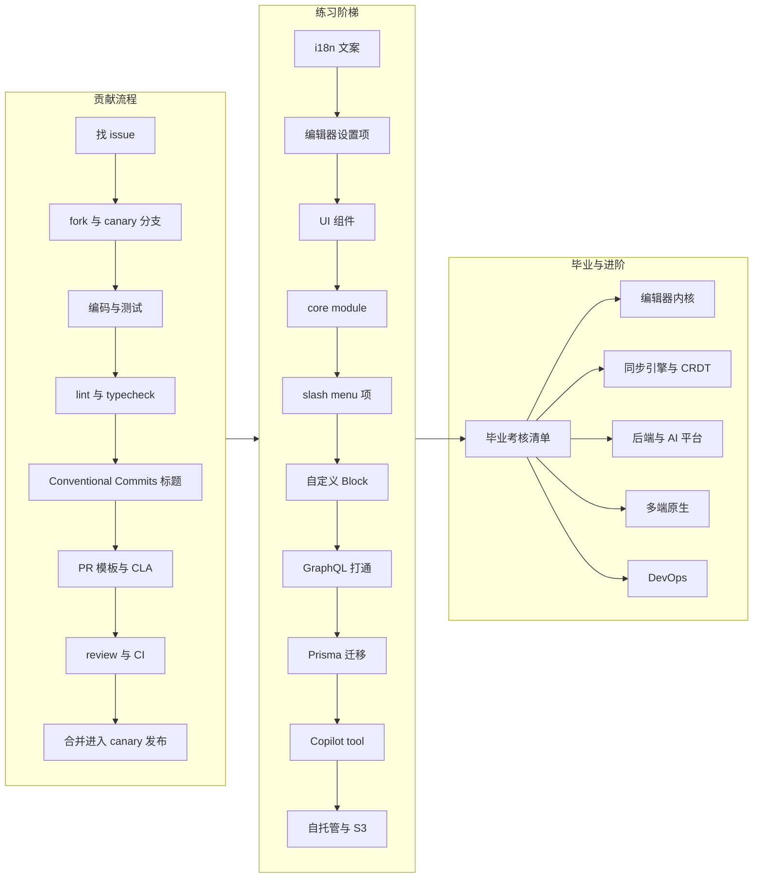
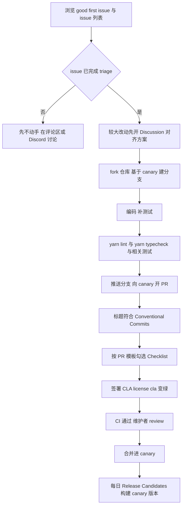

# 第 30 章 贡献实战与进阶路线

> **所属部分**：第 10 部分 · 综合实战 ｜ **难度**：★★★☆☆ ｜ **建议学时**：6 小时 ｜ **前置章节**：全部章节（重点回顾第 3、4、10、11、15、16、22、24、27 章）

## 本章导读

读懂源码只是开始，真正"毕业"的标志是：**你的代码出现在 AFFiNE 的 canary 分支里**。本章是全书的收官，目标是把前 29 章的知识转化为可落地的贡献能力。

内容分为四块：

1. **完整贡献流程**：从找 issue、fork、建分支、写 Conventional Commits，到本地 `yarn lint` / `yarn typecheck` / 测试，再到 PR 模板逐项、CLA 签署、review 与 CI，最后合并进入 canary 发布。所有规则都直接引用仓库中的 `.github/PULL_REQUEST_TEMPLATE.md`、`docs/CONTRIBUTING.md`、`docs/BUILDING.md`、`tools/commitlint/.commitlintrc.json` 与 `.github/workflows/*.yml`。
2. **10 级实战练习阶梯**：从改一条 i18n 文案，到新增 Copilot tool，再到用 Docker Compose 自托管并接入 S3 兼容存储。每级都给出目标、真实改动位置、实现思路与验收标准。
3. **毕业考核清单**：按全书 10 个部分列出能力检查项，用来自评"我是否真的学会了"。
4. **进阶方向与社区跟进**：编辑器内核、同步引擎与 CRDT、后端与 AI 平台、多端原生、DevOps 五条路线，以及持续跟进社区的渠道。

> 本章的练习是"练习"，不是"必须提交的 PR"。建议在自己的 fork 上完成，挑选其中真正有价值、与现有 issue 对应的改动再提交上游。不要为了刷贡献而提交没有需求背景的 PR——PR 模板里明确写着维护者可以直接关闭质量过低的 PR。

## 学习目标

- [ ] 能够按 `docs/CONTRIBUTING.md` 的五步流程完成一次从 issue 到 PR 的完整贡献
- [ ] 能够写出符合 `tools/commitlint/.commitlintrc.json` 约束的 PR 标题（type 与 scope 均合法）
- [ ] 能够在本地运行 `yarn lint`、`yarn typecheck`、`yarn test` 以及与改动相关的服务端/E2E 测试，并读懂 CI 失败原因
- [ ] 能够完成 CLA 签署并排查 `license/cla` 检查一直为红的常见原因
- [ ] 能够独立完成练习阶梯中至少 6 个练习，覆盖前端 UI、编辑器扩展、前后端 GraphQL 打通、数据库迁移
- [ ] 能够用 Docker Compose 自托管 AFFiNE，并把 blob 存储切换到 S3 兼容服务
- [ ] 能够对照毕业考核清单评估自己的能力短板，并选定一条进阶方向制定学习计划

## 知识地图



## 30.1 完整贡献流程

### 30.1.1 流程总览



`docs/CONTRIBUTING.md` 把流程浓缩为五步（原文节选）：

> 1. **Find something to work on.** Browse good first issues or the issue tracker. Issues that are still in triage haven't been reviewed yet — better not to start work on those. For bigger changes, open a discussion or talk to us on Discord first.
> 2. **Set up your environment.** Follow BUILDING.md for the web app. For the server (cloud features) see developing-server.md; for the desktop client see building-desktop-client-app.md.
> 3. **Make your change** on a branch created from `canary`. Add tests where it makes sense, and run `yarn lint`, `yarn typecheck` and the relevant tests locally.
> 4. **Open a PR to `canary`** with a Conventional Commits title, e.g. `fix(editor): keep selection after paste` — the title format is enforced by CI.
> 5. **Get it merged.** A PR merges once the `license/cla` check is green, CI passes, and a maintainer approves the review.

### 30.1.2 第一步：找 issue

- **入口**：`docs/CONTRIBUTING.md` 给出的 good first issues 链接是 `https://github.com/toeverything/AFFiNE/contribute`——这是 GitHub 自动聚合 `good first issue` 等新手友好标签的页面；另一入口是 issue tracker 本身。
- **看状态**：`docs/issue-triaging.md` 列出了 issue 的各种 triage 状态（如 `Untriaged`、`Open`、`Upvoting`、`Shelved`、`Waiting for Info`、`Can't Reproduce`……）。只挑选已经过 triage 且状态为 `Open` 一类"团队希望近期实现"的 issue；`Untriaged` 的 issue 官方明确建议不要先动手。
- **看模板**：Bug 报告使用 `.github/ISSUE_TEMPLATE/BUG-REPORT.yml`（默认打上 `bug` 标签），功能请求使用 `FEATURE-REQUEST.yml`；`config.yml` 还把"其他问题"引导到 GitHub Discussions 和 Discord。
- **先认领**：在 issue 下留言说明你的方案与预计范围，避免撞车。大改动（新功能、跨模块重构）先在 Discussions 或 Discord 对齐方案。
- **自己发现的问题**：先按模板提 issue 并等待 triage，而不是直接甩一个 PR。

### 30.1.3 第二步：fork 与建分支

```bash
# 1. 在 GitHub 网页上 fork toeverything/AFFiNE 到自己的账号
git clone https://github.com/<你的用户名>/AFFiNE.git
cd AFFiNE
git remote add upstream https://github.com/toeverything/AFFiNE.git

# 2. 永远基于最新 canary 建分支（canary 是默认开发分支）
git fetch upstream
git checkout -b fix/editor-keep-selection upstream/canary

# 3. 环境（详见第 11 章与 docs/BUILDING.md）
fnm use --install-if-missing     # Node 版本以 .nvmrc 为准（当前 22）
corepack enable                  # Yarn 4.x
yarn install                     # postinstall 会执行 yarn affine init 并安装 git hooks
yarn affine @affine/native build # 构建前端原生模块（NAPI-rs）
yarn dev -p @affine/web          # http://localhost:8080
```

需要后端时，按 `docs/developing-server.md`：复制 `.docker/dev/compose.yml.example` 与 `.env.example`，`docker compose -f ./.docker/dev/compose.yml up` 启动 postgres/redis/mailhog，`yarn affine @affine/server-native build`、`yarn affine server init`、`yarn affine server dev`。

Windows 用户注意：仓库使用符号链接，需开启开发者模式并 `git config --global core.symlinks true` 后再 clone（`docs/BUILDING.md` 的 Windows 小节）。

### 30.1.4 第三步：Conventional Commits

PR 标题由 `.github/workflows/pr-title-lint.yml`（工作流名 `PR Title Lint`）在 `opened`/`edited`/`synchronize` 时检查，核心命令为：

```yaml
# 来源：.github/workflows/pr-title-lint.yml（节选）
- name: Check PR title
  env:
    TITLE: ${{ github.event.pull_request.title }}
  run: echo "$TITLE" | yarn workspace @affine/commitlint-config commitlint -g ./.commitlintrc.json
```

规则文件 `tools/commitlint/.commitlintrc.json` 继承 `@commitlint/config-conventional`，并限定 scope 枚举：

```jsonc
// 来源：tools/commitlint/.commitlintrc.json（节选）
{
  "extends": ["@commitlint/config-conventional"],
  "rules": {
    "scope-enum": [2, "always", [
      "admin", "electron", "server", "core", "web", "mobile", "ios", "android",
      "mobile-native", "docs", "component", "env", "graphql", "hooks", "i18n",
      "native", "templates", "debug", "nbstore", "infra", "editor", "tools",
      "y-octo", "client"
    ]]
  }
}
```

- type：`feat` `fix` `docs` `style` `refactor` `perf` `test` `build` `ci` `chore` `revert`
- scope 可省略；若写，必须在上述枚举中。例如 `fix(editor): keep text selection after paste`、`feat(core): add custom icons for folders`、`docs: update building guide`。
- 常见错误：`feat(blocksuite): ...`（`blocksuite` 不在枚举中，编辑器相关请用 `editor`）、`Fix: xxx`（type 必须小写）、`feat(server) add x`（缺冒号）。
- CI 只校验 **PR 标题**而不校验每个 commit；从 `git log --oneline` 看，canary 上的提交基本是"PR 标题 + `(#PR号)`"的形式（如 `fix(client): windows static link (#15753)`），据此推断合并方式为 squash（此处为推断，以维护者实际操作为准）。因此**标题比单个 commit 信息更重要**，本地 commit 也建议保持同样格式。

### 30.1.5 第四步：本地检查

`docs/BUILDING.md` 的 "Linting and Type Checking" 一节：

```sh
# lint (oxlint) + format check (oxfmt)
yarn lint
# auto-fix lint & format issues
yarn lint:fix
# TypeScript type check
yarn typecheck
```

根 `package.json` 中对应 `"lint": "yarn lint:ox && yarn lint:format"`、`"typecheck": "tsc -b tsconfig.json --verbose"`、`"test": "vitest --run"`。按改动范围选择测试：

| 改动范围 | 建议运行 |
| --- | --- |
| 前端/BlockSuite 单元逻辑 | `yarn test`（可加路径过滤，如 `yarn test packages/common/nbstore`） |
| 后端 | `yarn workspace @affine/server test`（ava，`--concurrency 1 --serial`，需本地 postgres/redis） |
| Web 端交互 | `yarn workspace @affine-test/affine-local e2e`（先 `npx playwright install`） |
| 云端协作/同步 | `yarn workspace @affine-test/affine-cloud e2e`（需本地服务端） |
| Copilot | `yarn workspace @affine-test/affine-cloud-copilot e2e` |
| BlockSuite 集成 | `yarn workspace @affine-test/blocksuite test` |
| GraphQL 变更 | 额外运行 `yarn affine @affine/graphql build` 并提交生成文件 |
| i18n 变更 | 额外运行 `yarn affine @affine/i18n build` 并提交生成文件 |

CI（`.github/workflows/build-test.yml`）会运行 `lint`、`typecheck`、`unit-test`、`lint-rust`、`rust-test`、`check-git-status`、`server-test`（含 elasticsearch / embedded / manticoresearch 变体）、`copilot-api-test`、`desktop-test` 等作业，最终由 `test-done` 汇总。其中 `check-git-status` 的作用可以从名字推断：检查构建/代码生成后工作区是否"干净"——忘记提交 `schema.gql`、`schema.ts`、`i18n.gen.ts` 等生成文件是新人最常见的 CI 失败原因（具体检查逻辑建议打开该 job 的 steps 确认）。

### 30.1.6 第五步：PR 模板逐项

`.github/PULL_REQUEST_TEMPLATE.md` 全文如下（注释与正文均为原文）：

```markdown
<!--
Thank you for contributing to AFFiNE!

The PR title must follow Conventional Commits (enforced by CI):
  type(scope): description      e.g.  fix(editor): keep selection after paste
Types: feat fix docs style refactor perf test build ci chore revert
-->

## Description

<!-- What does this PR do? Link related issues, e.g. "Closes #1234". Screenshots or recordings are welcome for UI changes. -->

## Checklist

- [ ] I have signed the [AFFiNE Contributor License Agreement](https://cla-assistant.io/toeverything/AFFiNE) — required before merge; the `license/cla` check must be green (...)
- [ ] The PR targets the `canary` branch and its title follows [Conventional Commits](https://www.conventionalcommits.org/)
- [ ] Tests are added or updated where it makes sense
- [ ] `yarn lint` and `yarn typecheck` pass locally
- [ ] If the PR code includes AI-generated edits, I have carefully reviewed it to ensure that the scope of the PR is consistent with what is claimed in the title and description, and that there are no redundant or invalid implementations.
- [ ] I agree that maintainers may close the PR without discussion if they consider the code quality to be too low.
```

逐项填写指南：

| 模板项 | 怎么做才算"做到" |
| --- | --- |
| Description | 一句话说明"做了什么、为什么"；`Closes #1234` 关联 issue（合并后自动关闭）；UI 改动附前后截图或录屏；说明测试方式 |
| CLA | 见下一节；未签署时 PR 永远无法合并 |
| 目标分支与标题 | base 选 `toeverything/AFFiNE:canary`；标题通过 commitlint |
| Tests | bug 修复尽量附一个"修复前失败、修复后通过"的测试；纯文案/样式改动可说明无需测试 |
| lint/typecheck | 本地实际跑过，不要只勾选 |
| AI 生成代码 | 如使用 AI 辅助，逐行 review，删除与标题无关的"顺手改动"和冗余实现 |
| 质量承诺 | 保持 PR 小而聚焦，一个 PR 只解决一件事 |

另外，`.github/labeler.yml` 会根据改动路径自动给 PR 打标签（如 `docs`、`test`、`mod:dev`、`mod:infra` 等），`.github/auto_assign.yml` 配置了 `addAssignees: author`（把作者设为 assignee，用于 GitHub Project 跟踪），`.github/CODEOWNERS` 决定哪些维护者对哪些目录负责。

### 30.1.7 CLA 签署

`docs/BUILDING.md` 的 "Sign the CLA first" 一节要点：

1. 打开 `https://cla-assistant.io/toeverything/AFFiNE`，用 GitHub 账号登录并同意（协议全文见 `.github/CLA.md`）。
2. 如果先开了 PR 后签署，在 CLA bot 的评论里点击 **recheck**，或推一个新 commit 触发重新检查。
3. `license/cla` 仍为红的两大原因：
   - **每一位 committer 都要签**，包括 co-author；bot 评论中标记 ❌ 的名字都需要签署；
   - **commit 邮箱必须关联到你的 GitHub 账号**：`git log --format='%an %ae'` 查看邮箱，在 GitHub Settings → Emails 中添加；或用正确身份改写提交后 force-push 你自己的 PR 分支。

### 30.1.8 Review、CI 与合并

- 维护者会被自动分配（BUILDING.md："Reviewers are assigned automatically, and an automated reviewer may also leave comments — please address or answer them."）。对自动 reviewer 的评论也要逐条回应：采纳则修改，不采纳则说明理由。
- CI 失败时先看是哪个 job：`lint`/`typecheck` 在本地即可复现；`server-test` 需要本地数据库；`check-git-status` 多为生成文件未提交；E2E 偶发失败（flaky）可以在评论中说明并请求重跑。
- 处理 review 意见时**追加 commit** 而不是频繁 force-push，方便 reviewer 看增量；需要同步上游时 `git fetch upstream && git rebase upstream/canary`。

### 30.1.9 合并之后：进入 canary 发布

- `.github/workflows/release.yml`（工作流名 `Release Candidates`）配置了 `schedule: cron '0 9 * * *'`，即每天 UTC 09:00 自动构建一次候选版本，也支持 `workflow_dispatch` 手动选择 `server,desktop-macos,desktop-windows,desktop-linux?` 等目标。
- 从仓库 tag 可以看到 canary 版本的命名形如 `v2026.10.27-canary.909`，beta/stable 则形如 `v0.27.5-beta.2`（`git tag --sort=-creatordate` 可查看）。
- `docs/contributing/releases.md` 描述了 stable/beta 发布流程：`./scripts/set-version.sh <版本>` 修改版本号 → 提交并推送 `canary` → 触发发布 Action → 在 Releases 页面编辑草稿并发布（需核心团队授权）。
- 所以你的 PR 合并后，最快第二天就会出现在 canary 版本中；进入 beta/stable 则取决于发布节奏（第 4 章）。

## 30.2 十级实战练习阶梯

> 约定：每个练习都给出"目标 / 改动位置 / 实现思路 / 验收标准"。改动位置均为仓库中真实存在的目录或文件，新文件以"新建"标注。代码片段为示意，提交前请以当前源码风格为准。

### 练习 ① 新增或修改一条 i18n 文案（★☆☆☆☆）

- **目标**：把设置页某个开关的说明文案改得更清楚，或为新功能新增一条文案。
- **改动位置**：
  - `packages/frontend/i18n/src/resources/en.json`（**基准语言**，README 要求先更新这里）
  - `packages/frontend/i18n/src/resources/zh-Hans.json`（可选，补中文）
  - 生成文件：`packages/frontend/i18n/src/i18n.gen.ts`、`packages/frontend/i18n/src/i18n-completenesses.json`
  - 使用处：例如 `packages/frontend/core/src/desktop/dialogs/setting/general-setting/editor/page.tsx`
- **实现思路**：
  1. key 采用点分命名，如已有的 `com.affine.settings.editorSettings.page.display-bi-link.title`；
  2. 组件中 `const t = useI18n();`，以 `t['com.affine.xxx']()` 调用（带插值时传对象参数，`{{name}}` 语法见 `packages/frontend/i18n/README.md`）；
  3. 运行 `yarn affine @affine/i18n build`：`packages/frontend/i18n/build.ts` 调用 `@magic-works/i18n-codegen` 的 `runCli` 生成类型安全的 `i18n.gen.ts`，并重新计算各语言完成度写入 `i18n-completenesses.json`；
  4. 其他语言不要机翻硬塞，README 根目录说明翻译协作在 Discord 进行。
- **验收标准**：`yarn typecheck` 通过（错误的 key 会直接类型报错）；切换界面语言能看到新文案；生成文件已提交；PR 标题如 `fix(i18n): clarify bi-directional link setting description`。

### 练习 ② 新增一个编辑器设置项（★★☆☆☆）

- **目标**：新增布尔设置"显示文档字数统计"（示例名 `displayWordCount`），在设置页提供开关并在编辑器中生效。
- **改动位置**：
  - `packages/frontend/core/src/modules/editor-setting/schema.ts`：`AffineEditorSettingSchema` 中新增字段
  - `packages/frontend/core/src/desktop/dialogs/setting/general-setting/editor/page.tsx`：新增 `SettingRow` + `Switch`
  - `packages/frontend/i18n/src/resources/en.json`：标题与描述文案
  - 消费处：参考 `packages/frontend/core/src/blocksuite/block-suite-editor/lit-adaper.tsx` 中对 `displayBiDirectionalLink` 的读取方式
- **实现思路**：
  ```ts
  // schema.ts 中 AffineEditorSettingSchema（示意，仿照 displayBiDirectionalLink）
  displayWordCount: z.boolean().default(false),
  ```
  ```tsx
  // page.tsx（示意，仿照 handleDisplayBiDirectionalLinkChange）
  const handleDisplayWordCountChange = useCallback(
    (checked: boolean) => editorSetting.set('displayWordCount', checked),
    [editorSetting]
  );
  // ...
  <SettingRow name={t['com.affine.settings.editorSettings.page.display-word-count.title']()}
              desc={t['com.affine.settings.editorSettings.page.display-word-count.description']()}>
    <Switch data-testid="display-word-count-trigger"
            checked={settings.displayWordCount}
            onChange={handleDisplayWordCountChange} />
  </SettingRow>
  ```
  `editorSetting` 来自 `useService(EditorSettingService).editorSetting`，`settings$` 是 LiveData（第 16 章），`useLiveData` 订阅即可。zod `default` 保证老用户没有该字段时取默认值。
- **验收标准**：开关状态刷新后保持；关闭/打开立即影响编辑器；为 `data-testid` 补一条 `tests/affine-local` 下的 E2E 或至少手工录屏；`yarn typecheck` 通过。

### 练习 ③ 在组件库新增一个 UI 组件（★★☆☆☆）

- **目标**：在 `@affine/component` 中新增一个 `Kbd`（键盘按键提示）组件。
- **改动位置**：
  - 新建 `packages/frontend/component/src/ui/kbd/`：`index.ts`、`kbd.tsx`、`style.css.ts`、`kbd.stories.tsx`
  - `packages/frontend/component/src/index.ts`：追加 `export * from './ui/kbd';`
  - 参考结构：`packages/frontend/component/src/ui/divider/`（`divider.tsx`、`divider.stories.tsx`、`style.css.ts`、`index.ts`）、`ui/switch/`
- **实现思路**：
  1. 样式使用 vanilla-extract（`*.css.ts`），颜色/圆角使用主题 CSS 变量而不是写死色值（第 18 章）；
  2. 组件用 `forwardRef`，透传原生属性，支持 `className` 合并；
  3. 写 Storybook 故事：组件库的 `package.json` 中 `"dev": "storybook dev -p 6006"`，可用 `yarn workspace @affine/component dev` 本地预览；
  4. 在一个真实位置使用它（如快捷键设置页 `general-setting/shortcuts`），避免"只加不用"的死代码。
- **验收标准**：Storybook 中亮/暗主题均显示正常；`yarn lint`、`yarn typecheck` 通过；至少一处真实使用。

### 练习 ④ 新增一个 core module（Store/Service/Entity）（★★★☆☆）

- **目标**：新增 `reading-progress` 模块，记录每篇文档上次阅读的滚动位置，重新打开时恢复。
- **改动位置**：
  - 新建 `packages/frontend/core/src/modules/reading-progress/`：`index.ts`、`stores/reading-progress.ts`、`services/reading-progress.ts`、`entities/`（可选）
  - `packages/frontend/core/src/modules/index.ts`：在 `configureCommonModules` 中调用 `configureReadingProgressModule(framework)`
  - 参考模板：`packages/frontend/core/src/modules/tag/index.ts`（`configureTagModule`）
- **实现思路**：
  ```ts
  // 参考 packages/frontend/core/src/modules/tag/index.ts 的写法（示意）
  export function configureReadingProgressModule(framework: Framework) {
    framework
      .scope(WorkspaceScope)
      .service(ReadingProgressService)
      .store(ReadingProgressStore, [WorkspaceService /*, 某个本地存储服务 */]);
  }
  ```
  1. Store 只负责读写持久层（例如工作区级别的本地缓存），不含业务逻辑；
  2. Service 暴露 `progress$(docId)`（LiveData）与 `save(docId, offset)`；
  3. 作用域选 `WorkspaceScope`，随工作区销毁而释放（第 16 章作用域树）；
  4. 在文档页（`desktop/pages/workspace/detail-page/`）中滚动节流保存、打开时恢复。
- **验收标准**：为 Service 写一个 vitest 单测（构造 `Framework`、`createScope` 后断言行为，可参考 `modules/editor-setting/__tests__`）；切换文档、刷新页面后位置恢复；不引入循环依赖。

### 练习 ⑤ 新增一个 slash menu 菜单项（★★★☆☆）

- **目标**：在 `/` 菜单中新增"插入当前时间"项，在光标处插入格式化时间文本。
- **改动位置**（两种选择）：
  - **应用层**（推荐，不改 BlockSuite 核心）：仿照 `packages/frontend/core/src/blocksuite/ai/extensions/ai-slash-menu.ts` 中的 `AiSlashMenuConfigExtension`（内部 `SlashMenuConfigExtension('ai', {...})`），新建一个配置扩展，并在 `packages/frontend/core/src/blocksuite/view-extensions/` 下某个 ViewExtension 的 `setup` 中注册（AI 的注册点是 `view-extensions/ai/index.ts`）；
  - **BlockSuite 层**：修改 `blocksuite/affine/widgets/slash-menu/src/config.ts` 中的 `defaultSlashMenuConfig`。
- **实现思路**：
  ```ts
  // 类型来自 blocksuite/affine/widgets/slash-menu/src/types.ts（SlashMenuActionItem）
  SlashMenuConfigExtension('insert-time', {
    items: [
      {
        name: 'Current Time',
        description: 'Insert the current time.',
        group: '6_Others@0',            // 格式为 `${number}_${string}@${number}`
        searchAlias: ['now', 'time'],
        when: ({ model }) => !!model.text,
        action: ({ std, model }) => {
          // 通过 inline editor 在当前选区插入文本，参考链路二的 insertText（第 29 章）
        },
      },
    ],
  });
  ```
  `group` 决定分组与排序；`when` 控制可见性；`action` 拿到 `std` 与 `model`，可以执行命令链（参考 `imageSlashMenuConfig` 的 `std.command.chain()`）。
- **验收标准**：输入 `/now` 能搜到该项；只读模式不显示（或执行无副作用）；撤销（Ctrl/Cmd+Z）可以回退插入；在 `tests/blocksuite` 或 `tests/affine-local` 补一条 E2E。

### 练习 ⑥ 新增一个自定义 Block（★★★★☆）

- **目标**：实现一个"倒计时"块（`affine:countdown`），属性为目标日期，视图显示剩余天数。
- **改动位置**（完整步骤见第 15 章）：
  - 模型：仿照 `blocksuite/affine/model/src/blocks/divider/divider-model.ts`（`DividerBlockSchemaExtension`）
  - 块包：仿照 `blocksuite/affine/blocks/divider/src/`——`store.ts`（`DividerStoreExtension extends StoreExtensionProvider`）、`view.ts`（`DividerViewExtension extends ViewExtensionProvider`，内部 `` BlockViewExtension('affine:divider', literal`affine-divider`) ``）、`divider-block.ts`、`effects.ts`、`adapters/`
  - 注册：`blocksuite/affine/all/src/extensions/store.ts` 与 `view.ts`
  - 插入入口：结合练习 ⑤ 给它加一个 slash menu 项
- **实现思路**：先定义 schema（flavour、props、`parent`/`children` 约束），再写 Lit 视图组件，最后写 adapter（Markdown/HTML/纯文本导出）。注意 `effects()` 中注册自定义元素，避免重复 define。
- **验收标准**：能插入、编辑日期、撤销重做；刷新后数据保留；两个浏览器协作时对端实时看到（验证走了链路二）；导出 Markdown 有合理降级表示；有单元测试覆盖 adapter。

### 练习 ⑦ 新增一个 GraphQL query/mutation 并前后端打通（★★★★☆）

- **目标**：新增查询 `workspaceDocCount(workspaceId)` 返回工作区文档数，在工作区设置页展示。
- **改动位置**：
  - 后端 resolver：在合适的业务目录下新增或扩展 resolver，参考 `packages/backend/server/src/core/config/resolver.ts`（`@Query(() => ServerConfigType)` 的 `serverConfig`）与 `packages/backend/server/src/core/workspaces/resolvers/`
  - 权限：参考 `WorkspaceBlobResolver.setBlob` 中 `this.ac.user(user.id).workspace(workspaceId).assert(...)` 的写法（第 23 章）
  - Schema：`packages/backend/server/src/schema.gql`（开发模式下由 NestJS 自动生成，见 `packages/backend/server/src/base/graphql/index.ts` 中 `autoSchemaFile` 非 prod 时写入 `./src/schema.gql`）
  - 前端操作：新建 `packages/common/graphql/src/graphql/workspace-doc-count.gql`
  - 代码生成：`packages/common/graphql/codegen.yml`（`schema: ../../backend/server/src/schema.gql`，`documents: ./src/**/*.gql`，生成 `src/schema.ts` 与 `src/graphql/index.ts`）
  - 前端使用：参考 `packages/frontend/core/src/modules/cloud/stores/server-config.ts` 中 `gql({ query: serverConfigQuery })`
- **实现思路**：
  1. 后端加 `@Query(() => Int)` 方法，`@CurrentUser()` 取用户、做权限断言、调用 `models.doc` 相关方法计数；
  2. `yarn affine server dev` 启动一次，确认 `schema.gql` 自动更新；
  3. 写 `.gql` 文件后 `yarn affine @affine/graphql build`（即 `gql-gen --errors-only`），生成 `workspaceDocCountQuery` 常量与类型；
  4. 前端在 Store 中 `this.graphqlService.gql({ query: workspaceDocCountQuery, variables: { workspaceId } })`，Service 暴露 LiveData，组件消费。
- **验收标准**：后端 e2e/ava 测试覆盖"有权限返回正确数量、无权限抛错"；`schema.gql`、`schema.ts`、`graphql/index.ts` 三个生成文件均已提交；`yarn typecheck` 通过。

### 练习 ⑧ 新增 Prisma 模型与迁移（★★★★☆）

- **目标**：为练习 ④ 的阅读进度增加云端持久化，新建表 `user_doc_reading_progress`。
- **改动位置**：
  - `packages/backend/server/schema.prisma`：新增 model（仿照 `model Notification`：`@id @default(uuid()) @db.VarChar`、`@map("user_id")`、`@db.Timestamptz(3)`、`@relation(... onDelete: Cascade)`）
  - `packages/backend/server/migrations/`：新增迁移目录（命名形如现有的 `20260906090000_payment_auth_runtime`）
  - `packages/backend/server/src/models/`：新建 `reading-progress.ts`，`class ReadingProgressModel extends BaseModel`（`base.ts` 提供事务感知的 `this.db`）
  - `packages/backend/server/src/models/index.ts`：在 `MODELS` 对象中注册
- **实现思路**：
  ```bash
  # 修改 schema.prisma 后生成迁移（底层为 prisma migrate dev，命令透传方式参考 docs/developing-server.md 中的 prisma studio）
  yarn affine server prisma migrate dev --name add_reading_progress
  # 查看数据
  yarn affine server prisma studio
  ```
  Model 层只做数据访问（`this.db.xxx.upsert/findUnique`），业务规则放 Service/Resolver；跨表写入用 `@Transactional`（第 22 章）。
- **验收标准**：`yarn affine server init`（即 `prisma migrate dev && data-migration run`）在空库上可重放；新增 model 的单测（参考 `packages/backend/server/src/__tests__/models/`）通过；迁移 SQL 已人工 review（索引、外键、可空性）；生产部署时由 `predeploy` 脚本中的 `prisma migrate deploy` 执行。

### 练习 ⑨ 新增一个 Copilot tool（★★★★★）

- **目标**：新增工具 `doc_outline`：返回指定文档的标题层级大纲，让 AI 在长文档中先看目录再精读。
- **改动位置**：
  - 新建 `packages/backend/server/src/plugins/copilot/tools/doc-outline.ts`：用 `defineTool({ description, inputSchema, execute })`（`tools/tool.ts`）
  - `packages/backend/server/src/plugins/copilot/tools/index.ts`：`export * from './doc-outline';`
  - `packages/backend/server/src/plugins/copilot/providers/types.ts`：在 `PromptToolsSchema` 的枚举中加入 `'docOutline'`
  - `packages/backend/server/src/plugins/copilot/runtime/tool-runtime.ts`：`ToolRuntime.getTools` 的 `switch` 中新增 `case 'docOutline': tools.doc_outline = createDocOutlineTool(...)`
  - 启用：内置 prompt 的工具清单位于 `packages/backend/native/src/llm/assets/prompts/built-in.json`（"Chat With AFFiNE AI" 的 `tools` 数组），修改后需重新构建 `@affine/server-native`
  - 可选开关：`packages/backend/server/src/plugins/copilot/utils.ts` 的 `getTools` 中按 `toolsConfig` 过滤（参考 `readingDocs` 对 `docRead` 的过滤）
  - 前端渲染：`packages/frontend/core/src/blocksuite/ai/components/ai-message-content/stream-objects.ts` 的 `renderToolCall`/`renderToolResult` 中为 `'doc_outline'` 添加分支（否则走通用卡片），组件可放 `components/ai-tools/`
- **实现思路**：参考 `tools/doc-read.ts` 获取文档内容的方式（它通过 `getDoc.bind(null, options)` 注入，内部做权限校验），解析出 heading 列表；`inputSchema` 用 zod 严格约束（`.strict()`、长度上限），错误用 `toolError(...)`（`tools/error.ts`）返回结构化失败而不是抛异常——Rust 运行时会把结果回传给模型继续推理（第 29 章 29.5.3 片段 3）。
- **验收标准**：在 `packages/backend/server/src/__tests__/copilot/` 下为工具写单测（权限不足、文档不存在、正常返回）；本地 AI 面板提问"先列出这篇文档的大纲"能看到 `doc_outline` 的 tool-call/tool-result 卡片；工具描述清晰说明"何时该用"。

### 练习 ⑩ 用 Docker Compose 自托管并接入 S3 兼容存储（★★★★☆）

- **目标**：在本机用 `.docker/selfhost/compose.yml` 启动 AFFiNE，并把 blob 存储从默认 fs 切换到 MinIO（S3 兼容）。
- **涉及文件**：
  - `.docker/selfhost/compose.yml`：服务 `affine`（镜像 `ghcr.io/toeverything/affine:stable`，端口 `3010`）、`affine_migration`（执行 `node ./scripts/self-host-predeploy.js`）、`redis`、`postgres`（`pgvector/pgvector:pg16`）；卷 `./data/storage:/root/.affine/storage`、`./config:/root/.affine/config`
  - `.docker/selfhost/config.json.example` / `config.example.json`：配置样例；`.docker/selfhost/schema.json`：完整配置 JSON Schema
  - 服务端读取路径：`packages/backend/server/src/env.ts` 中 `join(homedir(), '.affine/config/config.json')`，即容器内 `/root/.affine/config/config.json`
  - 配置定义：`packages/backend/server/src/core/storage/config.ts`（`storages`）、`packages/backend/server/src/base/storage/providers/index.ts`（`S3StorageConfig`）
- **实现步骤**：
  1. 新建一个目录，复制 `compose.yml`；新增 `compose.override.yml` 加入 MinIO：
     ```yaml
     services:
       minio:
         image: minio/minio
         command: server /data --console-address ":9001"
         environment:
           MINIO_ROOT_USER: affine
           MINIO_ROOT_PASSWORD: change-me-please
         ports:
           - '9000:9000'
           - '9001:9001'
         volumes:
           - ./data/minio:/data
     ```
  2. 在 MinIO 控制台（`http://localhost:9001`）创建 bucket `affine-blobs`；
  3. 写 `./config/config.json`（键名以 `schema.json` 中的 `storages` → `"blob.storage"` 为准）：
     ```json
     {
       "$schema": "https://github.com/toeverything/affine/releases/latest/download/config.schema.json",
       "server": { "externalUrl": "http://localhost:3010" },
       "storages": {
         "blob.storage": {
           "provider": "aws-s3",
           "bucket": "affine-blobs",
           "config": {
             "endpoint": "http://minio:9000",
             "region": "us-east-1",
             "forcePathStyle": true,
             "credentials": { "accessKeyId": "affine", "secretAccessKey": "change-me-please" }
           }
         }
       }
     }
     ```
  4. `docker compose up -d`，等待 `affine_migration` 成功退出后访问 `http://localhost:3010`，创建管理员账号与云端工作区；
  5. 插入一张图片，在 MinIO 控制台确认 bucket 中出现对象（对应第 29 章链路三的 `putObject`）。
- **安全提醒**（第 28 章）：样例 compose 中 postgres 使用 `POSTGRES_HOST_AUTH_METHOD: trust`，仅适合本机实验；生产环境应设置数据库密码、不对外暴露 5432/6379/9000 端口、为 `externalUrl` 配置 HTTPS 反向代理，凭据通过 `.env`（`.docker/selfhost/.gitignore` 已忽略 `.env`）或密钥管理注入。
- **验收标准**：图片上传后出现在 MinIO bucket；删除容器重建（保留卷）数据不丢失；`docker compose logs affine` 无存储相关错误。若浏览器直传 presigned URL 时遇到 CORS 报错，为 bucket 配置 CORS 或关闭直传，让 `createBlobUpload` 回退为 `GRAPHQL` 方式。

### 练习难度与知识点对照

| 练习 | 主要涉及章节 | 前端 | 编辑器 | 后端 | 运维 |
| --- | --- | --- | --- | --- | --- |
| ① i18n | 18 | ✓ | | | |
| ② 编辑器设置 | 16、18 | ✓ | ✓ | | |
| ③ UI 组件 | 18 | ✓ | | | |
| ④ core module | 16、17 | ✓ | | | |
| ⑤ slash menu | 13、14 | | ✓ | | |
| ⑥ 自定义 Block | 12–15 | | ✓ | | |
| ⑦ GraphQL | 21、23 | ✓ | | ✓ | |
| ⑧ Prisma | 22 | | | ✓ | |
| ⑨ Copilot tool | 24、29 | ✓ | | ✓ | |
| ⑩ 自托管 + S3 | 27、28 | | | ✓ | ✓ |

## 30.3 毕业考核清单

按全书 10 个部分自评，每部分至少勾选 80% 再进入进阶方向。

**第 1 部分 · 产品认知**
- [ ] 能用一句话解释 AFFiNE 的"Docs + Whiteboard + Database"定位与 Page/Edgeless 双模式
- [ ] 能区分本地工作区与云端工作区，说出 Free / Pro / Team / AI 等商业模式差异
- [ ] 能说明自托管版与官方云版在功能与部署上的主要差别

**第 2 部分 · 项目管理与开源协作**
- [ ] 能说出 issue triage 状态的含义，知道哪些 issue 适合新人
- [ ] 能写出合法的 Conventional Commits 标题并解释 scope 枚举
- [ ] 能解释 canary / beta / stable 渠道与 tag 命名规则

**第 3 部分 · 编程语言与基础技术**
- [ ] 能读懂 AFFiNE 中的高级 TypeScript 类型（条件类型、模板字面量类型、`satisfies`）
- [ ] 能解释 React、Lit、Signals、RxJS 在项目中的分工与桥接方式
- [ ] 能说明 NAPI-rs 如何把 Rust 函数暴露给 Node/Electron
- [ ] 能解释 Yjs 的 update、state vector、事务 origin 与 UndoManager 的关系

**第 4 部分 · 工程化与开发环境**
- [ ] 能画出 monorepo 主要包的依赖方向（apps → core → component/infra/nbstore → blocksuite）
- [ ] 能独立完成 Web、Server、Electron 的本地启动，并解决常见环境问题
- [ ] 能使用 `yarn affine` CLI 执行构建、开发与包内命令

**第 5 部分 · 编辑器内核 BlockSuite**
- [ ] 能解释 Store / Block / Schema / Transformer 之间的关系
- [ ] 能使用 Std 的命令链、事件分发、选区与扩展机制
- [ ] 能独立实现一个包含 model、view、adapter 的自定义块（练习 ⑥）

**第 6 部分 · 前端应用**
- [ ] 能用 Framework 的 service/store/entity/scope 编写模块（练习 ④）
- [ ] 能复述冷启动链路与 Workspace/Doc/Editor 三层作用域（第 29 章链路一）
- [ ] 能解释 nbstore 的 local/remote 存储、DocFrontend 与 DocSyncPeer 的分工
- [ ] 能说明 Web、Electron、移动端在存储实现上的差异（IndexedDB 与 SQLite）

**第 7 部分 · 后端服务**
- [ ] 能说明 NestJS 模块组织、事件总线、Rust 原生运行时在后端中的位置
- [ ] 能新增 Prisma 模型、迁移与 Model 类（练习 ⑧）
- [ ] 能新增带权限校验的 GraphQL 操作并完成前端代码生成（练习 ⑦）
- [ ] 能复述同步网关处理 `space:push-doc-update` 的全过程与快照合并时机
- [ ] 能说明 Copilot 会话、消息、SSE 流与工具回调的关系（练习 ⑨）

**第 8 部分 · 质量保障**
- [ ] 能为前端逻辑写 vitest 单测、为后端写 ava 测试
- [ ] 能运行并调试 Playwright E2E（local 与 cloud 两类）
- [ ] 能根据测试用例反推模块用法

**第 9 部分 · 运维与部署**
- [ ] 能读懂 `build-test.yml`、`release.yml`、`pr-title-lint.yml` 的主要作业
- [ ] 能用 Docker Compose 自托管并接入 S3 兼容存储（练习 ⑩）
- [ ] 能列出自托管的安全基线（数据库认证、端口暴露、HTTPS、密钥管理）

**第 10 部分 · 综合实战**
- [ ] 能独立追踪任一功能的前后端链路并画出时序图
- [ ] 能在 SharedWorker、WebSocket 帧、SSE 流、IndexedDB 中定位问题
- [ ] 至少有 1 个 PR 被合并到 `toeverything/AFFiNE` 的 canary 分支

## 30.4 后续进阶方向

| 方向 | 适合谁 | 核心目录 | 进阶课题 | 推荐资源 |
| --- | --- | --- | --- | --- |
| 编辑器内核专家 | 喜欢富文本、渲染、交互细节 | `blocksuite/framework/std`、`blocksuite/framework/store`、`blocksuite/affine/gfx`、`blocksuite/affine/blocks` | inline 编辑与 IME 兼容、Edgeless 渲染性能（`turbo-renderer`）、选区与剪贴板、adapter 体系 | BlockSuite 文档 `blocksuite.io`；Lit 官方文档；`blocksuite/playground` 示例 |
| 同步引擎与 CRDT | 喜欢分布式系统、数据一致性 | `packages/common/nbstore`、`packages/backend/server/src/core/sync`、`core/doc`、根 `Cargo.toml` 中的 crate 依赖 `y-octo` | 离线合并、update 压缩与快照、权限代次、跨节点广播、Rust 版 Yjs（y-octo） | Yjs 文档与 `yjs/yjs` 源码；Kleppmann 关于 CRDT 的论文与课程 |
| 后端与 AI 平台 | 喜欢服务端、LLM 应用 | `packages/backend/server/src/plugins/copilot`、`packages/backend/native/src/llm`、`core/backend-runtime` | 工具调用循环、检索与 embedding、BYOK、配额与计费、Rust/TS 边界设计 | NestJS 文档；各模型供应商的 tool calling 文档；Prisma 文档 |
| 多端原生 | 喜欢 Electron、iOS、Android | `packages/frontend/apps/electron`、`packages/frontend/apps/ios`、`packages/frontend/apps/android`、`packages/frontend/native` | IPC 设计、SQLite 存储实现、NAPI-rs 原生模块、自动更新与签名 | Electron 文档；Capacitor 文档；NAPI-rs 文档 |
| DevOps | 喜欢 CI/CD、部署、可观测性 | `.github/workflows`、`.github/actions`、`.github/deployment`、`.docker`、`tools/cli` | 构建缓存、矩阵发布、Helm/K8s 部署、OpenTelemetry 指标、安全扫描 | GitHub Actions 文档；Docker 文档；OpenTelemetry 文档 |

选择建议：

1. 先从练习阶梯中**你完成得最轻松的那一级**对应的方向开始；
2. 找 2–3 个该方向的已合并 PR，按第 29 章的方法逆向阅读它们改了哪些文件、为何这样改；
3. 订阅该方向核心目录的 CODEOWNERS 维护者的公开讨论，理解设计取舍；
4. 每月至少完成一次"读一个模块 → 写一篇笔记 → 提一个小 PR"的循环。

## 30.5 持续跟进社区

| 渠道 | 地址（取自仓库 README、docs、ISSUE_TEMPLATE） | 用途 |
| --- | --- | --- |
| GitHub Releases | `https://github.com/toeverything/AFFiNE/releases` | 版本变更、下载；canary 版本几乎每天都有 |
| GitHub Discussions | `https://github.com/toeverything/AFFiNE/discussions` | 方案讨论、问答、功能提议 |
| Discord | `https://affine.pro/redirect/discord` | 实时交流、翻译协作、贡献者沟通 |
| 官方博客 | `https://affine.pro/blog/` | 产品更新、技术文章 |
| 官方文档 | `https://docs.affine.pro/` | 用户文档、自托管文档；贡献者手册在 `https://docs.affine.pro/contributing` |
| 仓库内文档 | `docs/`（`CONTRIBUTING.md`、`BUILDING.md`、`developing-server.md`、`contributing/tutorial.md`） | 随代码演进的一手资料 |
| 安全问题 | `SECURITY.md` | 漏洞请走私密渠道，不要公开提 issue |

跟进节奏建议：每周看一次 canary 的 commit 列表（`git log upstream/canary --oneline --since="1 week ago"`），关注与你方向相关的 scope（如 `fix(nbstore)`、`feat(editor)`）；每个大版本阅读一次 Release Notes 和 `CHANGELOG.md`。

## 源码导读清单

| 优先级 | 路径 | 阅读重点 |
| --- | --- | --- |
| ★★★ | `docs/CONTRIBUTING.md` | 五步贡献流程、CLA |
| ★★★ | `docs/BUILDING.md` | 环境、测试表、lint/typecheck、PR 规则、排错 |
| ★★★ | `.github/PULL_REQUEST_TEMPLATE.md` | Checklist 各项 |
| ★★★ | `tools/commitlint/.commitlintrc.json` | scope 枚举 |
| ★★☆ | `.github/workflows/pr-title-lint.yml` | 标题校验命令 |
| ★★☆ | `.github/workflows/build-test.yml` | CI 作业清单与依赖 |
| ★★☆ | `.github/workflows/release.yml` | 每日候选版本构建 |
| ★★☆ | `docs/issue-triaging.md`、`docs/contributing/releases.md` | issue 状态、发布流程 |
| ★★☆ | `packages/frontend/i18n/build.ts` | 文案代码生成与完成度计算 |
| ★★☆ | `packages/frontend/core/src/modules/editor-setting/schema.ts` | 设置项 schema |
| ★★☆ | `packages/common/graphql/codegen.yml` | GraphQL 代码生成配置 |
| ★★☆ | `packages/backend/server/schema.prisma`、`src/models/index.ts` | 数据模型与 Model 注册 |
| ★★☆ | `packages/backend/server/src/plugins/copilot/runtime/tool-runtime.ts` | 工具注册 switch |
| ★☆☆ | `.docker/selfhost/compose.yml`、`schema.json` | 自托管服务与配置项 |
| ★☆☆ | `.github/labeler.yml`、`auto_assign.yml`、`CODEOWNERS` | PR 自动化 |

## 动手实践

1. **（30 分钟）完成"零代码贡献演练"**：fork 仓库、基于 `upstream/canary` 建分支，修改一处文档错别字（如 `docs/` 下的拼写），本地运行 `yarn lint`，用 `docs: fix typo in building guide` 作为 PR 标题在**你自己的 fork 内**开一个 PR（base 选自己的 canary），熟悉模板填写。
2. **（1 小时）标题校验演练**：在本地执行 `echo "feat(blocksuite): test" | yarn workspace @affine/commitlint-config commitlint -g ./.commitlintrc.json`（需先 `yarn install`），观察报错；再换成 `feat(editor): test` 观察通过。
3. **（2 小时）完成练习 ① + ②**：新增一个设置项及其文案，运行 `yarn affine @affine/i18n build` 与 `yarn typecheck`，截图验收。
4. **（2 小时）完成练习 ⑩**：自托管 + MinIO，上传图片后在 bucket 中找到对象，并把 `docker compose ps` 与 MinIO 截图记录在学习笔记中。
5. **（持续）挑选一个真实 issue**：从 good first issue 列表中找到一个与你完成的练习相关的 issue，留言认领并提交上游 PR。

## 自测题

1. 一个 PR 被合并需要满足哪三个条件？
2. 下列 PR 标题哪些会被 `PR Title Lint` 拒绝？为什么？
   a. `feat(blocksuite): add countdown block`　b. `fix(editor): keep selection after paste`　c. `Docs: update readme`　d. `chore: bump deps`
3. 你签了 CLA，但 `license/cla` 仍然是红的，最可能的两个原因是什么？
4. 修改了后端 resolver 和前端 `.gql` 文件后，必须提交哪些生成文件？分别由什么命令/过程生成？
5. 为什么新增 i18n 文案时要先改 `en.json`？改完需要运行什么命令？
6. 新增一个 Copilot tool 至少需要改动哪几处？为什么工具名有驼峰和蛇形两套？
7. 自托管时 `config.json` 应放在宿主机的哪个位置？服务端从哪里读取它？
8. 你的 PR 合并到 canary 后，最快什么时候能出现在可下载的版本中？依据是什么？
9. 练习 ④ 中为什么推荐把模块注册在 `WorkspaceScope` 下？
10. 列举两个"不应该直接提交 PR"的情形。

<details><summary>参考答案</summary>

1. `license/cla` 检查为绿（所有 committer 签署 CLA）；CI 通过（构建与测试、PR 标题校验）；维护者 review 并批准。
2. a 被拒：`blocksuite` 不在 `scope-enum` 中（编辑器相关应用 `editor`）；c 被拒：type 必须为小写的 `docs`（config-conventional 的 type-case 规则）。b、d 合法（scope 可省略）。
3. 一是 PR 中存在其他未签署的 committer（含 co-author）；二是 commit 的作者邮箱没有关联到你的 GitHub 账号，CLA assistant 无法把提交匹配到已签署的用户。解决：让所有人签署；在 GitHub Emails 设置中添加该邮箱或改写提交身份后 force-push，再点 recheck。
4. `packages/backend/server/src/schema.gql`（开发模式启动服务端时由 NestJS `autoSchemaFile` 生成）；`packages/common/graphql/src/schema.ts` 与 `packages/common/graphql/src/graphql/index.ts`（运行 `yarn affine @affine/graphql build`，即 `gql-gen`，依据 `codegen.yml` 生成）。
5. `en.json` 是基准语言（`packages/frontend/i18n/README.md` 要求先更新基础资源），类型生成与完成度计算都以它为基准。改完运行 `yarn affine @affine/i18n build`，生成 `i18n.gen.ts` 并更新 `i18n-completenesses.json`。
6. 至少：新建工具文件并用 `defineTool` 定义；在 `tools/index.ts` 导出；在 `providers/types.ts` 的 `PromptToolsSchema` 中加入驼峰名；在 `runtime/tool-runtime.ts` 的 `getTools` 中加 `case` 并以蛇形名注册；在使用该工具的 prompt 配置（内置 prompt 在 `packages/backend/native/src/llm/assets/prompts/built-in.json`）中启用；前端可选地在 `stream-objects.ts` 中加入专用渲染。驼峰名是 prompt 配置/服务端内部的能力标识，蛇形名是暴露给模型 function calling 与前端渲染的工具名，两者在 `getTools` 的 switch 中完成映射。
7. 放在 compose 文件同级的 `./config/config.json`；compose 把 `./config` 挂载到容器的 `/root/.affine/config`，服务端在 `packages/backend/server/src/env.ts` 中读取 `join(homedir(), '.affine/config/config.json')`。
8. 最快次日。`.github/workflows/release.yml`（Release Candidates）配置了每天 UTC 09:00 的定时触发，会基于 canary 构建候选版本（tag 形如 `v2026.10.27-canary.909`）。
9. 阅读进度属于某个工作区的数据，放在 `WorkspaceScope` 下可以随工作区打开而创建、随工作区关闭而销毁，自动隔离不同工作区的状态，也能直接注入 `WorkspaceService` 等工作区级依赖；放在全局作用域则需要自己管理多工作区与生命周期。
10. 例如：issue 仍处于 `Untriaged` 状态、尚未经过团队评审；大型功能或跨模块重构未在 Discussions/Discord 对齐方案；改动与任何需求无关（纯粹"刷贡献"）；包含大量与标题无关的顺手修改或未经 review 的 AI 生成代码。

</details>

## 常见坑与排错

| 现象 | 原因 | 解决 |
| --- | --- | --- |
| `yarn install` 报 Node/Yarn 版本错误 | Node 版本不符 `.nvmrc` 或使用了 Yarn 1 | `fnm use` / `nvm use`；`corepack enable` 后 `yarn -v` 应为 4.x |
| macOS 上原生模块构建失败 | 使用了 binutils 的 `strip` | 改用系统 `strip`（`docs/BUILDING.md` Troubleshooting） |
| 拉取最新 canary 后应用起不来 | 依赖或 Rust 绑定变化 | 重新 `yarn install` 与 `yarn affine @affine/native build` |
| PR Title Lint 失败 | scope 不在枚举、type 大写、缺冒号 | 对照 `tools/commitlint/.commitlintrc.json` 修改标题（修改标题会重新触发检查） |
| CI 中 `check-git-status` 失败 | 生成文件未提交或格式化后有变化 | 本地运行对应生成命令与 `yarn lint:fix`，提交全部变更 |
| `typecheck` 报 i18n key 不存在 | 改了 `en.json` 但没重新生成 `i18n.gen.ts` | `yarn affine @affine/i18n build` |
| 前端找不到新 GraphQL 操作常量 | 未运行 codegen 或服务端未重启导致 `schema.gql` 未更新 | 先以开发模式启动服务端更新 schema，再 `yarn affine @affine/graphql build` |
| `prisma migrate dev` 提示需要重置数据库 | 本地库与迁移历史不一致 | 仅限本地开发库时按提示重置；切勿对共享/生产库执行 |
| 自托管启动后 affine 容器一直重启 | `affine_migration` 未成功或数据库不可达 | `docker compose logs affine_migration`；确认 postgres 健康检查通过 |
| 切到 S3 后图片上传失败 | bucket 不存在、凭据错误、`forcePathStyle` 未开（MinIO 需要）或浏览器直传 CORS | 检查 MinIO 日志与浏览器 Network；按第 29 章链路三逐跳排查 |

## 延伸阅读

- 本书第 3 章 [开源治理与协作流程](../02-项目管理与开源协作/03-开源治理与协作流程.md)、第 4 章 [分支版本与发布节奏](../02-项目管理与开源协作/04-分支版本与发布节奏.md)
- 本书第 15 章 [自定义 Block 实战](../05-编辑器内核BlockSuite/15-自定义Block实战.md)（练习 ⑥ 的完整步骤）
- 本书第 25 章 [测试体系](../08-质量保障/25-测试体系.md)、第 26 章 [CICD 与 GitHubActions](../09-运维与部署/26-CICD与GitHubActions.md)
- 本书第 27 章 [部署与运维](../09-运维与部署/27-部署与运维.md)、第 28 章 [安全与合规](../09-运维与部署/28-安全与合规.md)
- 本书第 29 章 [端到端链路追踪](./29-端到端链路追踪.md)（练习 ⑦ ⑨ ⑩ 的链路背景）
- 仓库文档：`docs/types-of-contributions.md`（代码之外的贡献方式）、`docs/contributing/tutorial.md`、`docs/building-desktop-client-app.md`
- Conventional Commits 规范 `conventionalcommits.org`；commitlint 的 `@commitlint/config-conventional` 规则说明

## 学时拆分

| 内容 | 建议时长 |
| --- | --- |
| 30.1 贡献全流程（含 CLA、CI、发布） | 1 小时 |
| 30.2 练习 ①–④（前端与模块） | 1.5 小时 |
| 30.2 练习 ⑤–⑨（编辑器、GraphQL、Prisma、Copilot，选做其二） | 2 小时 |
| 30.2 练习 ⑩ 自托管 + S3 | 0.5 小时 |
| 30.3–30.5 毕业自评、进阶规划、社区跟进 | 0.5 小时 |
| 动手实践与自测 | 0.5 小时 |
| **合计** | **6 小时** |

---
上一章：[第 29 章 端到端链路追踪](./29-端到端链路追踪.md) ｜ 下一章：无（全书完） ｜ [返回目录](../README.md)
