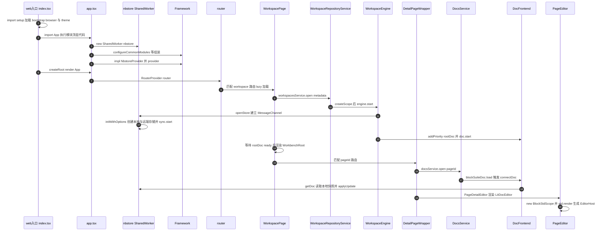
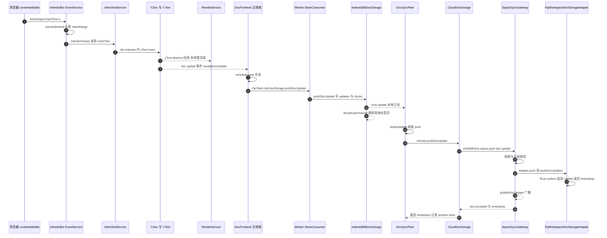
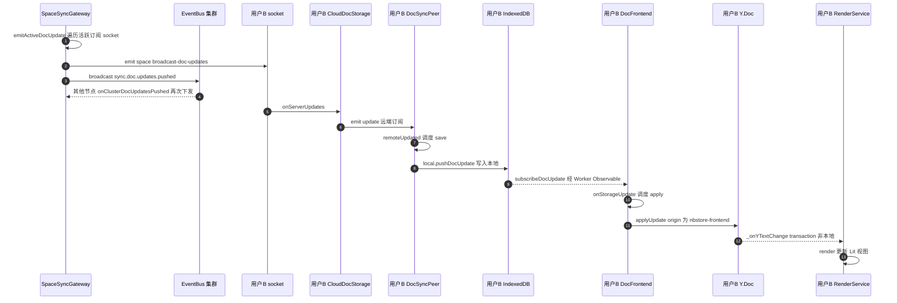
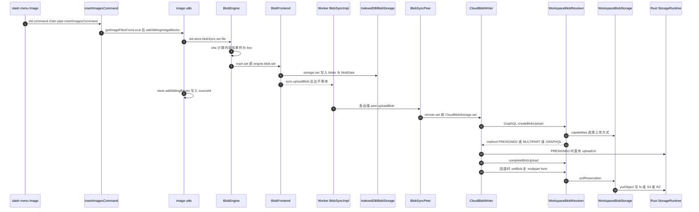
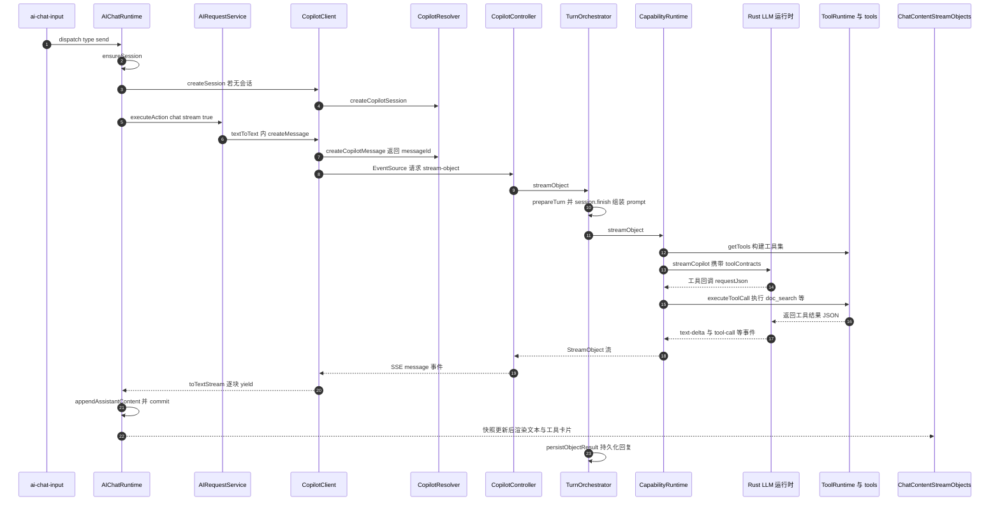

# 第 33 章 端到端链路追踪

> **所属部分**：第 10 部分 · 综合实战 ｜ **难度**：★★★★★ ｜ **建议学时**：8 小时 ｜ **前置章节**：第 16–28 章（BlockSuite 内核、前端应用、后端服务）

## 本章导读

前面 28 章我们把 AFFiNE 拆成了一块块积木：BlockSuite 的 Store/Std、前端的 DI 与 nbstore、后端的 NestJS 网关与 Prisma、Copilot 插件……但真实的 bug 和需求从来不按章节边界出现。用户说"我打的字同事看不到"，问题可能出在 `beforeinput` 事件、Yjs 事务、Worker 消息、IndexedDB 事务、socket.io 房间、PostgreSQL 写入中的任何一环。

本章是全书的"串珠"章节。我们先花一节讨论**如何读一个百万行级的大型项目**（自顶向下、自底向上、断点法、grep 法、日志法、测试用例反推），然后用这些方法亲手追踪 4 条贯穿前后端的真实链路：

1. **应用冷启动 → 编辑器挂载**：从 `packages/frontend/apps/web/src/index.tsx` 一直走到 `EditorHost` 渲染出第一个段落块；
2. **键入一个字符 → 协作者看到**：从浏览器 `beforeinput` 事件出发，穿过 Y.Text、nbstore、IndexedDB、socket.io、`SpaceSyncGateway`、PostgreSQL，再回到另一个浏览器的 Lit 视图；
3. **插入一张图片**：从 slash menu 的 "Image" 菜单项到 `createBlobUpload` GraphQL 变更，再到 Rust 原生对象存储（fs / S3 / R2）；
4. **一次 AI 对话**：从 `ai-chat-input` 的回车键，到 `createCopilotSession`/`createCopilotMessage`，到 SSE 流式接口 `stream-object`，再到 Rust LLM 运行时与 Copilot tools 回调，最后流式渲染工具卡片。

每条链路都给出 **Mermaid 时序图 + 逐跳表格 + 关键源码片段**。所有路径、类名、方法名都来自当前仓库（`@affine/monorepo` 0.27.5，canary 分支，HEAD 附近的 tag 形如 `v2026.10.27-canary.909`）。值得一提的是，这一版本的后端已经把大量热路径（文档 update 写入、对象存储、LLM 调用）下沉到了 Rust 原生运行时 `packages/backend/native`，TypeScript 层更多扮演"编排 + 权限 + 协议"的角色——这正是阅读新版源码时最容易"追丢"的地方，本章会明确标出 TS 与 Rust 的边界。

> 阅读建议：打开两个窗口，一边看本章，一边在 IDE 里按表格逐跳 `Cmd+P` 打开文件、`Cmd+Shift+O` 跳到方法。把每一跳亲手点一遍，比读十遍文字都有用。

## 学习目标

- [ ] 能够说出至少 6 种读大型源码的方法，并针对"找入口""找实现""找调用者"三类问题选择合适方法
- [ ] 能够独立复述 Web 端冷启动链路：`index.tsx → setup.ts → app.tsx → Framework 组装 → router → WorkspacePage → WorkspaceEngine.start → DocsService.open → PageEditor → BlockStdScope.render`
- [ ] 能够画出"键入一个字符"的完整时序图，指出本地视图刷新、IndexedDB 落盘、socket 推送三者的先后与异步边界
- [ ] 能够解释 `origin` / `uniqueId` 在 `DocFrontend`、`DocSyncPeer`、`IndexedDBDocStorage` 中如何防止 update 回环
- [ ] 能够说明服务端在何时、由哪个方法把 updates 合并为 snapshot，以及 `doc.snapshot.updated` 事件的下游
- [ ] 能够描述 blob 上传的三种方式（PRESIGNED / MULTIPART / GRAPHQL）及其选择逻辑，并定位 fs / S3 / R2 的实现边界
- [ ] 能够追踪 AI 对话从 `AIChatInput.send` 到 `CopilotController.chatStreamObject` 再到 `executeToolCall` 的全过程
- [ ] 能够在 DevTools 中观察 IndexedDB 表、WebSocket 帧和 SSE 事件流，并在关键位置下断点定位问题

## 知识地图

```mermaid
flowchart TB
  M[读源码方法论] --> M1[自顶向下]
  M --> M2[自底向上]
  M --> M3[断点法]
  M --> M4[grep法]
  M --> M5[日志法]
  M --> M6[测试反推]

  subgraph L1[链路一 冷启动]
    A1[web入口 index.tsx] --> A2[app.tsx 组装 Framework]
    A2 --> A3[router 与 WorkspacePage]
    A3 --> A4[WorkspaceEngine 启动 nbstore]
    A4 --> A5[DocsService 打开文档]
    A5 --> A6[PageEditor 与 BlockStdScope]
  end

  subgraph L2[链路二 协同编辑]
    B1[beforeinput] --> B2[InlineEditor 写 Y.Text]
    B2 --> B3[DocFrontend 保存]
    B3 --> B4[IndexedDB 落盘]
    B4 --> B5[DocSyncPeer 推送]
    B5 --> B6[SpaceSyncGateway]
    B6 --> B7[PostgreSQL updates]
    B6 --> B8[广播给协作者]
  end

  subgraph L3[链路三 图片 blob]
    C1[slash menu Image] --> C2[BlobEngine set]
    C2 --> C3[BlobFrontend 本地写入]
    C3 --> C4[BlobSyncPeer 上传]
    C4 --> C5[createBlobUpload]
    C5 --> C6[Rust 对象存储 fs S3 R2]
  end

  subgraph L4[链路四 AI 对话]
    D1[ai-chat-input] --> D2[AIChatRuntime]
    D2 --> D3[GraphQL 会话与消息]
    D3 --> D4[SSE stream-object]
    D4 --> D5[TurnOrchestrator]
    D5 --> D6[Rust LLM 运行时]
    D6 --> D7[Copilot tools 回调]
  end

  M --> L1
  M --> L2
  M --> L3
  M --> L4
  L1 --> T[调试技巧 断点 日志 DevTools]
  L2 --> T
  L3 --> T
  L4 --> T
```



## 29.1 如何读一个大型项目的源码

AFFiNE 仓库同时包含 TypeScript（前端、后端、BlockSuite）、Rust（`packages/frontend/native`、`packages/backend/native`、y-octo 等）、Swift/Kotlin（移动端）。试图"从头读到尾"是不可能的。读源码的本质是**带着问题找路径**，下面六种方法是工具箱，通常需要组合使用。

### 29.1.1 自顶向下：从入口顺藤摸瓜

适合回答"一个功能是怎么被启动/挂载的"。步骤：

1. 找到进程入口：Web 是 `packages/frontend/apps/web/src/index.tsx`，Electron 主进程在 `packages/frontend/apps/electron`，后端是 `packages/backend/server/src/index.ts`；
2. 只看"组装代码"——`new Framework()`、`configureXxxModule`、NestJS 的 `@Module` imports、路由表；
3. 遇到 `lazy: () => import(...)` 就跟进去，遇到具体业务细节先跳过，画出骨架图后再回头。

**陷阱**：AFFiNE 大量使用 DI，自顶向下时你看到的是接口（如 `NbstoreProvider`），真正实现在 `framework.impl(...)` 处注入。遇到接口时，搜 `.impl(接口名` 找实现。

### 29.1.2 自底向上：从"必经之地"反推

适合回答"这个数据最终写到哪里、谁写的"。例如想知道文档最终怎么落库，直接去看最底层：`IndexedDBDocStorage.pushDocUpdate`（前端）、`PgWorkspaceDocStorageAdapter.pushDocUpdates`（后端），然后用 IDE 的 "Find All References" 一层层往上找调用者。

底层"必经之地"的经验清单：

| 关注点 | 前端必经之地 | 后端必经之地 |
| --- | --- | --- |
| 文档写入 | `packages/common/nbstore/src/impls/idb/doc.ts` `pushDocUpdate` | `packages/backend/server/src/core/doc/adapters/workspace.ts` `pushDocUpdatesWithContract` |
| 网络推送 | `packages/common/nbstore/src/impls/cloud/doc.ts` `pushDocUpdate` | `packages/backend/server/src/core/sync/gateway.ts` `onReceiveDocUpdate` |
| GraphQL 请求 | `packages/common/graphql/src/fetcher.ts` `gqlFetcherFactory` | 各 `*.resolver.ts` / `resolvers/*.ts` 中的 `@Mutation` |
| Blob | `packages/common/nbstore/src/impls/cloud/blob-writer.ts` `CloudBlobWriter.set` | `packages/backend/server/src/core/storage/wrappers/blob.ts` `WorkspaceBlobStorage` |

### 29.1.3 断点法：让运行时告诉你答案

静态阅读遇到"这个回调到底被谁调用"时，最快的办法是在回调里打断点，看 Call Stack。AFFiNE 的特殊之处：

- **nbstore 跑在 SharedWorker 里**（`packages/frontend/apps/web/src/app.tsx` 中 `new SharedWorker(workerUrl, { name: 'affine-shared-worker' })`）。主线程 DevTools 里看不到 Worker 的调用栈，需要打开 `chrome://inspect/#workers`，找到 `affine-shared-worker` 单独 inspect。调试时也可以 `localStorage.setItem('disableSharedWorker', 'true')` 让它退化为普通 `Worker`，后者会出现在主 DevTools 的 Sources → Threads 中。
- 跨线程调用通过 `OpClient.call('docStorage.pushDocUpdate', ...)` 之类的字符串操作名进行，调用栈会在这里"断开"。这时用 **grep 操作名**（下一节）接上另一端。
- 后端用 `yarn affine server dev`（底层是 `nodemon ./src/index.ts`）启动，可以在 VS Code 中 attach Node 进程打断点。

### 29.1.4 grep 法：用字符串把世界连起来

字符串常量是跨边界的"胶水"：socket.io 事件名、Op 操作名、GraphQL 操作名、路由路径、i18n key、事件总线名。用 Grep 搜它们几乎能一步跨过任何边界：

```bash
# socket 事件：前端 emit 与后端 @SubscribeMessage 一一对应
rg "'space:push-doc-update'" packages
# Worker 操作：client.call 与 consumer.registerAll 对应
rg "'blobSync.uploadBlob'" packages/common/nbstore
# GraphQL：.gql 文件、生成的 mutation 常量、后端 resolver 方法
rg "createBlobUpload" packages/common/graphql packages/common/nbstore packages/backend/server/src
# 事件总线
rg "'doc.snapshot.updated'" packages/backend/server/src
```

一个小技巧：后端 NestJS 的方法名经常与 GraphQL 字段同名（如 `createCopilotSession`），而前端生成代码会在操作名后加 `Mutation`/`Query` 后缀（如 `createCopilotSessionMutation`），搜索时去掉后缀即可同时命中两端。

### 29.1.5 日志法：开关现成的调试日志

- 前端统一使用 `@affine/debug` 的 `DebugLogger`（`packages/common/debug/src/index.ts`）。在 URL 后加 `?debug` 即可开启：源码中检测到 `window.location.search.includes('debug')` 后写入 `sessionStorage` 的 `affine:debug` 并执行 `debug.enable('*')`。例如 `WorkspaceRepositoryService.instantiate` 会打印 `open workspace [flavour] id`（logger 名为 `affine:workspace-repository`）。
- 后端使用 NestJS `Logger`，例如 `DocStorageAdapter.squashUpdatesToSnapshot` 里的 `logger.verbose('Squashing updates, ...')`，需要把日志级别调到 verbose 才可见。
- 开发期还有一个非常有用的"告警日志"：`DocFrontend.handleDocUpdate` 在 `BUILD_CONFIG.debug` 下会检测"应用远端 update 时又触发了本地修改"，打印 `⚠️ When nbstore applies a remote update...`，这是排查"文档 edited by 变成自己"类 bug 的线索。

### 29.1.6 测试用例反推：最权威的"用法文档"

测试用例告诉你一个模块**被设计成怎样使用**，且一定能跑通。本章 4 条链路对应的测试：

| 链路 | 测试文件 |
| --- | --- |
| inline 输入 | `blocksuite/framework/std/src/__tests__/inline/event-beforeinput.unit.spec.ts`、`editor.unit.spec.ts` |
| nbstore 前端与同步 | `packages/common/nbstore/src/__tests__/frontend.spec.ts`、`sync.spec.ts`、`cloud-doc-updates.spec.ts`、`cloud-blob.spec.ts` |
| 服务端同步网关 | `packages/backend/server/src/__tests__/sync/gateway.spec.ts` |
| blob 上传 | `packages/backend/server/src/__tests__/storage/blob-upload.spec.ts`、`__tests__/e2e/storage/r2-proxy.spec.ts` |
| 协作 E2E | `tests/affine-cloud/e2e/collaboration.spec.ts`、`storage.spec.ts` |
| AI runtime | `packages/frontend/core/src/blocksuite/ai/runtime/chat/runtime.spec.ts`、`runtime/request/service.spec.ts` |

读法：先看 `describe/test` 标题理解"能力清单"，再看 arrange 部分理解"如何构造对象"，最后看 assert 理解"期望行为"。例如 `inline/event-beforeinput.unit.spec.ts` 第 14 行直接 `new InlineEditor(yText)`，说明 InlineEditor 只依赖一个 Y.Text，可以脱离整个编辑器单测——这本身就是重要的架构信息。

### 29.1.7 组合拳：一个通用的追踪模板

```text
1. 明确问题：输入是什么，输出/副作用是什么
2. 自顶向下找到"触发点"（UI 事件 / 路由 / API 入口）
3. 自底向上找到"落点"（存储写入 / 网络发送）
4. 用 grep 跨越字符串边界（事件名、操作名）
5. 断点验证每一跳，记录调用栈
6. 用测试或日志确认边界条件
7. 画时序图 + 逐跳表，形成自己的笔记
```

下面四条链路，都严格按这个模板完成。

## 29.2 链路一：应用冷启动到编辑器挂载

**问题**：用户在浏览器打开 `http://localhost:8080/workspace/<wid>/<docId>`，代码是如何一步步走到 BlockSuite 编辑器把段落渲染出来的？

### 29.2.1 时序图



### 29.2.2 逐跳表

| 序号 | 层 | 文件路径 | 函数/方法 | 做了什么 |
| --- | --- | --- | --- | --- |
| 1 | Web 入口 | `packages/frontend/apps/web/src/index.tsx` | 模块顶层 `import './setup'`、`mountApp` | 先执行 setup 副作用，再 `createRoot(#app).render(<StrictMode><Telemetry/><App/></StrictMode>)` |
| 2 | 启动副作用 | `packages/frontend/apps/web/src/setup.ts` | 模块顶层 | 依次导入 `@affine/core/bootstrap/browser`、`bootstrap/cleanup`、`@affine/component/theme` |
| 3 | 环境准备 | `packages/frontend/core/src/bootstrap/browser.ts` | 模块顶层 | 注释写着 `ORDER MATTERS`：`env` → `public-path` → `polyfill/browser` → `telemetry` |
| 4 | Worker 创建 | `packages/frontend/apps/web/src/app.tsx` | 模块顶层 | 优先 `new SharedWorker(getWorkerUrl('nbstore'))`，否则降级 `Worker`；包装为 `StoreManagerClient(new OpClient(port))` |
| 5 | Worker 端 | `packages/frontend/apps/web/src/nbstore.worker.ts` | 模块顶层 | `new StoreManagerConsumer([...idbStorages, ...idbV1Storages, ...broadcastChannelStorages, ...cloudStorages])` 并 `bindConsumer` |
| 6 | DI 组装 | `packages/frontend/apps/web/src/app.tsx` | 模块顶层 | `new Framework()`，调用 `configureCommonModules`、`configureBrowserWorkbenchModule`、`configureLocalStorageStateStorageImpls`、`configureBrowserWorkspaceFlavours`，再 `framework.impl(NbstoreProvider, {...})`、`framework.impl(PopupWindowProvider, ...)` |
| 7 | 模块注册 | `packages/frontend/core/src/modules/index.ts` | `configureCommonModules` | 依次调用 `configureI18nModule`、`configureWorkspaceModule`、`configureDocModule`、`configureStorageModule`……约数十个模块 |
| 8 | 工作区 flavour | `packages/frontend/core/src/modules/workspace-engine/index.ts` | `configureBrowserWorkspaceFlavours` | 注册 `LocalWorkspaceFlavoursProvider` 与 `CloudWorkspaceFlavoursProvider` 两种 `WorkspaceFlavoursProvider` 实现 |
| 9 | 生命周期 | `packages/frontend/apps/web/src/app.tsx` | 模块顶层 | `frameworkProvider.get(LifecycleService).applicationStart()` |
| 10 | React 根 | `packages/frontend/apps/web/src/app.tsx` | `App` | `FrameworkRoot` → `CacheProvider` → `I18nProvider` → `AffineContext` → `RouterProvider router` |
| 11 | 顶层路由 | `packages/frontend/core/src/desktop/router.tsx` | `topLevelRoutes` | `WORKSPACE_ROUTE_PATH`（`/workspace/:workspaceId/*`，定义于 `desktop/route-paths.ts`）lazy 加载 `./pages/workspace/index` |
| 12 | 工作区页 | `packages/frontend/core/src/desktop/pages/workspace/index.tsx` | `Component` | 从 `workspacesService.list.workspaces$` 找到 `meta`；找不到会重试 `revalidate`，最终 404 或 SharePage |
| 13 | 打开工作区 | 同上 | `WorkspacePage` | `useLayoutEffect` 中 `workspacesService.open({ metadata: meta })`，并订阅 `workspace.engine.doc.docState$(workspace.id)` 的 `ready` |
| 14 | 工作区仓库 | `packages/frontend/core/src/modules/workspace/services/repo.ts` | `WorkspaceRepositoryService.open` / `instantiate` | `ObjectPool` 复用；`flavourProvider.getEngineWorkerInitOptions(id)`；`framework.createScope(WorkspaceScope, ...)`；`workspace.engine.start()`；发出 `WorkspaceInitialized` |
| 15 | 存储配置 | `packages/frontend/core/src/modules/workspace-engine/impls/cloud.ts` | `getEngineWorkerInitOptions` | Web 端 local 使用 `IndexedDBDocStorage` 等；remotes 中 `cloud:${flavour}` 使用 `CloudDocStorage`、`CloudBlobStorage`、`CloudAwarenessStorage` |
| 16 | 引擎启动 | `packages/frontend/core/src/modules/workspace/entities/engine.ts` | `WorkspaceEngine.start` | `nbstoreService.openStore('workspace:<flavour>:<id>', options)`；`doc.addPriority(rootDoc.guid, 100)`；`this.doc.start()` |
| 17 | Worker 打开 | `packages/common/nbstore/src/worker/client.ts` | `StoreManagerClient.open` | 新建 `MessageChannel`，`call('open', transfer({key, closeKey, options, port: port2}))`，返回 `new StoreClient(new OpClient(port1))` |
| 18 | Worker 初始化 | `packages/common/nbstore/src/worker/store.ts` | `StoreConsumer.initWithOptions` | 按名称 `createStorage` 构造 local/remotes 的 `SpaceStorage`，`new Sync(this.storages)`，`connect()` 后 `sync.start()` |
| 19 | 前端门面 | `packages/common/nbstore/src/worker/client.ts` | `StoreClient` 构造函数 | 创建 `WorkerDocStorage`、`WorkerDocSync` 并包装为 `DocFrontend`、`BlobFrontend`、`AwarenessFrontend`、`IndexerFrontend` |
| 20 | 根文档连接 | `packages/frontend/core/src/modules/workspace/entities/workspace.ts` | `docCollection` getter | 构造 `WorkspaceImpl`，传入 `onLoadDoc: doc => engine.doc.connectDoc(doc)` 和 `blobSource`；`WorkspaceImpl` 构造时立即对 root doc 调用 `onLoadDoc` |
| 21 | 工作台 | `packages/frontend/core/src/modules/workbench/view/workbench-root.tsx` | `WorkbenchRoot` | 以 `workbenchRoutes`（`desktop/workbench-router.ts`）作为子路由，`/:pageId` lazy 加载 `detail-page/detail-page` |
| 22 | 文档页 | `packages/frontend/core/src/desktop/pages/workspace/detail-page/detail-page.tsx` | `Component` | 记录 `last_page_id`、加入最近文档，`useGuard('Doc_Read', pageId)`，渲染 `DetailPageWrapper` |
| 23 | 加载文档 | `packages/frontend/core/src/desktop/pages/workspace/detail-page/detail-page-wrapper.tsx` | `useLoadDoc` | `docsService.open(pageId)`；`doc.scope.get(EditorsService).createEditor()`；`engine.doc.addPriority(pageId, 10)` |
| 24 | 文档作用域 | `packages/frontend/core/src/modules/doc/services/docs.ts` | `DocsService.open` | `createScope(DocScope, {docId, blockSuiteDoc, record})`，调用 `blockSuiteDoc.load()` |
| 25 | 连接 nbstore | `packages/frontend/core/src/modules/workspace/impls/doc.ts` | `DocImpl.load` | `spaceDoc.load()` → `workspace.onLoadDoc?.(spaceDoc)` → `onLoadAwareness` |
| 26 | 首次加载 | `packages/common/nbstore/src/frontend/doc.ts` | `_connectDoc` / `jobs.load` | 调度 `load` 任务；`storage.getDoc(docId)`（经 Worker 读 IndexedDB 快照）后 `applyUpdate`，标记 `readyDocs` |
| 27 | React 编辑器 | `packages/frontend/core/src/components/page-detail-editor.tsx` | `PageDetailEditor` | 渲染 `BlockSuiteEditor`（`blocksuite/block-suite-editor/blocksuite-editor.tsx`） |
| 28 | Lit 适配 | `packages/frontend/core/src/blocksuite/block-suite-editor/lit-adaper.tsx` | `BlocksuiteDocEditor` | 渲染 `LitDocEditor`，传入 `doc={page}`、`specs` |
| 29 | Lit 包装 | `packages/frontend/core/src/blocksuite/editors/index.ts` | `LitDocEditor` | `createReactComponentFromLit({ elementClass: PageEditor })` |
| 30 | 编辑器挂载 | `packages/frontend/core/src/blocksuite/editors/page-editor.ts` | `PageEditor.connectedCallback` / `render` | `new BlockStdScope({ store: this.doc, extensions: this.specs })`，`render()` 中 `std.render()` |
| 31 | Std 渲染 | `blocksuite/framework/std/src/scope/std-scope.ts` | `BlockStdScope.render` | `new EditorHost()`，注入 `std`、`store`，通知 lifecycle watcher `rendered()` |
| 32 | 宿主元素 | `blocksuite/framework/std/src/view/element/lit-host.ts` | `EditorHost.connectedCallback` / `renderChildren` | `std.mount()`，按 `BlockViewExtension` 把 flavour 映射到自定义元素递归渲染块树 |

### 29.2.3 关键片段

**片段 1：Worker 与 Framework 的组装**（Web 应用最重要的 40 行，节选）

```tsx
// 来源：packages/frontend/apps/web/src/app.tsx
const workerUrl = getWorkerUrl('nbstore');

if (
  window.SharedWorker &&
  localStorage.getItem('disableSharedWorker') !== 'true'
) {
  const worker = new SharedWorker(workerUrl, {
    name: 'affine-shared-worker',
  });
  storeManagerClient = new StoreManagerClient(new OpClient(worker.port));
} else {
  const worker = new Worker(workerUrl);
  storeManagerClient = new StoreManagerClient(new OpClient(worker));
}
// ...
const framework = new Framework();
configureCommonModules(framework);
configureBrowserWorkbenchModule(framework);
configureLocalStorageStateStorageImpls(framework);
configureBrowserWorkspaceFlavours(framework);
framework.impl(NbstoreProvider, {
  realtime: storeManagerClient.realtime,
  openStore(key, options) {
    return storeManagerClient.open(key, options);
  },
});
// ...
const frameworkProvider = framework.provider();
frameworkProvider.get(LifecycleService).applicationStart();
```

要点：所有标签页共享一个 SharedWorker，因此同一工作区在多个 tab 中只有一份同步连接；`NbstoreProvider` 是一个"端口"，Electron 版会注入完全不同的实现（见第 24 章）。

**片段 2：工作区实例化**

```ts
// 来源：packages/frontend/core/src/modules/workspace/services/repo.ts
instantiate(openOptions, customEngineWorkerInitOptions?) {
  logger.info(
    `open workspace [${openOptions.metadata.flavour}] ${openOptions.metadata.id} `
  );
  const flavourProvider = this.flavoursService.flavours$.value.find(
    p => p.flavour === openOptions.metadata.flavour
  );
  const engineWorkerInitOptions =
    customEngineWorkerInitOptions ??
    flavourProvider?.getEngineWorkerInitOptions(openOptions.metadata.id);
  // ...
  const workspaceScope = this.framework.createScope(WorkspaceScope, {
    openOptions,
    engineWorkerInitOptions,
  });
  const workspace = workspaceScope.get(WorkspaceService).workspace;
  workspace.engine.start();
  workspaceScope.emitEvent(WorkspaceInitialized, workspace);
  flavourProvider?.onWorkspaceInitialized?.(workspace);
  // ...
  return workspace;
}
```

**片段 3：引擎启动与优先级**

```ts
// 来源：packages/frontend/core/src/modules/workspace/entities/engine.ts
start() {
  // ...
  const { store, dispose } = this.nbstoreService.openStore(
    (this.props.isSharedMode ? 'shared:' : '') +
      `workspace:${this.workspaceService.workspace.flavour}:${this.workspaceService.workspace.id}`,
    this.props.engineWorkerInitOptions
  );
  // ...
  this.client = store;
  this.eventBus.emit(WorkspaceEngineBeforeStart, this);

  const rootDoc = this.workspaceService.workspace.docCollection.doc;
  // priority load root doc
  this.doc.addPriority(rootDoc.guid, 100);
  this.indexer.addPriority(rootDoc.guid, 100);
  this.doc.start();
  // ...
}
```

`addPriority` 同时作用于 `DocFrontend` 的本地加载队列和 `DocSync` 的远端同步队列（见 `DocFrontend.addPriority` 内部调用 `this.sync?.addPriority`）。根文档优先级 100，当前打开的文档优先级 10（`useLoadDoc`），这就是"打开大工作区时当前文档总是最先可编辑"的原因。

**片段 4：文档打开与编辑器创建**

```tsx
// 来源：packages/frontend/core/src/desktop/pages/workspace/detail-page/detail-page-wrapper.tsx
useLayoutEffect(() => {
  if (!docRecord) {
    return;
  }
  const { doc, release } = docsService.open(pageId);
  setDoc(doc);
  const editor = doc.scope.get(EditorsService).createEditor();
  const unbind = editor.bindWorkbenchView(viewService.view);
  setEditor(editor);
  return () => {
    unbind();
    editor.dispose();
    release();
  };
}, [docRecord, docsService, pageId, viewService.view]);

// set sync engine priority target
useEffect(() => {
  return currentWorkspace.engine.doc.addPriority(pageId, 10);
}, [currentWorkspace, pageId]);
```

**片段 5：从 Lit 元素到 EditorHost**

```ts
// 来源：packages/frontend/core/src/blocksuite/editors/page-editor.ts
override connectedCallback() {
  super.connectedCallback();
  this._disposables.add(
    this.doc.slots.rootAdded.subscribe(() => this.requestUpdate())
  );
  this.std = new BlockStdScope({
    store: this.doc,
    extensions: this.specs,
  });
}

override render() {
  if (!this.doc.root) return nothing;
  const std = this.std;
  const theme = std.get(ThemeProvider).app$.value;
  return html`
    <div data-theme=${theme} class="page-editor-container">
      ${guard([std], () => std.render())}
    </div>
  `;
}
```

注意 `if (!this.doc.root) return nothing;` 与 `rootAdded` 订阅：冷启动时本地 IndexedDB 可能还没数据（首次在新设备打开云端文档），此时编辑器先渲染空，等同步拉到根块后 `rootAdded` 触发 `requestUpdate`，编辑器才真正出现。

### 29.2.4 小结与思考

冷启动链路揭示了 AFFiNE 前端的三层结构：**应用壳（apps/web）只做组装**、**业务（core/modules）通过 DI 与作用域管理生命周期**、**编辑器（BlockSuite）只认 Store 与扩展**。`WorkspaceScope → DocScope → EditorScope` 三层作用域分别由 `WorkspacePage`、`DetailPageWrapper` 中的 `FrameworkScope` 提供给 React 子树，这就是任何组件都能 `useService(WorkspaceService)` 的原因（第 20 章）。

## 29.3 链路二：键入一个字符到协作者看到

**问题**：用户 A 在段落里敲下字母 `a`，用户 B 的屏幕上是如何出现这个 `a` 的？服务端什么时候把增量合并成快照？

### 29.3.1 时序图（本地写入与推送）



### 29.3.2 时序图（服务端广播与对端应用）



### 29.3.3 逐跳表

| 序号 | 层 | 文件路径 | 函数/方法 | 做了什么 |
| --- | --- | --- | --- | --- |
| 1 | 块视图 | `blocksuite/affine/blocks/paragraph/src/paragraph-block.ts` | `ParagraphBlockComponent` 渲染 | 渲染 `<rich-text .yText=${this.model.props.text.yText} .inlineEventSource=${this.topContenteditableElement} .undoManager=${this.store.history.undoManager}>` |
| 2 | 富文本 | `blocksuite/affine/rich-text/src/rich-text.ts` | `RichText._init` | `new InlineEditor(this._yText, { hooks: { beforeinput: onVBeforeinput, compositionEnd: onVCompositionEnd } })` 后 `inlineEditor.mount(...)` |
| 3 | 事件绑定 | `blocksuite/framework/std/src/inline/services/event.ts` | `EventService.mount` | `disposables.addFromEvent(eventSource, 'beforeinput', e => this._onBeforeInput(e))`，同时监听 `selectionchange`、`affine-android-ime-input` |
| 4 | 输入处理 | 同上 | `EventService._onBeforeInput` | 判断选区是否属于本编辑器；处理 IME 组合；**`event.preventDefault()` 阻止浏览器原生 DOM 修改**；构造 `BeforeinputHookCtx`，调用 `hooks.beforeinput`，再 `transformInput(...)`，并 `slots.inputting.next` |
| 5 | 输入分派 | `blocksuite/framework/std/src/inline/utils/transform-input.ts` | `transformInput` → `handleInsertText` | `insertText` 类型调用 `editor.insertText(inlineRange, data, attributes)` 并移动光标 `setInlineRange` |
| 6 | 文本服务 | `blocksuite/framework/std/src/inline/services/text.ts` | `InlineTextService.insertText` | 合并 marks、规范化属性后 `this.transact(() => { yText.delete(...); yText.insert(...) })` |
| 7 | 事务 | `blocksuite/framework/std/src/inline/inline-editor.ts` | `InlineEditor.transact` | `doc.transact(fn, withoutTransact ? null : doc.clientID)`——**以 clientID 为 origin**，使 `Y.UndoManager`（`trackedOrigins` 含 clientID）能记录撤销栈 |
| 8 | 本地视图 | `blocksuite/framework/std/src/inline/services/render.ts` | `RenderService._onYTextChange` | `yText.observe` 回调：发出 `textChange`；若 `!transaction.local` 标记需要同步远端光标；调用 `render()` |
| 9 | update 捕获 | `packages/common/nbstore/src/frontend/doc.ts` | `DocFrontend.handleDocUpdate` | Y.Doc `update` 事件；`origin === NBSTORE_ORIGIN` 时忽略（防回环）；否则 `schedule({ type: 'save', docId, update })` |
| 10 | 主循环 | 同上 | `DocFrontend.mainLoop` → `jobs.save` | 按优先级弹出 docId，把同一文档的多个 save 任务 `mergeUpdates` 合并为一次，调用 `storage.pushDocUpdate({docId, bin}, this.uniqueId)` |
| 11 | 跨线程 | `packages/common/nbstore/src/worker/client.ts` | `WorkerDocStorage.pushDocUpdate` | `this.client.call('docStorage.pushDocUpdate', { update, origin })` |
| 12 | Worker 路由 | `packages/common/nbstore/src/worker/store.ts` | `StoreConsumer.registerHandlers` | `'docStorage.pushDocUpdate': ({ update, origin }) => this.docStorage.pushDocUpdate(update, origin)` |
| 13 | 本地落盘 | `packages/common/nbstore/src/impls/idb/doc.ts` | `IndexedDBDocStorage.pushDocUpdate` | 事务写 `updates` 与 `clocks` 两张 object store（时间戳冲突时 +1ms 重试至多 10 次）；`emit('update', ..., origin)`；`channel.postMessage` 通知其他标签页 |
| 14 | 同步感知 | `packages/common/nbstore/src/sync/doc/peer.ts` | `DocSyncPeer.mainLoop` 中 `local.subscribeDocUpdate` | 过滤 `origin === this.uniqueId` 或以 `sync:${peerId}:` 开头的更新，其余触发 `events.localUpdated` |
| 15 | 调度推送 | 同上 | `events.localUpdated` | `actions.addDoc(docId)`，`schedule({ type: 'push', docId, clock, update })` |
| 16 | 执行推送 | 同上 | `jobs.push` | 合并 push 任务的 update，`remote.pushDocUpdate({docId, bin: merged}, this.uniqueId)`；成功后调度 `save`（记录 remoteClock）并 `syncMetadata.setPeerPushedClock` |
| 17 | 云端存储 | `packages/common/nbstore/src/impls/cloud/doc.ts` | `CloudDocStorage.pushDocUpdate` | `connection.joinDoc(...)` 确保已加入；`socket.emitWithAck('space:push-doc-update', { spaceType, spaceId, docId, update: base64 })` |
| 18 | 加入房间 | 同上 | `CloudDocStorageConnection.joinDoc` / `doConnect` | `emitWithAck('space:join-batch', { spaces: [...], clientVersion })`；连接时 `socket.on('space:broadcast-doc-updates', this.onServerUpdates)` 与 `space:broadcast-doc-invalidation` |
| 19 | 网关入口 | `packages/backend/server/src/core/sync/gateway.ts` | `SpaceSyncGateway.onReceiveDocUpdate`（`@SubscribeMessage('space:push-doc-update')`） | `canonicalDocId`；`assertReservedDocSubject`；`hasActiveDocSubscription`；`hasActiveDocAction(..., 'Doc.Update')`；取 `permissionGeneration` |
| 20 | 分支写入 | 同上 | `onReceiveDocUpdate` | 若是工作区根文档（`docId === spaceId`）走 `runtime.executeDomainCommandV1({ command: 'append_root_update', ... })`；否则 `adapter.push(...)` |
| 21 | 适配器 | 同上 | `WorkspaceSyncAdapter.push` → `SyncSocketAdapter.push` | 检查 `models.doc.getMeta(...).blocked`；判断 `update_doc` / `create_doc` 写意图；`assertIn(spaceId)` 后调用 `storage.pushDocUpdates` |
| 22 | 文档存储 | `packages/backend/server/src/core/doc/adapters/workspace.ts` | `pushDocUpdates` → `pushDocUpdatesWithContract` | `filterValidDocUpdates` 过滤非法 update；每 10 条一批调用 `this.runtime.appendWorkspaceDocUpdatesV1(...)`（Rust 原生运行时，写入 updates 表并返回时间戳）；新文档发出 `doc.created` |
| 23 | 广播 | `packages/backend/server/src/core/sync/gateway.ts` | `publishDocUpdate` | 向 `sync-027` 批量房间（排除发送者）发 `space:broadcast-doc-invalidation`；`emitActiveDocUpdate` 向活跃订阅该文档的 socket 发 `space:broadcast-doc-updates`；`event.broadcast('sync.doc.updates.pushed', ...)` 通知集群其他节点 |
| 24 | 集群转发 | 同上 | `onClusterDocUpdatesPushed`（`@OnEvent('sync.doc.updates.pushed')`） | 其他节点收到后对本节点上的活跃 socket 执行 `emitActiveDocUpdate` |
| 25 | 应答 | 同上 | `onReceiveDocUpdate` 返回 | `{ data: { accepted: true, timestamp } }` |
| 26 | 对端接收 | `packages/common/nbstore/src/impls/cloud/doc.ts` | `CloudDocStorage.onServerUpdates` | 校验 `spaceType/spaceId`；`idConverter.oldIdToNewId`；对每个 update `emit('update', { docId, bin: base64ToUint8Array(update), timestamp, editor })` |
| 27 | 对端调度 | `packages/common/nbstore/src/sync/doc/peer.ts` | `events.remoteUpdated` | 更新 remoteClock；非空 update 调度 `save`，空 update 调度 `pull` |
| 28 | 对端落盘 | 同上 | `jobs.save` | 合并后 `local.pushDocUpdate({docId, bin}, this.uniqueId)` 写入 B 的 IndexedDB，记录 `setPeerPulledRemoteClock` |
| 29 | 回到主线程 | `packages/common/nbstore/src/worker/store.ts` / `client.ts` | `'docStorage.subscribeDocUpdate'` / `WorkerDocStorage.subscribeDocUpdate` | Worker 端把本地存储的 update 事件包装为 Observable，主线程订阅后回调 `DocFrontend.event.onStorageUpdate` |
| 30 | 对端应用 | `packages/common/nbstore/src/frontend/doc.ts` | `event.onStorageUpdate` → `jobs.apply` → `applyUpdate` | `origin !== this.uniqueId` 时调度 `apply`；`applyUpdate(doc, update, NBSTORE_ORIGIN)` |
| 31 | 对端渲染 | `blocksuite/framework/std/src/inline/services/render.ts` | `RenderService._onYTextChange` | `transaction.local === false`，设置 `_pendingRemoteInlineRangeSync`，重新 `render()`，用户 B 看到 `a` |

### 29.3.4 关键片段

**片段 1：阻止原生输入，转交 Y.Text**

```ts
// 来源：blocksuite/framework/std/src/inline/services/event.ts（EventService._onBeforeInput 节选）
// Always prevent native DOM mutations inside inline editor. Browsers (notably
// Firefox) may remove Lit marker comment nodes during native edits, which
// will crash subsequent Lit updates with `ChildPart has no parentNode`.
event.preventDefault();

let inlineRange = this.editor.toInlineRange(range);
// ...
const ctx: BeforeinputHookCtx<TextAttributes> = {
  inlineEditor: this.editor,
  raw: event,
  inlineRange,
  data: event.data ?? event.dataTransfer?.getData('text/plain') ?? null,
  attributes: {} as TextAttributes,
};
this.editor.hooks.beforeinput?.(ctx);

transformInput<TextAttributes>(
  ctx.raw.inputType,
  ctx.data,
  ctx.attributes,
  ctx.inlineRange,
  this.editor as never
);

this.editor.slots.inputting.next(event.data ?? '');
```

这是理解 BlockSuite 编辑模型的钥匙：**DOM 永远不是数据源**。浏览器想改 DOM，被 `preventDefault` 拦下；BlockSuite 改 Y.Text；Y.Text 的 observe 再驱动 Lit 重新渲染 DOM。IME 组合输入（中文拼音）是例外：组合期间允许原生行为，`compositionend` 时再一次性写入。

**片段 2：DocFrontend 的防回环与合并保存**

```ts
// 来源：packages/common/nbstore/src/frontend/doc.ts
private readonly handleDocUpdate = (
  update: Uint8Array,
  origin: any,
  doc: YDoc,
  transaction: YTransaction
) => {
  if (origin === NBSTORE_ORIGIN) {
    return;
  }
  // ...（debug 模式下检测"应用远端更新时触发了本地修改"）
  if (!this.status.docs.has(doc.guid)) {
    return;
  }
  this.schedule({
    type: 'save',
    docId: doc.guid,
    update,
  });
};
```

```ts
// 来源：packages/common/nbstore/src/frontend/doc.ts（jobs.save）
save: async (docId, jobs, signal) => {
  if (!this.status.docs.has(docId)) {
    return;
  }
  if (this.status.connectedDocs.has(docId)) {
    const merged = await this.mergeUpdates(
      jobs.map(j => j.update).filter(update => !isEmptyUpdate(update))
    );
    throwIfAborted(signal);
    await this.storage.pushDocUpdate(
      { docId, bin: merged },
      this.uniqueId
    );
  }
},
```

防回环有两层：Y.Doc 层用 `NBSTORE_ORIGIN = 'nbstore-frontend'` 标记"来自存储的变化"；存储层用 `uniqueId = frontend:${nanoid()}` 标记"我自己写进去的"，`onStorageUpdate` 里 `origin !== this.uniqueId` 才会 apply。

**片段 3：IndexedDB 写入与跨标签广播**

```ts
// 来源：packages/common/nbstore/src/impls/idb/doc.ts（IndexedDBDocStorage.pushDocUpdate 节选）
while (true) {
  const trx = this.db.transaction(['updates', 'clocks'], 'readwrite');
  try {
    await trx.objectStore('updates').add({ ...update, createdAt: timestamp });
    await trx.objectStore('clocks').put({ docId: update.docId, timestamp });
    trx.commit();
    await trx.done;
  } catch (e) {
    await trx.done.catch(() => {});
    if (e instanceof Error && e.name === 'ConstraintError') {
      retry++;
      if (retry < 10) {
        timestamp = new Date(timestamp.getTime() + 1);
        continue;
      }
    }
    throw e;
  }
  break;
}
this.emit('update', { docId: update.docId, bin: update.bin, timestamp, editor: update.editor }, origin);
this.channel.postMessage({ type: 'update', update: { /* ... */ }, origin } satisfies ChannelMessage);
```

**片段 4：DocSyncPeer 推送**

```ts
// 来源：packages/common/nbstore/src/sync/doc/peer.ts（jobs.push 节选）
push: async (docId, jobs, signal) => {
  if (this.status.connectedDocs.has(docId) && !this.remote.isReadonly) {
    const maxClock = jobs.reduce(
      (a, b) => (a.getTime() > b.clock.getTime() ? a : b.clock),
      new Date(0)
    );
    const merged = await this.mergeUpdates(
      jobs.map(j => j.update ?? new Uint8Array()).filter(update => !isEmptyUpdate(update))
    );
    if (!isEmptyUpdate(merged)) {
      const { timestamp } = await this.remote.pushDocUpdate(
        { docId, bin: merged },
        this.uniqueId
      );
      this.schedule({ type: 'save', docId, remoteClock: timestamp });
    }
    throwIfAborted(signal);
    await this.syncMetadata.setPeerPushedClock(this.peerId, { docId, timestamp: maxClock });
  }
},
```

`peerClocks`（推送/拉取时钟）存放在 IndexedDB 的 `peerClocks` 表中，由 `IndexedDBDocSyncStorage` 管理。断网期间本地更新照常写 `updates` 表，重连后 `DocSyncPeer` 通过比较 `pushedClock` 与本地 clock 找出未推送的文档补推——这就是"离线优先"的实现基础（第 23 章）。

**片段 5：服务端接收与广播**

```ts
// 来源：packages/backend/server/src/core/sync/gateway.ts（onReceiveDocUpdate 节选）
const canonicalRoot = spaceType === SpaceType.Workspace && docId === spaceId;
let timestamp: number;
if (canonicalRoot) {
  // ...
  output = await this.runtime.executeDomainCommandV1({
    command: 'append_root_update',
    actorUserId: user.id,
    workspaceId: spaceId,
    update,
    assertPermission: true,
    expectedPermissionGeneration: permissionGeneration,
  });
  // ...
  timestamp = new Date(output.timestamp as string).getTime();
} else {
  timestamp = await adapter.push(
    spaceId, docId, [Buffer.from(update, 'base64')], user.id, permissionGeneration
  );
}
this.publishDocUpdate(
  { spaceType, spaceId, docId, updates: [Buffer.from(update, 'base64')], timestamp, editor: user.id },
  client
);
return { data: { accepted: true, timestamp } };
```

```ts
// 来源：packages/backend/server/src/core/sync/gateway.ts（emitActiveDocUpdate 节选）
const sockets = this.activeDocSockets.get(
  this.activeDocKey(payload.spaceType, payload.spaceId, payload.docId)
);
if (!sockets) {
  return;
}
// ...
for (const socket of sockets) {
  if (socket.id !== sourceSocketId) {
    socket.emit('space:broadcast-doc-updates', activeBroadcastPayload);
  }
}
```

注意新版协议的两种通知：

- **精确推送**：只发给"活跃订阅了这个文档"（通过 `space:join-batch` 带 `docId` 加入）的 socket，载荷包含 update 本身；
- **失效通知**：发给整个工作区批量房间（`Room(spaceId, 'sync-027')`）里的其他客户端，只带 `timestamp`。客户端收到后在 `CloudDocStorage.onServerInvalidation` 中 50ms 去抖，调用 `repairInvalidatedDocs` 拉取 `space:load-doc-timestamps`，对变新的文档 emit 一个**空 update**，`DocSyncPeer.events.remoteUpdated` 看到空 update 会调度 `pull`，再用 `space:load-doc` 拉差量。这样没打开的文档不会被大量 update 淹没。

### 29.3.5 服务端何时把 updates 合并成 snapshot

答案是**读时合并（lazy squash）**，而不是写时合并：

```ts
// 来源：packages/backend/server/src/core/doc/storage/doc.ts（DocStorageAdapter）
protected async getDocUnderLock(spaceId: string, docId: string) {
  const snapshot = await this.getDocSnapshot(spaceId, docId);
  const updates = await this.getDocUpdates(spaceId, docId);

  if (updates.length) {
    const docUpdate = await this.squash(
      snapshot ? [snapshot, ...updates] : updates
    );
    return await this.squashUpdatesToSnapshot(
      spaceId, docId, updates, snapshot, docUpdate
    );
  }
  return { doc: snapshot, snapshotUpdated: false };
}
```

`squashUpdatesToSnapshot`（带 `@Transactional`，超时 60s）做三件事：`setDocSnapshot(newSnapshot)` 写新快照；若有旧快照则 `createDocHistory(snapshot)` 生成历史版本（页面历史功能的数据来源）；`markUpdatesMerged` 标记已合并的 updates。

触发时机：

| 触发者 | 路径 |
| --- | --- |
| 客户端拉取文档 | `SpaceSyncGateway.onLoadSpaceDoc`（`space:load-doc`）→ `adapter.diff` → `DocStorageAdapter.getDocDiff` → `PgWorkspaceDocStorageAdapter.getDoc` |
| 服务端读文档内容 | `DocReader`、HTTP `WorkspacesController.doc`（`/api/workspaces/:id/docs/:guid`）等调用 `getDoc` 的地方 |
| 合并后的下游 | `PgWorkspaceDocStorageAdapter.getDoc` 在 `snapshotUpdated` 时 `emitDetached('doc.snapshot.updated', ...)` → `packages/backend/server/src/core/doc/event.ts` `DocEventsListener.markDocContentCacheStale` 更新文档内容缓存/元数据 |
| 定时清理 | `packages/backend/server/src/core/doc/job.ts` `DocStorageCronJob.nightlyJob`（每天零点）调用 `cleanupExpiredSnapshotHistories` 清理过期历史 |

前端 IndexedDB 采用完全相同的策略：`SnapshotDocStorageBase.getDoc`（`packages/common/nbstore/src/storage/doc.ts`）读取时 `squash` 并 `setDocSnapshot` + `markUpdatesMerged`，注释直言 *"A huge amount of write time will be saved if we don't merge updates into snapshot immediately."*

> 此处为推断，建议断点验证：`appendWorkspaceDocUpdatesV1` 进入 Rust 原生运行时（`packages/backend/native/src/runtime`）后，是否还会在写入时做额外的"超过阈值即合并"处理，TS 层源码无法确证。可在 `packages/backend/native/src` 中搜索 `append_workspace_doc_updates` 相关实现，或在测试库中观察 updates 表行数变化验证。

## 29.4 链路三：插入图片 blob

**问题**：用户在 slash menu 选择 "Image" 并选中一张本地图片，图片数据是如何从浏览器进入 S3/R2 的？另一个协作者又是如何看到这张图的？

### 29.4.1 时序图



### 29.4.2 逐跳表

| 序号 | 层 | 文件路径 | 函数/方法 | 做了什么 |
| --- | --- | --- | --- | --- |
| 1 | 菜单 | `blocksuite/affine/blocks/image/src/configs/slash-menu.ts` | `imageSlashMenuConfig.items[0].action` | `std.command.chain().pipe(getSelectedModelsCommand).pipe(insertImagesCommand, { removeEmptyLine: true }).run()` |
| 2 | 注册 | `blocksuite/affine/blocks/image/src/image-spec.ts` | 模块顶层 | `SlashMenuConfigExtension(flavour, imageSlashMenuConfig)` 把菜单项注入 slash menu |
| 3 | 命令 | `blocksuite/affine/blocks/image/src/commands/insert-images.ts` | `insertImagesCommand` | `getImageFilesFromLocal()` 打开文件选择器，`.then(files => addSiblingImageBlocks(std, files, targetModel, placement))`，必要时删除空行 |
| 4 | 构造属性 | `blocksuite/affine/blocks/image/src/utils.ts` | `addSiblingImageBlocks` → `buildPropsWith` | 过滤 `image/*`；`hasExceeded` 检查大小；并行 `readImageSize(file)` 与 `std.store.blobSync.set(file)`，得到 `{ size, sourceId, width, height }` |
| 5 | 插块 | 同上 | `addSiblingImageBlocks` | `std.store.addSiblingBlocks(targetModel, propsArray.map(props => ({ ...props, flavour })), placement)`——**块里只存 `sourceId`（blob key），不存二进制**，块本身走链路二同步 |
| 6 | Store 门面 | `blocksuite/framework/store/src/model/store/store.ts` | `get blobSync` | 返回 `this.workspace.blobSync` |
| 7 | Blob 引擎 | `blocksuite/framework/sync/src/blob/engine.ts` | `BlobEngine.set` | key = `sha(await value.arrayBuffer())`（内容寻址，天然去重）；`await this.main.set(key, value)`；shadows 后台上传 |
| 8 | 主 peer | `packages/frontend/core/src/modules/workspace/entities/workspace.ts` | `docCollection` 中 `blobSource.set` | `this.engine.blob.set({ key: id, data: new Uint8Array(await blob.arrayBuffer()), mime: blob.type })` |
| 9 | 前端门面 | `packages/common/nbstore/src/frontend/blob.ts` | `BlobFrontend.set` | 加锁后 `storage.set(blob)`；**不等待上传**，`this.sync.uploadBlob(blob, true /* force upload */)` |
| 10 | 跨线程 | `packages/common/nbstore/src/worker/client.ts` | `WorkerBlobStorage.setBlob` / `WorkerBlobSync.uploadBlob` | `client.call('blobStorage.setBlob', blob)`、`client.call('blobSync.uploadBlob', { blob, force })` |
| 11 | 本地落盘 | `packages/common/nbstore/src/impls/idb/blob.ts` | `IndexedDBBlobStorage.set` | 写入 IndexedDB 的 `blobs`（元数据）与 `blobData`（二进制）表 |
| 12 | 上传编排 | `packages/common/nbstore/src/sync/blob/index.ts` | `BlobSyncImpl.uploadBlob` | 等待 `reconfiguration`，对所有 peer 并行 `p.uploadBlob(blob, force, signal)` |
| 13 | 单 peer 上传 | `packages/common/nbstore/src/sync/blob/peer.ts` | `BlobSyncPeer.uploadBlob` | 非 force 时查 `getBlobUploadedAt` 跳过已上传；去重 `uploadingPromise`；`remote.set(blob, signal)`；成功后 `setBlobUploadedAt`；区分 `OverCapacityError`/`OverSizeError` 更新状态 |
| 14 | 云端 blob | `packages/common/nbstore/src/impls/cloud/blob.ts` | `CloudBlobStorage.set` | 委托 `this.writer.set(blob, signal)` |
| 15 | 上传器 | `packages/common/nbstore/src/impls/cloud/blob-writer.ts` | `CloudBlobWriter.set` | `getBlobSizeLimit`（`workspaceBlobQuotaQuery`）→ `createBlobUploadMutation` → 按 `upload.method` 分支 |
| 16 | GraphQL 定义 | `packages/common/graphql/src/graphql/blob-upload-create.gql` 等 | `createBlobUpload` / `completeBlobUpload` / `getBlobUploadPartUrl` / `abortBlobUpload` / `setBlob` | 前端生成常量 `createBlobUploadMutation`、`completeBlobUploadMutation`、`setBlobMutation` 等 |
| 17 | 服务端初始化 | `packages/backend/server/src/core/workspaces/resolvers/blob.ts` | `WorkspaceBlobResolver.createBlobUpload` | 权限与配额预留（`reserveStorage`）；`storage.head` 判断 `alreadyUploaded`；`storage.capabilities()` 决定 MULTIPART（大于阈值且支持）/ PRESIGNED / 默认 GRAPHQL；`setReservationUploadId` |
| 18 | 直传完成 | 同上 | `completeBlobUpload` | 校验对象存在，必要时 `completeMultipartUpload`，最终 `finalizeReservation` |
| 19 | 回退上传 | 同上 | `setBlob` | `ac.user().workspace().assert('Workspace.Blobs.Upload')`；`readBuffer(blob.createReadStream())`；`reserveStorage`；`storage.putReservation`；失败时 `runtime.abortStorageReservationV1`；成功 `finalizeReservation` |
| 20 | 存储包装 | `packages/backend/server/src/core/storage/wrappers/blob.ts` | `WorkspaceBlobStorage.putReservation` / `capabilities` / `presignPut` | `this.rt.putObject('blob', reservationObjectKey(...), blob, metadata)`；`capabilities` 结合 `uploadURLConfig` 决定是否允许直传 |
| 21 | 运行时桥 | `packages/backend/server/src/core/storage-runtime/provider.ts` | `StorageRuntimeProvider.putObject` | `this.measured('putObject', rt => rt.putObject(scope, key, body, metadata))`，进入 Rust |
| 22 | Rust 后端 | `packages/backend/native/src/runtime/object_storage/backend.rs` | `StorageBackendConfig` | 枚举 `Fs` / `S3` / `Assetpack`；provider 为 `fs`、`assetpack` 时走本地文件系统，为 `aws-s3`、`cloudflare-r2` 时都走 S3 兼容客户端 |
| 23 | 代理直传 | `packages/backend/server/src/core/storage/r2-proxy.ts` | `R2UploadController`（`@Controller('/api/storage')`）`@Put('upload')` / `@Put('multipart')` | 当配置开启 `proxyUpload` 时，presigned URL 实际指向服务器自身代理端点 |
| 24 | 对端下载 | `packages/common/nbstore/src/frontend/blob.ts` → `impls/cloud/blob.ts` | `BlobFrontend.get` → `sync.downloadBlob` → `CloudBlobStorage.get` | 本地无则下载，请求 `/api/workspaces/${workspaceId}/blobs/v1/${key}?<source 查询参数>`；source 来自 `Workspace.loadBlobSource` 为当前文档注册的 `{ type: 'currentDoc', workspaceId, docId }`（`registerSource`），服务端据此判断"引用该 blob 的文档你是否可读" |
| 25 | 下载接口 | `packages/backend/server/src/core/workspaces/controller.ts` | `WorkspacesController.blobV1`（`@Get('/:id/blobs/v1/:name')`） | `blobSource(workspaceId, sourceType, docId, timestampMs)` 构造来源；`runtime.openBlobV1(user?.id, source, name)` 在 Rust 中鉴权并打开流；循环 `readBlobStreamChunkV1` 以 `pipeline` 流式写回，响应头 `cache-control: private, no-store` |

### 29.4.3 关键片段

**片段 1：图片块只存 key**

```ts
// 来源：blocksuite/affine/blocks/image/src/utils.ts
async function buildPropsWith(std: BlockStdScope, file: File) {
  const { size } = file;
  const [imageSize, sourceId] = await Promise.all([
    readImageSize(file),
    std.store.blobSync.set(file),
  ]);

  if (!(imageSize.width * imageSize.height)) {
    toast(std.host, 'Failed to read image size, please try another image');
    throw new Error('Failed to read image size');
  }

  return { size, sourceId, ...imageSize } satisfies Partial<ImageBlockProps>;
}
```

**片段 2：本地优先，上传后台化**

```ts
// 来源：packages/common/nbstore/src/frontend/blob.ts
async set(blob: BlobRecord) {
  await this.waitForConnected();
  await using lock = await this.lock.lock('blob', blob.key);
  await this.storage.set(blob);
  await lock[Symbol.asyncDispose]();

  // We don't wait for the upload to complete,
  // as the upload process runs asynchronously in the background
  this.sync.uploadBlob(blob, true /* force upload */).catch(() => {
    // ignore the error as it has already been recorded in the sync status
  });

  return;
}
```

所以图片插入是"秒出"的：写完 IndexedDB 就返回，块立即渲染（读本地 blob）；上传状态通过 `blobState$` 暴露给 UI（例如上传中/失败的图标）。

**片段 3：三种上传方式的选择**

```ts
// 来源：packages/common/nbstore/src/impls/cloud/blob-writer.ts（CloudBlobWriter.set 节选）
const init = await this.connection.gql({
  query: createBlobUploadMutation,
  variables: { workspaceId: this.workspaceId, key: blob.key, size: blob.data.byteLength, mime: blob.mime },
  context: { signal },
});
const upload = init.createBlobUpload;
if (upload.alreadyUploaded) {
  return;
}
try {
  if (upload.method === BlobUploadMethod.PRESIGNED) {
    // ...
    await this.uploadViaPresigned(upload.uploadUrl, upload.headers, blob.data, signal);
    await this.completeUpload(blob.key, undefined, undefined, signal);
    return;
  }
  if (upload.method === BlobUploadMethod.MULTIPART) {
    // ...
    const parts = await this.uploadViaMultipart(blob.key, upload.uploadId, upload.partSize, blob.data, upload.uploadedParts, signal);
    await this.completeUpload(blob.key, upload.uploadId, parts, signal);
    return;
  }
} catch (error) {
  // ... 直传失败：打印 '[blob] direct upload failed'，必要时 abort multipart
}
await this.uploadViaGraphql(blob, signal);
```

**片段 4：服务端回退路径 setBlob**

```ts
// 来源：packages/backend/server/src/core/workspaces/resolvers/blob.ts（WorkspaceBlobResolver.setBlob 节选）
await this.ac
  .user(user.id)
  .workspace(workspaceId)
  .assert('Workspace.Blobs.Upload');

const buffer = await readBuffer(blob.createReadStream(), () => undefined);
const reservation = await this.reserveStorage({
  workspaceId, userId: user.id, key: blob.filename,
  size: buffer.byteLength, mime: blob.mimetype || 'application/octet-stream', kind: 'blob',
});
if (reservation.alreadyUploaded) return blob.filename;
// ...
metadata = await this.storage.putReservation(
  workspaceId, blob.filename, reservation.reservationId, buffer,
  { contentType: blob.mimetype || 'application/octet-stream', contentLength: buffer.byteLength }
);
// ...
const finalized = await this.finalizeReservation({ /* ... */ });
if (!finalized) throw new BlobInvalid('Blob reservation changed');
return blob.filename;
```

"预留（reservation）→ 写对象 → 定稿（finalize）"三段式保证了配额统计与对象存储的一致：写失败会 `abortStorageReservationV1` 回滚配额。

### 29.4.4 存储 provider 配置

`packages/backend/server/src/base/storage/providers/index.ts` 定义了 `StorageProviderName = 'fs' | 'aws-s3' | 'cloudflare-r2' | 'assetpack'` 以及 `S3StorageConfig`（`endpoint`、`region`、`credentials`、`forcePathStyle`、`presign`、`usePresignedURL` 等）、`R2StorageConfig`（`accountId`、`jurisdiction`）。配置项名为 `storages.blob.storage`（见 `packages/backend/server/src/core/storage/config.ts`，以及 `.docker/selfhost/schema.json` 中的 `"blob.storage"`），默认值是 `{"bucket":"blobs","config":{"path":"~/.affine/storage"},"provider":"fs"}`。第 34 章练习 ⑩ 会用 MinIO 演示接入 S3 兼容存储。

## 29.5 链路四：AI 对话

**问题**：用户在文档右侧 AI 面板输入"总结这篇文档"并回车，消息如何到达大模型？模型调用 `doc_read`/`doc_search` 等工具时发生了什么？流式结果如何一段段出现在面板上？

### 29.5.1 时序图



### 29.5.2 逐跳表

| 序号 | 层 | 文件路径 | 函数/方法 | 做了什么 |
| --- | --- | --- | --- | --- |
| 1 | 面板 | `packages/frontend/core/src/desktop/pages/workspace/detail-page/tabs/chat.tsx` | `EditorChatPanel` | `createAIRequestService(graphqlService.gql, eventSourceService.eventSource, nbstoreService.realtime, docIds => ...waitForSynced)`；`new AIChatRuntime({ request, scope: { kind: 'doc', workspaceId, docId }, strategy: new DocAIChatSessionStrategy() })`；挂载 `AIChatContent` |
| 2 | 服务工厂 | `packages/frontend/core/src/blocksuite/ai/runtime/request/service.ts` | `createAIRequestService` | `new AIRequestService(new CopilotClient(gql, eventSource, realtime), syncSelectedSources)` |
| 3 | 输入框 | `packages/frontend/core/src/blocksuite/ai/components/ai-chat-input/ai-chat-input.ts` | `AIChatInput._onTextareaSend` → `send` | 清空 textarea；收集图片、`_getMatchedContexts()`、reasoning、`aiToolsConfigService.config`、`aiModelService.modelId`，`runtime.dispatch({ type: 'send', ... })` |
| 4 | 运行时 | `packages/frontend/core/src/blocksuite/ai/runtime/chat/runtime.ts` | `AIChatRuntime.dispatch` → `send` | 乐观追加 user 消息与空 assistant 消息（status `loading`）；`ensureSession()`；`activateEditorContext`；等待选中文档同步；`request.executeAction('chat', { ..., stream: true, signal })` |
| 5 | 会话策略 | `packages/frontend/core/src/blocksuite/ai/runtime/chat/session-strategy.ts` | `DocAIChatSessionStrategy.createSession` | 文档维度的会话创建/复用（Workspace、Fork、Playground 各有策略类） |
| 6 | 动作定义 | `packages/frontend/core/src/blocksuite/ai/runtime/request/action-definitions.ts` | `actionDefinitions.chat` | `promptName: 'Chat With AFFiNE AI'`，`endpoint: Endpoint.StreamObject`，`timeout: 5 分钟`，`buildParams` 注入 docs/files/liveEditorContext/scopeSelectors/currentDocId |
| 7 | 执行动作 | `packages/frontend/core/src/blocksuite/ai/runtime/request/service.ts` | `AIRequestService.executeAction` | `getActionDefinition(id)`；`createSession`（已有 sessionId 直接返回）；组装 `transportOptions`；`textToText(...)` 并 `wrapTextStream` 上报事件 |
| 8 | 传输 | `packages/frontend/core/src/blocksuite/ai/runtime/request/message-transport.ts` | `textToText`（stream 分支） | `createMessage(...)` 得到 `messageId`；`createWorkspaceByokLocalLease`；`client.chatTextStream(...)`；`for await (const event of toTextStream(eventSource, ...))` 只 yield `message` 类型的 `event.data` |
| 9 | GraphQL 客户端 | `packages/frontend/core/src/blocksuite/ai/runtime/request/copilot-client.ts` | `CopilotClient.createSession` / `createMessage` | 分别发送 `createCopilotSessionMutation`、`createCopilotMessageMutation`（定义于 `packages/common/graphql/src/graphql/copilot-session-create.gql`、`copilot-message-create.gql`） |
| 10 | SSE 客户端 | 同上 | `CopilotClient.chatTextStream` | URL：`/api/copilot/chat/${sessionId}/${endpoint}`（StreamObject 时为 `stream-object`），附加 `messageId`、`reasoning`、`toolsConfig` 等查询参数，`this.eventSource(url)` |
| 11 | 会话变更 | `packages/backend/server/src/plugins/copilot/resolver.ts` | `CopilotResolver.createCopilotSession` → `createCopilotSessionInternal` | 互斥锁 `COPILOT_LOCKER:session:...`；`withPermission`；`chatSession.create({...})` |
| 12 | 会话服务 | `packages/backend/server/src/plugins/copilot/session.ts` | `ChatSessionService.create` | `randomUUID()`；`prompts.get(promptName)`；`models.copilotSession.checkSessionPrompt`；`store.create(..., reuseLatestChat)` |
| 13 | 消息变更 | `packages/backend/server/src/plugins/copilot/resolver.ts` | `CopilotResolver.createCopilotMessage` | 互斥锁；`chatSession.getOwnedScope`；`access.sessionResource`（`Doc.Update` 或 `Workspace.Copilot`）；`inbox.createMessage(...)`（`conversation/inbox.ts` `ConversationInboxService`） |
| 14 | SSE 入口 | `packages/backend/server/src/plugins/copilot/controller.ts` | `CopilotController.chatStreamObject`（`@Sse('/chat/:sessionId/stream-object')`） | `getSignal(req)` 监听断连；`orchestrator.streamObject(...)`；`from(prepared.stream).pipe(map(toMessageEvent), catchError(mapSseError), finalize(...))`；`mergePingStream` 定时心跳 |
| 15 | 编排 | `packages/backend/server/src/plugins/copilot/runtime/turn-orchestrator.ts` | `TurnOrchestrator.streamObject` → `prepareChatSelection` | `conversations.prepareTurn`；`ChatQuerySchema.parse(query)`；若检索范围为 required 则 `embeddings.prepareSelectedDocuments`；`session.finish(params)` 得到 prompt 消息；`providerOptions.tools = getTools(promptConfig.tools, toolsConfig)` |
| 16 | 持久化 | 同上 | `streamObjectResult` | 边 `yield chunk` 边收集，结束后 `turnPersistence.persistObjectResult(session, chunks, wasAborted())` |
| 17 | 能力层 | `packages/backend/server/src/plugins/copilot/runtime/capability-runtime.ts` | `CapabilityRuntime.streamObject` → `stream('chat.default', ...)` → `prepareChat` | `tools.getTools(options, '')`；`buildCanonicalNativeRequest({ model: 'route-selected', toolContracts: buildToolContracts(toolSet), ... })` |
| 18 | 原生调用 | 同上 / `packages/backend/server/src/core/backend-runtime/copilot-operations.ts` | `backend.streamCopilot(input, toolCallback, { maxSteps: 20 })` | 调用 Rust `runtime.executeCopilotStream`；Rust 侧（`packages/backend/native/src/llm`，含 `route`、`core`、`prompt_catalog.rs`）负责路由选型与调用模型供应商 |
| 19 | 工具集 | `packages/backend/server/src/plugins/copilot/runtime/tool-runtime.ts` | `ToolRuntime.getTools` | 按 prompt 配置的工具名 `switch`：如 `'docSearch'` → `tools.doc_search = createDocSearchTool(buildDocumentSearch(this.retrieval, options, documentScope))` |
| 20 | 工具回调 | `packages/backend/server/src/plugins/copilot/runtime/tool/bridge.ts` | `executeToolCall` | 处理参数解析错误；`tools[request.name].execute(args, options)`；返回 `LlmToolCallbackResponse` JSON 给 Rust 继续多步循环 |
| 21 | 工具实现 | `packages/backend/server/src/plugins/copilot/tools/doc-search.ts` | `createDocSearchTool` / `buildDocumentSearch` | `defineTool({ description, inputSchema: z.object({ query, doc_ids, limit }), execute })`，在工作区内检索文档片段 |
| 22 | 事件契约 | `packages/backend/server/src/plugins/copilot/runtime/contracts/runtime-event-contract.ts` | `StreamObjectSchema` | 判别联合：`text-delta`、`reasoning`、`tool-call`、`tool-result` |
| 23 | 前端读流 | `packages/frontend/core/src/blocksuite/ai/provider/event-source.ts` | `toTextStream` | 监听 `message`/`attachment` 事件入队；`error` 事件若带 data 视为服务端错误，否则视为正常结束 |
| 24 | 前端合并 | `packages/frontend/core/src/blocksuite/ai/runtime/chat/runtime.ts` | `appendAssistantContent` / `parseStreamObject` | 能 JSON 解析为流对象则 `mergeStreamObjects`，否则作为纯文本追加；`commit({ status: 'transmitting' })` |
| 25 | 渲染 | `packages/frontend/core/src/blocksuite/ai/components/ai-message-content/stream-objects.ts` | `ChatContentStreamObjects.renderStreamObject` / `renderToolCall` / `renderToolResult` | `text-delta` 渲染富文本；`tool-call` 按 `toolName`（`doc_search`、`doc_read`、`web_search_exa`、`doc_compose`……）渲染 `tool-call-card` 或专用结果组件 |

### 29.5.3 关键片段

**片段 1：前端发起流式请求**

```ts
// 来源：packages/frontend/core/src/blocksuite/ai/runtime/request/message-transport.ts（textToText 节选）
if (stream) {
  return {
    [Symbol.asyncIterator]: async function* () {
      if (!retry) {
        messageId = await createMessage({
          client, sessionId, content, attachments, params, timeout, signal,
        });
      }
      if (signal?.aborted) {
        return;
      }
      const byokLeaseId = await createWorkspaceByokLocalLease(client, workspaceId);
      // ...
      const eventSource = client.chatTextStream(
        { sessionId, messageId, reasoning, profileId, modelId, routeTargetId,
          toolsConfig, actionId, actionVersion, runId, retry, byokLeaseId },
        endpoint
      );
      // ...
      for await (const event of toTextStream(eventSource, { timeout, signal })) {
        if (event.type === 'message') {
          yield event.data;
        }
      }
      // finally: eventSource.close()
    },
  };
}
```

设计要点：**"先建消息，再开流"**。用户输入通过 GraphQL 变更持久化（得到 `messageId`），SSE 只负责"把回复流回来"。这样断线重试（`retry: true`）时无需重新提交用户消息。

**片段 2：SSE 控制器**

```ts
// 来源：packages/backend/server/src/plugins/copilot/controller.ts（chatStreamObject 节选）
@Sse('/chat/:sessionId/stream-object')
@CallMetric('ai', 'chat_object_stream', { timer: true })
async chatStreamObject(
  @CurrentUser() user: CurrentUser,
  @Req() req: Request,
  @Param('sessionId') sessionId: string,
  @Query() query: Record<string, string>
): Promise<Observable<ChatEvent>> {
  try {
    const { signal, onConnectionClosed } = getSignal(req);
    // ...
    const prepared = await this.orchestrator.streamObject(
      user.id, sessionId, query, signal, () => endBeforePromiseResolve
    );
    // ...
    const source$ = from(prepared.stream).pipe(
      map(data => this.toMessageEvent(prepared.messageId, data)),
      catchError(e => mapSseError(e, { endpoint: 'chat_object', stage: 'stream' })),
      finalize(() => { this.ongoingStreamCount$.next(this.ongoingStreamCount$.value - 1); })
    );
    return this.mergePingStream(prepared.messageId || '', source$);
  } catch (err) {
    return mapSseError(err, { endpoint: 'chat_object', stage: 'prepare' });
  }
}
```

**片段 3：TS 与 Rust 的边界——工具回调**

```ts
// 来源：packages/backend/server/src/plugins/copilot/runtime/capability-runtime.ts（stream 节选）
const { request, toolSet } = await this.prepareChat(messages, options);
const runId = randomUUID();
const rawStream = this.backend.streamCopilot<LlmToolLoopStreamEvent | CopilotRuntimeEvent>(
  {
    slot,
    builtInRouteId: options.builtInRouteId,
    workspaceId: options.workspace,
    userId: options.user,
    localLeaseId: options.byokLeaseId,
    access: await this.access(options),
    managedTargetId: options.managedTargetId,
    targetOverride: this.targetOverride(cond),
    request,
  },
  async requestJson => {
    const toolRequest = JSON.parse(requestJson) as LlmToolCallbackRequest;
    return JSON.stringify(
      await executeToolCall(toolSet, toolRequest, {
        signal: options.signal, messages, runId, toolCallId: toolRequest.callId,
      })
    );
  },
  { maxSteps: 20, signal: options.signal }
);
```

这段代码是新版 Copilot 架构的核心：**模型调用与"思考-调用工具-再思考"的循环在 Rust 中完成**（最多 20 步），**工具本身仍在 TS 中实现**（因为工具需要访问 Prisma、DocReader、检索服务、权限体系）。Rust 每需要执行一个工具，就通过 NAPI 回调这个 `async requestJson => ...` 函数。第 28 章介绍的 provider 抽象，在本版本中已大部分迁入 `packages/backend/native/src/llm`。

**片段 4：工具的定义方式**

```ts
// 来源：packages/backend/server/src/plugins/copilot/tools/doc-search.ts
export const createDocSearchTool = (
  search: (query: string, docIds: string[] | undefined, limit: number, signal?: AbortSignal) =>
    Promise<DocumentSearchResult>
) =>
  defineTool({
    description:
      'Search persisted workspace documents and return bounded passages with Page or canvas locators. ...',
    inputSchema: z
      .object({
        query: z.string().trim().min(1).max(2000),
        doc_ids: z.array(z.string().min(1).max(128)).max(50).optional().describe('...'),
        limit: z.number().int().min(1).max(20).optional(),
      })
      .strict(),
    execute: ({ query, doc_ids, limit }, options) =>
      search(query, doc_ids, Math.min(limit ?? 10, 20), options.signal),
  });
```

工具名有两套命名：prompt 配置中的**驼峰名**（`PromptToolsSchema` 里的 `'docSearch'`，见 `providers/types.ts`；内置 prompt "Chat With AFFiNE AI" 的工具清单在 `packages/backend/native/src/llm/assets/prompts/built-in.json`）与暴露给模型/前端的**蛇形名**（`tools.doc_search`、前端 `case 'doc_search'`）。新增工具时两处都要对上（第 34 章练习 ⑨）。

### 29.5.4 流式渲染

前端拿到的每个 SSE `message` 事件的 `data`，在 `stream-object` 端点下是一个 JSON 序列化的 `StreamObject`。`AIChatRuntime.appendAssistantContent` 尝试 `JSON.parse`，成功则合并进 `streamObjects` 数组（相邻 text-delta 会被合并），然后 `commit` 产生新快照；`useAIChatRuntime` / `ai-chat-messages` 订阅快照，最终 `ChatContentStreamObjects` 根据 `type` 分派：`text-delta` → `renderRichText`、`reasoning` → 折叠的思考区、`tool-call`/`tool-result` → 工具卡片组 `renderToolGroup`（会统计调用数与失败数，显示 i18n 文案 `com.affine.ai.chat-panel.tool-group.failed`）。

## 29.6 调试技巧

### 29.6.1 推荐断点位置

| 场景 | 断点位置 | 观察什么 |
| --- | --- | --- |
| 启动卡在 loading | `packages/frontend/core/src/desktop/pages/workspace/index.tsx` `WorkspacePage` 中 `isRootDocReady` | root doc 是否 ready；若 IndexedDB 无数据则在等远端 |
| 工作区打不开 | `packages/frontend/core/src/modules/workspace/services/repo.ts` `instantiate` | `flavourProvider` 是否为 undefined（`Unknown workspace flavour`） |
| 字符没写进去 | `blocksuite/framework/std/src/inline/services/event.ts` `_onBeforeInput` | `inlineRange` 是否为 null、是否 `_isComposing`、是否 `isReadonly` |
| 本地没保存 | `packages/common/nbstore/src/frontend/doc.ts` `handleDocUpdate`、`jobs.save` | origin 是否被误判为 `NBSTORE_ORIGIN`；doc 是否在 `connectedDocs` |
| Worker 内写入 | `packages/common/nbstore/src/impls/idb/doc.ts` `pushDocUpdate`（在 Worker 线程的 DevTools 中） | 事务是否 `ConstraintError` 重试 |
| 不推送 | `packages/common/nbstore/src/sync/doc/peer.ts` `events.localUpdated`、`jobs.push` | `docErrors` 是否包含该文档、`remote.isReadonly`、`connectedDocs` |
| 服务端拒绝 | `packages/backend/server/src/core/sync/gateway.ts` `onReceiveDocUpdate` | 抛出 `NotInSpace` / `DocActionDenied` / `DocUpdateBlocked` 的分支 |
| 协作者收不到 | 同上 `emitActiveDocUpdate` | `activeDocSockets` 中是否有对端 socket；对端是否 join 了该 docId |
| 快照合并 | `packages/backend/server/src/core/doc/storage/doc.ts` `squashUpdatesToSnapshot` | updates 数量、`setDocSnapshot` 是否成功 |
| 图片上传失败 | `packages/common/nbstore/src/impls/cloud/blob-writer.ts` `CloudBlobWriter.set` | `upload.method`，以及 catch 中的 `UserFriendlyError` 类型 |
| AI 无响应 | `packages/backend/server/src/plugins/copilot/runtime/turn-orchestrator.ts` `prepareChatSelection`、`runtime/tool/bridge.ts` `executeToolCall` | prompt 消息、工具集、工具参数解析错误 |

### 29.6.2 日志

- 前端：URL 加 `?debug`（写入 `sessionStorage['affine:debug']`），或开发构建下 `BUILD_CONFIG.debug` 自动开启；Console 过滤 `affine:` 前缀。
- 编辑器：BlockSuite 在 `RenderService._onYTextChange` 中会对含 `\r` 的 Y.Text 抛 `InlineEditorError`；前端 nbstore 在 debug 模式下会打印"应用远端 update 时触发本地修改"的警告。
- 后端：NestJS Logger；网关、文档存储有大量 `logger.verbose`/`logger.error`。另外 `metrics.socketio.counter('doc_updates_broadcast')`、`metrics.ai.counter('chat_object_stream_calls')` 等指标可在接入 OpenTelemetry 后观察（第 31 章）。

### 29.6.3 在 DevTools 观察 IndexedDB

1. Application → Storage → IndexedDB；数据库名由 `IDBConnection.dbName` 决定：`${flavour}:${type}:${id}`，例如云端工作区为 `<serverId>:workspace:<workspaceId>`，本地工作区为 `local:workspace:<workspaceId>`。
2. 关键 object store（`packages/common/nbstore/src/impls/idb/schema.ts`）：
   - `snapshots`：合并后的文档快照；
   - `updates`：尚未合并的增量（每敲一次字通常就多一行，打开文档时会被 squash 清掉）；
   - `clocks`：每个文档最后更新时间；
   - `peerClocks`：与各远端 peer 的推送/拉取时钟；
   - `blobs` / `blobData`：blob 元数据与二进制；`blobSync`：blob 上传时间记录；
   - `indexerRecords`、`invertedIndex`：本地全文索引。
3. 实验：打开文档，在 `updates` 表里记下行数；敲几个字后刷新表，行数增加；刷新页面重新打开文档，行数归零、`snapshots` 中对应记录的 timestamp 更新——你亲眼见证了"读时合并"。

### 29.6.4 观察 WebSocket 帧

1. Network → 过滤 `WS`，选中 socket.io 连接（官方云为纯 websocket；自托管可能先 polling 再升级，见 `SocketManager` 中 `transports: isSelfHosted ? ['polling', 'websocket'] : ['websocket']`）。
2. Messages 面板中，socket.io 帧形如 `42["space:push-doc-update",{...}]`（`4` 为 engine.io message，`2` 为 socket.io event），带 ack 的帧会多一个序号，如 `421[...]`，服务器回 `431[{"data":{"accepted":true,"timestamp":...}}]`。
3. 用两个浏览器（或一个普通窗口 + 一个无痕窗口）登录不同账号打开同一文档：A 敲字时 A 的面板出现 `space:push-doc-update`，B 的面板出现 `space:broadcast-doc-updates`；打开工作区但没打开该文档的 C 只会收到 `space:broadcast-doc-invalidation`。
4. update 是 base64 编码的 Yjs 二进制，可在 Console 用 `Y.decodeUpdate(Uint8Array.from(atob(str), c => c.charCodeAt(0)))` 解码——`packages/frontend/core/src/desktop/pages/workspace/index.tsx` 把 `yjs` 挂到了 `globalThis.Y`，`window.currentWorkspace` 也可直接访问当前工作区对象。

### 29.6.5 观察 SSE 与 GraphQL

- Network → Fetch/XHR 中 `graphql` 请求的 payload 里可以看到 `operationName`（如 `createBlobUpload`、`createCopilotMessage`）。
- SSE 请求类型为 `eventsource`，点开后 EventStream 面板逐条显示 `message` 事件；ping 事件来自 `mergePingStream`。

## 源码导读清单

| 优先级 | 路径 | 阅读重点 |
| --- | --- | --- |
| ★★★ | `packages/frontend/apps/web/src/app.tsx` | SharedWorker 创建、Framework 组装、NbstoreProvider 注入 |
| ★★★ | `packages/frontend/core/src/modules/workspace/services/repo.ts` | `open`/`instantiate`、ObjectPool、WorkspaceScope |
| ★★★ | `packages/frontend/core/src/modules/workspace/entities/engine.ts` | `start`、优先级、openStore key 规则 |
| ★★★ | `packages/common/nbstore/src/frontend/doc.ts` | job 队列、`handleDocUpdate`、`applyUpdate`、防回环 |
| ★★★ | `packages/common/nbstore/src/sync/doc/peer.ts` | connect/push/pull/save 四类任务与时钟 |
| ★★★ | `packages/backend/server/src/core/sync/gateway.ts` | `onJoinSpaceBatch`、`onReceiveDocUpdate`、`publishDocUpdate`、`emitActiveDocUpdate` |
| ★★★ | `packages/backend/server/src/core/doc/storage/doc.ts` | `getDocUnderLock`、`squashUpdatesToSnapshot` |
| ★★☆ | `blocksuite/framework/std/src/inline/services/event.ts` | `_onBeforeInput`、IME 处理 |
| ★★☆ | `blocksuite/framework/std/src/inline/services/render.ts` | `_onYTextChange`、远端光标同步 |
| ★★☆ | `packages/common/nbstore/src/impls/cloud/doc.ts` | 推送、广播、失效修复 `repairInvalidatedDocs` |
| ★★☆ | `packages/common/nbstore/src/impls/cloud/blob-writer.ts` | 三种上传方式与错误映射 |
| ★★☆ | `packages/backend/server/src/core/workspaces/resolvers/blob.ts` | `createBlobUpload`、`setBlob`、预留与定稿 |
| ★★☆ | `packages/backend/server/src/plugins/copilot/runtime/capability-runtime.ts` | `streamCopilot` 与工具回调 |
| ★★☆ | `packages/frontend/core/src/blocksuite/ai/runtime/chat/runtime.ts` | `send`、`appendAssistantContent` |
| ★☆☆ | `packages/common/nbstore/src/worker/store.ts`、`worker/client.ts` | Worker 操作表 |
| ★☆☆ | `packages/backend/native/src/runtime/object_storage/backend.rs` | fs 与 S3 后端选择 |
| ★☆☆ | `packages/frontend/core/src/blocksuite/ai/components/ai-message-content/stream-objects.ts` | 工具卡片渲染分派 |

## 动手实践

**实践 1：给冷启动打点（1 小时）**
在本地 `yarn dev -p @affine/web`（参考第 15 章）启动后，在 DevTools Performance 面板录制一次刷新。在以下位置临时加 `performance.mark`（只在本地，不提交）：`app.tsx` 模块顶层、`WorkspaceRepositoryService.instantiate`、`WorkspaceEngine.start`、`DocFrontend.jobs.load`、`PageEditor.connectedCallback`。输出各阶段耗时，回答"冷启动最慢的一跳是哪一跳"。

**实践 2：亲眼看到 updates 被合并（30 分钟）**
按 29.6.3 的步骤观察 `updates` 与 `snapshots` 表变化；然后在 `SnapshotDocStorageBase.getDoc`（`packages/common/nbstore/src/storage/doc.ts`）打断点（注意它运行在 Worker 中），确认合并发生在打开文档时。

**实践 3：协作帧抓包（1 小时）**
启动本地服务端（`docs/developing-server.md`：`docker compose -f ./.docker/dev/compose.yml up`、`yarn affine server init`、`yarn affine server dev`），用 `dev@affine.pro / dev` 与 `pro@affine.pro / pro` 两个账号在两个浏览器打开同一云端文档，按 29.6.4 抓取 `space:push-doc-update` 与 `space:broadcast-doc-updates` 帧，并在 `SpaceSyncGateway.onReceiveDocUpdate` 打断点观察 `permissionGeneration`。

**实践 4：断网离线编辑（30 分钟）**
DevTools → Network → Offline，继续编辑文档；观察 `updates` 表增长但 WS 无帧；恢复网络后观察补推帧。在 `DocSyncPeer.jobs.push` 打断点，确认推送的是合并后的单个 update。

**实践 5：追踪一个工具调用（1 小时）**
本地服务端配置好 Copilot（第 28 章），在 AI 面板提问"在工作区里搜索包含 roadmap 的文档"。在 `runtime/tool/bridge.ts` 的 `executeToolCall` 打断点，记录 `request.name`、`request.args`；在前端 Network 的 EventStream 中找到对应的 `tool-call` 与 `tool-result` 事件。

## 自测题

1. 为什么 `EventService._onBeforeInput` 要对几乎所有输入调用 `event.preventDefault()`？IME 组合输入为什么是例外？
2. `DocFrontend` 中的 `NBSTORE_ORIGIN` 与 `uniqueId` 分别防止了哪一种回环？
3. 用户 A 敲一个字，A 本地的 IndexedDB 写入、A 的视图刷新、socket 推送三件事的先后顺序是怎样的？哪些是同步的，哪些是异步的？
4. 服务端在什么时候把 updates 合并成 snapshot？合并后会触发哪个事件，由谁消费？
5. `space:broadcast-doc-updates` 与 `space:broadcast-doc-invalidation` 有什么区别？客户端收到后者如何处理？
6. 为什么图片块里只存 `sourceId`？blob key 是如何计算的？这带来了什么好处？
7. `createBlobUpload` 可能返回哪几种 `method`？服务端根据什么做选择？客户端直传失败后会怎样？
8. AI 对话为什么"先用 GraphQL 创建消息，再用 SSE 拉流"，而不是一个请求完成？
9. 在新版 Copilot 中，模型调用循环与工具执行分别在 TS 还是 Rust 中？两者如何通信？
10. 在 DevTools 中如何调试运行在 SharedWorker 中的 nbstore 代码？有什么降级办法？

<details><summary>参考答案</summary>

1. 浏览器原生编辑会直接修改 DOM（Firefox 甚至会删掉 Lit 的标记注释节点，导致 `ChildPart has no parentNode` 崩溃），而 BlockSuite 的唯一数据源是 Y.Text，DOM 只是渲染结果。阻止原生修改、改为写 Y.Text 再由 `RenderService` 重渲染，保证"数据驱动视图"。IME 组合期间浏览器需要展示候选的中间态，无法拦截，因此 `_isComposing` 时直接 return，等 `compositionend` 时再通过 `hooks.compositionEnd` 与 `insertText` 一次性写入。
2. `NBSTORE_ORIGIN`（`'nbstore-frontend'`）作为 `applyUpdate` 的 origin，`handleDocUpdate` 看到它就不再 schedule save，防止"从存储读来的 update 又被写回存储"；`uniqueId`（`frontend:${nanoid()}`）作为 `pushDocUpdate` 的 origin，`onStorageUpdate` 看到 `origin === this.uniqueId` 就不 apply，防止"自己写进存储的 update 又被应用回自己的 Y.Doc"。
3. 视图刷新最先且同步：`doc.transact` 结束时 Y.Text 的 observe 回调同步触发 `RenderService.render()`（Lit 更新本身异步提交）；同一时刻 Y.Doc `update` 事件同步触发 `handleDocUpdate`，但只是入队；随后 `mainLoop` 异步取出任务，经 Worker 消息写入 IndexedDB；写入成功后 IndexedDB 存储 emit，`DocSyncPeer` 入队 push 任务，再异步通过 socket 推送。所以顺序是：视图 → IndexedDB → 网络，后两者都是异步的。
4. 读时合并：`DocStorageAdapter.getDoc` → `getDocUnderLock` 发现存在未合并 updates 时 `squash` 并 `squashUpdatesToSnapshot`（写新快照、旧快照入历史、标记 updates 已合并）。常见触发是客户端 `space:load-doc`（经 `getDocDiff`）或服务端读取文档内容。`PgWorkspaceDocStorageAdapter.getDoc` 在快照更新时发出 `doc.snapshot.updated`，由 `DocEventsListener.markDocContentCacheStale` 消费，更新内容缓存与元数据。
5. 前者只发给活跃订阅了该文档的 socket，携带 update 二进制，客户端可直接应用；后者发给工作区批量房间里的其他客户端，只携带 `spaceType/spaceId/timestamp`。客户端收到失效通知后去抖 50ms，执行 `repairInvalidatedDocs`：拉取 `space:load-doc-timestamps`，对时间戳变新的文档 emit 空 update，`DocSyncPeer` 看到空 update 调度 `pull`，再通过 `space:load-doc` 按需拉差量。
6. 二进制放在 Yjs 文档里会让文档膨胀、同步变慢，且无法利用对象存储/CDN。key 由 `BlobEngine.set` 对文件内容计算 `sha` 得到，是内容寻址：相同图片只存一份（自然去重），且 `BlobSyncPeer` / 服务端 `alreadyUploaded` 可以直接跳过重复上传。
7. `PRESIGNED`（预签名 PUT 直传）、`MULTIPART`（大文件分片直传，支持断点续传 `uploadedParts`）、`GRAPHQL`（通过 `setBlob` 变更把文件发给服务端）。服务端依据 `WorkspaceBlobStorage.capabilities()`（provider 能力 + `uploadURLConfig` 配置）和文件大小（`MULTIPART_THRESHOLD`）选择，默认回退 `GRAPHQL`。客户端直传失败会打印 `[blob] direct upload failed`、尝试 abort 分片上传，除 `CONTENT_TOO_LARGE` 外回退到 `uploadViaGraphql`。
8. 用户消息通过 GraphQL 变更持久化（带权限检查与互斥锁），获得 `messageId`；SSE 只负责单向推送回复。这样断线或失败时可以 `retry: true` 只重开流，不会重复提交用户消息；SSE 也便于用浏览器原生 `EventSource` 与服务端 `@Sse` + RxJS Observable 实现。
9. 模型调用、路由选型与多步工具循环（`maxSteps: 20`）在 Rust（`packages/backend/native/src/llm`，通过 `BackendRuntimeProvider.streamCopilot` → `executeCopilotStream`）中执行；工具实现在 TS（`plugins/copilot/tools/*`）。Rust 需要执行工具时，通过 NAPI 回调 `CapabilityRuntime.stream` 中传入的 `async requestJson => ...`，TS 用 `executeToolCall` 执行并返回 JSON 字符串。
10. 打开 `chrome://inspect/#workers`（Edge 为 `edge://inspect`），找到名为 `affine-shared-worker` 的 SharedWorker 点击 inspect，在独立 DevTools 中打断点。降级办法：`localStorage.setItem('disableSharedWorker', 'true')` 后刷新，`app.tsx` 会改用普通 `Worker`，它会出现在主 DevTools 的 Threads 列表中。

</details>

## 常见坑与排错

| 现象 | 可能原因 | 排查与解决 |
| --- | --- | --- |
| 打开工作区一直转圈 | root doc 本地无数据且远端未连上 | 看 `WorkspacePage` 的 `isRootDocReady`；WS 面板是否有 `space:join-batch` 及其 ack；服务端是否拒绝 `clientVersion`（`rejectJoin`） |
| 抛 `Unknown workspace flavour` | 工作区元数据的 flavour 对应的服务器未注册/已删除 | 检查 `WorkspaceFlavoursService.flavours$`；自托管时确认已添加该服务器 |
| 在 Worker 代码打的断点不生效 | 断点打在了主线程的 Sources 中 | 用 `chrome://inspect` 打开 SharedWorker，或禁用 SharedWorker |
| 文档"edited by"总显示自己 | 应用远端 update 时有代码写了 Y.Doc | 开启 debug，查看 `⚠️ When nbstore applies a remote update...` 警告列出的 key |
| 协作者看不到修改，但刷新后能看到 | 对端未对该 doc 建立活跃订阅，只收到失效通知；或失效修复失败 | 对端 WS 是否收到 `space:broadcast-doc-invalidation`；Console 是否有 `failed to repair invalidated docs` |
| `DocActionDenied` / `NotInSpace` | 权限代次 `permissionGeneration` 变化或未 join 该文档 | 断点 `onReceiveDocUpdate`；权限变更后客户端需重新 join |
| 图片上传状态一直失败 | 超配额（`STORAGE_QUOTA_EXCEEDED`）或超单文件大小（`BLOB_QUOTA_EXCEEDED`），或代理限制（`CONTENT_TOO_LARGE`） | 看 `BlobSyncPeer` 的 `blobError`/`remoteOverCapacity` 状态，以及 `CloudBlobWriter.set` 的错误映射 |
| 自托管 S3 直传 CORS 报错 | 浏览器直接 PUT 到 S3/MinIO 但 bucket 未配置 CORS | 配置 bucket CORS，或关闭预签名直传让其回退 GRAPHQL 上传 |
| AI 面板 `Session not found` | 会话创建失败或会话不属于当前用户/作用域 | Network 中 `createCopilotSession` 响应；服务端 `getOwnedScope` 返回值 |
| SSE 连接很快结束且无内容 | `toTextStream` 把无 data 的 error 事件视为"正常结束" | 看服务端 `mapSseError` 日志与 `chat_object_stream_errors` 指标的 stage（prepare / stream） |

## 延伸阅读

- 本书第 12 章 [CRDT 与 Yjs 原理](../03-编程语言与基础技术/12-CRDT与Yjs原理.md)：理解 update、state vector、`diffUpdate`、`mergeUpdates`
- 本书第 17 章 [BlockSuite-Std 视图扩展命令事件](../05-编辑器内核BlockSuite/17-BlockSuite-Std视图扩展命令事件.md)：`BlockStdScope`、命令链 `std.command.chain()`
- 本书第 23 章 [存储与同步引擎 nbstore](../06-前端应用/23-存储与同步引擎nbstore.md)：`SpaceStorage`、`Sync`、各 storage 实现
- 本书第 27 章 [API 层-GraphQL-WebSocket-认证权限](../07-后端服务/27-API层-GraphQL-WebSocket-认证权限.md)：socket 认证、`PermissionAccess`
- 本书第 28 章 [业务插件-AI-搜索-支付等](../07-后端服务/28-业务插件-AI-搜索-支付等.md)：Copilot 插件全貌
- 仓库文档：`docs/contributing/tutorial.md`（官方代码库导览）、`docs/developing-server.md`
- Yjs 官方文档 docs.yjs.dev 中关于 Document Updates 与 Transactions 的章节
- socket.io 协议文档中关于 packet 编码（`42`、`43` 前缀）的说明

## 学时拆分

| 内容 | 建议时长 |
| --- | --- |
| 29.1 读源码方法论 | 0.5 小时 |
| 29.2 链路一 冷启动 | 1.5 小时 |
| 29.3 链路二 协同编辑与快照合并 | 2 小时 |
| 29.4 链路三 图片 blob | 1 小时 |
| 29.5 链路四 AI 对话 | 1.5 小时 |
| 29.6 调试技巧 + 动手实践 + 自测 | 1.5 小时 |
| **合计** | **8 小时** |

---
上一章：[第 32 章 安全与合规](../09-运维与部署/32-安全与合规.md) ｜ 下一章：[第 34 章 贡献实战与进阶路线](./34-贡献实战与进阶路线.md) ｜ [返回目录](../README.md)
