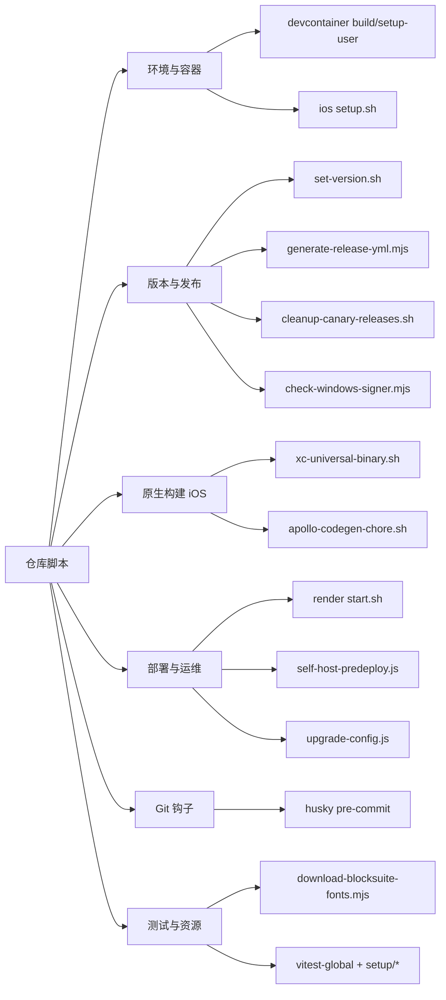
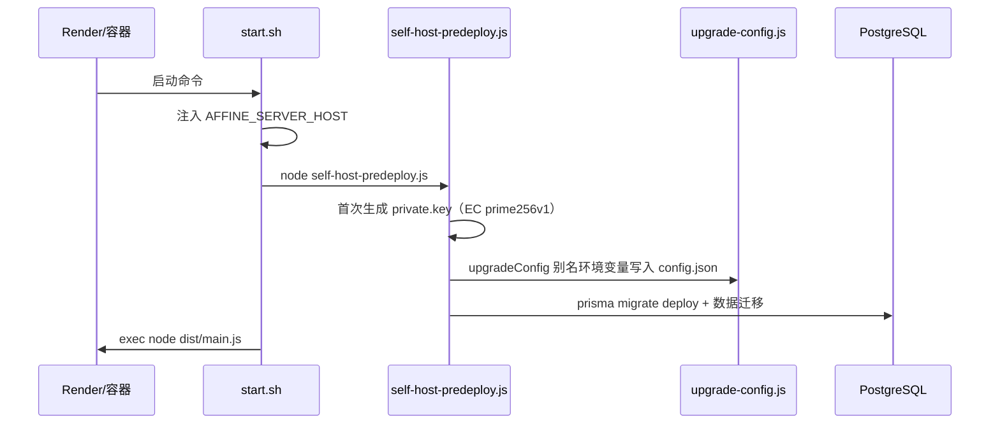

# 第 31 章 脚本与自动化工具

> **所属部分**：第 11 部分 · 附录 ｜ **难度**：★★★☆☆ ｜ **建议学时**：4 小时 ｜ **前置章节**：第 10 章（构建工具链）、第 26 章（CI/CD）、第 27 章（部署与运维）

---

## 本章导读

读完前 30 章，你已经见过 AFFiNE 的产品、内核、前后端与运维。但还有一类“隐形基础设施”散落在仓库各处：**脚本**。它们不属于任何业务模块，却在安装依赖、改版本、出安装包、起服务、跑钩子时默默工作——是整条自动化流水线的“毛细血管”。

这些脚本此前零散出现在第 4、7、10、11、20、26、27 章里。本章把它们**集中归纳成一张地图**：每个脚本是什么语言、干什么、何时被谁触发、有哪些坑。目标不是逐行精读，而是让你遇到“这个 `.sh`/`.mjs` 是干嘛的”时能立刻定位。

仓库里真正的 `*.sh` 只有 9 个（不含 `node_modules`、Rust `target`），数量不多但覆盖面广；另有一批 `scripts/*.mjs`、后端 `scripts/*.js` 承担 Node 侧自动化。两类脚本的分工本章也会讲清。

> 本章路径均相对仓库根目录 `AFFiNE/`，对应 `@affine/monorepo` 0.27.5（canary）。脚本内容迭代较快，如有出入以 `git log -- <脚本路径>` 为准。

---

## 学习目标

- [ ] 能够画出仓库脚本的分类地图（环境、版本发布、原生构建、部署、Git 钩子、测试与资源）
- [ ] 能够说清 `scripts/set-version.sh` 为何要同时改 workspace 版本、AppStream、iOS MARKETING_VERSION
- [ ] 能够解释 `.render/start.sh` → `self-host-predeploy.js` → `upgrade-config.js` 的启动链，以及“环境变量优先级低于 `config.json`”的根因
- [ ] 能够说明 iOS 的 `xc-universal-binary.sh` 为什么要重置 `PATH`、`apollo-codegen-chore.sh` 为什么要下载 CLI
- [ ] 能够区分“shell 脚本”与“Node 脚本”各自适合的场景，以及它们与 `yarn affine` CLI 的分工
- [ ] 能够在仓库里快速定位任一脚本的触发入口（package.json / CI / 钩子 / 平台）

---

## 知识地图



---

## 一、脚本全景与分类

仓库里的脚本可按“用途”分成六类，用两种语言实现：

| 类别 | 脚本 | 语言 | 触发入口 |
| --- | --- | --- | --- |
| 环境与容器 | `.devcontainer/build.sh`、`.devcontainer/setup-user.sh` | bash | Dev Container 构建 |
| 环境与容器 | `packages/frontend/apps/ios/setup.sh` | zsh | iOS 开发者手动 |
| 版本与发布 | `scripts/set-version.sh` | bash | CI composite action `setup-version` |
| 版本与发布 | `scripts/generate-release-yml.mjs` | Node | 桌面发布工作流 |
| 版本与发布 | `scripts/cleanup-canary-releases.sh` | bash | 维护者手动（默认 dry-run） |
| 版本与发布 | `scripts/check-windows-signer.mjs` | Node | 桌面构建工作流 |
| 原生构建 | `packages/frontend/apps/ios/App/xc-universal-binary.sh` | bash | Xcode Build Phase |
| 原生构建 | `packages/frontend/apps/ios/apollo-codegen-chore.sh` | zsh | 手动更新 GraphQL 代码 |
| 部署与运维 | `.render/start.sh` | sh | Render 平台启动命令 |
| 部署与运维 | `packages/backend/server/scripts/self-host-predeploy.js` | Node | 容器启动 / 自托管预部署 |
| 部署与运维 | `packages/backend/server/scripts/upgrade-config.js` | Node | 被 predeploy 调用 |
| 部署与运维 | `packages/backend/server/scripts/docker-clean.mjs` | Node | Docker 镜像构建 |
| Git 钩子 | `.husky/pre-commit`、`.husky/_/husky.sh` | sh | `git commit` |
| 测试与资源 | `scripts/download-blocksuite-fonts.mjs` | Node | 手动 / 构建前 |
| 测试与资源 | `scripts/vitest-global.js`、`scripts/setup/*.ts` | Node/TS | Vitest 启动 |

一条经验规律：**跨平台、要调 Node 生态（读 `package.json`、算 sha512、调 `@blocksuite/*`、写 `config.json`）的用 `.mjs`/`.js`；只在类 Unix shell 里串联命令行工具（`jq`、`sed`、`gh`、`cargo`、`xcodebuild`）的用 `.sh`**。所以后端与发布的“数据处理”偏 Node，而 iOS 构建、容器初始化偏 shell。

---

## 二、开发环境与容器脚本

### `.devcontainer/build.sh`

Dev Container 构建时执行的最小引导：`yarn install` → 构建 `@affine/server-native`（Rust 原生模块）→ `prisma migrate reset -f` 建库。它用的正是第 10 章的 `yarn affine` CLI（注入 SWC 加载器以支持旧版装饰器）。

### `.devcontainer/setup-user.sh`

```bash
set -e
npm install -g @withgraphite/graphite-cli@stable
if [ -v GRAPHITE_TOKEN ]; then gt auth --token $GRAPHITE_TOKEN; fi
gt init --trunk canary
```

安装 Graphite CLI 并把主干设为 `canary`——印证了第 4 章“canary 单主干”的开发模型。

### `packages/frontend/apps/ios/setup.sh`

iOS 开发者的一键准备脚本（zsh）：`cd` 到脚本目录再回到仓库根、校验 `.git` 存在、`yarn install`、临时把 `project.pbxproj` 的 `objectVersion` 调成 56 以兼容工具链。典型的“把新人踩过的坑固化成脚本”。

---

## 三、版本与发布脚本

### `scripts/set-version.sh`：一次改动，多处同步

发版时版本号要在很多地方保持一致，这个脚本（126 行 bash）用 `jq`/`sed` 统一处理：

```bash
for DIR_ITEM in $(yarn workspaces list --json | jq -r '.location'); do
  DIR=$(echo -n "$DIR_ITEM" | tr -d '\r\n')
  [ -f "$DIR/package.json" ] && \
    jq ".version = \"$1\"" "$DIR/package.json" > tmp.json && mv tmp.json "$DIR/package.json"
done
```

除了遍历**所有 workspace 包**改 `version`，它还做两件平台特定的事：

- `update_app_stream_version`：往 Linux AppStream 的 `.metainfo.xml` 里插入 `<release version date>`（Flatpak/软件中心要用）；
- `update_ios_marketing_version` / `get_ios_version_from_git`：把 iOS 的 `MARKETING_VERSION` 规范化为**日期式版本**（`YYYY.M.D`，从最近的 stable/beta tag 推导）。原因是 Apple 要求 `CFBundleShortVersionString` **单调递增**，日期式天然满足。

触发入口是 CI 的 composite action：`.github/actions/setup-version/action.yml` 里 `run: ./scripts/set-version.sh ${{ inputs.app-version }}`（见第 26 章）。

### `scripts/generate-release-yml.mjs`：喂给 electron-updater

桌面自动更新（`electron-updater`）依赖 `latest.yml`/`latest-mac.yml`/`latest-linux.yml` 清单。这个 Node 脚本扫描 `./release` 目录里的安装包，计算 **sha512** 与文件大小，生成对应 YAML。放在第 20 章“自动更新”与第 26 章“发布工作流”之间的衔接处。

### `scripts/cleanup-canary-releases.sh`：安全优先的清理

canary 每天出包，GitHub Releases 会堆积。这个 219 行 bash 基于 `gh` CLI 清理旧的 canary release：

<details><summary>设计要点（点击展开）</summary>

- **默认 dry-run**：不加 `--yes` 只打印将删除什么，避免误删；
- `--keep N` 保留最新 N 个（默认 30）、`--dedupe-by-commit` 同一 commit 只留最新；
- `--pattern` 用正则匹配 tagName（默认 `-canary\.?`）、`--no-cleanup-tag` 保留远程 tag；
- 解析失败则保留（宁可不删也不误删）。

</details>

> ⚠️ 它具有破坏性且作用于远程仓库。学习时**只读不执行**（即便 dry-run 也需仓库权限）。

### `scripts/check-windows-signer.mjs`：发布门禁

beta/stable 或 `REQUIRE_SIGNER=true` 时，校验 `AFFINE_SIGN_CLIENT_HASH`、`AFFINE_SIGNER_ADDR`、`AFFINE_SIGNER_TOKEN` 等签名密钥是否齐全，缺失则让 CI 失败（通过 `GITHUB_OUTPUT`）。呼应第 26 章“公开仓库只构建未签名候选包、签名外包私有仓库”。

---

## 四、原生构建脚本（iOS）

### `xc-universal-binary.sh`：在 Xcode 里调 Rust

iOS 壳要用到 Rust 原生库（第 7 章 `affine_mobile_native` / UniFFI）。这个脚本作为 **Xcode Build Phase** 在构建时被调用，关键细节：

```bash
set -eEuvx
# XCode 会覆盖 PATH，这里重置回登录 shell 的 PATH
PATH="$(bash -l -c 'echo $PATH')"
# 依次从 ~/.cargo/bin、PATH、rustup 解析 cargo
```

两个典型坑：① **Xcode 会篡改 `PATH`**，导致找不到 `cargo`，必须手动恢复；② 需要设置 `IPHONEOS_DEPLOYMENT_TARGET` 供 Rust 的 `cc` crate 交叉编译。脚本用 `trap error_help ERR` 在出错时打印友好提示。

### `apollo-codegen-chore.sh`：生成 GraphQL 的 Swift 代码

Web 端用 `@affine/graphql` 的 codegen（第 23 章），iOS 端则用 Apollo iOS。这个 zsh 脚本：同步 `Package.swift` 里的 apollo 版本（`sed`）、**从 GitHub Release 下载 `apollo-ios-cli` 二进制**、按 `apollo-codegen-config.json` 生成代码、最后清理临时 CLI。下载 CLI 而非依赖全局安装，保证版本可控、CI 可复现。

---

## 五、部署与运维脚本

### 启动链：`.render/start.sh` → predeploy → 迁移 → main

`.render/start.sh`（部署到 Render 平台的启动命令）只有三步，却串起整个自托管启动流程：

```sh
set -eu
export AFFINE_SERVER_HOST="${AFFINE_SERVER_HOST:-${RENDER_EXTERNAL_HOSTNAME:-localhost}}"
node ./scripts/self-host-predeploy.js   # 生成密钥 + 迁移配置 + 数据库迁移
exec node ./dist/main.js                 # 启动服务
```



### `self-host-predeploy.js`：幂等的预部署

- 在 `~/.affine/config` 下**首次启动生成 EC 私钥**（`private.key`，已存在则跳过）——所以“安全可重复执行”；
- 调 `upgradeConfig()` 处理配置迁移；
- 执行 Prisma 迁移与数据迁移。

### `upgrade-config.js`：环境变量为何“优先级低于 config.json”

这是第 27 章一个著名困惑的根源。脚本维护一张**别名表**，把旧的扁平环境变量映射到新的结构化配置：

```js
const aliases = [
  ['mailer', 'SMTP.host', 'MAILER_HOST'],
  ['redis', 'host', 'REDIS_SERVER_HOST'],
  // …（port/password 还标了 integer/boolean 类型转换）
];
```

启动时它把这些环境变量的值**写进 `config.json`**。之后应用以 `config.json` 为准——于是“你改了环境变量却不生效”，因为首次启动已固化进 `config.json`。升级自托管时务必记住这一点。

### `docker-clean.mjs`

Docker 镜像构建阶段的清理脚本（Node），精简最终镜像体积。

---

## 六、Git 钩子与测试资源脚本

### `.husky/pre-commit`

只有一行，却是本地质量第一道闸：

```sh
yarn lint-staged && yarn lint:ox
```

先对暂存文件跑 `lint-staged`（`oxfmt --write` + 分类型 `oxlint --fix`，见第 10 章），再对**全仓**跑 `oxlint --deny-warnings`。`.husky/_/husky.sh` 是 husky 生成的引导脚手架，一般不手改。

> 注意：仓库**没有** `commit-msg` 本地钩子，提交信息规范改由 CI 校验 PR 标题（第 10、26 章）。

### 资源与测试脚本

- `scripts/download-blocksuite-fonts.mjs`：导入 `@blocksuite/affine/shared/services` 的 `AffineCanvasTextFonts`，把白板 canvas 用到的字体下载到前端资源目录——白板文字渲染（第 14 章）需要内置字体；
- `scripts/vitest-global.js`：三行，`setup` 里把 `process.env.TZ='Asia/Singapore'`，**锁定测试时区**避免跨时区用例漂移（第 25 章）；
- `scripts/setup/{global,lit,polyfill,vi-mock}.ts`：Vitest 的环境预置（全局变量、Lit、polyfill、mock）。

---

## 七、小结：脚本与 `yarn affine` 的分工

AFFiNE 有意把自动化分三层：

1. **`yarn affine` CLI（`tools/cli`，第 10 章）**：日常开发命令（dev/build/test/按包执行），是 TypeScript、跨平台、注入装饰器加载器的“主入口”；
2. **`scripts/*.mjs|*.js`**：需要 Node 生态或数据处理的一次性/CI 任务（算 sha512、写 config、读 workspace）；
3. **`*.sh`**：绑定具体平台 shell 工具链的胶水（iOS 的 Xcode/cargo、发布的 `gh`、容器初始化、Git 钩子）。

记住这个分层，就能快速判断“一个任务应该/已经由哪种脚本承担”。

---

## 源码导读清单

| 优先级 | 路径 | 看什么 |
| --- | --- | --- |
| P0 | `scripts/set-version.sh` | workspace 遍历、AppStream 与 iOS 版本的特殊处理 |
| P0 | `packages/backend/server/scripts/upgrade-config.js` | 别名表与“环境变量写进 config.json”的逻辑 |
| P0 | `.husky/pre-commit` | 两段式本地门禁 |
| P1 | `.render/start.sh` + `self-host-predeploy.js` | 自托管启动链与幂等性 |
| P1 | `scripts/cleanup-canary-releases.sh` | dry-run 优先、保守删除的设计 |
| P1 | `packages/frontend/apps/ios/App/xc-universal-binary.sh` | Xcode 篡改 PATH 的应对 |
| P2 | `scripts/generate-release-yml.mjs` | electron-updater 清单与 sha512 |
| P2 | `scripts/check-windows-signer.mjs` | 发布密钥门禁 |

---

## 动手实践

1. **画脚本调用图**：从 `package.json` 的 `scripts`、`.github/`（含 composite actions）、`.husky/`、各平台配置出发，为每个 `*.sh`/`scripts/*.mjs` 标出“谁触发它”。**验收**：每个脚本都有明确入口，找出至少一个“只能手动执行”的脚本。
2. **安全试跑清理脚本**：`scripts/cleanup-canary-releases.sh --help`，再对一个你有权限的测试仓库跑 **dry-run**（不加 `--yes`）。**验收**：能解释 `--keep`、`--dedupe-by-commit`、`--pattern` 的组合效果，并确认未真正删除。
3. **复现 config 固化坑**：本地起一次自托管（第 27 章），设一个 `REDIS_SERVER_HOST` 环境变量启动，观察 `~/.affine/config/config.json` 是否写入；再改环境变量重启，看是否生效。**验收**：能用 `upgrade-config.js` 的别名表解释现象。
4. **给 set-version 加一处同步**：假设新增一个需要版本号的文件（如某 `about.json`），说明你会在 `set-version.sh` 的哪个位置、用什么方式（`jq` 还是 `sed`）加同步逻辑。**验收**：给出 diff 思路并说明为何选该工具。

---

## 自测题

<details><summary>Q1. 为什么 iOS 的 MARKETING_VERSION 要用日期式（YYYY.M.D）而不是直接用 app 版本号？</summary>

Apple 要求 `CFBundleShortVersionString` 单调递增；canary/beta 频繁出包时普通语义版本可能回退或重复，日期式版本天然单调递增且与具体发布解耦，面向用户的 App Store 版本另在 App Store Connect 设置。

</details>

<details><summary>Q2. 为什么你改了环境变量但自托管服务端不生效？哪个脚本导致的？</summary>

`self-host-predeploy.js` 启动时调用 `upgrade-config.js`，按别名表把环境变量的值写进 `~/.affine/config/config.json`，之后应用以 config.json 为准。首次启动固化后，再改同名环境变量不会覆盖已写入的配置。

</details>

<details><summary>Q3. xc-universal-binary.sh 第一步为什么要 `PATH="$(bash -l -c 'echo $PATH')"`？</summary>

Xcode 在运行 Build Phase 脚本时会覆盖/精简 `PATH`，导致找不到 `cargo` 等 Rust 工具链；用登录 shell 的 PATH 覆盖回来，才能定位到 `~/.cargo/bin`。

</details>

<details><summary>Q4. 仓库用什么规则决定一个自动化任务写成 .sh 还是 .mjs？</summary>

需要 Node 生态/数据处理（读 package.json、算 sha512、写 config.json、调 @blocksuite）用 `.mjs`/`.js`；只在类 Unix shell 里串联命令行工具（jq、sed、gh、cargo、xcodebuild）用 `.sh`。日常开发命令则走 `yarn affine` CLI。

</details>

---

## 常见坑

| 现象 | 原因与处理 |
| --- | --- |
| 本地 `cargo` 明明装了，Xcode 构建却找不到 | Xcode 篡改了 PATH，见 `xc-universal-binary.sh` 的 PATH 重置 |
| 误删了大量 GitHub Release | `cleanup-canary-releases.sh` 忘了 dry-run；务必先不加 `--yes` |
| 自托管改环境变量不生效 | `upgrade-config.js` 已把值固化进 `config.json`，改 config.json 或删除后重启 |
| `set-version.sh` 在非类 Unix 环境失败 | 依赖 `jq`、`yarn workspaces`、`sed -E`，Windows 需 WSL/Git Bash |
| pre-commit 很慢 | 它会跑全仓 `oxlint`；大改动时耐心等待，勿用 `--no-verify` 跳过 |

---

## 延伸阅读

- 第 10 章：`yarn affine` CLI 与 oxlint/oxfmt 工具链
- 第 20 章：桌面自动更新、iOS/Android 原生集成
- 第 26 章：CI/CD 工作流、composite actions、签名外包
- 第 27 章：自托管部署、`config.json` 配置系统与迁移
- 第 7 章：Rust 原生模块与 UniFFI

---

## 本章学时拆分（建议 4 小时）

| 内容 | 时长 |
| --- | --- |
| 脚本全景分类与语言分工 | 0.5h |
| 版本与发布脚本精读 | 1h |
| 部署启动链与 config 固化 | 1h |
| iOS 原生构建脚本 | 0.5h |
| Git 钩子与测试资源脚本 | 0.5h |
| 动手实践与自测 | 0.5h |

---

| [← 第 30 章 贡献实战与进阶路线](../10-综合实战/30-贡献实战与进阶路线.md) | [返回总目录 →](../README.md) |
| --- | --- |
