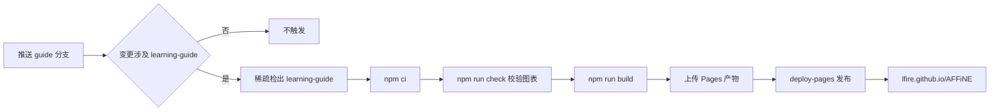

# 站点部署与维护说明

本学习指南用 [VitePress](https://vitepress.dev/) 构建为静态站点，通过 GitHub Actions 自动发布到 GitHub Pages：

- **在线文档**：30 章教程，支持全文搜索、明暗主题，图表在浏览器端用 Mermaid 渲染；
- **配套演示**：每章一套自研的**交互式学习演示**（场景式，非 reveal.js 幻灯片），地址为 `/slides/NN.html`；左侧场景目录可跳转，章节页顶部有"打开演示"入口，演示页可返回对应文档。

站点地址（fork 为 `lfire/AFFiNE` 时）：**<https://lfire.github.io/AFFiNE/>**

## 一、目录结构

```text
learning-guide/
├── index.md                 # 站点首页
├── README.md                # 学习路线与总目录（GitHub 上直接浏览也可用）
├── DEPLOY.md                # 本文件
├── 01-产品认知/ … 10-综合实战/  # 30 章正文
├── slides/
│   ├── index.md             # 演示总览页
│   ├── [id].md              # 演示播放页（动态路由，每套生成 /slides/NN.html）
│   ├── [id].paths.mts       # 动态路由参数：构建期渲染 decks/NN.md 为场景
│   └── decks/
│       ├── _FORMAT.md       # 学习演示编写规范（不发布）
│       └── 01.md … 30.md    # 30 套学习演示源文件（场景用 === 分隔）
├── scripts/check-mermaid.mjs  # Mermaid 语法与演示结构校验
├── .vitepress/
│   ├── config.mts           # 站点配置：侧边栏自动生成、链接改写、Mermaid 围栏
│   ├── decks.ts             # 演示清单与构建期渲染（独立 markdown-it + shiki）
│   └── theme/               # 自定义主题：MermaidDiagram / LearningDeck / DeckGallery 等组件
└── package.json             # 独立的 npm 项目，不属于 AFFiNE 的 Yarn workspace
```

> `learning-guide/` 是一个**独立的 npm 项目**，不在根 `package.json` 的 workspaces 中，不会影响 AFFiNE 本身的 `yarn install`、构建与 CI。

## 二、本地开发与预览

需要 Node.js ≥ 20（与 AFFiNE 一致推荐 22）。

```bash
cd learning-guide
npm install          # 首次安装依赖
npm run dev          # 开发服务器（热更新）：http://localhost:5173/AFFiNE/
npm run check        # 校验全部 Mermaid 图与演示结构
npm run build        # 生产构建，产物位于 .vitepress/dist
npm run preview      # 本地预览生产构建：http://localhost:4173/AFFiNE/
```

- 本地默认 `base` 为 `/AFFiNE/`，可用环境变量覆盖：`DOCS_BASE=/ npm run dev`。
- 文档中指向仓库源码的相对链接（如 `../../docs/BUILDING.md`）会在构建时自动改写为 GitHub 源码链接，仓库名和分支取自环境变量 `GITHUB_REPOSITORY` 和 `GUIDE_BRANCH`，本地默认 `lfire/AFFiNE` 与 `guide`。

## 三、首次启用 GitHub Pages（只需做一次）

1. **启用 fork 的 Actions**：打开仓库的 **Actions** 页签。fork 仓库默认禁用工作流，点击 *I understand my workflows, go ahead and enable them*。
2. **设置 Pages 来源**：**Settings → Pages → Build and deployment → Source** 选择 **GitHub Actions**。
3. **放行 `guide` 分支**：**Settings → Environments → github-pages → Deployment branches and tags**，添加规则 `guide`。
   第 2 步完成后 GitHub 会自动创建 `github-pages` 环境，默认只允许默认分支（`canary`）部署。不放行的话，部署会报错：
   `Branch "guide" is not allowed to deploy to github-pages due to environment protection rules.`
4. **推送触发**：

   ```bash
   git add learning-guide .github/workflows/deploy-learning-guide.yml .prettierignore
   git commit -m "docs: add AFFiNE learning guide site"
   git push benji guide
   ```

   > `.prettierignore` 中追加了 `learning-guide/**`：仓库的 pre-commit 钩子会用 oxfmt 格式化暂存文件，会改动演示源文件里手工编排的 HTML 组件与代码块，因此需要排除。

5. 在 **Actions → Deploy Learning Guide** 中查看运行结果。成功后访问 <https://lfire.github.io/AFFiNE/>。

> 也可以在 Actions 页面选择 *Deploy Learning Guide → Run workflow* 手动触发。

## 四、自动部署流程

工作流文件：`.github/workflows/deploy-learning-guide.yml`



| 环节 | 说明 |
| --- | --- |
| 触发条件 | `guide` 分支上 `learning-guide/**` 或工作流文件本身有变更；或手动触发 |
| 稀疏检出 | AFFiNE 仓库体积很大，只检出 `learning-guide/`，检出只需几秒 |
| 依赖缓存 | `setup-node` 按 `package-lock.json` 缓存 npm 依赖 |
| 质量门禁 | `npm run check` 中任一 Mermaid 图语法错误或演示结构问题都会中断部署 |
| base 路径 | 取 `configure-pages` 输出的 `base_path`：项目页为 `/AFFiNE/`；配置自定义域名后自动变为 `/` |
| 并发控制 | 同一时间只保留一个部署，进行中的部署不会被取消 |

## 五、日常维护

### 修改文档

直接编辑各章 Markdown，推送到 `guide` 分支即可自动发布。注意 VitePress 会把 Markdown 编译为 Vue 模板：

- 正文中的泛型、标签等写法（如 `Promise<void>`）请放在行内代码中；
- 自测题答案使用多行写法，`<details>` 内外都要留空行：

  ```html
  <details><summary>参考答案</summary>

  答案正文，支持 **Markdown** 与 `代码`。

  </details>
  ```

### 修改或新增演示

1. 编写规范见 [`slides/decks/_FORMAT.md`](https://github.com/lfire/AFFiNE/blob/guide/learning-guide/slides/decks/_FORMAT.md)（场景分隔、封面/过渡页、富组件库、容量上限）；
2. 编辑 `slides/decks/NN.md`（场景用 `===` 分隔），文件名的两位数字与章号对应，章节页的"打开演示"入口和演示总览会自动关联；
3. 运行 `npm run check` 校验，再用 `npm run dev` 打开 `/slides/NN.html` 预览。

### 与上游同步

学习指南只新增了 `learning-guide/` 目录和一个工作流文件，上游文件仅在 `.prettierignore` 末尾追加了 3 行，同步上游时基本不会冲突：

```bash
git fetch origin
git checkout guide
git rebase origin/canary      # 或 git merge origin/canary
git push benji guide --force-with-lease
```

> fork 中同步了上游的 `canary` 分支后，上游的构建、发布类工作流也可能在 fork 中被触发，因缺少密钥而失败。可在 **Actions** 页面逐个 *Disable workflow*，只保留 *Deploy Learning Guide*。

## 六、常见问题

| 现象 | 原因与处理 |
| --- | --- |
| 部署报 `not allowed to deploy to github-pages` | 未放行 `guide` 分支，见第三节第 3 步 |
| 工作流没有运行 | fork 未启用 Actions；或本次提交没有改动 `learning-guide/` |
| 页面样式丢失、资源 404 | `base` 不正确。仓库改名后无需改代码，CI 会自动取新的 `base_path`；本地用 `DOCS_BASE` 覆盖 |
| 构建报 `Element is missing end tag` | 正文中有未放进行内代码的 `<xxx>` 文本，或 `<details>` 前后缺少空行 |
| 图表显示"渲染失败" | Mermaid 语法错误，运行 `npm run check` 定位到具体行 |
| 演示页空白 | 打开浏览器控制台查看报错；确认 `slides/decks/NN.md` 存在且只有一个一级标题 |
