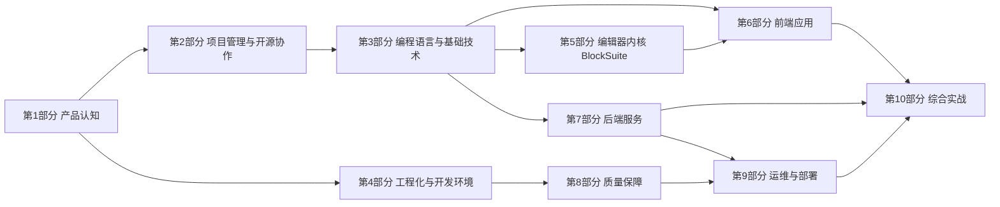

# AFFiNE 从零到精通 · 系统学习指南

> 基于仓库 `toeverything/AFFiNE` **v0.27.5**（canary，提交 `8cef09e1dd`，tag `v2026.10.27-canary.909`）的源码编写。
> 全书 **11 个部分 · 35 章 · 约 3.8 万行**，建议总学时 **262 小时**。所有路径都以仓库根目录为基准，引用的代码片段都摘自真实源码。

<!-- 以下链接为站外绝对地址，GitHub 与站点内均可直接打开 -->

| 在线阅读 | 配套演示 | 部署与维护 |
| --- | --- | --- |
| [lfire.github.io/AFFiNE](https://lfire.github.io/AFFiNE/) | [35 套交互式学习演示](https://lfire.github.io/AFFiNE/slides/) | [站点部署说明](./DEPLOY.md) |

每章正文顶部都有"打开演示"入口。配套演示是**场景式交互学习模块**（非 bullet 幻灯片）：左侧场景目录可跳转，成段讲解配架构/时序图、标注代码、对比与自测。建议**先读文档或先过演示建立框架，再相互印证**。

---

## 一、这套指南怎么用

**适合谁**：会 JS/TS/React 的前端开发者，想吃透 AFFiNE 的产品、编辑器内核、前后端、多端、工程化和运维，并成为能提交 PR 的贡献者。

**每章统一结构**：

| 模块 | 作用 |
| --- | --- |
| 元信息 | 所属部分、难度（★1–5）、建议学时、前置章节 |
| 本章导读 / 学习目标 | 可勾选的目标清单，学完后逐条打勾 |
| 知识地图 | 一张 Mermaid 图，概括本章知识点之间的关系 |
| 正文小节 | 概念原理 → 源码位置 → 真实代码讲解 → 设计取舍 → 小结 |
| 源码导读清单 | 按 P0/P1/P2 排列的必读文件 |
| 动手实践 | 3–5 个递进练习，每个都写明验收标准 |
| 自测题 | 答案默认折叠，先作答再展开 |
| 常见坑 / 延伸阅读 / 学时拆分 | 排错经验、权威资料、时间预算 |

**阅读建议**：先通读正文，再对照"源码导读清单"在 IDE 里打开源码逐个阅读，最后完成"动手实践"和"自测题"。只读不练，基本等于没学。

---

## 二、整体学习路线

难度大致按 **认知 → 语言 → 工程 → 内核 → 应用 → 服务 → 运维 → 实战** 的顺序递进。第 4 部分只依赖第 1 章，可以提前学，尽早把项目跑起来。

---

## 三、全书目录

### 第 1 部分 · 产品认知（7 小时）

| 章 | 标题 | 难度 | 学时 | 核心内容 |
| --- | --- | --- | --- | --- |
| 01 | [产品定位与核心概念](./01-产品认知/01-产品定位与核心概念.md) | ★☆☆☆☆ | 4h | local-first 理念；Workspace / Doc / Page 与 Edgeless 双模式 / Block / Collection / Journal 等概念；"产品概念 → 代码目录"对照表 |
| 02 | [功能全景与商业模式](./01-产品认知/02-功能全景与商业模式.md) | ★☆☆☆☆ | 3h | 多端矩阵；Cloud 与自托管对比；订阅、配额与 License；AI 能力面；开源加云服务的商业模式 |

### 第 2 部分 · 项目管理与开源协作（6 小时）

| 章 | 标题 | 难度 | 学时 | 核心内容 |
| --- | --- | --- | --- | --- |
| 03 | [开源治理与协作流程](./02-项目管理与开源协作/03-开源治理与协作流程.md) | ★★☆☆☆ | 3h | MIT 与 EE 双许可证分区；CLA；CODEOWNERS；Issue 分诊；Conventional Commits；Renovate |
| 04 | [分支版本与发布节奏](./02-项目管理与开源协作/04-分支版本与发布节奏.md) | ★★☆☆☆ | 3h | canary 单主干；canary/beta/stable 通道；日期式 tag；发布工作流；自动更新与回滚 |

### 第 3 部分 · 编程语言与基础技术（60 小时）

> 本部分面向"懂编程、但没系统学过这些语言/框架"的读者：**先用 4 个基础章（05–08）把 TypeScript、前端框架、Rust、CRDT 从核心概念讲清**，再进入对应的 AFFiNE 应用章（09–12），逐层递进。已熟悉某项技术可直接跳到应用章。

| 章 | 标题 | 难度 | 学时 | 核心内容 |
| --- | --- | --- | --- | --- |
| 05 | [TypeScript 基础入门](./03-编程语言与基础技术/05-TypeScript基础入门.md) | ★★☆☆☆ | 6h | 类型系统与推断；接口与类型别名；泛型；联合/交叉与字面量；工具类型；装饰器；模块与 tsconfig 基础——为第 9 章打底 |
| 06 | [前端框架基础入门：React、Lit、Signals、RxJS](./03-编程语言与基础技术/06-前端框架基础入门-React-Lit-Signals-RxJS.md) | ★★★☆☆ | 8h | 组件化与声明式 UI；React 组件与 Hooks；Lit Web Component；Signals 细粒度响应式；RxJS 流式思维——为第 10 章打底 |
| 07 | [Rust 基础入门](./03-编程语言与基础技术/07-Rust基础入门.md) | ★★★☆☆ | 6h | 所有权与借用；类型/枚举/trait；Option/Result 错误处理；Cargo 与 crate；async 基础——为第 11 章打底 |
| 08 | [CRDT 基础入门](./03-编程语言与基础技术/08-CRDT基础入门.md) | ★★★☆☆ | 4h | 并发冲突与最终一致；OT 与 CRDT 对比；状态式/操作式 CRDT；常见数据类型与墓碑——为第 12 章打底 |
| 09 | [TypeScript 在 AFFiNE 中的应用](./03-编程语言与基础技术/09-TypeScript在AFFiNE中的应用.md) | ★★★☆☆ | 8h | tsconfig 项目引用；TS 7 原生编译器；新旧两套装饰器；泛型与 DI 标识符；声明合并；代码生成类型 |
| 10 | [前端技术栈：React、Lit、Signals、RxJS](./03-编程语言与基础技术/10-前端技术栈-React-Lit-Signals-RxJS.md) | ★★★☆☆ | 10h | React 19；Router v7；Lit 3 Web Components；Preact Signals；RxJS；vanilla-extract；Radix |
| 11 | [Rust 与 NAPI-rs](./03-编程语言与基础技术/11-Rust与NAPI-rs.md) | ★★★★☆ | 10h | Rust 速成；Cargo workspace；napi-rs 绑定；UniFFI；各原生 crate 职责 |
| 12 | [CRDT 与 Yjs 原理](./03-编程语言与基础技术/12-CRDT与Yjs原理.md) | ★★★★☆ | 8h | CRDT 理论；Yjs 数据类型与 update 编码；Awareness；AFFiNE 对 yjs 的补丁；读时合并快照 |

### 第 4 部分 · 工程化与开发环境（14 小时）

| 章 | 标题 | 难度 | 学时 | 核心内容 |
| --- | --- | --- | --- | --- |
| 13 | [Monorepo 结构与包依赖地图](./04-工程化与开发环境/13-Monorepo结构与包依赖地图.md) | ★★☆☆☆ | 4h | Yarn 4 workspaces；122 个包的职责清单；分层依赖图；nolyfill 与 patches |
| 14 | [构建工具链与代码规范](./04-工程化与开发环境/14-构建工具链与代码规范.md) | ★★★☆☆ | 6h | `yarn affine` CLI；Rspack、Vite、SWC；oxlint、oxfmt；husky、lint-staged；各类代码生成 |
| 15 | [本地开发环境搭建与调试](./04-工程化与开发环境/15-本地开发环境搭建与调试.md) | ★★☆☆☆ | 4h | Node 22、Yarn 4、Rust；原生模块构建；Web 与 Server 本地启动；Docker 依赖服务；调试技巧 |

### 第 5 部分 · 编辑器内核 BlockSuite（44 小时）

| 章 | 标题 | 难度 | 学时 | 核心内容 |
| --- | --- | --- | --- | --- |
| 16 | [BlockSuite 架构与 Store 数据层](./05-编辑器内核BlockSuite/16-BlockSuite架构与Store数据层.md) | ★★★★☆ | 10h | framework 与 affine 两层架构；Workspace、Doc、Store；Block Schema；Yjs 与 Signals 的响应式绑定；Transformer |
| 17 | [BlockSuite Std：视图、扩展、命令、事件](./05-编辑器内核BlockSuite/17-BlockSuite-Std视图扩展命令事件.md) | ★★★★☆ | 12h | 扩展体系；EditorHost；命令链；事件分发；选择系统；Inline 编辑器；gfx 基础；ext-loader |
| 18 | [Affine 块组件与 Edgeless 白板](./05-编辑器内核BlockSuite/18-Affine块组件与Edgeless白板.md) | ★★★★★ | 14h | 全部块与 Widget；Inline 元素；Surface 与 Canvas；gfx 元素；turbo-renderer；data-view 数据库视图 |
| 19 | [自定义 Block 实战](./05-编辑器内核BlockSuite/19-自定义Block实战.md) | ★★★★☆ | 8h | 拆解真实块；从零写一个"提示卡片"块；Playground 验证；应用侧注册；版本兼容 |

### 第 6 部分 · 前端应用（46 小时）

| 章 | 标题 | 难度 | 学时 | 核心内容 |
| --- | --- | --- | --- | --- |
| 20 | [前端基础设施：DI 与 LiveData](./06-前端应用/20-前端基础设施-DI与LiveData.md) | ★★★★☆ | 8h | Framework、Service、Entity、Store、Scope；作用域事件；LiveData；ORM；Op Worker 通信 |
| 21 | [Core 业务模块与路由](./06-前端应用/21-Core业务模块与路由.md) | ★★★★☆ | 12h | 应用启动链路；60 多个业务模块分域详解；Workbench 多视图；路由体系 |
| 22 | [组件库、主题与国际化](./06-前端应用/22-组件库主题与国际化.md) | ★★☆☆☆ | 6h | component 组件库；主题与 CSS 变量；i18n 与 Tolgee 协作；Admin 后台 |
| 23 | [存储与同步引擎 nbstore](./06-前端应用/23-存储与同步引擎nbstore.md) | ★★★★★ | 10h | Storage 抽象；IDB、SQLite、Cloud 实现；文档、Blob、Awareness 同步算法；SharedWorker；离线到上线的完整时序 |
| 24 | [多端：Electron 与移动端](./06-前端应用/24-多端-Electron与移动端.md) | ★★★★☆ | 10h | main、preload、helper 进程模型；IPC；打包签名；Capacitor 8 下的 iOS 与 Android；UniFFI |

### 第 7 部分 · 后端服务（42 小时）

| 章 | 标题 | 难度 | 学时 | 核心内容 |
| --- | --- | --- | --- | --- |
| 25 | [后端架构与基础设施层](./07-后端服务/25-后端架构与基础设施层.md) | ★★★★☆ | 10h | NestJS 速成；入口链路；按 Flavor 动态装配模块；base 层各模块（配置、错误、事件、锁、限流等） |
| 26 | [数据层：Prisma、PostgreSQL、Redis](./07-后端服务/26-数据层-Prisma-PostgreSQL-Redis.md) | ★★★☆☆ | 8h | 60 多个模型分域讲解与 ER 图；三套迁移机制；Models 层；pgvector；用数据库表代替消息队列 |
| 27 | [API 层：GraphQL、WebSocket、认证与权限](./07-后端服务/27-API层-GraphQL-WebSocket-认证权限.md) | ★★★★★ | 12h | code-first GraphQL；前端 codegen；socket.io 同步协议；文档存储；认证全流程；权限与配额 |
| 28 | [业务插件：AI、搜索、支付等](./07-后端服务/28-业务插件-AI-搜索-支付等.md) | ★★★★☆ | 12h | Copilot（会话、Prompt、工具、向量检索、MCP、BYOK）；Indexer；Stripe 与 RevenueCat；OAuth；Calendar |

### 第 8 部分 · 质量保障（6 小时）

| 章 | 标题 | 难度 | 学时 | 核心内容 |
| --- | --- | --- | --- | --- |
| 29 | [测试体系](./08-质量保障/29-测试体系.md) | ★★★☆☆ | 6h | Vitest（含浏览器模式）；AVA 服务端测试；Playwright 多套 E2E；Copilot 测试；覆盖率 |

### 第 9 部分 · 运维与部署（19 小时）

| 章 | 标题 | 难度 | 学时 | 核心内容 |
| --- | --- | --- | --- | --- |
| 30 | [CI/CD 与 GitHub Actions](./09-运维与部署/30-CICD与GitHubActions.md) | ★★★☆☆ | 6h | build-test 的 34 个 job 依赖图；composite actions；镜像与发布工作流；签名外包 |
| 31 | [部署与运维](./09-运维与部署/31-部署与运维.md) | ★★★★☆ | 8h | Docker 镜像；自托管 Compose；配置系统；迁移；按角色拆分与水平扩展；存储与搜索后端；可观测性；故障手册 |
| 32 | [安全与合规](./09-运维与部署/32-安全与合规.md) | ★★★★☆ | 5h | 会话与令牌；防滥用（Captcha、Hashcash、限流）；SSRF 与 XSS 防护；Electron 安全；供应链安全；安全自查清单 |

### 第 10 部分 · 综合实战（14 小时）

| 章 | 标题 | 难度 | 学时 | 核心内容 |
| --- | --- | --- | --- | --- |
| 33 | [端到端链路追踪](./10-综合实战/33-端到端链路追踪.md) | ★★★★★ | 8h | 源码阅读方法论；4 条全链路：冷启动、键入一个字符到协作者可见、上传图片、AI 对话；调试技巧 |
| 34 | [贡献实战与进阶路线](./10-综合实战/34-贡献实战与进阶路线.md) | ★★★☆☆ | 6h | 完整 PR 流程；10 级实战练习阶梯；毕业考核清单；进阶方向 |

### 第 11 部分 · 附录（4 小时）

| 章 | 标题 | 难度 | 学时 | 核心内容 |
| --- | --- | --- | --- | --- |
| 35 | [脚本与自动化工具](./11-附录/35-脚本与自动化工具.md) | ★★★☆☆ | 4h | 仓库 shell/Node 脚本全景归纳：环境、版本发布、iOS 原生构建、自托管启动链、Git 钩子、测试资源；与 `yarn affine` CLI 的分工 |

**合计：35 章，262 小时。**

---

## 四、学习路径推荐

| 路径 | 适合人群 | 章节 | 学时 |
| --- | --- | --- | --- |
| **A. 完整路线** | 想全面掌握、成为核心贡献者 | 1 → 35 全部 | 约 262h |
| **B. 前端与编辑器方向** | 想深耕编辑器和前端架构 | 1–12、16–24、29、33、34（第 28 章选学） | 约 175h |
| **C. 后端与全栈方向** | 想补齐服务端、同步和运维能力 | 1–15、23、25–34 | 约 170h |
| **D. 速览路线** | 产品、管理岗或只想快速了解 | 1、2、3、4、13、15、30、31 | 约 35h |

> 第 3 部分的基础章（05–08）面向 0 基础；已熟悉 TypeScript / 前端框架 / Rust / CRDT 的读者可直接从对应应用章（09–12）开始。

### 完整路线周计划（每周约 20 小时，共 14 周）

| 周 | 章节 | 学时 | 里程碑 |
| --- | --- | --- | --- |
| W1 | 1、2、3、4、13 | 17h | 理解产品与协作规则，看懂仓库地图 |
| W2 | 14、15、05 | 16h | **本地跑通 Web 和 Server**；补齐 TypeScript 基础 |
| W3 | 06、07 | 14h | 补齐前端框架与 Rust 基础 |
| W4 | 08、09 | 12h | 补齐 CRDT 基础，吃透 TS 在 AFFiNE 的应用 |
| W5 | 10、11 | 20h | 掌握前端技术栈与 Rust 原生模块 |
| W6 | 12、29 | 14h | 看懂 CRDT/Yjs 原理，能写单测与 E2E |
| W7 | 16、17 | 22h | 看懂 BlockSuite 数据层与视图层 |
| W8 | 18、19 | 22h | **独立写出一个自定义 Block** |
| W9 | 20、21 | 20h | 看懂前端 DI 与业务模块 |
| W10 | 22、23 | 16h | 吃透同步引擎 nbstore |
| W11 | 24、25 | 20h | 理解多端与后端架构 |
| W12 | 26、27 | 20h | 打通数据层与 API 层 |
| W13 | 28、30、32 | 23h | 理解 AI 插件、CI/CD 与安全 |
| W14 | 31、33、34、35 | 24h | **自托管部署，提交第一个 PR**，通读脚本附录 |

> 每周 10 小时的话，把周数翻倍（约 28 周）即可。

---

## 五、技术全景速览

| 层 | 主要技术 | 位置 |
| --- | --- | --- |
| 编辑器内核 | Lit 3、@preact/signals-core、Yjs | `blocksuite/framework`、`blocksuite/affine` |
| 前端应用 | React 19、react-router 7、RxJS、自研 DI 与 LiveData、vanilla-extract | `packages/frontend/core`、`packages/common/infra` |
| 存储同步 | IndexedDB、SQLite、socket.io、SharedWorker | `packages/common/nbstore` |
| 多端 | Electron（Forge）、Capacitor 8、UniFFI | `packages/frontend/apps/*`、`packages/frontend/mobile-native` |
| 后端 | NestJS 11、Apollo GraphQL、Prisma 6、PostgreSQL（pgvector）、Redis、OpenTelemetry | `packages/backend/server` |
| 原生 | Rust（edition 2024）、napi-rs、sqlx、tokio | `packages/*/native`、根 `Cargo.toml` |
| 工程化 | Yarn 4、Rspack、Vite、SWC、oxlint、oxfmt、TS 7 native | `tools/cli`、根配置文件 |
| 测试与 CI | Vitest、AVA、Playwright、GitHub Actions | `tests/`、`.github/` |

---

## 六、学习中最该知道的 15 个事实

以下内容来自编写本书时对源码的逐行核查，其中很多与官方文档或"想当然"的理解不同：

1. **许可证分区**：`packages/backend/**` 和 `packages/common/native/**` 适用 `packages/backend/server/LICENSE`（EE 许可证），其余代码才是 MIT。根 `package.json` 写的 `"license": "MIT"` 不代表整个仓库（第 3、32 章）。
2. **后端核心逻辑大量在 Rust 中**：权限判定、配额、权益、会话签发、对象存储、搜索、LLM 调用等都在 `packages/backend/native` 或外部 crate `affine_core` 中，TS 层主要负责协议入口和编排。角色与动作的权限矩阵不在本仓库（第 11、25、27 章）。
3. **`tsc` 实际是 TS 7 原生版**：`typescript` 这个依赖名指向 `@typescript/typescript6`，而 `node_modules/.bin/tsc` 来自 `@typescript/native`（第 9 章）。
4. **前后端用两套装饰器**：只有 server 开启了 `experimentalDecorators`（NestJS 需要）；BlockSuite 和 Lit 用的是标准装饰器（`@property accessor`）（第 9 章）。
5. **yjs 被锁定在 13.6.21 并打了补丁**：补丁把 clientID 从 32 位扩到 53 位，降低 ID 冲突导致文档损坏的风险（第 12、13 章）。
6. **BlockSuite 的块不用 Shadow DOM**：`BlockComponent` 基于 `ShadowlessElement`，Widget 才用 Shadow DOM（第 10、17 章）。
7. **官方文档部分过时**：`blocksuite/docs-site/guide` 和 `packages/common/nbstore/README.md` 中的不少 API 已经不存在，学习时以源码为准（第 16、23 章）。
8. **同步协议采用两级广播**：客户端用 `space:join-batch` 加入房间；正在编辑该文档的连接收到完整增量 `space:broadcast-doc-updates`，同一工作区的其他连接只收到失效通知 `space:broadcast-doc-invalidation`，之后按需拉取（第 23、27、33 章）。
9. **快照在读取时合并**：前端和服务端都是写入时追加 update、读取时合并成快照，合并时顺带生成历史版本（第 12、33 章）。
10. **后端没有消息队列**：后台任务统一采用"`@Cron` 定时轮询 + 用数据库表当队列 + `FOR UPDATE SKIP LOCKED` 租约"。Redis 只放缓存、锁、限流和跨实例消息（第 26 章）。
11. **服务端命令要通过 `yarn affine` 执行**：CLI 会注入 SWC 加载器来支持旧版装饰器，直接用 `yarn workspace @affine/server ...` 会报错（第 14、15 章）。
12. **`config.json` 的优先级高于环境变量**：`scripts/upgrade-config.js` 会在启动时把旧环境变量写进 `config.json`，之后再改环境变量就不生效了。这是自托管升级时最常见的困惑（第 31 章）。
13. **公开仓库只构建未签名的候选包**：签名、部署和上架由 `release-submit.yml` 交给私有仓库完成；canary 每天 UTC 09:00 构建（第 4、30 章）。
14. **i18n 协作平台是 Tolgee，不是 Crowdin**：资源目录有 26 份语言文件，但 `SUPPORTED_LANGUAGES` 只登记了 25 种（第 22 章）。
15. **文档与代码不一致的地方，正好可以作为第一个 PR**：例如 `developing-server.md` 写的是 mailhog，实际 compose 用的是 mailpit；`.codesandbox` 里调用的 `yarn dev-core` 已不存在；`releases.md` 引用的 `release-desktop-app.yml` 已被删除（第 15、34 章）。

---

## 七、调试速查

| 场景 | 方法 |
| --- | --- |
| 打开调试日志 | URL 后加 `?debug` |
| 调试 nbstore（Web 端运行在 SharedWorker 中） | 在 `chrome://inspect` 中单独 inspect；或执行 `localStorage.disableSharedWorker = 'true'` 后刷新，降级为普通 Worker |
| 查看本地数据 | DevTools → Application → IndexedDB |
| 查看同步帧 | DevTools → Network → WS，筛选 `space:` 开头的事件 |
| 调试 GraphQL | 开发模式下访问 `http://localhost:3010/graphql`（GraphiQL） |
| 调试 Electron 主进程 | 开发模式默认带 `--inspect`，用 Chrome 或 VS Code attach |
| 单独调试编辑器 | `yarn workspace @blocksuite/playground dev` |

---

## 八、约定与说明

- **版本基线**：本书基于 v0.27.5（2026-10-27 canary）。AFFiNE 迭代很快，如果发现路径变化，请以 `git log -- <路径>` 追溯。
- **路径写法**：一律相对仓库根目录。少数章节会用包内相对路径简写（如 Electron 包下的 `scripts/`、Copilot 插件下的 `tools/`），上下文中会说明所属的包。
- **标注约定**：标有"教学示例"的代码不在仓库中；标有"推断"的地方建议打断点验证。
- **图表**：全书 155 张 Mermaid 图（含本页）都已通过 mermaid 11 语法解析。可在 VS Code（安装 Markdown Preview Mermaid 插件）、Typora 或 GitHub 中直接渲染。

祝学习顺利，期待在 AFFiNE 的贡献者列表里看到你。
