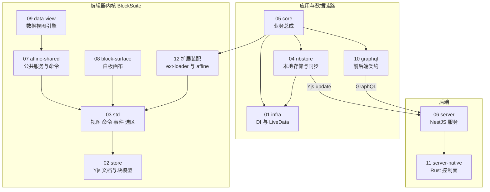

# 重点包精讲 · 总览

> 工程图谱按 L0–L7 为全部 112 个子包各写了一篇分层文档，平均约 190 行。但这些包的分量差别很大：21.8 万行的 `@affine/core` 和一个 500 行的小工具包，篇幅几乎一样。本专区挑出 **12 个重点包**单独精讲，每篇约 580–800 行，讲到能读懂、能修改、能扩展的程度。

## 为什么要单独精讲

分层文档回答的是"这个包是什么、怎么组织的"。对大多数包这已经够了，但对少数关键包还不够。读懂其他包的代码时，你会反复撞上它们，需要知道的不只是"它有什么"，而是：

- **它是怎么运行的**：一次调用从入口到结果，中间经过哪些对象、哪些事件；
- **为什么这样设计**：做了什么取舍，代价是什么；
- **在哪里容易出错**：生命周期、作用域、事务、订阅泄漏这类只有读透源码才知道的坑；
- **怎么在它上面加东西**：新增一个模块、一个命令、一个块的最小步骤。

## 选包的 4 条标准

| 标准 | 含义 | 衡量方式 |
| --- | --- | --- |
| **A 依赖枢纽** | 很多包建立在它之上，改动影响面大 | 被多少工作区包直接/间接依赖 |
| **B 体量复杂度** | 代码量大、子系统多，靠分层文档难以覆盖 | 去掉测试与生成代码后的源码行数 |
| **C 关键链路** | 位于"编辑 → 本地存储 → 同步 → 服务端"主数据链路上 | 是否承载文档数据的产生、持久化、传输 |
| **D 范式定义者** | 定义了其他包都要遵循的写法 | 是否提供 DI、扩展、命令、Schema 等被大量模仿的机制 |

入选条件是**至少满足两条，或在 C、D 上不可替代**。只满足 A 不够：被依赖最多的 `@blocksuite/global` 主要是工具函数，逻辑简单，分层文档已经足够。

## 数据总表

统计范围：仓库内 123 个工作区包（不含根包 `@affine/monorepo`）。"全部"口径包含 devDependencies，"运行时"口径只算 dependencies 与 peerDependencies。源码行数只统计 `.ts`/`.tsx`/`.rs`，不含测试与 `.gen.` 生成文件。

| 包 | 直接被依赖（全部 / 运行时） | 传递被依赖（全部 / 运行时） | 传递依赖排名 | 源码行数 | 满足标准 |
| --- | --- | --- | --- | --- | --- |
| [`@toeverything/infra`](./01-toeverything-infra.md) | 9 / 7 | 19 / 9 | 77 | 5,837 | C D |
| [`@blocksuite/store`](./02-blocksuite-store.md) | 48 / 48 | 94 / 85 | 3 | 8,412 | A C D |
| [`@blocksuite/std`](./03-blocksuite-std.md) | 65 / 65 | 92 / 83 | 4 | 21,611 | A B D |
| [`@affine/nbstore`](./04-affine-nbstore.md) | 7 / 6 | 11 / 8 | 83 | 15,891 | B C |
| [`@affine/core`](./05-affine-core.md) | 7 / 7 | 7 / 7 | 89 | 218,309 | B C |
| [`@affine/server`](./06-affine-server.md) | 0 / 0 | 0 / 0 | — | 74,643 | B C |
| [`@blocksuite/affine-shared`](./07-blocksuite-affine-shared.md) | 63 / 63 | 89 / 80 | 6 | 19,572 | A B |
| [`@blocksuite/affine-block-surface`](./08-blocksuite-affine-block-surface.md) | 33 / 33 | 64 / 55 | 10 | 9,125 | A C |
| [`@blocksuite/data-view`](./09-blocksuite-data-view.md) | 8 / 8 | 34 / 25 | 31 | 38,118 | B D |
| [`@affine/graphql`](./10-affine-graphql.md) | 8 / 7 | 25 / 14 | 74 | 11,970 | C D |
| [`@affine/server-native`](./11-affine-server-native.md) | 1 / 1 | 1 / 1 | 93 | 86,072 | B C |
| [扩展装配](./12-扩展装配.md)：`@blocksuite/affine-ext-loader` | 60 / 59 | 86 / 77 | 7 | 512 | A D |
| 扩展装配：`@blocksuite/affine` | 15 / 14 | 27 / 18 | 70 | 554 | D |
| *对照：`@blocksuite/global`（未入选）* | *60 / 60* | *96 / 87* | *1* | *5,177* | *A* |

::: tip 各篇实测与本表的差异
本表是选包时用统一脚本算出的。各篇精讲第 0 段又按自己的口径复核了一遍，差异如下，都不影响入选结论：

- **行数**：`@affine/server` 去掉 `errors.gen.ts` 后是 74,516 行；`@blocksuite/std` 只算非测试 `.ts` 是 21,586 行；ext-loader 与 `@blocksuite/affine` 去掉配置文件后是 484 / 513 行。
- **生成代码占比**：`@affine/graphql` 的 11,970 行里 98% 是生成代码，手写 TS 只有 245 行，另有 182 个手写 `.gql` 文件。
- **构成**：`@affine/server-native` 的 86,072 行中约 2.5 万行是测试，手写业务 Rust 约 5.9 万行；`@blocksuite/affine-block-surface` 有约 3,000 行是内嵌的第三方代码（RoughJS 等）。
- **占比**：`@affine/core` 约占全仓源码的 28.6%、前端源码的 78%。
- **传递被依赖**：部分包相差 1，原因是对根包、自身循环依赖（如 `@affine/graphql` 与 `@affine/error` 互相依赖）的计数口径不同。
:::

从表里能看出两类重点包：

- **枢纽型**（store、std、affine-shared、block-surface、ext-loader）：被依赖数排在前 10，是编辑器的地基。读任何一个块包都会撞上它们。
- **重心型**（infra、nbstore、core、server、server-native、graphql）：被依赖数不高，甚至排在后段，但承载了产品的主数据链路，或定义了全应用的写法。`@toeverything/infra` 只排第 77，却是 `@affine/core` 全部 69 个业务模块的装配底座。

## 入选清单与理由

### 编辑器内核（BlockSuite）

| 精讲 | 为什么是重点 |
| --- | --- |
| [01 · `@toeverything/infra`](./01-toeverything-infra.md) | 前端应用的 DI 容器与 LiveData 响应式底座。`@affine/core` 的 69 个业务模块都用它的 `Framework` 装配，"怎么写一个模块"由它定义。被依赖数不高，但不懂它就看不懂任何业务模块。 |
| [02 · `@blocksuite/store`](./02-blocksuite-store.md) | 编辑器数据层，所有块数据最终都落在它管理的 Yjs 文档里，是数据链路的起点。`defineBlockSchema` 定义了每个块怎么声明数据，Store 的增删改是所有编辑操作的终点。 |
| [03 · `@blocksuite/std`](./03-blocksuite-std.md) | 编辑器视图层运行时，被 65 个包直接依赖，全仓第一。扩展、命令、事件、选区四大机制是所有块包、widget、白板交互的写法基础。 |
| [07 · `@blocksuite/affine-shared`](./07-blocksuite-affine-shared.md) | 业务层的公共服务、命令、工具集合，被 63 个包直接依赖。主题、文档模式、特性开关、通用命令都从这里取。 |
| [08 · `@blocksuite/affine-block-surface`](./08-blocksuite-affine-block-surface.md) | 白板画布底座，被 33 个包直接依赖。所有图形元素都存在它的 `Y.Map` 里，由它的 Canvas 渲染管线绘制，是白板模式的数据与渲染中枢。 |
| [09 · `@blocksuite/data-view`](./09-blocksuite-data-view.md) | BlockSuite 最大的包（3.8 万行）。一套与具体块解耦的数据视图引擎，表格、看板、日历都基于它；数据库块和内嵌视图块只是它的两种数据源。 |
| [12 · 扩展装配](./12-扩展装配.md) | `@blocksuite/affine-ext-loader` 只有 512 行，却被 60 个包直接依赖：每个块、widget、gfx 包都通过它声明"我要注册哪些扩展"。`@blocksuite/affine` 再把全部扩展汇总成产品使用的门面。两者合起来回答"一个编辑器是怎么被组装出来的"。 |

### 应用与数据链路

| 精讲 | 为什么是重点 |
| --- | --- |
| [04 · `@affine/nbstore`](./04-affine-nbstore.md) | local-first 的存储与同步引擎：文档、Blob、Awareness 怎么落盘到 IndexedDB/SQLite、怎么与云端同步、多端多 Tab 怎么协调。数据链路的中段。 |
| [05 · `@affine/core`](./05-affine-core.md) | 全仓最大的包（21.8 万行），产品业务总成。69 个业务模块、工作区与文档生命周期、编辑器集成、多端同构都在这里。 |
| [10 · `@affine/graphql`](./10-affine-graphql.md) | 前后端契约：后端 schema 生成前端类型与查询，错误码也沿这条链对齐。前后端改动是否兼容，看它就知道。 |

### 后端

| 精讲 | 为什么是重点 |
| --- | --- |
| [06 · `@affine/server`](./06-affine-server.md) | 后端核心（7.5 万行），负责鉴权、工作区与权限、文档同步与存储、Copilot（单模块 1.7 万行）。数据链路的终点。 |
| [11 · `@affine/server-native`](./11-affine-server-native.md) | 后端 Rust 原生模块（8.6 万行），承担 Yjs 合并、权限与配额决策等性能敏感或需要强一致的逻辑。很多看似在 TS 里的后端行为，真正的决策在这里。 |

## 落选说明

以下包体量或被依赖数也不小，但没有入选：

| 包 | 数据 | 未入选原因 |
| --- | --- | --- |
| `@blocksuite/global` | 被 96 个包传递依赖，排名第 1 | 工具函数、错误类型、DI 基础类为主，逻辑简单。DI 的运行机制在 std 精讲里一并讲透。 |
| `@blocksuite/affine-components` | 直接 48 / 传递 82，约 1.5 万行 | 一组相互独立的 Lit UI 零件（portal、toolbar、peek 等），可以按需逐个读，没有贯穿全局的运行机制。 |
| `@affine/component` | 约 2.6 万行 | React 组件库，写法是常规的设计系统，概念难度不高。 |
| `@affine/native` | 约 1.6 万行 Rust | 桌面端 SQLite 存储等原生能力。存储语义在 nbstore 精讲里讲，原生实现细节读分层文档即可。 |
| `@affine/electron` | 约 1.3 万行 | 多端外壳中最厚的一个，但都是 Electron 的常规范式（多进程、IPC、打包），分层文档已经覆盖。 |

## 重点包之间的关系

箭头表示"依赖 / 调用"。把文档数据串起来看：

1. 用户在编辑器里的操作，经 **std** 的事件和命令落到 **store** 的 Yjs 文档；
2. **nbstore** 把 Yjs update 写进本地存储，并推送到云端；
3. **server** 接收 update，交给 **server-native** 合并、校验权限，写入数据库，再广播给其他客户端；
4. **core** 用 **infra** 的 DI 把以上各部分装配成产品，通过 **graphql** 调用后端的业务接口。

## 阅读路线

按你的目标选一条线读，每条线内按顺序读：

| 目标 | 路线 |
| --- | --- |
| 读懂编辑器、写自定义块 | 02 store → 03 std → 12 扩展装配 → 07 affine-shared → 08 block-surface（做白板时）→ 09 data-view（做数据视图时） |
| 读懂产品前端、写业务模块 | 01 infra → 05 core → 04 nbstore → 10 graphql |
| 读懂后端与同步 | 04 nbstore → 06 server → 11 server-native → 10 graphql |
| 全局把握 | 01 → 02 → 03 → 04 → 05 → 06，再按需读 07–12 |

## 每篇精讲的结构

| 段落 | 回答的问题 |
| --- | --- |
| 0 为什么是重点包 | 数据依据、满足哪几条标准、不懂它会卡在哪 |
| 1 全景架构 | 包内由哪些部分组成，边界在哪 |
| 2 核心抽象与数据模型 | 最关键的几个类和类型，各自负责什么 |
| 3 关键流程走读 | 最重要的几条运行流程，每一步发生在哪个文件哪一行 |
| 4 源码阅读路线 | 先读哪个文件、读到什么程度，哪些可以先跳过 |
| 5 设计取舍 | 关键决策的理由、代价和没选的替代方案 |
| 6 易错点与调试 | 真实容易出错的地方，以及怎么排查 |
| 7 扩展实践 | 在它上面新增功能的步骤与代码骨架 |
| 8 与其他重点包的协作 | 和清单里其他包怎么配合 |

精讲里凡是"根据源码推断、未经运行验证"的结论都会明确标注。精讲发现分层文档有与源码不符之处时，会在第 6 段末尾列出，并已同步更正到分层文档。

## 附录：源码缺陷验证

精讲在读码时发现的 49 条疑似缺陷，已逐条写最小用例运行验证，或在无法运行时严格读码确认：37 条已复现，10 条读码确认，2 条未复现。其中 5 条较严重，涉及数据丢失、工作区写入卡死和会话安全。详见 [附录：源码缺陷验证](./99-附录-源码缺陷验证.md)。
