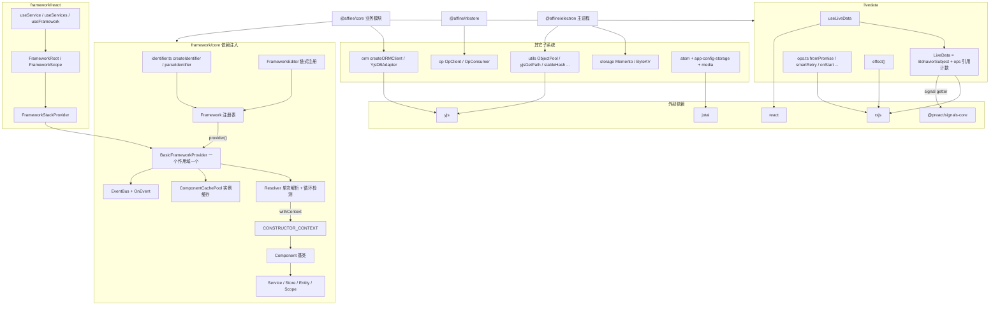
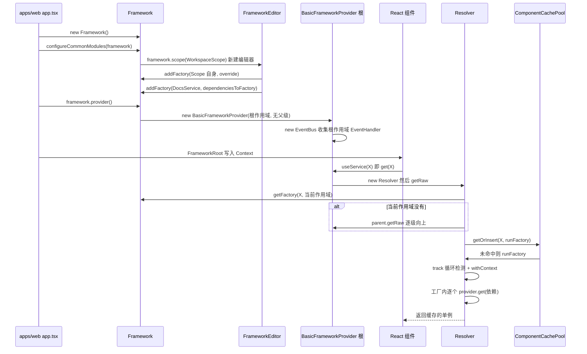
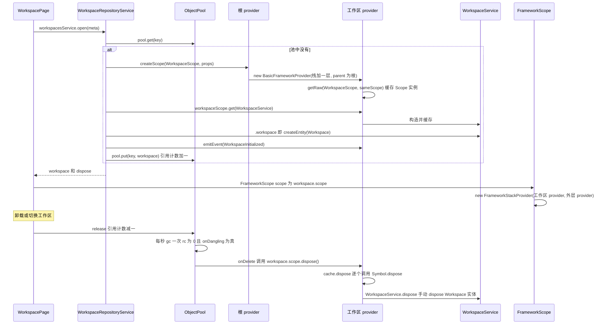
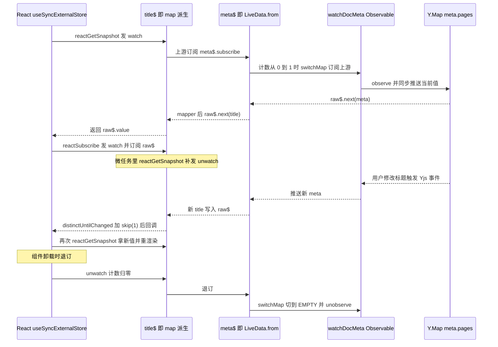

# `@toeverything/infra` 精讲

> 一句话：AFFiNE 前端自研的"依赖注入 + 响应式状态"底座——`Framework` 规定了一个业务模块怎么注册、在哪个作用域活着、何时被销毁，`LiveData` 规定了状态怎么被观察、怎么流到 React；外加给 nbstore 用的跨线程 RPC（`op`）和把 Yjs 当表用的 ORM。
>
> 对应分层文档：[`@toeverything/infra`](../L1-通用基础设施/toeverything-infra.md) · 源码：`packages/common/infra`

分层文档已经介绍了"三根支柱"和目录，本文不再重复，重点讲：容器内部的数据结构和解析算法、作用域树怎么建立和销毁、`LiveData` 的引用计数状态机，以及这些机制在 `@affine/core` 里引出的坑。

## 0. 为什么是重点包

| 指标 | 数值 | 核实说明 |
| --- | --- | --- |
| 直接被依赖 | 10 个工作区包 | 用脚本扫描全部 `package.json` 得出：`@affine/monorepo`（根包 devDependencies）、`@affine/core`、`@affine/nbstore`、`@affine/web`、`@affine/electron`、`@affine/electron-renderer`、`@affine/mobile`、`@affine/ios`、`@affine/android`、`@affine-test/kit` |
| 传递被依赖 | 20 个 | 在上面基础上再加 `@affine/admin`、`@affine/electron-api`、`@affine/mobile-shared` 和 7 个 `@affine-test/*` 端到端测试包 |
| 源码行数 | 5,837 行 | `src/` 下 `.ts/.tsx`，不含 `__tests__` |
| 所在链路 | 前端应用的"依赖注入 + 响应式状态"底座 | `packages/frontend` 下有 989 处 `from '@toeverything/infra'` |

**和编排方给的数据不一致的地方（以源码为准）：**

- `@affine/component` **不是**依赖方：它的 `package.json` 里没有这个依赖，`packages/frontend/component/src` 里也没有任何 import。10 个直接依赖方里算上了根包 `@affine/monorepo`。
- "70 个业务模块"：`packages/frontend/core/src/modules/` 下共有 69 个子目录。其中 `configureCommonModules`（`packages/frontend/core/src/modules/index.ts:73-139`）调用了 65 次 `configureXxx(framework)`，剩下的由各端入口按平台单独装配（如 `configureBrowserWorkbenchModule`）。所有模块确实都通过 `Framework` 注册。用 grep 粗略统计，core 里有 156 个 `extends Service`、74 个 `extends Entity`、45 个 `extends Store`、5 个 `extends Scope`（`WorkspaceScope`/`DocScope`/`ServerScope`/`ViewScope`/`EditorScope`）。
- `rxjs` 只出现在 infra 的 **devDependencies** 中（`packages/common/infra/package.json`），但 `livedata.ts` 在运行时就 import 了它。能正常运行是因为消费方（如 `@affine/core`）自己声明了 `rxjs`。

**满足的标准：**

- **C 关键链路**：前端每个页面都依赖它。应用入口先 `new Framework()`，再 `framework.provider()`、`<FrameworkRoot>`（`packages/frontend/apps/web/src/app.tsx:56-106`）。工作区和文档的打开/关闭就是作用域的创建/销毁。core 的 `.tsx` 里有 1020 处 `useLiveData(`、866 处 `useService(`。
- **D 范式定义者**：一个业务模块"长什么样"——`entities/ services/ stores/ scopes/` 怎么分目录、`configureXxxModule` 怎么写、Service 和 Entity 的生命周期怎么区分、异步请求为什么要写成 `effect(exhaustMap(... fromPromise ... smartRetry ...))`——这些都由本包的 API 决定。nbstore 的 Worker 通信协议也由本包的 `op` 定义。

它被依赖的数量不算最高，但不懂它，基本读不懂 `@affine/core`。

**不懂它会卡在哪：**

1. `packages/frontend/core/src/modules/doc/services/docs.ts:104-140` 的 `DocsService.open()`：为什么打开一篇文档要先 `createScope(DocScope, {...})` 再 `docScope.get(DocService).doc`？为什么 `ObjectPool` 的 `onDelete` 里调用的是 `obj.scope.dispose()`？
2. `packages/frontend/core/src/modules/workspace/entities/workspace.ts:126-137`：`Workspace` 的 `docs`/`engine` 为什么写成 getter 并在里面 `this.scope.get(...)` / `this.framework.get(...)`，而不放进构造函数依赖？（答案是惰性解析，用来避开循环依赖，见 6.2）
3. `packages/frontend/core/src/modules/doc/entities/record.ts:23-26,97`：`meta$ = LiveData.from(store.watchDocMeta(id), {})`，`title$ = meta$.map(...)`。没人订阅时它会不会一直监听 Yjs？
4. `packages/frontend/core/src/modules/cloud/services/doc-updated-by.ts:9`：`@OnEvent(DocInitialized, t => t.onDocInitialized)` 装饰的服务注册在 `DocScope`，它什么时候被实例化？
5. `packages/common/nbstore/src/worker/client.ts:99` 的 `new OpClient<WorkerOps>(port1)` 和 `transfer(...)`：请求、取消、订阅在 `MessagePort` 上分别是什么消息？

## 1. 全景架构



逐块说明：

- **framework/core（约 1,400 行，本包核心）**：分**注册期**和**运行期**两部分。注册期是 `Framework` 加 `FrameworkEditor`，最终产出一张三层 Map：`作用域路径 → 标识符名 → 变体 → 工厂`。运行期由 `BasicFrameworkProvider` 负责，每个作用域实例对应一个 provider，各自持有实例缓存 `ComponentCachePool` 和事件总线 `EventBus`。每次解析都会新建一个短命的 `Resolver`，记录依赖栈，用来做循环检测和报错。组件拿到 `framework`/`props` 不靠构造参数，而是通过全局变量 `CONSTRUCTOR_CONTEXT` 传进去。
- **framework/react（81 行）**：把 provider 放进 React Context。`FrameworkScope` 把"作用域实例"和"外层 provider"叠成一个 `FrameworkStackProvider`，用来解决 React 组件树和 DI 作用域树不一致的问题（见 5.2）。
- **livedata（约 980 行）**：`LiveData` 继承自 RxJS 的 `Observable`，值存放在内部的 `BehaviorSubject` 里，另有一条 `ops$` 操作流做引用计数。Preact signal 只在访问 `.signal` 时才懒创建，**并不是**分层文档早先写的"内部用 signal 持有当前值"（已于 2026-11-01 更正）。`ops.ts` 和 `effect` 是处理异步副作用的工具集。
- **op（约 740 行 TS，另有 159 行 README）**：基于 `MessagePort` 接口的 RPC，支持 call/cancel 和 subscribe/unsubscribe 两类语义。目前只有 nbstore 和 electron helper 在用。
- **orm（约 1,500 行）**：用 schema 描述表，`YjsDBAdapter` 把**每张表映射成一个 `Y.Doc`、每条记录映射成该 doc 的一个根级 `Y.Map`**。core 里只有 `WorkspaceDBService` 一个使用方。
- **storage / utils / atom / app-config-storage / media**：都是小工具，第 2、8 段会提到谁在用。注意：用户提到的 `sync` 子系统**在 infra 里不存在**，同步逻辑已经在 `@affine/nbstore` 里。

## 2. 核心抽象与数据模型

### 2.1 `Identifier` 与 `parseIdentifier`：容器的"键"

```ts
// packages/common/infra/src/framework/core/types.ts:17-21
export type Identifier<T> = {
  identifierName: string;
  variant: ComponentVariant;
  __TYPE__: T;            // 幻影类型，只用于推断 get() 的返回值
};
```

- `createIdentifier<T>(name, variant = 'default')`（`identifier.ts:79-92`）返回一个**可调用对象**：本身就是 `Identifier`，调用 `Id('local')` 会得到同名但变体不同的标识符。`WorkspaceFlavoursProvider('LOCAL')` / `('CLOUD')`（`packages/frontend/core/src/modules/workspace-engine/index.ts:16-17`）就是这样注册多个实现的。
- 类也能直接当标识符：`parseIdentifier`（`identifier.ts:106-114`）遇到函数时调用 `createIdentifierFromConstructor`，名字取 `` `${target.name}${stableHash(target)}` ``。`stableHash` 对对象和函数用 WeakMap 分配自增 id（`utils/stable-hash.ts:24-33`），所以**同名的两个类不会冲突**。代价是名字不稳定，只在当前运行期内唯一。
- 依赖声明的类型安全来自 `TypesToDeps<ConstructorParameters<Arg1>>`（`types.ts:26-30`）：`.service(X, [A, B])` 里的数组会按构造参数逐位做类型检查；写成 `[Id]` 表示"注入该标识符的全部变体"，对应的构造参数类型必须是数组。

### 2.2 `Framework`：只存工厂的注册表

```ts
// packages/common/infra/src/framework/core/framework.ts:24-28
export class Framework {
  private readonly components: Map<
    string,                                         // 作用域路径，如 "WorkspaceScope3~/DocScope7~"
    Map<string, Map<ComponentVariant, ComponentFactory>>
  > = new Map();
```

- 所有注册最终都走 `addFactory`（`framework.ts:114-142`）。作用域栈先经 `stringifyScope` 用 `/` 拼成字符串（`scope.ts:3-5`），同一个键重复注册会抛 `DuplicateDefinitionError`，除非传了 `override`。`addValue` 也只是包了一层 `() => value` 的工厂（`framework.ts:97-109`）。
- `service`/`store`/`entity`/`impl`/`override`/`scope` 这些 getter **每次访问都会 new 一个 `FrameworkEditor`**（`framework.ts:55-92`）。所以 `framework.scope(A)` 只影响这一条链，下一句 `framework.service(X)` 又回到根作用域。
- `FrameworkEditor.scope`（`framework.ts:463-476`）做两件事：把作用域名压入**本链**的 `currentScopeStack`；把 Scope 类**注册到它自己的作用域路径下**，并且带 `override: true`。所以多个模块各自写 `.scope(WorkspaceScope)` 不会报重复。
- `service`/`store` 的第二个参数有三种形态（`framework.ts:255-269`）：函数视为工厂，数组或 `undefined` 视为依赖列表，其它值视为实例。`entity` 不接受实例（`framework.ts:346-356`）。`override(Id, null)` 等价于删除（`framework.ts:430-435`）。
- 依赖列表最终变成 `dependenciesToFactory`（`framework.ts:482-513`）：依次调用 `provider.get(dep)`，遇到 `[dep]` 就改用 `getAll`，最后执行 `new cls(...args, provider)`。**provider 会作为额外的最后一个参数传进去**，但业务代码一般用不到。
- `Framework` 不保存任何实例。`clone()` 只浅拷贝工厂引用（`framework.ts:213-223`）。

### 2.3 `FrameworkProvider` 家族：解析、缓存、事件

| 类 | 职责 | 关键位置 |
| --- | --- | --- |
| `FrameworkProvider`（抽象） | 对外 API：`get`/`getAll`/`getOptional`/`createEntity`/`createScope`/`emitEvent`，实现了 `Symbol.dispose` | `provider.ts:28-103` |
| `BasicFrameworkProvider` | 每个作用域实例一个，持有 `scope: string[]`、`parent`、`cache`、`eventBus` | `provider.ts:286-324` |
| `Resolver` | 每次 `getRaw` 临时创建，携带 `depth` 和 `stack`，用于循环检测和 `MissingDependencyError` 的依赖链 | `provider.ts:141-284` |
| `ComponentCachePool` | `identifierName → variant → 实例`，`dispose()` 遍历所有实例并调用它们的 `Symbol.dispose` | `provider.ts:105-139` |
| `FrameworkStackProvider` | 只给 React 用：按顺序在多个 provider 里查找 | `provider.ts:326-382` |
| `EventBus` | 构造时收集当前作用域的 `EventHandler`；`on` 会同时注册到所有祖先 | `event.ts:24-88` |

`ResolveOptions`（`provider.ts:21-26`）的四个开关决定了几种组件的不同行为：

```ts
// provider.ts:65-94（节选）
createEntity = (identifier, ...[props]) =>
  this.getRaw(parseIdentifier(identifier), { noCache: true, sameScope: true, props });

createScope = (root, ...[props]) => {
  const newProvider = this.collection.provider(
    [...this.scope, parseIdentifier(root).identifierName], this);
  return newProvider.getRaw(parseIdentifier(root), { sameScope: true, props });
};
```

### 2.4 `Component` 与四种原型：差别只在"怎么解析"

```ts
// packages/common/infra/src/framework/core/components/component.ts:4-31（节选）
export class Component<Props = {}> {
  readonly framework: FrameworkProvider;
  readonly props: Props;
  protected readonly disposables: (() => void)[] = [];
  constructor() {
    if (!CONSTRUCTOR_CONTEXT.current.provider) {
      throw new Error('Component must be created in the context of a provider');
    }
    this.framework = CONSTRUCTOR_CONTEXT.current.provider;
    this.props = CONSTRUCTOR_CONTEXT.current.props;
    CONSTRUCTOR_CONTEXT.current = {};
  }
  dispose() { this.disposables.forEach(dispose => dispose()); }
  [Symbol.dispose]() { this.dispose(); }
}
```

`Service`/`Store`/`Entity` 三个子类各只有一两个标记字段（`__isService`、`__isStore`、`__isEntity`、`__injectable`，见 `components/*.ts`）。在**注册时三者完全一样**，`entity()` 和 `service()` 都只是调用 `addFactory`。真正的区别来自调用方用哪种方式取实例：

| 原型 | 典型获取方式 | 是否缓存 | 解析范围 | 是否随作用域自动 dispose | 能拿到 props |
| --- | --- | --- | --- | --- | --- |
| `Service` | `get(X)` / `useService(X)` | 是，缓存在**注册所在作用域**的 provider 里 | 当前作用域，找不到再向父级找 | 是 | 否 |
| `Store` | 作为依赖注入 | 是 | 同上 | 是 | 否 |
| `Entity` | `this.framework.createEntity(X, props)` | **否**，每次 new 一个 | **只查当前作用域**（`sameScope`） | **否**，需要创建者自己 dispose | 是 |
| `Scope` | `createScope(X, props)` | 缓存在新 provider 里 | 只查新作用域 | 它的 `dispose()` 会连带调用 `this.framework.dispose()`（`components/scope.ts:38-41`） | 是 |

`Scope` 还把 `get`/`getAll`/`createEntity`/`createScope`/`emitEvent` 等代理到自己的 provider 上（`components/scope.ts:14-36`），所以 `workspaceScope.get(WorkspaceService)` 这种写法成立。

**一个关键的隐含规则**：`withContext` 传入的 `provider` 是"找到工厂的那个 `BasicFrameworkProvider`"（`provider.ts:186-189`），而不是发起请求的那个。因此组件内部的 `this.framework` 永远指向它**注册时所在的作用域**。根作用域的服务即使是从工作区作用域里被请求到的，它的 `this.framework.get(WorkspaceService)` 也会失败。

### 2.5 `LiveData<T>`：带引用计数的 `BehaviorSubject`

```ts
// packages/common/infra/src/livedata/livedata.ts:239-254（节选）
private readonly raw$: BehaviorSubject<T>;
private readonly ops$ = new Subject<LiveDataOperation>();   // 'set' | 'get' | 'watch' | 'unwatch'
private readonly upstreamSubscription: Subscription | undefined;
private isPoisoned = false;
private _signal: Signal<T> | undefined;
```

- **状态**：值存在 `raw$`（`BehaviorSubject`）里。`subscribe` 会先发 `'watch'`，退订时发 `'unwatch'`（`livedata.ts:332-347`）。`pipe` 也会这么做（`livedata.ts:448-460`）。
- **上游**：构造函数第二个参数 `upstream(ops$)` 返回一个 Observable，构造时**立即**订阅它，把每个值写进 `raw$`（`livedata.ts:262-279`）。`LiveData.from(obs$, init)` 构造的上游会把 ops 流折算成引用计数：`get` 展开成 `watch, unwatch`，用 `scan` 累加计数，`distinctUntilChanged` 后接 `switchMap(op => op === 'watch' ? upstream$ : EMPTY)`（`livedata.ts:92-142`）。结果是**有人观察时才订阅真实上游，没人观察时就退订**。
- **派生**：`map`/`selector`/`distinctUntilChanged`/`throttleTime`/`flat` 都基于 `LiveData.from(...)` 实现，所以每个派生节点都是惰性的。初始值是 `undefined` 或 `null`，注释里写着 "is safe"，原因是首次订阅时会同步拿到上游的当前值（`livedata.ts:349-408, 480-506`）。源码里**没有** `flatMap`，对应的能力是 `flat()`，它会把 `LiveData<LiveData<T>>` 或数组里嵌套的 `LiveData` 拍平。
- **computed**：`LiveData.computed(get => ...)` 每次重算时重新订阅所有 `get` 过的依赖，有全局递归上限 10（`livedata.ts:175-237`）。
- **毒化**：上游 `error` 后 LiveData 进入 poisoned 状态，之后的任何读写都会抛 `PoisonedError`（`livedata.ts:272-277, 586-593`）。约定是：**LiveData 的上游不允许抛错**。
- **Signal 桥**：`get signal()` 第一次被访问时创建 preact signal，并**永久订阅**自身（`livedata.ts:306-315`），直到 `complete()` 才释放。

### 2.6 `effect`：带取消语义的命令式入口

`effect(op1, op2, ...)`（`livedata/effect/index.ts:77-127`）内部只有一个 `Subject`。调用 `fn(value)` 等于 `subject$.next(value)`，管道在创建 effect 时就已订阅好。管道**不允许 complete 或 error**，一旦发生就用 `setTimeout` 抛出一个未捕获的 `EffectError`（`effect/index.ts:97-112`）；在 `BUILD_CONFIG.debug` 模式下错误信息会带上 effect 的定义位置（`effect/index.ts:80-82`）。`fn.unsubscribe()` 终止所有进行中的流程，`fn.reset()` 退订后重新订阅。

和它配套的算子在 `livedata/ops.ts`：

| 算子 | 行为 | 位置 |
| --- | --- | --- |
| `fromPromise(p \| (signal) => p)` | 把 Promise 包成 Observable，**退订时 `abort(MANUALLY_STOP)`** | `ops.ts:95-115` |
| `backoffRetry({ when, count, delay, maxDelay })` | 指数退避，等待时间 `2^(i-1) * delay`，上限 `maxDelay` | `ops.ts:122-146` |
| `smartRetry()` | 网络错误无限重试，非网络错误重试 `count` 次（依据 `UserFriendlyError.isNetworkError`） | `ops.ts:148-172` |
| `onStart` / `onComplete` | 订阅时 / 完成时回调（error 时**不会**触发 onComplete） | `ops.ts:61-88` |
| `mapInto(l$)` / `catchErrorInto(l$)` | 把值或错误写进 LiveData；后者在完成时把错误置回 `null` | `ops.ts:28-56` |
| `exhaustMapSwitchUntilChanged` | 输入不变时用 exhaustMap，变了就切成 switchMap | `ops.ts:186-206` |

另外 `utils/exhaustmap-with-trailing.ts:21` 的 `exhaustMapWithTrailing` 也常和 effect 搭配使用（如 `packages/frontend/core/src/modules/permissions/entities/permission.ts:49-86`）。

## 3. 关键流程走读

### 3.1 从 `configureXxxModule` 到组件里 `useService` 拿到实例



1. **创建注册表**：`new Framework()`（`packages/frontend/apps/web/src/app.tsx:56`），随后 `configureCommonModules(framework)`（`app.tsx:57`）。平台相关的实现（`NbstoreProvider`、`PopupWindowProvider`）由 `framework.impl(...)` 补上（`app.tsx:61-85`）。
2. **模块注册**：以 `configureDocModule` 为例（`packages/frontend/core/src/modules/doc/index.ts:26-41`）。`framework.scope(WorkspaceScope)` 新建一个 `FrameworkEditor`，把栈设为 `[WorkspaceScope名]`（`framework.ts:463-476`）。接下来的 `.service(DocsService, [DocsStore, DocPropertiesStore, [DocCreateMiddleware]])` 经 `dependenciesToFactory` 变成一个闭包工厂，存到 `components.get('WorkspaceScope名').get('DocsService名').get('default')`。随后 `.scope(DocScope)` 把栈扩展为两层，`Doc`/`DocService` 都注册在 `WorkspaceScope名/DocScope名` 路径下。
3. **进入运行期**：`framework.provider()`（`framework.ts:174-179`）创建根 `BasicFrameworkProvider`。它的构造函数立即 `new EventBus(this, parent?.eventBus)`（`provider.ts:300`），EventBus 又调用 `provider.getAll(EventHandler, { sameScope: true })`，把 `@OnEvent` 产生的 handler 挂上（`event.ts:27-38`）。此时**业务服务一个都还没有构造**。入口紧接着调用 `frameworkProvider.get(LifecycleService).applicationStart()`（`app.tsx:92`），触发了第一批实例化。
4. **挂进 React**：`<FrameworkRoot framework={frameworkProvider}>`（`app.tsx:97`）只是一个 Context Provider（`framework/react/index.tsx:53-62`）。Context 的默认值是 `Framework.EMPTY.provider()`（`react/index.tsx:7-9`），所以忘了包 Provider 时**不会拿到 null**，而是在 `get` 时抛 `ComponentNotFoundError`。
5. **解析**：`useService(X)` 就是 `useContext(...).get(X)`（`react/index.tsx:15-17`），**没有任何 memo**，每次 render 都会走一遍查找，但命中缓存后开销是 O(1)。`get` 会把类转成 `IdentifierValue`，然后 `BasicFrameworkProvider.getRaw` 新建 `Resolver`（`provider.ts:303-306`）。
6. **查找与回退**：`Resolver.getRaw`（`provider.ts:154-207`）先查当前作用域的工厂；找不到且 `!sameScope` 时委托给 `parent.getRaw`，直到根作用域，最后要么返回 `undefined`（optional），要么抛 `ComponentNotFoundError`。
7. **构造**：找到工厂后 `runFactory` 调用 `track(identifier)`：深度达到 100 时抛 `RecursionLimitError`，栈里已有同一标识符时抛 `CircularDependencyError`（`provider.ts:266-281`）。接着在 `withContext({ provider: this.provider, props })` 里执行工厂（`provider.ts:183-200`，`constructor-context.ts:15-23`）。工厂内部对每个依赖递归调用 `nextResolver.get(...)`。依赖缺失时，内层的 `ComponentNotFoundError` 会被包装成带依赖链的 `MissingDependencyError`（`provider.ts:190-197`）。
8. **缓存**：非 `noCache` 时，结果放进**找到工厂的那个 provider** 的 `ComponentCachePool`（`provider.ts:206`）。之后同一作用域内再 `get` 直接命中缓存。

### 3.2 工作区作用域的创建与销毁



1. **打开**：`WorkspacePage` 在 `useLayoutEffect` 中调用 `workspacesService.open({ metadata: meta })`，cleanup 里调用 `ref.dispose()`（`packages/frontend/core/src/desktop/pages/workspace/index.tsx:248-254`）。`WorkspacesService.open` 只是转发给 `WorkspaceRepositoryService.open`（`packages/frontend/core/src/modules/workspace/services/workspaces.ts:41-43`）。
2. **池化**：`open` 先查 `ObjectPool`（`packages/frontend/core/src/modules/workspace/services/repo.ts:62-68`），命中就复用并让引用计数加一（`utils/object-pool.ts:19-40`）。分享模式不进池，每次都新建（`repo.ts:49-60`）。
3. **建作用域**：`instantiate` 调用 `this.framework.createScope(WorkspaceScope, { openOptions, engineWorkerInitOptions })`（`repo.ts:109-112`）。这里的 `this.framework` 就是根 provider，因为 `WorkspaceRepositoryService` 注册在根上。`createScope` 新建一个 `BasicFrameworkProvider`，`scope = [...根栈, 'WorkspaceScope名']`，`parent = 根`，然后在**新 provider** 里以 `sameScope + props` 解析 Scope 类本身（`provider.ts:79-94`）。Scope 实例因此被缓存在新 provider 的 cache 中，`this.framework` 指向新 provider，`this.props` 就是传入的 props。新 provider 的 EventBus 也会把该作用域的 `@OnEvent` handler 挂上，并同时注册到所有祖先总线（`event.ts:44-54`）。
4. **实例化业务对象**：`workspaceScope.get(WorkspaceService).workspace`（`repo.ts:114`）。`WorkspaceService` 缓存在工作区 provider 中；它的 `workspace` getter 调用 `this.framework.createEntity(Workspace)`（`packages/frontend/core/src/modules/workspace/services/workspace.ts:8-13`）。`Workspace` 的依赖 `[WorkspaceScope, FeatureFlagService]` 中，前者命中工作区 provider 缓存的 Scope 实例，后者回退到根作用域。
5. **广播**：`workspaceScope.emitEvent(WorkspaceInitialized, workspace)`（`repo.ts:118`）只触发**工作区总线上**的 listener，也就是工作区作用域及其子作用域注册过来的 handler。handler 被触发时才调用 `provider.get(target)` 惰性构造对应服务（`event.ts:113-120`）。
6. **进入 React**：`<FrameworkScope scope={workspace.scope}>`（`desktop/pages/workspace/index.tsx:347`）用 `useMemo` 生成 `new FrameworkStackProvider([scope.framework, provider])`（`react/index.tsx:64-81`）。子树里的 `useService(DocsService)` 先在工作区 provider 中查找（它自己会沿父链回退到根），找不到才去外层 provider 找。
7. **释放**：卸载时 `release()` 让 rc 减一并 `requestGc()`。GC 用 `setInterval` 每秒检查一次，只回收 `rc === 0 && onDangling(obj)` 的对象（`object-pool.ts:54-90`），对 Workspace 来说 `onDangling` 就是 `canGracefulStop`，当前恒为 `true`（`workspace/entities/workspace.ts:130-133`）。**所以在 1 秒内重新打开同一个工作区会直接复用原实例。**
8. **销毁**：`onDelete` 调用 `workspace.scope.dispose()`（`repo.ts:26-28`）。`Scope.dispose()` 先执行自身的 `disposables`，再调用 `this.framework.dispose()`（`components/scope.ts:38-41`）。provider 把 `disposed` 置为 true，然后对 cache 中所有实例调用 `Symbol.dispose`，单个实例抛错时用 `setTimeout` 重新抛出，不会中断其它实例（`provider.ts:118-134, 316-323`）。`createEntity` 出来的 `Workspace` **不在 cache 里**，所以靠 `WorkspaceService.dispose()` 手动调用 `this._workspace?.dispose()`（`workspace/services/workspace.ts:15-17`）。最后 `eventBus.dispose()` 把 listener 从父总线摘掉。
9. **文档作用域同理**：`DocsService.open` 在工作区 provider 下 `createScope(DocScope, {...})`，作用域路径变成两层（`packages/frontend/core/src/modules/doc/services/docs.ts:119-123`）。DocsService 用自己的 `ObjectPool` 管理 Doc，`onDelete` 时调用 `obj.scope.dispose()`（`docs.ts:28-32`）。**注意：父作用域 dispose 不会级联销毁子作用域**，provider 不追踪自己的子 provider（见 6.4）。

### 3.3 LiveData：从 Yjs 变化到 React 重渲染

以文档标题为例：`BlocksuiteHeaderTitle` 里有 `useLiveData(docService.doc.record.title$)`（`packages/frontend/core/src/blocksuite/block-suite-header/title/index.tsx:29`），`title$ = this.meta$.map(meta => meta.title ?? '')`（`modules/doc/entities/record.ts:97`），`meta$ = LiveData.from(this.docsStore.watchDocMeta(this.id), {})`（`record.ts:23-26`），而 `watchDocMeta` 由 `yjsGetPath(...).pipe(switchMap(yjsObserve), ...)` 构成（`modules/doc/stores/docs.ts:200-206`）。



1. **桥接 React**：`useLiveData` 就是 `useSyncExternalStore(liveData.reactSubscribe, liveData.reactGetSnapshot)`（`livedata/react.ts:20-37`）。传入 `null`/`undefined` 时使用空订阅，返回值类型会相应带上 `null | undefined`。
2. **render 阶段读快照**：`reactGetSnapshot` 先发 `'watch'`，然后在一个微任务里补发 `'unwatch'`，最后返回 `raw$.value`（`livedata.ts:550-560`）。这次短暂的 watch 会让 `LiveData.from` 的计数从 0 变成 1，进而订阅上游。像 Yjs 这样**同步推送**的上游会立刻把最新值写进 `raw$`，因此首帧拿到的就是真实值，而不是初始值 `{}`。
3. **逐级惰性订阅**：`title$` 是 `map` 派生出来的，它的上游是 `new Observable(subscriber => this.subscribe(...))`（`livedata.ts:349-365`），订阅 title$ 的上游就等于订阅 meta$，于是 meta$ 的计数也变为 1，再去订阅 `watchDocMeta`，最终调用 `Y.Map.observe`（`utils/yjs-observable.ts:42-58`）。
4. **commit 后订阅变化**：`reactSubscribe` 发 `'watch'`，然后订阅 `raw$.pipe(distinctUntilChanged(), skip(1))`（`livedata.ts:536-548`）。`skip(1)` 用来跳过 BehaviorSubject 订阅时立即回放的当前值；`distinctUntilChanged` 用 `===` 比较，过滤掉重复值。
5. **变化传播**：Yjs 事务触发 observe 回调，新值依次写入 meta$ 和 title$ 的 `raw$`，再触发 React 的 store-change 回调。React 重新调用 `reactGetSnapshot`，用 `Object.is` 比较后决定是否重渲染。
6. **退订**：组件卸载时 subscription 的 teardown 发出 `'unwatch'`，计数归零后 `switchMap` 切到 `EMPTY`，上游被退订，Yjs 的 `unobserve` 一路级联执行。这正是分层文档说的"惰性上游、杜绝泄漏"的具体实现。

## 4. 源码阅读路线

1. `framework/core/types.ts` 和 `consts.ts`（共约 40 行）：理解 `Identifier`、`FrameworkScopeStack = string[]`，以及 `ROOT_SCOPE = []`。
2. `framework/core/identifier.ts`：读懂"可调用的标识符"和 `parseIdentifier` 对类的处理，顺带看 `utils/stable-hash.ts`，明白类名后缀是怎么来的。
3. `framework/core/framework.ts`：先看 `addFactory` 的三层 Map，再看 `FrameworkEditor.scope` 和 `dependenciesToFactory`。读到能自己画出 `configureDocModule` 注册完之后 `components` 的结构为止。
4. `framework/core/components/component.ts` 和 `constructor-context.ts`：搞清楚 `this.framework`/`this.props` 是从哪里来的，以及为什么不能手动 `new` 一个 Service。
5. `framework/core/provider.ts`：**逐行精读**。重点看 `Resolver.getRaw` 的回退逻辑、`createEntity`/`createScope` 的选项组合、`ComponentCachePool.dispose`、`BasicFrameworkProvider.dispose`。
6. `framework/core/event.ts`：`OnEvent` 怎样借 `SUB_COMPONENTS` 让 `FrameworkEditor.service` 顺带注册 handler（`framework.ts:271-278`），以及 `on` 为什么会递归注册到祖先。
7. `framework/__tests__/framework.spec.ts`：用测试验证理解，尤其是 `scope`（260 行）、`scope event`（340 行）、`dispose`（374 行）、`circular dependency`（466 行）几个用例。
8. `framework/react/index.tsx`：`FrameworkScope` 加上 `FrameworkStackProvider`（回到 `provider.ts:326-382`）。
9. `livedata/livedata.ts`：先看构造函数、`subscribe`、`from`（引用计数状态机），再看 `map`/`flat`/`computed`，最后看 `reactSubscribe`/`reactGetSnapshot`。可以对照 `livedata/__tests__/livedata.spec.ts` 中的 `from`（22 行）和 `poisoned`（136 行）用例。
10. `livedata/ops.ts` 和 `livedata/effect/index.ts`，然后找一个 core 里的真实用例对照，例如 `packages/frontend/core/src/modules/workspace-indexer-embedding/entities/embedding-enabled.ts`。
11. `utils/object-pool.ts`：读完再回头看 `repo.ts` 和 `docs.ts`，作用域的生命周期就能串起来了。
12. 按需阅读：`op/README.md` → `op/client.ts` → `op/consumer.ts`（研究 nbstore 时）；`orm/core/table.ts` → `orm/core/adapters/yjs/table.ts`（研究 `WorkspaceDBService` 时）。

**可以先跳过的部分**：`orm/core/validators/*`（只做 schema 校验）、`orm/core/adapters/memory/*`（测试用）、`atom/settings.ts`（jotai 版的 Electron 应用设置）、`app-config-storage.ts`（Electron 主进程配置持久化）、`media/types.ts`（只有音频媒体的类型定义）、`utils/fractional-indexing.ts`、`utils/redirect-allowlist.ts`。

## 5. 设计取舍

### 5.1 显式依赖数组，而不是装饰器加 reflect-metadata

- **选择**：`.service(X, [A, B])` 手写依赖列表，再由 `TypesToDeps` 和构造参数逐位做类型校验。
- **原因**：不依赖 `emitDecoratorMetadata`，也就不受构建工具（SWC/esbuild）是否支持它的约束；类型擦除之后，运行时依然能拿到依赖列表。依赖关系集中写在 `configureXxxModule` 里，一眼能看清模块的依赖图。
- **代价**：依赖要写两遍（构造参数一遍，数组一遍）；参数顺序写错时，类型相同的依赖会被静默注入错位。
- **替代方案**：InversifyJS、tsyringe 依赖装饰器元数据，Angular 依赖编译器。当前方案的运行时只有约 1,400 行，代价更低。BlockSuite 侧在 `blocksuite/framework/global/src/di/` 里也有一套几乎同构的容器（`Container`/`ServiceResolver`/`ServiceCachePool`），说明这是团队统一采用的方案。

### 5.2 作用域 = 字符串路径 + 父指针，provider 不追踪子 provider

- **选择**：作用域在注册期就是一段路径，如 `"WorkspaceScope名/DocScope名"`；运行期每个作用域实例对应一个 provider，只保存 `parent`。
- **原因**：结构简单，解析逻辑就是"本层查不到就问父级"。同一个作用域类型可以同时有多个实例（多个工作区、多篇文档）。
- **代价**：父作用域 dispose 不会级联子作用域，子作用域的生命周期必须由业务代码（ObjectPool）显式管理。注册路径和运行时路径必须完全一致，比如 `DocScope` 只能在工作区 provider 下面创建。React 组件树和 DI 作用域树并不总是一致：`ServerScope` 是根的子作用域，却经常嵌在工作区子树中使用（`packages/frontend/core/src/desktop/dialogs/setting/workspace-setting/preference/index.tsx:45`），所以需要 `FrameworkStackProvider` 按"内层优先、外层兜底"的顺序查找。
- **替代方案**：让作用域树强制等于组件树（类似 React Context 嵌套），这样就没法表达"服务器作用域独立于工作区"的关系；或者由 provider 维护 children 实现级联销毁，那就需要引用计数，和 ObjectPool 的职责重叠。

### 5.3 Entity 不是新的数据结构，只是"不缓存 + 同作用域"的解析方式

- **选择**：`entity()` 和 `service()` 在注册时完全一样，区别只在 `createEntity` 传了 `noCache: true, sameScope: true, props`。
- **原因**：复用同一套依赖解析逻辑；实体可以接收运行期 props（如 `DocRecord` 的 `id`），并通过构造参数注入同作用域的 Store/Service。
- **代价**：类型系统不会阻止 `get(SomeEntity)`，误用时实体会变成被缓存的单例。实体不在 cache 中，**必须由创建者 dispose**，这也是 `WorkspaceService.dispose`、`DocService.dispose`、`WorkspaceEngineService.dispose` 都要手动 dispose 各自实体的原因。
- **替代方案**：把实体也放进 cache 并按 props 做键，会导致缓存无限增长，又需要另一套回收机制。

### 5.4 LiveData 以 RxJS 为主、Signal 为辅

| 维度 | 当前方案：`BehaviorSubject` + ops 引用计数 | 备选：以 preact signal 为核心 |
| --- | --- | --- |
| 异步与取消 | 直接用 `switchMap`、`fromPromise`（AbortSignal） | 需要另外封装 |
| 惰性上游 | `LiveData.from` 用引用计数实现 | signal 的 `effect` 需要手动管理 |
| React 接入 | `useSyncExternalStore`，标准做法 | 需要适配层 |
| 与 BlockSuite 互通 | 通过 `.signal` / `LiveData.fromSignal` 桥接（`packages/frontend/core/src/blocksuite/view-extensions/cloud/user-list.ts:6-11`、`packages/frontend/core/src/blocksuite/attachment-viewer/pdf/pdf-viewer.tsx:414`） | 天然互通 |
| 代价 | `.value` 在冷态下会触发一次临时订阅；派生链每一层都是一个 BehaviorSubject；上游出错即毒化 | 失去 RxJS 的算子生态 |

### 5.5 组件通过全局 `CONSTRUCTOR_CONTEXT` 拿到 framework 和 props

- **选择**：`withContext` 在调用工厂之前写入全局变量，`Component` 的构造函数读取后立即清空（`component.ts:15-22`）。
- **原因**：子类构造函数只需要声明业务依赖，`super()` 不需要传参；字段初始化器里也能直接使用 `this.framework`/`this.props`（如 `DocsService.list = this.framework.createEntity(DocRecordList)`，`modules/doc/services/docs.ts:26`）。
- **代价**：组件只能在工厂执行期间被构造；一个工厂里连续 `new` 两个 Component 时，第二个会抛错（见 6.7）；本质上是对单线程同步构造的隐式依赖。

## 6. 易错点与调试

**6.1 `createEntity` 创建的实体泄漏**
- 现象：关闭工作区或文档后，Yjs 监听和定时器仍在运行，内存持续上涨。
- 原因：实体不进 `ComponentCachePool`，作用域 dispose 时不会遍历到它（`provider.ts:202-204`）。
- 避免：谁 `createEntity` 谁负责 dispose。服务持有的实体放在 `override dispose()` 里释放（参考 `modules/workspace/services/engine.ts:23-27`）；批量实体用 `ObjectPool` 配合 `onDelete` 管理。实体内部订阅的清理函数 push 进 `this.disposables`，或者在 `dispose()` 里调用 `effect.unsubscribe()`（`modules/workspace-indexer-embedding/entities/embedding-enabled.ts:60-62`）。

**6.2 注册作用域决定了 `this.framework`：`Missing dependency [X] in creating [Y]`**
- 现象：一个根作用域服务依赖 `WorkspaceService`，或在其内部 `this.framework.get(WorkspaceService)`，结果报 `ComponentNotFoundError` / `MissingDependencyError`。
- 原因：组件的 provider 是"找到工厂的那一层"（`provider.ts:186-189`）。根服务即使是从工作区里被请求的，也只能看到根作用域。
- 避免：把服务挪到正确的作用域；如果只在运行期需要，就用"getter 内惰性 `get`"，这同时也能打破构造期的循环依赖（`modules/workspace/entities/workspace.ts:126-137`）。错误信息会打印完整依赖链 `[A] -> [B] -> [C]`（`error.ts:27-41, 55-59`），顺着链检查注册时的 `.scope(...)` 即可。

**6.3 `createEntity` 和 `getAll` 都不会向父作用域查找**
- 现象：`createEntity(DocRecord)` 在 DocScope 的 provider 上报 not found；`[Middleware]` 依赖注入后得到空数组。
- 原因：`createEntity` 带 `sameScope: true`。`getAllRaw` 里虽然有 `vars === undefined` 时回退父级的分支（`provider.ts:218-224`），但 `getFactoryAll` 永远返回 `new Map(...)`（`framework.ts:197-204`），这个分支**实际上永远走不到**，所以 `getAll` 只看当前作用域。
- 避免：实体在哪个作用域注册，就用那个作用域的服务去创建它。多实现注入时，实现要注册在和消费方相同的作用域里，例如 `DocCreateMiddleware` 的实现就注册在 `.scope(WorkspaceScope)` 下（`modules/editor-setting/index.ts:34-38`），与 `DocsService` 一致。

**6.4 子作用域不会随父作用域销毁；ObjectPool 有延迟**
- 现象：工作区关闭后，之前打开的文档作用域还活着；或者快速切换工作区时，旧实例被复用了。
- 原因：`BasicFrameworkProvider` 不记录子 provider；`DocsService` 也没有在 dispose 时清空它的 pool（`modules/doc/services/docs.ts` 中没有 `dispose` 覆写）。`ObjectPool` 的 GC 是每秒一次的 `setInterval`，而且受 `onDangling` 控制（`object-pool.ts:54-90`）。
- 避免：所有 `open()` 拿到的引用都必须 `release()`（React 里放在 effect cleanup 中）。不要假设 release 之后对象立即被销毁。需要强制销毁时调用 `pool.clear()`。

**6.5 LiveData 的冷读、毒化与 signal 常驻**
- 冷读：对没有订阅者的 `LiveData.from(x$)` 读取 `.value` 时，会把 `'get'` 展开成 `watch, unwatch`，**同步订阅一次上游后立即退订**（`livedata.ts:105-110, 282-288`）。如果上游是同步的（Yjs），能拿到最新值；如果上游是 `fromPromise(...)`，这次读取会**发出一个请求然后马上 abort**，返回的仍然是旧值。异步数据需要先订阅，或者使用 `waitFor`/`waitForNonNull`（`livedata.ts:512-534`）。
- 毒化：上游 error 之后，这个 LiveData 永久不可用，`useLiveData` 渲染时也会抛错（`livedata.ts:537-539`）。上游一律用 `catchError` / `catchErrorInto` 兜住错误。
- signal 常驻：访问一次 `.signal` 就会建立一个永久订阅（`livedata.ts:306-315`），让 `LiveData.from` 的上游一直保持活跃，直到 `complete()`。只在确实需要交给 BlockSuite 的地方使用。
- `map` 的 mapper 在冷读时每次都会重新执行；需要做结构比较时用 `selector`，它会做 shallowEqual（`livedata.ts:370-391`）。

**6.6 dispose 的顺序和次数**
- 顺序：`ComponentCachePool` 按"构造完成"的顺序插入 Map，因为 `getOrInsert` 先执行 `insert()` 才写入外层 Map（`provider.ts:108-116`）。被依赖者先构造完成，所以在 `dispose()` 遍历时**被依赖者先被销毁**，依赖者后销毁。在 `dispose()` 里不要假设注入进来的同作用域依赖还可用。（以上是根据源码推断的，测试没有覆盖。）
- 次数：直接调用 `scope.dispose()` 时，`Scope.dispose → Component.dispose`（第一次执行 disposables）`→ provider.dispose → cache.dispose → scope[Symbol.dispose]`（第二次执行 disposables，provider 因 `disposed` 标志直接返回）。所以给 Scope 子类挂的清理函数要能重复调用。
- 覆写 `dispose()` 时记得调用 `super.dispose()`，否则 `this.disposables` 不会执行。core 里的 `Workspace.dispose()`（`modules/workspace/entities/workspace.ts:173-175`）和 `WorkspaceService.dispose()` 都没有调用 super，往它们的 `disposables` 里 push 清理函数是无效的。

**6.7 手动 `new` 组件 / 工厂里构造多个组件**
- 现象：`Component must be created in the context of a provider`。
- 原因：`CONSTRUCTOR_CONTEXT` 只在 `withContext` 期间有值，第一个 `Component` 构造完就会把它清空（`component.ts:21`）。
- 避免：组件一律通过 `get`/`createEntity`/`createScope` 获取。工厂形态里只能 `new` 一个组件，`f.get(...)` 必须作为它的参数先求值（参考 `modules/cloud/index.ts` 中 `CaptchaService` 的工厂写法）。单元测试里同样要走 `framework.provider().get(X)`。

**6.8 多层作用域的事件 listener 残留（已实测确认，见[附录](./99-附录-源码缺陷验证.md) A6）**
- `EventBus.on` 会递归注册到所有祖先总线（`event.ts:44-54`），但 `dispose()` 只调用**直接父级**的 `off`（`event.ts:80-87`）。对于 `DocScope`（根 → 工作区 → 文档）里的 `@OnEvent` 服务（如 `DocUpdatedByService`，注册见 `modules/cloud/index.ts:204-205`），文档作用域销毁后，根总线上可能还留着它的 handler 闭包。由于 `DocInitialized` 只在文档作用域上 emit（`modules/doc/services/docs.ts:137`），目前不会产生功能性问题，但会持有已销毁 provider 的引用。新增"在根上 emit、在孙级作用域监听"的事件时要特别注意。

**调试手段**

- **日志开关**：在 URL 上加 `?debug` 会写入 `sessionStorage['affine:debug']` 并执行 `debug.enable('*')`；`BUILD_CONFIG.debug` 构建默认开启（`packages/common/debug/src/index.ts:25-38`）。相关命名空间有 `livedata`（上游意外 complete 或未捕获错误）、`effect`（effect 内部错误）、`affine:event-bus`（每次 emit 都会打印事件 id 和 payload，`event.ts:66`）。
- **错误类型**：`ComponentNotFoundError`、`MissingDependencyError`（带 `dependencyStack`）、`CircularDependencyError`、`RecursionLimitError`、`DuplicateDefinitionError`（`framework/core/error.ts`），都可以在 devtools 里设置"在抛出时暂停"。
- **运行时检查**：拿到 `useFramework()` 后，查看 `.scope`（作用域路径）、`.stack`（`FrameworkStackProvider` 的各层）、`.cache.cache`（`BasicFrameworkProvider` 已构造的实例）；`framework.componentCount` 可以查看注册了多少项（`framework.ts:42-50`）。
- **单测入口**：`packages/common/infra/src/framework/__tests__/framework.spec.ts`、`livedata/__tests__/livedata.spec.ts`、`livedata/__tests__/react.spec.tsx`、`livedata/effect/__tests__/`、`op/__tests__/`、`orm/core/__tests__/`。core 层可以参考 `packages/frontend/core/src/__tests__/auth-client-nonce.spec.ts`，它展示了在测试里自己 `new Framework()` 装配的写法。

## 7. 扩展实践

### 7.1 新增一个带 Service + Entity + Store 的工作区级模块

目标：做一个"工作区书签"模块，按工作区持久化书签文档 id 列表；对外暴露 `bookmarks$`，并为单篇文档提供 `Bookmark` 实体。

**步骤清单**

1. 在 `packages/frontend/core/src/modules/bookmark/` 下按惯例建 `stores/`、`entities/`、`services/`、`index.ts`。
2. Store 只负责数据访问，依赖 `WorkspaceLocalState`。它是一个 `Memento` 标识符，由 workspace 模块在 `WorkspaceScope` 中提供（`modules/workspace/providers/storage.ts`、`modules/workspace/index.ts:82-85`）。
3. Entity 通过 props 接收 `docId`，状态都用 `LiveData` 表示。
4. Service 负责编排，并且负责它创建出来的实体的生命周期。
5. 在 `configureXxxModule` 里用 `.scope(WorkspaceScope)` 注册，然后加进 `configureCommonModules`，位置要在 `configureWorkspaceModule` 之后（`modules/index.ts:73-75`）。
6. 组件必须处在 `<FrameworkScope scope={workspace.scope}>` 子树内才能 `useService`。

**最小骨架**

```ts
// modules/bookmark/stores/bookmark.ts
import { Store } from '@toeverything/infra';
import type { WorkspaceLocalState } from '../../workspace';

export class BookmarkStore extends Store {
  constructor(private readonly localState: WorkspaceLocalState) {
    super();
  }
  watchBookmarks() {
    return this.localState.watch<string[]>('bookmarks');
  }
  setBookmarks(ids: string[]) {
    this.localState.set('bookmarks', ids);
  }
}
```

```ts
// modules/bookmark/entities/bookmark.ts
import { Entity, LiveData } from '@toeverything/infra';
import { map } from 'rxjs';
import type { BookmarkStore } from '../stores/bookmark';

export class Bookmark extends Entity<{ docId: string }> {
  constructor(private readonly store: BookmarkStore) {
    super();
  }
  // 惰性：只有被 useLiveData 订阅时才监听存储
  readonly isBookmarked$ = LiveData.from(
    this.store
      .watchBookmarks()
      .pipe(map(ids => (ids ?? []).includes(this.props.docId))),
    false
  );
}
```

```ts
// modules/bookmark/services/bookmark.ts
import { LiveData, ObjectPool, Service } from '@toeverything/infra';
import { map } from 'rxjs';
import { Bookmark } from '../entities/bookmark';
import type { BookmarkStore } from '../stores/bookmark';

export class BookmarkService extends Service {
  constructor(private readonly store: BookmarkStore) {
    super();
  }
  readonly bookmarks$ = LiveData.from(
    this.store.watchBookmarks().pipe(map(ids => ids ?? [])),
    [] as string[]
  );
  private readonly pool = new ObjectPool<string, Bookmark>({
    onDelete: b => b.dispose(),
  });
  // 返回 RcRef，调用方用完 release()
  bookmark(docId: string) {
    return (
      this.pool.get(docId) ??
      this.pool.put(docId, this.framework.createEntity(Bookmark, { docId }))
    );
  }
  toggle(docId: string) {
    const ids = this.bookmarks$.value;
    this.store.setBookmarks(
      ids.includes(docId) ? ids.filter(id => id !== docId) : [...ids, docId]
    );
  }
  override dispose() {
    this.pool.clear(); // 实体不在 cache 中，必须自己释放
    super.dispose();
  }
}
```

```ts
// modules/bookmark/index.ts
import type { Framework } from '@toeverything/infra';
import { WorkspaceLocalState, WorkspaceScope } from '../workspace';
import { Bookmark } from './entities/bookmark';
import { BookmarkService } from './services/bookmark';
import { BookmarkStore } from './stores/bookmark';

export { BookmarkService } from './services/bookmark';

export function configureBookmarkModule(framework: Framework) {
  framework
    .scope(WorkspaceScope)
    .store(BookmarkStore, [WorkspaceLocalState])
    .entity(Bookmark, [BookmarkStore])
    .service(BookmarkService, [BookmarkStore]);
}
```

```tsx
// 组件里（处在工作区 FrameworkScope 内）
const bookmarkService = useService(BookmarkService);
const ids = useLiveData(bookmarkService.bookmarks$);

const ref = useMemo(() => bookmarkService.bookmark(docId), [bookmarkService, docId]);
useEffect(() => () => ref.release(), [ref]);
const isBookmarked = useLiveData(ref.obj.isBookmarked$);
```

几个要点：

- `bookmarks$.value` 在 `toggle` 里是冷读。因为 `Memento.watch` 的实现（如 `MemoryMemento`，`storage/memento.ts:41-43`）是同步推送的，所以能拿到最新值；如果换成异步来源，就要改成直接调用 `store` 的同步读取方法。
- `Bookmark` 注册在 `WorkspaceScope`，而 `BookmarkService` 的 `this.framework` 正是工作区 provider，所以 `createEntity` 满足 `sameScope` 要求。
- 单测时可以 `framework.scope(WorkspaceScope).override(WorkspaceLocalState, new MemoryMemento())`，替换掉真实存储。

### 7.2 用 LiveData 和 effect 封装一个异步数据源

这里沿用 core 里的标准写法（`modules/workspace-indexer-embedding/entities/embedding-enabled.ts:18-62`）：

```ts
import {
  catchErrorInto, effect, Entity, fromPromise, LiveData,
  mapInto, onComplete, onStart, smartRetry,
} from '@toeverything/infra';
import { exhaustMap } from 'rxjs';
// QuotaStore：你自己的 Store，提供 fetchQuota(signal: AbortSignal): Promise<number>

export class RemoteQuota extends Entity {
  quota$ = new LiveData<number | null>(null);
  isLoading$ = new LiveData(false);
  error$ = new LiveData<any>(null);

  constructor(private readonly store: QuotaStore) {
    super();
  }

  revalidate = effect(
    exhaustMap(() =>                                   // 请求进行中时忽略新的触发
      fromPromise(signal => this.store.fetchQuota(signal)).pipe(  // 退订时自动 abort
        smartRetry(),                                  // 网络错误无限退避，其它错误重试 3 次
        mapInto(this.quota$),
        catchErrorInto(this.error$),                   // 错误不外泄，effect 不会被打断
        onStart(() => this.isLoading$.setValue(true)),
        onComplete(() => this.isLoading$.setValue(false))
      )
    )
  );

  override dispose() {
    this.revalidate.unsubscribe();                     // 取消进行中的请求
    super.dispose();
  }
}
```

要点：

- **算子顺序有讲究**：`onStart`/`onComplete` 放在 `catchErrorInto` **之后**，也就是最外层。这样即使请求出错，`catchErrorInto` 返回 `EMPTY` 后流仍会正常 complete，`isLoading$` 能被复位。如果放在 `catchErrorInto` 之前，出错时 `onComplete` 不会触发（`ops.ts:72-88` 只在 complete 时回调）。
- **选择 exhaust 还是 switch**：结果稳定、只怕重复请求时用 `exhaustMap`；依赖输入（如用户 id）变化时要立即重发，用 `switchMap` 或 `exhaustMapSwitchUntilChanged`；需要"进行中又来了新触发，结束后再补跑一次"的场景用 `exhaustMapWithTrailing`。
- **推送型数据源**（WebSocket、Yjs、BroadcastChannel）不需要 effect，直接写 `LiveData.from(new Observable(subscriber => { ...; return teardown }), 初始值)`，就能免费获得"有人看才连、没人看就断"的行为。上游里千万不要 `throw`，否则 LiveData 会被毒化。
- 调用方：组件里 `useEffect(() => { quota.revalidate(); }, [quota])`，展示时 `useLiveData(quota.quota$)`；命令式等待结果用 `await quota.isLoading$.waitFor(v => !v)`。

## 8. 与其他重点包的协作

| 重点包 | 关系方向 | 接口 / 数据流 | 说明 |
| --- | --- | --- | --- |
| [`@affine/core`](./05-affine-core.md) | core → infra（重度） | `Framework`/`Service`/`Entity`/`Store`/`Scope`、`LiveData`、`effect`、`ObjectPool`、`yjsGetPath`、ORM | 69 个模块目录全部按本包的范式编写；工作区、文档、服务器、视图、编辑器这 5 种作用域都是 `Scope` 子类。数据流向：Yjs 或网络先经 Store 转成 Observable，再由 Entity/Service 包成 LiveData，最后通过 `useLiveData` 进入 React |
| [`@affine/nbstore`](./04-affine-nbstore.md) | nbstore → infra（只用 `./op`） | `OpClient<WorkerOps>` / `OpConsumer<WorkerOps>`、`transfer()` | 主线程的 `packages/common/nbstore/src/worker/client.ts:99` 调用 `call`/`ob$`，Worker 端在 `worker/consumer.ts:63` 中 `new OpConsumer<WorkerOps>(port)` 并注册 handler。core 的 `WorkspaceDBService` 再把 ORM 生成的 YDoc 交给 `engine.doc.connectDoc` 进入 nbstore 做持久化（`packages/frontend/core/src/modules/db/services/db.ts:46-58`） |
| [`@blocksuite/store`](./02-blocksuite-store.md) | 无直接依赖，通过 core 桥接 | `DocScope` 的 props 里携带 `blockSuiteDoc: Store`（`modules/doc/scopes/doc.ts:6-10`）；两边共享同一份 `yjs` | infra 的 `yjsGetPath`/`yjsObserve` 直接监听 BlockSuite 工作区的 rootYDoc（`modules/doc/stores/docs.ts:200-206`） |
| [`@blocksuite/std`](./03-blocksuite-std.md) | 无依赖，存在同构实现 | BlockSuite 自己的 DI 在 `blocksuite/framework/global/src/di/`（`Container`、`ServiceResolver`、`ServiceCachePool`、`createIdentifier`） | 两套容器 API 高度相似但互不相通。core 用 infra 的 `Framework` 管理应用，编辑器内部用 BlockSuite 的 `Container`，扩展之间靠 `ViewExtension` 交换数据 |
| [`@blocksuite/affine-shared`](./07-blocksuite-affine-shared.md) | 无直接依赖，靠 signal 桥接 | `LiveData.signal` 输出给 BlockSuite（`packages/frontend/core/src/blocksuite/view-extensions/cloud/user-list.ts:6-11`），`LiveData.fromSignal` 把 block model 的 signal 接回 React（`packages/frontend/core/src/blocksuite/attachment-viewer/pdf/pdf-viewer.tsx:414`） | 两边都基于 `@preact/signals-core`，所以能零拷贝互通 |
| [`@affine/graphql`](./10-affine-graphql.md) | 无直接依赖 | core 的 `GraphQLService` 注册在 `ServerScope`，各 Store 调用它，结果再由 `effect + fromPromise + smartRetry` 写入 LiveData | 网络错误判断用的是 `@affine/error` 的 `UserFriendlyError.isNetworkError`（`livedata/ops.ts:160`） |
| [`@affine/server`](./06-affine-server.md) | 无 | — | 后端用 NestJS 自带的 DI，不使用本包。`op` 只用于前端的线程或进程间通信 |
| [`@blocksuite/affine-block-surface`](./08-blocksuite-affine-block-surface.md)、[`@blocksuite/data-view`](./09-blocksuite-data-view.md)、[`@affine/server-native`](./11-affine-server-native.md)、[扩展装配](./12-扩展装配.md) | 无直接关系 | — | 编辑器内核这一侧的包不依赖 infra；扩展装配由 core 在 `src/blocksuite/manager/` 完成，那里各 `configure` 函数接收的参数类型就是 infra 的 `FrameworkProvider`（`packages/frontend/core/src/blocksuite/manager/view.ts:42-54`） |
