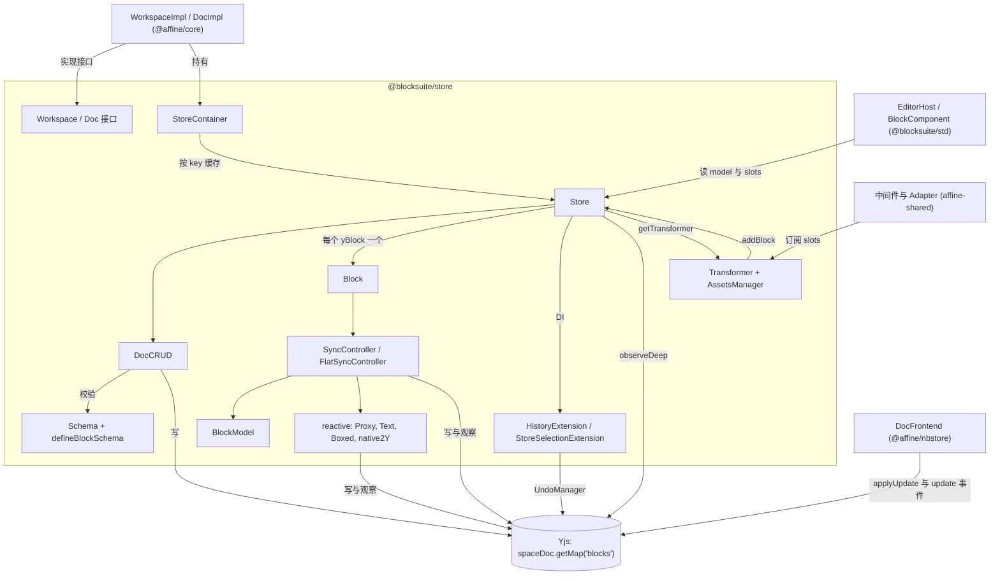
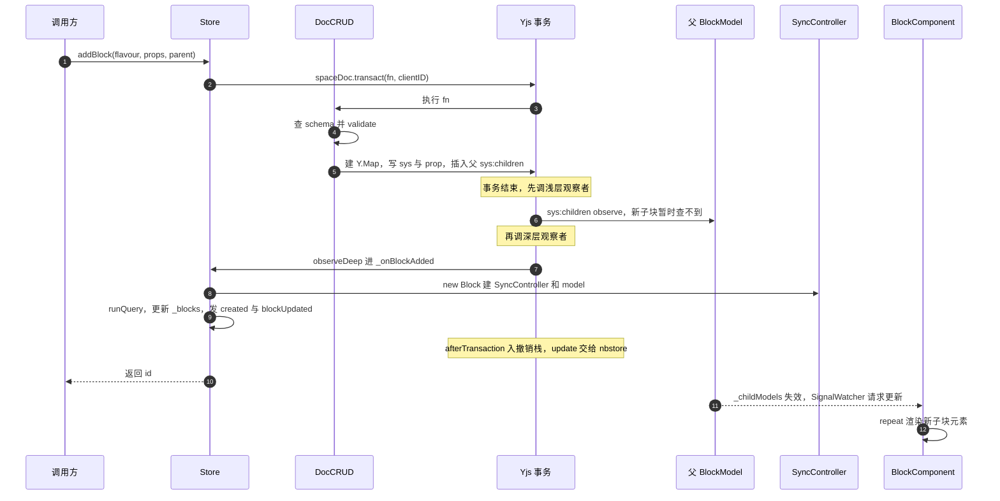
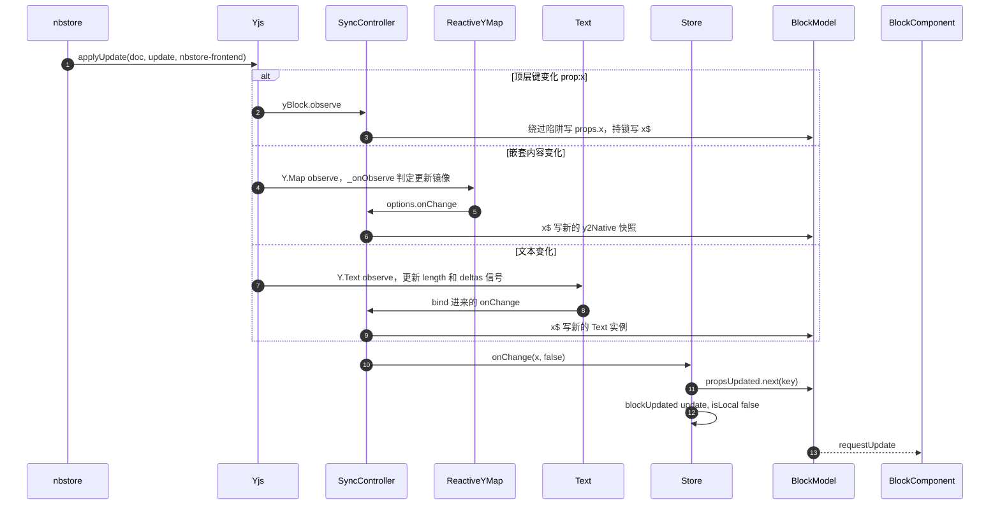
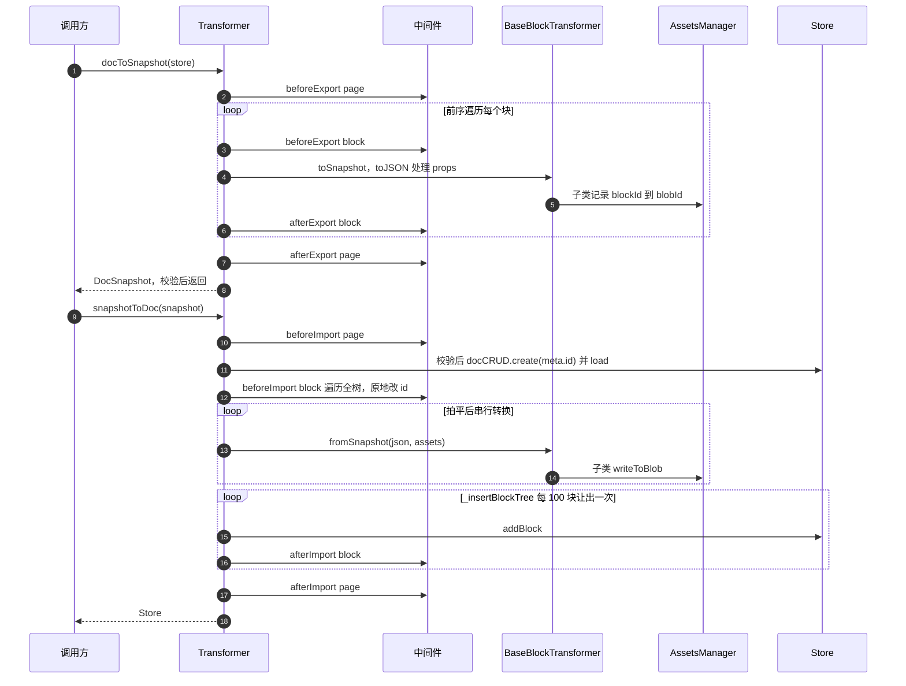
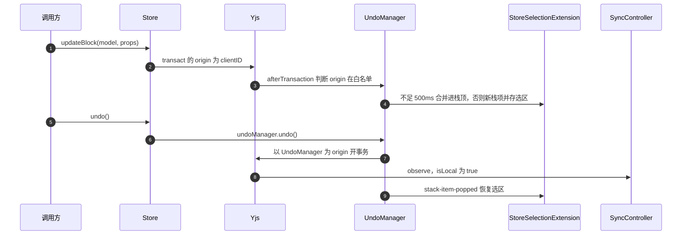

# @blocksuite/store 精讲

> 一句话：把一棵块树落在 Yjs CRDT 上，再向上暴露"写普通对象即协同写入"的 `Store`/`BlockModel` API 和与 Yjs 解耦的 JSON 快照；编辑器里的块数据都经它进出。
>
> 对应分层文档：[`@blocksuite/store`](../L2-编辑器内核框架/blocksuite-store.md) · 源码：`blocksuite/framework/store`

分层文档已讲清目录结构、`defineBlockSchema` 用法、Proxy 与 `x$` 的基本概念，本文不再复述。本文只回答三类问题：一次调用到底走了哪些代码、哪些行为和直觉不一致、改它时要守住什么。

下文标"静态推断"的结论来自读码，未实际运行验证；其余结论都有源码或测试用例支撑。

## 0. 为什么是重点包

| 指标 | 数据 | 核实结果 |
|---|---|---|
| 直接被依赖 | 48 个工作区包 | 扫描 `package.json` 复现，一致 |
| 传递被依赖 | 95 个（全仓 124 个，排第 3） | 一致。排在前面的是 `@blocksuite/global`（97）、`@blocksuite/sync`（96）。注意：95 含 `devDependencies`，只算运行时依赖是 85 |
| 源码行数 | 约 8,412 行 | `src` 下非测试 `.ts` 为 8,384 行；8,412 多出的 28 行正好是 `vitest.config.ts`。测试另有约 2,600 行 |
| 所在链路 | "编辑 → 本地存储 → 同步 → 服务端"的起点 | 成立，但边界要说准，见下 |

"所有块的数据最终都是它管理的 Yjs 文档"这句话需要收窄：

- `Y.Doc` 本身不由本包创建。生产环境的 `spaceDoc` 由 `packages/frontend/core/src/modules/workspace/impls/doc.ts:40` 的 `DocImpl` 创建，本包只定义 `Doc` 接口（`blocksuite/framework/store/src/extension/workspace/doc.ts:15`）并操作其中的 `getMap('blocks')`。
- 工作区级元数据（文档列表等）不走 `Store`，在 `rootDoc.getMap('meta')`（`packages/frontend/core/src/modules/workspace/impls/meta.ts:44,104`）。
- 白板元素也在块数据里，但不是块：它们放在 `affine:surface` 块的 `elements` 这个 `Boxed(Y.Map)` 内（`blocksuite/affine/blocks/surface/src/surface-model.ts:18`），由 std 的 gfx 层直接操作。

满足的标准：

- **A 依赖枢纽**：上表数字。它与 `global`、`sync` 同处底座，但 `sync` 只有 3 个直接依赖方，`store` 有 48 个，是真正被业务层到处直接 import 的数据 API。
- **C 关键链路**：本地写入在这里变成 Yjs 事务，事务提交后的 `update` 事件被 `packages/common/nbstore/src/frontend/doc.ts:429` 接走；远端 update 也从这里回流成 Signal 和事件。
- **D 范式定义者**：`defineBlockSchema` 在仓库中（不含测试）约 40 处调用，决定了块如何声明数据；`x$` 约定、`isLocal` 语义、中间件形态都被上层全盘继承。

不懂它会卡在哪：

1. `blocksuite/affine/blocks/embed/src/embed-youtube-block/embed-youtube-block.ts:69` 的 `store.withoutTransact(...)`：为什么异步补全元数据要包这一层？不懂就解释不了"用户按撤销时这个操作不该被撤回"。
2. `blocksuite/affine/blocks/note/src/note-edgeless-block.ts:405` 的 `model.stash('edgeless')`：缩放时每帧改属性却不产生协同流量，`pop` 时才落一次 Yjs。
3. `blocksuite/framework/std/src/view/element/block-component.ts:230` 只订阅 `propsUpdated`，子块增删却能刷新：答案在 `BlockModel._childModels` 的双层 Signal。
4. `blocksuite/affine/widgets/drag-handle/src/middleware/new-id-cross-doc.ts:44` 为什么写 `cells$.value = newCells` 就能改数据：写 Signal 也会落 Yjs。
5. `packages/common/nbstore/src/frontend/doc.ts:480` 的告警"When nbstore applies a remote update, some code triggers a local change"：本包的默认值回填就能触发它，见 6.3。

## 1. 全景架构



逐块说明：

- **门面**：`Store` 是"一份 Doc 的一个视图"，不拥有数据。`StoreContainer`（`blocksuite/framework/store/src/model/store-container.ts:10`）决定同一 Doc 上哪些请求复用同一个 `Store`。`DocCRUD` 只操作 Yjs，不碰 model：写路径到 Yjs 为止，model 的变化全部由 Yjs 事件驱动回来。
- **块运行期**：`Block` 只是选择器（`blocksuite/framework/store/src/model/block/block.ts:52-63`），按 schema 的 `isFlatData` 选控制器。全仓只有 `affine:table` 用 flat（`blocksuite/affine/model/src/blocks/table/table-model.ts:65`）。
- **响应式引擎**：与块无关的通用层，`WorkspaceMetaImpl` 也直接用 `createYProxy`（`packages/frontend/core/src/modules/workspace/impls/meta.ts:106`）。
- **扩展**：`StoreSelectionExtension`、`HistoryExtension` 是每个 `Store` 都带的内部扩展（`blocksuite/framework/store/src/model/store/store.ts:184`）。`Workspace`/`Doc` 只是接口。
- **Transformer 没有特权**：导入走的就是公开的 `doc.addBlock`（`blocksuite/framework/store/src/transformer/transformer.ts:554`），受同样的 schema 校验和事件流约束。

### 对象与 Yjs 的对应

```text
rootDoc (Y.Doc)                      Workspace.doc
├─ getMap('meta')                    文档列表、工作区属性
└─ getMap('spaces')                  旧版兼容占位，新版不再依赖（见 DocImpl._initSpaceDoc 注释）

spaceDoc (Y.Doc, guid = docId)       Doc.spaceDoc，独立 Y.Doc，clientID 与 rootDoc 相同
└─ getMap('blocks')                  Doc.yBlocks: Y.Map<YBlock>
   └─ <blockId>: Y.Map               YBlock，一块一个
      ├─ sys:id        string
      ├─ sys:flavour   string
      ├─ sys:version   number
      ├─ sys:children  Y.Array<string>   只存子块 id，没有 parent 字段
      ├─ prop:type     'text'            原始值直接存
      ├─ prop:text     Y.Text            Text
      ├─ prop:style    Y.Map             纯对象递归成 Y.Map
      ├─ prop:items    Y.Array           数组递归成 Y.Array
      └─ prop:boxed    Y.Map{type, value}  Boxed，type 是 '$blocksuite:internal:native$'
```

| 概念 | 形态 | 基数 | 由谁创建 |
|---|---|---|---|
| `Workspace` | 接口，生产实现 `WorkspaceImpl` | 一个 rootDoc 一个 | `@affine/core` |
| `Doc` | 接口，生产实现 `DocImpl`，测试实现 `TestDoc` | 一个 spaceDoc 一个 | `docMetaAdded` 事件触发（`packages/frontend/core/src/modules/workspace/impls/workspace.ts:95-102`） |
| `Store` | 类 | **一个 Doc 多个** | `doc.getStore()` |
| `Block` | 类 | 每个 Store 对每个 yBlock 一个 | `Store._onBlockAdded` |
| `BlockModel` | 类，可被 `toModel` 子类化 | 与 `Block` 一一对应 | `SyncController._createModel` |

"每个 Store 各有一份 Block/Model"是最容易漏的一点：同一 yBlock 在编辑器 Store 和预览 Store 里是两个不同的 `BlockModel` 实例，各自注册 Yjs 观察者。

## 2. 核心抽象与数据模型

### 2.1 `Store`：可以有多个的视图

构造顺序（`blocksuite/framework/store/src/model/store/store.ts:562-609`）值得记住，因为几个坑都出在这里：

1. 建 DI 容器，注册内部扩展和用户扩展（此时只是登记，DI 惰性实例化，`blocksuite/framework/global/src/di/provider.ts:64-70`）。
2. 从 DI 取全部 `BlockSchemaIdentifier` 注册进 `Schema`，取 `DocIdentifier` 得到 `Doc`。`StoreOptions.doc` 字段在构造函数里其实没用，`Doc` 是经 `StoreContainer` 塞的匿名扩展（`blocksuite/framework/store/src/model/store-container.ts:36-40`）从 DI 拿到的。
3. `_yBlocks.observeDeep`，然后遍历现有 yBlock 直接调 `_onBlockAdded(id, false, true)`。循环里的 `_handleYBlockAdd` 此刻没有订阅者（`_subscribeToSlots` 在其后），是空操作。

Store 复用规则（`blocksuite/framework/store/src/model/store-container.ts:22-34`）：

| 调用 | 缓存 key | 结果 |
|---|---|---|
| `getStore({ id })` | `id` | 同 id 复用 |
| `getStore({ readonly: true })` 或带 `query` | `JSON.stringify({ readonlyKey, query })` | 同条件复用，**`id`、`extensions`、`provider` 不参与 key** |
| `getStore()`，不传 id | `idGenerator()` 随机值 | **每次新建**，且留在 `_storeMap` 里，无法用 `removeStore` 按 key 取回 |

第三行有个测试与生产的差异：`TestDoc.getStore` 在无参时用 `spaceDoc.guid` 兜底（`blocksuite/framework/store/src/test/test-doc.ts:151-153`），所以 `blocksuite/framework/store/src/__tests__/doc.unit.spec.ts:221-240` 能断言 `store1` 与 `store2` 相同；而 `DocImpl.getStore` 把 `id: undefined` 原样传下去（`packages/frontend/core/src/modules/workspace/impls/doc.ts:152-158`），结果是每次一个新 Store。`packages/frontend/core/src/modules/integration/entities/writer.ts:72` 等处就是无参调用。

`Store` 上没有 `blockCollection`。这个名字只存在于 `Workspace` 实现的 `blockCollections` 这个 `Map` 上（`packages/frontend/core/src/modules/workspace/impls/workspace.ts:40`）。

### 2.2 `YBlock`：跨语言的键空间

`sys:*` 与 `prop:*` 不是内部细节，而是落盘格式。`packages/backend/native/src/runtime/storage_runtime/blob_cleanup.rs:488-498` 的 Rust 测试夹具就是手工按 `blocks`、`sys:flavour`、`prop:sourceId` 构造文档。改键名等于改文件格式。

类型上 `YBlock`（`blocksuite/framework/store/src/model/block/types.ts:6-10`）只是给 `get` 加重载。`SYS_KEYS = {id, flavour, children, version}`（`blocksuite/framework/store/src/consts.ts:7`）决定了 `updateBlock` 不能改这四个字段：`syncBlockProps` 直接跳过（`blocksuite/framework/store/src/model/store/utils.ts:18`）。

### 2.3 `SyncController`：一个 prop 的三份状态

分层文档把它称为"心脏"，真正要理解的是下面这张表。对普通（非 flat）块，一个 prop `x` 同时存在于三处：

| 位置 | 内容 | 谁写 |
|---|---|---|
| `yBlock['prop:x']` | CRDT 真相 | `set` 陷阱、`DocCRUD`、远端 |
| `_props` 的 target 上的 `x` | 响应式代理、`Text`、`Boxed` 或原始值 | `set` 陷阱、Yjs 观察者（`_byPassProxy` 下） |
| `_props` 的 target 上的 `x$` | `Signal`，**值的形态随时间变化** | `setValue`、Yjs 观察者、代理的 `onChange` |

`x$.value` 的形态是这里最隐蔽的事实。以对象型 prop 为例：

| 时机 | `x$.value` 是什么 | 源码 |
|---|---|---|
| model 刚创建 | 响应式代理，和 `x` 是同一对象 | `blocksuite/framework/store/src/model/block/sync-controller.ts:143,158-159` |
| 事务外 `props.x = v` | 传入的原始 `v`：观察者在 `yBlock.set` 内同步跑完，`setValue` 在其后覆盖 | `blocksuite/framework/store/src/model/block/sync-controller.ts:195,197` |
| 事务内 `props.x = v` | 先是 `v`，提交后变成 `y2Native` 的**普通对象快照** | `blocksuite/framework/store/src/model/block/sync-controller.ts:197,63` |
| 内层字段变化或远端更新之后 | 新的普通对象快照 | `blocksuite/framework/store/src/model/block/sync-controller.ts:63,238` |

所以 `x$` 只该用于读和整体替换。`props.style$.value.color = 'red'` 在 model 刚创建时会写到 Yjs（碰巧是代理），之后就只改了一个无人持有的对象。`blocksuite/framework/store/src/__tests__/block.unit.spec.ts:173-208` 覆盖的全是整体读写，没有覆盖原地改。

三条防回声机制各管一段，别混：

- `_byPassProxy`（`blocksuite/framework/store/src/model/block/sync-controller.ts:28-34`）：Yjs 观察者写 target 时跳过 `set` 陷阱的 Yjs 分支。
- `_mutex`（`blocksuite/framework/store/src/model/block/sync-controller.ts:36`，`lib0/mutex`）：不可重入锁，断开 Signal 与 props 的互相触发。锁内再次进入时直接丢弃，不排队。
- `yBlock.get(...) === yValue`（`blocksuite/framework/store/src/model/block/sync-controller.ts:192`）：原始值相等时不写 Yjs。对象永远不相等，因为 `native2Y` 总造新的 `Y.Map`。

`effect`（`blocksuite/framework/store/src/model/block/sync-controller.ts:144-151`）让写 Signal 也能落 Yjs。首次运行时 `this.model` 还没赋值，靠 `if (!this.model) return` 跳过，但 `data.value` 已先读取，依赖已建立，这行的顺序不能调换。

`model.keys` 是写入白名单（`blocksuite/framework/store/src/model/block/sync-controller.ts:166,182`），在创建时固定：不在 `keys` 里的属性写到 `props` 上**不进 Yjs**，只改本地。这就是所有块都把 `'meta:createdAt': undefined` 这样的字段写进 `props` 工厂的原因（`blocksuite/affine/model/src/blocks/callout/callout-model.ts:23-26`）：默认值为 `undefined` 也能让键进入 `keys` 并得到 `x$`。

### 2.4 `BlockModel`：子节点的双层 Signal

`_childModels`（`blocksuite/framework/store/src/model/block/block-model.ts:22-31`）遍历 `_children.value`，对每个 id 调 `this._store.getBlock$(id)`。`_children` 跟 `sys:children`，`getBlock$` 跟 `Store._blocks`。两层都要，因为这两个信号的更新有时序差：父的 `sys:children` 观察者先于子 `Block` 创建执行（见 3.1 第 7 步），这一刻查不到子块；等 `_blocks` 更新后，computed 因依赖 `_blocks` 再次失效。如果这里用 `getBlock`（peek），新子块会一直缺席。

生命周期：`created.next()` 时才把 `sys:children` 读进来并开始观察（`blocksuite/framework/store/src/model/block/block-model.ts:116-129`），所以 `_onBlockAdded` 里 `_blocks.value` 赋值和 `created.next()` 之间，该 model 的 `children` 是空的。

`version` 有两个来源，容易读错：`BlockModel.version` 返回 **schema 版本**（`blocksuite/framework/store/src/model/block/block-model.ts:92-94`），`Block.version` 返回**数据里的 `sys:version`**（`blocksuite/framework/store/src/model/block/block.ts:34-36`，经 `blocksuite/framework/store/src/model/block/sync-controller.ts:270-272`）。

### 2.5 `Schema`：只校验关系，不校验值

`defineBlockSchema` 里的 `props` 只是默认值工厂。整个写路径上没有任何地方校验 prop 的类型或键名：`addBlock` 把 `initialProps` 全量写入（`blocksuite/framework/store/src/model/store/crud.ts:89-92,112-116`），多余的键也会落盘；`BlockSnapshotSchema` 的 `props` 是 `z.record(z.unknown())`（`blocksuite/framework/store/src/transformer/type.ts:20`）。

`BlockSchema.parse(schema)` 也比看上去弱。`z.function().args(...).returns(...)` 在 zod 里只在解析时检查"是不是函数"（`node_modules/zod/v3/types.js:2873-2882`），参数和返回值的校验靠解析结果返回的包装函数，而 `defineBlockSchema` 丢弃了解析结果、返回原对象（`blocksuite/framework/store/src/model/block/zod.ts:115-116`）。

`validate(flavour, parentFlavour, childFlavours)` 的判定（`blocksuite/framework/store/src/schema/schema.ts:58-103`）：

| 情形 | 结果 |
|---|---|
| flavour 未注册 | 抛 `SchemaValidateError` |
| `role === 'root'` 且有父 | 抛 `Root block cannot have parent.` |
| 非 root 且无父 | 抛 `None root block must have parent.` |
| 其余 | `_validateParent(child, parent)`，再逐个校验 children |

`_validateParent`（`blocksuite/framework/store/src/schema/schema.ts:172-227`）是**双向握手**：取子的 `parent ?? ['*']` 与父的 `children ?? ['*']` 做笛卡尔积，任一组合满足即通过。两边都是具体值时必须都匹配，一边是 `*` 时只看另一边。

- `@xxx` 按 role 精确匹配（`blocksuite/framework/store/src/schema/schema.ts:139-163`），否则走 `minimatch`，而且是双向的（`blocksuite/framework/store/src/schema/schema.ts:123-128`）。
- `children: []` 和不写含义相反：空数组 `.some` 恒为 false，表示**不允许任何子块**；不写才是不限制。
- 实例：`affine:note` 的 `children` 含 `'@content'`（`blocksuite/affine/model/src/blocks/note/note-model.ts:78-83`），所以新块只要 `role: 'content'` 且 `parent` 含 `affine:note`，不用改 note 的白名单。

校验的时机不全：`addBlock`、`moveBlocks`、`bringChildrenTo` 校验；`model.props` 写入、`Store` 构造时读入的历史数据、远端 update 都不校验。schema 只约束经 CRUD API 发起的本地结构变更。

### 2.6 `native2Y` / `y2Native`：转换规则与不对称

| JS 值 | 存入 Yjs | 读回 | 备注 |
|---|---|---|---|
| `Boxed` | 其内部 `Y.Map`（不克隆） | `Boxed` | 不克隆，别把已挂载的 `Boxed` 赋给别的键 |
| `Text` | `yText`；已挂载则 `clone()` | `Text` | 赋值已挂载的 `Text` 得到的是副本 |
| 数组 | 递归成 `Y.Array` | `ReactiveYArray` 代理 | |
| 纯对象 | 递归成 `Y.Map` | `ReactiveYMap` 代理 | `isPureObject` 要求 `constructor` 是 `Object` 或空（`blocksuite/framework/store/src/reactive/is-pure-object.ts:1-8`），代理也算纯对象 |
| 其他 | 原样交给 Yjs | 原样 | 类实例不会被转换 |

规则在 `blocksuite/framework/store/src/reactive/native-y.ts:8-74`。判断顺序有讲究：`y2Native` 先判 `Boxed.is`，因为 Boxed 本质也是 `Y.Map`。

`Boxed` 的语义是"这块数据我自己管"。`boxed.setValue` 和 `boxed.getValue().set()` 都是裸 Yjs 写入，不经过代理。

### 2.7 flat 模式对照

| 方面 | `SyncController` | `FlatSyncController` + `ReactiveFlatYMap` |
|---|---|---|
| 嵌套对象存法 | `prop:a` 是 `Y.Map` | 点分键 `prop:a.b.c`，每个叶子一个键（`blocksuite/framework/store/src/model/store/crud.ts:99-110`） |
| 允许 `Y.Map` 值 | 允许 | 禁止，`blocksuite/framework/store/src/reactive/flat-native-y/initialize.ts:36-40` 直接抛错 |
| `$` Signal | 仅顶层键，创建时生成 | 仅顶层键，可在运行时动态新增（`blocksuite/framework/store/src/reactive/flat-native-y/proxy.ts:78-99`） |
| 监听方式 | `yBlock.observe` 全量处理 | `_onObserve` 过滤本地写 |
| stash 期间收到远端更新 | **覆盖本地值**（`blocksuite/framework/store/src/__tests__/block.unit.spec.ts:242-245`） | **忽略**（`blocksuite/framework/store/src/reactive/flat-native-y/y-event-handler.ts:57-59`） |
| 默认值回填时机 | 解析时写 Yjs | `ReactiveFlatYMap` 构造末尾写 Yjs（`blocksuite/framework/store/src/reactive/flat-native-y/index.ts:150-155`） |

## 3. 关键流程走读

### 3.1 `store.addBlock()` 全链路



1. **入口**（`blocksuite/framework/store/src/model/store/store.ts:749-756`）：`readonly` 时抛 `ModelCRUDError`。这是唯一一个在 readonly 下抛错的写 API，`updateBlock`/`deleteBlock`/`moveBlocks` 只 `console.error` 后返回。
2. **开事务**（`blocksuite/framework/store/src/model/store/store.ts:371-386`）：origin 是 `clientID`，事务内异常被 `try/catch` 吞掉，只打 `console.error`。
3. **校验**（`blocksuite/framework/store/src/model/store/crud.ts:53-73`）：schema 不存在、id 已存在、父子关系不合法都抛错，但都在第 2 步的事务里，所以**外层拿不到异常，`addBlock` 仍返回 id**。`blocksuite/framework/store/src/__tests__/schema.unit.spec.ts:118-124` 明确验证了这个行为：断言的是 `console.error` 被调用，而不是 `toThrow`。
4. **写 Y.Map**（`blocksuite/framework/store/src/model/store/crud.ts:75-86`）：先 `_yBlocks.set` 再写字段，子字段的写入发生在已集成的类型上。
5. **合并 props**（`blocksuite/framework/store/src/model/store/crud.ts:88-117`）：`schema.model.props(internalPrimitives)` 现造默认值，再用 `initialProps` 覆盖，删掉 `id`/`flavour`/`children`。普通模式跳过 `undefined`。
6. **挂到父节点**（`blocksuite/framework/store/src/model/store/crud.ts:119-134`）：`parentIndex` 超界时夹到末尾。第 120 行的 `parent ?? (role === 'root' ? null : this.root)` 看似"不传 parent 就挂到 root"，但第 73 行的 `validate` 已经把非 root 且无父的情况拒绝了，这个回退对非 root 块走不到。
7. **事务提交**：Yjs 的回调顺序是浅层 `observe` → 深层 `observeDeep` → `afterTransaction` → `update`（`node_modules/yjs/src/utils/Transaction.js:280-312,359-363`）。于是父 model 的 `_children` 先更新，此时子 `Block` 还不存在。
8. **翻译事件**（`blocksuite/framework/store/src/model/store/store.ts:1266-1293`）：只看 `event.target === _yBlocks` 的 `add`/`delete`。**`update` 动作被忽略**：同一事务里先删后加同 id，Yjs 报的是 `update`（`node_modules/yjs/src/utils/YEvent.js:116-118`），`Block` 不会重建，继续指着已删除的旧 `Y.Map`（静态推断）。
9. **建实例**（`blocksuite/framework/store/src/model/store/store.ts:649-701`）：`new Block` → `SyncController` 构造 → `_parseYBlock` → `_createModel` → `_observeYBlockChanges`。`_onBlockAdded` 自带 `try/catch`，建失败只打日志，块在 Yjs 里存在但 `Store` 里没有。
10. **发通知**（`blocksuite/framework/store/src/model/store/store.ts:677-696`）：顺序是 `_runQuery` → `_blocks.value` → `created.next()` → `rootAdded` → `blockUpdated`。`_blocks.value = {...}` 每次复制整张表，逐块导入 N 个块时这里是 O(N²)。
11. **历史与同步**：`afterTransaction` 里 `UndoManager` 入栈并发 `stack-item-added`，选区被存进 `stackItem.meta`（`blocksuite/framework/store/src/extension/selection/selection-extension.ts:22-24`）；`update` 事件由 `packages/common/nbstore/src/frontend/doc.ts:429` 接走。这里是"本地存储 → 同步"的交接点。
12. **视图**：`addBlock` 返回时 DOM 还没变。`_blocks` 变化让父组件读过的 `model.children`（`blocksuite/framework/std/src/view/element/lit-host.ts:100-104`）失效，`SignalWatcher` 请求 Lit 更新，随后 `_renderModel`（`blocksuite/framework/std/src/view/element/lit-host.ts:62-94`）生成新元素，`connectedCallback` 调 `std.view.setBlock`（`blocksuite/framework/std/src/view/element/block-component.ts:217`）。

第 8、9 步在最外层事务结束后才执行，所以嵌在 `store.transact` 里的 `addBlock` 之后立即 `getBlock` 得到 undefined，见 6.5。

### 3.2 远端 update 到达：model.props 与 Signal 如何更新



1. **入口**：`packages/common/nbstore/src/frontend/doc.ts:448-453`，`applyUpdate(doc, update, NBSTORE_ORIGIN)`，其中 `NBSTORE_ORIGIN = 'nbstore-frontend'`（第 31 行）。`Y.applyUpdate` 产生 `local = false` 的事务。
2. **`isLocal` 判定**同一段逻辑抄了五份（`blocksuite/framework/store/src/model/block/sync-controller.ts:45-51`、`blocksuite/framework/store/src/reactive/base-reactive-data.ts:34-40`、`blocksuite/framework/store/src/reactive/boxed.ts:121-127`、`blocksuite/framework/store/src/reactive/text/text.ts:83-89`、`blocksuite/framework/store/src/model/store/store.ts:1271-1277`）：origin 为空、doc 已解绑、origin 是 `UndoManager` 或 `origin.proxy` 为真时算本地，否则比较 `origin === clientID`。所以同步实现调 `applyUpdate` 时若不传 origin，远端变更会被标成本地，nbstore 传字符串正是为了避开这一点。
3. **顶层键**（`blocksuite/framework/store/src/model/block/sync-controller.ts:38-85`）：不检查 origin 也不检查 `_stashed`，本地写和远端写都走这里，所以一次本地写的 `onChange` 也由这里发出。
4. **嵌套内容**由 `_onObserve` 决定是否改镜像（`blocksuite/framework/store/src/reactive/base-reactive-data.ts:24-32`）：

   ```ts
   if (
     event.transaction.origin?.force === true ||
     (event.transaction.origin?.proxy !== true &&
       (!event.transaction.local ||
         event.transaction.origin instanceof Y.UndoManager))
   ) {
     handler();
   }
   ```

   只有远端和撤销才改镜像，本地代理写已经在陷阱里同步改过了。`onChange` 则无条件调用。副作用：**本地直接操作嵌套 `Y.Map` 不会更新镜像**，无论是否在 `store.transact` 内，因为 `local` 为 true 且 origin 不是 `UndoManager`。`origin.force` 就是为此留的口子，但 `blocksuite` 目录内没有使用者。顶层 `yBlock.set('prop:x', ...)` 不受影响（`blocksuite/framework/store/src/__tests__/block.unit.spec.ts:203-207`）。
5. **Signal 更新**都在 `_mutex` 内（`blocksuite/framework/store/src/model/block/sync-controller.ts:60-65,236-239`），写 Signal 触发的 `effect` 进不了锁，不会回写 Yjs。如果这次更新发生在 `batch()` 内，`effect` 会延后到锁释放之后，对象型 prop 将被 `native2Y` 重新写一遍（静态推断）。所以不要把 Yjs 事务包进 Signal 的 `batch`。
6. **通知**（`blocksuite/framework/store/src/model/store/store.ts:660-674`）：`propsUpdated.next({ key })`、`blockUpdated.next({ type: 'update' })`。一个事务改 N 个键发 N 次。`BlockComponent` 对 `propsUpdated` 调 `requestUpdate`（`blocksuite/framework/std/src/view/element/block-component.ts:229-233`），Lit 自身做合并。
7. **结构变化**：`sys:children` 的 `Y.Array` 观察者更新 `_children`（`blocksuite/framework/store/src/model/block/block-model.ts:120-122`）；块增删与 3.1 第 8 步以后相同，只是 `isLocal` 为 false。
8. **flat 块**走 `ReactiveFlatYMap._observer` → `getYEventHandler`（`blocksuite/framework/store/src/reactive/flat-native-y/y-event-handler.ts:23-38`），在 `_updateWithYjsSkip` 下经 proxy 写入，`set` 陷阱内的 `updateSignal` 负责同步 `x$`。

### 3.3 一次 Snapshot 导出与导入



导出：

1. `docToSnapshot`（`blocksuite/framework/store/src/transformer/transformer.ts:100-136`）先发 `beforeExport{page}`，再用 `toDraftModel` 把整棵树转成不依赖 Yjs 的 `DraftModel`。`DraftModel.props` 里的值仍是原对象引用，不是深拷贝（`blocksuite/framework/store/src/model/block/draft.ts:23-30`）。
2. `_blockToSnapshot`（`blocksuite/framework/store/src/transformer/transformer.ts:391-420`）递归，`schema.transformer?.(configs) ?? new BaseBlockTransformer(configs)`：每个块都**新建**一个 transformer 实例（`blocksuite/framework/store/src/transformer/transformer.ts:533-538`），所以块级 transformer 不能存状态，状态放 `transformerConfigs` 这个 `Map`。
3. `toJSON`（`blocksuite/framework/store/src/transformer/json.ts:6-30`）把 `Boxed` 编成 `{ '$blocksuite:internal:native$': true, value }`，`Text` 编成 `{ '$blocksuite:internal:text$': true, delta }`。`fileNameMiddleware` 直接手写这个结构（`blocksuite/affine/shared/src/adapters/middlewares/file-name.ts:14-21`），因此这两个标识也是格式契约。
4. **导出是同步的，blob 不在这一步读**。`ImageBlockTransformer.toSnapshot` 只往 `pathBlobIdMap` 记一笔 `blockId → sourceId`（`blocksuite/affine/model/src/blocks/image/image-transformer.ts:22-32`），调用方再自己遍历读取，例如 `blocksuite/affine/widgets/linked-doc/src/transformers/zip.ts:52`。只调 `docToSnapshot` 得到的 JSON 不含 blob。

导入：

5. `snapshotToDoc`（`blocksuite/framework/store/src/transformer/transformer.ts:192-224`）的顺序是**先发 `beforeImport{page}` 再校验**，中间件有机会修正数据。`snapshotToSlice` 和 `snapshotToBlock` 相反，先校验（`blocksuite/framework/store/src/transformer/transformer.ts:181,258`）。
6. `_snapshotToBlock`（`blocksuite/framework/store/src/transformer/transformer.ts:624-662`）是导入核心：

   ```ts
   this._triggerBeforeImportEvent(snapshot, parent, index);

   const flatSnapshots: FlatSnapshot[] = [];
   this._flattenSnapshot(snapshot, flatSnapshots, parent, index);

   const blockTree = await this._convertFlatSnapshots(
     flatSnapshots,
     replaceExisting
   );

   if (replaceExisting) {
     // … 先全量 schema.validate，确认无重复 id
     doc.transact(() => doc.doc.clear());
   }
   await this._insertBlockTree([blockTree], doc, parent, index);
   ```

   `_triggerBeforeImportEvent` 在拍平**之前**跑，中间件原地修改 `snapshot` 的结果才会进入后续流程。`replaceIdMiddleware` 甚至在这里调整 `children` 顺序，把 surface 移到最后（`blocksuite/affine/shared/src/adapters/middlewares/replace-id.ts:152-160`）。
7. **ID 重映射不在本包**。Store 层对 id 完全透传（`blocksuite/framework/store/src/transformer/transformer.ts:550-554`），`replaceIdMiddleware`（`blocksuite/affine/shared/src/adapters/middlewares/replace-id.ts:20`）在 `beforeImport{block}` 改 `snapshot.id`，在 `afterImport{block}` 修引用（database 的 `cells`、`reference.pageId`、surface-ref 的 `reference`），还要把 `uploadingAssetsMap` 的键迁到新 id（`blocksuite/affine/shared/src/adapters/middlewares/replace-id.ts:173-179`）。它原地改快照，同一个快照对象导入两次会被映射两次。
8. `_convertFlatSnapshots`（`blocksuite/framework/store/src/transformer/transformer.ts:422-459`）串行 `await fromSnapshot`。**blob 在这里写入**：`ImageBlockTransformer.fromSnapshot` 在 `assets` 非空且 `sourceId` 不以 `/` 开头时 `writeToBlob`（`blocksuite/affine/model/src/blocks/image/image-transformer.ts:15-18`）。`assets.isEmpty()` 这个判断意味着 `AssetsManager` 要由调用方提前装填，否则跳过。
9. 单块转换失败时：`requireComplete` 为 false 则过滤掉，但 `_rebuildBlockTree` 用下标写 `children[index]`，中间块失败会留下空洞，`_insertBlockTree` 解构 `undefined` 时抛错，整体落进外层 `catch`（`blocksuite/framework/store/src/transformer/transformer.ts:605-614,547-549`，静态推断）。
10. `_insertBlockTree`（`blocksuite/framework/store/src/transformer/transformer.ts:540-587`）对每个块单独 `addBlock`，随后立即 `getBlock`：这依赖"事务提交后同步建好 Block"，**所以不能把导入包在外层 `store.transact` 里**。查不到时抛 `Block not found by id`，`addBlock` 吞掉的校验错误在这里才暴露。每 100 块 `await nextTick()`。

`snapshotToSlice` 的特殊行为：若 `content[0].id` 已在文档里，走 `moveBlocks` 而不是新增（`blocksuite/framework/store/src/transformer/transformer.ts:285-303`）。`newIdCrossDoc` 只在跨文档时换 id、同文档保留（`blocksuite/affine/widgets/drag-handle/src/middleware/new-id-cross-doc.ts:15-22`），落到这个分支就是移动。粘贴则要用 `replaceIdMiddleware`（`blocksuite/affine/blocks/root/src/clipboard/page-clipboard.ts:37`），否则粘贴同文档内容会变成"移动原块"。此外它用写死的 `flavour: 'affine:page'` 建临时根（`blocksuite/framework/store/src/transformer/transformer.ts:268-274`），框架层在这里依赖了业务 flavour。

### 3.4 事务、撤销与 origin 矩阵



撤销范围由 `HistoryExtension` 构造函数决定（`blocksuite/framework/store/src/extension/history/history-extension.ts:22-24`）：

```ts
this._history = new Y.UndoManager([this.store.doc.yBlocks], {
  trackedOrigins: new Set([this.store.doc.spaceDoc.clientID]),
});
```

- **`captureTimeout` 没有配置**，用 Yjs 默认 500ms（`node_modules/yjs/src/utils/UndoManager.js:166`）。连续操作在 500ms 内合并为一步。`store.captureSync()` 即 `stopCapturing()` 强制切分，`blocksuite/framework/std/src/inline/range/range-binding.ts:132` 在合适时机调用它。
- **`trackedOrigins` 自定义后，默认的 `null` 不再被跟踪**（默认值是 `new Set([null])`，`node_modules/yjs/src/utils/UndoManager.js:169`）。这决定了下表：

| 写法 | 顶层事务 origin | 可撤销 | `isLocal` | 嵌套代理镜像 |
|---|---|---|---|---|
| `addBlock` 等 CRUD、`store.transact(fn)` | `clientID` | 是 | true | 代理写时已同步 |
| `withoutTransact(() => store.updateBlock(...))` | `null` | **否** | true | 同上 |
| 裸写 `model.props.x = v` | `null`（`yBlock.set` 隐式事务） | **否** | true | 不涉及 |
| 裸写 `model.props.obj.k = v` | `{ doc, proxy: true, target }` | **否** | true | 跳过 handler，已同步 |
| 裸写 flat props | `{ proxy: true }`（`blocksuite/framework/store/src/reactive/flat-native-y/proxy.ts:162-167`） | **否** | true | 同上 |
| `text.insert` 等 `Text` 方法 | `clientID`（`blocksuite/framework/store/src/reactive/text/text.ts:104-106`） | **是** | true | 不涉及 |
| `boxed.setValue` | `null` | **否** | true | 不涉及 |
| `store.undo()` | `UndoManager` 实例 | 进 redo 栈 | true | **执行 handler** |
| nbstore 应用远端 | `'nbstore-frontend'`，`local=false` | 否 | false | **执行 handler** |

判定都看顶层事务：Yjs 嵌套 `transact` 复用外层事务（`node_modules/yjs/src/utils/Transaction.js:415-423`），内层 origin 被丢弃。所以 `store.updateBlock(model, () => { model.props.x = 1; })` 可撤销，同样的赋值拿到外面就不可撤销。

查 Yjs 行为时看 13.6.21：`blocksuite/framework/store/package.json` 声明 `^13.6.27`，但根 `package.json:223` 的 resolutions 把它锁在打过补丁的 13.6.21，补丁只改了 `generateNewClientId`。

`withoutTransact`（`blocksuite/framework/store/src/model/store/store.ts:401-405`）只是翻转一个布尔值，有三个局限：

- 只影响同步代码。`withoutTransact(async () => { await fetch(); store.updateBlock(...) })` 在 `await` 之后标志已恢复。`uploadMiddleware` 的写法是对的：先 `await` 完，再进 `withoutTransact`（`blocksuite/affine/shared/src/adapters/middlewares/upload.ts:53-60`）。
- 没有 `try/finally`。`fn` 抛错后 `_shouldTransact` 留在 false，此后这个 Store 的操作全部不可撤销（静态推断）。注意 `store.transact` 内的异常已被吞掉，抛错的只可能是事务外的代码，如 `updateBlock` 的 `schema.validate`。
- 只影响本 Store。嵌在外层 `transact` 里无效，因为 origin 由外层决定。

UndoManager 的创建时机：`HistoryExtension` 由 DI 惰性创建，`Store.load` 先 `_doc.load(initFn)` 再遍历 `StoreExtension`（`blocksuite/framework/store/src/model/store/store.ts:1228-1231`）。因此 `store.load(() => { /* 初始化块 */ })` 里的写入发生在 UndoManager 诞生之前，不进撤销栈（静态推断）。

撤销恢复的块是**新的 `BlockModel` 实例**：删除后再撤销，Yjs 产生新的 `Y.Map`，事件是 `add`，走 `_onBlockAdded` 新建（静态推断）。持有旧 model 引用的代码要重新 `getBlock`。

## 4. 源码阅读路线

路径相对 `blocksuite/framework/store/src/`。

1. `consts.ts`、`model/block/types.ts`（5 分钟）：记住 `sys:*`/`prop:*` 键空间和两个内部标识。
2. `reactive/native-y.ts`、`reactive/is-pure-object.ts`：读懂转换规则和判断顺序，把 2.6 的表自己推一遍。
3. `reactive/boxed.ts`、`reactive/text/text.ts` 的构造函数和 `_transact`：理解 `isLocal` 公式第一次出现的地方，注意 `Text` 的 origin 是 `clientID`。后半的 `split`/`join` 等 API 可略。
4. `reactive/base-reactive-data.ts`、`reactive/proxy.ts`：重点看 `_onObserve` 的条件和 `createYProxy` 的 `transform`。搞懂"为什么本地写不走 handler"。
5. `model/block/zod.ts`、`schema/schema.ts`：重点是 `_validateParent`，配合 `__tests__/schema.unit.spec.ts` 看。
6. `model/block/sync-controller.ts`：全包最重要的 391 行，从 `_createModel` 读起，对照 2.3 的表。读到能回答"写 `x$.value` 会发生什么"为止。
7. `model/block/block-model.ts`、`model/block/block.ts`：读 `_childModels` 和构造函数里的 `created` 订阅。
8. `model/store/crud.ts`：重点看 `addBlock`、`deleteBlock`、`getParent`，留意所有 `return` 分支，很多是静默失败。
9. `model/store/store.ts`：构造函数 → `_onBlockAdded` → `_handleYEvent` → CRUD 方法。类型定义和 getter 可略读。
10. `extension/history/history-extension.ts`、`extension/selection/selection-extension.ts`、`model/store-container.ts`：对照 3.4 的表。
11. `transformer/transformer.ts`、`transformer/base.ts`、`transformer/json.ts`：先看 `_snapshotToBlock`，再看 `replace-id.ts` 这个真实中间件。
12. `packages/frontend/core/src/modules/workspace/impls/doc.ts` 和 `__tests__/block.unit.spec.ts`：前者告诉你生产实现和测试实现差在哪，后者是行为的最佳说明书。

可以先跳过：`adapter/`（`ASTWalker` 那套是 Markdown/HTML 转换用，与数据层核心无关）、`reactive/flat-native-y/`（除非改 table 块）、`transformer/assets.ts` 的文件名冲突逻辑、`test/test-meta.ts`。

## 5. 设计取舍

源码基本没写设计动机，本段的"为什么"和"替代方案为何没选"都是根据代码结构做的推断。

### 5.1 树结构只存 `sys:children`，不存 parent

- **选择**：父子关系只记在父侧。`getParent` 每次从 root 做 DFS（`blocksuite/framework/store/src/model/store/crud.ts:242-263`），`root` 每次遍历全部 yBlock（`blocksuite/framework/store/src/model/store/crud.ts:11-23`）。
- **为什么**：CRDT 下维护双向指针要处理两者不一致，单向存储只有一个事实来源。
- **代价**：`getParent` 是 O(N)。`runQuery` 对每个未隐藏的新块沿祖先链循环 `getParent`（`blocksuite/framework/store/src/model/store/query.ts:28-31,72-82`），默认的 `loose` 模式下就是全部块，打开 N 块文档的 Store 构造约为 O(N²·depth)（静态估算）。并发移动同一块到不同父时，id 可能同时出现在两个 `sys:children` 里，`getParent` 返回 DFS 先遇到的那个（静态推断）。
- **替代**：在 Store 上维护 parent 索引并随 Yjs 事件更新。这份索引要处理事件时序（见 3.1 第 7 步），又多一份需要保持一致的状态。

### 5.2 写路径只到 Yjs，model 全靠事件回流

- **选择**：`DocCRUD` 不碰 model，`Block` 只在 Yjs 事件里创建。
- **为什么**：本地和远端共用一条路径，不存在"本地建了 model、远端又建一次"的分叉。
- **代价**：事务内读不到新块；事务提交前 model 与 Yjs 不一致。
- **例外**：`props` 写入是反过来的，`set` 陷阱同步改 target 和 Signal，不等事件，否则 `model.props.x = 1; model.props.x` 读不到新值。所以 props 的同步是"乐观本地 + 事件校正"，块的增删是"纯事件驱动"，两种模式共存。

### 5.3 事务吞异常

- **选择**：`store.transact` 捕获 `fn` 的所有异常（`blocksuite/framework/store/src/model/store/store.ts:375-382`）。
- **为什么**：防止异常穿透 Yjs 事务打断编辑器；Yjs 没有回滚，抛出去也救不回已写部分。
- **代价**：`addBlock` 失败仍返回 id；事务内前半段已写入的内容保留；`updateBlock` 的校验在事务外会抛错，`addBlock` 的校验在事务内不抛，API 语义不一致。
- **补偿**：`blocksuite/framework/store/vitest.config.ts:20-26` 配置了 `onConsoleLog`，单测中任何未预期的 console 输出都会抛错，这样被吞的异常在测试里能暴露。
- **替代**：像 `updateBlock` 那样把校验提到事务外，或返回 `null`。都要改全部调用方，未采用。

### 5.4 两套 props 存储

- **选择**：默认嵌套 `Y.Map`，table 块用点分键。
- **为什么**：`rows`/`columns`/`cells` 是"大量动态键的字典"，点分键让每个叶子都是 `yBlock` 的顶层键，一次观察事件就能定位路径，不用在每层建代理和观察者。
- **代价**：两套实现要同步维护，行为有差异（见 2.7）。flat 的前缀删除按字符串匹配，不带 `.` 边界（`blocksuite/framework/store/src/reactive/flat-native-y/proxy.ts:186-189`、`blocksuite/framework/store/src/reactive/flat-native-y/y-map-updater.ts:32-36`），删 `rows.a` 会连带 `rows.ab`。table 的 id 由 `nanoid()` 生成（`blocksuite/affine/blocks/table/src/table-data-manager.ts:82`），定长，碰不到；自己用 flat 时要注意。
- **替代**：统一到 flat。存量文档的 `Y.Map` 格式无法改变，`blocksuite/framework/store/src/reactive/flat-native-y/initialize.ts:36-40` 也明确拒绝 `Y.Map` 值。

### 5.5 中间件是 `Subject` 事件，不是异步管道

- **选择**：`TransformerMiddleware` 拿到四个 RxJS `Subject`，靠原地修改 payload 生效（`blocksuite/framework/store/src/transformer/middleware.ts:101-120`）。
- **为什么**：简单，一个中间件可订阅多个阶段并用 `filter`/`map` 组合（`blocksuite/affine/shared/src/adapters/middlewares/replace-id.ts:27-33`）；同步通知对大文档开销小。
- **代价**：
  - 不能 `await`：`Subject.next` 不等异步订阅者，异步处理的结果赶不上后续步骤。
  - 错误不回流：RxJS 7 把订阅者里的异常放到异步上报，`Transformer` 的 `try/catch` 接不住，转换继续。`blocksuite/affine/shared/src/adapters/middlewares/replace-id.ts:203` 的 `throw` 不会让导入失败。
  - 顺序靠数组下标，`replaceIdMiddleware` 必须排在依赖新 id 的中间件之前。
- **替代**：洋葱式异步中间件。每块多一次 `await` 对上万块的文档是负担，且现有需求基本都是同步改 JSON；需要异步的（blob）由块级 `fromSnapshot` 承担，它是 `async` 的。

## 6. 易错点与调试

### 6.1 `addBlock` 返回了 id，块却不存在

- **现象**：拿着返回的 id 后续 `getBlock` 得到 undefined，界面无变化。
- **原因**：校验失败在事务内被吞（3.1 第 3 步）。不传 `parent` 的非 root 块、未注册的 flavour、不合法的父子关系都会这样。
- **避免**：写后检查 `store.hasBlock(id)`；提前用 `store.schema.safeValidate(flavour, parentFlavour)` 判断；日志里搜 `An error occurred while Y.doc`。

### 6.2 写了属性但撤销不掉，或不该撤销的被撤销

- **现象**：`model.props.x = 1` 之后 Ctrl+Z 无反应；或自动补全的数据被用户撤销掉。
- **原因**：见 3.4 的矩阵。裸写不可撤销，`Text` 方法却总是可撤销。
- **避免**：用户操作一律 `store.updateBlock(model, {...})` 或 `store.updateBlock(model, () => {...})`；系统回填用 `withoutTransact`，且只包同步部分。`updateBlock` 的对象形式会跳过 `undefined`（`blocksuite/framework/store/src/model/store/utils.ts:19`），要清空字段用回调形式写 `model.props.x = undefined`。

### 6.3 打开文档就产生写入

- **现象**：只看没改，文档被标记为自己编辑；开发环境看到 nbstore 的 `When nbstore applies a remote update` 告警。
- **原因**：schema 新增带默认值的 prop 后，`_parseYBlock` 对缺失的键执行 `yBlock.set`（`blocksuite/framework/store/src/model/block/sync-controller.ts:309-320`）。这发生在 `new Block` 时，在远端事件里会变成一次本地写，且 origin 为 `null`。**`readonly` 的 Store 也会写**，因为 `readonly` 只拦截 CRUD 方法。flat 块同理（`blocksuite/framework/store/src/reactive/flat-native-y/index.ts:150-155`）。
- **避免**：给存量块加字段时优先把默认值设为 `undefined`，`blocksuite/framework/store/src/model/block/sync-controller.ts:315` 对 `undefined` 不写 Yjs，业务层读取时再兜底。用 `packages/common/nbstore/src/frontend/doc.ts:472-486` 的告警内容定位是哪个键。

### 6.4 `x$` 与 `x` 不是一回事

- **现象**：`props.style$.value.color = 'red'` 时灵时不灵；`computed` 里拿到的对象改了不同步。
- **原因**：`x$.value` 对对象型 prop 是快照（2.3）。
- **避免**：`x$` 只读或整体赋值，局部改用 `model.props.style.color = 'red'`。写 `x$.value` 也是裸写，放在 `updateBlock` 回调里才可撤销。

文本 prop 还有一个累积问题：每次内容变化，`_getPropsProxy` 的回调用 `y2Native(value)` 给 `text$` 造一个新 `Text`（`blocksuite/framework/store/src/model/block/sync-controller.ts:238`），而 `Text` 构造函数总是 `yText.observe`（`blocksuite/framework/store/src/reactive/text/text.ts:82`），全文件没有 `unobserve`。观察者数量随编辑次数增长，每个都执行 `toDelta()`（静态推断）。在控制台看 `model.props.text.yText._eH.l.length` 可验证。排查长文档输入卡顿时优先看这里。

### 6.5 事务边界内读到旧状态

- **现象**：`transact` 里 `addBlock` 后 `getBlock` 为 undefined，`model.children` 没有新块。
- **原因**：`Block` 和 `_children` 都在事务提交后的观察者里更新（3.1）。
- **避免**：需要 id 就用 `addBlock` 的返回值，在事务外取 model；需要在事务内读结构，直接读 `store.spaceDoc.getMap('blocks')`。`addBlocks` 不是原子的，每块一个事务（`blocksuite/framework/store/src/model/store/store.ts:789-798`），要原子就外包 `store.transact`。

### 6.6 `deleteBlock` 的静默行为

- **现象一**：删 root 没反应。`getParent(root)` 为 null，`blocksuite/framework/store/src/model/store/crud.ts:159-161` 直接返回。`rootDeleted` 只会由 `doc.clear()`、撤销或远端变更触发。
- **现象二**：传了 `options` 后子块变孤儿。默认值 `{ deleteChildren: true }` 只在**不传**时生效，`deleteBlock(model, {})` 让 `deleteChildren` 为 undefined，子块留在 `yBlocks` 和 `_blocks` 里但不可达（`blocksuite/framework/store/src/model/store/crud.ts:211-223`）。
- **现象三**：`blockUpdated` 的 `delete` 载荷里 `parent` 通常是空串。事件发出时子已从父的 `sys:children` 移除，`getParent` 查不到（`blocksuite/framework/store/src/model/store/store.ts:716`，静态推断）。需要父信息要在删除前取。
- **避免**：显式传 `{ deleteChildren: true }` 或 `{ bringChildrenTo: x }`，二者互斥。`moveBlocks` 只检查 `newParent` 不在被移动集合内（`blocksuite/framework/store/src/model/store/crud.ts:297-302`），不防移入自己的后代，上层要自己判断。

### 6.7 `readonly` 不是写保护

- **现象**：readonly 视图里某段逻辑仍改了数据。
- **原因**：只有 `addBlock`/`updateBlock`/`deleteBlock`/`moveBlocks`/`undo`/`redo` 检查它。`model.props.x = v`、`text.insert`、`store.transact`、默认值回填都不检查。而且 `readonly` 是 Store 级的，同一 Doc 上另一个 Store 不受影响（`blocksuite/framework/store/src/__tests__/doc.unit.spec.ts:257-285`）。
- **避免**：业务逻辑写前自查 `store.readonly`，如 `blocksuite/affine/model/src/blocks/embed/youtube/youtube-model.ts:42`。`store.readonly` 的 getter 读的是 `.value`，在 `effect` 里会建立订阅。

### 6.8 Store、UndoManager 的生命周期

- **现象**：内存随打开次数增长；`dispose` 后 `load` 的 Store 不再响应变更。
- **原因**：
  - 无参 `getStore()` 每次新建且留在 `_storeMap`（2.1）。
  - `Store.dispose` 不销毁 `Y.UndoManager`：`HistoryExtension.disposed` 只移除自己的监听（`blocksuite/framework/store/src/extension/history/history-extension.ts:71-78`），`doc.on('afterTransaction')` 还在（`node_modules/yjs/src/utils/UndoManager.js:268,393`）。每个 Store 的 UndoManager 都跟踪同一 `clientID`，互相捕获彼此的本地事务。
  - `Store.dispose` 里 slots 被 `complete()`，`unobserveDeep` 也已执行；`load` 重新订阅了 slots 但没有恢复这两者（`blocksuite/framework/store/src/model/store/store.ts:1221-1226,1246-1253`，静态推断）。
  - `StoreContainer` 仍缓存着已 dispose 的 Store。`removeStore` 的参数必须和创建时一致才能命中 key：`blocksuite/affine/blocks/surface-ref/src/portal/note.ts:59,121-124` 是对的；`blocksuite/affine/fragments/frame-panel/src/card/frame-preview.ts:121-123` 用 `{ readonly: true, query }` 创建、只用 `{ query }` 移除，`readonlyKey` 不同，移除不生效。
- **避免**：只读/预览场景用稳定的 `{ id }` 或 `{ readonly, query }`，用完 `removeStore`。不要复用 dispose 过的 Store。

### 6.9 其他值得记住的细节

- `store.isEmpty$` 是 `computed`，而 `root` 走 peek。若首次求值时没有 root，它没有任何依赖，之后永远是 true（`blocksuite/framework/store/src/model/store/store.ts:227-229`，由 `node_modules/@preact/signals-core/src/index.ts:558` 的逻辑推断）。`packages/frontend/core/src/blocksuite/block-suite-editor/starter-bar.tsx:170-181` 在用它，确保读取时 root 已存在。
- `Block.blockViewType` 是普通字段，不是 Signal，且只在 `_onBlockAdded` 和 `updateBlock` 时重算（`blocksuite/framework/store/src/model/store/store.ts:677,905,924`）。裸写 props 不触发，Query 结果会滞后。`hidden` 也不会从 `model.children` 里消失，过滤发生在 `blocksuite/framework/std/src/view/element/lit-host.ts:65`。
- `model.keys` 不随远端新增键更新，新键能读到但没有 `x$`，写入也不进 Yjs。

### 调试手段

| 想看什么 | 怎么做 |
|---|---|
| 块事件流 | `store.slots.blockUpdated.subscribe(console.log)` |
| Yjs 真实内容 | `store.doc.yBlocks.toJSON()`，单块用 `model.yBlock.toJSON()` |
| 撤销栈 | `store.history.undoManager.undoStack`，看 `stack-item-added` 是否触发 |
| 判断某次写的 origin | `store.spaceDoc.on('afterTransaction', tr => console.log(tr.origin, tr.local))` |
| 观察者是否累积 | `model.yBlock._eH.l.length`、`model.props.text.yText._eH.l.length` |
| Schema 关系 | `store.schema.toJSON()`，`store.schema.isValid(child, parent)` |
| 被吞的异常 | 控制台搜 `An error occurred while Y.doc`、`An error occurred while adding block`、`Error when transforming` |
| 单测 | `blocksuite/framework/store/src/__tests__/*.unit.spec.ts`，`testTimeout: 500`，任何未预期的 console 输出都判失败；工具见 `@blocksuite/store/test` 的 `TestWorkspace` |

### 与分层文档不一致之处

> 以下各条已于 2026-11-01 同步更正到分层文档，保留在此作为勘误记录。

以下以源码为准：

- 重复打包标记实际是 `'__ $BLOCKSUITE_STORE$ __'`（带空格，`blocksuite/framework/store/src/index.ts:15`）。
- zod 对函数字段只检查类型是函数，没有做签名校验（见 2.5）。
- 版本不一致时的 `MigrationError` 只是 `blocksuite/framework/global/src/exceptions/code.ts:9` 的枚举值，`blocksuite` 与 `packages/frontend/core` 内没有抛出点，store 里也没有迁移流程。`BlockComponent.isVersionMismatch` 比较的是 `schema.version` 和 `model.version`，而后者也返回 schema 版本（`blocksuite/framework/std/src/view/element/block-component.ts:88-105`、`blocksuite/framework/store/src/model/block/block-model.ts:92-94`），两边恒等，不匹配分支走不到。Snapshot 里的 `version` 导入时也被忽略，新块一律写当前 schema 版本（`blocksuite/framework/store/src/model/store/crud.ts:78,85`）。
- AFFiNE 里的 `spaceDoc` 是独立 `Y.Doc`，不是 subdoc；`spaces` 里的 subdoc 只是旧版兼容（`packages/frontend/core/src/modules/workspace/impls/doc.ts:28-30,40`）。

## 7. 扩展实践

### 7.1 新增一种块的 schema 与 model

任务：加一个 `affine:countdown` 块，有标题和截止时间。

步骤：

1. 在 `blocksuite/affine/model/src/blocks/countdown/countdown-model.ts` 写 schema 和 model，从 `blocks/index.ts` 导出。
2. 列全所有 prop，包括默认 `undefined` 的（否则不进 `keys`，写入不同步）。
3. 想清楚 `role` 和父子：`role: 'content'` 配 `parent: ['affine:note']`，靠 note 的 `@content` 放行。
4. 新建块包的 `store.ts`，照 `blocksuite/affine/blocks/callout/src/store.ts` 继承 `StoreExtensionProvider`，在 `setup` 里 `context.register(CountdownBlockSchemaExtension)`，再加进 `blocksuite/affine/all/src/extensions/store.ts:34` 的列表。
5. 视图侧（`BlockViewExtension` 等）属于 std 的范围，见 [@blocksuite/std 精讲](./03-blocksuite-std.md)。
6. 涉及 blob 或特殊序列化时写 `transformer`，否则默认的 `BaseBlockTransformer` 够用。
7. 用 `@blocksuite/store/test` 的 `TestWorkspace` 写单测，写法同 `blocksuite/framework/store/src/__tests__/block.unit.spec.ts:80-94`。`addBlock` 之后断言 `store.hasBlock(id)`，防止校验失败被吞。

```ts
// blocksuite/affine/model/src/blocks/countdown/countdown-model.ts
import {
  BlockModel,
  BlockSchemaExtension,
  defineBlockSchema,
  type Text,
} from '@blocksuite/store';

import type { BlockMeta } from '../../utils/types';

export type CountdownProps = {
  title: Text;
  deadline: number | null;
  note?: string;
} & BlockMeta;

export const CountdownBlockSchema = defineBlockSchema({
  flavour: 'affine:countdown',
  // 工厂函数：Text/Boxed 必须每次新建
  props: (internal): CountdownProps => ({
    title: internal.Text(),
    deadline: null,
    note: undefined, // 默认 undefined 也要写，否则不进 model.keys
    'meta:createdAt': undefined,
    'meta:updatedAt': undefined,
    'meta:createdBy': undefined,
    'meta:updatedBy': undefined,
  }),
  metadata: {
    version: 1,
    role: 'content',
    parent: ['affine:note'],
    children: [], // 不允许子块；不写表示不限制
  },
  toModel: () => new CountdownBlockModel(),
});

export class CountdownBlockModel extends BlockModel<CountdownProps> {
  override isEmpty() {
    return this.props.title$.value.length === 0 && !this.props.deadline;
  }
}

export const CountdownBlockSchemaExtension =
  BlockSchemaExtension(CountdownBlockSchema);
```

上线后改字段的规则：新增字段默认值优先 `undefined`（6.3）；现状没有迁移通路，语义变更要在读取侧兼容；flavour 字符串和 prop 名是落盘格式，不要改。

### 7.2 写一个 Transformer 中间件

任务：导入时给书签 URL 去掉 `http` 明文协议。

规则：

- 必须同步，`Subject` 不等异步，抛错也不会让转换失败。
- 原地改 `payload.snapshot`。`beforeImport{block}` 发生在拍平之前，这里改才生效。
- `afterImport{block}` 拿到的是真实 model，写 `model.props` 是裸写，不进撤销栈，正好符合导入语义。
- 返回清理函数，`Transformer[Symbol.dispose]` 时执行。

```ts
import type {
  BeforeImportBlockPayload,
  TransformerMiddleware,
} from '@blocksuite/store';
import { filter } from 'rxjs';

export const httpsBookmarkMiddleware =
  (): TransformerMiddleware =>
  ({ slots }) => {
    const subscription = slots.beforeImport
      .pipe(
        filter(
          (payload): payload is BeforeImportBlockPayload =>
            payload.type === 'block' &&
            payload.snapshot.flavour === 'affine:bookmark'
        )
      )
      .subscribe(({ snapshot }) => {
        const { url } = snapshot.props;
        if (typeof url === 'string') {
          snapshot.props.url = url.replace(/^http:/, 'https:');
        }
      });

    return () => subscription.unsubscribe();
  };
```

使用：

```ts
const job = store.getTransformer([
  replaceIdMiddleware(store.workspace.idGenerator), // 先换 id
  httpsBookmarkMiddleware(),
]);
const snapshot = job.docToSnapshot(store);
if (!snapshot) throw new Error('导出失败');
await job.snapshotToDoc(snapshot);
job[Symbol.dispose]();
```

`docToSnapshot` 等方法吞异常返回 `undefined`（`blocksuite/framework/store/src/transformer/transformer.ts:131-135`），调用方要判空。中间件之间传递状态用 `transformerConfigs`/`adapterConfigs` 这两个 `Map`，前者同时传给块级 transformer。

## 8. 与其他重点包的协作

| 包 | 关系 | 接口 | 数据怎么流 |
|---|---|---|---|
| [`@blocksuite/std`](./03-blocksuite-std.md) | std 调用 store | `Store`、`BlockModel`、`slots`、`getTransformer`；DI 链 `container.provider(undefined, store.provider)` | model 与 Signal 驱动 Lit 重渲；`std.selection` 就是 `StoreSelectionExtension`；剪贴板经 `blocksuite/framework/std/src/clipboard/clipboard.ts:244` 用 Transformer |
| [`@affine/core`](./05-affine-core.md) | core 实现 store 的接口 | `WorkspaceImpl`、`DocImpl`、`WorkspaceMetaImpl` | core 创建 `Y.Doc`，经 `getStoreManager()` 注入扩展（`packages/frontend/core/src/blocksuite/manager/store.ts`），`onLoadDoc` 把 `spaceDoc` 交给 nbstore |
| [`@affine/nbstore`](./04-affine-nbstore.md) | 无直接调用，经 `Y.Doc` 对接 | `doc.on('update')`、`applyUpdate(doc, update, 'nbstore-frontend')` | 本地事务的 update 流向存储；远端 update 进入 Yjs 后走 3.2。origin 字符串是两边的约定：nbstore 用它防回环，store 用它判 `isLocal` |
| [`@affine/server`](./06-affine-server.md) | `package.json` 不含 `@blocksuite/*` | Yjs 二进制 | 服务端存取 update 和快照，不经过 `Store`；格式契约是 `blocks` 与 `sys:*`/`prop:*` 键空间 |
| [`@affine/server-native`](./11-affine-server-native.md) | 无代码依赖 | 同上 | `packages/backend/native` 的测试夹具按相同键构造文档 |
| [`@blocksuite/affine-shared`](./07-blocksuite-affine-shared.md) | shared 扩展 store | `TransformerMiddleware`、`BaseAdapter` | `replaceIdMiddleware`、`uploadMiddleware` 等都在 `blocksuite/affine/shared/src/adapters/middlewares/`；各格式 Adapter 继承 `BaseAdapter` |
| [`@blocksuite/affine-block-surface`](./08-blocksuite-affine-block-surface.md) | surface 建在 Boxed 上 | `Boxed(Y.Map)`、`store.transact` | 白板元素直接操作 `elements` 内的 Yjs 结构，绕过 `SyncController`，但同样落在 `yBlocks` 的撤销范围内 |
| [`@blocksuite/data-view`](./09-blocksuite-data-view.md) | data-view 依赖 store | `blockUpdated`、`BlockModel` | `blocksuite/affine/blocks/data-view/src/data-source.ts:158` 订阅块事件刷新视图 |
| [扩展装配](./12-扩展装配.md) | 装配层调用 store 的扩展机制 | `ExtensionType`、`BlockSchemaExtension`、`StoreExtensionProvider` | `StoreExtensionManager` 汇总各块的 store 扩展，经 `getStore({ extensions })` 进入 `Store` 的 DI 容器 |
| [`@toeverything/infra`](./01-toeverything-infra.md) | 无直接依赖 | 无 | `packages/common/infra/package.json` 不含 `@blocksuite/*`，两者只在 `@affine/core` 汇合 |
| [`@affine/graphql`](./10-affine-graphql.md) | 无直接关系 | 无 | 块数据不走 GraphQL，走 nbstore 的文档同步 |
