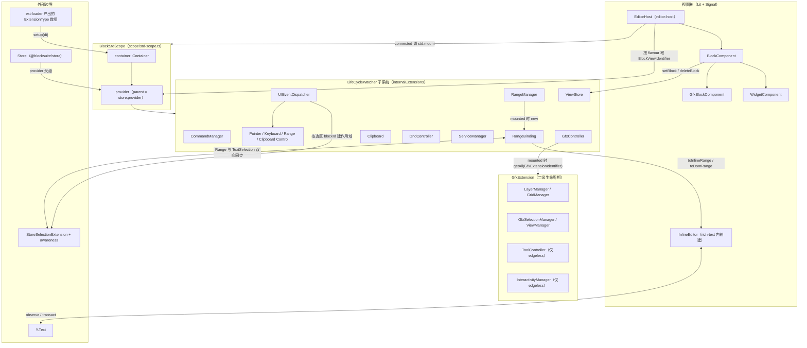
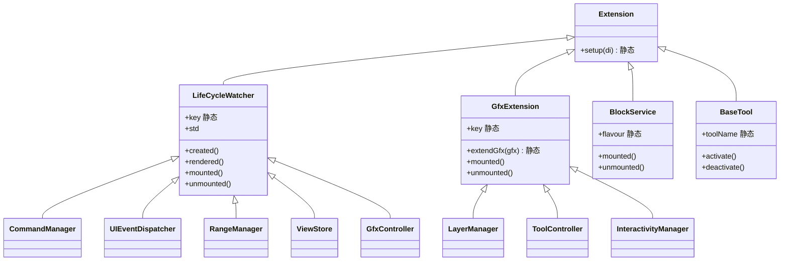
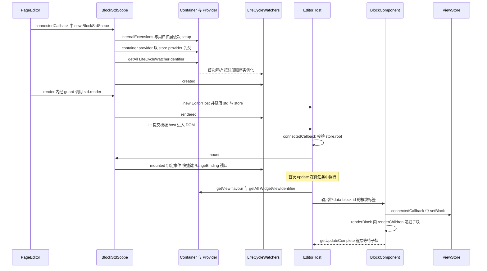
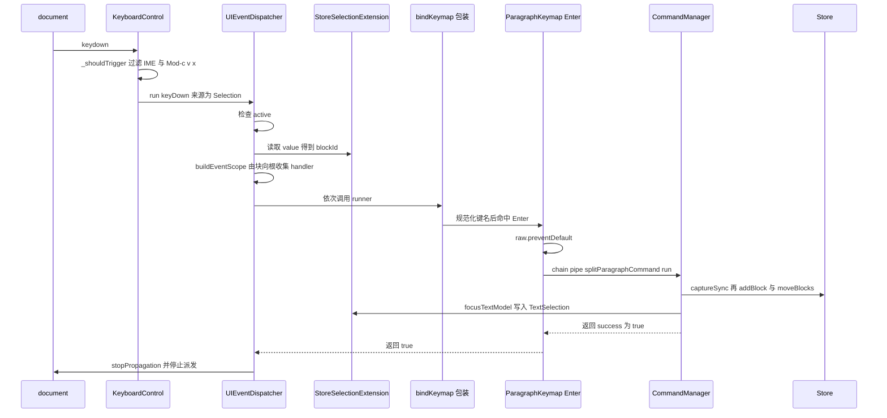
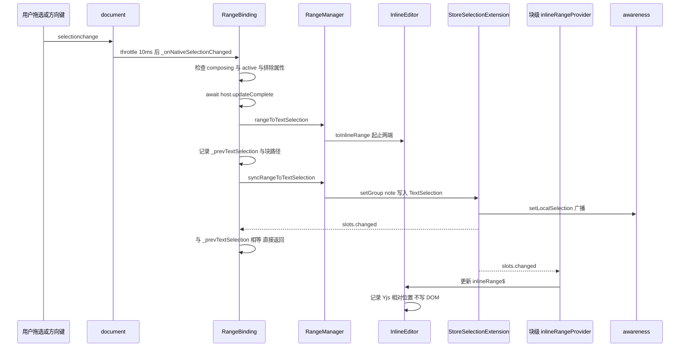
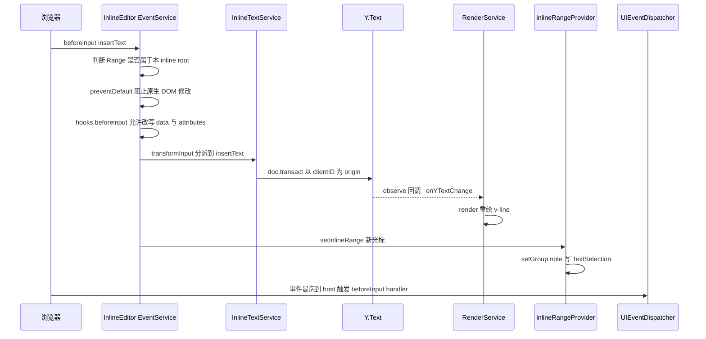

# `@blocksuite/std` 精讲

> 一句话：`@blocksuite/std` 是 BlockSuite 的**编辑器视图层运行时**——它以 `BlockStdScope` 为根、以 `@blocksuite/global/di` 为总线，把 store 的块树渲染成 Lit 组件树，并提供 Extension / Command / Event / Selection 四大机制与 gfx 白板底座；AFFiNE 所有块、widget、白板交互都"寄生"在它上面。
>
> 对应分层文档：[`@blocksuite/std`](../L2-编辑器内核框架/blocksuite-std.md) · 源码：`blocksuite/framework/std`

分层文档已经讲清了"有哪些模块、各自是什么"。本篇只讲分层文档没讲透的部分：**DI 解析的真实规则、生命周期各钩子的精确时机、命令链的执行模型与坑、事件作用域的排序细节、选区三方（Selection / Range / InlineEditor）如何避免互相回环**，以及 gfx 如何在同一套运行时里再套一层生命周期。

## 0. 为什么是重点包

| 指标 | 数值 | 说明 |
| --- | --- | --- |
| 直接被依赖 | 65 个工作区包（全仓第 1） | 实测：仓库内 65 个 `package.json` 声明了 `@blocksuite/std`（不含自身）；作为对比，`@blocksuite/store` 为 48 个 |
| 传递被依赖 | 93 个 | 编排方统计 |
| 源码行数 | 约 21,611 行（编排方口径） | 实测 `src` 下非测试 `.ts` 共 21,586 行，差异在 0.2% 以内；另有测试约 4,044 行。framework 层对比：store 8,384、global 5,155、sync 1,553，std 为 framework 层最大 |
| 所在链路 | 编辑器视图层运行时 | store 的数据 → std 渲染与交互 → 各 `affine-block-*` / `affine-widget-*` / `affine-gfx-*` 的业务 |

包内体量分布（实测，非测试 `.ts`）很能说明它的"真实重心"：

| 子目录 | 行数 | 占比 | 说明 |
| --- | --- | --- | --- |
| `gfx/` | 11,298 | 52% | 白板：视口、图层、网格索引、工具、交互、surface 模型 |
| `inline/` | 4,545 | 21% | 内联编辑器（`InlineEditor`）与 `RangeManager`/`RangeBinding` |
| `event/` | 1,880 | 9% | `UIEventDispatcher` 与四个 control |
| `view/` | 1,279 | 6% | `EditorHost`、`BlockComponent`、`WidgetComponent`、`ViewStore` |
| `extension/` | 947 | 4% | `LifeCycleWatcher`、各类扩展工厂、dnd |
| `clipboard/` `command/` `selection/` `scope/` 等 | 约 1,600 | 8% | 命令系统只有 283 行，却是被调用最多的范式 |

**满足的标准：**

- **A 依赖枢纽**：65 个直接依赖方覆盖所有 `blocks/*`、`widgets/*`、`gfx/*`、`inlines/*`、`fragments/*`，以及 `affine-shared`、`affine-rich-text`、`affine-components`、`@affine/core`。连纯数据包 `@blocksuite/affine-model` 都依赖它——`blocksuite/affine/model/src` 里有 38 处 `from '@blocksuite/std/gfx'`，因为白板模型基类 `GfxBlockElementModel`/`SurfaceBlockModel` 就定义在 std 的 `gfx/model/` 下。
- **B 体量复杂度**：2.16 万行，横跨 DI、Lit 渲染、Preact Signal、原生 Selection/Range、IME 组合输入、指针手势、Yjs 相对位置等多个高难领域。
- **D 范式定义者**：任何块包的 `view.ts` 都是 `FlavourExtension + BlockViewExtension + KeymapExtension + ...` 的数组（见 `blocksuite/affine/blocks/paragraph/src/view.ts:55-64`）；任何"做一件事"的逻辑都写成 `Command`（如 `blocksuite/affine/blocks/paragraph/src/commands/split-paragraph.ts:9`）；交互一律走 `UIEventHandler` 的"返回 true 即消费"约定。
- 另外它也事实上处在 **C 关键链路**上：每一次按键、点击、选区变化都要穿过 `UIEventDispatcher` 和 `RangeBinding`。

**不懂它会卡在哪：**

1. 读 `blocksuite/affine/blocks/paragraph/src/paragraph-keymap.ts:31-228`：为什么 handler 有时 `return` 有时 `return true`？为什么同一个 `Enter` 要自己调 `raw.preventDefault()`？为什么用 `{ flavour: 'affine:paragraph' }` 而不是 blockId？——这些全是 `UIEventDispatcher.run` 与 `buildEventScope` 的语义。
2. 读 `blocksuite/affine/blocks/root/src/configs/toolbar.ts:84-89` 的 `.tryAll(chain => [...]).pipe(getSelectedModelsCommand, { types: [...] }).run()`：`tryAll` 内失败分支的输出会不会污染后面？`ok` 为 false 时 ctx 里有什么？——要看 `CommandManager._createChain`。
3. 读 `blocksuite/affine/foundation/src/store.ts:31-37`：`TextSelectionExtension` 明明定义在 std，为什么注册在 **store** 扩展而不是 view 扩展？——因为 DI 的 `getAll` 不会穿透父级 provider（见 2.1）。
4. 读 `blocksuite/affine/foundation/src/view.ts:85-87`：`InteractivityManager`、`ToolController` 只在 edgeless 注册，那 `gfx.tool` 这个属性从哪来？——来自 `GfxExtension.extendGfx` 的原型扩展（`blocksuite/framework/std/src/gfx/tool/tool-controller.ts:227-233`）。
5. 读 `packages/frontend/core/src/blocksuite/editors/page-editor.ts:82`：为什么要 `guard([std], () => std.render())`？——`std.render()` 每次都 new 一个 `EditorHost`，而 host 的卸载会让部分子系统不可逆地关闭（见第 6 段第 2 条）。

## 1. 全景架构



逐块解释：

- **外部边界**。std 的输入只有两样：一个 `Store`（数据、slots、选区状态、awareness）和一组 `ExtensionType`（AFFiNE 里由 `getViewManager().config.init().value.get('page')` 之类产出，见 `packages/frontend/core/src/blocksuite/manager/view.ts:370-375`）。它从不直接碰 Yjs 文档结构，唯一例外是 inline 编辑器直接操作 `Y.Text`。
- **`BlockStdScope`**。一个 `Container` 装定义、一个 `provider` 管实例；provider 以 `store.provider` 为父，于是 std 内能 `get` 到 store 层的 `StoreSelectionExtension`、`HistoryExtension` 等。std 本身不持有任何子系统字段，`std.command`/`std.event`/`std.view`/`std.range`/`std.clipboard`/`std.dnd` 全是 `this.get(Xxx)` 的 getter（`blocksuite/framework/std/src/scope/std-scope.ts:68-117`）。
- **LifeCycleWatcher 子系统**。`internalExtensions` 共 14 个（`std-scope.ts:34-49`），其中 10 个是 `LifeCycleWatcher`，另外 4 个（`GfxSelectionManager`/`GridManager`/`LayerManager`/`ViewManager`）是 `GfxExtension`，也混在这张表里注册。注意 **page 模式同样会注册 `GfxController`**，只是没有 surface 时它基本闲置。
- **GfxExtension 二级生命周期**。`GfxExtension` 不是 `LifeCycleWatcher`，它的 `mounted/unmounted` 由 `GfxController.mounted/unmounted` 转发（`blocksuite/framework/std/src/gfx/controller.ts:232-245`）；`InteractivityManager` 再向下转发给 `InteractivityExtension`（`gfx/interactivity/manager.ts:80-96`），形成三级钩子链。
- **视图树**。`EditorHost` → 按 flavour 渲染 `BlockComponent`（或其子类 `GfxBlockComponent`）→ 块内渲染 `widgets` 和 `renderChildren`。块组件在连接时把自己登记进 `ViewStore`，这是"由 id 找组件"的唯一索引。
- **选区三方**。状态在 store 的 `StoreSelectionExtension`（signal + awareness 广播），DOM 侧的 `Range` 由 `RangeBinding` 唯一负责写入，`InlineEditor` 负责"字符偏移 ↔ DOM 节点"的换算。三者的协作见流程 ③。

## 2. 核心抽象与数据模型

### 2.1 `BlockStdScope`、DI 与 Extension 家族

**职责**：在构造函数里一次性完成"注册 → 建 provider → 触发 created"，之后通过 `mount/render/unmount` 把宿主元素的生命周期广播给所有 watcher。

```ts
// blocksuite/framework/std/src/scope/std-scope.ts:119-140
constructor(options: BlockStdOptions) {
  this.store = options.store;
  this.userExtensions = options.extensions;
  this.container = new Container();
  this.container.addImpl(StdIdentifier, () => this);
  internalExtensions.forEach(ext => { ext.setup(this.container); });
  this.userExtensions.forEach(ext => { ext.setup(this.container); });
  this.provider = this.container.provider(undefined, this.store.provider);
  this._lifeCycleWatchers.forEach(watcher => { watcher.created(); });
}
```

要真正读懂它，必须知道 `@blocksuite/global/di` 的五条解析规则（分层文档没讲）：

1. **容器只存工厂，不存实例**。`Container` 是 `scope → identifierName → variant → factory` 的三层 Map（`blocksuite/framework/global/src/di/container.ts:101-105`）。同一 `[scope, identifier, variant]` 重复注册会抛 `DuplicateServiceDefinitionError`（`container.ts:179-182`），只有 `override` 才能覆盖——这就是 `ConfigExtensionFactory` 用 `di.override` 的原因（`blocksuite/framework/std/src/extension/config.ts:35-41`），让"后配置覆盖前配置"成立。
2. **provider 创建时克隆容器**。`BasicServiceProvider` 构造时执行 `container.clone()`（`global/src/di/provider.ts:200`），所以 `std.provider` 建好之后再往 `std.container` 里加东西**不会生效**。
3. **实例懒创建、按 provider 缓存**。`getRaw` 通过 `ServiceCachePool.getOrInsert` 首次调用才执行工厂（`provider.ts:151-165`），且单 provider 内单例。`LifeCycleWatcher` 之所以在构造函数末尾就被全部实例化，是因为 `_lifeCycleWatchers` getter 调了 `getAll`。
4. **`get` 会沿父链查找，`getAll` 不会**。`getRaw` 找不到工厂时转发给 `parent`（`provider.ts:137-149`）；而 `getAllRaw` 的回退条件是 `vars === undefined`（`provider.ts:94-100`），但 `getFactoryAll` 永远返回 `new Map(...)`（`container.ts:241-248`），所以**多实现查询只看本层容器**。结论：`std.get(StoreSelectionExtension)` 能拿到 store 层实例，但 store 层的 `StoreSelectionExtension.loaded()` 用 `this.store.provider.getAll(SelectionIdentifier)` 收集选区类型（`blocksuite/framework/store/src/extension/selection/selection-extension.ts:49-54`），**选区类型必须注册在 store 扩展里**。
5. **类即标识符**。`di.add(SomeClass, deps)` 用 `createIdentifierFromConstructor` 生成 `类名 + stableHash` 作为 identifierName（`global/src/di/identifier.ts:100-104`）；`createIdentifier(name)` 返回的标识符本身又是函数，`BlockViewIdentifier('affine:paragraph')` 就是带 variant 的同名标识符（`identifier.ts:78-92`）。`getAll(BlockViewIdentifier)` 返回 `Map<variant, 实现>`。

**作用域层级**。global 的 DI 支持 `scope`（`container.ts` 的 `ContainerEditor.scope`），但 std 和 store 都只用根 scope，层级完全靠 **provider 父链**表达：`StoreOptions.provider`（可选，由 `getStore` 调用方传入，`blocksuite/framework/store/src/model/store-container.ts:42-48`）→ `store.provider`（`store.ts:585`）→ `std.provider`。一个 Store 上可以同时挂多个 std（仓库里有 25 处 `new BlockStdScope(`（含测试），包括预览、嵌入同步文档、AI 渲染），它们共享 store 层实例，各自拥有独立的视图层实例。

#### Extension 家族与生命周期



各家族的 `setup` 写法对照（都是真实源码）：

| 形态 | 注册的 DI 项 | 依赖 | 源码 |
| --- | --- | --- | --- |
| `LifeCycleWatcher` 子类 | 类本身 + `LifeCycleWatcherIdentifier(key)` | `StdIdentifier` | `blocksuite/framework/std/src/extension/lifecycle-watcher.ts:32-47` |
| `BlockService`（已 `@deprecated`） | 类本身 + `BlockServiceIdentifier(flavour)` | `StdIdentifier`、`BlockFlavourIdentifier(flavour)` | `extension/service.ts:57-76` |
| `GfxExtension` 子类 | `GfxClassExtenderIdentifier(key)` + 类本身 + `GfxExtensionIdentifier(key)` | `GfxControllerIdentifier` | `gfx/extension.ts:29-48` |
| `BaseTool` 子类 | `ToolIdentifier(toolName)` | `GfxControllerIdentifier` | `gfx/tool/tool.ts:57-66` |
| `FlavourExtension(f)` | `BlockFlavourIdentifier(f)` | 无 | `extension/flavour.ts:18-26` |
| `BlockViewExtension(f, view)` | `BlockViewIdentifier(f)` | 无 | `extension/block-view.ts:24-33` |
| `WidgetViewExtension(f, id, view)` | `WidgetViewIdentifier` 的 variant 为 flavour 与 id 用竖线拼接 | 无 | `extension/widget-view-map.ts:22-40` |
| `KeymapExtension(factory, opts)` | `KeymapIdentifier('Keymap-' + 自增 id)` | 无 | `extension/keymap.ts:37-49` |
| `ConfigExtensionFactory(id)(cfg)` | `ConfigIdentifier(id)`，用 `override` | 无 | `extension/config.ts:31-44` |
| `GfxViewInteractionExtension(type, cfg)` | `GfxViewInteractionIdentifier(type)` | 无 | `gfx/interactivity/extension/view.ts:123-134` |

一个巧妙点：`GfxControllerIdentifier` 就是 `LifeCycleWatcherIdentifier('GfxController')`（`gfx/identifiers.ts:6-10`），所以 gfx 扩展依赖 `GfxController` 时拿到的正是那个已被当作 watcher 实例化的单例。

**生命周期的精确时机**（源码注释说的是顺序，下面是时机）：

| 钩子 | 触发点 | 此刻能做什么 | 不能做什么 |
| --- | --- | --- | --- |
| `created` | `BlockStdScope` 构造末尾（`std-scope.ts:137-139`） | 读 store、注册不依赖 DOM 的订阅 | 访问 `std.host`（会抛 `ValueNotExists`，`std-scope.ts:96-105`） |
| `rendered` | `std.render()` 新建 `EditorHost` 并赋值后（`std-scope.ts:152-162`） | 拿到 `std.host` 引用 | host 还没进 DOM，`isConnected` 为 false |
| `mounted` | `EditorHost.connectedCallback` 中，所有父类 connected 之后（`blocksuite/framework/std/src/view/element/lit-host.ts:127-139`） | 在 host/document 上绑事件；`UIEventDispatcher` 此时 `_bindEvents` 并绑定所有 `KeymapIdentifier`（`event/dispatcher.ts:414-426`）；`RangeManager` 此时 new `RangeBinding`（`inline/range/range-manager.ts:134-136`） | **块组件还没渲染**：Lit 的首次 update 在 connectedCallback 返回后的微任务里才执行，此刻 `std.view.getBlock(...)` 拿不到任何块 |
| `unmounted` | `EditorHost.disconnectedCallback`，在父类 disconnected 之后（`lit-host.ts:141-144`） | 释放资源 | host 的 `disposables` 已被 `WithDisposable` 释放（`blocksuite/framework/global/src/lit/with-disposable.ts:47-50`） |

调用顺序 = 注册顺序：10 个内置 watcher 在前（`ServiceManager` 第一个，所以 `BlockService.mounted` 早于 `UIEventDispatcher.mounted`），用户扩展按数组顺序在后。`EditorLifeCycleExtension`（`extension/editor-life-cycle.ts:7-49`）把四个钩子转成 rxjs `Subject`，供非 watcher 代码订阅。

### 2.2 视图树：`EditorHost` / `BlockComponent` / `WidgetComponent` / `ViewStore`

**`EditorHost`** 的渲染核心是一个按 model 生成静态模板的函数：

```ts
// blocksuite/framework/std/src/view/element/lit-host.ts:62-94（节选）
private readonly _renderModel = (model: BlockModel): TemplateResult => {
  const block = this.store.getBlock(model.id);
  if (!block || block.blockViewType === 'hidden') return html`${nothing}`;
  const schema = this.store.schema.flavourSchemaMap.get(flavour);
  const view = this.std.getView(flavour);
  if (!schema || !view) { console.warn(`Cannot find render flavour ${flavour}.`); return html`${nothing}`; }
  const widgetViews = this.std.provider.getAll(WidgetViewIdentifier);
  const widgets = Array.from(widgetViews.entries()).reduce((mapping, [key, tag]) => {
    const [widgetFlavour, id] = key.split('|');
    if (isMatchFlavour(widgetFlavour, model)) {
      mapping[id] = html`<${tag} ${unsafeStatic(WIDGET_ID_ATTR)}=${id}></${tag}>`;
    }
    return mapping;
  }, {} as Record<string, TemplateResult>);
  const tag = typeof view === 'function' ? view(model) : view;
  return html`<${tag} ${unsafeStatic(BLOCK_ID_ATTR)}=${model.id}
    .widgets=${widgets} .viewType=${block.blockViewType}></${tag}>`;
};
```

几个分层文档没讲的细节：

- `BlockViewType` 可以是函数 `(model) => StaticValue`（`blocksuite/framework/std/src/spec/type.ts:4`），同一 flavour 可按 model 内容选不同组件。
- widget 的 flavour 支持后缀 `/*`：`isMatchFlavour` 会把 `a/b/*` 解释为"父链依次为 b、a 的任意块"（`lit-host.ts:31-44`）。
- **块组件只拿到 `data-block-id` 和 `widgets`/`viewType` 三个输入**，model 是在 `BlockComponent.model` getter 里按 id 懒查并缓存的（`block-component.ts:108-121`）。
- `renderChildren` 是 host 上的箭头函数，用 `repeat` 按 `child.id` 做 keyed diff（`lit-host.ts:96-105`）；`BlockComponent.renderChildren` 只是 `this.host.renderChildren.bind(this)`（`block-component.ts:129-131`），`bind` 对箭头函数无效，实际始终以 host 为 this。

**Lit 与 Signal 如何结合**。`EditorHost`、`BlockComponent`、`WidgetComponent` 都套了 `SignalWatcher`：它在每次 `performUpdate` 外包一个 Preact `effect`，渲染中读过的 signal 变化时自动 `requestUpdate`（`blocksuite/framework/global/src/lit/signal-watcher.ts:37-70`）。而 store 的 `BlockModel.children` 是 `computed`（`blocksuite/framework/store/src/model/block/block-model.ts:22-31,96-98`），所以**父块在 `renderChildren(this.model)` 时就订阅了自己的子列表**——增删子块只会让直接父块重渲染，而不是整棵树。属性变化走另一条路：`BlockComponent.connectedCallback` 订阅 `model.propsUpdated` 再 `requestUpdate`（`block-component.ts:229-233`）。

**`BlockComponent` 的渲染管线**是一个可追加的 renderer 数组，按 reduce 依次包裹：

```ts
// block-component.ts:242-247 与 284-289
override render() {
  return this._renderers.reduce((acc, cur) => cur.call(this, acc), nothing as unknown);
}
protected accessor _renderers = [this.renderBlock, this._renderMismatchBlock, this._renderViewType];
```

即 `renderBlock()` 产出内容 → 版本不匹配时替换为警告 → 按 `viewType` 决定 `display`/`hidden`/`bypass`（`bypass` 只渲染子块，`block-component.ts:186-192`）。`addRenderer` 可以在外层再包一层（如 `CaptionedBlockComponent`）。

**`WidgetComponent` 与块组件不同的三点**：它继承的是 `LitElement` 而非 `ShadowlessElement`（`widget-component.ts:13-17`），**默认有 Shadow DOM**；它通过 `@consume` 拿 `modelContext`/`serviceContext`（由宿主块 `@provide`，`block-component.ts:280-293`），所以 `this.model` 是宿主块的 model；它的 `handleEvent`/`bindHotKey` 默认按宿主 **flavour** 注册（`widget-component.ts:18-28,62-71`）。

**`ViewStore`** 只是两个 Map 和一个 `viewUpdated: Subject`（`view/view-store.ts:22-145`）。注册发生在块的 `connectedCallback`（`block-component.ts:217`），但**删除只在 store 发出该块的 `delete` 事件时发生**（`block-component.ts:219-226`），块组件本身没有覆写 `disconnectedCallback`。这保证了块被临时移出 DOM（如重排）时索引不丢。

### 2.3 `Command` 与 `Chain`

```ts
// blocksuite/framework/std/src/command/types.ts:18-42（节选）
export type Command<Input = InitCommandCtx, Output = {}> = (
  input: Input & InitCommandCtx, next: (output?: Output) => void) => void;
export type Chain<CommandCtx extends object = InitCommandCtx> = {
  with: <Out extends object>(input: Out) => Chain<CommandCtx & Out>;
  pipe: {
    <Out extends object>(command: Command<CommandCtx, Out>): Chain<CommandCtx & Out>;
    <Out extends object, In extends object>(command: Command<In, Out>, input?: In): Chain<CommandCtx & In & Out>;
  };
  try: <Out extends object>(commands: (chain: Chain<CommandCtx>) => Chain<CommandCtx & Out>[]) => Chain<CommandCtx & Out>;
  run: () => [false, Partial<CommandCtx> & InitCommandCtx] | [true, CommandCtx];
};
```

**类型推断**靠两点：`pipe` 的第一个重载把当前 `CommandCtx` 直接当作命令的 `Input`，所以前序命令产出的字段能被后序命令"看到"；返回类型 `Chain<CommandCtx & Out>` 用交叉类型不断累积。`run()` 的返回是可辨识联合：只有 `success === true` 时 ctx 才是完整类型，失败时是 `Partial`。

**执行模型**是同步的 CPS（续延传递）递归：

```ts
// blocksuite/framework/std/src/command/manager.ts:229-237
function runCmds(ctx: InitCommandCtx, [cmd, ...rest]: Command[]) {
  let _ctx = ctx;
  if (cmd) {
    cmd(ctx, data => { _ctx = runCmds({ ...ctx, ...data }, rest); });
  }
  return _ctx;
}
```

- `pipe(command, input)` 的包装是 `(ctx, next) => command({ ...ctx, ...input }, next)`（`manager.ts:127-133`）：**显式 input 覆盖链上同名字段**，但 input 本身不会写回 ctx，只有 `next(output)` 的内容会被合并进后续 ctx。
- `run()` 在命令数组尾部追加一个"置 `success = true`"的哨兵命令（`manager.ts:105-122`）；任何异常被 `catch` 后只 `console.error`，返回 `[false, ctx]`。
- `try` / `tryAll` 会用 `chain()` 新建内层链，并在每个分支前插入 `(_, next) => next(ctx)` 把外层 ctx 注入（`manager.ts:134-195`）。每个分支跑完都执行 `ctx = { ...ctx, ...branchCtx }`——**不论成功失败**。
- `with(value)` 等价于插一个 `next(value)` 的命令（`manager.ts:123-126`）。
- `exec(cmd, input)` 就是 `chain().pipe(cmd, input).run()`（`manager.ts:221-226`）。

### 2.4 `UIEventDispatcher` 与 `UIEventStateContext`

**事件状态**是一个按 `type` 字符串索引的袋子：每个控制器把 `UIEventState`（`defaultState`）、`EventSourceState`（`sourceState`）以及专用状态（`keyboardState`/`pointerState`/`clipboardState`）塞进 `UIEventStateContext`（`event/base.ts:14-50`）。类型安全靠全局接口合并：每个 state 文件都 `declare global { interface BlockSuiteUIEventState { ... } }`（如 `event/state/keyboard.ts`），于是 `ctx.get('keyboardState')` 能推出 `KeyboardEventState`。

**作用域构建**（`dispatcher.ts:371-412`）的精确顺序：

1. 先挑出 flavour 与 blockId 都为空的**全局 handler**，留到最后；
2. 以起始 blockId 集合为第一层：收集 `blockId` 命中的 handler，再收集这些块 flavour 的 handler（同一 flavour 全程只收一次，`flavourSeen`）；
3. 把集合换成各自的父块 id，重复第 2 步直到根；
4. 拼上全局 handler。

起始 blockId 从哪来取决于 `EventSourceState.sourceType`：键盘、剪贴板、`beforeInput` 等 bypass 事件用 **Selection**（当前 `std.selection.value` 的 blockId，`dispatcher.ts:251-259`）；指针类事件用 **Target**（`event.target` 最近的 `[data-block-id]`，找不到时退回 Selection，`dispatcher.ts:261-275`，`event/control/pointer.ts:25`）；`selectionChange` 和组合输入事件由 `RangeControl` 根据原生 Range 跨越的块自行算出作用域后传入 `run` 的第三个参数（`event/control/range.ts:11-24,80-139`）。

**同层内的顺序**：`add` 用 `unshift`（`dispatcher.ts:361`），**后注册的先执行**。`KeymapExtension` 的 id 是模块级自增计数器，`mounted` 时按 Map 插入顺序逐个 `bindHotkey`，因此在 `blocksuite/affine/blocks/paragraph/src/view.ts:58-59` 中排在后面的 `ParagraphKeymapExtension` 会先于 `ParagraphTextKeymapExtension` 被询问。

**消费语义**（`dispatcher.ts:428-453`）：非 active 直接 return；遍历 runner，第一个返回 truthy 的 handler 终止派发，并对非合成事件调用 `stopPropagation()`——**注意不是 `preventDefault()`**，阻止浏览器默认行为必须由 handler 自己做。`click`/`doubleClick`/`tripleClick` 是合成事件（`dispatcher.ts:82`），不会 `stopPropagation`。

**监听位置**：键盘和剪贴板监听在 `document`（`event/control/keyboard.ts:116-144`，`event/control/clipboard.ts:50-54`），指针和 bypass 事件监听在 host。正因为键盘在 document 上，`active` 门控才至关重要：静态 `_activeDispatcher` 保证同一时刻只有一个 dispatcher 处理事件（`dispatcher.ts:333-348`）。`KeyboardControl._shouldTrigger` 会跳过 `isComposing` 以及不带 Shift/Alt 的 Mod-c/v/x（`keyboard.ts:29-43`），让原生 copy/paste/cut 事件交给 `ClipboardControl`。

**快捷键匹配**（`event/keymap.ts:67-118`）基于 `w3c-keyname`：先按"修饰键 + keyName"直接匹配；单字符键再尝试去掉 Shift；最后在有修饰键时回退到 `keyCode` 推出的基础键名，但 macOS 上 Alt+字母产生的非 ASCII 字符被刻意排除（`keymap.ts:94-108`，对应 issue #14059），只保留 Alt+数字。

### 2.5 选区三方：`BaseSelection` / `RangeManager`+`RangeBinding` / `InlineEditor`

**`BaseSelection` 子类**（std 定义，store 管状态）：

| 类 | `group` | `type` | `recoverable` | 关键字段 | 源码 |
| --- | --- | --- | --- | --- | --- |
| `TextSelection` | `note` | `text` | true | `from`/`to`（`blockId,index,length`）、`reverse` | `blocksuite/framework/std/src/selection/text.ts:34-115` |
| `BlockSelection` | `note` | `block` | 默认 false | `blockId` | `selection/block.ts` |
| `SurfaceSelection` | `gfx` | `surface` | true | `elements`、`editing`、`inoperable` | `selection/surface.ts:11-40` |
| `CursorSelection` | `gfx` | `cursor` | 默认 false | `x`、`y`，blockId 固定为 `[gfx-cursor]` | `selection/cursor.ts:9-27` |

`group` 决定 `setGroup(group, list)` 时被整体替换的范围（`store/.../selection-extension.ts:166-169`）；`recoverable` 决定 `RangeBinding` 在没有文本选区时是否把焦点拉回 host（`inline/range/range-binding.ts:284-297`）。`StoreSelectionExtension.set` 一次做三件事：写 awareness（远端可见）、写 signal、发 `slots.changed`（`selection-extension.ts:157-164`）；它还在 undo 栈的 `stack-item-added/popped` 上存取选区，使撤销时光标复原（`selection-extension.ts:22-31`）。

**`RangeManager`** 负责纯换算：`rangeToTextSelection`（Range → 起止块 → 起止 `InlineEditor.toInlineRange`，`range-manager.ts:152-189`）、`textSelectionToRange`（反向，跨块时拼接首块起点与尾块终点，`range-manager.ts:223-260`）、`getSelectedBlockComponentsByRange` 的 `all/flat/highest` 三种模式（`range-manager.ts:88-132`）。**`RangeBinding`** 负责同步时机与防回环（流程 ③）。两个 DOM 属性用于把子树排除在同步之外：`data-range-sync-exclude`、`data-range-query-exclude`（`inline/range/consts.ts:1-9`），database、widget 内输入框都靠它。

**`InlineEditor` 与 `Y.Text` 的绑定**（`blocksuite/framework/std/src/inline/inline-editor.ts`）：

- 构造时要求 `yText.doc` 存在且文本不含 `\r`（`inline-editor.ts:201-213`），渲染侧每 64 次变更再抽检一次（`inline/services/render.ts:62-70`）。
- `mount(root, eventSource, readonly)` 把实例挂到 `root.inlineEditor`、设置 `data-v-root`、清空子节点并删除 Lit 的 `_$litPart$` 标记，然后挂载 event/range/render 三个服务（`inline-editor.ts:232-257`）。
- **写**：所有文本操作经 `transact(fn)` → `doc.transact(fn, doc.clientID)`（`inline-editor.ts:285-295`）。store 的 `UndoManager` 的 `trackedOrigins` 正是 `spaceDoc.clientID`（`blocksuite/framework/store/src/extension/history/history-extension.ts:23`），所以内联输入天然进入撤销栈；`withoutTransact = true` 时 origin 为 null，不入栈。
- **读**：`RenderService.mount` 里 `yText.observe(this._onYTextChange)`，任何来源的变更都触发 `render()` 把 delta 切成行渲染为 `v-line`/`v-element`/`v-text`；远端事务还会用 `Y.RelativePosition` 重新定位本地光标（`render.ts:19-90`）。
- **选区来源可替换**：AFFiNE 的 `rich-text` 构造 `InlineEditor` 时传入块级 `inlineRangeProvider`（`blocksuite/affine/rich-text/src/rich-text.ts:168-179`，provider 来自 `getInlineRangeProvider(this)`，`blocksuite/framework/std/src/inline/range/inline-range-provider.ts:8-118`）。一旦 override，`InlineEditor` 就**不再自己监听 selectionchange，也不再自己写 DOM Range**（`inline/services/event.ts:554-560`，`inline/services/range.ts:257`）——DOM Range 的唯一写者变成 `RangeBinding`。

### 2.6 gfx：同一运行时里的第二套坐标系

`GfxController`（`gfx/controller.ts:33-284`）持有 `viewport: Viewport`、`keyboard`、`cursor$`、`surface$`，并以 getter 暴露 `layer`/`grid`。构造时就调用所有 `GfxClassExtenderIdentifier` 的 `extendFn`（`controller.ts:93-95`），这正是 `gfx.tool`、`gfx.selection` 这类"看起来是字段、其实来自扩展"的属性的来源。命中测试 `getElementByPoint` 先用 `GridManager.search` 做空间索引粗筛，再 `includesPoint` 精判，最后按 `LayerManager.compare` 排序取最上层（`controller.ts:132-179`）。

`GfxBlockComponent`（`view/element/gfx-block-component.ts:104-214`）在 `BlockComponent` 之上加了四件事：

- 连接时设为 `position: absolute`，订阅 `viewport.viewportUpdated`、块更新、图层更新三路信号来更新 CSS transform 与 z-index（`gfx-block-component.ts:60-102`）；
- `transformState$`（`idle`/`survival`/`active`）控制可见性和指针事件，配合 `gfx-viewport` 只渲染视口内的块；
- **首次渲染节流**：覆写 `scheduleUpdate`，若父元素实现了 `scheduleUpdateChildren`（`GfxViewportElement`）就排队等待，并发数由 `maxConcurrentRenders` 控制（`gfx-block-component.ts:193-205`，`gfx/viewport-element.ts:943-996`）；
- 默认拖拽：`onDragStart` 时 `model.stash('xywh')`，`onDragMove` 直接写本地 `xywh`，`onDragEnd` 时 `pop` 提交（`gfx-block-component.ts:125-135`）——拖拽过程不产生协同流量。

交互扩展点分两层：`GfxViewInteractionExtension(flavourOrType, config)` 为某类视图声明 `handleResize`/`handleRotate`/`handleSelection` 钩子（`gfx/interactivity/extension/view.ts:60-134`），由 `InteractivityManager` 在交互时按 flavour 查找（`gfx/interactivity/manager.ts:160,699,836`）；工具则通过 `BaseTool` 注册、`ToolController.setTool` 切换（`gfx/tool/tool-controller.ts:575-615`），`ToolController` 在 `mounted` 时向 `std.event` 注册**全局** `dragStart`/`dragMove`/`dragEnd`/`pointerMove`/`contextMenu` 等 handler，再分发给当前工具（`tool-controller.ts:256-540,561-573`）。

## 3. 关键流程走读

### 流程 ①：编辑器启动——从 `new BlockStdScope` 到第一个块出现在 DOM



1. **创建 std**。`PageEditor.connectedCallback` 里 `new BlockStdScope({ store: this.doc, extensions: this.specs })`（`packages/frontend/core/src/blocksuite/editors/page-editor.ts:58-67`），doc 变化时在 `willUpdate` 里重建（`page-editor.ts:87-100`）。specs 由 React 层 `lit-adaper.tsx:283` 传入。
2. **注册**。`std-scope.ts:122-133`：先 `addImpl(StdIdentifier, () => this)`，再 setup 14 个内置扩展、再 setup 用户扩展。此阶段只往容器写工厂，任何重复定义立即抛错。
3. **建 provider 并实例化 watcher**。`std-scope.ts:135-139`。`getAll(LifeCycleWatcherIdentifier)` 触发每个 watcher 的工厂 `provider => provider.get(this)`，进而 `new Watcher(std)`。`GfxController` 构造函数里还会立即执行所有 `extendGfx`（`controller.ts:80-96`），`UIEventDispatcher` 构造函数里创建四个 control（`dispatcher.ts:124-131`）。
4. **`created`**。同上，按注册顺序同步调用。
5. **`render()`**。`page-editor.ts:75-85` 在自身 Lit 渲染中执行 `guard([std], () => std.render())`；`std-scope.ts:152-162` new 出 `EditorHost`，此时 `std.host` 可用，随后广播 `rendered`。
6. **`mounted`**。host 被 Lit 插入 DOM，`EditorHost.connectedCallback` 先让 `SignalWatcher`/`WithDisposable`/`ShadowlessElement` 完成各自逻辑，然后检查 `store.root`（缺失抛 `NoRootModelError`），再 `std.mount()`（`lit-host.ts:127-139`）。`requiredProperties` 装饰器在原 connectedCallback 之后才校验 `store`/`std`（`view/decorators/required.ts:44-57`）。
7. **首次渲染**。Lit 在微任务中调用 `EditorHost.render()` → `_renderModel(store.root)`（`lit-host.ts:192-197`），按 `BlockViewIdentifier(flavour)` 取标签，收集匹配的 widget 模板（`lit-host.ts:62-94`）。
8. **块组件连接**。根块 `connectedCallback`：`ViewStore.setBlock(this)`、订阅 `blockUpdated` 的删除事件与 `propsUpdated`（`block-component.ts:214-234`）。`@consume` 的 `std`/`store` 来自 host 的 `@provide`（`lit-host.ts:199-205`）。
9. **递归**。各块在 `renderBlock()` 里调 `this.renderChildren(this.model)`（如 `blocksuite/affine/blocks/root/src/page/page-root-block.ts:400-407`），子块重复第 7、8 步。
10. **稳定**。`BlockComponent.getUpdateComplete` 会 `await` 所有子块的 `updateComplete`（`block-component.ts:236-240`），所以 `await host.updateComplete` 等于"整棵块树首轮渲染完成"——`RangeBinding` 正是依赖这一点在新块渲染后再落光标。

### 流程 ②：在段落里按 Enter——从原生事件到命令再到 store



1. **原生事件入口**。`KeyboardControl.listen` 在 `document` 上监听 `keydown`（`event/control/keyboard.ts:116-117`）；`_down` 先过 `_shouldTrigger`（`keyboard.ts:15-43`），再构造包含 `keyboardState` 的 context 并 `run('keyDown', ...)`。
2. **门控**。`run` 首行 `if (!this.active) return;`（`dispatcher.ts:433`）。多个编辑器共存时只有最近被点击/聚焦的那个会继续。
3. **作用域**。来源是 Selection，取当前所有选区的 blockId（`dispatcher.ts:251-259`）。光标在段落 P 中时，顺序为：绑定在 P 上的 blockId handler → `affine:paragraph` 的 flavour handler → P 的父 note 的 handler → `affine:note` → 根 → `affine:page` → 全局。
4. **keymap 包装**。每个 `KeymapExtension` 在 `mounted` 时被 `bindHotkey` 成一个 `keyDown` handler（`dispatcher.ts:420-425`，`keyboard.ts:90-114`）；包装内若 `composition` 为 true 直接返回 false，否则 `bindKeymap(keymap)(ctx)` 做键名匹配（`event/keymap.ts:67-118`）。
5. **业务 handler**。`ParagraphKeymapExtension` 的 `Enter`（`blocksuite/affine/blocks/paragraph/src/paragraph-keymap.ts:103-178`）：不是段落或在 callout 内就 `return`（falsy，让外层 handler 有机会处理）；否则 `raw.preventDefault()` 阻止浏览器产生 `insertParagraph` 的 beforeinput，再按位置选择 `addParagraphCommand` 或 `splitParagraphCommand`。
6. **命令执行**。`splitParagraphCommand`（`commands/split-paragraph.ts:9-80`）读取 `std.selection` 与 inline range，`store.captureSync()` 切出独立撤销步，`text.split` + `store.addBlock` + `store.moveBlocks` 写 Yjs，最后 `focusTextModel(std, id)` 把 `TextSelection` 设到新块（`blocksuite/affine/rich-text/src/dom.ts:66-73`，其中先 `std.event.active = true`），然后 `next({ paragraphConvertedId: id })`。
7. **消费**。handler 返回 true → `run` 调 `stopPropagation()` 并 return（`dispatcher.ts:442-452`）。
8. **视图回流**（图外）。store 的 children 变化 → note 块的 `model.children` computed 失效 → `SignalWatcher` 让 note 块重渲染 → `repeat` 插入新段落组件 → 新段落 `connectedCallback` 登记 `ViewStore`。与此同时第 6 步写入的 `TextSelection` 触发 `RangeBinding._onStdSelectionChanged`，它 `await host.updateComplete` 后才去找新块的 inline editor 落 DOM 光标（`range-binding.ts:302-331`）——这就是为什么"设置选区"可以早于"块渲染完成"。

### 流程 ③：文本选区变化——原生 Range 与 `TextSelection` 的双向同步



1. **监听**。`RangeBinding` 构造时在 `document` 上以 10ms throttle 监听 `selectionchange`，同时订阅 `selection.slots.changed`、注册 `beforeInput` handler 和 composition 监听（`inline/range/range-binding.ts:353-386`）。它挂在 `host.disposables` 上，随 host 断开自动释放。
2. **过滤**（`range-binding.ts:168-237`）：正在组合输入、焦点不在本编辑器（`isActiveInEditor`，`inline/range/active.ts:52-60`）、Range 不在 host 内、Range 直接落在 `EditorHost` 上、起止都在 `contenteditable=false` 元素上、处于 `data-range-sync-exclude` 子树、或两端都不在 `v-text` 内——后几种情况会清掉 text 选区甚至 `removeRange`。
3. **换算**。`rangeToTextSelection` 找起止块（`getClosestBlock`）和起止 inline editor（`getClosestInlineEditor`，靠 `[data-v-root]`），各自 `toInlineRange(range)`，同块则 `to = null`（`range-manager.ts:152-189`）。方向由 `anchorNode`/`focusNode` 比较得出（`range-binding.ts:244-250`）。
4. **防回环记账**。先写 `_prevTextSelection = { selection, path }` 再调用 `syncRangeToTextSelection`（`range-binding.ts:265-269`）。
5. **写状态**。`setGroup('note', [text])` 替换 note 组（保留 gfx 组），`set` 写 awareness、signal、`slots.changed`（`selection-extension.ts:157-169`）。
6. **回声抑制**。`_onStdSelectionChanged` 收到同一选区，在 `updateComplete` 后比较 `text.equals(prev)` 与块路径，相等即 return（`range-binding.ts:303-315`），不会再写 DOM。
7. **块级 provider**。每个文本块的 `getInlineRangeProvider` 也订阅了 `slots.changed`，算出"本块在该选区中的片段"写入自己的 `inlineRange$`（`inline-range-provider.ts:96-112`）；`InlineEditor.RangeService` 的 effect 据此更新 `lastStartRelativePosition` 等，但因 provider 被 override 而不写 DOM（`inline/services/range.ts:232-268`）。
8. **远端**。其他客户端的 `StoreSelectionExtension` 在 awareness `change` 时只取 key 以本 store id 开头的 `selectionV2` 条目，反序列化成 `remoteSelections`（`selection-extension.ts:56-95`），供 `affine-widget-remote-selection` 等渲染。

**反方向**（代码设置选区，如流程 ② 第 6 步）：`slots.changed` → `_onStdSelectionChanged` → 非本 host 聚焦或非 active 时忽略 → 无文本选区且没有 `recoverable` 选区时 `host.focus()` → `await host.updateComplete` → `syncTextSelectionToRange` → `RangeManager.set(range)`（`range-binding.ts:272-332`，`range-manager.ts:191-221`）。DOM 改变又触发 `selectionchange`，回到正方向第 4~6 步，因为选区相等而终止。整个闭环里**只有 `RangeBinding` 写 DOM Range**，这是它不会无限振荡的根本原因。

### 流程 ④：输入一个字符——`beforeinput` 到 `Y.Text`



1. `InlineEditor.EventService.mount` 在 `eventSource` 上监听 `beforeinput`（`inline/services/event.ts:571-573`）。
2. `_onBeforeInput` 判断 Range 是否属于本 inline root；跨到另一个 inline root 时直接 return，交给 `RangeBinding` 的跨块处理（`event.ts:89-115`）。
3. 组合输入中直接 return；否则**无条件 `preventDefault()`**（`event.ts:117-125`），源码注释说明这是为了防止 Firefox 删掉 Lit 的标记注释节点。
4. 调 `hooks.beforeinput`（AFFiNE 的 `rich-text` 传入 `onVBeforeinput`，`rich-text.ts:171-174`），再 `transformInput` 按 `inputType` 分派（`event.ts:242-250`，`inline/utils/transform-input.ts:54-78`）。
5. `insertText` 在 `transact` 内写 `Y.Text`（`inline/services/text.ts`、`inline-editor.ts:285-295`）；`yText.observe` 回调触发 `render()`（`render.ts:54-77,97`）。
6. `setInlineRange` 经 provider 变成 `TextSelection`（`inline-range-provider.ts:75-93`），再由流程 ③ 的反方向落 DOM。
7. 事件继续冒泡到 host，`UIEventDispatcher` 的 bypass `beforeInput` handler 运行（`dispatcher.ts:134-156`）；其中 `RangeBinding` 注册的 handler 专门处理**跨块选区输入**：删除首块尾段、尾块头段并 `join`，再删除中间块（`range-binding.ts:31-85`）。

## 4. 源码阅读路线

1. **`blocksuite/framework/global/src/di/container.ts` + `provider.ts`**（约 680 行）：读懂 `addFactory` 的重复检查、`provider()` 的 clone、`getRaw` 与 `getAllRaw` 的父链差异、`track` 的循环检测。这是理解 std 一切"为什么拿不到"的前提。
2. **`std/src/scope/std-scope.ts` + `identifier.ts`**：记住 14 个内置扩展的顺序和 9 个标识符；弄清 `getView`、`host` getter 的抛错条件。
3. **`std/src/extension/`**：先 `lifecycle-watcher.ts`，再四个工厂（`flavour.ts`、`block-view.ts`、`widget-view-map.ts`、`keymap.ts`、`config.ts`），最后 `service.ts`/`service-manager.ts`（知道它已 deprecated 但仍被调用 `mounted`）。
4. **`std/src/view/element/lit-host.ts` → `block-component.ts` → `widget-component.ts` → `shadowless-element.ts` → `view/view-store.ts`**，配合 `global/src/lit/signal-watcher.ts`、`with-disposable.ts`：能独立画出"host 如何渲染一个块并让它找到 std、model、widgets"。
5. **`std/src/command/types.ts` → `manager.ts` → `__tests__/command.unit.spec.ts`**：测试用例（`try` 不重复执行前序命令、`tryAll` 全部执行等，`command.unit.spec.ts:159-414`）是最好的语义说明。
6. **`std/src/event/base.ts` → `dispatcher.ts` → `control/keyboard.ts` → `keymap.ts` → `control/range.ts`**：重点是 `buildEventScope` 与 `run`；`control/pointer.ts`（626 行）先只看 `createContext` 用 Target 来源这一点。
7. **`std/src/selection/*.ts` + `store/src/extension/selection/selection-extension.ts` + `base.ts`**：理解 `group`、`recoverable`、awareness 序列化。
8. **`std/src/inline/range/range-manager.ts` → `range-binding.ts` → `inline-range-provider.ts` → `active.ts`**：对照流程 ③ 逐个分支读。
9. **`std/src/inline/inline-editor.ts` → `services/event.ts`（只读 `_onBeforeInput` 与 `mount`）→ `services/render.ts` → `services/range.ts` 的 `mount` → `utils/transform-input.ts`**。
10. **`std/src/gfx/controller.ts` → `extension.ts` → `identifiers.ts` → `view/element/gfx-block-component.ts` → `tool/tool.ts` → `tool/tool-controller.ts`（`_initializeEvents`、`setTool`）→ `interactivity/extension/view.ts`**：建立"gfx 是 watcher 下挂扩展"的心智模型。
11. **`std/src/clipboard/clipboard.ts`、`extension/dnd/index.ts`**：知道剪贴板只提供"按 mimeType 优先级找 adapter"的机制、dnd 是 pragmatic-drag-and-drop 的薄封装即可。
12. 回到业务：`blocksuite/affine/blocks/paragraph/src/`（`view.ts`、`paragraph-keymap.ts`、`commands/`、`paragraph-block.ts`）作为一个完整块的"范式样本"。

**可以先跳过**：`gfx/model/surface/` 的属性装饰器（`field`/`derive`/`local`/`observer`，属于 surface 元素建模，读 surface 块时再看）、`gfx/viewport-element.ts` 的分片显隐算法、`gfx/grid.ts` 与 `gfx/layer.ts` 的内部索引维护、`gfx/interactivity/resize/manager.ts`、`inline/utils/` 下的点位换算、`event/control/pointer.ts` 的手势细节（pinch/pan）、所有 Android IME 补丁分支（`keymap.ts:124-165`、`inline/services/event.ts` 中 `IS_ANDROID` 分支）。

## 5. 设计取舍

### 5.1 一切皆 DI 扩展，而不是硬编码子系统

- **选择**：std 自身的 14 个子系统也走 `setup(di)` 注册，`BlockStdScope` 只是容器 + 生命周期广播器。
- **为什么**：块、widget、工具、配置都可由第三方插拔；同一份 store 能挂多个裁剪过能力的 std（预览、嵌入、AI 渲染）；`ConfigExtensionFactory` 的 `override` 让"后配置覆盖前配置"成为通用机制。
- **代价**：错误延迟暴露（依赖缺失要到第一次 `get` 才抛 `MissingDependencyError`）；`getAll` 不穿透父级这一隐性规则决定了扩展该注册在 store 还是 std；"谁注册了某个标识符"无法静态检索；page 模式也会实例化 `GfxController`、`Viewport`、`LayerManager` 等。
- **替代方案**：像 ProseMirror 那样用 Plugin 数组 + 显式 state 字段。未选的原因是 BlockSuite 需要按 flavour/variant 多实现注册与按需解析，DI 的 variant 机制更贴合。

### 5.2 块组件用 Light DOM，widget 默认用 Shadow DOM

- **选择**：`EditorHost`、`BlockComponent` 继承 `ShadowlessElement`（`createRenderRoot` 返回 this），`WidgetComponent` 直接继承 `LitElement`。
- **为什么**：块内容必须处在同一棵 light DOM 里，原生 Selection 才能跨块连续、`closest('[data-block-id]')` 才能找到块；widget（工具栏、菜单、拖拽柄）是浮层 UI，需要样式隔离。
- **代价**：块样式是"定义即全局"——`finalizeStyles` 在类 finalize 时就把样式追加到 `document.head`，即使元素从未渲染（`shadowless-element.ts:20-35`），只有落在某个 shadow root 内时才走引用计数注入/移除（`shadowless-element.ts:52-96`）；作者必须手动给选择器加作用域前缀。
- **替代方案**：全部 Shadow DOM + `::part` 或全部 light DOM。前者会切断跨块选区；后者让浮层样式泄漏。

### 5.3 命令是同步 CPS 中间件，而不是 Promise 或命令对象

- **选择**：`Command = (ctx, next) => void`，`runCmds` 同步递归，类型靠交叉类型累积。
- **为什么**：零依赖、可组合（`pipe`/`try`/`tryAll`/`with`），前序命令的产出在类型层对后序可见；同步执行保证一个键盘 handler 内"读选区 → 改 store → 设选区"在同一调用栈完成，不会和其他事件交错。
- **代价**：不支持异步（`next` 在 await 之后调用时 `run` 早已返回 `success = false`）；异常被吞成 `console.error`；`try` 分支失败时的部分输出也会合并进 ctx；文档注释里还残留旧 API 写法（`manager.ts:207-213` 的 `.myCommand1()`）。
- **替代方案**：async 命令或 Redux 式 action。未选是因为编辑器绝大多数操作是同步的 Yjs 事务，异步会引入时序问题。

### 5.4 事件按"块树作用域 + 返回值消费"路由，而不是依赖 DOM 冒泡

- **选择**：键盘、剪贴板在 `document` 单点监听，按选区块向根收集 handler，返回 truthy 即消费。
- **为什么**：焦点通常在某个 inline root 的 contenteditable 上，DOM 冒泡路径与"逻辑上谁该处理"不一致（例如多块选区、块选择时焦点在 host 上）；用块树建作用域让"段落不处理就交给 note、再交给页面"自然成立；flavour 级注册让一个 keymap 覆盖所有同类块，而不必每个实例注册一次。
- **代价**：全局唯一 active 的假设在嵌套编辑器（嵌入同步文档、surface-ref 预览各自有 std）里需要大量启发式维护（`dispatcher.ts:163-248` 十几个监听）；handler 顺序依赖注册时序（`unshift`）；在组件实例中注册 flavour 级 handler 会按实例数复制。
- **替代方案**：每个块组件自己监听 DOM 事件。未选是因为跨块操作没有归属，且无法统一处理优先级。

### 5.5 选区：状态在 store、类型在 std、DOM 由 `RangeBinding` 单写

- **选择**：选区是可序列化的值对象数组，放在 store 的 signal 中并同步到 awareness；std 只定义类型与 DOM 同步；`InlineEditor` 被 provider override 后退出 DOM 写入。
- **为什么**：远端选区、撤销恢复光标、多 std 共享同一选区都需要"选区是数据"；单写者消除了 inline 与全局两套逻辑互相覆盖光标的问题。
- **代价**：DOM 光标落地是异步的（等 `host.updateComplete`）且有 10ms throttle；所有挂在同一 store 上的 std 共享一个 `StoreSelectionExtension`，源码里两处 `TODO(@mirone)` 承认这是取舍（`range-binding.ts:273-275`，`active.ts:45-51`）；跨块 IME 需要绕过 Lit 直接 `replaceChildren` 并删除 `_$litPart$`（`range-binding.ts:120-130`），非常脆弱。
- **替代方案**：完全以 DOM Selection 为真相（contenteditable 原生方案）。未选是因为它无法序列化、无法跨编辑器共享，也无法在块组件尚未渲染时预设光标。

## 6. 易错点与调试

1. **在 `mounted` 里找块组件**
   - 现象：`std.view.getBlock(id)` 返回 null，`std.view.views` 为空数组。
   - 原因：`mounted` 在 `EditorHost.connectedCallback` 同步阶段调用，Lit 首次渲染还在微任务队列里（见 2.1 生命周期表格）。
   - 避免：订阅 `std.view.viewUpdated`（`view-store.ts:27`），或 `await std.host.updateComplete` 后再查；GfxExtension 同理。

2. **`EditorHost` 被移动或重挂载后部分功能失灵**
   - 现象：把 host 从 DOM 移出再插回，`viewUpdated` 订阅不再收到事件，`EditorLifeCycleExtension.slots` 不再触发，白板视口不响应。
   - 原因：`unmounted` 是不可逆的：`ViewStore.unmounted` 调 `viewUpdated.complete()`（`view-store.ts:140-144`），`EditorLifeCycleExtension.unmounted` 释放所有 Subject（`editor-life-cycle.ts:43-48`），`GfxController.unmounted` 释放 `viewport`、`keyboard` 和 surface 监听（`controller.ts:239-245`）。只有 `UIEventDispatcher` 会在下次 `mounted` 重建 `DisposableGroup`（`dispatcher.ts:414-418`）。
   - 避免：像 `PageEditor` 那样用 `guard([std], ...)` 保证 host 不重建（`page-editor.ts:82`）；需要换文档时整体重建 std（`page-editor.ts:91-99`）。

3. **扩展注册在错误的层**
   - 现象：`Unknown selection type: xxx`（`selection-extension.ts:33-42`）；或 widget/keymap 注册了却不生效；或启动即抛 `DuplicateServiceDefinitionError`。
   - 原因：`getAll` 只查本层容器（2.1 第 4 条）。选区类型由 store 层 `getAll(SelectionIdentifier)` 收集，必须进 store 扩展；`WidgetViewIdentifier`、`KeymapIdentifier`、`LifeCycleWatcherIdentifier` 由 std 层 `getAll` 收集，必须进 view 扩展。同一个 `LifeCycleWatcher` 类被两个 provider 各注册一次也会因 `di.add(this)` 重复而报错。
   - 排查：在控制台对 `std.provider.getAll(...)` 与 `std.store.provider.getAll(...)` 分别查询，确认实现落在哪层。

4. **命令"没生效"或数据串味**
   - 现象：`run()` 返回 `[false, ctx]` 但没有任何报错；或 `try` 之后的命令读到了失败分支写入的字段。
   - 原因：命令没调 `next`（含条件分支漏写）、在异步回调里调 `next`、或抛异常被 `run` 的 `catch` 吞掉只留 `console.error`（`manager.ts:117-119`）；`try`/`tryAll` 无论分支成败都执行 `ctx = { ...ctx, ...branchCtx }`（`manager.ts:151-152,182-183`）。
   - 避免：命令保持同步，异步操作放在链外；失败分支不要提前 `next` 写半成品；对 `run()` 的结果解构 `const [ok, ctx] = ...` 并显式处理。

5. **事件 handler 的四个陷阱**
   - 返回 true 只 `stopPropagation`，不 `preventDefault`——段落的 `Enter`/`Tab` 都手动调 `raw.preventDefault()`（`paragraph-keymap.ts:150,208`）。
   - 后注册先执行（`dispatcher.ts:361`）；想让自定义 keymap 盖过内置的，要么用更具体的作用域（blockId），要么确保在内置扩展之后注册。
   - 在组件实例里用 `handleEvent(name, fn, { flavour: true })` 会每个实例注册一份 flavour 级 handler：`ParagraphBlockComponent` 的 `compositionStart`（`blocksuite/affine/blocks/paragraph/src/paragraph-block.ts:137-150`）在 N 个段落时有 N 份，任一段落开始组合输入，所有段落的 `_composing` 都会被置 true；handler 若返回 truthy，则只有第一个实例能收到。
   - macOS 上 `Alt-字母` 绑定不会触发（`keymap.ts:94-108`），Alt 组合请用数字或配合 Mod。

6. **选区值对象的语义细节**
   - `TextSelection.empty()` 返回 `!!this.to`（`selection/text.ts:84-86`），名字与语义相反，仓库内无调用，判断折叠请用 `isCollapsed()`。
   - `TextSelection.equals` 不比较 `reverse`（`text.ts:88-97`），方向变化不会被 `RangeBinding` 视为"不同选区"。
   - `RangeBinding._onStdSelectionChanged` 里 `text === this._prevTextSelection`（`range-binding.ts:299`）比较的是 `TextSelection` 与 `{ selection, path }` 对象，只在两者都为 null 时成立；真正的去重在后面的 `equals` + 路径比较。
   - 每次 `selection.set` 都写 awareness，高频（如指针移动中）设置选区会放大协同流量，白板用 `CursorSelection` 时要注意节流。

7. **输入框、自定义可编辑区域"抢"不到光标**
   - 现象：在块内或 widget 里放一个 `input`，聚焦后文本选区被清掉、Range 被 `removeRange`，或编辑器被置为非 active。
   - 原因：`RangeBinding._onNativeSelectionChanged` 对"不在 `v-text` 内"的 Range 会清选区（`range-binding.ts:230-237`）；`shouldDeactivateEditorOnFocusOut` 会在焦点离开 host 时停用 dispatcher（`active.ts:21-43`）。
   - 避免：给该子树加 `data-range-sync-exclude="true"`（同步与失活判定都会豁免），需要从 `getSelectedBlockComponentsByRange` 排除时再加 `data-range-query-exclude="true"`。

8. **以为 `host.updateComplete` 也等待了 widget**
   - 现象：测试里 `await host.updateComplete` 后 widget 内部 DOM 还没就绪。
   - 原因：`EditorHost.getUpdateComplete` 用 `Object.entries(widgetViews)` 遍历一个 `Map`（`lit-host.ts:155-167`），结果恒为空数组，widget 等待实际是空操作；它只额外等待根块，子块由 `BlockComponent.getUpdateComplete` 递归等待。
   - 避免：需要 widget 稳定时，用 `std.view.getWidget(name, hostBlockId)` 拿到实例后单独 `await widget.updateComplete`。

**调试手段**

- **在控制台拿到 std**：Elements 面板选中 `editor-host` 元素后 `$0.std`；`$0.std.provider.getAll(...)` 列举实现（标识符可从 `@blocksuite/std` 导出的 `LifeCycleWatcherIdentifier`、`KeymapIdentifier`、`WidgetViewIdentifier` 获得，或直接在源码断点里取）。
- **看事件作用域**：`$0.std.event.buildEventScope('keyDown', [blockId])` 是公开方法，返回将被调用的 runner 列表（含 `flavour`/`blockId` 字段），可直接定位"谁抢先消费了按键"；`$0.std.event.active` 看门控状态。
- **看选区**：`$0.std.selection.value`、`$0.std.selection.remoteSelections`；订阅 `$0.std.selection.slots.changed` 打印每次变化；`$0.std.range.value` 看原生 Range。
- **看视图索引**：`$0.std.view.views`、`$0.std.view.walkThrough(fn)`（`view-store.ts:104-138`，fn 返回 true 可剪枝）。
- **单独执行命令**：`$0.std.command.exec(cmd, input)` 返回 `[ok, ctx]`，失败时 ctx 停留在失败点之前。
- **DI 报错解读**：`MissingDependencyError` 带解析栈（`provider.ts:112-118`），`CircularDependencyError` 带完整环（`provider.ts:173-180`），递归超过 100 层抛 `RecursionLimitError`。
- **单元测试入口**：`blocksuite/framework/std/src/__tests__/*.unit.spec.ts`，用 vitest 浏览器模式在 Playwright Chromium 中运行（`blocksuite/framework/std/vitest.config.ts`，`testTimeout: 500`）；`__tests__/test-editor.ts` 是最小可用的宿主容器，`test-spec.ts`/`test-block.ts` 给出最小块装配，写复现用例时直接复用。

## 7. 扩展实践

### 7.1 新增一个命令并绑定快捷键

目标：在段落中按 `Mod-Shift-y` 在普通文本与引用之间切换（避开 macOS 上 Cmd+Shift+Q 的系统注销快捷键）。

步骤：
1. 写一个"取当前文本块"的命令，输出 `blockId`；
2. 写一个消费 `blockId` 的切换命令；
3. 用 `KeymapExtension` 按 `affine:paragraph` flavour 绑定；
4. 在某个 `ViewExtensionProvider.setup` 里 `context.register(...)`。

```ts
import { ParagraphBlockModel } from '@blocksuite/affine-model';
import { matchModels } from '@blocksuite/affine-shared/utils';
import { type Command, KeymapExtension, TextSelection } from '@blocksuite/std';

// 1. 输入只依赖 std，输出 blockId
export const getFocusedTextBlockCommand: Command<{}, { blockId: string }> = (
  ctx,
  next
) => {
  const text = ctx.std.selection.find(TextSelection);
  if (!text || !text.isInSameBlock()) return; // 不调 next 即失败
  next({ blockId: text.from.blockId });
};

// 2. 输入声明 blockId，链上前一个命令的输出会被类型推断出来
export const toggleQuoteCommand: Command<{ blockId: string }> = (ctx, next) => {
  const { std, blockId } = ctx;
  const model = std.store.getBlock(blockId)?.model;
  if (!model || !matchModels(model, [ParagraphBlockModel])) return;
  std.store.captureSync(); // 独立撤销步
  std.store.updateBlock(model, {
    type: model.props.type === 'quote' ? 'text' : 'quote',
  });
  next();
};

// 3. flavour 级快捷键：只在选区落在段落及其祖先作用域时被询问
export const QuoteToggleKeymapExtension = KeymapExtension(
  std => ({
    'Mod-Shift-y': ctx => {
      const [ok] = std.command
        .chain()
        .pipe(getFocusedTextBlockCommand)
        .pipe(toggleQuoteCommand)
        .run();
      if (!ok) return; // 返回 falsy，让后续 handler 继续
      ctx.get('keyboardState').raw.preventDefault(); // 消费不等于阻止默认行为
      return true;
    },
  }),
  { flavour: 'affine:paragraph' }
);
```

要点：`Shift` 组合下 `w3c-keyname` 的 `keyName` 通常给出大写 `Y`，直接匹配落空后，靠 `keyCode` 推出的基础键名 `y` 回退命中（`keymap.ts:94-114`）；仓库内 `'Mod-Shift-l'`（`blocksuite/affine/blocks/root/src/keyboard/keyboard-manager.ts:115`）就是同样写法。如果它和内置快捷键冲突，记住"后注册先执行"。

### 7.2 写一个监听事件与视图变化的 Extension

```ts
import { DisposableGroup } from '@blocksuite/global/disposable';
import { LifeCycleWatcher } from '@blocksuite/std';

export class PasteAuditWatcher extends LifeCycleWatcher {
  static override key = 'paste-audit-watcher'; // 必填且全局唯一

  private _disposables = new DisposableGroup();

  override mounted() {
    super.mounted();
    // 支持再次 mounted：上一轮 unmounted 已经 dispose
    if (this._disposables.disposed) this._disposables = new DisposableGroup();

    // 全局 handler：不传 options，处于作用域最末端
    this._disposables.add(
      this.std.event.add('paste', ctx => {
        const { raw } = ctx.get('clipboardState');
        console.info('[paste]', raw.clipboardData?.types);
        return false; // 只观察不消费
      })
    );

    // 块组件在 mounted 之后才渲染，用 viewUpdated 观察
    this._disposables.add(
      this.std.view.viewUpdated.subscribe(({ type, method, id }) => {
        if (type === 'block' && method === 'add') {
          // 此时 this.std.view.getBlock(id) 已可用
        }
      })
    );
  }

  override unmounted() {
    super.unmounted();
    this._disposables.dispose();
  }
}
```

注册：`context.register(PasteAuditWatcher)`（类本身就是 `ExtensionType`，`setup` 是静态方法）。注意全局 `paste` handler 位于作用域最后。页面根块的 `PageClipboard`（同样是 `LifeCycleWatcher`）在自己的 `mounted` 里 `std.event.add('paste', this.onPagePaste)`（`blocksuite/affine/blocks/root/src/clipboard/page-clipboard.ts:183-196`），也是全局 handler；两者谁先执行取决于谁后 `mounted`（后 add 的先执行）。若 `onPagePaste` 先执行且返回 truthy，你的观察者就收不到——要稳定观察粘贴内容，用 `std.clipboard.use(middleware)` 挂 Transformer 中间件更可靠。

### 7.3 新增一个 widget 的最小骨架

目标：给每个段落挂一个"被块选中时显示"的角标。宿主块必须在 `renderBlock` 里输出 `this.widgets`，段落块满足这一点（`blocksuite/affine/blocks/paragraph/src/paragraph-block.ts:253-256`），而 `affine:note` 块不渲染 widgets，挂上去也看不见。

```ts
// widget.ts
import type { ParagraphBlockModel } from '@blocksuite/affine-model';
import { WidgetComponent, WidgetViewExtension } from '@blocksuite/std';
import { html, nothing } from 'lit';
import { literal, unsafeStatic } from 'lit/static-html.js';

export const MY_PARAGRAPH_BADGE = 'my-paragraph-badge-widget'; // 不能含竖线

export class MyParagraphBadgeWidget extends WidgetComponent<ParagraphBlockModel> {
  override render() {
    // WidgetComponent 带 SignalWatcher：读取 selected$ 即自动订阅
    if (!this.block?.selected$.value) return nothing;
    return html`<span class="badge">${this.model.props.type}</span>`;
  }
}

export const myParagraphBadgeWidget = WidgetViewExtension(
  'affine:paragraph',
  MY_PARAGRAPH_BADGE,
  literal`${unsafeStatic(MY_PARAGRAPH_BADGE)}`
);

// view.ts
import {
  type ViewExtensionContext,
  ViewExtensionProvider,
} from '@blocksuite/affine-ext-loader';

export class MyParagraphBadgeViewExtension extends ViewExtensionProvider {
  override name = 'my-paragraph-badge-widget';

  override effect() {
    super.effect();
    customElements.define(MY_PARAGRAPH_BADGE, MyParagraphBadgeWidget);
  }

  override setup(context: ViewExtensionContext) {
    super.setup(context);
    context.register(myParagraphBadgeWidget);
  }
}
```

骨架与仓库内 `blocksuite/affine/widgets/frame-title/src/affine-frame-title-widget.ts:8-21` 和 `view.ts` 同构。三点提醒：widget 有 Shadow DOM，样式写在 `static styles` 里即可隔离；`this.model` 是宿主块 model（来自 `modelContext`）；若在 widget 里 `handleEvent`，默认是宿主 flavour 级注册，每个段落的 widget 实例都会各注册一份（第 6 段第 5 条）。

## 8. 与其他重点包的协作

| 重点包 | 关系方向 | 接口 / 数据流 | 精讲 |
| --- | --- | --- | --- |
| `@blocksuite/store` | std 依赖 store | `Store`（`getBlock`/`addBlock`/`transact`/`captureSync`/`slots.blockUpdated`）、`BlockModel` 的 `children` computed 与 `propsUpdated`、`Extension` 基类、`StoreSelectionExtension` 与 awareness、`store.provider` 作为 std provider 的父级 | [02-blocksuite-store](./02-blocksuite-store.md) |
| `@blocksuite/affine-ext-loader` + `@blocksuite/affine` | ext-loader 为 std 供料 | `ViewExtensionManager.get(scope)` 产出 `ExtensionType[]` → `new BlockStdScope({ extensions })`；`ViewExtensionProvider.effect()` 负责 `customElements.define`，foundation 的 effect 调用 `@blocksuite/std/effects` 注册 `editor-host`、`gfx-viewport`、`v-line` 等（`blocksuite/affine/foundation/src/effects.ts:32-35`）；ext-loader 自身不依赖 std | [12-扩展装配](./12-扩展装配.md) |
| `@blocksuite/affine-shared` | shared 依赖 std | 通用命令（`getSelectedModelsCommand`、`getTextSelectionCommand` 等）都是 `Command`；服务多为 `LifeCycleWatcher`/`StoreExtension`；`HighlightSelection`、`ImageSelection` 继承 `BaseSelection` | [07-blocksuite-affine-shared](./07-blocksuite-affine-shared.md) |
| `@blocksuite/affine-block-surface` | surface 依赖 std 的 gfx | `SurfaceBlockModel`、`GfxPrimitiveElementModel` 与属性装饰器定义在 `std/gfx/model/surface/`；surface 块通过 `GfxController.surface$` 被发现（`controller.ts:85-89`），图元进入 `LayerManager`/`GridManager` 参与命中测试与排序 | [08-blocksuite-affine-block-surface](./08-blocksuite-affine-block-surface.md) |
| `@blocksuite/data-view` | data-view 依赖 std | 数据视图运行在 database / data-view 块内，依赖 std 的事件与选区；宿主块设置 `data-range-sync-exclude` 让单元格编辑脱离全局 Range 同步（`blocksuite/affine/blocks/database/src/database-block.ts:367`、`blocksuite/affine/blocks/data-view/src/data-view-block.ts:246`），database 另注册自有 `DatabaseSelection`（`blocksuite/affine/blocks/database/src/selection.ts:68`） | [09-blocksuite-data-view](./09-blocksuite-data-view.md) |
| `@affine/core` | core 创建并持有 std | `PageEditor`/`EdgelessEditor` 在 `connectedCallback` 中 new std、`guard` 渲染 host（`page-editor.ts:58-85`）；`createBlockStdScope` 为 Markdown/AI 等离屏场景创建 std（`packages/frontend/core/src/blocksuite/manager/view.ts:370-375`）；React 侧通过 `lit-adaper.tsx` 传入 specs | [05-affine-core](./05-affine-core.md) |
| `@toeverything/infra` | 无直接依赖 | std 不依赖 infra；二者在 `@affine/core` 中汇合：infra 的 framework 管理文档/工作区服务，std 负责单个编辑器实例内部 | [01-toeverything-infra](./01-toeverything-infra.md) |
| `@affine/nbstore` | 间接 | nbstore 负责 Y.Doc 的持久化与同步，std 只经由 store 看到结果；远端编辑通过 `Y.Text` observe 与 awareness 到达 std（流程 ③ 第 8 步、流程 ④ 第 5 步） | [04-affine-nbstore](./04-affine-nbstore.md) |
