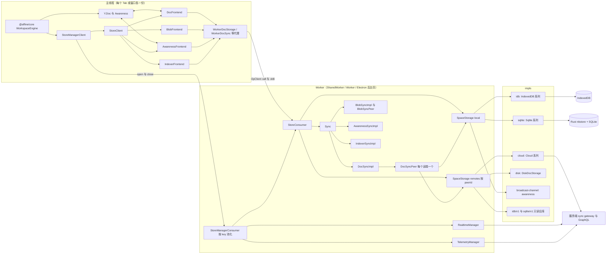
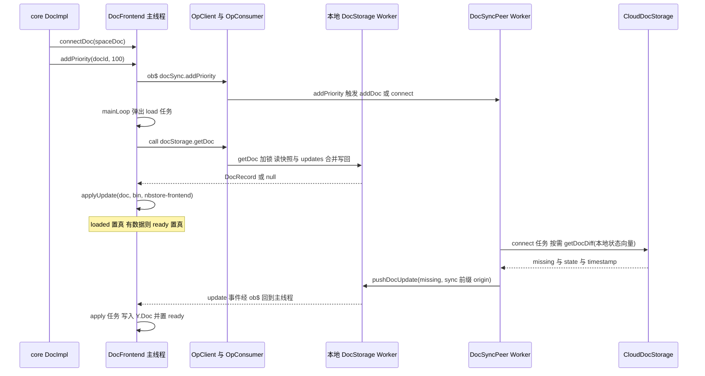
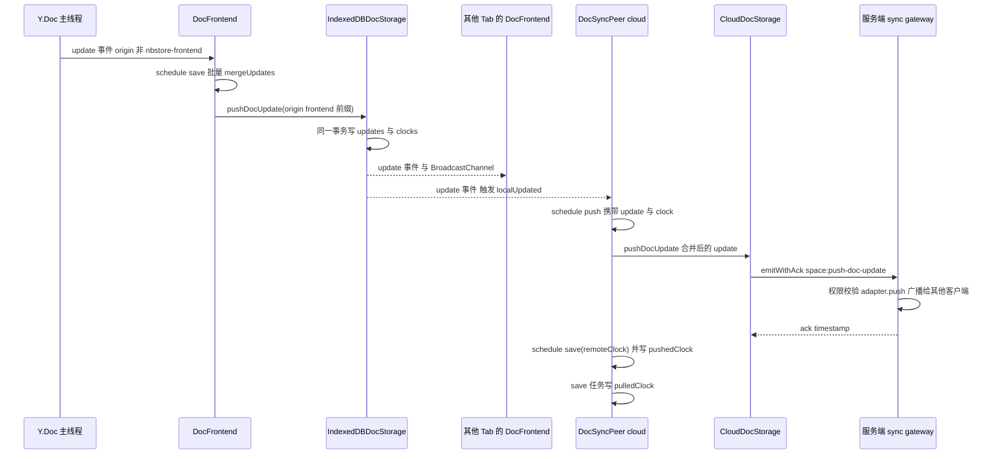
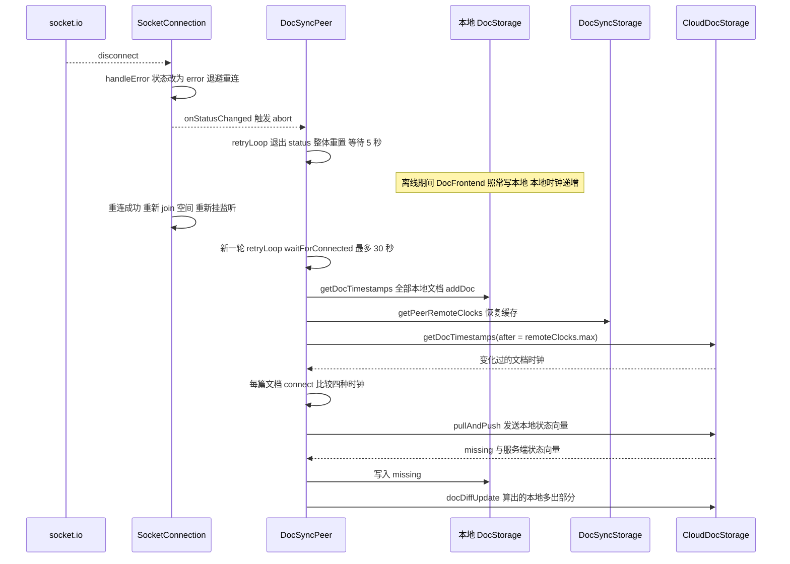
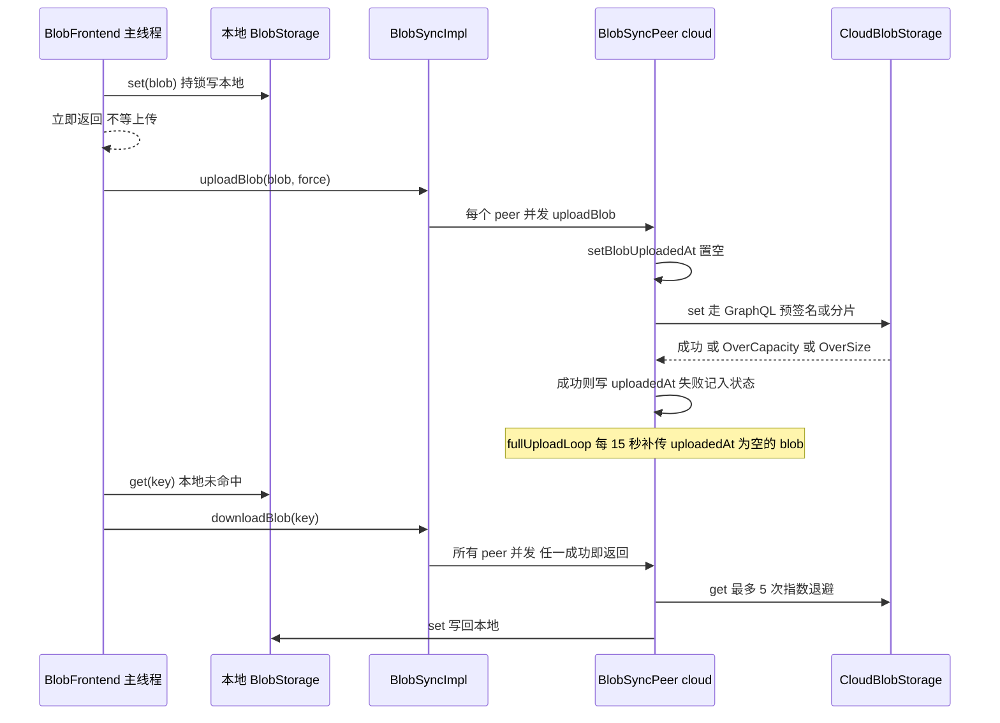

# `@affine/nbstore` 精讲

> 一句话：AFFiNE 的本地优先存储与同步引擎。编辑器产生的 Yjs update 先写进本地库（IndexedDB / SQLite），再按"本地 ↔ 每个远端一个 peer"的方式，与云端、本地磁盘目录、旧版数据库双向对齐。整套引擎跑在 Worker 里，主线程只保留一层把 `Y.Doc` 接到存储上的 frontend。
>
> 对应分层文档：[`@affine/nbstore`](../L1-通用基础设施/affine-nbstore.md) · 源码：`packages/common/nbstore`

分层文档已经讲过七种 `StorageType`、读时合并快照、`DocSyncPeer` 的五种任务、Worker 代理和自动重连，这里不再重复。本文回答这几个问题：

- 四种时钟（本地时钟、远端时钟、已拉取时钟、已推送时钟）分别在什么时候写，`connect` 任务怎样靠它们决定"拉、推还是什么都不做"。
- 一次按键从 `Y.Doc` 到服务端确认，中间经过哪几个线程、哪几次 origin 过滤。
- 多 Tab、多端由哪几套机制协调：SharedWorker 池化、IDB 的 BroadcastChannel、`sync:<peerId>:` 前缀。
- 断线后，内存里的任务队列丢了怎么办。

文中标"根据源码推断"的结论只来自读代码，没有实际运行验证。

## 0. 为什么是重点包

| 指标 | 数据 | 核实说明 |
|---|---|---|
| 直接被依赖 | 7 个工作区包（运行时 6 个） | 扫描全部 `package.json` 复现：`@affine/core`、`@affine/web`、`@affine/electron-renderer`、`@affine/mobile`、`@affine/ios`、`@affine/android`、`@affine/electron`。其中 `@affine/electron` 只写在 devDependencies 里，所以运行时口径是 6 个 |
| 传递被依赖 | 11 个（运行时 8 个），全仓 124 个包中排第 83 | 在直接依赖方之外，又多了 `@affine/admin`、`@affine/mobile-shared`、`@affine/electron-api`、`@affine-test/affine-desktop`。有 81 个包的传递被依赖数比它高，另有 2 个包与它并列，所以排第 82 到 84 位都说得通，按稳定排序是第 83 |
| 源码行数 | 15,891 行 | `src/` 下除 `__tests__` 外共 16,809 行。减去和源码放在同一目录的 3 个 spec 文件（`impls/disk/doc.spec.ts` 423 行、`impls/disk/sync.integration.spec.ts` 460 行、`impls/sqlite/indexer/node-builder.spec.ts` 35 行），正好是 15,891 行。`__tests__` 目录里另有约 4,100 行测试 |
| 所在链路 | local-first 数据链路的中段 | 成立。上游是 `@blocksuite/store` 写进 `Y.Doc` 的事务，下游是 `packages/backend/server/src/core/sync/gateway.ts` 的 socket.io 网关。最大的单文件是 `sync/doc/peer.ts`（1,008 行）；`impls/idb/indexer/` 是一套自研的倒排索引，约 1,800 行 |

**满足的标准：**

- **B 体量与复杂度**：15,891 行里塞了 4 套并行的状态机——`DocSyncPeer`、`BlobSyncPeer`、`IndexerSyncImpl`、`DocFrontend`，每套都有自己的优先级队列、取消信号和重试循环。底层还要对接 5 种后端：IndexedDB、经 Rust 桥接的 SQLite、socket.io 加 GraphQL、磁盘目录、BroadcastChannel。并发问题（锁、时间戳冲突、乐观重试）散落在各个实现里。
- **C 关键链路**：所有文档内容、附件、协作光标和本地搜索索引都经过它。断网时能编辑，靠的是本地 storage；重连后能补齐差异，靠的是 `DocSyncPeer`；多个 Tab 互相看到对方的编辑，靠的是同一个 storage 的 `update` 事件广播。

它的被依赖数不高，因为 `@affine/core` 只在少数几个地方（`WorkspaceEngine`、`NbstoreService`、各工作区 flavour 的初始化配置）直接用它。但"离线可用、多端同步、冲突合并"这三件事的实现全在这里。

**不懂它会卡在哪：**

1. `packages/frontend/core/src/modules/doc/entities/doc.ts:38-40`：打开文档时调用了 `engine.doc.addPriority(this.id, 100)`。为什么"加优先级"会让 Worker 去云端拉一篇本地从没有过的文档？答案在 `connect` 任务的优先级分支，见 3.1。
2. `packages/frontend/core/src/components/workspace-selector/workspace-card/index.tsx:111-125` 用 `(total - syncing) / total` 计算同步进度。`total` 和 `syncing` 是什么口径？多个 peer 之间为什么取最大值？见 2.4。
3. `packages/frontend/apps/web/src/app.tsx:30-54`：为什么要在 SharedWorker 和 Worker 之间二选一？窗口 `blur` 时调用的 `storeManagerClient.pause()` 究竟停了什么？（答案：只停索引，见 6.5。）
4. `packages/frontend/core/src/modules/workspace-engine/impls/cloud.ts:503-625`：Worker 初始化配置的 `remotes` 里，除了 `cloud:<serverId>` 之外为什么还有一个 `v1`？见 5.3。
5. `packages/frontend/core/src/modules/share-doc/entities/share-info.ts:65-66` 调用的 `waitForSynced` 什么时候 resolve？离线时会不会一直挂着？见 6.3。

## 1. 全景架构



逐块说明：

- **主线程只有 frontend 和代理。** `StoreClient` 的构造函数（`packages/common/nbstore/src/worker/client.ts:238-249`）在主线程创建 `DocFrontend`、`BlobFrontend` 等对象，交给它们的 storage 和 sync 都是 `Worker*` 代理（`client.ts:278-631`）。所以 `Y.Doc` 始终和编辑器在同一个线程；真正的 IndexedDB 读写、socket.io 连接、同步循环都在 Worker 里。
- **Worker 入口按平台装配实现。** Web 端在 `packages/frontend/apps/web/src/nbstore.worker.ts:13-18` 注册 `idbStorages`、`idbV1Storages`、`broadcastChannelStorages`、`cloudStorages`。Electron 后台页（`packages/frontend/apps/electron-renderer/src/background-worker/index.ts:39-45`）注册 `sqliteStorages`、`sqliteV1Storages`、`diskStorages` 等。iOS 的 Worker（`packages/frontend/apps/ios/src/nbstore.worker.ts:69-74`）注册 `idbStoragesIndexerOnly` 加 `sqliteStorages`。到底用哪个类，由 core 在 `packages/frontend/core/src/modules/workspace-engine/impls/cloud.ts:114-146` 按 `BUILD_CONFIG` 选出，再把 `identifier` 字符串写进初始化配置。
- **两层池化。** `StoreManagerConsumer` 按 key（如 `workspace:<flavour>:<id>`，见 `packages/frontend/core/src/modules/workspace/entities/engine.ts:61-65`）缓存 `StoreConsumer` 并做引用计数。每个 `StoreConsumer` 持有一个本地 `SpaceStorage`、若干个远端 `SpaceStorage` 和一个 `Sync`。在此之下，同一数据库的多个 storage 通过 `share()`（`packages/common/nbstore/src/connection/shared-connection.ts:4-20`）共用同一个连接对象。
- **`Sync` 只负责组装。** `packages/common/nbstore/src/sync/index.ts:30-87` 从本地和各远端的 `SpaceStorage` 中取出同类 storage，交给 4 个 `*SyncImpl`。文档和 Blob 是"每个远端一个 peer"的模型；Awareness 没有 peer，就是对本地和所有远端广播；Indexer 只在本地建索引，远端索引只在搜索时通过 `prefer: 'remote'` 选用。
- **realtime 和 telemetry 挂在 Manager 层，不属于任何 store。** 它们在 `packages/common/nbstore/src/worker/consumer.ts:33-34` 创建，每个 Worker 一份。之所以放进 nbstore，是为了复用 Worker 和 socket.io 连接，见 2.6 末尾。

**各实现对比：**

| 实现 | 提供的 storage | 用在哪端 | 文档存储模型 | 跨上下文通知 | 关键差异 |
|---|---|---|---|---|---|
| `idb` | doc、blob、docSync、blobSync、indexer、indexerSync | Web、移动 Web | `SnapshotDocStorageBase`，在 JS 里读时合并 | `BroadcastChannel('idb:' + dbName)`（`packages/common/nbstore/src/impls/idb/db.ts:36`） | 用 `IndexedDBLocker` 实现跨上下文的锁；`updates` 表以 `[docId, createdAt]` 为主键，时间戳冲突时加 1 毫秒重试 |
| `sqlite` | 同上 6 种 | Electron、iOS、Android（iOS/Android 的 indexerSync 仍走 IDB） | 继承 `DocStorageBase`，`getDoc` 整个交给 Rust 处理 | 无，依赖 Electron 和移动端共用同一个 Worker | 通过 `bindNativeDBApis` 注入原生 API，Proxy 自动补上第一个参数 universal id（`packages/common/nbstore/src/impls/sqlite/db.ts:203-226`） |
| `cloud` | doc、doc-static、blob、awareness、indexer | 所有端的远端 | `SnapshotDocStorageBase`，但快照和 update 队列都是空实现 | 服务端推送 `space:broadcast-doc-updates` | `getDocDiff` 把状态向量发给服务端，由服务端算差异；Blob 走 GraphQL 加预签名或分片上传 |
| `disk` | doc | Electron 本地工作区的"同步到文件夹" | `SnapshotDocStorageBase` | 原生事件 `DiskSyncEvent` | `syncMetadataScope = 'connection'`，每次连接都不复用已有时钟；会抛出单文档级别的错误 |
| `broadcast-channel` | awareness | 所有端的本地 awareness | 不涉及 | `BroadcastChannel('channel:' + id)` | 只广播，不持久化 |
| `idb/v1`、`sqlite/v1` | doc、blob | 旧版本数据迁移 | 只读 | 无 | `readonlyMode: true`，时间戳固定为 `CONST_TIMESTAMP`（`packages/common/nbstore/src/impls/idb/v1/doc.ts:25`） |

## 2. 核心抽象与数据模型

### 2.1 `Connection`：带引用计数的连接状态机

```ts
// packages/common/nbstore/src/connection/connection.ts:12-22
export interface Connection<T = any> {
  readonly status: ConnectionStatus;   // idle | connecting | connected | error | closed
  readonly inner: T;
  connect(): void;
  disconnect(): void;
  waitForConnected(signal?: AbortSignal): Promise<void>;
  onStatusChanged(cb: (status: ConnectionStatus, error?: Error) => void): () => void;
}
```

- **职责**：每个 storage 都带一个 `connection`，它是同步层判断"能不能干活"的唯一依据。
- **`AutoReconnectConnection` 的关键点**（`connection.ts:24-237`）：
  - `connect()` 和 `disconnect()` 做引用计数，计数从 0 变 1 时才真正连接，从 1 变 0 时才真正断开（`connection.ts:171-189`）。
  - 出错走 `handleError`：先断开，再把状态设为 `error`，然后按 `min(3000 * 2^n, 60000)` 毫秒退避重连（`connection.ts:143-169`）。
  - 每次连接有 15 秒超时，超时同样当作错误处理（`connection.ts:98-102`）。
  - 子类只需实现 `doConnect` 和 `doDisconnect`。连接断开时，子类通过给 `this.error` 赋值进入重连流程，比如 socket.io 的 `disconnect` 事件就是这么处理的（`packages/common/nbstore/src/impls/cloud/socket.ts:326-328`）。
- **`share()`**：以 `shareId` 为键，把多个 storage 的连接合并成一个。`IDBConnection` 的 `shareId` 是 `idb(<schema 版本>):<flavour>:<type>:<id>`（`packages/common/nbstore/src/impls/idb/db.ts:19-21`），所以同一个工作区的 doc、blob、docSync、blobSync 共用一个 `IDBPDatabase`。注意 `CONNECTIONS` 这个 Map 只增不删，第一次传入的 options 会一直生效。
- **不走自动重连的连接**：`DummyConnection`（永远处于 `connected`）、`HttpConnection`（`packages/common/nbstore/src/impls/cloud/http.ts:6`）、主线程的 `WorkerDocConnection` 和 `WorkerBlobConnection`。后两者的 `waitForConnected` 会被转发到 Worker 执行（`packages/common/nbstore/src/worker/client.ts:333-347`）。

### 2.2 `DocStorage`：一篇文档 = 快照 + update 队列 + 时钟

关键类型（`packages/common/nbstore/src/storage/doc.ts:28-55`）：

| 类型 | 字段 | 含义 |
|---|---|---|
| `DocClock` | `docId`, `timestamp: Date` | 一篇文档"最后一次被写入"的时间，是同步调度的基本单位 |
| `DocRecord` | 在 `DocClock` 的基础上加 `bin`, `editor?` | 一份完整的或增量的 Yjs 二进制 |
| `DocDiff` | 在 `DocClock` 的基础上加 `missing`, `state` | 相对于调用方状态向量缺少的部分，以及本端的状态向量 |
| `DocClocks` | `Record<string, Date>` | 全部文档的时钟，用于做增量对比 |

接口里同步层真正依赖的方法只有 6 个：`getDoc`、`getDocDiff`、`pushDocUpdate`、`getDocTimestamp`、`getDocTimestamps(after?)`、`subscribeDocUpdate`。另有两个可选钩子 `prepareDocImport` 和 `acknowledgeDocUpdate`，目前只有 disk 实现了。`syncMetadataScope`（`doc.ts:76-77`）这个标志决定同步时钟能不能跨连接复用。

在 IndexedDB 里的落盘布局（`packages/common/nbstore/src/impls/idb/schema.ts:193-235`）：

| store | 主键 | 写入时机 |
|---|---|---|
| `snapshots` | `docId` | `getDoc` 读时合并后写回，只在时间戳更新时才覆盖（`packages/common/nbstore/src/impls/idb/doc.ts:140-157`） |
| `updates` | `[docId, createdAt]` | 每次调用 `pushDocUpdate` 追加一条 |
| `clocks` | `docId` | 和 `updates` 在同一个事务里写，即本地时钟 |
| `peerClocks` | `[peer, docId]` | 同步层写入，一条记录同时存 `clock`、`pulledClock`、`pushedClock` |
| `locks` | `key` | `IndexedDBLocker` 用来实现跨上下文互斥 |

`pushDocUpdate` 有个必须遵守的约定：**写入成功后要 `emit('update', record, origin)`**。frontend 和同步层都只靠这个事件得知"存储变了"。IDB 实现还会把同一条消息发到 BroadcastChannel（`packages/common/nbstore/src/impls/idb/doc.ts:64-84`），收到的一方再以原来的 origin 重新 emit（`idb/doc.ts:205-209`）。

SQLite 的数据模型其实和 IDB 一样，也是快照加 update 队列，区别在于合并放到了 Rust 里做：`packages/frontend/native/nbstore/src/doc.rs:170` 的 `get_doc` 在事务里读出快照和全部 update，用 `y_octo::merge_updates_v1` 合并，再用 `UPDATE ... WHERE updated_at = ? AND data = ?` 做乐观替换，最多重试 8 次。合并结果如果还有 pending update，就报 `IncompleteDoc`。`push_update`（`doc.rs:95`）保证新时间戳严格大于已有时钟，最多尝试 12 次。

### 2.3 `DocSyncStorage`：四种时钟

同步层的核心思路是：**先用时钟判断某篇文档要不要同步，再用状态向量决定传哪些字节。** 时钟一共有四种：

| 时钟 | 存放位置 | 何时写 | 用途 |
|---|---|---|---|
| 本地时钟 | 本地 doc storage 的 `clocks` | 每次 `pushDocUpdate` | 本地最后一次写入的时间 |
| 远端时钟（`remoteClock`） | `peerClocks.clock`，以及内存里的 `ClockMap` | `retryLoop` 拉取 `getDocTimestamps`（`packages/common/nbstore/src/sync/doc/peer.ts:810-825`）之后，或收到远端广播时（`peer.ts:552-558`） | 远端最新版本的时间 |
| 已拉取时钟（`pulledRemoteClock`） | `peerClocks.pulledClock` | `pull`、`pullAndPush`、`save` 完成之后 | 已经拉到本地的远端版本 |
| 已推送时钟（`pushedClock`） | `peerClocks.pushedClock` | `push` 完成后取这批任务里最大的时钟；`pullAndPush` 在远端没有这篇文档的分支里也会写（`peer.ts:464-467`） | 已经推到远端的本地版本 |

`ClockMap`（`packages/common/nbstore/src/utils/clock.ts:1-38`）额外维护一个 `max` 字段。重连时只请求 `after = max` 之后变过的文档（`peer.ts:810-814`），所以重连的开销和期间变化的文档数成正比，而不是和文档总数成正比。

当远端的 `syncMetadataScope === 'connection'` 时，`DocSyncPeer` 的构造函数会把同步元数据换成 `DummyDocSyncStorage`（`peer.ts:179-182`），每次连接都从零开始对比。disk 远端（文件可能被外部修改）就是这种情况。

### 2.4 `DocSyncPeer`：一个远端一套任务队列

```ts
// packages/common/nbstore/src/sync/doc/peer.ts:39-51（字段节选）
interface Status {
  docs: Set<string>;            // 已知的文档（本地和远端的并集）
  connectedDocs: Set<string>;   // 已完成 connect 任务的文档
  docErrors: Map<string, string>;           // 单文档级错误，出错的文档暂停同步
  jobDocQueue: AsyncPriorityQueue;          // 待处理的 docId 及其优先级
  jobMap: Map<string, Job[]>;               // 每篇文档积压的任务
  remoteClocks: ClockMap;
  syncing: boolean; retrying: boolean; skipped: boolean;
  // …
}
```

- **调度粒度是文档，不是单个任务。** `schedule` 只把 docId 放进优先级队列，任务追加到 `jobMap[docId]` 里（`peer.ts:955-973`）。主循环每次弹出一个 docId，然后**按固定顺序**清空它的任务：connect → pullAndPush → pull → push → save（`peer.ts:844-914`）。同一类任务会一次处理完，比如多个 push 先用 `mergeUpdates` 合成一个再发出去。
- **优先级**：根文档（`docId === spaceId`）固定是 `Infinity`（`peer.ts:975-980`），其余文档取 `prioritySettings` 里的累加值，同一优先级再按 docId 的字典序排。`PriorityQueue.pop` 取的是树里的最大值（`packages/common/nbstore/src/utils/priority-queue.ts:27-47`）。
- **状态口径**（`peer.ts:231-305`）：`total` 是 `docs.size`；`syncing` 是 `jobMap.size`，即还有积压任务的文档数；`synced` 要求 `jobMap` 为空，并且没有任何单文档错误。单篇文档要算 `synced`，必须已经在 `connectedDocs` 里且没有积压任务。`DocSyncImpl` 汇总多个 peer 时，`total` 和 `syncing` 取最大值，`synced` 要求所有 peer 都满足（`packages/common/nbstore/src/sync/doc/index.ts:70-98`）。取最大值而不是求和，是因为各个 peer 同步的是同一批文档。
- **生命周期**：`mainLoop` 外层是无限重试，`retryLoop` 内层是一次连接周期。每轮 `retryLoop` 结束后，`status` 会被**整个替换成新对象**（`peer.ts:658-676`），内存里的任务全部丢弃，下一轮靠时钟重新推导出要做的事，见 5.4。

### 2.5 `DocFrontend`：主线程里 `Y.Doc` 和 storage 之间的桥

```ts
// packages/common/nbstore/src/frontend/doc.ts:115-127（节选）
export class DocFrontend {
  private readonly uniqueId = `frontend:${nanoid()}`;
  private readonly status = {
    docs: new Map<string, YDoc>(),
    connectedDocs: new Set<string>(),   // 已经从 storage 加载过（对应 loaded）
    readyDocs: new Set<string>(),       // Y.Doc 里已有非空数据（对应 ready）
    jobDocQueue: new AsyncPriorityQueue(),
    jobMap: new Map<string, Job[]>(),
    currentJob: null as { docId: string; jobs: Job[] } | null,
  };
```

- **三种任务**：`load`（加载）、`save`（把 `Y.Doc` 的 update 写进 storage）、`apply`（把 storage 的 update 应用到 `Y.Doc`）。一个批次内按 load → 逐条 apply → 合并后 save 的顺序执行（`doc.ts:271-285`）。
- **状态里的四个"好了"含义各不相同**：
  - `ready`：`Y.Doc` 里已经有数据，可能来自本地，也可能来自远端；
  - `loaded`：本地 storage 已经读过一次；
  - `updating`：还有 apply 或 save 没做完；
  - `synced`：来自 `DocSync`，表示和所有远端都对齐了。

  对应的等待方法分别是 `waitForDocReady`、`waitForDocLoaded`、`waitForUpdated`、`waitForSynced`（`doc.ts:504-541`）。
- **两种 origin**：写入 storage 时用 `frontend:<nanoid>`（`doc.ts:347-353`），用来在 `onStorageUpdate` 里跳过自己写的数据（`doc.ts:372-380`）；把数据应用到 `Y.Doc` 时用固定字符串 `'nbstore-frontend'`（`doc.ts:31`、`doc.ts:453`），用来在 `handleDocUpdate` 里跳过自己应用的数据（`doc.ts:468-470`）。后者也是 BlockSuite 判断 `isLocal` 的依据，见 [02 精讲 3.4](./02-blocksuite-store.md)。
- **生命周期**：`start()` 只能调用一次，因为 abort 之后不能重启（`doc.ts:227-238`）。`connectDoc` 对同一个 guid 重复调用会抛错（`doc.ts:418-420`）。`Y.Doc` 被 destroy 时会自动调用 `disconnectDoc`（`doc.ts:431-433`）。

### 2.6 `WorkerOps`：类型安全的跨线程协议

```ts
// packages/common/nbstore/src/worker/ops.ts:53-58, 185-195（节选，格式有压缩）
interface GroupedWorkerOps {
  docStorage: {
    getDoc: [string, DocRecord | null];
    pushDocUpdate: [{ update: DocUpdate; origin?: string }, DocClock];
    subscribeDocUpdate: [void, { update: DocRecord; origin?: string }];
    // …
  };
  // blobStorage / awarenessStorage / docSync / blobSync / awarenessSync / indexerSync / sync
}
export type WorkerOps = UnionToIntersection<Values<Values<{
  [k in keyof GroupedWorkerOps]: { [k2 in keyof GroupedWorkerOps[k]]:
    k2 extends string ? Record<`${k}.${k2}`, GroupedWorkerOps[k][k2]> : never };
}>>>;
```

- 按分组写，用模板字面量类型拍平成 `'docStorage.getDoc'` 这样的键，再交给 infra 的 `OpClient<WorkerOps>` 和 `OpConsumer<WorkerOps>`（见 [01 精讲](./01-toeverything-infra.md)）。
- **两种通道**：
  - `WorkerManagerOps`（`ops.ts:197-234`）走 Worker 的主端口，负责 `open`/`close` 以及 telemetry 和 realtime；
  - `WorkerOps` 走 `open` 时新建的那个 `MessageChannel`，一个 store 一条（`packages/common/nbstore/src/worker/client.ts:96-132`）。
- **`StoreInitOptions`**（`ops.ts:41-51`）里只有 `{ name: identifier, opts }`，必须能被结构化克隆。`name` 的取值范围来自 `AvailableStorageImplementations`（`packages/common/nbstore/src/impls/index.ts:15-29`），所以新增实现时要把它加进这个联合类型。
- **用 Observable 表示租约**：`docSync.addPriority` 在 Worker 侧返回一个永远不发值的 `Observable`，teardown 时撤销优先级（`packages/common/nbstore/src/worker/store.ts:309-313`）。主线程 `ob$` 订阅存活多久，优先级就生效多久（`client.ts:412-419`）。Tab 关闭导致端口断开时，订阅随之结束（根据源码推断）。
- **realtime 和 telemetry**：`RealtimeManager`（`packages/common/nbstore/src/realtime/manager.ts:35`）把 `realtime:request`、`realtime:subscribe` 复用在文档同步的那条 socket.io 连接上（同一个 `SOCKET_MANAGER_CACHE`，`packages/common/nbstore/src/impls/cloud/socket.ts:251-264`），供评论、通知数、配额、转写等功能使用（例如 `packages/frontend/core/src/modules/notification/services/count.ts:34`）。`TelemetryManager` 把埋点先写进名为 `affine-telemetry` 的 IndexedDB 队列（`packages/common/nbstore/src/telemetry/queue.ts:24-31`）：登录且非自托管时走 WebSocket 发送，否则走 HTTP `/api/telemetry/collect`（`packages/common/nbstore/src/telemetry/manager.ts:146-206`）。两者和文档同步没有数据关系，放在这里只是为了共享 Worker、连接，以及页面关闭后仍能继续发送。

## 3. 关键流程走读

### 3.1 打开一篇文档：从 `DocImpl.load` 到 `Y.Doc` 就绪



1. **core 发起**：`DocImpl.load` 调用 `workspace.onLoadDoc(spaceDoc)`（`packages/frontend/core/src/modules/workspace/impls/doc.ts:161-168`），后者就是 `engine.doc.connectDoc(doc)`（`packages/frontend/core/src/modules/workspace/entities/workspace.ts:110-113`）。几乎同时，`Doc` 实体通过 `engine.doc.addPriority(this.id, 100)` 提高这篇文档的优先级（`packages/frontend/core/src/modules/doc/entities/doc.ts:38-40`）。
2. **登记文档**：`_connectDoc` 调度一个 `load` 任务，并监听 `doc.on('update')`（`packages/common/nbstore/src/frontend/doc.ts:417-434`）。`addPriority` 同时修改本地队列的优先级，并通过 `sync.addPriority` 把优先级带到 Worker（`doc.ts:399-415`）。
3. **load 任务的前半段**（`doc.ts:304-320`）：如果 `Y.Doc` 里已经有内容（比如刚创建、已经写入了初始块），先把 `encodeStateAsUpdate(doc)` 作为一个 save 任务排队，这就是"新建文档的初始内容会落盘"的原因。随后立即发出 `doc.emit('sync', [true, doc])`，这时还没有读存储。根据源码推断，这是为了让依赖 Yjs `sync` 事件的代码尽早继续执行。
4. **跨线程读取**：`WorkerDocStorage.getDoc` 发出 `call('docStorage.getDoc')`（`packages/common/nbstore/src/worker/client.ts:285-287`），在 Worker 侧由 `StoreConsumer` 转发给本地 `SpaceStorage.get('doc')`（`packages/common/nbstore/src/worker/store.ts:234`）。
5. **读时合并**：IDB 走 `SnapshotDocStorageBase.getDoc`（`packages/common/nbstore/src/storage/doc.ts:235-265`）。它先用 `IndexedDBLocker` 加一把跨上下文的锁（`packages/common/nbstore/src/impls/idb/lock.ts:23-82`），读出快照和积压的 update，合并后写回新快照，并删除已合并的 update。SQLite 则直接调用原生 `getDoc`，在 Rust 里完成同样的事。
6. **应用到 `Y.Doc`**：`applyUpdate(doc, bin, 'nbstore-frontend')`（`doc.ts:448-460`），然后把文档加入 `readyDocs`（有数据时）和 `connectedDocs`（`doc.ts:325-332`）。到这一步 `waitForDocLoaded` 就会 resolve。
7. **Worker 侧同时在做的事**：`DocSyncPeer.addPriority` 发现优先级由 0 变为正数并且正在同步，就执行 `addDoc` 或重新调度 connect（`packages/common/nbstore/src/sync/doc/peer.ts:982-993`）。下面是 connect 任务的判断逻辑：

```ts
// packages/common/nbstore/src/sync/doc/peer.ts:310-341（节选）
const pushedClock = (await this.syncMetadata.getPeerPushedClock(this.peerId, docId))?.timestamp ?? null;
const clock = await this.local.getDocTimestamp(docId);
const remoteClock = this.status.remoteClocks.get(docId);
if (!this.remote.isReadonly && clock &&
    (pushedClock === null || pushedClock.getTime() < clock.timestamp.getTime())) {
  await this.jobs.pullAndPush(docId, signal);      // 本地有没推过的改动
} else {
  const pulled = (await this.syncMetadata.getPeerPulledRemoteClock(this.peerId, docId))?.timestamp ?? null;
  const hasRemoteClock = remoteClock.getTime() > 0;
  const hasPulled = pulled !== null && pulled.getTime() > 0;
  if (hasRemoteClock
      ? !hasPulled || (pulled !== null && pulled.getTime() < remoteClock.getTime())
      : (this.prioritySettings.get(docId) ?? 0) > 0 && (!clock || !hasPulled)) {
    await this.jobs.pull(docId, signal);           // 远端更新 或 有人正在看这篇文档
  }
}
this.status.connectedDocs.add(docId);
```

   最后一个分支解释了第 0 段的问题 1：远端时钟表里没有这篇文档（比如别人刚分享的链接），但只要有人给它加了优先级，并且本地没有数据或从没拉取过，就会执行一次 pull。
8. **远端数据回流**：pull 把 `missing` 写进本地 storage，origin 是 `sync:<peerId>:<nanoid>`（`peer.ts:486-492`）。storage 发出 `update` 事件，经 `ob$('docStorage.subscribeDocUpdate')`（`packages/common/nbstore/src/worker/client.ts:319-328`）回到主线程，`DocFrontend.onStorageUpdate` 发现 origin 不是自己，就调度一个 apply 任务（`frontend/doc.ts:372-380`），`waitForDocReady` 随之 resolve。

### 3.2 本地编辑一次：Yjs update 到服务端确认



1. **收集**：只要事务的 origin 不是 `'nbstore-frontend'`，就调度一个 save 任务（`packages/common/nbstore/src/frontend/doc.ts:462-496`）。在 debug 构建下，如果是在应用远端 update 的过程中又触发了本地写入，会打印告警并列出改动的键（`doc.ts:471-486`）。
2. **合并写入**：主循环会把同一批里同一篇文档的 save 任务合并成一次 `pushDocUpdate(merged, frontend:<id>)`（`doc.ts:334-355`）。高频输入因此只产生少量跨线程调用。
3. **本地落盘**（`packages/common/nbstore/src/impls/idb/doc.ts:33-87`）：

```ts
// packages/common/nbstore/src/impls/idb/doc.ts:38-62（节选）
while (true) {
  const trx = this.db.transaction(['updates', 'clocks'], 'readwrite');
  try {
    await trx.objectStore('updates').add({ ...update, createdAt: timestamp });
    await trx.objectStore('clocks').put({ docId: update.docId, timestamp });
    trx.commit();
    await trx.done;
  } catch (e) {
    await trx.done.catch(() => {});
    if (e instanceof Error && e.name === 'ConstraintError') {
      retry++;
      if (retry < 10) { timestamp = new Date(timestamp.getTime() + 1); continue; }
    }
    throw e;
  }
  break;
}
```

   update 和时钟在同一个事务里写入，所以"写了 update 但时钟没变"这种状态不会出现。
4. **扇出**：`emit('update', record, origin)` 加上 BroadcastChannel，一共有三类接收方：
   - 同一 Worker 里其他 Tab 的 `DocFrontend`（它们的 `ob$` 订阅），因为 origin 不同会执行 apply；
   - 其他 Worker 里的同一个数据库，通过 BroadcastChannel 收到；
   - 本 Worker 的 `DocSyncPeer`。
5. **peer 过滤**：本地订阅会跳过 `sync:<peerId>:` 开头的 origin（`packages/common/nbstore/src/sync/doc/peer.ts:760-777`），其余的进入 `events.localUpdated`，调度一个携带 update 和 clock 的 push 任务（`peer.ts:569-597`）。
6. **推送**：push 任务只在文档已经 connect 过且远端可写时执行，先合并再调用 `remote.pushDocUpdate(merged, uniqueId)`（`peer.ts:345-381`）。`CloudDocStorage` 会先 `joinDoc`，再发出 `space:push-doc-update`，update 用 base64 编码（`packages/common/nbstore/src/impls/cloud/doc.ts:181-200`）。
7. **服务端**：`onReceiveDocUpdate`（`packages/backend/server/src/core/sync/gateway.ts:1434`）依次检查订阅、权限和权限版本号，写入后调用 `publishDocUpdate`（`gateway.ts:1041`）。已经 join 这篇文档的其他 socket 会收到完整的 `space:broadcast-doc-updates`，其中排除了发送者（`gateway.ts:625-651`）；同一空间里的其他客户端只收到 `space:broadcast-doc-invalidation`。最后 ack 返回服务端时间戳。
8. **确认**：拿到服务端时间戳后，调度一个不带数据的 `save(remoteClock)`，并把本批任务的最大本地时钟写成 `pushedClock`（`peer.ts:369-379`）。这个 save 任务没有数据要写，只会把 `pulledClock` 更新为服务端时间戳（`peer.ts:543-546`）。这样下次 connect 时，`pushed >= local` 并且 `pulled >= remote`，这篇文档就会被跳过。
9. **其他客户端**：`CloudDocStorage.onServerUpdates` 把广播的内容当作不带 origin 的 update 发出（`impls/cloud/doc.ts:46-64`）。peer 的 `remoteUpdated` 更新远端时钟并调度带数据的 save 任务（`peer.ts:598-635`），save 写进本地 storage 后，再经第 4 步扇出到它所有的 Tab。只收到 invalidation 的客户端会在 50 毫秒防抖后执行 `repairInvalidatedDocs`：拉取时间戳，对变化的文档发出空 update，从而触发 pull（`impls/cloud/doc.ts:84-123`）。

**Yjs 合并在哪一层发生？** nbstore 自己不做任何冲突处理，只做三类 CRDT 操作：

- 在主线程用 `applyUpdate` 把 update 应用到 `Y.Doc`；
- 在 storage 里用 `mergeUpdates` 或 Rust 的 `merge_updates_v1` 合并快照；
- 在同步层用 `diffUpdate` 和 `encodeStateVectorFromUpdate` 计算差异。

服务端用 server-native 的 `mergeUpdatesInApplyWay` 合并（`packages/backend/server/src/core/doc/merge-updates.ts:7`）。Yjs 的 update 满足交换律和幂等，所以同一个 update 被多条路径重复送达也没关系，这也是 nbstore 敢于"多发"的前提。

### 3.3 断线与重连：双方如何对齐差异



1. **发现断线**：socket.io 设置了 `reconnection: false`（`packages/common/nbstore/src/impls/cloud/socket.ts:214`），重连完全由 `AutoReconnectConnection` 负责。`disconnect` 事件会给 `this.error` 赋值（`socket.ts:326-328`），进入退避重连（`packages/common/nbstore/src/connection/connection.ts:143-165`）。
2. **中止本轮**：`retryLoop` 对本地、远端、同步元数据三个连接都注册了 `onStatusChanged`，任何状态变化都会 abort（`packages/common/nbstore/src/sync/doc/peer.ts:746-753`）。正在 `asyncPop` 的循环因此抛出异常，`finally` 里取消订阅（`peer.ts:916-922`）。`mainLoop` 记下错误信息，把 `retrying` 设为 true，整体替换 `status`，然后等待 5 秒（`peer.ts:643-694`）。
3. **离线期间**：`DocFrontend` 不受影响，照常写本地 storage，只是 `DocSyncPeer` 没有订阅本地 update，这些写入不会产生 push 任务。它们只体现在本地时钟里。
4. **重新进入**：新一轮 `retryLoop` 会等待三个连接都恢复，30 秒超时就进入下一次重试（`peer.ts:723-739`）。`CloudDocStorageConnection.doConnect` 会重新 `joinDoc(spaceId)`，并重新挂上两个广播监听（`packages/common/nbstore/src/impls/cloud/doc.ts:314-332`）。
5. **重建待办**：
   - 本地所有文档执行 `addDoc`，每篇调度一个 connect（`peer.ts:794-798`）；
   - 从 `DocSyncStorage` 恢复缓存的远端时钟，再请求 `after = max` 之后的远端变化，结果持久化（`peer.ts:800-825`）；
   - 远端时钟表里出现的文档，以及有正优先级的文档，也执行 `addDoc`（`peer.ts:828-835`）。
6. **逐篇判断**：connect 任务比较四种时钟（见 3.1 第 7 步的代码）。离线期间改过的文档满足 `pushed < local`，走 `pullAndPush`；只在远端改过的文档满足 `pulled < remote`，走 `pull`；其余文档不发任何请求。
7. **按状态向量补齐**（`peer.ts:382-470`）：用本地状态向量请求 `getDocDiff`，服务端返回 `missing` 和它自己的状态向量。`missing` 写入本地后，再用 `docDiffUpdate`（`peer.ts:140-161`）计算要回推的部分。两个状态向量不相等时，直接 `diffUpdate(local, remoteSv)`。相等时还要再比一次删除集：状态向量不包含删除信息，所以用 `diffUpdate(local, localSv)` 得到本地的删除集，和服务端返回的 `missing`（此时也只剩删除集）比较，一样就不推。
8. **权限错误是终点**：`DOC_ACTION_DENIED` 和 `SPACE_ACCESS_DENIED` 会让 `mainLoop` 直接返回，不再重试（`peer.ts:647-679`）。只影响单篇文档的错误由 `runRemoteDocJob` 捕获（`peer.ts:925-953`）：这篇文档会被移出 `connectedDocs`，也不再接受新任务（`peer.ts:955-964`）。

### 3.4 Blob：写入即返回，后台上传，按需下载



1. **写**：`BlobFrontend.set` 持有同一个 key 的锁写入本地，释放锁后以"火后不管"的方式调用 `uploadBlob(blob, true)`（`packages/common/nbstore/src/frontend/blob.ts:37-50`）。所以插入图片立刻就能显示，上传失败也不会影响编辑。
2. **上传**：`BlobSyncPeer.uploadBlob`（`packages/common/nbstore/src/sync/blob/peer.ts:170-240`）先把 `uploadedAt` 置空，相当于标记"需要补传"，上传成功后再写入时间。超出容量会设置 `overCapacity`，此时 `fullUpload` 直接跳过（`peer.ts:266-269`）；超出单文件大小只会标记这一个 blob。云端实现在 `packages/common/nbstore/src/impls/cloud/blob-writer.ts:64-160`，先调用 `createBlobUploadMutation`，再按服务端返回的方法选择预签名、分片或 GraphQL 直传。
3. **补传**：`fullUploadLoop` 每 15 秒运行一次 `fullUpload`，遍历本地列表，补传 `uploadedAt` 为空的 blob（`peer.ts:242-324`）。
4. **读**：先读本地，未命中时释放锁，再调用 `downloadBlob`（`packages/common/nbstore/src/frontend/blob.ts:22-35`）。`BlobSyncImpl.downloadBlob` 向所有 peer 并发请求，任何一个成功就 resolve 为 true（`packages/common/nbstore/src/sync/blob/index.ts:190-227`）。每个 peer 最多重试 5 次，间隔从 1 秒起、上限 10 秒；只读远端只试 1 次（`sync/blob/peer.ts:106-138`）。同一个 blob 的并发下载会复用同一个 Promise（`peer.ts:100-104`）。
5. **云端不支持列举**：`CloudBlobStorage.list()` 直接抛出 `'Workspace blob inventory is unavailable'`（`packages/common/nbstore/src/impls/cloud/blob.ts:351-353`）。全量下载改为走 `readableSources`，即按"当前文档或历史版本"注册的来源逐个读取（`sync/blob/peer.ts:326-347`）。`Workspace` 在 `onLoadDoc` 里注册这些来源（`packages/frontend/core/src/modules/workspace/entities/workspace.ts:110-113`）。

## 4. 源码阅读路线

1. `packages/common/nbstore/src/storage/storage.ts`、`connection/connection.ts`、`connection/shared-connection.ts`：搞懂 `ConnectionStatus` 的五个状态、引用计数、退避公式和 `shareId`。能画出 `handleError` 之后的状态转移就够了。
2. `storage/doc.ts`、`storage/lock.ts`：对照 2.2 的表，弄清 `DocRecord`、`DocClock`、`DocDiff`，以及 `getDoc` 和 `getDocDiff` 的关系。`SnapshotDocStorageBase.getDoc` 要逐行读。
3. `impls/idb/doc.ts`、`impls/idb/db.ts`、`impls/idb/schema.ts`、`impls/idb/doc-sync.ts`：看一个完整的落地实现，重点是事务边界、`emit` 加 BroadcastChannel 的扇出、`setPeerRemoteClock` 只在时间更新时才写入。
4. `storage/index.ts` 和 `storage/dummy/`：`SpaceStorage` 怎样用 Dummy 补齐缺失的类型，`get<T>()` 的类型怎样收窄。
5. `sync/doc/peer.ts`：**本包最重要的文件**。按这个顺序读：`Job`/`Status` → `jobs.connect` → `pullAndPush`/`pull`/`push`/`save` → `events` → `retryLoop` → `mainLoop` → `schedule`/`addPriority`。配合 `utils/clock.ts`、`utils/async-priority-queue.ts`、`utils/priority-queue.ts` 一起读。读到能用四种时钟解释任意一篇文档为什么被拉、被推或被跳过为止。
6. `sync/doc/index.ts` 和 `sync/index.ts`：多个 peer 的状态怎样汇总，`reconfigure` 时为什么先停 doc、再换 remotes、最后重启。
7. `frontend/doc.ts`：三种任务、两种 origin、四个状态位。和第 5 步对照，看清"主线程的 frontend"和"Worker 的 peer"是两套独立的队列。
8. `worker/ops.ts` → `worker/client.ts` → `worker/consumer.ts` → `worker/store.ts`：协议类型、代理类、池化与 `serialize`、handler 注册。可以先读 `packages/common/infra/src/op/README.md`，再对照 `op/consumer.ts` 里 `call` 和 `subscribe` 两种消息的处理方式。
9. `impls/cloud/socket.ts` → `impls/cloud/doc.ts`，再看服务端的 `packages/backend/server/src/core/sync/gateway.ts:1434` 附近：把客户端事件名和服务端 handler 对应起来，理解 join、广播和 invalidation 三种机制。
10. `sync/blob/peer.ts` 和 `frontend/blob.ts`：Blob 的上传标记、补传循环、下载退避。
11. 验证理解：`packages/common/nbstore/src/__tests__/sync.spec.ts` 里的 `doc (%s clocks)`（第 309 行）、权限拒绝相关用例（第 622、799 行）、`connection-scoped readonly peers ...`（第 1100 行）、`store opens serialize ...`（第 1293 行），以及 `__tests__/frontend.spec.ts` 里的 `doc` 用例（第 15 行）。

**可以先跳过的部分**：

- `impls/idb/indexer/*`：自研的分词、倒排索引和 BM25，约 1,800 行；
- `impls/sqlite/indexer/*` 和 `sync/indexer/*`：索引同步，有兴趣时再读，其中 `tryNativeCrawlDocData` 是入口；
- `impls/idb/v1`、`impls/sqlite/v1`：只读的旧库；
- `impls/disk/*`：Electron 的 Markdown 文件夹同步，单文档错误相关的分支都为它服务；
- `impls/cloud/blob-writer.ts`、`impls/cloud/blob-source-registry.ts`：上传协议细节；
- `telemetry/*`、`utils/binary-search-tree.ts`、`utils/id-converter.ts`：新旧 docId 转换。

## 5. 设计取舍

### 5.1 `Y.Doc` 留在主线程，存储与同步放进 Worker

- **做法**：`DocFrontend` 在主线程创建（`packages/common/nbstore/src/worker/client.ts:244`），storage 和 sync 都通过 Op 代理访问。
- **原因**：编辑器必须直接持有 `Y.Doc` 实例，`@blocksuite/store` 的 Signal 和事件都挂在它上面，所以 `Y.Doc` 不可能放进 Worker。另一方面，IndexedDB 事务、快照合并、socket.io 收发和多文档同步循环都比较重，放进 Worker 不占用 UI 线程。使用 SharedWorker 时，多个 Tab 还能共享同一个同步引擎。
- **代价**：每次 save、apply、getDoc 都要跨一次线程。`pushDocUpdate` 的 payload 没有用 `transfer()` 包装，update 二进制会被结构化克隆复制一份（根据源码推断，`transfer` 只用在 `open` 传递端口时，`client.ts:105-113`）。另外，每个 Tab 都持有一份完整的 `Y.Doc`，内存不能共享。
- **没选的方案**：全部在主线程完成，会卡 UI，多个 Tab 还会各自连一遍云端。把 `Y.Doc` 也放进 Worker、主线程用代理访问，和 BlockSuite 的同步模型不兼容。

### 5.2 两级对齐：时钟决定"要不要同步"，状态向量决定"传哪些字节"

| 维度 | 时钟（`DocClock`） | 状态向量（Yjs state vector） |
|---|---|---|
| 粒度 | 每篇文档一个 `Date` | 每篇文档每个 client 一个计数 |
| 获取成本 | 一次 `getDocTimestamps(after)` 就能拿到全部 | 需要读出并合并整篇文档 |
| 能回答的问题 | 自上次以来有没有变化 | 具体缺少哪些操作 |
| 失效风险 | 依赖墙上时钟，见 6.7 | 不包含删除集，需要 `docDiffUpdate` 补上 |

- **原因**：工作区里可能有几千篇文档，每次重连都比较状态向量，就要把每篇文档读出来并合并一遍。时钟只用一次元数据查询就能把范围缩小到变化过的那几篇。
- **代价**：多了四种时钟要维护，判断逻辑（3.1 第 7 步）不直观。时钟还混用了两种来源，本地时钟来自本机时间，远端时钟来自服务端时间，分属不同的时间轴，只在各自的轴上比较。
- **没选的方案**：服务端维护一个全局递增序号，类似 `Lamport` 时钟的游标。这样需要服务端协议支持，而当前的 `space:load-doc-timestamps` 已经能满足需求。

### 5.3 一切都是 peer：云端、磁盘目录、旧版库用同一套同步逻辑

- **做法**：`StoreInitOptions.remotes` 是一个 `Record<peerId, 各类型 storage>`。云端工作区的远端是 `cloud:<serverId>` 和 `v1`（`packages/frontend/core/src/modules/workspace-engine/impls/cloud.ts:562-625`）；本地工作区的远端可能是 `disk` 和 `v1`（`packages/frontend/core/src/modules/workspace-engine/impls/local.ts:498-512`）。
- **原因**：旧版数据迁移被建模成一个"只读远端"。`IndexedDBV1DocStorage` 强制 `readonlyMode: true`，时间戳固定为 `CONST_TIMESTAMP`（2030 年），第一次 pull 之后 `pulled >= remote`，以后就不会再拉。Blob 迁移也只是一次 `fullDownload('v1')`（`packages/frontend/core/src/modules/workspace/entities/engine.ts:85-88`）。磁盘同步同样复用 `DocSyncPeer`，只是额外加了 `syncMetadataScope`、`prepareDocImport`、`acknowledgeDocUpdate` 三个扩展点。
- **代价**：`DocSyncPeer` 里混进了 disk 专用的错误名（`DISK_SOURCE_EXPORT_FAILED`、`DISK_SOURCE_REVIEW_REQUIRED`）和 `'disk:source-discovered'` 这个 origin（`packages/common/nbstore/src/sync/doc/peer.ts:108-115`、`peer.ts:609-616`），抽象有些泄漏。peer 之间互相独立，同一份 update 会分别推给每个远端。
- **没选的方案**：为迁移和磁盘同步各写一套专门流程。那样代码更直白，但无法复用重试、优先级和状态汇总，UI 也要接多套进度。

### 5.4 内存任务队列可以丢，持久化时钟兜底

- **做法**：`retryLoop` 结束后整体替换 `status`（`peer.ts:658-676`），积压的 push 和 save 全部丢弃。下一轮靠"本地全部文档执行 connect，再比较时钟"把要做的事推导回来。
- **原因**：断线、Worker 被浏览器回收、应用崩溃，都等价于"内存状态丢失"，系统只需要一条恢复路径。时钟和 update 写在同一个事务里（`packages/common/nbstore/src/impls/idb/doc.ts:39-49`），`pushedClock` 只在远端确认之后才写，所以"推送进度"和"数据"之间不会出现不一致：中途失败最坏的结果是重推一遍，而 Yjs 合并是幂等的。
- **代价**：每次重连都要对所有本地文档执行 connect，每篇至少读两次元数据（`getPeerPushedClock`、`getDocTimestamp`）。文档很多时，重连后的第一轮会有可见的 `syncing` 计数。

### 5.5 用 origin 字符串约定防止回环，而不是给消息加 ID 去重

- **做法**：一共三种约定。`frontend:<nanoid>`：frontend 跳过自己写入 storage 的 update。`'nbstore-frontend'`：frontend 跳过自己应用到 `Y.Doc` 的 update。`sync:<peerId>:<nanoid>`：peer 跳过同一 peerId 写入的 update。origin 不落盘，只在 `update` 事件里随内存流转（`packages/common/nbstore/src/storage/doc.ts:86-91` 的注释），但会随 BroadcastChannel 和 Op 消息跨上下文传递。
- **原因**：零存储开销，也不需要维护"已见消息"集合。peer 按前缀过滤，在多 Worker 场景下很关键：Worker A 从云端拉下来的 update 经 IDB 的 BroadcastChannel 到达 Worker B 时，origin 仍是 `sync:cloud:...:A`。B 的 cloud peer 看到同样的前缀就不会再推一遍（`packages/common/nbstore/src/sync/doc/peer.ts:762-767`）。而 B 的 `DocFrontend` 照常 apply，B 所在的 Tab 能看到更新。
- **代价**：这是一个隐式协议，见 6.2。
- **没选的方案**：给每个 update 计算哈希去重。需要额外的存储和清理策略，而 Yjs 本身已经保证重复应用是无害的，去重只是为了省流量，前缀约定已经够用。

## 6. 易错点与调试

**6.1 应用远端 update 时触发了本地写入**

- **现象**：只是打开文档没做修改，"最后编辑者"却变成了自己；debug 构建的控制台里出现 `When nbstore applies a remote update, some code triggers a local change`。
- **原因**：`applyUpdate` 引起的同步回调里又有代码写了 `Y.Doc`（典型例子是给块的默认值做回填）。这次写入的 origin 不是 `'nbstore-frontend'`，于是被当作本地编辑保存并推送（`packages/common/nbstore/src/frontend/doc.ts:462-495`）。
- **避免**：根据告警列出的键定位是谁写的，修法见 [02 精讲 6.3](./02-blocksuite-store.md)。

**6.2 自定义 origin 撞上约定的前缀**

- **现象**：自己调用 `pushDocUpdate` 写入的数据没有推到云端，或者其他 Tab 没收到。
- **原因**：origin 以 `sync:<peerId>:` 开头会被对应的 peer 跳过（`packages/common/nbstore/src/sync/doc/peer.ts:762-767`）；和某个 `DocFrontend` 的 `uniqueId` 相同，会被那个 frontend 跳过。
- **避免**：业务代码不要自己造 origin。确实需要时，用 `'rollback'` 这种和上述前缀都不冲突的字符串，参考 `packages/common/nbstore/src/storage/history.ts:93`。

**6.3 状态有 1 秒节流，离线时 `waitForSynced` 会一直挂着**

- **现象**：测试里断言 `state$` 时偶尔拿到旧值；离线点击"分享"之后 Promise 一直不 resolve。
- **原因**：`state$`、`docState$` 都用 `throttleTime(1000)` 做了节流（`packages/common/nbstore/src/sync/doc/index.ts:100-106`、`packages/common/nbstore/src/frontend/doc.ts:178-185`）。`waitFor*` 用的是不节流的 `_state$` 和 `_docState$`。离线时 peer 的 `connectedDocs` 是空的，`synced` 永远为 false（`peer.ts:292-295`）。
- **避免**：测试中用 `waitFor*` 或 `vitest.waitFor`。业务调用 `waitForSynced` 时要传 `AbortSignal` 或者自己加超时。

**6.4 Store 的 key、引用计数和 reconfigure 限制**

- **现象**：同一个工作区以不同配置再次打开时抛出 `Local storage configuration cannot change while a store is open`；或者关掉所有 Tab 之后，SharedWorker 里的同步仍在运行。
- **原因**：`StoreManagerConsumer` 按 key 复用 store。再次 `open` 时会调用 `reconfigure`，它只允许修改 remotes（`packages/common/nbstore/src/worker/store.ts:127-133`）。引用计数的递减依赖 `close`，而 `close` 只在 `beforeunload` 里由 `storeManagerClient.dispose()` 发出（`packages/frontend/apps/web/src/app.tsx:43-45`）。如果页面被强制结束、没有触发 `beforeunload`，计数就不会归零（根据源码推断）。
- **避免**：需要不同本地配置时换一个 key，参考 `engine.ts:62` 的 `'shared:'` 前缀。排查泄漏时，在 Worker 控制台查看 `storePool` 的计数。

**6.5 `pause()` 只暂停索引**

- **现象**：以为窗口失焦后同步就停了，实际上云端推送和拉取都在继续。
- **原因**：`StoreManagerClient.pause()` 最终调用 `StoreConsumer.pauseSync()`，它在 1 秒后只调用 `indexerSync.pauseSync()`（`packages/common/nbstore/src/worker/store.ts:192-203`）。文档和 Blob 的同步不受影响。
- **避免**：真正需要停止同步时，调用 `Sync.stop()`，或者经 `reconfigure` 移除远端。

**6.6 权限错误之后同步永久停止**

- **现象**：权限恢复后文档仍然不同步，UI 显示 `retrying: false` 并带着错误信息。
- **原因**：遇到 `isRemotePermissionError` 时 `mainLoop` 直接 return（`packages/common/nbstore/src/sync/doc/peer.ts:647-679`）。单文档级错误会让这篇文档在本轮循环中不再接受任务（`peer.ts:955-964`）。只有 disk 的两种错误会在下一次本地更新时自动恢复（`peer.ts:578-582`）。
- **避免**：权限变化之后要重新开始同步，例如重新打开 store，或者 `reconfigure` 替换远端（`packages/common/nbstore/src/sync/index.ts:95-137` 会重启 `doc`）。

**6.7 依赖本机时钟（根据源码推断）**

- **现象**：系统时间被往回调之后，个别离线改动迟迟推不上去。
- **原因**：IDB 的本地时钟就是 `new Date()`（`packages/common/nbstore/src/impls/idb/doc.ts:34`），只在主键冲突时加 1 毫秒，并不保证比已有时钟大。SQLite 的 Rust 实现做了保证（`packages/frontend/native/nbstore/src/doc.rs:95-117`）。如果新的本地时钟小于之前写过的 `pushedClock`，connect 时会判定为"不需要推送"，而 `pull` 分支不会回推本地多出的内容。要等到这篇文档下一次产生本地编辑并走 push 路径，或者执行 `pullAndPush`，才会补上。
- **排查**：查看 IDB 里的 `clocks` 和 `peerClocks.pushedClock`。需要时调用 `engine.doc.resetSync()` 清空同步时钟（`packages/common/nbstore/src/sync/doc/index.ts:208-251`），强制全部重新对齐。

**6.8 两把锁的实现细节（根据源码推断）**

- `SingletonLocker`（`packages/common/nbstore/src/storage/lock.ts:24-44`）的 `acquire` 先 `await this.inner`，再替换 `inner` 和 `release`。如果两个调用方在同一轮微任务里等待同一个 `inner`，它们会同时拿到锁，而且 `release` 字段会被后来者覆盖。用到它的地方有 `BlobFrontend` 的读写锁，以及没有覆盖 `locker` 的 `SnapshotDocStorageBase` 子类（cloud、disk）。cloud 的 `setDocSnapshot` 是空实现，所以实际影响有限。
- `IndexedDBLocker`（`packages/common/nbstore/src/impls/idb/lock.ts:32-35`）的注释写的是 "lock timeout 3s"，代码实际是 30000 毫秒。如果持锁方崩溃，等待方每 3 秒检查一次，最多要等 30 秒。

**其他细节：**

- `AwarenessSyncImpl.update` 在连接不是 `connected` 时直接丢弃更新（`packages/common/nbstore/src/sync/awareness/index.ts:27-36`）。
- `BroadcastChannelAwarenessStorage` 回复 collect 时带的是自己的 `collectUniqueId`，而请求方比较的也是它自己的 id（`packages/common/nbstore/src/impls/broadcast-channel/awareness.ts:102-130`），跨上下文的收集回复似乎永远对不上。同一个 Worker 内的订阅者走的是 `onCollect` 直连，不受影响（根据源码推断）。
- `WorkerDocConnection.waitForConnected` 会缓存第一次的 Promise，如果第一次被拒绝，这个结果也会一直被缓存（`packages/common/nbstore/src/worker/client.ts:340-346`）。

**调试手段：**

- **切换 Worker 类型**：`localStorage.setItem('disableSharedWorker', 'true')` 之后刷新，Web 端会改用独立的 Worker（`packages/frontend/apps/web/src/app.tsx:30-41`），断点和日志直接出现在当前页面的 DevTools 里。SharedWorker 的控制台要在 `chrome://inspect/#workers` 里打开。
- **关键日志**：`Remote sync started`、`Remote sync ended`、`Sync error, retry in 5s`、`Sync stopped due to remote permission error`、`Sync paused for doc`、`connection error, will reconnect`、`[IndexerSync] paused`、`Blob full upload error, retry in 15s`。
- **查看数据**：DevTools 的 Application → IndexedDB，数据库名是 `<flavour>:workspace:<id>`。`updates` 里积压的条数就是还没合并进快照的 update；`peerClocks` 的每条记录同时包含 `clock`、`pulledClock`、`pushedClock`，可以直接对照 3.1 第 7 步的判断逻辑。
- **强制全量重同步**：`workspace.engine.doc.resetSync()`。
- **测试入口**：`packages/common/nbstore/src/__tests__/sync.spec.ts`（用 `fake-indexeddb` 跑两个 IDB peer 互相同步）、`__tests__/frontend.spec.ts`、`__tests__/cloud-doc-updates.spec.ts`、`connection/__tests__/auto-reconnection.spec.ts`、`realtime/__tests__/manager.spec.ts`。根目录的 `vitest.config.ts` 把 `.` 列为一个 project，根据配置推断，可以用 `yarn vitest run packages/common/nbstore` 运行（本文没有执行过）。

**分层文档与源码不一致之处：**

> 以下各条已于 2026-11-01 同步更正到分层文档，保留在此作为勘误记录。第 7 条的包内 README 属于源码，未改。

1. "整套引擎跑在 SharedWorker 里"：只在 Web 和移动 Web 且浏览器支持时成立，否则用独立 Worker（`packages/frontend/apps/web/src/app.tsx:30-41`）。Electron 用的是后台渲染页，通过 `apis.worker.connectWorker` 建立 `MessagePort`（`packages/frontend/apps/electron-renderer/src/app/effects/store-manager.ts:9-43`）。iOS 和 Android 用的是普通 Worker。
2. "所有 storage 的连接继承 `AutoReconnectConnection`"：`DummyConnection`、`HttpConnection`、`WorkerDocConnection`、`WorkerBlobConnection` 都不是。
3. "SQLite 继承 `DocStorageBase`（因其有原生事务，合并策略不同）"：合并策略其实一样，都是快照加 update 队列、读时合并，只是放在了 Rust 的 `doc.rs:170` 里，并用乐观 CAS 重试。
4. 3.4(d) "跳过自己产生的 origin"：本地订阅过滤的是整个 `sync:<peerId>:` 前缀，同一 peerId 的其他上下文写入的 update 也会被跳过，这是多 Worker 场景下防止重复推送的关键。
5. 3.6 "多标签页共享同一套同步引擎"：只在 SharedWorker 模式下成立。独立 Worker 模式下每个 Tab 各有一套引擎，靠 IDB 的 BroadcastChannel 和 `IndexedDBLocker` 协调。
6. 第 6 节 "Cloud 后端依赖的 `@affine/realtime` 在 peerDependencies 中"：它同时也在 `dependencies` 里。
7. 另外，包内的 `packages/common/nbstore/README.md` 已经过时：示例里 `new SpaceStorage([...])` 传的是数组，还用到了 `storage.on('connection')`、`tryGet`、`@affine/nbstore/op`、`SpaceStorageWorkerClient`，这些在当前源码里都不存在。

## 7. 扩展实践

### 7.1 新增一种存储实现：以内存 doc storage 为例

**步骤：**

1. 在 `packages/common/nbstore/src/impls/memory/` 下实现连接和 storage。doc 如果采用快照模型，就继承 `SnapshotDocStorageBase`，并提供静态的 `identifier`。
2. `pushDocUpdate` 写入成功后必须 `emit('update', record, origin)`；返回的时钟要单调递增。
3. `setDocSnapshot` 只在新快照的时间戳更新时才覆盖；`getDocTimestamps(after)` 只返回 `after` 之后变化过的文档。
4. 数据如果是易失的，要声明 `syncMetadataScope = 'connection'`，否则重启后旧的时钟会误判"已同步"。
5. 导出 `memoryStorages` 数组，并在 `packages/common/nbstore/src/impls/index.ts` 的 `Storages` 联合类型里加上 `typeof memoryStorages`，这样 `StoreInitOptions` 才能接受 `name: 'MemoryDocStorage'`。
6. 在 `packages/common/nbstore/package.json` 的 `exports` 里加 `"./memory"`，在各个 Worker 入口的 `StoreManagerConsumer([...])` 里加上 `...memoryStorages`。
7. 在 core 的 `getEngineWorkerInitOptions` 里把它配置成 local 的某种类型，或者 `remotes` 里的一个 peer。

```ts
// packages/common/nbstore/src/impls/memory/doc.ts
import { AutoReconnectConnection, share } from '../../connection';
import {
  type DocClock,
  type DocClocks,
  type DocRecord,
  type DocUpdate,
  SnapshotDocStorageBase,
} from '../../storage';

interface MemoryDB {
  snapshots: Map<string, DocRecord>;
  updates: Map<string, DocRecord[]>;
  clocks: Map<string, Date>;
}
const DBS = new Map<string, MemoryDB>();

class MemoryConnection extends AutoReconnectConnection<MemoryDB> {
  constructor(private readonly dbId: string) {
    super();
  }
  override get shareId() {
    return `memory:${this.dbId}`;
  }
  override async doConnect() {
    let db = DBS.get(this.dbId);
    if (!db) {
      db = { snapshots: new Map(), updates: new Map(), clocks: new Map() };
      DBS.set(this.dbId, db);
    }
    return db;
  }
  override doDisconnect() {}
}

export class MemoryDocStorage extends SnapshotDocStorageBase {
  static readonly identifier = 'MemoryDocStorage';
  // 进程重启即丢失，不能复用持久化的同步时钟
  readonly syncMetadataScope = 'connection';
  readonly connection = share(new MemoryConnection(this.options.id));

  private get db() {
    return this.connection.inner;
  }

  override async pushDocUpdate(update: DocUpdate, origin?: string): Promise<DocClock> {
    const prev = this.db.clocks.get(update.docId)?.getTime() ?? 0;
    const timestamp = new Date(Math.max(Date.now(), prev + 1)); // 单调递增
    const record: DocRecord = { ...update, timestamp };
    this.db.updates.set(update.docId, [...(this.db.updates.get(update.docId) ?? []), record]);
    this.db.clocks.set(update.docId, timestamp);
    this.emit('update', record, origin); // 不 emit，frontend 和 peer 都收不到
    return { docId: update.docId, timestamp };
  }

  override async getDocTimestamp(docId: string) {
    const timestamp = this.db.clocks.get(docId);
    return timestamp ? { docId, timestamp } : null;
  }

  override async getDocTimestamps(after: Date = new Date(0)) {
    const clocks: DocClocks = {};
    for (const [docId, ts] of this.db.clocks) if (ts > after) clocks[docId] = ts;
    return clocks;
  }

  override async deleteDoc(docId: string) {
    this.db.snapshots.delete(docId);
    this.db.updates.delete(docId);
    this.db.clocks.delete(docId);
  }

  protected override async getDocSnapshot(docId: string) {
    return this.db.snapshots.get(docId) ?? null;
  }

  protected override async setDocSnapshot(snapshot: DocRecord) {
    const prev = this.db.snapshots.get(snapshot.docId);
    if (!prev || prev.timestamp < snapshot.timestamp) {
      this.db.snapshots.set(snapshot.docId, snapshot); // 只接受更新的快照
    }
    return true;
  }

  protected override async getDocUpdates(docId: string) {
    return this.db.updates.get(docId) ?? [];
  }

  protected override async markUpdatesMerged(docId: string, updates: DocRecord[]) {
    const merged = new Set(updates.map(u => u.timestamp.getTime()));
    const rest = (this.db.updates.get(docId) ?? []).filter(u => !merged.has(u.timestamp.getTime()));
    this.db.updates.set(docId, rest);
    return updates.length;
  }
}
```

```ts
// packages/common/nbstore/src/impls/memory/index.ts
import type { StorageConstructor } from '..';
import { MemoryDocStorage } from './doc';

export * from './doc';
export const memoryStorages = [MemoryDocStorage] satisfies StorageConstructor[];
```

**验证**：仿照 `packages/common/nbstore/src/__tests__/sync.spec.ts:309` 写一个用例。用 `new Sync({ local: new SpaceStorage({ doc: idbDoc, docSync: idbDocSync }), remotes: { memory: new SpaceStorage({ doc: new MemoryDocStorage({ id: 'ws' }) }) } })` 组装，先对两边的 `SpaceStorage` 调用 `connect()`，再 `sync.start()`。在本地 `pushDocUpdate` 之后执行 `await sync.doc.waitForSynced()`，最后检查内存端 `getDoc` 的内容。

### 7.2 给上层增加一个可订阅的同步指标：每个 peer 的状态

需求：在设置页分别显示"云端同步"和"磁盘同步"的进度和错误，而现在的 `state$` 已经把多个 peer 合成了一条。

**步骤：**

1. 在 `packages/common/nbstore/src/sync/doc/peer.ts` 里把 `PeerState` 改成 `export interface`。它的字段只有数字、布尔值和字符串，可以安全地结构化克隆。
2. 在 `DocSyncImpl` 里加一个按 peerId 分组的 Observable，并加进 `DocSync` 接口。
3. 在 `packages/common/nbstore/src/worker/ops.ts` 的 `GroupedWorkerOps.docSync` 里声明 `peerStates: [void, Record<string, PeerState>]`。
4. 在 `packages/common/nbstore/src/worker/store.ts` 的 `registerHandlers` 里注册 handler；在 `packages/common/nbstore/src/worker/client.ts` 的 `WorkerDocSync` 里实现代理。少写任何一边，TypeScript 都会报错。
5. 在 `DocFrontend` 里透传出去，core 用 `LiveData.from` 接入 React。

```ts
// packages/common/nbstore/src/sync/doc/index.ts（DocSyncImpl 内新增）
readonly peerStates$: Observable<Record<string, PeerState>> = this.peers$.pipe(
  switchMap(peers =>
    peers.length
      ? combineLatest(
          peers.map(peer =>
            peer.peerState$.pipe(map(state => [peer.peerId, state] as const))
          )
        )
      : of([] as (readonly [string, PeerState])[])
  ),
  map(entries => Object.fromEntries(entries)),
  // 和 state$ 一样节流，避免跨线程消息过多
  throttleTime(1000, undefined, { leading: true, trailing: true }),
  share({ connector: () => new ReplaySubject(1) })
);

// packages/common/nbstore/src/worker/store.ts（registerHandlers 内新增）
'docSync.peerStates': () => this.docSync.peerStates$,

// packages/common/nbstore/src/worker/client.ts（WorkerDocSync 内新增）
get peerStates$() {
  return this.client.ob$('docSync.peerStates');
}

// packages/common/nbstore/src/frontend/doc.ts（DocFrontend 内新增）
get peerStates$() {
  return this.sync.peerStates$;
}
```

```ts
// core 侧使用：例如在某个 Entity 里
peerStates$ = LiveData.from(this.workspaceService.workspace.engine.doc.peerStates$, {});
// 组件中：const states = useLiveData(entity.peerStates$); states['cloud:<serverId>']?.syncing
```

**注意事项：**

- 不要在 Worker 侧的 Observable 里抛错。`OpConsumer` 会把错误序列化后发给主线程，主线程这边的 `LiveData` 会因此被毒化（见 [01 精讲](./01-toeverything-infra.md) 中关于 LiveData 毒化的说明）。
- `DocSyncImpl.dummy` 和测试里手写的 `DocSync` 实现也要补上这个字段。
- peerId 是 `cloud:<flavour>`、`v1`、`disk` 这样的字符串，在 UI 上显示前要转换成可读名称。

## 8. 与其他重点包的协作

| 重点包 | 关系方向 | 接口与数据流 | 说明 |
|---|---|---|---|
| [`@toeverything/infra`](./01-toeverything-infra.md) | nbstore → infra（只用 `./op`） | `OpClient<WorkerOps>` / `OpConsumer<WorkerOps>`、`transfer()` | 主线程在 `packages/common/nbstore/src/worker/client.ts:99` 创建通道，Worker 在 `packages/common/nbstore/src/worker/consumer.ts:63` 绑定。`call` 对应 Promise 形式的 API，`ob$` 对应订阅和"租约"（2.6）。core 的 `WorkspaceDBService` 把 ORM 生成的 `Y.Doc` 交给 `engine.doc.connectDoc` 持久化（`packages/frontend/core/src/modules/db/services/db.ts:52`） |
| [`@blocksuite/store`](./02-blocksuite-store.md) | 没有 import 关系，通过 `Y.Doc` 对接 | `doc.on('update')`、`applyUpdate(doc, update, 'nbstore-frontend')` | 本地事务产生的 update 进入 `DocFrontend.handleDocUpdate`。远端 update 用固定 origin 应用，store 据此把它判为非本地。两边就靠这个字符串约定配合 |
| [`@affine/core`](./05-affine-core.md) | core → nbstore | `NbstoreService.openStore`、`WorkspaceEngine`（`packages/frontend/core/src/modules/workspace/entities/engine.ts:55-89`）、各 flavour 的 `getEngineWorkerInitOptions` | core 决定用哪些实现、哪些远端，以及文档的优先级；nbstore 负责执行。同步状态经 `LiveData.from(engine.doc.state$)` 进入 UI |
| [`@affine/server`](./06-affine-server.md) | 通过 socket.io 协议对接 | `space:join-batch`、`space:load-doc`、`space:push-doc-update`、`space:load-doc-timestamps`、`space:broadcast-doc-updates` / `space:broadcast-doc-invalidation`，以及 awareness 和 realtime 事件 | 事件类型在客户端 `packages/common/nbstore/src/impls/cloud/socket.ts:30-136` 手写了一份，服务端实现在 `packages/backend/server/src/core/sync/gateway.ts`，两边没有共享类型定义，改协议时要同时修改 |
| [`@affine/graphql`](./10-affine-graphql.md) | nbstore → graphql（peer 依赖） | `createBlobUploadMutation`、`completeBlobUploadMutation`、`setBlobMutation` 等 | Blob 上传和云端索引查询走 GraphQL，文档同步不走 |
| [`@affine/server-native`](./11-affine-server-native.md) | 没有直接依赖 | 服务端用 `mergeUpdatesInApplyWay` 合并 update（`packages/backend/server/src/core/doc/merge-updates.ts:7`） | 和客户端 SQLite 侧的 `packages/frontend/native/nbstore`（基于 `y_octo`）同属 Rust 生态，但分别是两个原生包 |
| [`@blocksuite/std`](./03-blocksuite-std.md) | 间接 | 远端编辑经 `Y.Doc` 到 store，再到 std 的视图刷新；awareness 经 `AwarenessFrontend.connectAwareness` 进入编辑器的协作光标 | std 看不到 nbstore，只能看到结果 |
| [`@blocksuite/affine-shared`](./07-blocksuite-affine-shared.md)、[`@blocksuite/affine-block-surface`](./08-blocksuite-affine-block-surface.md)、[`@blocksuite/data-view`](./09-blocksuite-data-view.md)、[扩展装配](./12-扩展装配.md) | 没有直接关系 | 附件和图片块通过 core 注入的 blob source（`set`、`blobState$`、`upload`，见 `packages/frontend/core/src/modules/workspace/entities/workspace.ts:97-106`）间接使用 `BlobFrontend` | 块数据最终都以 `Y.Doc` update 的形式由 nbstore 持久化 |
