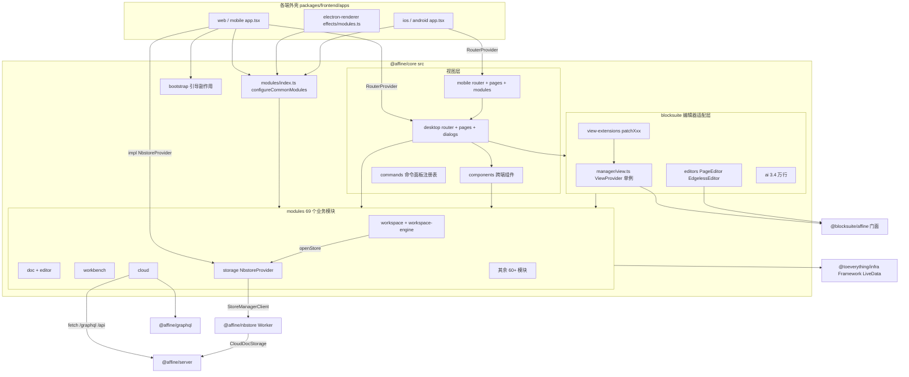
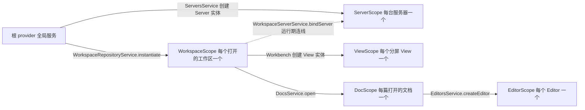
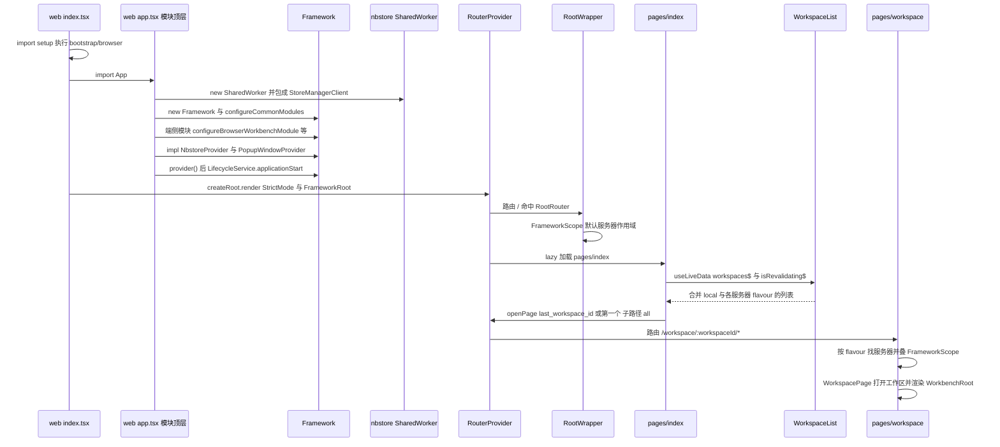
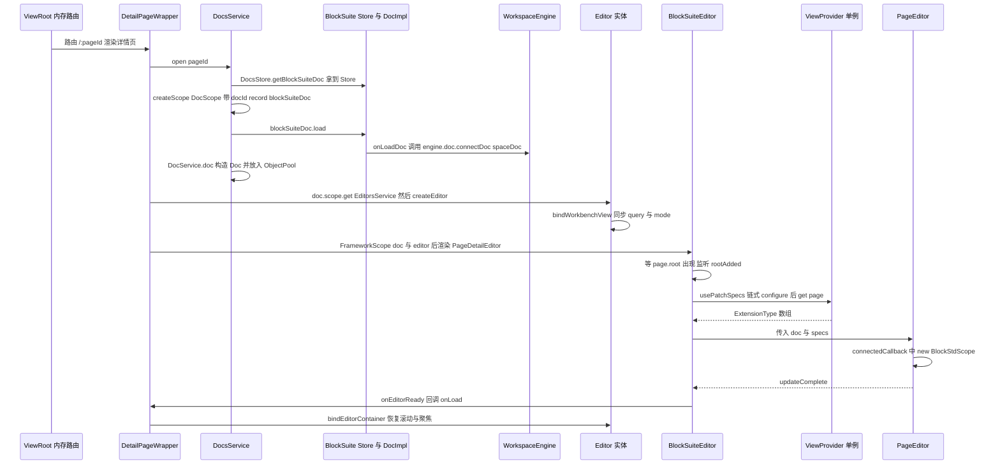
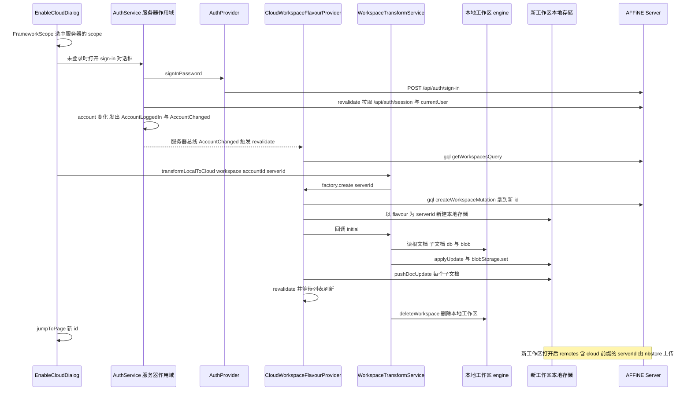
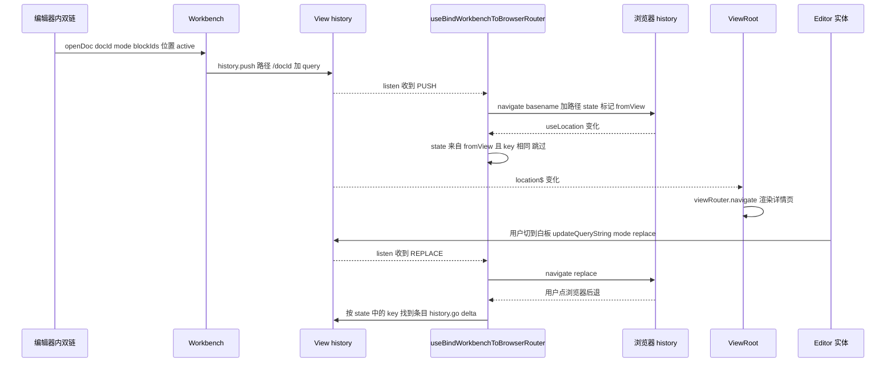

# `@affine/core` 精讲

> 一句话：AFFiNE 前端的**产品总成包**。它本身不创建容器，而是提供 69 个业务模块的 `configureXxx` 函数、各端共用的页面与组件，以及把 BlockSuite 编辑器接进产品的适配层。各端外壳（web、electron-renderer、mobile、ios、android）只负责挑模块、填平台实现，然后渲染 core 提供的路由。
>
> 对应分层文档：[`@affine/core`](../L4-前端应用/affine-core.md) · 源码：`packages/frontend/core`

分层文档已经讲过"模块 = `configureXxxModule`""store/entity/service 三原型""ViewExtensionManager 的链式配置"。DI 容器怎么解析、作用域怎么创建和销毁、LiveData 怎么引用计数，在 [`@toeverything/infra` 精讲](./01-toeverything-infra.md) 里已经讲透；`BlockStdScope` 怎么把扩展装成编辑器，在 [`@blocksuite/std` 精讲](./03-blocksuite-std.md) 里已经讲透。本篇不重复这些内容，只讲 core 自己的东西：

- 骨架：`src/` 各目录的分工和依赖方向，69 个模块按业务域画成的地图；
- 主干：工作区（flavour、engine 与 nbstore 的衔接）、文档（从 `DocsService.open` 到编辑器可编辑）、工作台（View 自带 history，与浏览器 URL 双向同步）、云端（多服务器、鉴权、GraphQL）；
- 跨端：同一份业务代码在不同端靠哪几种机制分叉。

## 0. 为什么是重点包

| 指标 | 数值 | 核实说明 |
| --- | --- | --- |
| 直接被依赖 | 7 个 | 扫描全部 `package.json` 的结果：`@affine/web`、`@affine/electron-renderer`、`@affine/mobile`、`@affine/ios`、`@affine/android`、`@affine/mobile-shared`、`@affine/admin`，都写在 `dependencies` 里 |
| 传递被依赖 | 7 个（全仓第 89） | 上面 7 个包没有再被其它工作区包依赖，所以传递依赖数等于直接依赖数 |
| 源码行数 | 218,309 行 | `src/` 下 `.ts`/`.tsx`，不含 `__tests__`、`*.spec.*`、`.gen.`。实测与编排方数据一致 |
| 业务模块 | 69 个目录 | `src/modules/` 下 69 个子目录，另有一个 `index.ts` |
| 所在链路 | 产品业务总成 | 工作区和文档的生命周期、编辑器集成、数据同步的调度都从这里发起 |

**和编排方数据不一致的地方（以实测为准）：**

- "约占全部工作区包源码的一半"：用同样的口径（`.ts`/`.tsx`/`.rs`，去掉测试、生成文件和 `.d.ts`）扫描 `packages/`、`blocksuite/`、`tools/`，总量约 76.3 万行，core 占 **28.6%**；`packages/frontend` 约 28.0 万行，core 占其中的 **78%**。所以准确的说法是"全仓最大的包，接近全仓源码的三成，前端源码的近八成"。
- 模块行数：编排方给的数字**包含了测试文件**。去掉 `*.spec.*` 后：cloud 5,041、app-sidebar 2,631、media 2,187、workspace-engine 1,565、import-clipper 950（它目录里的 `share-import.spec.ts` 一个文件就有 941 行）。workbench 3,473、collection-rules 3,032、share-menu 3,023、peek-view 2,707、quicksearch 2,329、workspace 1,769、integration 1,567 这几个与编排方一致。
- 一个容易被忽略的事实：`packages/frontend/core/src/modules/` 一共只有 53,868 行，**不到全包的四分之一**。体量大头在 `desktop/`（50,513）、`blocksuite/`（48,231，其中 `packages/frontend/core/src/blocksuite/ai/` 一个目录就有 33,879 行）和 `components/`（43,940）。

**满足的标准：**

- **B 体量复杂度**：21.8 万行，5 种作用域（`WorkspaceScope`/`DocScope`/`EditorScope`/`ViewScope`/`ServerScope`），69 个模块，两套路由（`desktop/`、`mobile/`），一层编辑器适配。分层文档 200 行只够讲清"模块怎么写"，讲不了"一个文档是怎么打开的"。
- **C 关键链路**：编辑数据的入口在这里。`WorkspaceEngine.start()` 打开 nbstore 的 store（`packages/frontend/core/src/modules/workspace/entities/engine.ts:55-89`）；BlockSuite 的每个子文档在 `onLoadDoc` 时被交给 `engine.doc.connectDoc`（`packages/frontend/core/src/modules/workspace/entities/workspace.ts:110-113`）；本地工作区转云端也是 core 把数据搬进新存储（`packages/frontend/core/src/modules/workspace/services/transform.ts:23-83`）。

**不懂它会卡在哪：**

1. `packages/frontend/apps/electron-renderer/src/app/effects/modules.ts:82-129`：桌面端为什么要写 `framework.scope(ServerScope).override(AuthProvider, …)`，而且必须带 `scope(ServerScope)`？（答：`AuthProvider` 默认实现也注册在 `ServerScope`，见 `packages/frontend/core/src/modules/cloud/impl/auth.ts:25-26`，每台服务器一份；桌面端要把登录请求转给主进程。）
2. `packages/frontend/apps/web/src/app.tsx:61-66` 的 `NbstoreProvider.openStore(key, options)`：`key` 和 `options` 是谁拼的？（答：`WorkspaceEngine.start` 拼出 `` `workspace:${flavour}:${id}` ``，`options` 来自 flavour 的 `getEngineWorkerInitOptions`，是一份只含存储类名和参数的可序列化描述，见 2.2。）
3. `blocksuite/affine/blocks/note/src/configs/toolbar.ts:325` 的 `ctx.std.getOptional(SidebarExtensionIdentifier)`：编辑器里点"打开侧栏"，实现在哪？（答：core 的 `patchSideBarService` 把 `WorkbenchService` 包成 BlockSuite 扩展注入进去，见 `packages/frontend/core/src/blocksuite/view-extensions/editor-view/side-bar-service.ts:5-20`。）
4. `packages/frontend/apps/android/src/app.tsx:100` 已经调用了 `framework.provider()`，第 107 行之后还在 `framework.impl(...)`，为什么不报错？（答：infra 的 provider 在**解析时**才去注册表查工厂（`packages/common/infra/src/framework/core/provider.ts:163`），只要在第一次 `get` 之前注册上就行，见 6.8。）
5. `@affine/nbstore` 里 `CloudDocStorage` 的 `serverBaseUrl`、`isSelfHosted` 是从哪来的？（答：`packages/frontend/core/src/modules/workspace-engine/impls/cloud.ts:562-605`，按工作区所属服务器生成。）

## 1. 全景架构



**逐块说明：**

| 目录（`packages/frontend/core/src/` 下） | 行数 | 职责 | 读它要知道的事 |
| --- | --- | --- | --- |
| `bootstrap/` | 118 | 引导副作用：`env` → `public-path` → `polyfill` → `telemetry` | 只有 `browser.ts` 和 `electron.ts` 两个入口，各端 `setup.ts` 第一行导入（如 `packages/frontend/apps/web/src/setup.ts:1`） |
| `modules/` | 53,868 | 业务逻辑：Service、Entity、Store、Scope、Provider 接口 | 69 个目录。`configureCommonModules` 调用 65 次 `configureXxx`（`packages/frontend/core/src/modules/index.ts:73-139`） |
| `desktop/` | 50,513 | 桌面和浏览器端的路由（`router.tsx`）、页面（`pages/`）、全局对话框（`dialogs/`） | 工作区内部的路由表单独放在 `packages/frontend/core/src/desktop/workbench-router.ts`，交给 workbench 渲染 |
| `blocksuite/` | 48,231 | 编辑器适配：扩展装配、React 与 Lit 的桥接、AI 面板与 AI 块 | `ai/` 占 70%；读主干只需要 `manager/`、`view-extensions/`、`block-suite-editor/`、`editors/` |
| `components/` | 43,940 | 跨端复用的 React 组件与 hooks（页面列表、属性面板、登录、侧栏等） | 被 desktop 引用 110 个文件、被 mobile 引用 38 个文件 |
| `mobile/` | 19,128 | 移动端路由、页面、5 个移动专属模块（`packages/frontend/core/src/mobile/modules/index.ts:9-15`） | 大量复用 desktop 的页面：mobile 有 25 个文件从 `desktop/` 导入 |
| `utils/`、`commands/`、`types/` | 1,441 / 892 / 178 | 工具函数；命令面板的全局注册表 `AffineCommandRegistry`（`packages/frontend/core/src/commands/registry/registry.ts:48`，不在 DI 里）；共享类型 | — |

**依赖方向**（统计 import 了对方的文件数，只算别名或 `../` 形式的跨目录引用，是下限）：desktop → modules 189、components → modules 155、blocksuite → modules 93、mobile → modules 89；反方向 modules → components 36、modules → blocksuite 18、modules → desktop 4。总体上是"视图层依赖模块"，但 `modules/*/view/` 也会引用组件和 `blocksuite/`。modules → desktop 的 4 个文件里，最关键的是 `packages/frontend/core/src/modules/workbench/view/workbench-root.tsx:3` 直接 import 了 `desktop/workbench-router`，所以 workbench 模块和桌面路由表是绑在一起的（移动端为此自己写了一个 `mobile/pages/workspace/workbench-root.tsx`）。

**69 个模块的业务地图**（行数不含测试）：

| 业务域 | 模块（行数） | 一句话 |
| --- | --- | --- |
| 平台与基础（12） | `storage` 456、`db` 369、`desktop-api` 254、`dnd` 374、`dialogs` 194、`feature-flag` 465、`telemetry` 151、`i18n` 126、`url` 103、`global-context` 70、`shared` 47、`lifecycle` 39 | 全局 State/Cache 与 `NbstoreProvider`；基于 infra ORM 的工作区数据库；Electron API 桥；拖放；全局对话框注册；特性开关；埋点；语言；URL 与弹窗；"当前工作区/文档/服务器"的全局上下文；Worker 渲染工具；`ApplicationStarted`/`ApplicationFocused` 事件 |
| 工作区与文档（9） | `workspace` 1,769、`workspace-engine` 1,565、`doc` 1,291、`docs-search` 460、`template-doc` 385、`workspace-property` 381、`journal` 331、`blob-management` 134、`backup` 81 | 本篇主干一、二；全文检索；模板文档；工作区自定义属性；日记；未引用 Blob 清理；桌面备份 |
| 编辑器集成（18） | `peek-view` 2,707、`media` 2,187、`doc-info` 1,534、`comment` 1,460、`pdf` 985、`at-menu-config` 710、`editor-setting` 598、`editor` 499、`search-menu` 400、`code-block-preview-renderer` 306、`typst` 301、`doc-display-meta` 281、`doc-link` 234、`doc-summary` 221、`find-in-page` 138、`mermaid` 134、`explorer-icon` 67、`icon-picker` 25 | 中心预览；音频与会议转写；文档信息面板；评论；PDF 渲染；`@` 菜单与 `/` 搜索菜单配置；编辑器设置；`Editor` 实体；代码块预览与 Typst/Mermaid 渲染器；标题与图标计算；反向链接；摘要；页内查找（Electron）；导航树中的文档图标；图标选择器 |
| 工作台、导航与组织（11） | `workbench` 3,473、`collection-rules` 3,032、`app-sidebar` 2,631、`quicksearch` 2,329、`app-tabs-header` 940、`collection` 622、`favorite` 622、`tag` 520、`navigation` 451、`organize` 402、`navigation-panel` 59 | 本篇主干三；文档列表的过滤、分组、排序规则引擎；左侧栏；`Cmd+K` 快速搜索；Electron 顶部标签栏；收藏集；收藏；标签；导航辅助；文件夹树；侧栏分区折叠状态 |
| 云、账号与协作（11） | `cloud` 5,041、`share-menu` 3,023、`integration` 1,567、`permissions` 1,257、`open-in-app` 507、`quota` 501、`notification` 381、`share-doc` 351、`share-setting` 304、`userspace` 269、`paywall` 32 | 本篇主干四；分享菜单视图；第三方集成（日历等）；工作区与文档权限；"在桌面 App 中打开"；工作区配额；服务端通知；公开分享；工作区分享设置；用户级本地数据库；原生端付费墙 |
| 导入（3） | `import-clipper` 950、`import` 250、`import-template` 151 | Web Clipper 导入、通用导入、模板导入 |
| AI（2） | `workspace-indexer-embedding` 1,538、`ai-button` 484 | 工作区向量索引设置；AI 入口按钮与 6 个 AI 子模块（`configureAIButtonModule` 等） |
| 外观（3） | `system-font-family` 88、`theme-editor` 79、`theme` 43 | 系统字体、主题编辑器、应用主题 |

装配方式分三类：59 个目录通过 `configureCommonModules` 装配（ai-button 和 storage 各贡献多个调用，合计 65 次）；`workbench`、`workspace-engine`、`app-tabs-header`、`backup`、`desktop-api`、`find-in-page` 这 6 个由各端外壳按平台装配；`mermaid`、`typst`、`shared`、`share-menu` 这 4 个没有 `configure` 函数，只提供渲染器或视图。

## 2. 核心抽象与数据模型

### 2.1 作用域树：5 种 Scope 和 React 里的"叠层"



| Scope | props | 谁创建 | 定义位置 |
| --- | --- | --- | --- |
| `ServerScope` | `{ server: Server }` | `Server` 实体构造时 `createScope`（`packages/frontend/core/src/modules/cloud/entities/server.ts:31-33`） | `packages/frontend/core/src/modules/cloud/scopes/server.ts:5-7` |
| `WorkspaceScope` | `{ openOptions, engineWorkerInitOptions }` | `WorkspaceRepositoryService.instantiate`（`packages/frontend/core/src/modules/workspace/services/repo.ts:109-112`） | `packages/frontend/core/src/modules/workspace/scopes/workspace.ts:6-9` |
| `ViewScope` | `{ view: View }` | `View` 实体构造时（`packages/frontend/core/src/modules/workbench/entities/view.ts:19-21`） | `packages/frontend/core/src/modules/workbench/scopes/view.ts:5-7` |
| `DocScope` | `{ docId, record, blockSuiteDoc }` | `DocsService.open`（`packages/frontend/core/src/modules/doc/services/docs.ts:120-124`） | `packages/frontend/core/src/modules/doc/scopes/doc.ts:6-10` |
| `EditorScope` | `{ editor: Editor }` | `Editor` 实体构造时（`packages/frontend/core/src/modules/editor/entities/editor.ts:31-33`） | `packages/frontend/core/src/modules/editor/scopes/editor.ts:5-7` |

有两点在 infra 精讲里没有展开，但在 core 里非常关键：

1. **服务器和工作区是兄弟作用域，不是父子**。两者都挂在根上。云工作区"属于哪台服务器"是运行期连上的：cloud flavour 在 `onWorkspaceInitialized` 里调用 `workspace.scope.get(WorkspaceServerService).bindServer(this.server)`（`packages/frontend/core/src/modules/workspace-engine/impls/cloud.ts:489-492`）。所以工作区作用域里的服务要访问服务器，只能通过 `WorkspaceServerService.server`，而且这个值可能是 `null`（本地工作区就是 `null`）（`packages/frontend/core/src/modules/cloud/services/workspace-server.ts:5-15`）。
2. **React 侧的上下文比 DI 树更宽**。文档页最终的 provider 栈是：根 → 默认服务器（`RootWrapper`，`packages/frontend/core/src/desktop/pages/root/index.tsx:28`）→ 工作区所属服务器（`packages/frontend/core/src/desktop/pages/workspace/index.tsx:221`）→ 工作区（同文件 `:347`）→ View（`packages/frontend/core/src/modules/workbench/view/view-root.tsx:36`）→ Doc → Editor（`packages/frontend/core/src/desktop/pages/workspace/detail-page/detail-page-wrapper.tsx:91-92`）。`FrameworkScope` 每叠一层就生成一个 `FrameworkStackProvider`，`scope` 为空时直接透传（`packages/common/infra/src/framework/react/index.tsx:63-81`）。因此组件里的 `useService(AuthService)` 拿到的是**当前工作区所属服务器**的 AuthService。但 DocScope 的 DI 父级是工作区 provider，不是 ViewScope：DocScope 里的服务用 `this.framework.get(ViewService)` 是拿不到的。

### 2.2 `WorkspaceFlavourProvider`、`Workspace`、`WorkspaceEngine`

`WorkspaceMetadata` 只有三个字段 `{ id, flavour, initialized? }`，池化的键是 `` `${flavour}:${id}` ``（`packages/frontend/core/src/modules/workspace/metadata.ts:1-8`）。**flavour 是字符串，不是枚举**：本地工作区是 `'local'`（`packages/frontend/core/src/modules/workspace-engine/impls/local.ts:188`）；云工作区的 flavour 是**服务器 id**，即 `readonly flavour = this.server.id`（`packages/frontend/core/src/modules/workspace-engine/impls/cloud.ts:112`）。官方云的服务器 id 是 `'affine-cloud'`，自托管服务器的 id 在添加时用 `nanoid()` 生成（`packages/frontend/core/src/modules/cloud/services/servers.ts:87-102`）。所以"local / cloud / 自托管"在源码里不是三个 flavour，而是"一个 local 加上每台服务器各一个"。

每种 flavour 都实现同一个接口（`packages/frontend/core/src/modules/workspace/providers/flavour.ts:20-74`），关键方法：

```ts
export interface WorkspaceFlavourProvider {
  flavour: string;
  deleteWorkspace(id: string): Promise<void>;
  createWorkspace(
    initial: (docCollection: BSWorkspace, blobStorage: BlobStorage, docStorage: DocStorage) => Promise<void>
  ): Promise<WorkspaceMetadata>;
  workspaces$: LiveData<WorkspaceMetadata[]>;
  isRevalidating$?: LiveData<boolean>;
  revalidate?: () => void;
  // …
  getEngineWorkerInitOptions(workspaceId: string): WorkerInitOptions;
  onWorkspaceInitialized?(workspace: Workspace): void;
}
```

flavour 不是直接注册的。DI 里注册的是"flavour 列表的提供者" `WorkspaceFlavoursProvider`，用变体区分：`WorkspaceFlavoursProvider('LOCAL')` 和 `WorkspaceFlavoursProvider('CLOUD')`（`packages/frontend/core/src/modules/workspace-engine/index.ts:14-21`）。`WorkspaceFlavoursService` 用 `[[WorkspaceFlavoursProvider]]` 一次注入全部变体，再 `combineLatest` 合并成一个 `flavours$`（`packages/frontend/core/src/modules/workspace/services/flavours.ts:6-17`）。CLOUD 变体会监听 `ServersService.servers$`，**为每台服务器生成一个 `CloudWorkspaceFlavourProvider`**，并用 `ObjectPool` 管理（`packages/frontend/core/src/modules/workspace-engine/impls/cloud.ts:680-728`）。所以新增一台自托管服务器，工作区列表会自动多出一组 flavour。

`getEngineWorkerInitOptions` 是工作区接入 nbstore 的关键。它返回的不是存储实例，而是**存储类名加参数的描述**：

```ts
// packages/frontend/core/src/modules/workspace-engine/impls/cloud.ts:562-581（节选）
remotes: {
  [`cloud:${this.flavour}`]: {
    doc: {
      name: 'CloudDocStorage',
      opts: {
        type: 'workspace',
        id: workspaceId,
        serverBaseUrl: this.server.serverMetadata.baseUrl,
        isSelfHosted: this.server.config$.value.type === ServerDeploymentType.Selfhosted,
      },
    },
    blob: { name: 'CloudBlobStorage', opts: { id: workspaceId, serverBaseUrl: this.server.serverMetadata.baseUrl } },
    // awareness / indexer …
  },
},
```

本地存储的类型在构建期按端选定：Electron、iOS、Android 用 `SqliteDocStorage` 等，浏览器用 `IndexedDBDocStorage` 等（`packages/frontend/core/src/modules/workspace-engine/impls/local.ts:193-225`）。描述里写的是 `this.DocStorageType.identifier`，真正的实例在 Worker 里按名字构造；Web 端 Worker 能识别哪些名字，由 `packages/frontend/apps/web/src/nbstore.worker.ts:13-18` 传入的存储列表决定。这样同一份描述可以跨线程（SharedWorker）甚至跨进程（Electron）传递。

**`Workspace` 实体**（`packages/frontend/core/src/modules/workspace/entities/workspace.ts:17-176`）持有根 `YDoc`（guid 就是工作区 id），并惰性创建 BlockSuite 的 `WorkspaceImpl` 作为 `docCollection`（`:78-124`）。数据流的关键接线都在 `WorkspaceImpl` 的构造参数里：

- `onLoadDoc: doc => { this.loadBlobSource(doc); this.engine.doc.connectDoc(doc); }`：任何子文档被 `load()` 时，把它的 YDoc 交给 nbstore 同步；
- `onLoadAwareness`：把 awareness 交给 `engine.awareness`；
- `blobSource`：BlobEngine 的读写落到 `engine.blob`；
- `onCreateDoc`：BlockSuite 内部新建文档时，回到 core 的 `DocsService.createDoc`，确保元数据和中间件逻辑都执行。

`docs` 和 `engine` 写成 getter，在 getter 里才 `get`（`:126-137`），用来避开 `Workspace` 和 `DocsService`、`WorkspaceEngineService` 之间的构造期循环依赖。

**`WorkspaceEngine`**（`packages/frontend/core/src/modules/workspace/entities/engine.ts:12-90`）是一层薄壳，内部只有一个 `client?: StoreClient`。`doc`/`blob`/`indexer`/`awareness` 四个 getter 直接返回 `client.docFrontend` 等；`client` 未初始化时访问会抛 `Engine is not initialized`。`start()` 做四件事：调用 `nbstoreService.openStore(key, engineWorkerInitOptions)`、发出 `WorkspaceEngineBeforeStart` 事件、给根文档加最高优先级、调用 `doc.start()`。nbstore 内部怎么同步，见 [04-affine-nbstore](./04-affine-nbstore.md)。

### 2.3 `DocsService` / `DocRecord` / `Doc` / `Editor`

文档有三种不同生命周期的对象，分清它们是读懂 core 的前提：

| 对象 | 作用域 | 生命周期 | 能做什么 |
| --- | --- | --- | --- |
| `DocRecord` | WorkspaceScope 实体 | 只要文档 id 在列表里就存在，由 `DocRecordList` 的 `Map` 缓存，从不删除（`packages/frontend/core/src/modules/doc/entities/record-list.ts:13-33`） | **不打开文档**就能读写元数据：`meta$`、`properties$`、`title$`、`primaryMode$`，数据来自根文档的 `meta.pages` 和工作区数据库（`packages/frontend/core/src/modules/doc/entities/record.ts:14-31`） |
| `Doc` | DocScope 实体 | `DocsService.open` 时创建，放进 `ObjectPool`，引用计数归零并经过 GC 后 `scope.dispose()`（`packages/frontend/core/src/modules/doc/services/docs.ts:28-32`） | 持有 BlockSuite `Store`（`blockSuiteDoc`）与它的 `spaceDoc`；构造时监听本地事务来更新 `updatedAt`，并给 nbstore 的 doc 和 indexer 各加 100 优先级（`packages/frontend/core/src/modules/doc/entities/doc.ts:11-45`） |
| `Editor` | DocScope 实体 | 每个"编辑器视图"一个，同一篇文档可以同时有多个（分屏、Peek 预览） | `mode$`（page/edgeless）、`selector$`（定位到块或元素）、`editorContainer$`；负责与 View 的 URL query 双向同步（`packages/frontend/core/src/modules/editor/entities/editor.ts:30-41`） |

注册关系见 `packages/frontend/core/src/modules/doc/index.ts:26-41` 和 `packages/frontend/core/src/modules/editor/index.ts:16-24`。`Editor` 注册在 `.scope(WorkspaceScope).scope(DocScope)` 下，依赖 `[DocService, WorkspaceService]`；`EditorService` 注册在更内层的 `EditorScope`。

`DocsService.createDoc` 是"新建文档"的唯一正确入口（`packages/frontend/core/src/modules/doc/services/docs.ts:144-178`）：依次执行所有 `DocCreateMiddleware.beforeCreate`，调用 `DocsStore.createDoc` 写 Yjs 元数据，再用 `initDocFromProps` 初始化块，然后设置 primaryMode、模板标记，执行 `afterCreate`，写入创建和更新时间，最后在工作区总线上发出 `DocCreated`。直接调用 BlockSuite 的 `collection.createDoc` 也会回到这里，因为 `onCreateDoc` 被接到了 `this.docs.createDoc({ id, skipInit: true })`。

### 2.4 `Workbench` 与 `View`

`Workbench`（`packages/frontend/core/src/modules/workbench/entities/workbench.ts:26-311`）是工作区级的"窗口管理器"：`views$` 是一组 `View`，`activeViewIndex$` 指向当前活动视图，`location$` 是活动视图的位置。打开操作统一走 `open(to, { at, replaceHistory, show })`，`at` 可以取 `'active' | 'beside' | 'head' | 'tail' | number | 'new-tab'`（`:14-20, 138-160`）。`openDoc` 只是把 `docId` 和 `ReferenceParams` 拼成 `` `/${docId}?…` `` 再调用 `open`（`:177-199`）。

`View`（`packages/frontend/core/src/modules/workbench/entities/view.ts:13-136`）**自带一个内存 history**（`createNavigableHistory`，`:54-65`）。`location$`/`entries$` 由 `history.listen` 转成 LiveData，`queryString$()` 把 search 解析成对象。每个 View 由 `ViewRoot` 渲染成一个独立的 `createMemoryRouter(workbenchRoutes)`（`packages/frontend/core/src/modules/workbench/view/view-root.tsx:13-44`），所以分屏里每个视图都有自己完整的路由和前进后退栈。

"Tab"在不同端含义不同，由 `WorkbenchNewTabHandler` 决定：浏览器端是 `window.open(link, '_blank')`；桌面端调用主进程的 `addTab`，开一个新的渲染视图（`packages/frontend/core/src/modules/workbench/services/workbench-new-tab-handler.ts:14-40`）。桌面端每个标签页是一个独立的渲染进程上下文，各有自己的 `Framework`；启动时从 GlobalState 的 `tabViewsMetaSchema` 里按 `appInfo.viewId` 恢复自己的 views（`packages/frontend/core/src/modules/workbench/services/workbench-view-state.ts:33-68`）。

### 2.5 `Server` 家族：多服务器、鉴权与请求栈

- `ServersService`（根作用域）：服务器列表 = 内置服务器 `BUILD_IN_SERVERS` 加上 GlobalState 里的 `serverList`（`packages/frontend/core/src/modules/cloud/stores/server-list.ts:13-22`）。列表每变化一次，就为新出现的服务器 `createEntity(Server)`，触发 `revalidateConfig()`，并在该服务器的作用域总线上发出 `ServerStarted`（`packages/frontend/core/src/modules/cloud/services/servers.ts:20-48`）。
- `Server` 实体：构造时创建 `ServerScope`，并从作用域里取出 `FetchService.fetch`、`GraphQLService.gql`、`ServerConfigStore`（`packages/frontend/core/src/modules/cloud/entities/server.ts:26-57`）。`config$` 在缺配置时会在 `map` 里 `throw`（`:47-57`）。
- `DefaultServerService`：构造时取 `'affine-cloud'`，取不到就抛错（`packages/frontend/core/src/modules/cloud/services/default-server.ts:7-19`）。"默认服务器"的作用域在 `RootWrapper` 里包住整棵路由树。
- `ServerScope` 内的请求栈（`packages/frontend/core/src/modules/cloud/index.ts:135-198`）：`ServerService` → `FetchService` → `GraphQLService` → 各个 `XxxStore` → `XxxService`/实体。`AuthService`、`SubscriptionService`、`UserQuotaService` 等都在这一层，所以**每台服务器一套账号状态**。

`FetchService.fetch`（`packages/frontend/core/src/modules/cloud/services/fetch.ts:32-110`）负责：把相对路径拼到 `server.serverMetadata.baseUrl` 上，设置默认 15 秒超时，附加 `x-affine-version` 和 `x-affine-client-kind` 请求头，并把网络错误、中止、非 2xx 响应统一转成 `UserFriendlyError`（中止 499，网络错误 504）。`GraphQLService` 只有三十多行：

```ts
// packages/frontend/core/src/modules/cloud/services/graphql.ts:19-49（节选）
private readonly rawGql = gqlFetcherFactory('/graphql', this.fetcher.fetch);

rxGql = <Query extends GraphQLQuery>(options: QueryOptions<Query>) =>
  fromPromise(signal => this.gql({ ...options, context: { signal, ...options.context } } as any));

gql = async <Query extends GraphQLQuery>(options: QueryOptions<Query>) => {
  try {
    return await this.rawGql(options);
  } catch (anyError) {
    const error = UserFriendlyError.fromAny(anyError);
    if (error.isStatus(401)) {
      this.framework.get(AuthService).session.revalidate();   // 惰性取，避开 AuthStore → GraphQLService 的环
    }
    throw error;
  }
};
```

`AuthService` 依赖 `AuthStore`，`AuthStore` 又依赖 `GraphQLService`（`packages/frontend/core/src/modules/cloud/index.ts:147-162`）。如果 `GraphQLService` 在构造参数里声明 `AuthService`，就会形成环，所以它只在出现 401 时才惰性 `get`。真正的登录动作被抽象成 `AuthProvider` 接口（`packages/frontend/core/src/modules/cloud/provider/auth.ts:12-40`）：默认实现直接 `fetch` 后端的 `/api/auth/*`（`packages/frontend/core/src/modules/cloud/impl/auth.ts:25-80`）；桌面端和 iOS、Android 用 `override` 换成原生实现。

### 2.6 `ViewProvider`：把 core 服务注入编辑器的适配层

`packages/frontend/core/src/blocksuite/manager/view.ts:75-364` 定义了一个**进程级单例** `ViewProvider`。它在构造时创建一个 `ViewExtensionManager`，内容是门面的 `getInternalViewExtensions()` 加上 core 的 15 个 ViewExtension（`:86-106`）；对外暴露一个链式 `config` 对象（`:112-135`）。每个 `_configureXxx` 只是调用 `this._manager.configure(SomeExtension, { framework, … })`。

core 的 ViewExtension 都遵循同一个模式：options 里用 zod 声明 `framework: z.instanceof(FrameworkProvider)`；在 `setup` 里从 `framework` 取出 core 服务，用 `patchXxx` 把它们包装成 BlockSuite 的服务扩展，再 `context.register(...)`。例子：

- `patchDocModeService`：把 `DocModeProvider` 的 `setEditorMode`/`getPrimaryMode` 等方法转发到 `EditorService.editor.setMode`、`DocService.doc.setPrimaryMode`（`packages/frontend/core/src/blocksuite/view-extensions/editor-view/doc-mode-service.ts:10-54`）；
- `patchUserListExtensions`：把 `MemberSearchService` 的 LiveData 用 `.signal` 转成 BlockSuite 需要的 Signal（`packages/frontend/core/src/blocksuite/view-extensions/cloud/user-list.ts:4-23`）；
- `AffineEditorViewExtension`：只有 `scope === 'doc'` 时才 `get(DocService)`/`get(EditorService)`，因为白板设置页这类场景里没有文档作用域（`packages/frontend/core/src/blocksuite/view-extensions/editor-view/editor-view.tsx:90-123`）。

传进来的 `framework` 是 React 里 `useFramework()` 拿到的**整条叠层栈**（`packages/frontend/core/src/blocksuite/block-suite-editor/lit-adaper.tsx:70`），所以扩展可以同时访问 Editor、Doc、View、Workspace、Server 各层的服务。

## 3. 关键流程走读

### 流程 ①：Web 端从入口到首页渲染



1. **引导副作用**：`packages/frontend/apps/web/src/index.tsx:1` 先 `import './setup'`，后者依次导入 `@affine/core/bootstrap/browser`、`bootstrap/cleanup`、组件主题（`packages/frontend/apps/web/src/setup.ts:1-3`）。`bootstrap/browser.ts:1-5` 注释写着 `ORDER MATTERS`：`env` 必须最先执行，因为它注入 `BUILD_CONFIG` 等全局变量。
2. **Worker 先于容器**：`app.tsx` 在模块顶层创建 nbstore Worker。优先用 SharedWorker，`localStorage.disableSharedWorker === 'true'` 或浏览器不支持时退回普通 Worker；然后包成 `StoreManagerClient`，并在页面 focus 和 click 时 `resume()`、blur 时 `pause()`（`packages/frontend/apps/web/src/app.tsx:28-54`）。
3. **装配**：`new Framework()` → `configureCommonModules` → 浏览器版工作台 → localStorage 版全局状态 → 浏览器版 flavours → `impl(NbstoreProvider, { realtime, openStore })` → `impl(PopupWindowProvider)`（`packages/frontend/apps/web/src/app.tsx:56-85`）。`NbstoreProvider` 就是 core 和 nbstore 之间的接缝：core 只认识接口（`packages/frontend/core/src/modules/storage/providers/nbstore.ts:8-29`）。
4. **转入运行期**：`framework.provider()` 之后立刻 `get(LifecycleService).applicationStart()`，并在 window focus 时调用 `applicationFocus()`（`packages/frontend/apps/web/src/app.tsx:86-92`）。`AuthService` 用 `@OnEvent(ApplicationFocused, …)` 监听这个事件来重新校验会话（`packages/frontend/core/src/modules/cloud/services/auth.ts:44-45, 89-91`）。
5. **React 根**：`Suspense` → `FrameworkRoot` → emotion `CacheProvider` → `I18nProvider` → `AffineContext` → `RouterProvider`（`packages/frontend/apps/web/src/app.tsx:94-108`）。路由表是 core 的 `desktop/router.tsx`（`packages/frontend/core/src/desktop/router.tsx:38-200`），除登录回调页外几乎都是 `lazy` 加载。
6. **默认服务器作用域**：`RootWrapper` 用 `FrameworkScope` 包住 `defaultServerService.server.scope`，并在这一层渲染 `GlobalDialogs` 和 `NotificationCenter`（`packages/frontend/core/src/desktop/pages/root/index.tsx:11-36`）。所以首页可以直接 `useService(AuthService)`。
7. **首页选工作区**：`pages/index` 读取 `workspacesService.list.workspaces$`。列表来自 `WorkspaceList`：对所有 flavour 的 `workspaces$` 做 `combineLatest` 再拍平，`isRevalidating$` 任一 flavour 在加载中即为 true（`packages/frontend/core/src/modules/workspace/entities/list.ts:7-28`）。加载完成后，优先打开 `last_workspace_id`，否则打开第一个；有 `initCloud=true` 时会创建或打开云工作区；列表为空时调用 `createFirstAppData` 建一个示例工作区（`packages/frontend/core/src/desktop/pages/index/index.tsx:93-194`）。
8. **进入工作区**：`pages/workspace` 按 URL 里的 `workspaceId` 在列表中找到 meta。meta 的 flavour 不是 `'local'` 时，用 `serversService.server$(meta.flavour)` 找到服务器；如果 URL 带了 `?server=`，就按 baseUrl 找。然后把 `globalContext.serverId` 设成该服务器的 id，并用 `FrameworkScope scope={server?.scope}` 包住 `WorkspacePage`（`packages/frontend/core/src/desktop/pages/workspace/index.tsx:144-224`）。找不到工作区时，先最多重试三次 revalidate，再判断：是文档路由就当成分享页渲染，否则显示 404（`:113-215`）。
9. **打开工作区**：`WorkspacePage` 在 `useLayoutEffect` 里 `workspacesService.open({ metadata: meta })`，cleanup 时 `dispose`（`:248-254`）。作用域怎么建立、怎么回收，见 [infra 精讲 3.2](./01-toeverything-infra.md)。core 额外做的是 `instantiate` 里的四步：`createScope` → 取 `WorkspaceService.workspace` → **`workspace.engine.start()`** → 发出 `WorkspaceInitialized` 并调用 flavour 的 `onWorkspaceInitialized`（`packages/frontend/core/src/modules/workspace/services/repo.ts:90-127`）。
10. **等根文档就绪**：`rootDocReady$ = LiveData.from(workspace.engine.doc.docState$(workspace.id).pipe(map(v => v.ready)), false)`。在它变成 true 之前只显示骨架屏，之后才渲染 `WorkspaceLayout` 加 `WorkbenchRoot`（`:256-268, 334-358`）。`WorkbenchRoot` 再为每个 View 渲染一个内存路由，`/all` 命中全部文档页（`packages/frontend/core/src/modules/workbench/view/workbench-root.tsx:37-109`）。

### 流程 ②：打开一个本地文档到编辑器可编辑



1. **路由命中**：工作区路由表里 `'/:pageId'` 对应 `detail-page`（`packages/frontend/core/src/desktop/workbench-router.ts:32-35`）。页面 `Component` 记录 `last_page_id`、加入最近访问，再用 `useGuard('Doc_Read', pageId)` 做权限判断（`packages/frontend/core/src/desktop/pages/workspace/detail-page/detail-page.tsx:454-480`）。
2. **打开文档**：`useLoadDoc` 必须先等到 `docRecordList.doc$(pageId)` 有值，才调用 `docsService.open(pageId)`（`packages/frontend/core/src/desktop/pages/workspace/detail-page/detail-page-wrapper.tsx:15-40`）。`open` 的检查顺序是：DocRecord 不存在就抛 `Doc record not found`，BlockSuite 文档不存在就抛 `Doc not found`，池中已有就直接复用（`packages/frontend/core/src/modules/doc/services/docs.ts:105-118`）。
3. **建文档作用域并加载**：

   ```ts
   // packages/frontend/core/src/modules/doc/services/docs.ts:120-141
   const docScope = this.framework.createScope(DocScope, { docId, blockSuiteDoc, record: docRecord });
   try {
     blockSuiteDoc.load();
   } catch (e) {
     logger.error('Failed to load doc', { docId, error: e });
   }
   const doc = docScope.get(DocService).doc;
   doc.scope.emitEvent(DocInitialized, doc);
   const { obj, release } = this.pool.put(docId, doc);
   ```

   `Store.load()` 会调用 `DocImpl.load()`（`blocksuite/framework/store/src/model/store/store.ts:1221-1233`），后者执行 `this.workspace.onLoadDoc?.(this.spaceDoc)` 和 `onLoadAwareness`（`packages/frontend/core/src/modules/workspace/impls/doc.ts:161-176`）。于是空的 `spaceDoc` 被接到 nbstore，本地存储里的 update 异步灌进来。注意 `load()` 的异常只记日志不抛出，所以文档加载失败时页面仍会继续渲染。
4. **创建 Editor**：`doc.scope.get(EditorsService).createEditor()` 发出 `EditorInitialized`（`packages/frontend/core/src/modules/editor/services/editors.ts:6-12`）。`editor.bindWorkbenchView(viewService.view)` 建立 URL query 和编辑器状态的双向绑定（见流程 ④）。cleanup 时依次调用 `unbind`、`editor.dispose`、`release`。此外 wrapper 还单独给当前文档加了 10 的同步优先级（`detail-page-wrapper.tsx:43-45`）。
5. **叠作用域**：`FrameworkScope scope={doc.scope}` 加 `FrameworkScope scope={editor.scope}`（`detail-page-wrapper.tsx:90-94`）。`DetailPageImpl` 里的 `useServices({ EditorService, DocService, ViewService, … })` 依赖的就是这两层（`detail-page.tsx:76-97`）。
6. **等内容到达**：`BlockSuiteEditor` 在 `props.page.root` 出现之前显示 `EditorLoading`，通过 `page.slots.rootAdded` 得知根块已到达（`packages/frontend/core/src/blocksuite/block-suite-editor/blocksuite-editor.tsx:309-323`）。对本地工作区来说，这一步等的是 IndexedDB 或 SQLite 的读取。
7. **拼扩展**：`usePatchSpecs` 在一个 `useMemo` 里先 `init()` 重置成默认配置，再依次链式调用 `foundation(framework)`、`ai`、`theme`、`editorView({ framework, reactToLit, confirmModal })`、`cloud(framework, isCloud)`……最后 `manager.get(mode)`；移动端取 `mobile-page`/`mobile-edgeless`（`packages/frontend/core/src/blocksuite/block-suite-editor/lit-adaper.tsx:93-131`）。`ExtensionManager.get` 每次都会删掉旧集合，用当前 options 重新调用一遍所有 provider 的 `setup`，并返回新数组（`blocksuite/affine/ext-loader/src/manager.ts:96-109`）。
8. **创建 std**：`PageEditor.connectedCallback` 里执行 `this.std = new BlockStdScope({ store: this.doc, extensions: this.specs })`，`render` 时调用 `std.render()`（`packages/frontend/core/src/blocksuite/editors/page-editor.ts:58-85`）。std 内部的流程见 [std 精讲流程 ①](./03-blocksuite-std.md)。
9. **就绪回调**：`BlockSuiteEditorImpl` 用 Proxy 把 `page`、`host`、`std`、`mode` 等拼成一个 `AffineEditorContainer`（`blocksuite-editor.tsx:89-150`）。它在 effect 里设置图片代理地址，等 `updateComplete` 之后调用 `onEditorReady`（`:211-243`）。详情页的 `onLoad` 订阅 `RefNodeSlotsProvider.docLinkClicked`，把编辑器里的双链点击转成 `workbench.openDoc` 或 `peekView.open`；最后调用 `editor.bindEditorContainer`，恢复滚动位置、处理 `selector` 定位（`detail-page.tsx:193-298`）。到这里文档就可以编辑了。

### 流程 ③：登录云账号，把本地工作区转成云工作区



1. **选服务器**：`EnableCloudDialog` 列出 `serversService.servers$`，用 `FrameworkScope key={selectedServer.id} scope={selectedServer.scope}` 包住对话框内容（`packages/frontend/core/src/desktop/dialogs/enable-cloud/index.tsx:132-164`）。这样对话框里的 `useService(AuthService)` 拿到的是**所选服务器**的登录状态，切换服务器就切换整套账号上下文。
2. **未登录先登录**：`signInOrEnableCloud` 在未登录时调用 `globalDialogService.open('sign-in', { server: selectedServer.baseUrl })`（`:83-98`）。以密码登录为例：`AuthService.signInPassword` → `AuthStore.signInPassword` → `authProvider.signInPassword`（`packages/frontend/core/src/modules/cloud/services/auth.ts:257-281`、`packages/frontend/core/src/modules/cloud/stores/auth.ts:144-150`）。默认 provider 用 `FetchService` POST `/api/auth/sign-in`，有验证码时附加 `x-captcha-*` 请求头（`packages/frontend/core/src/modules/cloud/impl/auth.ts:58-80`）。
3. **会话校验**：`AuthSession.revalidate` 是 `effect(exhaustMapWithTrailing(...))`，带无限次 `backoffRetry`（`packages/frontend/core/src/modules/cloud/entities/session.ts:75-94`）。`fetchSession` 先请求 `/api/auth/session`，再用 GraphQL 的 `currentUser` 校验同一个用户（`packages/frontend/core/src/modules/cloud/stores/auth.ts:101-113`）。结果写进 GlobalState 缓存，`session$` 由缓存派生（`session.ts:45-61`）。
4. **账号事件**：`AuthService` 构造时订阅 `account$`，按 id 去重并跳过初值。账号变化时在**服务器作用域总线**上发出 `AccountLoggedIn` 或 `AccountLoggedOut`，再发出 `AccountChanged`（`packages/frontend/core/src/modules/cloud/services/auth.ts:60-79`）。该服务器的 `CloudWorkspaceFlavourProvider` 在构造时用 `server.scope.eventBus.on(AccountChanged, …)` 订阅了这个事件，收到后 `revalidate()`（`packages/frontend/core/src/modules/workspace-engine/impls/cloud.ts:97-110`）。revalidate 用 GraphQL `getWorkspacesQuery` 拉列表，按账号缓存到 GlobalState；账号切换时先用缓存秒出列表（`:257-325`）。
5. **转换**：登录后调用 `workspacesService.transformLocalToCloud(workspace, account.id, selectedServer.id)`（`enable-cloud/index.tsx:54-81`）。`WorkspaceTransformService` 先确认源工作区是 `local`，然后调用 `factory.create(flavour, initial)`（`packages/frontend/core/src/modules/workspace/services/transform.ts:23-39`）。工厂按 flavour 找到对应 provider 并调用它的 `createWorkspace`（`packages/frontend/core/src/modules/workspace/services/factory.ts:18-34`）。
6. **云端建空间、本地写数据**：`CloudWorkspaceFlavourProvider.createWorkspace` 先用 `createWorkspaceMutation` 让服务端分配 id，再以 `flavour = server.id` 新建本地 Doc/Blob 存储，构造一个临时 `WorkspaceImpl` 执行 `initial`（`packages/frontend/core/src/modules/workspace-engine/impls/cloud.ts:160-226`）。`initial` 从旧工作区的 `engine.doc.storage` 读出根文档和每个子文档的二进制并 `applyUpdate`；调用 `transformWorkspaceDBLocalToCloud`，把本地数据库里的用户数据归到这个账号下；逐个复制 blob（`transform.ts:40-76`）。
7. **落盘与刷新**：所有加载过的子文档用 `encodeStateAsUpdate` 推进新存储；写入初始文档属性（创建者为当前账号）；然后 `revalidate()` 并等待列表刷新（`cloud.ts:228-256`）。**这一步没有直接上传服务器**，数据只写进了本地的云工作区存储。
8. **删旧、跳新**：`destroy.deleteWorkspace(local.meta)` 删除本地工作区（`transform.ts:80`），对话框 `jumpToPage(newId, openPageId || 'all')`。新工作区按流程 ① 第 9 步打开。这次 `getEngineWorkerInitOptions` 返回的 `remotes` 里有 `` `cloud:${serverId}` ``（`cloud.ts:562-605`），nbstore 的同步把本地数据推到服务端；`onWorkspaceInitialized` 把工作区绑定到该服务器（`cloud.ts:489-492`）。

打开一个已有的云工作区，只走第 4 步和第 8 步：列表来自 `getWorkspacesQuery`；首次在新设备打开时本地存储是空的，根文档的 `docState$.ready` 要等 nbstore 从远端拉下数据才会变成 true，期间显示骨架屏（流程 ① 第 10 步）。

### 流程 ④：工作台导航与浏览器 URL 同步



1. **入口统一**：编辑器里的双链、侧栏、命令面板，最终都调用 `workbench.open` 或 `openXxx`。`openDoc` 用 `toDocSearchParams` 把 `mode`、`blockIds`、`elementIds`、`refreshKey` 序列化成 query（`packages/frontend/core/src/modules/workbench/entities/workbench.ts:177-199`）。`at: 'active'` 时对活动视图的 history 执行 `push` 或 `replace`；目标位置还没有视图时，用 `createView` 新建一个（`:138-160`）。
2. **View 到浏览器**：`useBindWorkbenchToBrowserRouter` 监听活动视图的 `history`。收到 PUSH 或 REPLACE 时，把视图位置拼上 `basename`（`/workspace/:id`），保留当前 URL 里的 `flavour`、`server` 参数，然后 `navigate`，并带上 `state: 'fromView,' + key`。POP 不同步，因为两个栈的前进后退无法一一对应（`packages/frontend/core/src/modules/workbench/view/browser-adapter.ts:34-57, 103-143`）。
3. **浏览器到 View**：浏览器位置变化时，如果 state 是 `fromView` 且 key 就是当前视图的位置，说明是自己刚刚触发的，直接跳过；如果 key 是视图历史里更早的某一条（用户点了浏览器后退），就 `view.history.go(delta)`；其余情况视为用户直接改了 URL，执行 `view.history.push(newLocation, 'fromBrowser')`（`:59-87`）。
4. **渲染**：`ViewRoot` 订阅 `view.location$`，在 `useLayoutEffect` 里 `viewRouter.navigate(location)`。为了让内层 `RouterProvider` 不继承外层路由上下文，它用 `UNSAFE_LocationContext`、`UNSAFE_RouteContext` 把外层上下文清空（`packages/frontend/core/src/modules/workbench/view/view-root.tsx:20-43`）。
5. **编辑器状态回写 URL**：`Editor.bindWorkbenchView` 建两条订阅。view query 变了就 `setMode`/`setSelector`；编辑器的 `mode$`/`selector$` 变了就 `view.updateQueryString(…, { replace: true })`。两条订阅共用一个 `updating` 标志防止互相触发形成死循环（`packages/frontend/core/src/modules/editor/entities/editor.ts:120-197`）。如果 URL 没有指定 mode，就用文档的 primaryMode 作为默认值（`:132-144`）。
6. **桌面端不同**：Electron 用 `useBindWorkbenchToDesktopRouter`，只把浏览器位置的变化同步到 `workbench.open`，从不改写浏览器 history（`packages/frontend/core/src/modules/workbench/view/desktop-adapter.ts:19-43`）。用哪个适配器由构建期常量决定：`const useAdapter = BUILD_CONFIG.isElectron ? … : …`（`packages/frontend/core/src/modules/workbench/view/workbench-root.tsx:25-27`）。

## 4. 源码阅读路线

1. **`packages/frontend/apps/web/src/app.tsx` 全文**（108 行）：先弄清"外壳做了什么"——Worker、`new Framework`、`configureXxx`、两个 `impl`、`provider()`、React 根。再对照 `packages/frontend/apps/electron-renderer/src/app/effects/modules.ts:39-133`，看桌面端多装了哪些模块。
2. **`packages/frontend/core/src/modules/index.ts`**：只读 73-139 行的调用列表，对照第 1 段的模块地图，知道有哪些模块即可，不用逐个点进去。
3. **工作区接口层**：`packages/frontend/core/src/modules/workspace/index.ts:42-90`（注册）→ `packages/frontend/core/src/modules/workspace/providers/flavour.ts`（接口）→ `packages/frontend/core/src/modules/workspace/services/repo.ts`（打开与池化）→ `packages/frontend/core/src/modules/workspace/entities/workspace.ts`（`docCollection` 接线）→ `packages/frontend/core/src/modules/workspace/entities/engine.ts`（`start`）。读到能说清"一个工作区从 meta 变成 `Workspace` 实例要经过哪几步"。
4. **flavour 实现**：`packages/frontend/core/src/modules/workspace-engine/impls/local.ts`，重点看 `createWorkspace`（240-323）和 `getEngineWorkerInitOptions`（439-536）；再读 `packages/frontend/core/src/modules/workspace-engine/impls/cloud.ts` 的同名方法和 `CloudWorkspaceFlavoursProvider`（680-728）。读到能说清"flavour 为什么是服务器 id"。
5. **文档层**：`packages/frontend/core/src/modules/doc/index.ts` → `packages/frontend/core/src/modules/doc/services/docs.ts`（`open`、`createDoc`）→ `packages/frontend/core/src/modules/doc/entities/record.ts`、`packages/frontend/core/src/modules/doc/entities/doc.ts` → `packages/frontend/core/src/modules/doc/stores/docs.ts`（只看 `getBlockSuiteDoc`、`createDoc`、`watchDocMeta`）。读到能区分 DocRecord 和 Doc。
6. **路由与页面骨架**：`packages/frontend/core/src/desktop/router.tsx` → `packages/frontend/core/src/desktop/pages/root/index.tsx` → `packages/frontend/core/src/desktop/pages/index/index.tsx` → `packages/frontend/core/src/desktop/pages/workspace/index.tsx`。读到能说出页面上每一层 `FrameworkScope` 叠的是什么。
7. **工作台**：`packages/frontend/core/src/modules/workbench/README.md` → `packages/frontend/core/src/modules/workbench/index.ts` → `packages/frontend/core/src/modules/workbench/entities/workbench.ts` → `packages/frontend/core/src/modules/workbench/entities/view.ts` → `packages/frontend/core/src/modules/workbench/view/workbench-root.tsx` → `packages/frontend/core/src/modules/workbench/view/view-root.tsx` → `packages/frontend/core/src/modules/workbench/view/browser-adapter.ts`。读到能解释流程 ④。
8. **详情页与 Editor**：`packages/frontend/core/src/desktop/pages/workspace/detail-page/detail-page-wrapper.tsx` → `packages/frontend/core/src/desktop/pages/workspace/detail-page/detail-page.tsx`（只看 `onLoad` 和 JSX 骨架）→ `packages/frontend/core/src/modules/editor/index.ts`、`packages/frontend/core/src/modules/editor/entities/editor.ts`（`bindWorkbenchView`、`bindEditorContainer`）。
9. **编辑器适配**：`packages/frontend/core/src/components/page-detail-editor.tsx` → `packages/frontend/core/src/blocksuite/block-suite-editor/blocksuite-editor.tsx` → `packages/frontend/core/src/blocksuite/block-suite-editor/lit-adaper.tsx`（`usePatchSpecs`）→ `packages/frontend/core/src/blocksuite/manager/view.ts` → `packages/frontend/core/src/blocksuite/view-extensions/editor-view/editor-view.tsx` 和任意两个 `patchXxx` → `packages/frontend/core/src/blocksuite/editors/page-editor.ts`。
10. **云端**：`packages/frontend/core/src/modules/cloud/index.ts:121-228`（注册）→ `packages/frontend/core/src/modules/cloud/entities/server.ts` → `packages/frontend/core/src/modules/cloud/services/servers.ts` → `packages/frontend/core/src/modules/cloud/services/fetch.ts`、`packages/frontend/core/src/modules/cloud/services/graphql.ts` → `packages/frontend/core/src/modules/cloud/services/auth.ts`、`packages/frontend/core/src/modules/cloud/entities/session.ts`、`packages/frontend/core/src/modules/cloud/stores/auth.ts` → `packages/frontend/core/src/modules/cloud/impl/auth.ts`。
11. **转换与跨端**：`packages/frontend/core/src/modules/workspace/services/transform.ts` 和 `packages/frontend/core/src/desktop/dialogs/enable-cloud/index.tsx`；再读 `packages/frontend/apps/mobile/src/app.tsx`、`packages/frontend/core/src/mobile/modules/index.ts`，对照第 5 段的跨端表。

**可以先跳过的部分**：`packages/frontend/core/src/blocksuite/ai/`（3.4 万行，AI 面板与 AI 块，与主干无关）、`packages/frontend/core/src/desktop/dialogs/setting/`（设置页 UI）、`packages/frontend/core/src/components/explorer/` 和 `packages/frontend/core/src/components/page-list/`（列表 UI）、`packages/frontend/core/src/modules/collection-rules/impls/`（过滤器实现）、`packages/frontend/core/src/modules/share-menu/`、`packages/frontend/core/src/modules/media/`、`packages/frontend/core/src/modules/integration/`、`packages/frontend/core/src/modules/import-clipper/`。这些在主干读懂之后按需查阅即可。

## 5. 设计取舍

### 5.1 flavour 是字符串，每台服务器一个 flavour

- **选择**：`WorkspaceMetadata.flavour: string`，本地工作区是 `'local'`，云工作区的 flavour 就是服务器 id。CLOUD 变体按服务器列表动态生成 provider。
- **为什么**：自托管意味着服务器数量不固定。把"连哪台服务器"编码进 flavour，`WorkspaceFlavoursService`、`WorkspaceList`、`WorkspaceRepositoryService` 都不用知道服务器的存在；池化键 `` `${flavour}:${id}` `` 也天然区分了不同服务器上的同名工作区。（动机根据源码推断，注释里没有写明。）
- **代价**：flavour 和服务器 id 之间是隐式约定。`pages/workspace` 靠 `serversService.server$(meta.flavour)` 反查服务器（`packages/frontend/core/src/desktop/pages/workspace/index.tsx:151-155`）；URL 里只有 `workspaceId`，要靠 `?flavour=`/`?server=` 这类 query 补充上下文，browser-adapter 专门写了 `preserveWorkspaceContextSearch` 来保住它们（`packages/frontend/core/src/modules/workbench/view/browser-adapter.ts:103-131`）。而 `WorkspaceList.workspace$(id)` 只按 id 查找（`packages/frontend/core/src/modules/workspace/entities/list.ts:30-34`）。
- **替代**：用 `{ type: 'local' | 'cloud', serverId }` 这样的结构化字段，类型更清晰，但所有比较、序列化、作为 Map 键的地方都要改，迁移成本高。

### 5.2 工作区作用域与服务器作用域做兄弟，而不是父子

- **选择**：两者都由根上的服务创建；通过 `WorkspaceServerService.bindServer` 在运行期连线，React 侧再通过叠 `FrameworkScope` 把两者合在一起。
- **为什么**：本地工作区没有服务器；同一台服务器下可以同时打开多个工作区；服务器实例的生命周期跟随服务器列表，不跟随工作区。如果把 WorkspaceScope 挂在 ServerScope 下，本地工作区就没有地方挂。（根据源码推断。）
- **代价**：工作区作用域里需要服务器的服务，只能写成 `WorkspaceServerService.server?.xxx`，然后自己处理 `null`；云相关的工作区服务（`WorkspaceSubscriptionService`、`CloudDocMetaStore` 等，`packages/frontend/core/src/modules/cloud/index.ts:200-227`）都依赖 `WorkspaceServerService`，而不是 `ServerService`。"组件里能 `useService(AuthService)`"这件事依赖页面在外层叠了服务器作用域，脱离页面骨架（比如在 Peek 预览、对话框里）就要自己补上，`EnableCloudDialog` 就是这样做的。

### 5.3 编辑器扩展用"全局单例管理器 + 每次渲染重新配置"

- **选择**：一个进程级的 `ViewProvider`/`ViewExtensionManager`；每个编辑器在 `useMemo` 里 `init()` 后重新 `configure` 一遍，立即 `get(mode)`。
- **为什么**：ext-loader 的 provider 实例和 `effect()` 是按类缓存的，`effect` 负责 `customElements.define` 这类一次性副作用，每个类只执行一次（`blocksuite/affine/ext-loader/src/view-provider.ts:115-120`、`manager.ts:39-52`）。多个管理器实例也不会重复执行 `effect`，但会重复构造 provider。单例加重配置是最省事的做法。（根据源码推断。）
- **代价**：配置是共享的可变状态。`configure` 和 `get` 必须在同一段同步代码里完成；`ViewExtensionManager.get` 还会把管理器自身通过 `ViewExtensionManagerIdentifier` 注入编辑器（`blocksuite/affine/ext-loader/src/view-manager.ts:40-48`），编辑器内部之后再用这个管理器取扩展时，拿到的是**最后一次被配置的 options**，可能属于另一个编辑器（根据源码推断）。
- **替代**：每个编辑器 new 一个管理器，隔离性好，但 provider 实例和 zod 校验要重复做；或者把 framework 放进 std 的 DI，而不是放进 options，但这需要改 ext-loader 的接口。

### 5.4 View 自带 history，浏览器 URL 只是活动视图的投影

- **选择**：每个 View 一个内存 history 和一个内存路由；浏览器端双向同步活动视图，桌面端只做单向同步。
- **为什么**：分屏时多个视图要各自前进后退；Electron 的标签页和分屏状态要能持久化恢复（`DesktopWorkbenchDefaultState`）。浏览器只有一个 history 栈，承载不了这些。
- **代价**：两个栈要靠 `state: 'fromView,key'`/`'fromBrowser'` 标记来防循环，POP 无法精确对应；`WorkspacePage` 判断"是不是文档路由"时要拿 `workbenchRoutes` 自己做一遍 `matchPath`（`packages/frontend/core/src/desktop/pages/workspace/index.tsx:83-104`）；移动端要另写一个 workbench 根组件。

### 5.5 跨端靠"外壳装配 + Provider 接口"，core 不自己判断平台

| 机制 | 例子 | 位置 |
| --- | --- | --- |
| 外壳选择装配哪个 `configure` | 浏览器版和桌面版工作台；`configureMobileModules`；Electron 专属的 `configureAppTabsHeaderModule`、`configureFindInPageModule`、`configureDesktopApiModule` | `packages/frontend/core/src/modules/workbench/index.ts:53-77`、`packages/frontend/apps/electron-renderer/src/app/effects/modules.ts:39-50` |
| 接口加端侧 `impl` | `NbstoreProvider`、`PopupWindowProvider`、`ClientSchemeProvider`、`ValidatorProvider`、`HapticProvider`、`VirtualKeyboardProvider` | `packages/frontend/apps/mobile/src/app.tsx:46-136`、`packages/frontend/apps/ios/src/app.tsx:125-292` |
| 作用域内 `override` 默认实现 | 桌面端、iOS、Android 覆盖 `ServerScope` 的 `AuthProvider` | `packages/frontend/apps/electron-renderer/src/app/effects/modules.ts:82-129` |
| 可选依赖 | `f.getOptional(HapticProvider)`；`useServiceOptional(DesktopApiService)` | `packages/frontend/core/src/mobile/modules/haptics/index.ts:6-11`、`packages/frontend/core/src/modules/workbench/view/view-meta.tsx:8-27` |
| 构建期常量 | 本地存储类型按 `BUILD_CONFIG.isElectron/isIOS/isAndroid` 选；路由适配器按 `isElectron` 选；编辑器 scope 按 `isMobileEdition` 选 | `packages/frontend/core/src/modules/workspace-engine/impls/local.ts:193-225`、`workbench-root.tsx:25-27`、`lit-adaper.tsx:123-131` |
| 视图层目录分叉 | `desktop/` 与 `mobile/` 各有 router 和 pages，mobile 复用 desktop 的详情页包装器 `DetailPageWrapper` | `packages/frontend/core/src/mobile/pages/workspace/detail/mobile-detail-page.tsx` |
| 编辑器扩展分叉 | `MobileViewExtension`、`ElectronViewExtension` 在各自平台注册专属扩展 | `packages/frontend/core/src/blocksuite/manager/view.ts:99-101` |

- **代价**：漏装模块、漏填 impl 不会在编译期报错，只会在第一次 `get` 时抛 `ComponentNotFoundError`；构建期常量让同一份代码在不同端走不同分支，单测往往只覆盖其中一条。
- **替代**：core 内部 `if (platform)`，但那样 core 就要依赖所有平台 SDK。现在的做法让 core 只依赖接口，比如 `@affine/electron-api` 只通过 `DesktopApiService` 进入 core。

## 6. 易错点与调试

**6.1 `workspacesService.open()` 没配对 `dispose`**
- 现象：关掉工作区后，它的 nbstore 连接和同步还在运行；内存随打开次数上涨。
- 原因：`open` 每调用一次，`ObjectPool` 的引用计数加一，只有 `dispose`（也就是 `release`）才会减一（`packages/frontend/core/src/modules/workspace/services/repo.ts:62-77`）。仓库里就有反例：`EnableCloudDialog` 在**渲染函数体**里调用 `workspacesService.open(...)`，而且没有释放（`packages/frontend/core/src/desktop/dialogs/enable-cloud/index.tsx:48-50`），每次重渲染都会多一个永不归还的引用（根据源码推断，未实测）。
- 避免：`open` 一律放进 `useLayoutEffect`/`useEffect`，在 cleanup 里 `dispose`，参照 `WorkspacePage`（`packages/frontend/core/src/desktop/pages/workspace/index.tsx:248-254`）；只需要元数据时，用 `WorkspacesService.getProfile` 或 `list.workspace$`。

**6.2 `Engine is not initialized`**
- 现象：在 `WorkspaceInitialized` 之前或在工作区实体构造期访问 `workspace.docCollection`，或者调用 `engine.doc`，直接抛错。
- 原因：`WorkspaceImpl` 的**构造函数**里就会执行 `this.onLoadDoc?.(this.doc)`（`packages/frontend/core/src/modules/workspace/impls/workspace.ts:77-79`），进而访问 `engine.doc.connectDoc`，而 `engine.client` 要到 `start()` 里才赋值（`packages/frontend/core/src/modules/workspace/entities/engine.ts:61-74`）。`start()` 内部也是先赋值 `client`，再第一次读 `docCollection`（`:74-78`）。
- 避免：需要在引擎启动后做的初始化，用 `@OnEvent(WorkspaceInitialized, …)` 或监听 `WorkspaceEngineBeforeStart`；不要在 WorkspaceScope 服务的构造函数里碰 `docCollection`。

**6.3 DocScope 的服务拿不到 View 层服务**
- 现象：在 DocScope 注册的服务里 `this.framework.get(ViewService)` 或 `get(WorkbenchView)` 报 `ComponentNotFoundError`，可同样的代码写在组件里用 `useService` 却能拿到。
- 原因：`DocScope` 的 DI 父级是工作区 provider（`packages/frontend/core/src/modules/doc/services/docs.ts:120`），ViewScope 只出现在 React 的叠层栈里。
- 避免：View 相关的信息由组件层传进去，参照 `editor.bindWorkbenchView(viewService.view)`（`packages/frontend/core/src/desktop/pages/workspace/detail-page/detail-page-wrapper.tsx:33`）；或者在 ViewExtension 的 `setup` 里从 `useFramework()` 传进来的栈上取。

**6.4 子作用域不随实体一起销毁**
- 现象：关闭分屏视图、关闭编辑器之后，`ViewScope`/`EditorScope` 里的服务没有执行 `dispose`。
- 原因：`Editor` 和 `View` 在字段初始化时 `createScope`，但都没有覆写 `dispose` 去调用 `scope.dispose()`（`packages/frontend/core/src/modules/editor/entities/editor.ts` 全文没有 `dispose`；`modules/workbench/entities/*.ts` 中也没有）；`Workbench.close(view)` 只是把视图从数组里移除（`packages/frontend/core/src/modules/workbench/entities/workbench.ts:237-248`）。目前 `EditorScope` 里只有 `EditorService`、`ViewScope` 里只有 `ViewService` 和 `SidebarTab` 实体，影响很小（根据源码推断）。
- 避免：往这两个作用域里新增带订阅或定时器的服务之前，先给对应实体补上 `override dispose() { this.scope.dispose(); super.dispose(); }`，或者把服务改挂到 DocScope 或 WorkspaceScope。DocScope 有 `ObjectPool` 负责销毁，不受这个问题影响。

**6.5 编辑器扩展"没生效"**
- 现象：编辑器里 `@` 成员列表为空、侧栏按钮没反应、某个 feature flag 切换后编辑器行为没变。
- 原因：core 的 ViewExtension 大多在拿不到 `framework` 或开关为 false 时**静默 return**，比如 `CloudViewExtension` 要求 `enableCloud` 和 `framework` 同时存在（`packages/frontend/core/src/blocksuite/view-extensions/cloud/index.ts:27-31`）。在其他地方自己 `getViewManager().config.init()` 而没有链式传入 `framework`，相关扩展就全部缺席。另外，`PageEditor` 只在 `doc` 属性变化时重建 std，`specs` 变化时不会重建（`packages/frontend/core/src/blocksuite/editors/page-editor.ts:87-100`）。
- 避免：复用 `lit-adaper.tsx` 的 `usePatchSpecs`，或者照着它完整写一遍配置链；需要扩展立即生效时，给编辑器换 `key` 让它重新挂载。调试时在 `usePatchSpecs` 里打印 `manager.get(mode).length`，对比扩展数量。

**6.6 `updateQueryString` 合并的是全局 `location.search`**
- 现象：分屏时，非活动视图里的编辑器切换 page/edgeless 后，URL query 里混进了另一个视图的参数。
- 原因：`View.updateQueryString` 用 `queryString.parse(location.search, …)` 作为旧值（`packages/frontend/core/src/modules/workbench/entities/view.ts:116-119`），读的是 window 的 location，不是 `this.history.location`（根据源码推断，未实测）。
- 避免：在非活动视图里改 query 时先让它变成活动视图，或者直接 `view.history.replace({...view.history.location, search})`。

**6.7 加新的工作区路由时被当成文档 id**
- 现象：新增 `/reading-list` 这样的静态路由后，工作区不存在时访问它，没有显示 404，而是进了分享页逻辑。
- 原因：`WorkspacePage` 用 `workbenchRoutes.find(route => matchPath(route.path, '/' + docId))?.path === '/:pageId'` 判断是否为文档路由（`packages/frontend/core/src/desktop/pages/workspace/index.tsx:93-95`）。`find` 按**数组顺序**返回第一个匹配项，而 `'/:pageId'` 能匹配任意单段路径。
- 避免：新的静态路由必须放在 `'/:pageId'` 之前（`packages/frontend/core/src/desktop/workbench-router.ts:32`）。

**6.8 注册时机与 StrictMode**
- `framework.provider()` 之后仍可以 `impl`：Electron 的 `setupStoreManager` 在 `provider()` 之后才注册 `NbstoreProvider`（`packages/frontend/apps/electron-renderer/src/app/effects/index.ts:7-8`、`store-manager.ts:61-73`），Android 也是先 `provider()` 再 `impl`。这能工作，是因为解析在 `get` 时才查注册表；但如果在注册之前有人 `get` 过，就会抛错，而且已缓存的实例不会更新。所以新代码仍应在 `provider()` 之前完成全部注册。
- `configureCommonModules` 的调用顺序**不影响**依赖解析，只影响 `override` 谁覆盖谁（后写的生效），以及重复注册会抛 `DuplicateDefinitionError`（`packages/common/infra/src/framework/core/framework.ts:135-137`）。
- 开发模式下 `StrictMode`（`packages/frontend/apps/web/src/index.tsx:13`）会让 `useLayoutEffect` 执行"打开 → 释放 → 再打开"。ObjectPool 的 GC 每秒才跑一次，第二次打开会命中池子里的旧实例，所以不会真的重建工作区。这也意味着：不要假设 `dispose` 之后对象立刻被销毁。

**调试手段**

- **全局句柄**：`window.currentWorkspace`、`window.exportWorkspaceSnapshot(docIds?)`、`window.importWorkspaceSnapshot()`、`globalThis.Y`（`packages/frontend/core/src/desktop/pages/workspace/index.tsx:44-61, 270-316`）；`window.workbench`（`packages/frontend/core/src/modules/workbench/view/workbench-root.tsx:41`）；`globalThis.currentEditor`，即 `AffineEditorContainer` 的 Proxy，可以访问 `.std`、`.host`（`packages/frontend/core/src/blocksuite/block-suite-editor/blocksuite-editor.tsx:213`）。
- **日志**：URL 加 `?debug` 打开全部 `DebugLogger` 输出（机制见 [infra 精讲第 6 段](./01-toeverything-infra.md)）。core 相关的命名空间有：`affine:workspace-repository`（每次打开都会打印 `open workspace [flavour] id`，`repo.ts:15, 94-96`）、`affine:fetch`、`DocsService`、`affine:workspace-blob-source`、`affine::patch-peek-view-service`。
- **Worker**：Web 端设置 `localStorage.disableSharedWorker = 'true'` 后会改用专用 Worker，方便在 devtools 里单独调试（`packages/frontend/apps/web/src/app.tsx:30-41`）。
- **单测入口**：`packages/frontend/core/src/__tests__/auth-client-nonce.spec.ts`（自己 `new Framework()` 装配 cloud 的写法）、`packages/frontend/core/src/modules/cloud/stores/auth.spec.ts`、`packages/frontend/core/src/modules/docs-search/services/docs-search.spec.ts`、`packages/frontend/core/src/mobile/pages/workspace/workbench-root.spec.tsx`。core 的 `package.json` 没有定义 scripts，测试由仓库根的 vitest 统一运行。

**分层文档与源码不一致之处**

> 以下各条已于 2026-11-01 同步更正到分层文档，保留在此作为勘误记录。

1. 分层文档说有 "70 个业务 module"：实际是 69 个目录；`configureCommonModules` 调用了 65 次，覆盖 59 个目录；另有 6 个由各端外壳装配，4 个没有 `configure` 函数（见第 1 段）。
2. 分层文档列出的"对外入口 `./bootstrap`"：`package.json` 的 `exports` 确实把 `./bootstrap` 映射到 `./src/bootstrap/index.ts`，但这个文件**不存在**。各端实际使用的是 `@affine/core/bootstrap/browser` 或 `bootstrap/electron`（经 `./*` 映射）。
3. 分层文档 6 段说"被依赖的模块需先注册，否则运行期 `get` 会抛 `Missing dependency`"：解析是惰性的，注册顺序不影响依赖解析，见 6.8。
4. 分层文档的"被谁依赖"漏了 `@affine/admin`（它用了 `bootstrap/browser` 和 `components/hooks`）和 `@affine/mobile-shared`。
5. 分层文档把 `ServerScope` 描述为与 global/workspace/doc 嵌套的"第四条作用域轴"：实际共有 5 种 Scope（另有 `ViewScope`、`EditorScope`），而且 ServerScope 和 WorkspaceScope 是兄弟关系（见 2.1）。

## 7. 扩展实践

### 7.1 新增一个"阅读清单"业务模块，并接入工作区页面

目标：按工作区持久化一组文档 id，在工作区路由 `/reading-list` 下展示，并能从任意位置跳过去。Service/Entity/Store 的写法规范见 [infra 精讲 7.1](./01-toeverything-infra.md)，这里只讲 core 侧的接入。

**步骤清单：**

1. 新建 `packages/frontend/core/src/modules/reading-list/`，包含 `services/reading-list.ts` 和 `index.ts`；
2. 在 `packages/frontend/core/src/modules/index.ts` 的 `configureCommonModules` 里加一行调用（顺序无关）；
3. 新建页面 `packages/frontend/core/src/desktop/pages/workspace/reading-list.tsx`，导出 `Component`；
4. 在 `packages/frontend/core/src/desktop/workbench-router.ts` 中，**在 `'/:pageId'` 之前**加一项 `{ path: '/reading-list', lazy: () => import('./pages/workspace/reading-list') }`（原因见 6.7）；移动端需要的话，在 `packages/frontend/core/src/mobile/workbench-router.ts` 里同样加一条；
5. 入口：任意组件里调用 `useService(WorkbenchService).workbench.open('/reading-list')`，或者用 `WorkbenchLink`。

```ts
// packages/frontend/core/src/modules/reading-list/services/reading-list.ts
import { LiveData, Service } from '@toeverything/infra';

import type { DocsService } from '../../doc';
import type { WorkspaceLocalState } from '../../workspace';

const KEY = 'reading-list';

export class ReadingListService extends Service {
  constructor(
    private readonly docsService: DocsService,
    private readonly localState: WorkspaceLocalState
  ) {
    super();
  }

  readonly docIds$ = LiveData.from(this.localState.watch<string[]>(KEY), []).map(
    ids => ids ?? []
  );

  // 过滤掉已删除或进了回收站的文档
  readonly records$ = LiveData.computed(get => {
    const ids = get(this.docIds$);
    const map = get(this.docsService.list.docsMap$);
    return ids
      .map(id => map.get(id))
      .filter(r => r && !get(r.trash$));
  });

  add(docId: string) {
    const ids = this.localState.get<string[]>(KEY) ?? [];
    if (!ids.includes(docId)) this.localState.set(KEY, [...ids, docId]);
  }
}
```

```ts
// packages/frontend/core/src/modules/reading-list/index.ts
import type { Framework } from '@toeverything/infra';

import { DocsService } from '../doc';
import { WorkspaceLocalState, WorkspaceScope } from '../workspace';
import { ReadingListService } from './services/reading-list';

export { ReadingListService };

export function configureReadingListModule(framework: Framework) {
  framework
    .scope(WorkspaceScope) // WorkspaceLocalState 的实现只在工作区作用域里注册
    .service(ReadingListService, [DocsService, WorkspaceLocalState]);
}
```

```tsx
// packages/frontend/core/src/desktop/pages/workspace/reading-list.tsx
import { ReadingListService } from '@affine/core/modules/reading-list';
import { useLiveData, useService } from '@toeverything/infra';

import {
  ViewBody,
  ViewHeader,
  ViewIcon,
  ViewTitle,
  WorkbenchService,
} from '../../../modules/workbench';

export const Component = () => {
  const readingList = useService(ReadingListService);
  const workbench = useService(WorkbenchService).workbench;
  const records = useLiveData(readingList.records$);

  return (
    <>
      <ViewTitle title="Reading list" />
      <ViewIcon icon="allDocs" />
      <ViewHeader>
        <div>Reading list</div>
      </ViewHeader>
      <ViewBody>
        {records.map(r => (
          <div key={r!.id} onClick={() => workbench.openDoc(r!.id)}>
            {r!.title$.value}
          </div>
        ))}
      </ViewBody>
    </>
  );
};
```

要点：

- `WorkspaceLocalState` 是 `Memento`，有 `get`/`watch`/`set`（`packages/common/infra/src/storage/memento.ts:8-15`）。它的实现注册在 WorkspaceScope（`packages/frontend/core/src/modules/workspace/index.ts:82-85`），所以服务也必须挂在 WorkspaceScope，否则会报 `MissingDependencyError`。
- `ViewTitle`/`ViewIcon` 写的是**视图元信息**：浏览器端显示在分屏头部，Electron 同步到标签栏（`packages/frontend/core/src/modules/workbench/view/view-meta.tsx:8-47`）。`icon` 只能取 `iconNameToIcon` 的键（`packages/frontend/core/src/modules/workbench/constants.tsx:15-29`）。
- `ViewHeader`/`ViewBody` 是"岛"：内容会被渲染到 workbench 预留的位置（`packages/frontend/core/src/modules/workbench/view/view-islands.tsx:128-150`）。需要右侧栏时，用 `ViewSidebarTab tabId=… icon=…` 再注册一个标签页（`:160-191`）。
- 列表里直接读 `r.title$.value` 是冷读，标题变化不会触发重渲染；正式代码应抽成子组件，在里面 `useLiveData(record.title$)`。

### 7.2 把一个 core 服务暴露给 BlockSuite 编辑器

目标：让编辑器里的任意扩展（工具栏按钮、slash 菜单、widget）调用"加入阅读清单"。BlockSuite 侧不认识 infra 的 DI，所以要在两套 DI 之间搭一座桥：BlockSuite 侧用 `createIdentifier` 定义接口，core 侧写一个 ViewExtension，从 `framework` 取出服务并注入实现。

**步骤清单：**

1. 定义 BlockSuite 侧的标识符和扩展工厂。只给 core 内的扩展用的话，放在 core 里即可；要给 `blocksuite/affine/*` 的块包用，就得放到 `@blocksuite/affine-shared` 的 services 里，参照 `blocksuite/affine/shared/src/services/sidebar-service.ts:10-18`；
2. 新建 `packages/frontend/core/src/blocksuite/view-extensions/reading-list/index.ts`，继承 `ViewExtensionProvider`；
3. 在 `packages/frontend/core/src/blocksuite/manager/view.ts` 中：构造函数的扩展列表加入它（`:87-105`）；`Configure` 类型（`:45-71`）和 `config` getter（`:112-135`）各加一个 `readingList`；仿照 `_configureCloud`（`:286-292`）写 `_configureReadingList`，内容就是 `this._manager.configure(ReadingListViewExtension, { framework })` 后 `return this.config`；
4. 在 `packages/frontend/core/src/blocksuite/block-suite-editor/lit-adaper.tsx` 的配置链里加 `.readingList(framework)`；
5. 消费方：在 std 可用的地方调用 `std.getOptional(ReadingListIdentifier)?.add(docId)`。

```ts
// packages/frontend/core/src/blocksuite/view-extensions/reading-list/index.ts
import { ReadingListService } from '@affine/core/modules/reading-list';
import { createIdentifier } from '@blocksuite/affine/global/di';
import {
  type ViewExtensionContext,
  ViewExtensionProvider,
} from '@blocksuite/affine/ext-loader';
import type { ExtensionType } from '@blocksuite/affine/store';
import type { ReadonlySignal } from '@preact/signals-core';
import { FrameworkProvider } from '@toeverything/infra';
import { z } from 'zod';

export interface ReadingListBridge {
  add(docId: string): void;
  has$: (docId: string) => ReadonlySignal<boolean>; // 供 lit 组件响应式读取
}

export const ReadingListIdentifier =
  createIdentifier<ReadingListBridge>('AffineReadingListBridge');

const ReadingListExtension = (impl: ReadingListBridge): ExtensionType => ({
  setup: di => {
    di.addImpl(ReadingListIdentifier, () => impl);
  },
});

const optionsSchema = z.object({
  framework: z.instanceof(FrameworkProvider).optional(),
});
type Options = z.infer<typeof optionsSchema>;

export class ReadingListViewExtension extends ViewExtensionProvider<Options> {
  override name = 'affine-view-reading-list';
  override schema = optionsSchema;

  override setup(context: ViewExtensionContext, options?: Options) {
    super.setup(context, options);
    const framework = options?.framework;
    if (!framework || this.isPreview(context.scope)) return; // 预览场景不需要

    // 这里的 framework 是 React 叠层栈，能取到工作区作用域的服务
    const service = framework.get(ReadingListService);
    context.register(
      ReadingListExtension({
        add: id => service.add(id),
        has$: id => service.docIds$.map(ids => ids.includes(id)).signal,
      })
    );
  }
}
```

要点：

- **为什么不在 core 服务里直接 import BlockSuite**：方向反了。core 服务不应该知道编辑器的存在；桥只放在 `packages/frontend/core/src/blocksuite/view-extensions/` 这一层，与现有的 `patchSideBarService`、`patchDocModeService` 保持一致。
- **响应式数据用 `.signal` 传过去**，BlockSuite 的 lit 组件可以直接 watch。但每访问一次 `.signal` 都会建立一个常驻订阅（[infra 精讲 6.5](./01-toeverything-infra.md)），所以 `has$` 这种按参数生成的 Signal 不要在渲染循环里反复创建，应在组件连接时创建一次并缓存。
- **作用域**：只想在文档编辑器里生效时，参照 `AffineEditorViewExtension` 的 `scope: 'doc'` 选项做判断；`framework.get(DocService)` 在设置页之类没有文档作用域的地方会抛错（`packages/frontend/core/src/blocksuite/view-extensions/editor-view/editor-view.tsx:115-122`）。
- **改得更少的做法**：如果不在意独立开关，可以把 `ReadingListExtension(...)` 直接加进 `AffineEditorViewExtension.setup` 的 `register` 列表，省掉第 3、4 步。

## 8. 与其他重点包的协作

| 重点包 | 关系方向 | 接口 / 数据流 | 精讲 |
| --- | --- | --- | --- |
| `@toeverything/infra` | core → infra（最重） | 972 个文件从 `@toeverything/infra` 导入；5 种 Scope、全部 Service/Entity/Store、`ObjectPool`、`effect`、`LiveData.signal` 桥 | [01-toeverything-infra](./01-toeverything-infra.md) |
| `@blocksuite/store` | core 实现 store 的接口 | `WorkspaceImpl`/`DocImpl` 实现 BlockSuite 的 `Workspace`/`Doc` 接口（`packages/frontend/core/src/modules/workspace/impls/workspace.ts:37`、`impls/doc.ts:21`）；`getAFFiNEWorkspaceSchema` 注册 `AffineSchemas` 加两个 AI 块（`packages/frontend/core/src/modules/workspace/global-schema.ts:7-19`）；`getStoreManager().config.init().featureFlag(...)` 为每个 Store 提供扩展（`impls/doc.ts:143-145`）；`DocScope.props.blockSuiteDoc` 就是 `Store` | [02-blocksuite-store](./02-blocksuite-store.md) |
| `@blocksuite/std` | core 创建并持有 std | `PageEditor`/`EdgelessEditor` 里 `new BlockStdScope`；离屏场景用 `createBlockStdScope`（`packages/frontend/core/src/blocksuite/manager/view.ts:370-375`）；页面通过 `std.command.exec(focusBlockEnd)`、`std.getOptional(RefNodeSlotsProvider)` 与编辑器交互 | [03-blocksuite-std](./03-blocksuite-std.md) |
| `@affine/nbstore` | core 调度 nbstore | 外壳 `impl(NbstoreProvider)` → `WorkspaceEngine.start` 调用 `openStore(key, WorkerInitOptions)` → `docFrontend.connectDoc`、`addPriority`、`docState$`，以及 `blobFrontend`、`awarenessFrontend`；存储类型和远端描述由 flavour 生成（2.2） | [04-affine-nbstore](./04-affine-nbstore.md) |
| `@affine/server` | core 通过 HTTP 调用 | `FetchService` 访问 `/api/auth/*`、`/api/oauth/*`；`GraphQLService` 访问 `/graphql`；nbstore 远端存储用 flavour 给出的 `serverBaseUrl` 直接与服务端同步 | [06-affine-server](./06-affine-server.md) |
| `@blocksuite/affine-shared` | core 填 shared 的服务接口 | `SidebarExtension`、`DocModeExtension`、`UserListServiceExtension`、`ThemeProvider` 等接口由 core 的 `patchXxx` 提供实现；core 有 158 个文件从 shared 导入 | [07-blocksuite-affine-shared](./07-blocksuite-affine-shared.md) |
| `@blocksuite/affine-block-surface` | 间接 | `Editor.bindEditorContainer` 通过 `GfxControllerIdentifier` 读写白板视口，用来恢复滚动位置和处理演示模式（`packages/frontend/core/src/modules/editor/entities/editor.ts:86-92, 400-416`）；`DefaultTool` 从 `blocks/surface` 导入 | [08-blocksuite-affine-block-surface](./08-blocksuite-affine-block-surface.md) |
| `@blocksuite/data-view` | core 少量直接依赖 | 3 个文件直接导入，集中在 `packages/frontend/core/src/blocksuite/database-block/calendar`、`packages/frontend/core/src/blocksuite/view-extensions/database` 和 `packages/frontend/core/src/modules/doc-info` 的数据库属性单元格；`DatabaseViewExtension` 通过 `createDatabaseOptionsConfig(framework)` 注入 core 能力（`packages/frontend/core/src/blocksuite/manager/view.ts:228-237`） | [09-blocksuite-data-view](./09-blocksuite-data-view.md) |
| `@affine/graphql` | core 消费生成的查询 | 179 个文件导入，用于 `createWorkspaceMutation`、`getWorkspacesQuery`、`ServerFeature`、`ServerDeploymentType` 等；`gqlFetcherFactory` 由 `GraphQLService` 包装 | [10-affine-graphql](./10-affine-graphql.md) |
| `@affine/server-native` | 无直接关系 | 只在后端使用；core 感知到的是它产出的服务端行为（权限、配额等） | [11-affine-server-native](./11-affine-server-native.md) |
| `@blocksuite/affine-ext-loader` + `@blocksuite/affine` | core 是装配方 | `ViewProvider` 单例持有 `ViewExtensionManager`，内容是门面的 `getInternalViewExtensions()` 加上 core 的 15 个扩展；`StoreProvider` 同理（`packages/frontend/core/src/blocksuite/manager/store.ts:16-59`） | [12-扩展装配](./12-扩展装配.md) |
