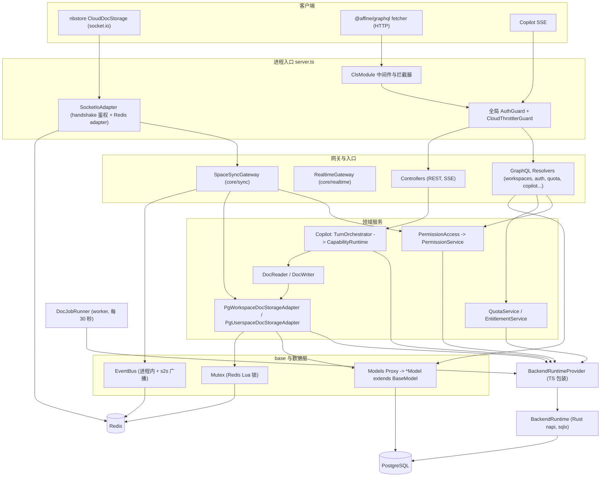
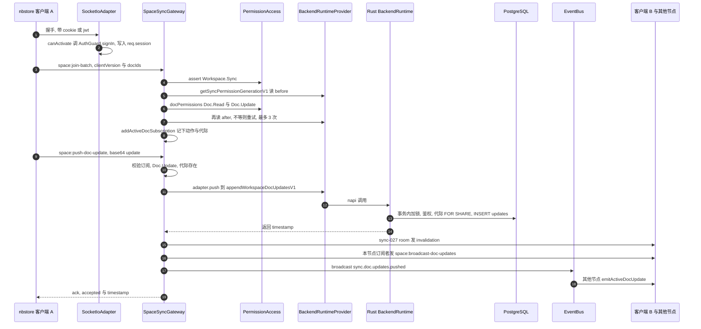
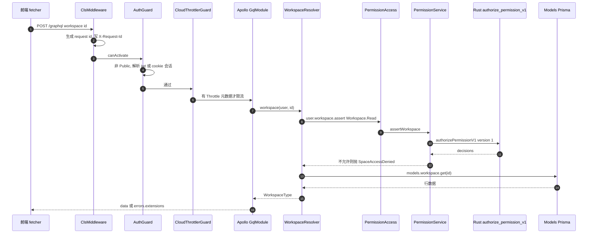
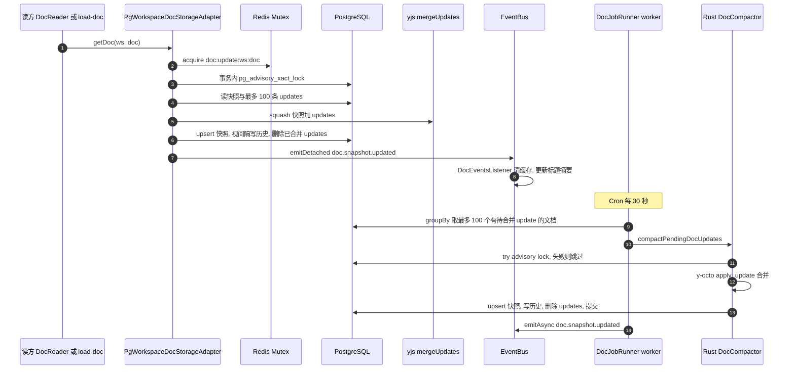
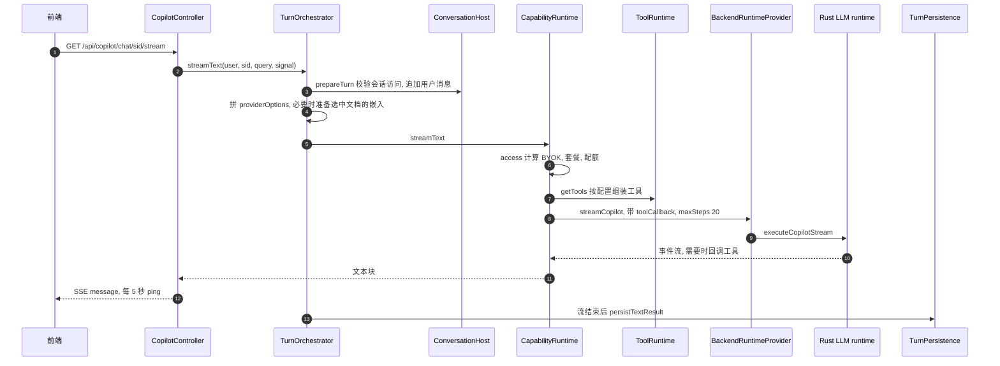

# @affine/server 精讲

> 一句话：AFFiNE 的 NestJS 后端应用本身。它接收客户端推来的 Yjs update，经权限代际校验后追加进 Postgres，再广播给同文档的其他连接，并按需或定时合并成快照；同时对外提供 code-first GraphQL、SSE 与 REST，把鉴权、权限、配额、计费、AI 路由这些"控制面"决策交给 Rust 的 `BackendRuntime`。
>
> 对应分层文档：[`@affine/server`](../L6-后端/affine-server.md) · 源码：`packages/backend/server`

分层文档已经讲了 NestJS"五件套"、code-first 的基本用法、`BaseModel` 的 `this.db`、`USER_FRIENDLY_ERRORS` 表，本文不再重复。本文回答三类问题：一次请求到底走了哪些代码，哪些行为和直觉不一样，改它时要守住什么。所有结论都来自读码，没有启动服务验证；标了"根据源码推断"的，是靠多处代码拼起来的推论，可信度比直接摘录低一档。

## 0. 为什么是重点包

| 指标 | 数据 | 核实结果 |
|---|---|---|
| 直接被依赖 | 0 | 一致。全仓 `package.json` 里只有它自己声明 `"@affine/server"`。前端通过网络消费它 |
| 传递被依赖 | 0 | 一致。它是应用，不是库 |
| 源码行数 | 约 74,643 行 | 实测 74,516 行，口径是 `src` 下 `.ts`/`.tsx`，去掉 `__tests__`、`*.spec.*` 和 `errors.gen.ts`。把 `errors.gen.ts`（1,393 行）算进去是 75,909 行。`schema.gql`（3,026 行）和 `schema.prisma`（1,537 行）都不在统计内。和给定值差 127 行，应该是口径差异 |
| 所在链路 | 数据链路的终点 | 成立。客户端 nbstore 推来的 update 在这里落库、广播、合并 |

模块规模核实结果：`plugins/copilot` 17,407、`core/workspaces` 6,140、`plugins/calendar` 4,004、`core/auth` 2,649、`core/doc` 2,560、`core/backend-runtime` 2,182、`plugins/payment` 1,922、`core/sync` 1,751、`core/mail` 1,301、`core/notification` 1,205，全部一致。给定列表漏了两项：**`models/` 有 10,017 行，是第二大目录**；`base/error` 有 2,469 行。`src/core` 下的 28 项里，目录是 26 个，另外两个是文件 `content-policy.ts` 和 `index.ts`。`src/plugins` 下 9 个插件，数目一致。

满足的标准：

- **B 体量复杂度**：单包 7.4 万行，同一份代码能部署成 7 种 flavor（`packages/backend/server/src/env.ts:23-31`）；Prisma 有 65 个 model，迁移目录下有 122 个迁移；业务错误码约 158 个（`packages/backend/server/src/base/error/def.ts:246` 起）。另有大量逻辑通过 napi 下沉到 `packages/backend/native`，读 TS 代码只能看到一半。
- **C 关键链路**：`SpaceSyncGateway`（`packages/backend/server/src/core/sync/gateway.ts:327`）是 nbstore 云同步的对端，所有协同编辑都从这里进出；权限、配额、计费的判定结果直接决定前端能做什么。
- 它不满足 A。它对前端定义了三份契约：`schema.gql`、错误枚举、socket.io 事件，所以有点 D 的味道，但这些都是网络协议，不是 TS 依赖。

不懂它会卡在哪：

1. `packages/common/nbstore/src/impls/cloud/doc.ts:182` 推送 `space:push-doc-update` 后可能收到 `NOT_IN_SPACE`、`DOC_ACTION_DENIED`、`SYNC_PERMISSION_GENERATION_CHANGED`、`FAILED_TO_SAVE_UPDATES`。每一种对应服务端哪一道检查、该不该重连重 join，要看 3.1。
2. `packages/common/error/src/index.ts:1` 的 `ErrorNames`、`ErrorDataUnion` 是从 `@affine/graphql` 导入的，不是从后端源码。后端错误表怎样变成前端类型，中间经过一个"只为注册类型而存在"的 GraphQL Query，见 5.5。
3. 前端调 `workspace(id)` 拿到 `SPACE_ACCESS_DENIED`，在 TS 里找不到任何角色判断。`packages/backend/server/src/core/permission/types.ts:5` 写明"Rust owns permission decisions"，而规则本身在外部 crate `affine_core` 里，见 2.4。
4. Copilot 通过 `DocWriter` 改了文档，前端却没有实时看到。这和 flavor 装配、`EventBus.broadcast` 的语义都有关，见 6.4。
5. 某个 resolver 在某套环境里"不存在"：`SERVER_FLAVOR=sync` 时根本没装 `GqlModule`，见第 1 段的 flavor 矩阵。

## 1. 全景架构



逐块说明：

- **入口层**：`server.ts` 在 `NestFactory.create` 之后挂全局守卫（`packages/backend/server/src/server.ts:125-129`，worker 只挂限流守卫）、全局 `CacheInterceptor`、`GlobalExceptionFilter`，再装上自定义的 `SocketIoAdapter`（`packages/backend/server/src/server.ts:139-140`）。WebSocket 的鉴权不在网关里，而是在 adapter 的 `server.use` 中间件里，调用 `canActivate`（`packages/backend/server/src/base/websocket/adapter.ts:56-71`）；`canActivate` 的实现由 `AuthWebsocketOptionsProvider` 注入（`packages/backend/server/src/core/auth/guard.ts:290-319`）。
- **两个 socket.io 网关**：`SpaceSyncGateway` 负责文档同步和 awareness，共 10 个 `space:*` 事件；`RealtimeGateway` 是通用的"请求/订阅"总线，靠 `RealtimeRegistry` 按名字注册 handler（`packages/backend/server/src/core/realtime/registry.ts:7-68`），评论、Copilot 转写等实时功能走它。分层文档 3.6 节把两者混在一起讲了，见第 6 段末尾。
- **领域服务**：权限、配额、权益三个 service 都只有一个依赖 `BackendRuntimeProvider`。文档存储适配器是唯一同时用 Prisma（读快照、读 update）和 Rust（写 update）两条通道的地方。
- **两条持久化通道**：TS 侧经 `Models` → Prisma；Rust 侧经 `BackendRuntime` → sqlx。两边操作同一个库、同几张表，靠**同一个 advisory lock 键** `workspace-doc-update:{workspaceId}/{docId}` 串行化：TS 侧见 `packages/backend/server/src/models/doc.ts:147-150`，Rust 侧见 `packages/backend/native/src/runtime/backend_runtime/domain_command/mod.rs:236-241`。
- **Redis 有三种用途**：`Mutex` 的 Lua 锁（`packages/backend/server/src/base/mutex/locker.ts:11-23`）、`Cache`，以及 socket.io 的 Redis adapter（`packages/backend/server/src/base/websocket/adapter.ts:73-76`）。`EventBus.broadcast` 依赖的就是最后一种。

### flavor 装配矩阵

`buildAppModule`（`packages/backend/server/src/app.module.ts:161-235`）按 `env` 的几个 getter 装配模块（`packages/backend/server/src/env.ts:135-182`）。容易看错的一点：`allinone` 会让 `flavors.graphql/sync/renderer/worker` 都为真，`flavors.front` 却只在 `FLAVOR=front` 时为真。

| 模块（`app.module.ts` 行） | allinone | graphql | sync | renderer | front | worker |
|---|---|---|---|---|---|---|
| `FunctionalityModules`（167） | 是 | 是 | 是 | 是 | 是 | 是 |
| `RealtimeGatewayModule`（168） | 是 | 是 | 是 | 是 | 是 | 否 |
| `DocJobsModule`、各 `*WorkerModule`（174-184） | 是 | 否 | 否 | 否 | 否 | 是 |
| `UserModule`、`AuthModule`、`PermissionModule`（187） | 是 | 是 | 是 | 是 | 是 | 否 |
| `QuotaModule`、`DocStorageModule`（190） | 是 | 是 | 是 | 是 | 是 | 是 |
| `DocRendererModule`（194） | 是 | 否 | 否 | 是 | 是 | 否 |
| `SyncModule`（196-200） | 是 | 否 | 是 | 否 | 是 | 否 |
| `ServerRealtimeHandlersModule`（201-204） | 否 | 否 | 是 | 否 | 是 | 否 |
| `GqlModule`、`WorkspaceModule`、`CopilotModule` 等（206-221） | 是 | 是 | 否 | 否 | 否 | 否 |
| `StaticFileModule`（229） | 否 | 否 | 否 | 否 | 是 | 否 |

`ServerRealtimeHandlersModule`（`packages/backend/server/src/realtime-handlers.module.ts:7-14`）只在"有 sync、没有 graphql"时装配，原因是 graphql flavor 里 `WorkspaceModule`、`CommentModule`、`CopilotModule` 已经各自带上了 realtime handler 模块。这套"二选一"写法是为了避免同一个 topic 被注册两次，否则 `RealtimeRegistry.registerTopic` 会抛错（`packages/backend/server/src/core/realtime/registry.ts:34-38`）。这个动机是根据源码推断的。

### 文档相关的表

| 表（Prisma model） | 写入方 | 说明 |
|---|---|---|
| `updates`（`Update`，`packages/backend/server/schema.prisma:683-695`） | Rust `append_updates_in` | 追加日志，主键 `(workspace_id, guid, created_at)` |
| `snapshots`（`Snapshot`，`packages/backend/server/schema.prisma:639-664`） | TS 读路径合并 / Rust worker 合并 | `updated_at` 记的是**最后一条被合并的 update 的时间**，不是行修改时间（见注释 646-648） |
| `snapshot_histories`（`SnapshotHistory`，`packages/backend/server/schema.prisma:697-711`） | 合并时按间隔写入 | 带 `expired_at`，由每晚的 `DocStorageCronJob` 清理 |
| `user_snapshots`（`UserSnapshot`，`packages/backend/server/schema.prisma:670-681`） | `PgUserspaceDocStorageAdapter` | 没有 update 队列，写时直接合并 |
| `workspace_sync_permission_generations` | 数据库触发器 | 不在 `schema.prisma` 里，由迁移 `packages/backend/server/migrations/20260829120000_terminal_authority_and_resource_ledger/migration.sql:97-135` 创建，见 2.1 |

## 2. 核心抽象与数据模型

### 2.1 `SpaceSyncGateway`：每个节点自己维护的订阅表

职责：处理 nbstore 的 `space:*` 事件，维护"哪个 socket 订阅了哪个文档、它被授权做什么、授权发生在哪一代权限上"，并把 update 写入存储、广播出去。

关键状态是四张 `Map`（`packages/backend/server/src/core/sync/gateway.ts:349-358`），全部是**进程内存**：

```ts
private readonly activeDocSockets = new Map<string, Set<Socket>>();          // docKey -> sockets
private readonly activeSocketDocs = new Map<string, Set<string>>();          // socketId -> docKeys
private readonly activeSocketDocActions = new Map<string, Map<string, Set<DocAction>>>();
private readonly activeSocketDocGenerations = new Map<string, Map<string, number>>();
```

docKey 是 `${spaceType}:${spaceId}:${docId}`（`packages/backend/server/src/core/sync/gateway.ts:483-485`）。精确到文档的 update 推送靠这几张表定向发送（`emitActiveDocUpdate`，`packages/backend/server/src/core/sync/gateway.ts:625-652`），**不用 socket.io room**。room 只有两个：`{type}:{spaceId}:sync` 和 `{type}:{spaceId}:sync-027`，后者用来广播"空间里有文档变了"的失效通知。

**权限代际（permission generation）** 是理解这个网关的关键。`workspace_members`、`workspace_access_policies`、`doc_access_policies`、`doc_grants` 四张表上都挂了 `AFTER INSERT OR UPDATE OR DELETE` 触发器，任何一行变动都会让该工作区的 `generation + 1`（`packages/backend/server/migrations/20260829120000_terminal_authority_and_resource_ledger/migration.sql:105-135`）。网关在 join 时记下当前代际，push 时把它作为 `expectedPermissionGeneration` 传给 Rust；Rust 在写 update 的同一事务里用 `FOR SHARE` 锁住代际行并比较（`packages/backend/native/src/runtime/backend_runtime/doc_writer.rs:268-291`），不相等就报 `sync_permission_generation_changed`。于是"权限刚被收回、旧连接还在推"的写入，会被数据库层拒掉。

`SyncSocketAdapter`（`packages/backend/server/src/core/sync/gateway.ts:1602-1669`）是挂在每个 socket 上的小对象，懒创建并缓存在 `client.affineSyncAdapters` 上（`packages/backend/server/src/core/sync/gateway.ts:1088-1107`）。`WorkspaceSyncAdapter` 的 `push` 会先查 `blocked` 标记，再根据文档是否已存在选 `update_doc` 或 `create_doc` 意图（`packages/backend/server/src/core/sync/gateway.ts:1682-1707`）。`UserspaceSyncAdapter` 只检查 `spaceId === userId`。

生命周期：网关是单例；订阅状态随 `space:join-batch` 建立，随 `space:leave*` 或 `handleDisconnect`（`packages/backend/server/src/core/sync/gateway.ts:704-713`）清除。

### 2.2 `DocStorageAdapter`：模板方法 + 两套实现

`DocStorageAdapter`（`packages/backend/server/src/core/doc/storage/doc.ts:65`）是抽象基类。它自己实现"读 = 快照 + 待合并 update → squash → 回写快照"这套模板，存储细节交给子类：

```ts
protected abstract getDocSnapshot(spaceId: string, docId: string): Promise<DocRecord | null>;
protected abstract setDocSnapshot(snapshot: DocRecord): Promise<boolean>;
protected abstract getDocUpdates(spaceId: string, docId: string): Promise<DocUpdate[]>;
protected abstract markUpdatesMerged(spaceId: string, docId: string, updates: DocUpdate[]): Promise<number>;
protected abstract createDocHistory(snapshot: DocRecord, force?: boolean): Promise<boolean>;
```

（`packages/backend/server/src/core/doc/storage/doc.ts:300-318`）

公开 API 有 `getDoc`、`getDocDiff`、`getDocBinNative`、`pushDocUpdates`、`pushDocUpdatesTrusted`、`rollbackDoc` 等。两个子类差别很大：

| | `PgWorkspaceDocStorageAdapter` | `PgUserspaceDocStorageAdapter` |
|---|---|---|
| 写入 | 交给 Rust `appendWorkspaceDocUpdatesV1`，只追加 `updates` 表 | TS 内读快照、squash、upsert，没有队列（`packages/backend/server/src/core/doc/adapters/userspace.ts:48-85`） |
| 锁 | Redis `Mutex` 加 Postgres advisory lock（`packages/backend/server/src/core/doc/adapters/workspace.ts:56-76`） | Redis `Mutex` |
| 历史 | 按 `doc.history.interval`（默认 10 分钟）生成 | 无（方法体为空） |
| 合并时机 | 读时，或 worker 每 30 秒 | 写时 |

基类里有个 `SingletonLocker`（`packages/backend/server/src/core/doc/storage/lock.ts:5-20`），它的 `lock` 每次都 `new Lock()`，从不写回 `lockedResource`，等于不加锁。好在两个子类都覆写了 `lockDocForUpdate`，生产路径用不到它。

`DocStorageOptions`（`packages/backend/server/src/core/doc/options.ts:9-82`）提供 `mergeUpdates`（读路径的合并函数）、`historyMaxAge`（来自工作区配额的 `historyPeriod`）和 `historyMinInterval`。

### 2.3 `BackendRuntimeProvider`：通往 Rust 控制面的唯一入口

继承链是 `BackendRuntimeProvider` → `BackendRuntimeOperations` → `BackendRuntimeSearchOperations` → `BackendRuntimeCoreOperations`（`packages/backend/server/src/core/backend-runtime/provider.ts:63`、`packages/backend/server/src/core/backend-runtime/copilot-operations.ts:19`、`packages/backend/server/src/core/backend-runtime/search-operations.ts:24`、`packages/backend/server/src/core/backend-runtime/operations.ts:42`）。它在 `@Global()` 模块里注册（`packages/backend/server/src/core/backend-runtime/index.ts:11-24`），任何模块都能直接注入。

构造时 `new BackendRuntime(serverConfig, undefined, telemetryCb, invalidationCb)`，两个回调都是 napi 的 ThreadsafeFunction：Rust 发出的失效事件会被转成本进程的 `backendRuntime.invalidation` 事件（`packages/backend/server/src/core/backend-runtime/provider.ts:70-88`）。`onApplicationBootstrap` 调 `start()`；收到 `config.changed` 且涉及 copilot、db、auth、payment 等配置时调 `reloadConfig()`（`packages/backend/server/src/core/backend-runtime/provider.ts:126-148`）。注释写明启动时**不跑迁移**，迁移只走 predeploy（`packages/backend/server/src/core/backend-runtime/provider.ts:113-119`）。

几乎所有方法都包了一层 `measured`（`packages/backend/server/src/core/backend-runtime/operations.ts:581-609`），它做两件事：记 `storage.backend_runtime` 指标；把 Rust 错误消息里的 `[affine-runtime:code]` 前缀（`packages/backend/server/src/core/backend-runtime/operations.ts:25`）解析出来，`blob_source_*` 映射成 `AccessDenied`、`NotFound`、`BadRequest`，其余包成 `BackendRuntimeError(code)`。调用方用 `backendRuntimeErrorCode(error)` 分支处理，例如 `packages/backend/server/src/core/sync/gateway.ts:1410`。

### 2.4 `PermissionAccess` → `PermissionService`：TS 只有动作名

`PermissionAccess` 是 `AccessControllerBuilder` 导出时的别名（`packages/backend/server/src/core/permission/index.ts:13`），提供链式 API：

```ts
await this.ac.user(userId).workspace(wsId).assert('Workspace.Users.Manage');
await this.ac.user(userId).doc(wsId, docId).can('Doc.Update');
await this.ac.user(userId).workspace(wsId).docs(items, 'Doc.Read'); // 批量过滤
```

（`packages/backend/server/src/core/permission/builder.ts:22-185`）

所有分支最后都走到 `PermissionService.authorize`（`packages/backend/server/src/core/permission/service.ts:158-168`），把 `{ version: 1, actorUserId, workspaceId, workspaceActions, docs }` 交给 `BackendRuntimeProvider.authorizePermissionV1`。Rust 侧 `authorize_permission_v1`（`packages/backend/native/src/runtime/backend_runtime/control_plane.rs:122-132`）每次新建一个 `PermissionAuthorizer`，从库里取一份权限快照，再交给 `affine_core::access_control` 计算。TS 里的 `Actions` 对象（`packages/backend/server/src/core/permission/types.ts:6-81`）只是动作名列表，叶子值都是空串，靠 Proxy 生成 `'Workspace.Users.Manage'` 这种路径字符串。

两点要知道：

- 规则真值在**外部 crate**：`packages/backend/native/Cargo.toml:14` 写的是 `affine_core = "0.0.8"`，`Cargo.lock` 显示来源是 crates.io。仓库里看不到角色到动作的映射表。
- 每次 `assert`/`can` 都是一次 napi 调用加一次数据库读，没有进程内缓存（根据 `packages/backend/native/src/runtime/backend_runtime/permission` 目录推断）。所以批量场景必须用 `docs()` 或 `docPermissions()`，不要在循环里调 `can`。

`assertWorkspace` 失败抛 `SpaceAccessDenied`，`assertDoc` 失败抛 `DocActionDenied`（`packages/backend/server/src/core/permission/service.ts:60-114`）。

### 2.5 `BaseModel` 与 `Models`：数据层的两个约定

`BaseModel` 的 `this.db` 分层文档已讲。这里补三个读码时容易忽略的点：

- `Models` 是 `ApplyType<ModelsType>()` 造出来的 DI token（`packages/backend/server/src/models/index.ts:91`），实际实例是 Proxy，首次访问某个属性时才 `ref.get(Model)`（`packages/backend/server/src/models/index.ts:93-122`）。访问 `MODELS` 里没有的键返回 `undefined`，而不是抛错。
- `ModelsModule` 是 `@Global()`（`packages/backend/server/src/models/index.ts:129-134`）。新增 Model 只要在 `MODELS` 表里加一行，全工程就能用 `this.models.xxx` 访问。
- 并不是所有表都走 Prisma 写。`models/permission-write.ts` 这个文件名就说明了：权限表的**写**在 TS，**读和判定**在 Rust；`updates` 表的**写**只在 Rust，TS 只读和删。

### 2.6 `EventBus`：本地 `emit` 与集群 `broadcast` 是两回事

`EventBus` 本身也是一个 `@WebSocketGateway({ namespace: 's2s' })`（`packages/backend/server/src/base/event/eventbus.ts:31-47`），并且拒绝任何客户端连接（`packages/backend/server/src/base/event/eventbus.ts:49-55`）。

| 方法 | 语义（`packages/backend/server/src/base/event/eventbus.ts`） |
|---|---|
| `emit` | 本进程，不等待；内部用 `emitAsync(...).catch` 防止监听器报错变成未处理的 rejection（88-94、189-197） |
| `emitAsync` | 本进程，等待所有监听器完成（80-83） |
| `emitDetached` / `emitDetachedAsync` | 开一个新的 CLS 上下文再分发，**不继承当前事务**（99-120） |
| `broadcast` | `server.serverSideEmit('broadcast', ...)`，经 Redis adapter 发给**其他节点**，再由它们的 `onApplicationBootstrap` 转成本地 `emit`（64-75、125-128） |

`serverSideEmit` 不会回送给发送方节点，所以 `broadcast` 不会触发本节点的监听器。同步网关正是按这个语义写的：先在本节点 `emitActiveDocUpdate`，再 `broadcast('sync.doc.updates.pushed')` 让别的节点各自投递（`packages/backend/server/src/core/sync/gateway.ts:1076-1085`）。

监听器用 `@OnEvent(name)` 声明（`packages/backend/server/src/base/event/def.ts:38-45`），由 `EventHandlerScanner` 扫描后在 `onModuleInit` 时统一绑定。每个监听器运行在 `cls.run({ ifNested: 'reuse' })` 里，并带 `event_handler` 指标（`packages/backend/server/src/base/event/eventbus.ts:130-183`）。

## 3. 关键流程走读

### 3.1 客户端推送一次 update，服务端落库并广播

前提：客户端已通过 `space:join-batch` 订阅了该文档。



1. **握手鉴权**（`packages/backend/server/src/core/auth/guard.ts:290-319`）：JWT 从 `handshake.auth.token` 搬到 `Authorization` 头，再复用 HTTP 的 `guard.signIn`。失败时抛 `AuthenticationRequired`，连接被拒（`packages/backend/server/src/base/websocket/adapter.ts:56-71`）。会话写在 `socket.request.session` 上，之后 `@CurrentUser()` 走 `getRequestResponseFromContext` 的 `ws` 分支（`packages/backend/server/src/base/utils/request.ts:40-45`）读取它。
2. **连接计数**：`handleConnection` 记录 presence，再定时把活跃用户数刷进 `sync_active_users_minutely`（`packages/backend/server/src/core/sync/gateway.ts:695-702`、`packages/backend/server/src/core/sync/gateway.ts:833-878`）。
3. **join 解析**：`parseJoinSpaceBatchMessage`（`packages/backend/server/src/core/sync/gateway.ts:236-302`）要求一批 1 到 100 项、都属于同一个 space、不重复。所有 `docId` 先经 Rust 的 `canonicalizeDocumentIdentity` 规范化（`packages/backend/server/src/core/sync/gateway.ts:228-234`）。客户端版本必须满足 `>=0.27.5-0`，否则 ack 返回 `success: false` 后 `setImmediate` 断开（`packages/backend/server/src/core/sync/gateway.ts:84-86`、`packages/backend/server/src/core/sync/gateway.ts:447-450`）。
4. **join 鉴权与代际**：核心是一个最多 3 次的循环（`packages/backend/server/src/core/sync/gateway.ts:1166-1211`）：

   ```ts
   for (let attempt = 0; attempt < 3; attempt++) {
     const before = await this.runtime.getSyncPermissionGenerationV1(first.spaceId);
     const decisions = await this.ac.user(user.id).workspace(first.spaceId)
       .docPermissions(docSpaces, ['Doc.Read', 'Doc.Update']);
     const after = await this.runtime.getSyncPermissionGenerationV1(first.spaceId);
     if (before !== after) continue;
     // … 每个 doc 必须有 Doc.Read，否则 DocActionDenied
     const installedAt = await this.runtime.getSyncPermissionGenerationV1(first.spaceId);
     if (installedAt !== after) continue;
     permissionGeneration = installedAt;
     // …
     break;
   }
   ```

   前后两次读到的代际相同，才说明这批决策是在一个稳定的权限视图上做出的。任何一步失败都会回滚已加入的 room 和订阅（`packages/backend/server/src/core/sync/gateway.ts:1223-1240`）。
5. **push 前检查**（`packages/backend/server/src/core/sync/gateway.ts:1441-1469`）：保留文档主体检查 `authorizeReservedDocSubject`，然后依次要求已订阅（否则 `NotInSpace`）、join 时拿到了 `Doc.Update`（否则 `DocActionDenied`）、记录过代际。这里**不再查权限**，用的是 join 时缓存的结果，正确性由第 7 步的代际比较兜底。
6. **根文档特殊处理**：`docId === spaceId` 时是工作区根文档，走 `executeDomainCommandV1({ command: 'append_root_update', ... })`（`packages/backend/server/src/core/sync/gateway.ts:1470-1497`）。根文档里有文档列表，生命周期操作（trash、restore、delete）必须走 `space:doc-lifecycle` 命令；直接改的话 Rust 返回 `doc_lifecycle_requires_command`，被映射成 `DocActionDenied`。
7. **写入**：普通文档走 `adapter.push` → `PgWorkspaceDocStorageAdapter.pushDocUpdates` → `pushDocUpdatesWithContract`（`packages/backend/server/src/core/doc/adapters/workspace.ts:116-195`）。先用 Rust `validateDocUpdate` 过滤非法或超过 32MB 的 update（`packages/backend/server/src/core/doc/storage/doc.ts:88-127`），再每 10 条一批调 `appendWorkspaceDocUpdatesV1`。Rust 侧 `append_authorized_updates`（`packages/backend/native/src/runtime/backend_runtime/doc_writer.rs:85-189`）在一个事务里依次执行：工作区存储共享锁 → 按 docId 排序后取 advisory lock（避免死锁） → 保留文档判定 → `authorize_domain`（`UpdateDoc` 或 `CreateDoc`） → `lock_permission_generation` 比较代际 → `INSERT INTO updates`，每条 update 的时间戳递增 1ms（`packages/backend/native/src/runtime/backend_runtime/doc_writer.rs:219-266`）。提交之后发 `BlobSource` 失效提示。新文档还会在 TS 侧 `emitDetachedAsync('doc.created')`。
8. **广播**：`publishDocUpdate`（`packages/backend/server/src/core/sync/gateway.ts:1041-1086`）做三件事：
   - 向 `{type}:{spaceId}:sync-027` room 发 `space:broadcast-doc-invalidation`。这走 socket.io room，经 Redis adapter 会到达**所有节点**上的连接，客户端收到后安排一次时间戳修复（`packages/common/nbstore/src/impls/cloud/doc.ts:66-77`）；
   - 向本节点订阅了该文档的其他 socket 发 `space:broadcast-doc-updates`。如果有多条 update，先用 native 合并成一条，并标 `compressed: true`（`packages/backend/server/src/core/sync/gateway.ts:394-445`）；
   - `broadcast('sync.doc.updates.pushed')`，其他节点在 `onClusterDocUpdatesPushed`（`packages/backend/server/src/core/sync/gateway.ts:899-907`）里各自定向投递。
9. **ack**：返回 `{ data: { accepted: true, timestamp } }`。所有异常都由 `GatewayErrorWrapper`（`packages/backend/server/src/base/nestjs/exception.ts:146-176`）转成 `{ error }` 返回给客户端，不会断开连接。

权限变化时会反向重算订阅：成员、文档授权、owner 等 9 个事件触发 `onPermissionChanged` → `publishPermissionChange`，先本节点 `revalidateActiveDocSubscriptions`，再 `broadcast` 给其他节点（`packages/backend/server/src/core/sync/gateway.ts:919-1039`）。失去 `Doc.Read` 的 socket 会被悄悄移出订阅，下一次 push 就会收到 `NotInSpace`。

### 3.2 一次需要权限的 GraphQL 请求：读取工作区与邀请成员



1. **CLS 与请求 id**：`ClsModule.forRoot` 的中间件给每个 HTTP 请求生成 id，并写进响应头 `X-Request-Id`（`packages/backend/server/src/app.module.ts:72-86`）。之后的 `UserFriendlyError` 构造时会从 CLS 取这个 id（`packages/backend/server/src/base/error/def.ts:106`），5xx 错误会把它带回前端（`packages/backend/server/src/base/error/def.ts:124-135`）。
2. **鉴权**：`AuthGuard.canActivate`（`packages/backend/server/src/core/auth/guard.ts:58-79`）先读 `@Public()` 元数据，再解析会话：`Bearer` 像 JWT 就走 `AccessTokenService.verify`，否则走 cookie 会话，必要时刷新 cookie（`packages/backend/server/src/core/auth/guard.ts:90-174`）。顺带检查客户端版本，不合格会吊销会话并抛 `UnsupportedClientVersion`（`packages/backend/server/src/core/auth/guard.ts:176-220`）。非 Public 接口拿不到会话就抛 `AuthenticationRequired`。
3. **限流**：只有标了 `@Throttle(...)` 的接口才会被限流，`packages/backend/server/src/base/throttler/decorators.ts:15-16` 的注释写明"never be rate limited"。邀请相关接口里只有 `getInviteInfo` 标了 `@Throttle('strict')`（`packages/backend/server/src/core/workspaces/resolvers/member.ts:482`）。
4. **resolver**：`workspace` 查询（`packages/backend/server/src/core/workspaces/resolvers/workspace.ts:167-181`）先 `assert('Workspace.Read')`，再 `models.workspace.get`。`role`、`permissions`、`quota` 都是 `@ResolveField`，只在前端选了这些字段时才会触发额外的权限或配额调用（`packages/backend/server/src/core/workspaces/resolvers/workspace.ts:94-143`）。
5. **判定**：链路见 2.4。判定在 Rust，TS 只拿到 `allowed` 布尔值。
6. **邀请成员**更长（`packages/backend/server/src/core/workspaces/resolvers/member.ts:172-305`）：
   - `assert('Workspace.Users.Manage')`，并且工作区名里不能含链接或域名；
   - 逐个邮箱校验格式、去重、排除已是成员的用户，单个失败只记在该项的 `error` 里，不影响其他项；
   - `inviteQuota.assertWorkspaceInviteQuota` 做反滥用的配额预占，拿到 `reservationId`；
   - `runtime.reserveWorkspaceSeatsV1` 在 Rust 里一次完成席位判定和邀请记录写入，席位不够抛 `NoMoreSeat`；
   - 根据成功数 `commit` 或 `release` 配额预占，`finally` 保证异常时一定释放；
   - 发 `workspace.members.invite`（触发邮件和通知）和 `workspace.members.updated`。后者也是 3.1 里同步网关重算订阅的触发器之一。
7. **错误出口**：`formatError`（`packages/backend/server/src/base/graphql/index.ts:60-69`）用 `mapAnyError` 把任何异常转成 `UserFriendlyError`，把 `toJSON()` 塞进 `extensions`。canary 环境额外带上 `stacktrace`。

### 3.3 积累的 update 合并成快照

合并有两个入口，用的是**两种不同的 Yjs 实现**。



**读路径合并**（同步完成，读方等待）：

1. `getDoc` 先拿 Redis 锁 `doc:update:{ws}:{doc}`。`Mutex.acquire` 重试 5 次、每次间隔 100ms，拿不到就返回 `undefined`，适配器随即抛 `Too many concurrent writings`（`packages/backend/server/src/core/doc/adapters/workspace.ts:414-425`、`packages/backend/server/src/base/mutex/mutex.ts:43-60`）。
2. 开一个 60 秒超时的 Prisma 事务，执行 `pg_advisory_xact_lock`，和 Rust 写入、Rust 合并用的是同一个键（`packages/backend/server/src/core/doc/adapters/workspace.ts:72-76`）。
3. `getDocUnderLock`（`packages/backend/server/src/core/doc/storage/doc.ts:135-156`）读快照，再按 `createdAt` 升序读 update，**最多 100 条**（`packages/backend/server/src/models/doc.ts:105-120`）。
4. `squash`（`packages/backend/server/src/core/doc/storage/doc.ts:320-343`）：只有一条时直接返回，否则调 `DocStorageOptions.mergeUpdates`。后者**默认用 JS 的 yjs**。只有打开 `doc.experimental.yocto` 时才会额外用 native 跑一遍做比对，而且只有 canary 环境才会采用 native 的结果（`packages/backend/server/src/core/doc/options.ts:18-72`、`packages/backend/server/src/core/doc/config.ts:16-25`）。
5. `squashUpdatesToSnapshot`（`packages/backend/server/src/core/doc/storage/doc.ts:179-218`）：新快照的时间戳取 `max(最后一条 update 时间, 旧快照时间 + 1)`；upsert 成功后，按 `historyMinInterval` 判断是否把**旧**快照写进历史（`packages/backend/server/src/core/doc/adapters/workspace.ts:306-372`），然后按时间戳删掉已合并的 update。
6. 事务外 `emitDetached('doc.snapshot.updated')`（`packages/backend/server/src/core/doc/adapters/workspace.ts:62-68`）。监听器 `DocEventsListener.markDocContentCacheStale` 清掉 7 天的内容缓存，解析标题和摘要写回 `workspace_pages`；根文档则更新工作区名和头像（`packages/backend/server/src/core/doc/event.ts:31-72`）。

`getDocBinNative`（`packages/backend/server/src/core/doc/storage/doc.ts:159-177`）是另一个变体：用 native 合并，但**不回写快照**。只用于解析内容（`DatabaseDocReader.getDocContentWithoutCache`，`packages/backend/server/src/core/doc/reader.ts:241-249`），结果不会再发回 Yjs 客户端。

**worker 异步合并**：

1. `DocJobRunner.run` 用 `@Cron(EVERY_30_SECONDS, { waitForCompletion: true })`，并发跑四个分片：合并、嵌入同步、记录待合并数量指标、修复空摘要（`packages/backend/server/src/core/doc-jobs/job.ts:33-47`）。`waitForCompletion` 保证上一轮没跑完时不会叠加执行。
2. `compactPendingDocUpdates`（`packages/backend/server/src/core/doc-jobs/job.ts:158-201`）按 `(workspaceId, id)` 分组，取最多 100 组（`packages/backend/server/src/models/doc.ts:138-145`），逐个调用 Rust。
3. Rust `compact_doc`（`packages/backend/native/src/runtime/backend_runtime/doc_compactor.rs:274-352`）用的是 `pg_try_advisory_xact_lock`：拿不到锁说明正有人读或写，这一轮直接跳过。合并用 y-octo 的 `apply_update_from_binary_v1`（`packages/backend/native/src/runtime/backend_runtime/doc_compactor.rs:59-69`），每次最多处理 `batch_limit` 条。
4. 合并成功后，TS 侧重建文档引用的 blob 关系（`storageRuntime.rebuildDocBlobRefs`），再 `emitAsync('doc.snapshot.updated')`，和读路径汇合。
5. 每天午夜 `DocStorageCronJob` 分批清理过期历史，最多 100 批，每批 1000 条（`packages/backend/server/src/core/doc/job.ts:13-20`）。

Rust 的 `compact_pending_doc_updates` 文档注释（`packages/backend/native/src/runtime/backend_runtime/doc_compactor.rs:357-363`）写着："Do not use this for snapshots that will be sent back to yjs clients until the y-octo/yjs round-trip compatibility issue is resolved." 但 worker 合并出来的快照，正是 `space:load-doc` 时 `getDocDiff` 发给客户端的那份。见 6.7。

### 3.4（可选）一次 Copilot 对话请求



1. **入口**：`@Sse('/chat/:sessionId/stream')`（`packages/backend/server/src/plugins/copilot/controller.ts:94-137`）。断开连接会通过 `getSignal` 变成 `AbortSignal`；结果流和每 5 秒一次的 ping 合并输出；`beforeApplicationShutdown` 会等所有进行中的流结束后再退出（`packages/backend/server/src/plugins/copilot/controller.ts:63-71`）。
2. **准备轮次**：`ConversationHost.prepareTurn`（`packages/backend/server/src/plugins/copilot/runtime/hosts/conversation-host.ts:470-496`）在追加消息前后各校验一次会话访问权限。`TurnOrchestrator.prepareChatSelection`（`packages/backend/server/src/plugins/copilot/runtime/turn-orchestrator.ts:34-100`）把模型选择、BYOK lease、计费单元、检索范围、工具列表都塞进 `providerOptions`。
3. **能力运行时**：`CapabilityRuntime.access`（`packages/backend/server/src/plugins/copilot/runtime/capability-runtime.ts:99-122`）并发查询服务端 BYOK、本地 BYOK、AI 套餐三种权益，再决定是否允许走配额计费的路由。
4. **调用 Rust**：`stream`（`packages/backend/server/src/plugins/copilot/runtime/capability-runtime.ts:209-260`）调 `BackendRuntimeProvider.streamCopilot`（`packages/backend/server/src/core/backend-runtime/copilot-operations.ts:120-166`）。后者把 napi 回调适配成 `RuntimeEventStream` 这个异步迭代器，用 `__AFFINE_COPILOT_STREAM_END__` 标记结束，并把 `AbortSignal` 接到 `handle.abort()`。工具调用反向发生：Rust 把请求 JSON 交给 TS 的 `executeToolCall`，结果再 JSON 化返回。
5. **工具**：`ToolRuntime.getTools`（`packages/backend/server/src/plugins/copilot/runtime/tool-runtime.ts:65`）依赖 `PermissionAccess`、`DocReader`、`DocWriter`、`DocumentRetrievalService`。非 dev、非 canary 环境会去掉 `docCreate`、`docUpdate`、`docUpdateMeta` 这几个写工具。
6. **落库**：流结束后 `TurnPersistence.persistTextResult` 写入助手消息；如果是中途中断，内容记为 `> Request aborted`（`packages/backend/server/src/plugins/copilot/runtime/hosts/conversation-host.ts:510-525`）。

Copilot 插件的总体结构：

| 目录 | 行数 | 职责 |
|---|---|---|
| `runtime/` | 4,632 | 编排层：`TurnOrchestrator`、`CapabilityRuntime`、`ToolRuntime`、`PromptRuntime`，以及 `hosts/` 下的会话、附件、持久化宿主 |
| `transcript/` | 2,088 | 音频转写任务 |
| `tools/` | 1,492 | 文档读写、搜索、artifact、exa 搜索等工具定义 |
| `mcp/` | 1,101 | 工作区 MCP 服务端和凭据 |
| `byok/` | 1,024 | 自带 Key 的策略与 resolver |
| `providers/` | 848 | 只剩类型和附件工具。`COPILOT_PROVIDER_PROVIDERS` 是空数组（`packages/backend/server/src/plugins/copilot/module-providers.ts:57`），**模型 provider 的抽象已经整体移进 Rust** |
| `retrieval/`、`embedding/` | 480、350 | 检索与嵌入，向量检索通过 `DOCUMENT_VECTOR_SEARCH` token 绑定到 `NativeEmbeddingService` |

模块拆成五层：`CopilotAvailabilityModule` → `CopilotKernelModule` → `CopilotFeatureModule` → `CopilotApiModule` → `CopilotModule`，另有 `CopilotRealtimeModule` 和 `CopilotWorkerModule`（`packages/backend/server/src/plugins/copilot/index.ts:40-98`）。sync flavor 只需要实时转写的 handler，worker flavor 只需要定时任务，这样拆可以让它们只装各自需要的那一层。这个动机是根据源码推断的。

## 4. 源码阅读路线

1. `packages/backend/server/src/index.ts` 和 `packages/backend/server/src/prelude.ts`：搞懂 `.env` 和私钥的加载顺序，以及全局 `env` 何时创建。5 分钟。
2. `packages/backend/server/src/env.ts`：记住 `flavors`、`role`、`isApi`、`isWorker` 的真值表。之后看到任何 `useIf` 都要能对上。
3. `packages/backend/server/src/app.module.ts`：通读。重点是 `FunctionalityModules` 里的 CLS 和事务插件，以及第 1 段的矩阵。
4. `packages/backend/server/src/server.ts`：全局守卫、拦截器、body parser、adapter 的挂载顺序。
5. `packages/backend/server/src/base/event/eventbus.ts` 加上 `packages/backend/server/src/base/nestjs/exception.ts`：分清 `emit`、`emitDetached`、`broadcast`；看懂 HTTP、GraphQL、WS、SSE 四种错误出口。
6. `packages/backend/server/src/core/backend-runtime/provider.ts` 和 `packages/backend/server/src/core/backend-runtime/operations.ts`：只看 `measured` 和错误码映射，其余方法当成目录翻一翻即可。
7. `packages/backend/server/src/core/permission/builder.ts` 和 `packages/backend/server/src/core/permission/service.ts`：读懂链式 API 怎样落到 `authorizePermissionV1`。
8. `packages/backend/server/src/core/sync/gateway.ts`：先读 1109-1526 行这四个 handler：join、load、lifecycle、push；再读 919-1086 行的权限重算和广播；最后读末尾的 adapter。
9. `packages/backend/server/src/core/doc/storage/doc.ts` → `packages/backend/server/src/core/doc/adapters/workspace.ts` → `packages/backend/server/src/models/doc.ts`：读路径合并的全过程。
10. `packages/backend/native/src/runtime/backend_runtime/doc_writer.rs` 和 `packages/backend/native/src/runtime/backend_runtime/doc_compactor.rs`：写入和异步合并的 Rust 侧，重点看锁的顺序和代际比较。
11. `packages/backend/server/src/core/doc-jobs/job.ts`：worker 每 30 秒做什么。
12. 挑一个 resolver，比如 `packages/backend/server/src/core/workspaces/resolvers/member.ts` 的 `inviteMembers`，对照 3.2 走一遍。

可以先跳过：

- `plugins/calendar`、`plugins/payment`、`plugins/license`：业务独立，不影响主链路。
- `plugins/copilot` 的 `transcript/`、`byok/`、`compat/`：等需要改 AI 功能时再看。`core/doc/codec-compare.ts` 只在 yocto 比对实验时使用，也可以跳过。
- `packages/backend/server/src/data/` 和 `mails/`：前者是数据迁移脚本，只在 `SERVER_FLAVOR=script` 时运行；后者是 React Email 模板。

## 5. 设计取舍

### 5.1 一份代码，按 flavor 装配

- **选择**：一个镜像、一个 `AppModule`，用环境变量 `SERVER_FLAVOR` 选择装配哪些模块。
- **原因**：自托管只需要 `allinone`；云上可以把同步节点、API 节点、worker 分开扩容。模块之间仍是进程内 DI，不需要定义 RPC 接口。
- **代价**：跨节点协作只能靠 `EventBus.broadcast` 加 Redis，而 `emit` 只在本进程生效。如果某个监听器所在的模块没装进当前 flavor，事件会无声无息地丢掉（6.4 就是一例）。很多模块会出现在多个 flavor 里，比如 `DocStorageModule` 所有 flavor 都装，所以 worker 节点上也有一份存储适配器。
- **替代方案**：拆成多个微服务。代价是共享 Prisma 模型、错误表、权限调用都要变成跨服务契约；源码里没有看到这方面的尝试。

### 5.2 update 先追加，合并延后

- **选择**：写入只 `INSERT updates`，不读快照、不合并；合并推迟到读时或 worker 定时任务。
- **原因**：写路径变短，锁持有时间也短。热门文档每秒可能有几十条 update，每次都合并要反复解码整份文档。
- **代价**：
  - 读延迟不稳定：第一次 `load-doc` 可能要合并 100 条 update，而且读方还要参与加锁；
  - 一份快照可能出自两种实现：读路径用 yjs，worker 用 y-octo（6.7）；
  - 单次合并有上限：读路径最多 100 条，worker 每文档最多 `DOC_BATCH_SIZE`（100）条。
- **替代方案**：写时合并。`PgUserspaceDocStorageAdapter` 用的就是这种方式（`packages/backend/server/src/core/doc/adapters/userspace.ts:63-84`），用户空间文档写入频率低，所以可以接受。

### 5.3 用权限代际兜底，不在每条消息上重新鉴权

- **选择**：join 时算一次权限并缓存在 socket 上；push 时只比较代际，比较发生在 Rust 写事务里。
- **原因**：每条 push 都走一遍完整授权，代价是一次 napi 调用加一次 SQL 快照查询。代际只是一个整数，用 `FOR SHARE` 锁住就能和触发器里的 `UPDATE` 互斥，正确性由数据库保证。
- **代价**：任何权限表的变化都会让**整个工作区**的代际加一。大工作区里改一个人的文档权限，所有连接的下一次 push 都会失败（`sync_permission_generation_changed`），需要重新 join。同步网关会主动重算订阅（3.1 末尾），但跨节点重算依赖 broadcast 能及时送达。
- **替代方案**：按文档维护代际，或者每条消息都鉴权。前者需要更多触发器和行，后者性能不可接受。源码只实现了工作区级别。

### 5.4 控制面放进 Rust，TS 和 Rust 共用一个数据库

| 维度 | TS（Prisma） | Rust（sqlx，经 `BackendRuntime`） |
|---|---|---|
| 负责什么 | 业务实体的 CRUD、权限表的写、快照和历史的读 | 权限判定、配额和席位、update 写入、异步合并、计费、LLM 路由 |
| 事务 | `@Transactional()` + CLS 隐式传播 | Rust 内部 `pool.begin()`，**不参与** TS 的 CLS 事务 |
| 迁移 | `packages/backend/server/migrations`（Prisma） | `native_schema_migrations` 加 `runtime_migrations.sql`（`packages/backend/native/src/runtime/migrations.rs:6`） |
| 串行化 | 同一个 advisory lock 键加 Redis `Mutex` | 同一个 advisory lock 键 |

- **原因**：分层文档 5 节已经总结为"强一致、防篡改、计算密集"。源码里能看到的直接证据是：权限规则来自外部 crate `affine_core`，同一套规则可以给同步、GraphQL、计费复用。
- **代价**：在 `@Transactional()` 方法里调用 `BackendRuntimeProvider`，Rust 用的是另一条连接，看不到 TS 事务里尚未提交的写入。改动通常要横跨两种语言、两套迁移；本地开发还要重新编译 `.node`。
- **替代方案**：全部留在 TS。源码的演进方向显然相反：`providers/` 只剩类型，`COPILOT_PROVIDER_PROVIDERS` 是空数组。

### 5.5 schema 和错误枚举都由后端生成

- **选择**：resolver 上的装饰器是 schema 的唯一来源；开发态启动时把 schema 写入 `src/schema.gql`，测试态写到 `node_modules/.cache/schema.gql`，生产态只放内存（`packages/backend/server/src/base/graphql/index.ts:36-43`）。错误表 `USER_FRIENDLY_ERRORS` 在开发态启动时由 `ErrorModule.onModuleInit` 生成 `errors.gen.ts`（`packages/backend/server/src/base/error/index.ts:20-37`）。
- **错误怎么进入前端类型**：`errors.gen.ts` 生成 `ErrorNames` 枚举和 `ErrorDataUnion` 联合类型，并用 `registerEnumType` 注册。光注册不够，类型还得被某个字段引用才会出现在 schema 里，于是有了一个只为注册类型而存在的 `ErrorResolver.error` 查询，调用它永远抛 `ActionForbidden`（`packages/backend/server/src/base/error/index.ts:11-18`）。这样 `schema.gql` 里才有 `enum ErrorNames` 和 `union ErrorDataUnion`（`packages/backend/server/src/schema.gql:932-934`），`packages/common/graphql/codegen.yml` 以 `../../backend/server/src/schema.gql` 为输入生成 `packages/common/graphql/src/schema.ts`，最后 `packages/common/error/src/index.ts:1` 从 `@affine/graphql` 导入这两个类型。
- **代价**：两份生成文件都**只在 dev 启动时**更新。改了 resolver 或错误表却没有用 dev 模式启动一次，生成文件和前端类型就会落后。
- **替代方案**：schema-first，需要手工保持 SDL 和实现一致。

## 6. 易错点与调试

### 6.1 以为 `broadcast` 会通知本节点

- **现象**：单机测试一切正常，多节点部署后某个功能只在一部分节点生效；或者反过来，本节点的监听器从来不触发。
- **原因**：`broadcast` 用的是 `serverSideEmit`，只发给**其他**节点（`packages/backend/server/src/base/event/eventbus.ts:125-128`）。
- **避免**：需要全集群生效时，先本地 `emit`（或直接调用本地处理函数），再 `broadcast`，参照 `publishDocUpdate` 和 `publishPermissionChange` 的写法（`packages/backend/server/src/core/sync/gateway.ts:955-960`）。

### 6.2 推送失败一律变成 `FAILED_TO_SAVE_UPDATES`，重试还可能漏写

- **现象**：客户端只收到 `FAILED_TO_SAVE_UPDATES`，看不出是权限问题还是代际变化；失败的 push 会延迟约 1 秒才返回。
- **原因**：`pushDocUpdatesWithContract` 用 `retryable` 包住整个批量写入。`retryable` 底层是 rxjs `retry({ count: 3, delay: 300 })`，对**任何**错误都重试（`packages/backend/server/src/base/utils/promise.ts:5-46`）。重试用尽后 `catch` 一律抛 `FailedToSaveUpdates`（`packages/backend/server/src/core/doc/adapters/workspace.ts:176-193`），`domain_permission_denied`、`sync_permission_generation_changed` 都被吞掉了。另外，重试时执行 `pendings = pendings.slice(done)`，而 `done` 是累计值、从不清零。多批写入时如果发生两次以上部分成功，第二次切片会多跳过一些 update：用 node 原样模拟，30 条里漏写 10 条却返回成功。不过目前所有生产调用方（同步网关和 `DocWriter` 的 6 处调用）每次都只传 1 条 update，`pushDocUpdatesTrusted` 没有调用者，所以眼下触发不了（见[附录](./99-附录-源码缺陷验证.md) B6）。
- **排查**：看服务端日志 `Failed to insert doc updates`，日志里带有原始 `error` 和 `expectedPermissionGeneration`；也可以看指标 `doc_update_insert_failed`。

### 6.3 `load-doc` 拿到的不是最新状态

- **现象**：待合并的 update 积压较多时，新打开文档的客户端看到的内容比其他客户端旧。
- **原因**：`findUpdates` 有 `take: 100`（`packages/backend/server/src/models/doc.ts:114`），`getDocUnderLock` 只合并最旧的 100 条就把结果当作当前文档返回，并且只删除这 100 条（根据源码推断）。剩下的要等下一次读或 worker 合并。
- **排查**：看指标 `doc.pending_updates`（`packages/backend/server/src/core/doc-jobs/job.ts:203-207`）。正常情况下 worker 每 30 秒合并一次，积压很难超过 100；worker 停了或者跟不上时，这个问题就会显现。

### 6.4 分离部署时，服务端写入的文档不会实时推给前端

- **现象**：`SERVER_FLAVOR=graphql` 的节点上，Copilot 工具通过 `DocWriter` 改了文档，正在编辑的客户端没有实时收到。
- **原因**：`DocWriter` 只 `emit('doc.updates.pushed')`（`packages/backend/server/src/core/doc/writer.ts:300-315`），这个事件唯一的监听者是 `SpaceSyncGateway.onDocUpdatesPushed`（`packages/backend/server/src/core/sync/gateway.ts:880-897`）。而 graphql flavor 不装 `SyncModule`（矩阵第 7 行），本地 `emit` 没人接，也没有 `broadcast` 补发（根据源码推断）。`allinone` 部署不受影响。客户端要等下一次时间戳修复或重新加载才能看到变更。
- **避免**：服务端代码要让文档变更实时可见时，除了本地 `emit`，还要考虑 `broadcast('sync.doc.updates.pushed', ...)`，并注意 payload 里的 update 要先转成 base64。

### 6.5 事务内发事件，监听器拿到的是事务连接

- **现象**：事件监听器里的写操作因为外层事务回滚而一起丢失；或者监听器的报错把外层事务也带进 `transaction is aborted` 状态。
- **原因**：监听器运行在 `cls.run({ ifNested: 'reuse' })` 里（`packages/backend/server/src/base/event/eventbus.ts:147`），会继承调用方 CLS 里的事务。`DocEventsListener` 专门把 Prisma 的 `P2028` 错误和 `transaction is aborted|transaction already closed` 当作可忽略错误（`packages/backend/server/src/core/doc/event.ts:8-20`），说明这类问题真实出现过。
- **避免**：在 `@Transactional()` 方法里发事件，用 `emitDetached` 或 `emitDetachedAsync`，参照 `packages/backend/server/src/core/doc/adapters/workspace.ts:63` 和 `packages/backend/server/src/core/doc/adapters/workspace.ts:170`。另外记住 Rust 调用不参与 TS 事务（5.4）。

### 6.6 WebSocket 会话在握手时就固定了

- **现象**：用户已经登出或会话被吊销，已有的 socket 还能继续 join 和 push。
- **原因**：会话在握手时写进 `socket.request.session`。之后即便全局 `AuthGuard` 对 WS 消息生效，`signInWithCookie` 的第一行 `if (req.session) return req.session` 也会直接复用旧会话（`packages/backend/server/src/core/auth/guard.ts:139`，根据源码推断）。真正的防线是文档级权限和权限代际，而不是登录态。
- **避免**：需要立即踢掉连接的场景，要显式断开 socket，不能只吊销会话。

### 6.7 读路径和 worker 用两种 Yjs 实现合并

- **现象**：同一个文档，快照有时由 yjs 生成、有时由 y-octo 生成；极端情况下客户端应用 diff 会出现问题。
- **原因**：读路径默认用 yjs（`packages/backend/server/src/core/doc/options.ts:18-23`），worker 用 y-octo（`packages/backend/native/src/runtime/backend_runtime/doc_compactor.rs:59-69`），而 Rust 注释自己就警告过 y-octo 的结果不要发回 yjs 客户端（`packages/backend/native/src/runtime/backend_runtime/doc_compactor.rs:359-360`）。
- **排查**：打开 `doc.experimental.yocto`，读路径会把两种实现的结果做比对，不一致时打印 tree diff，并记指标 `jwst.codec_not_match`（`packages/backend/server/src/core/doc/options.ts:25-49`）。单元测试入口是 `packages/backend/server/src/core/doc/__tests__/codec-compare.spec.ts`。

### 6.8 另外几处要留意的细节

- `QuotaResolver` 挂在 `UserType` 上，却用 `@CurrentUser()` 而不是 `@Parent()` 取用户（`packages/backend/server/src/core/quota/resolver.ts:12-31`）。查询别的 `UserType` 节点的 `quota` 字段，返回的仍然是当前登录用户的配额。
- 没有标 `@Throttle` 的 resolver 和 controller 完全不限流（3.2 第 3 步引用的注释）。新增对外接口时要主动标注。
- `Mutex.acquire` 失败返回 `undefined` 而不是抛错（`packages/backend/server/src/base/mutex/mutex.ts:53-59`），调用方必须自己判空。Redis 锁的 TTL 固定为 60 秒（`packages/backend/server/src/base/mutex/locker.ts:19`），持锁超过 60 秒的操作会被别人抢走锁。
- `ConfigFactory` 会把 native 管理的配置键从 TS 的 `Config` 中剥离（`packages/backend/server/src/base/config/factory.ts:41-55`）。在 TS 里读到某些密钥类配置是 `undefined` 属于正常现象，它们只存在于 Rust 侧。

### 调试手段

- **请求追踪**：每个 HTTP 响应都带 `X-Request-Id`。5xx 错误的 `extensions.requestId` 就是这个值，可以用它在日志里检索。canary 环境的 GraphQL 错误还带 `stacktrace`（`packages/backend/server/src/base/graphql/index.ts:65-67`）。
- **开发工具**：dev 环境开着 GraphiQL（`/graphql`）和 Swagger（`/api/docs`，`packages/backend/server/src/server.ts:142-155`）。
- **指标**：`metrics.enabled` 默认关闭（`packages/backend/server/src/base/metrics/config.ts:11-16`）。重点看 `doc.squash`、`doc.doc_update_rejected`、`doc.pending_updates`、`socketio.doc_updates_broadcast`、`socketio.error`，以及 `storage.backend_runtime`（按 `method` 维度拆分）。
- **日志**：合并过程打 `verbose` 级日志（`packages/backend/server/src/core/doc/storage/doc.ts:187-189`），事件分发打 `debug` 级日志。测试时用 `TEST_LOG_LEVEL` 环境变量控制日志级别，默认 `fatal`（`packages/backend/server/src/__tests__/utils/utils.ts:4-5`）。
- **测试入口**：`yarn test` 是串行执行的 ava。同步网关测 `packages/backend/server/src/__tests__/sync/gateway.spec.ts`，文档存储测 `packages/backend/server/src/__tests__/doc/workspace.spec.ts`，worker 任务测 `packages/backend/server/src/core/backend-runtime/__tests__/job.spec.ts`。`createModule`（`packages/backend/server/src/__tests__/create-module.ts:33`）基于 `FunctionalityModules` 搭建测试容器。

### 与分层文档不一致之处

> 以下各条已于 2026-11-01 同步更正到分层文档，保留在此作为勘误记录。

- 分层文档 3.6 节说文档增量"经 `sync` 模块的 `DocReader`/`DocWriter` 落到 PostgreSQL"，并说 `PgWorkspaceDocStorageAdapter` "调用 native `mergeUpdatesInApplyWay`"做合并。实际情况是：同步写入走 `SpaceSyncGateway` → 适配器 → Rust `appendWorkspaceDocUpdatesV1`；`DocWriter` 是服务端主动改文档用的（Copilot、MCP）；适配器的合并默认用 JS yjs，native 合并只在广播压缩、`getDocBinNative` 和 yocto 实验里使用。
- 分层文档 3.6 节把 `RealtimeGateway` 当作文档协同网关。它其实是通用的请求/订阅总线，文档协同网关是 `SpaceSyncGateway`（`packages/backend/server/src/core/sync/gateway.ts:327`）。
- 分层文档 3.5 节说"`emit` 是进程内同步分发"。实际上 `emit` 是不等待的异步分发，监听器在独立的 tick 里执行（`packages/backend/server/src/base/event/eventbus.ts:189-197`）；需要等待要用 `emitAsync`。
- 分层文档开头表格说 `@affine/error` "镜像 `USER_FRIENDLY_ERRORS`"。准确地说，它从 `@affine/graphql` 导入 `ErrorNames` 和 `ErrorDataUnion`，中间经过 `ErrorResolver` → `schema.gql` → codegen 这条链（5.5）。
- 分层文档 3.2 节只给了 `autoSchemaFile` 的两种取值。源码里有三种：测试态写入 `node_modules/.cache/schema.gql`。

## 7. 扩展实践

### 7.1 新增一个带 resolver、权限检查和 Prisma 模型的业务模块

任务：给工作区加"置顶公告"，有读权限的成员能看，有 `Workspace.Settings.Update` 权限的人能改。

步骤：

1. 在 `packages/backend/server/schema.prisma` 加 model，再执行 `yarn prisma migrate dev` 生成迁移（`package.json` 的 `init` 脚本就是这么用的）。表名用 `@@map` 指定下划线风格。
2. 在 `packages/backend/server/src/models/` 新建 Model，继承 `BaseModel`，并在 `packages/backend/server/src/models/index.ts` 的 `MODELS` 表和导出列表里各加一行。
3. 在 `packages/backend/server/src/core/` 新建模块目录，写 resolver 和 module。权限检查只用现有的动作名；新增动作名需要改 Rust 侧的规则（规则在外部 crate `affine_core` 里），不属于本仓库的 TS 改动范围。
4. 在 `packages/backend/server/src/app.module.ts` 的 graphql `useIf` 分支（206-221 行）里加入新模块。
5. 用 dev 模式启动一次，让 `schema.gql` 重新生成；再在 `packages/common/graphql/src/graphql/` 写 `.gql` 操作文件，运行 codegen。
6. 需要新的错误码时，在 `packages/backend/server/src/base/error/def.ts` 的 `USER_FRIENDLY_ERRORS` 里加一项，同样用 dev 模式启动一次来更新 `errors.gen.ts`。

最小骨架：

```prisma
model WorkspaceNotice {
  workspaceId String   @id @map("workspace_id") @db.VarChar
  content     String   @db.Text
  updatedBy   String?  @map("updated_by") @db.VarChar
  updatedAt   DateTime @updatedAt @map("updated_at") @db.Timestamptz(3)

  @@map("workspace_notices")
}
```

```ts
// packages/backend/server/src/models/workspace-notice.ts
import { Injectable } from '@nestjs/common';
import { Transactional } from '@nestjs-cls/transactional';

import { BaseModel } from './base';

declare global {
  interface Events {
    'workspace.notice.updated': { workspaceId: string };
  }
}

@Injectable()
export class WorkspaceNoticeModel extends BaseModel {
  async get(workspaceId: string) {
    return await this.db.workspaceNotice.findUnique({ where: { workspaceId } });
  }

  @Transactional()
  async set(workspaceId: string, content: string, updatedBy: string) {
    return await this.db.workspaceNotice.upsert({
      where: { workspaceId },
      update: { content, updatedBy },
      create: { workspaceId, content, updatedBy },
    });
  }
}
// models/index.ts 的 MODELS 中加入：workspaceNotice: WorkspaceNoticeModel,
```

```ts
// packages/backend/server/src/core/workspace-notice/index.ts
import { Module } from '@nestjs/common';
import { Args, Field, Mutation, ObjectType, Parent, ResolveField, Resolver } from '@nestjs/graphql';

import { EventBus, Throttle } from '../../base';
import { Models } from '../../models';
import { CurrentUser } from '../auth';
import { PermissionAccess, PermissionModule } from '../permission';
import { WorkspaceType } from '../workspaces';

@ObjectType()
class WorkspaceNoticeType {
  @Field() content!: string;
  @Field() updatedAt!: Date;
}

@Resolver(() => WorkspaceType)
class WorkspaceNoticeResolver {
  constructor(
    private readonly ac: PermissionAccess,
    private readonly models: Models,
    private readonly event: EventBus
  ) {}

  @ResolveField(() => WorkspaceNoticeType, { nullable: true })
  async notice(@CurrentUser() user: CurrentUser, @Parent() ws: WorkspaceType) {
    await this.ac.user(user.id).workspace(ws.id).assert('Workspace.Read');
    return await this.models.workspaceNotice.get(ws.id);
  }

  @Throttle()
  @Mutation(() => WorkspaceNoticeType)
  async setWorkspaceNotice(
    @CurrentUser() user: CurrentUser,
    @Args('workspaceId') workspaceId: string,
    @Args('content') content: string
  ) {
    await this.ac.user(user.id).workspace(workspaceId).assert('Workspace.Settings.Update');
    const notice = await this.models.workspaceNotice.set(workspaceId, content, user.id);
    this.event.emit('workspace.notice.updated', { workspaceId });
    return notice;
  }
}

@Module({
  imports: [PermissionModule],
  providers: [WorkspaceNoticeResolver],
})
export class WorkspaceNoticeModule {}
```

要点：

- `ModelsModule`、`EventModule` 都是全局模块，不需要 import；`PermissionModule` 不是全局的，要显式 import（参照 `packages/backend/server/src/core/sync/index.ts:7-11`）。
- `@ResolveField` 挂在 `WorkspaceType` 上，和 `WorkspaceResolver` 共用同一个 GraphQL 类型。别忘了 `@Parent()`（对比 6.8 第一条）。
- `models.workspaceNotice.set` 带 `@Transactional()`，事件在事务提交之后才发出。如果要把它放进更大的事务里，改用 `emitDetached`（6.5）。

### 7.2 新增一个插件的最小骨架

参照 `plugins/captcha`：配置就近声明，用命名守卫把能力"注入"到别的模块的接口上。插件没装时，守卫会直接放行。

```ts
// packages/backend/server/src/plugins/hello/config.ts
import { defineModuleConfig } from '../../base';

declare global {
  interface AppConfigSchema {
    hello: { enabled: boolean; greeting: string };
  }
}

declare module '../../base/guard' {
  interface RegisterGuardName {
    hello: 'hello';
  }
}

defineModuleConfig('hello', {
  enabled: { desc: 'Enable hello plugin.', default: false },
  greeting: { desc: 'Greeting text.', default: 'hi' },
});
```

```ts
// packages/backend/server/src/plugins/hello/index.ts
import './config';

import { type ExecutionContext, Injectable, Module } from '@nestjs/common';
import { Query, Resolver } from '@nestjs/graphql';

import { Config, GuardProvider } from '../../base';
import { ServerConfigModule } from '../../core';

@Injectable()
class HelloGuardProvider extends GuardProvider {
  name = 'hello' as const;
  constructor(private readonly config: Config) {
    super();
  }
  canActivate(_context: ExecutionContext) {
    return this.config.hello.enabled;
  }
}

@Resolver()
class HelloResolver {
  constructor(private readonly config: Config) {}

  @Query(() => String)
  hello() {
    return this.config.hello.greeting;
  }
}

@Module({
  imports: [ServerConfigModule],
  providers: [HelloGuardProvider, HelloResolver],
})
export class HelloModule {}
```

接入与注意：

- 在 `packages/backend/server/src/app.module.ts` 里按需要的 flavor 装配，有 GraphQL 接口就放进 graphql 分支。需要定时任务的话，再导出一个 `HelloWorkerModule` 放进 `isWorker` 分支，写法参照 `AuthWorkerModule`、`CopilotWorkerModule`。
- 别的模块的接口用 `@UseNamedGuard('hello')` 引用这个守卫（`packages/backend/server/src/base/guard/guard.ts:54-55`）。`GuardProvider` 在 `onModuleInit` 时把自己登记进 `GUARD_PROVIDER`（`packages/backend/server/src/base/guard/provider.ts:16-26`）；插件没装配时 `BasicGuard` 找不到对应 provider，直接放行（`packages/backend/server/src/base/guard/guard.ts:19-37`）。
- `defineModuleConfig` 声明的配置会出现在管理后台的配置项里，并经 `ServerConfigHandle` 持久化。插件的配置一旦涉及密钥，要确认它是不是 native 管理的键（6.8 最后一条）。配置变化会触发 `config.changed` 事件，需要热更新的插件用 `@OnEvent('config.changed')` 监听。

## 8. 与其他重点包的协作

| 重点包 | 关系 | 接口 | 数据流 |
|---|---|---|---|
| [`@affine/server-native`](./11-affine-server-native.md) | 本包调用它 | `packages/backend/server/src/native.ts` 门面，以及 `BackendRuntimeProvider` 的 `measured` 方法 | 权限、配额、席位、update 写入、异步合并、LLM 流都经 napi 进入 Rust，错误以 `[affine-runtime:code]` 前缀返回 |
| [`@affine/nbstore`](./04-affine-nbstore.md) | nbstore 是客户端，本包是服务端 | socket.io 的 `space:join-batch`、`space:push-doc-update`、`space:load-doc`、`space:broadcast-doc-updates`、`space:broadcast-doc-invalidation`（`packages/common/nbstore/src/impls/cloud/socket.ts`） | 客户端推 base64 update，服务端追加日志并广播；客户端带 state vector 拉 diff |
| [`@affine/graphql`](./10-affine-graphql.md) | 消费本包生成的 schema | `packages/backend/server/src/schema.gql` → `packages/common/graphql/codegen.yml` → `packages/common/graphql/src/schema.ts` | 后端装饰器变化 → dev 启动重写 SDL → 前端 codegen 生成类型和操作 |
| [`@affine/core`](./05-affine-core.md) | 前端业务层，通过 graphql、nbstore 和 SSE 间接调用本包 | GraphQL 操作、Copilot `/api/copilot/*` SSE、`RealtimeGateway` 的 `realtime:*` 事件 | 工作区、成员、配额、AI 对话请求从这里发出 |
| [`@blocksuite/store`](./02-blocksuite-store.md) | 数据形态的上游 | Yjs 二进制，比如 `spaceDoc.getMap('blocks')` | store 产生的 update 最终落到 `updates` 表；服务端解析标题和摘要时按 `affine:*` 块结构读取（`packages/backend/server/src/core/utils/blocksuite.ts`） |

[`@toeverything/infra`](./01-toeverything-infra.md) 与本包没有代码依赖：前端的 DI、LiveData 不进入后端，后端用的是 NestJS 自己的 DI。
