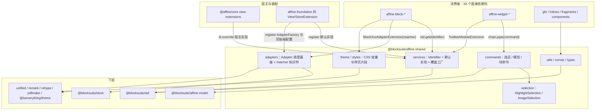
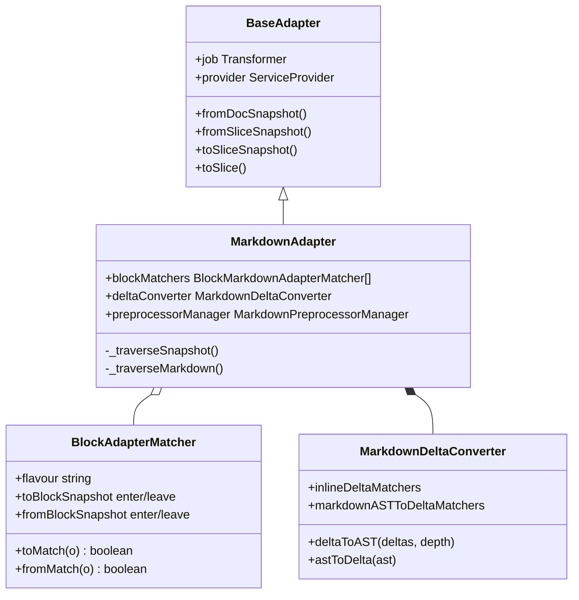
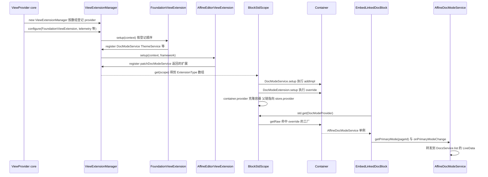
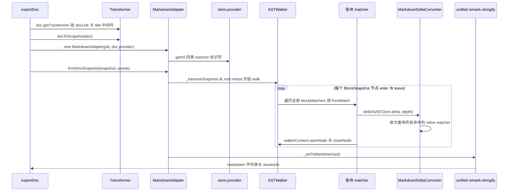
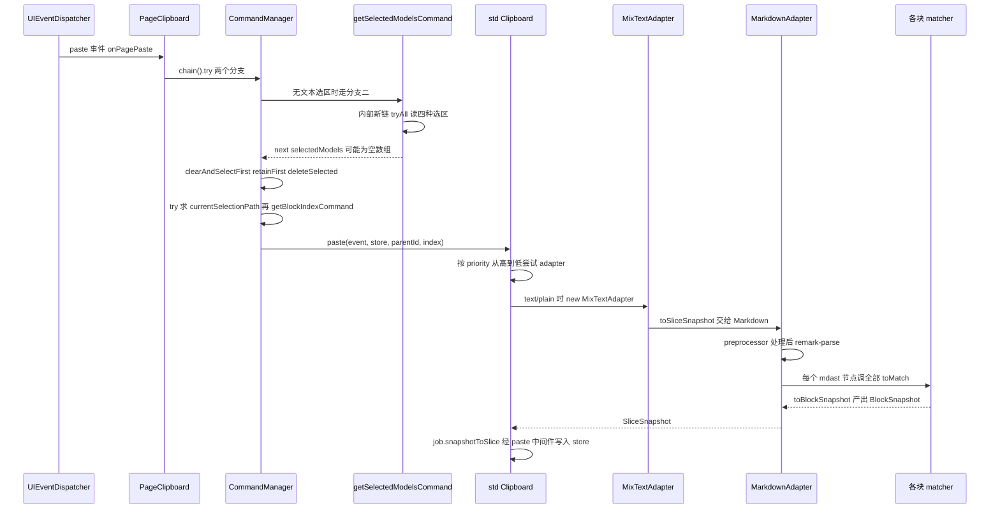

# `@blocksuite/affine-shared` 精讲

> 一句话：AFFiNE 编辑器业务层的"公共设施层"。它用 DI 标识符定义跨块服务契约（文档模式、主题、设置、埋点、工具栏注册表……），提供可复用的选区/模型命令和 Markdown/HTML/Notion/纯文本 adapter 的调度基座，还有几乎所有块都在用的 CSS 变量、常量、类型和工具函数。块包、widget、gfx、inline、fragment 都从这里取能力；`@affine/core` 则通过覆盖这里的标识符，把产品逻辑注入编辑器。
>
> 对应分层文档：[`@blocksuite/affine-shared`](../L3-编辑器业务层/blocksuite-affine-shared.md) · 源码：`blocksuite/affine/shared`

分层文档已经讲了目录结构、"接口 + 同名 Identifier + Extension + override 工厂"的骨架和 `getSelectedModelsCommand` 的 `tryAll` 写法，本篇不复述，重点回答三个问题：哪些东西真正被高频依赖？它们在运行时怎样被装配和替换？写扩展时会踩哪些坑？DI 解析规则、`Command`/`Chain` 语义、Extension 生命周期见 [std 精讲](./03-blocksuite-std.md) 第 2.1、2.3 节；`BaseAdapter`、`Transformer` 与 Snapshot 见 [store 精讲](./02-blocksuite-store.md) 第 3.3 节，下文直接引用。

## 0. 为什么是重点包

| 指标 | 数值 | 口径与说明 |
| --- | --- | --- |
| 直接被依赖 | 63 个工作区包 | 全仓第 2，仅次于 `@blocksuite/std` 的 65；63 个都写在 `dependencies` 里 |
| 传递被依赖 | 89 个（运行时 80） | 全仓第 6，前五是 `@blocksuite/global` 96、`@blocksuite/sync` 95、`@blocksuite/store` 94、`@blocksuite/std` 92、`@blocksuite/affine-model` 91。"运行时"只沿 `dependencies` + `peerDependencies` 传递 |
| 源码行数 | 19,538 行 | `src` 下的 `.ts`，不含 `src/__tests__`（测试另有 2,250 行）。编排方给的 19,572 与实测差 34 行，属于口径差异（算上两份 README 是 19,621） |
| import 面 | 785 个文件 | 统计 `blocksuite/` 与 `packages/` 下 `import {…} from '@blocksuite/affine-shared/<子入口>'`，以及经 `@blocksuite/affine/shared/<子入口>` 转出的写法，不含本包自身 |
| 所在链路 | BlockSuite 业务层的公共服务与工具层 | 向下只依赖 `affine-model`、`global`、`std`、`store` 四个工作区包；向上被所有块、widget、gfx、inline、fragment，以及 `affine-components`、`data-view`、`@affine/core` 使用 |

各子入口的被引用情况：

| 子入口 | 引用包数 | 引用文件数 | 引用最多的导出（括号内为引用包数） |
| --- | --- | --- | --- |
| `./utils` | 56 | 285 | `matchModels` 29、`stopPropagation` 13、`getBlockProps` 8、`isInsideBlockByFlavour` 8 |
| `./services` | 56 | 326 | `TelemetryProvider` 27、`ThemeProvider` 25、`DocModeProvider` 24、`ToolbarModuleExtension` 20、`EditPropsStore` 18、`FeatureFlagService` 16 |
| `./theme` | 33 | 143 | `unsafeCSSVarV2` 28（121 个文件）、`unsafeCSSVar` 11 |
| `./adapters` | 32 | 156 | `BlockMarkdownAdapterExtension` 18、`BlockHtmlAdapterExtension` 13、`BlockNotionHtmlAdapterExtension` 12、`BlockPlainTextAdapterExtension` 12 |
| `./types` | 29 | 93 | `AffineTextAttributes` 21、`AffineInlineEditor` 10 |
| `./consts` | 26 | 47 | `EMBED_CARD_WIDTH`/`EMBED_CARD_HEIGHT` 6 |
| `./commands` | 20 | 42 | `getSelectedModelsCommand` 10、`getTextSelectionCommand` 8、`getSelectedBlocksCommand` 7 |
| `./styles` | 12 | 28 | `scrollbarStyle` 7 |
| `./selection` | 4 | 10 | `HighlightSelection`、`ImageSelection` 各 2 |

后面挑哪些讲深，就按这张表定：服务三件套（Telemetry/Theme/DocMode/EditorSetting/FeatureFlag）、主题的两条通道、选区命令、adapter 基座、工具栏注册表，以及引用最多的 `matchModels`。

**满足的标准**

- **A 依赖枢纽**：直接被依赖数全仓第 2。更关键的是依赖图的形状：几十个块包彼此不依赖、只依赖它，它是这张星形图的中心。改一个导出的签名，影响面就是 63 个包。
- **B 体量复杂度**：约 2 万行，分 10 个子目录、11 个 `exports` 子路径，装了 30 个服务模块、21 个对外命令、10 种 adapter 和约 30 个工具域。难在"杂"，不在某一处算法。
- 它还定义了两个被全仓照抄的写法："服务 = Identifier + 默认实现 + 宿主覆盖"和"每块一个 adapter matcher"，有一点 D（范式定义者）的味道。但两个范式的底座（DI、`BaseAdapter`）在 std/store 里，这里不把 D 算进去。

**不懂它会卡在哪**

1. 读 `blocksuite/affine/blocks/embed-doc/src/embed-linked-doc-block/embed-linked-doc-block.ts:533-539`：`this.std.get(DocModeProvider).getPrimaryMode(pageId)` 返回的模式从哪来？默认实现是一个模块级 `Map`，AFFiNE 里实际跑的却是 `packages/frontend/core/src/blocksuite/view-extensions/editor-view/doc-mode-service.ts` 中接到 `DocsService` 的版本。不懂 override 机制就找不到真实现。
2. 读 `blocksuite/affine/blocks/root/src/configs/toolbar.ts:412-419`：`chain.pipe(getSelectedModelsCommand).pipe(draftSelectedModelsCommand).pipe(copySelectedModelsCommand)` 后面跟着 `if (!ok) return`。其实什么都没选时，`ok` 也是 `true`（见 6.3）。
3. 读 `blocksuite/affine/blocks/divider/src/adapters/markdown.ts`：一个对象字面量加 `BlockMarkdownAdapterExtension(...)`，分割线就支持了 Markdown 导入导出。谁来遍历？多个 matcher 同时命中会怎样？
4. 读 `blocksuite/affine/blocks/surface/src/extensions/crud-extension.ts:76`：新建图形时，`EditPropsStore.applyLastProps(key, props)` 合并出的默认样式，是 zod 默认值、AFFiNE 编辑器设置和"上次用过的样式"三层叠加的结果。
5. `packages/frontend/core/src/blocksuite/ai/utils/extract.ts:200-206` 为了导出 Markdown，专门拿 store 扩展 new 了一个 `BlockStdScope`。不知道 `getAll` 不沿父链查找，就看不懂这个绕法（见 6.5）。
6. 同一个块里，样式用 `unsafeCSSVarV2('...')`，逻辑里又用 `std.get(ThemeProvider).theme`。这是两条互不相干的主题通道（见 2.2）。

## 1. 全景架构



逐块说明：

- **宿主与装配**：shared 自己几乎不注册任何东西。默认实现由 foundation 注册：`blocksuite/affine/foundation/src/view.ts:64-83` 注册视图层 16 个服务，`blocksuite/affine/foundation/src/store.ts:31-52` 注册选区、6 个 AdapterFactory、`FeatureFlagService`、`BlockMetaService` 和 `ImageProxyService`。`@affine/core` 再通过 `ViewExtensionProvider` 注册覆盖实现。装配顺序见 [扩展装配精讲](./12-扩展装配.md)。
- **services**：30 个服务模块，按"谁提供实现"可分成四种形态（见 2.1）。
- **commands**：对外导出 21 个 `Command`，分 `block-crud`、`model-crud`、`selection` 三组。`commands/README.md` 规定这里只收通用命令。
- **adapters**：7,259 行，是最大的子目录。shared 提供每种格式的 `XxxAdapter`（负责遍历调度）、matcher 类型与 DI 标识符、`DeltaConverter`、中间件和剪贴板 adapter；具体某个块怎么转，由各块包注册 matcher。
- **selection**：只定义两种业务选区。`HighlightSelectionExtension` 由 foundation 注册，`ImageSelectionExtension` 由图片块自己注册（`blocksuite/affine/blocks/image/src/store.ts:15`）。`ImageSelection` 类放在 shared，是因为 shared 的 `getImageSelectionsCommand` 和 `getSelectedBlocksCommand` 要引用它（根据源码推断）。
- **theme/styles**：`unsafeCSSVarV2` 等函数把 `@toeverything/theme` 的变量名包成 Lit 可用的 `CSSResult`；`styles/` 提供字体、面板、滚动条的样式片段。
- **utils/consts/types**：约 30 个工具域，加上 `AffineTextAttributes` 这类文本属性的共享"词汇表"。

### 1.1 目录体量

| 目录 | 行数 | 说明 |
| --- | --- | --- |
| `src/adapters` | 7,259 | markdown 432 + delta 332、html 402、notion-html 300、plain-text 324、mix-text 360、pdf 1,003、middlewares（paste 596、replace-id 256 …） |
| `src/utils` | 5,113 | file/filesys 550、event 362、dom/point-to-block 334、print-to-pdf 310、svg 294、url 241、zod-schema 218 … |
| `src/services` | 4,384 | link-preview 615、font-loader 582、toolbar-service 538、comment 311 … |
| `src/commands` | 1,456 | `replace-selected-text-with-blocks` 399、`get-selection-rects` 184、`get-selected-blocks` 165 |
| `src/test-utils` | 680 | `affine` 模板字面量与 `createTestHost` |
| 其余 | 646 | theme 153、consts 160、styles 139、selection 104、types 89、`index.ts` 1 |

### 1.2 services 能力地图

"引用包数"口径同第 0 段，"—"表示 0 或 1 个包。

| 标识符 / 类 | 形态 | 默认实现与注册处 | 职责 | 引用包数 |
| --- | --- | --- | --- | --- |
| `TelemetryProvider` | 只有接口 + `TelemetryExtension`（override） | 无；`FoundationViewExtension` 收到 `options.telemetry` 时才注册（`foundation/src/view.ts:96-99`） | `track(eventName, props)`，事件类型表是 `TelemetryEventMap` | 27 |
| `ThemeProvider` / `ThemeService` | 默认实现 + 二级扩展点 `ThemeExtensionIdentifier` | foundation 视图层 | `app$`/`edgeless$` 两个主题 signal 与颜色解析 | 25 |
| `DocModeProvider` / `DocModeService` | 默认实现 + `DocModeExtension`（override） | foundation 视图层；core 覆盖 | 文档主模式、当前编辑器模式 | 24 |
| `ToolbarRegistryExtension` + `ToolbarModuleExtension` | 注册表 + 多实现 | foundation 视图层 | 各 flavour 的工具栏配置；`ToolbarContext` 聚合各服务 | 20 |
| `EditPropsStore` | `LifeCycleWatcher` | foundation 视图层 | 新建元素的默认样式；存进 `localStorage`/`sessionStorage` 的偏好 | 18 |
| `FeatureFlagService` | `StoreExtension` | foundation store 层；core 同步开关值 | 19 个 BlockSuite 特性开关 | 16 |
| `BlockElementCommentManager` | `LifeCycleWatcher` | foundation 视图层 | 块与 gfx 元素上的评论标记 | 10 |
| `NotificationProvider` | 只有接口 + `NotificationExtension`（addImpl） | 无；core 的 `patchNotificationService` | toast / confirm / prompt / notify | 8 |
| `ViewportElementProvider` | 只有接口 + `ViewportElementExtension(selector)` | 根块注册（`blocksuite/affine/blocks/root/src/view.ts:58`、`:74`），surface-ref 另有一份 | 滚动容器与视口 | 6 |
| `EmbedOptionProvider` | 默认实现 + `EmbedOptionConfig(options)` 多实现 | foundation 视图层 | 按 URL 正则选 embed 块的 flavour | 6 |
| `DocDisplayMetaProvider` | `LifeCycleWatcher` 默认实现 | foundation；core 在 `view-extensions/editor-view/display-meta.ts:43` 覆盖 | 引用、嵌入卡片的文档标题与图标 | 6 |
| `CitationProvider` | 默认实现 | foundation 视图层 | AI 引用的埋点与交互 | 6 |
| `EditorSettingProvider` | 只有接口 + `EditorSettingExtension`（override） | 无；core 在 `get-config.ts:19-23` 注入 | 编辑器设置 signal；`GeneralSettingSchema` 合并了 `NodePropsSchema` | 5 |
| `VirtualKeyboardProvider` | 只有接口 | AFFiNE 移动端 | 软键盘可见性与高度 signal | 5 |
| `LinkPreviewServiceIdentifier` + `LinkPreviewCache` | 默认实现 | foundation 视图层 | 书签、链接卡片的预览查询与缓存 | 4 |
| `EmbedIframeService` | `StoreExtension` | embed 块注册（`blocksuite/affine/blocks/embed/src/store.ts:46`） | iframe 嵌入配置与插入 | 4 |
| `CommentProviderIdentifier` | 只有接口 | core 的 `view-extensions/comment/comment-provider.ts` | 评论数据 | 4 |
| `FileSizeLimitProvider` | 默认实现（2GB） | foundation；core 的 `patchFileSizeLimitExtension` 覆盖 | 附件大小上限 | 3 |
| `ParseDocUrlProvider` / `GenerateDocUrlProvider` | 只有接口 | core 的 `view-extensions/editor-view/doc-url.ts:12-52` | 文档链接的解析与生成 | 3 / 2 |
| `FontLoaderService` + `FontConfigExtension` | `LifeCycleWatcher` | foundation；字体表由宿主传入 | canvas 文字的字体加载 | 3 |
| `DNDAPIExtension` | 默认实现 | foundation 视图层 | 拖放快照的编解码 | 2 |
| `PageViewportService` | `Subject` 实例 | foundation 视图层 | 页面视口事件流 | 2 |
| `UserProvider` / `UserListProvider` / `WriterInfoProvider` | 只有接口 | 宿主 | 用户与作者信息（`BlockMetaService` 用） | 2 |
| `OpenDocExtensionIdentifier` | 默认实现 `DefaultOpenDocExtension` | foundation 视图层 | "打开文档"的方式列表 | 2 |
| `IconPickerServiceIdentifier` | 只有接口 | core 在 `view-extensions/icon-picker/icon-picker-service.ts:18` 用 override 注入 | 图标选择器 | 2 |
| `QuickSearchProvider` / `SidebarExtensionIdentifier` / `NativeClipboardProvider` | 只有接口（工厂用 `addImpl`） | core / electron | 快速搜索、侧栏、原生复制 PNG | — |
| `AutoClearSelectionService` | `LifeCycleWatcher` | foundation 视图层 | `unmounted` 时清空选区（如切换文档模式） | — |
| `BlockMetaService` | `StoreExtension` | foundation store 层 | 本地更新节流 30 秒，写入 createdAt/By、updatedAt/By | — |

### 1.3 其他子目录速览

- **commands**：读当前选区（`getTextSelectionCommand` / `getBlockSelectionsCommand` / `getImageSelectionsCommand`；另有 `getSurfaceSelectionCommand` 只在包内用，没从 `./commands` 导出）；选区换块或模型（`getSelectedBlocksCommand` / `getSelectedModelsCommand`）；模型批处理（`draft` / `copy` / `delete` / `duplicate` / `retainFirst` / `clearAndSelectFirst`）；块导航（`getNext` / `getPrev` / `getFirst` / `getLast` / `getBlockIndex`）；光标（`focusBlockStart` / `focusBlockEnd`）；几何（`getSelectionRectsCommand`）；外加 AI 场景用的大命令 `replaceSelectedTextWithBlocksCommand`。
- **adapters**：每种格式一套"`XxxAdapter` + `XxxAdapterFactoryIdentifier` + `BlockXxxAdapterMatcherIdentifier` + `InlineDeltaToXxx` / `XxxASTToDelta` 两类 matcher 标识符 + `XxxDeltaConverter`"。有 matcher 的格式是 Markdown、Html、NotionHtml、PlainText；组合型有 `MixTextAdapter`（`text/plain` 粘贴时转给 Markdown）和 `NotionTextAdapter`；不带 matcher 的有 `ClipboardAdapter`（`BLOCKSUITE/SNAPSHOT`）、`ImageAdapter`、`AttachmentAdapter`、`PdfAdapter`（只导出）。`middlewares/` 里是 `pasteMiddleware`、`replaceIdMiddleware`、`titleMiddleware`、`defaultImageProxyMiddleware` 等 `Transformer` 中间件。
- **utils**：最常用的是模型判定（`matchModels`、`isInsideBlockByFlavour`、`getBlockProps`）、DOM 判定（`isInsidePageEditor`、`isInsideEdgelessEditor`）、事件（`stopPropagation`、`on`、`requestConnectedFrame`）、URL（`isValidUrl`、`normalizeUrl`）、`createDefaultDoc`，以及 zod 的 `NodePropsSchema`。
- **consts / types**：`EMBED_CARD_WIDTH`/`HEIGHT`、`REFERENCE_NODE`、`EDGELESS_TOP_CONTENTEDITABLE_SELECTOR`；`AffineTextAttributes`（`blocksuite/affine/shared/src/types/index.ts:48`）、`AffineInlineEditor`、`NoteChildrenFlavour`。

## 2. 核心抽象与数据模型

### 2.1 服务的四种形态

骨架（接口 + 同名 Identifier + Extension）分层文档已经讲过。要补充的是：**不是每个服务都有默认实现**，有没有默认实现决定了消费方该用 `get` 还是 `getOptional`。

| 形态 | 代表 | 定义方式 | 消费方式 | 宿主怎么改 |
| --- | --- | --- | --- | --- |
| ① 默认实现 + override 工厂 | `DocModeProvider` | `DocModeService.setup` 里 `di.addImpl(DocModeProvider, DocModeService)`（`blocksuite/affine/shared/src/services/doc-mode-service.ts:66-69`），工厂 `DocModeExtension` 里 `di.override`（`:103-109`） | `std.get` | 整体替换 |
| ② 只有接口 + 工厂 | `TelemetryProvider`、`EditorSettingProvider`、`NotificationProvider` | `createIdentifier` + 工厂 `XxxExtension(service)`（`telemetry-service/telemetry-service.ts:60-72`、`editor-setting-service.ts:29-41`） | 应该用 `std.getOptional`；仓库里 `getOptional(TelemetryProvider)` 有 64 处 | 宿主不提供，就没有这个能力 |
| ③ 默认实现 + 二级扩展点 | `ThemeProvider` | `ThemeService` 本身不被替换，构造时用 `getOptional(ThemeExtensionIdentifier)` 读宿主给的 signal（`theme-service.ts:53-60`） | `std.get` | 只提供数据源，逻辑仍用默认实现 |
| ④ store 级扩展 | `FeatureFlagService`、`BlockMetaService`、`EmbedIframeService` | `extends StoreExtension`（`feature-flag-service.ts:26-65`） | `store.get` 或 `std.get`（`get` 会沿父链找到） | 宿主写一个 `StoreExtension`，在 `loaded()` 里改值 |

关键签名：

```ts
// blocksuite/affine/shared/src/services/telemetry-service/telemetry-service.ts:53-62
export interface TelemetryService {
  track<T extends keyof TelemetryEventMap>(
    eventName: T,
    props: TelemetryEventMap[T]
  ): void;
}
export const TelemetryProvider = createIdentifier<TelemetryService>(
  'AffineTelemetryService'
);

// blocksuite/affine/shared/src/services/editor-setting-service.ts:21-27
export interface EditorSettingService {
  setting$: Signal<DeepPartial<EditorSetting>>;
  set?: (key: keyof EditorSetting, value: EditorSetting[keyof EditorSetting]) => void;
}
```

**生命周期**：形态 ①②③ 都是视图层（std 容器）里的普通 `Extension`，第一次 `std.get` 时才实例化，每个 `BlockStdScope` 各一个实例。`EditPropsStore`、`DocDisplayMetaService` 这类 `LifeCycleWatcher` 例外，会在 std 构造末尾全部实例化（std 精讲 2.1 规则 3）。形态 ④ 挂在 Store 上，同一个 Store 上的多个 std（预览、同步文档嵌入）共用一个实例。

**override 工厂的写法并不统一**：`DocModeExtension`、`EditorSettingExtension`、`TelemetryExtension` 用 `di.override`，可以覆盖已有注册；`NotificationExtension`、`QuickSearchExtension`、`SidebarExtension`、`GenerateDocUrlExtension`、`NativeClipboardExtension` 用的却是 `di.addImpl`（`notification-service.ts:56-61` 及同目录各文件），重复注册会抛 `DuplicateServiceDefinitionError`（`blocksuite/framework/global/src/di/container.ts:179-182`）。

### 2.2 `ThemeService`：主题的两条通道

```ts
// blocksuite/affine/shared/src/services/theme-service.ts:49-64
get theme$() {
  return isInsideEdgelessEditor(this.std.host) ? this.edgeless$ : this.app$;
}
constructor(private readonly std: BlockStdScope) {
  super();
  const extension = this.std.getOptional(ThemeExtensionIdentifier);
  this.app$ = extension?.getAppTheme?.() || getThemeObserver().theme$;
  this.edgeless$ =
    extension?.getEdgelessTheme?.(this.std.store.id) ||
    getThemeObserver().theme$;
}
static override setup(di: Container) {
  di.addImpl(ThemeProvider, ThemeService, [StdIdentifier]);
}
```

AFFiNE 的主题实际走两条通道：

1. **CSS 变量通道**：`unsafeCSSVarV2('layer/background/primary')` 展开成 `var(--affine-v2-layer-background-primary)`（`blocksuite/affine/shared/src/theme/css-variables.ts:131-132`；展开规则在 `@toeverything/theme` 的 v2 实现里：把 key 中的 `/` 换成 `-`，加上 `--affine-v2-` 前缀）。变量值由宿主加载的主题 CSS 按祖先节点的 `data-theme` 决定，**完全不经过 `ThemeService`**。这是用得最多的一条：`unsafeCSSVarV2` 被 28 个包、121 个文件使用；`data-view` 对 shared 的 65 条 import 里，`./theme` 占 22 条，仅次于 `./utils` 的 24 条。
2. **JS signal 通道**：`ThemeService` 服务于 canvas 渲染和模型颜色解析。`generateColorProperty`/`getColorValue`（`theme-service.ts:85-135`）用 `resolveColor(color, theme)` 从 `{ light, dark }` 形式的颜色里选值；`getCssVariableColor` 把旧数据里的 `--affine-xxx` 变量名换算成真实颜色（`:137-152`）。

两条通道靠 `data-theme` 对齐。默认数据源 `ThemeObserver` 用 `MutationObserver` 监听 `document.documentElement` 的 `data-theme`（`:155-186`），全局只有一个实例（`getThemeObserver`，`:188-195`）。白板主题可以和应用主题不同，所以嵌套编辑器要自己写 `data-theme`：`blocksuite/affine/blocks/embed-doc/src/embed-synced-doc-block/embed-synced-doc-block.ts:190-196` 先从 `ThemeService` 取出 `edgelessTheme`，再在 `:217` 写上 `data-theme=${edgelessTheme}`，CSS 变量通道才跟得上。

`ThemeExtension` 接口只有两个可选方法：`getAppTheme?(): Signal<ColorScheme>` 和 `getEdgelessTheme?(docId?): Signal<ColorScheme>`（`:23-26`）。AFFiNE 的实现把 `AppThemeService.appTheme.theme$` 和文档属性 `edgelessColorTheme` 合成 signal（`packages/frontend/core/src/blocksuite/view-extensions/theme/theme.ts:38-85`）。

### 2.3 `EditPropsStore`：三层合并的默认样式

```ts
// blocksuite/affine/shared/src/services/edit-props-store.ts:101-112
this.lastProps$ = computed(() => {
  const editorSetting$ = this.std.getOptional(EditorSettingProvider)?.setting$;
  const nextProps = mergeWith(
    clonedeep(initProps),          // ① NodePropsSchema 每个字段的 zod 默认值
    editorSetting$?.value,         // ② 宿主的编辑器设置（AFFiNE 设置页）
    this.innerProps$.value,        // ③ 本会话 recordLastProps 记下的"上次用过的样式"
    customizer
  );
  return LastPropsSchema.parse(nextProps);
});
```

- **键空间**是 `NodePropsSchema`（`blocksuite/affine/shared/src/utils/zod-schema.ts:177-192`）：`connector`、`brush`、`highlighter`、`text`、`mindmap`、`affine:edgeless-text`、`affine:note`、`affine:frame` 和 5 种 shape。`GeneralSettingSchema` 又把它 `merge` 进编辑器设置（`editor-setting-service.ts:9-17`），所以 AFFiNE 设置页的"默认样式"和第 ② 层是同一套 schema。
- **`applyLastProps(key, props)`**（`:145-157`）把调用方的 props 合并到 `lastProps$.value[key]` 上。surface 的 CRUD 扩展新增元素时会调用它（`blocksuite/affine/blocks/surface/src/extensions/crud-extension.ts:76`、`:102`）。
- **`customizer`**（`:62-72`）遇到颜色对象和 `Y.Text`/`Y.Array`/`Y.Map` 时不做深合并，直接取 source：既不会把 `{ light, dark }` 和字符串颜色拼在一起，也不会让 `lodash` 深拷贝 Yjs 对象。
- **另一半职责**是 `getStorage`/`setStorage`：白板视口、演示模式等偏好按 key 存进 `localStorage` 或 `sessionStorage`（`:115-143`），变化时从 `slots.storageUpdated` 发出。

### 2.4 选区类命令：靠 ctx 字段名约定的协议

`Command` 的类型与 `pipe`/`try`/`tryAll` 的执行语义见 std 精讲 2.3。shared 的选区命令在此之上约定了一组 **ctx 字段名**：

| 产出字段 | 产出命令 | 读取它的命令 |
| --- | --- | --- |
| `currentTextSelection` / `currentBlockSelections` / `currentImageSelections` / `currentSurfaceSelection` | 四个读选区命令，类型统一为 `GetSelectionCommand`（`blocksuite/affine/shared/src/commands/selection/types.ts:10-18`） | `getSelectedBlocksCommand`、`isNothingSelectedCommand`、`deleteTextCommand` 等 |
| `selectedBlocks` | `getSelectedBlocksCommand`（`commands/block-crud/get-selected-blocks.ts:12-165`） | `getSelectedModelsCommand` 内部 |
| `selectedModels` | `getSelectedModelsCommand`（`commands/model-crud/get-selected-models.ts:39-66`） | `draft` / `delete` / `retainFirst` / `clearAndSelectFirst` |
| `draftedModels`（一个 `Promise`） | `draftSelectedModelsCommand`（`model-crud/draft-selected-models.ts:8-50`） | `copySelectedModelsCommand` |
| `parentBlock` / `blockIndex` | `getBlockIndexCommand`（`block-crud/get-block-index.ts:3-33`） | 粘贴等插入逻辑 |

`getSelectedBlocksCommand` 的几个细节：

- **显式输入优先**：`ctx.textSelection ?? ctx.currentTextSelection`（`:39`），另外三种选区同理，因此可以传一个"不是当前选区"的选区来计算。
- **`mode` 只对文本和块选区生效**：文本选区交给 `std.range.getSelectedBlockComponentsByRange(range, { match, mode })`（`:45-51`）；块选区在 `all` 模式下向上找最高的同 role 祖先，在 `all`/`flat` 模式下用 `walkThrough` 收集子孙（`:69-101`）；图片和 surface 选区直接映射成块（`:107-126`）。
- **按模型树顺序排序**（`:141-158`，注释写明这是粘贴和导出要用的顺序）；**结果为空就不调用 `next`**（`:160`），命令算失败。
- 文本选区转 Range 失败时直接 `return`（`:42-55`）。即使同时还有块选区，这一步也整体失败。

`getSelectedModelsCommand` 则**在命令内部新开了一条链**（`ctx.std.command.chain()`，`:51`）：内链用 `tryAll` 读四种当前选区，再 `pipe(getSelectedBlocksCommand, { types, mode })`，最后**无条件** `next({ selectedModels })`（`:65`）。由此有两个推论：外层 ctx 里带的选区字段不会传进内链；这个命令永远"成功"。见 6.3。

### 2.5 Adapter 基座：matcher、上下文与 DeltaConverter



- **`BlockAdapterMatcher`**（`blocksuite/affine/shared/src/adapters/types/adapter.ts:46-116`）：一个块对一种格式的双向规则。`toMatch` 判断外部 AST 节点是否归它，`fromMatch` 判断 `BlockSnapshot` 节点是否归它，两个方向各有 `enter`/`leave` 钩子，可以是 async。各格式的 matcher 类型只是填上泛型，例如 `BlockMarkdownAdapterMatcher = BlockAdapterMatcher<MarkdownAST, MarkdownDeltaConverter>`（`markdown/block-adapter.ts:11-14`）。
- **注册**：`BlockMarkdownAdapterExtension(matcher)` 以 `matcher.flavour` 为 variant 调 `di.addImpl`（`markdown/block-adapter.ts:19-31`），所以**每种格式下每个 flavour 只能有一个 matcher**，重复注册会抛错。注册发生在 store 层：块包在自己的 `StoreExtensionProvider` 里 `context.register(XxxBlockAdapterExtensions)`（例如 `blocksuite/affine/blocks/divider/src/store.ts:12-16`）。
- **`AdapterContext`**（`types/adapter.ts:22-37`）每次调用钩子都新建一个，包含 `walker`、`walkerContext`、`configs`、`job`、`deltaConverter`、`textBuffer`、`provider`、`assets` 等字段。`walkerContext` 是 store 的 `ASTWalkerContext`，用来 `openNode`/`closeNode`/`skipAllChildren`/`setGlobalContext`；节点要到 `closeNode` 时才挂到父节点上（`blocksuite/framework/store/src/adapter/context.ts:36-49`）。`textBuffer` 每次都是新的 `{ content: '' }`，不能用来跨钩子传状态，跨节点状态要放 `setGlobalContext`。
- **行内的两个方向**（`types/delta-converter.ts:34-62`）：`InlineDeltaMatcher` 负责 delta 转 AST，`ASTToDeltaMatcher` 负责 AST 转 delta，分别通过 `InlineDeltaToMarkdownAdapterExtension`、`MarkdownASTToDeltaExtension` 以 `name` 为 variant 注册（`markdown/delta-converter.ts:114-147`）。
- **`AdapterFactory`**（`types/adapter.ts:118-124`）形如 `{ get(job): BaseAdapter }`。foundation 注册的 `MarkdownAdapterFactoryExtension` 在 `get` 时 `new MarkdownAdapter(job, provider)`（`markdown/markdown.ts:423-432`），即每个 `Transformer` 拿到一个新的 adapter 实例。

### 2.6 工具栏注册表与 `ToolbarContext`

工具栏的 UI 在 `affine-widget-toolbar`，但"哪个 flavour 显示哪些按钮"的注册表在 shared：

```ts
// blocksuite/affine/shared/src/services/toolbar-service/registry.ts:18-24,45-51
export function ToolbarModuleExtension(module: ToolbarModule): ExtensionType {
  return { setup: di => { di.addImpl(ToolbarModuleIdentifier(module.id.variant), module); } };
}
get modules() { return this.std.provider.getAll(ToolbarModuleIdentifier); }
getModuleBy(flavour: string) { return this.modules.get(flavour)?.config ?? null; }
```

- **模块的 key**：`ToolbarModule.id` 是 `BlockFlavourIdentifier(flavour)`，取它的 `variant` 作 key（`toolbar-service/module.ts:5-9`）。`getModulePlacement` 会先查 `custom:${flavour}`（`registry.ts:53-59`），AFFiNE 用这个前缀给内置工具栏追加按钮。
- **配置结构**：`ToolbarModuleConfig = { actions, when?, placement? }`（`config.ts:10-16`）。action 有 4 种：`ToolbarAction`、`ToolbarActionGenerator`、`ToolbarActionGroup`、`ToolbarActionGroupGenerator`；位置由 `ActionPlacement` 位标志（Start/Normal/End/More）决定（`action.ts:5-58`）。
- **`ToolbarContext`**（`context.ts:26-297`）是传给每个 action 的 `cx`，聚合了 shared 里最常用的服务：`docModeProvider`、`theme`、`settings`（即 `EditPropsStore`）、`features`、`toolbarRegistry`、`gfx`，外加每次访问都新建一条链的 `chain`。`track` 会给事件补上 `segment`/`page`/`module: 'toolbar'`，再通过 `getOptional(TelemetryProvider)` 发出（`:282-295`）。读懂 `ToolbarContext`，基本就知道一个块的工具栏能用到哪些共享能力。

## 3. 关键流程走读

### 3.1 流程 ①：`@affine/core` 注入 `DocModeProvider`，块组件取到它



1. **登记 provider 的顺序**（`packages/frontend/core/src/blocksuite/manager/view.ts:86-106`）：`getInternalViewExtensions()` 排在最前，它的第一项就是 `FoundationViewExtension`（`blocksuite/affine/all/src/extensions/view.ts:60-62`）；AFFiNE 自己的 `AffineThemeViewExtension`、`AffineEditorViewExtension` 等排在后面。
2. **配置**：`_configureFoundation`（`manager/view.ts:161-169`）把 `telemetry: { track: tracker.track }` 作为 options 交给 foundation，`TelemetryProvider` 的实现就来自这里。
3. **构建**：`ViewExtensionManager.get(scope)` 调 `_build`，按 provider 登记顺序依次 `setup`；`register` 进来的扩展存进一个 `Set`（`blocksuite/affine/ext-loader/src/manager.ts:39-52`、`:96-109`），同一个扩展对象注册两次会被去重，两个不同的对象则不会。
4. **foundation 注册默认实现**（`blocksuite/affine/foundation/src/view.ts:64-83`），`DocModeService` 和 `ThemeService` 都在其中。
5. **core 注册覆盖实现**（`packages/frontend/core/src/blocksuite/view-extensions/editor-view/editor-view.tsx:115-122`）：只在 `scope === 'doc'` 时注册 `patchDocModeService(...)`。它返回 `DocModeExtension(new AffineDocModeService())`（`.../editor-view/doc-mode-service.ts:10-54`）。这个宿主类把 `setEditorMode`/`getEditorMode` 接到 `EditorService.editor.mode$`，把 `get/set/togglePrimaryMode`、`onPrimaryModeChange` 接到 `DocsService.list` 或 `DocService.doc`。
6. **std 构造时装进容器**：`blocksuite/framework/std/src/scope/std-scope.ts:119-140` 按数组顺序调用各扩展的 `setup`，先跑 `DocModeService.setup` 里的 `addImpl`（`blocksuite/affine/shared/src/services/doc-mode-service.ts:67-69`），后跑 `DocModeExtension` 里的 `override`（`:103-109`）。**顺序很重要**：反过来的话，后执行的 `addImpl` 会发现已有注册，抛 `DuplicateServiceDefinitionError`（`blocksuite/framework/global/src/di/container.ts:179-182`）。
7. **建 provider**：`this.container.provider(undefined, this.store.provider)`（`std-scope.ts:135`）。父链指向 store 层，所以 `std.get(FeatureFlagService)` 这类 store 级服务也能取到。
8. **块组件取服务**（`blocksuite/affine/blocks/embed-doc/src/embed-linked-doc-block/embed-linked-doc-block.ts:533-539`）：

   ```ts
   const docMode = this.std.get(DocModeProvider);
   this._linkedDocMode = docMode.getPrimaryMode(this.model.props.pageId);
   this.disposables.add(
     docMode.onPrimaryModeChange(mode => {
       this._linkedDocMode = mode;
     }, this.model.props.pageId)
   );
   ```

   `get` 走 `getRaw`，在 std 容器里找到 override 后的工厂 `() => service`，返回宿主实例（`blocksuite/framework/global/src/di/provider.ts:129-149`）。返回的 rxjs `Subscription` 交给 `disposables` 管理，块卸载时自动退订。

**主题走的是同一条路的变体**：`AffineThemeViewExtension`（`packages/frontend/core/src/blocksuite/view-extensions/theme/index.ts:21-36`）注册的 `AffineThemeExtension` 并不覆盖 `ThemeProvider`，而是用 `di.override(ThemeExtensionIdentifier, AffineThemeExtension, [StdIdentifier])` 提供数据源（`theme/theme.ts:31-36`）。`ThemeService` 第一次被 `get` 时才构造，构造时通过 `getOptional(ThemeExtensionIdentifier)` 拿到它。**特性开关则走 store 层**：`FeatureFlagStoreExtension` 注册 `FeatureFlagSyncer`（`packages/frontend/core/src/blocksuite/store-extensions/feature-flag/index.ts:18-28`），后者在 `loaded()` 里把 `category === 'blocksuite'` 的 AFFiNE 开关逐个 `setFlag` 到 BlockSuite 的 `FeatureFlagService`（`feature-flag-syncer.ts:14-25`）。

### 3.2 流程 ②：一次 Markdown 导出，adapter 基座怎样调度各块的 matcher



1. **入口**：`blocksuite/affine/widgets/linked-doc/src/transformers/markdown.ts:577-613` 的 `exportDoc`。先用 `doc.getTransformer([docLinkBaseURLMiddleware, titleMiddleware])` 得到 job，再用 `job.docToSnapshot(doc)` 得到快照（快照与中间件机制见 store 精讲 3.3），然后 `new MarkdownAdapter(job, doc.provider)`。注意这里传的是 **store 的 provider**。
2. **收集 matcher**：构造函数用 `provider.getAll(...)` 收集块 matcher、两类 markdown 行内 matcher，以及两类 html 行内 matcher（交给 `HtmlDeltaConverter`，处理 Markdown 里内嵌的 html），再组装出 `MarkdownDeltaConverter`（`blocksuite/affine/shared/src/adapters/markdown/markdown.ts:181-212`）。matcher 数组的顺序就是 DI 注册顺序。
3. **遍历**：`fromDocSnapshot` → `fromBlockSnapshot` → `_traverseSnapshot`（`markdown.ts:235-268`、`:114-174`）。`ASTWalker` 用 `BlockSnapshotSchema.safeParse` 判定节点，深度优先访问每个 `BlockSnapshot`（`blocksuite/framework/store/src/adapter/base.ts:232-293`）。
4. **调度规则**（`markdown.ts:125-148`）：

   ```ts
   walker.setEnter(async (o, context) => {
     for (const matcher of this.blockMatchers) {
       if (matcher.fromMatch(o)) {
         const adapterContext = { walker, walkerContext: context, configs: this.configs,
           job: this.job, deltaConverter: this.deltaConverter, provider: this.provider,
           textBuffer: { content: '' }, assets,
           updateAssetIds: (assetsId: string) => { assetsIds.push(assetsId); } };
         await matcher.fromBlockSnapshot.enter?.(o, adapterContext);
       }
     }
   });
   ```

   **所有** `fromMatch` 为真的 matcher 都会被调用，而不是"第一个命中就停"。另外，`updateAssetIds` 只在 enter 的上下文里有，leave 的上下文里没有（对照 `:149-168`）。
5. **块 matcher 产出 mdast**：分割线直接 `openNode({ type: 'thematicBreak' }, 'children').closeNode()`（`blocksuite/affine/blocks/divider/src/adapters/markdown.ts:34-46`）；段落按 `props.type` 产出 `heading`/`paragraph`/`blockquote`，正文由 `deltaConverter.deltaToAST(text.delta, paragraphDepth)` 生成（`blocksuite/affine/blocks/paragraph/src/adapters/markdown.ts:246-273`）。
6. **行内格式是"链式包裹"**：`applyTextFormatting` 先生成一个 `text` 节点，再按注册顺序让每个命中的 `InlineDeltaToMarkdownAdapterMatcher` 在外面包一层（`blocksuite/affine/shared/src/adapters/markdown/delta-converter.ts:180-205`）：

   ```ts
   for (const matcher of this.inlineDeltaMatchers) {
     if (matcher.match(delta)) {
       mdast = matcher.toAST(delta, context);
       context.current = mdast;
     }
   }
   ```

   例如 bold matcher 返回 `{ type: 'strong', children: [current] }`（`blocksuite/affine/inlines/preset/src/adapters/markdown/inline-delta.ts:3-14`）。同时加粗和斜体时，谁在外层由注册顺序决定。
7. **序列化**：`_astToMarkdown` 用 `remarkGfm` + `remarkStringify` + `remarkMath` 输出字符串（`markdown.ts:214-223`）。`assetsIds` 非空时，`exportDoc` 会把 `index.md` 和资源一起打成 zip。

### 3.3 流程 ③：一次粘贴——从选区命令链到剪贴板 adapter 优先级



1. **入口**（`blocksuite/affine/blocks/root/src/clipboard/page-clipboard.ts:83-89`）：先 `preventDefault`；只读文档直接返回；然后 `captureSync()`，让这次粘贴成为一个独立的撤销步骤。
2. **第一个 `try`：清掉选中的旧内容**（`:90-111`）。分支一用 `getTextSelectionCommand` 拿文本选区，跨块就执行 `deleteTextCommand`；只要有文本选区分支一就成功，`try` 到此为止。分支二是 `getSelectedModelsCommand → clearAndSelectFirstModelCommand → retainFirstModelCommand → deleteSelectedModelsCommand`：保留第一个模型、清空它的文本并放上光标，删掉其余模型（`blocksuite/affine/shared/src/commands/model-crud/clear-and-select-first-model.ts:16-30`、`retain-first-model.ts:14-16`、`delete-selected-models.ts:16-18`）。
3. **`getSelectedModelsCommand` 内部**（`blocksuite/affine/shared/src/commands/model-crud/get-selected-models.ts:47-65`）：新开一条链，用 `tryAll` 依次跑四个读选区命令；只要有一个成功，就把合并后的 ctx 交给 `getSelectedBlocksCommand`（`tryAll` "全部执行、合并结果、任一成功即继续"的语义见 `blocksuite/framework/std/src/command/manager.ts:163-197`）。内链不论成败，外层都会收到 `next({ selectedModels })`。
4. **第二个 `try`：求插入位置**（`page-clipboard.ts:112-142`）：依次尝试文本、块、图片选区，取出 `currentSelectionPath`，再 `pipe(getBlockIndexCommand)` 得到 `parentBlock` 和 `blockIndex`（`blocksuite/affine/shared/src/commands/block-crud/get-block-index.ts:12-33`）。
5. **交给剪贴板**（`page-clipboard.ts:143-160`）：`std.clipboard.paste(e, store, parentId, blockIndex + 1)`。整条链都没找到落点时（例如刚剪切完，块选区已失效），退回到第一个段落之后粘贴（`:162-180`）。
6. **按优先级调度 adapter**：`Clipboard.paste` 先尝试读 BlockSuite 自己写入的 JSON，失败再按 MIME 读原始数据，两条路都走 `_getSnapshotByPriority`，按 `priority` 从高到低尝试（`blocksuite/framework/std/src/clipboard/clipboard.ts:70-115`、`:167-203`）。优先级表在 `blocksuite/affine/foundation/src/clipboard.ts:12-65`：从高到低依次是 `BLOCKSUITE/SNAPSHOT` 100、Notion 95、`text/html` 90、图片 80、`text/plain`（`MixTextAdapter`）70、`*/*` 附件 60。adapter 用 `new adapter(job, this.std.store.provider)` 创建（`clipboard.ts:97`），传的同样是 store 的 provider。
7. **任何一级失败都会静默降级**：`BaseAdapter.toSlice` 把异常吞成一条 `console.error`，返回 `undefined`（`blocksuite/framework/store/src/adapter/base.ts:187-202`），`_getSnapshotByPriority` 就继续试下一个 adapter。
8. **纯文本按 Markdown 解析**：`MixTextAdapter.toSliceSnapshot` 去掉 `\r` 后交给内部的 `MarkdownAdapter`（`blocksuite/affine/shared/src/adapters/mix-text.ts:261-273`）。后者先跑 slice 级 preprocessor，再用 `remarkParse + remarkGfm + remarkMath + remarkCallout` 解析（`markdown.ts:225-233`、`:385-420`），然后 `_traverseMarkdown` 对每个 mdast 节点调用**所有** `toMatch` 为真的 matcher（`:69-89`）。行内文本由 `astToDelta` 转换，这里**第一个**命中的 `MarkdownASTToDeltaMatcher` 胜出，没有命中就递归处理子节点（`delta-converter.ts:305-320`）。
9. **写入 store**：`job.snapshotToSlice` 经过 `PageClipboard._init` 挂上的 `pasteMiddleware`、`replaceIdMiddleware` 和上传中间件（`page-clipboard.ts:31-42`），把块插到目标位置。

## 4. 源码阅读路线

1. **`blocksuite/affine/shared/package.json`**：看 11 个 `exports` 子路径、`sideEffects: false`，以及依赖里的 unified/remark/rehype/pdfmake。先建立"这是一个对外按子路径切开的大包"的印象。
2. **`src/services/doc-mode-service.ts`（109 行）与 `src/services/telemetry-service/telemetry-service.ts`（72 行）**：对照形态 ①（有默认实现）和形态 ②（只有接口），看清 `addImpl` 与 `override` 的分工。
3. **`blocksuite/affine/foundation/src/view.ts` 与 `store.ts`**：哪些默认实现注册在视图层，哪些在 store 层。读完应能回答"某个服务该用 `std.get` 还是 `store.get`"。
4. **宿主的四种注入方式各看一个**：`packages/frontend/core/src/blocksuite/view-extensions/editor-view/doc-mode-service.ts`、`theme/theme.ts`、`editor-config/get-config.ts`、`store-extensions/feature-flag/feature-flag-syncer.ts`。
5. **`src/services/theme-service.ts` + `src/theme/css-variables.ts`**：主题的两条通道。
6. **`src/services/edit-props-store.ts` + `src/utils/zod-schema.ts:177-218`**：默认样式的三层合并与 `makeDeepOptional`。
7. **命令**：`src/commands/selection/*.ts` → `block-crud/get-selected-blocks.ts` → `model-crud/get-selected-models.ts` → `draft-selected-models.ts`、`copy-selected-models.ts`。读到能说出每个命令读哪个字段、写哪个字段、什么情况下不调用 `next`，再对照 `blocksuite/affine/blocks/root/src/clipboard/page-clipboard.ts:83-180` 看真实的组合。
8. **adapter 基座的四个文件**：`src/adapters/types/adapter.ts` → `markdown/block-adapter.ts` → `markdown/markdown.ts` → `markdown/delta-converter.ts`，读到能画出 3.2 的时序图。
9. **任选两个块 matcher 对照读**：`blocksuite/affine/blocks/divider/src/adapters/markdown.ts` 是最小样例；`blocksuite/affine/blocks/paragraph/src/adapters/markdown.ts` 用到了 `setGlobalContext`、`skipAllChildren` 和深度处理。
10. **`src/services/toolbar-service/`**：`registry.ts` → `config.ts` → `action.ts` → `context.ts`，再看任意一个块的 `configs/toolbar.ts`。
11. **`src/utils/model/checker.ts`、`src/utils/dom/checker.ts`**：两三个最常用的判定函数，都在 30 行以内。
12. **`src/test-utils/affine-template.ts` 与 `src/__tests__/commands/`**：学会用 `affine` 模板快速搭测试文档。

**可以先跳过**：`adapters/pdf/`（1,003 行，只导出；AFFiNE 侧由 `enable_pdfmake_export` 开关决定是否显示入口，见 `packages/frontend/core/src/components/page-list/operation-menu-items/export.tsx:85-121`）、`adapters/notion-html/` 与 `notion-text.ts`（用法同 html）、`services/font-loader/config.ts`（379 行字体表）、`utils/figma-squircle/`、`utils/print-to-pdf.ts`、`utils/file/filesys.ts`、`commands/model-crud/replace-selected-text-with-blocks.ts`（AI 场景专用），以及 `commands/index.d.ts`（源码注释称是"dev-only"的类型出口）。

## 5. 设计取舍

### 5.1 一个大 shared 包，对外按子路径切开

- **选择**：服务契约、命令、adapter 基座、主题、工具函数放进同一个包，对外用 11 个子路径隔离，主入口 `src/index.ts` 为空。
- **原因**：几十个块包不能互相依赖，否则会成环，所以横切能力需要一个比块低、又比 `affine-model` 高的落脚点。做成一个包，就只有一条依赖边、一个 tsconfig reference（`blocksuite/affine/shared/tsconfig.json` 只引用 model/global/std/store）。
- **代价**：
  - **依赖闭包被放大**：一个包哪怕只用 `matchModels`，在 `package.json` 层面也传递依赖了 unified、remark、rehype、pdfmake、dompurify。打包时有 `sideEffects: false` 和子路径隔离兜底，可以摇掉没用到的模块（根据配置推断）；但安装、类型检查和 tsc 增量构建绕不开，shared 的任何改动都会让下游 89 个包的构建缓存失效。
  - **子路径只在对外层面隔离，内部互相引用**：`utils` 引用 `services`（`src/utils/virtual-padding.ts:6`、`src/utils/model/get-content-block.ts:5` 引用 `DocModeProvider`）；`services` 引用 `utils`（`editor-setting-service.ts:7` 的 `NodePropsSchema`、`theme-service.ts:17` 的 `isInsideEdgelessEditor`）；`services` 引用 `commands`（`comment-service/block-element-comment-manager.ts:17`）；`adapters` 引用 `services`（`adapters/clipboard/clipboard.ts:18`）。导入 `./utils` 并不保证不加载服务代码。`./adapters` 的 `index.ts` 还会转出 `PdfAdapter`，而 `pdf.ts:23` 静态导入了 pdfmake。
  - **容易变成"杂物间"**：只有 `commands/README.md` 写了准入规则，services、utils 都没有。
- **替代方案**：拆成 `affine-services`、`affine-adapters`、`affine-utils` 等几个包。没拆的原因（根据结构推断）：这几块之间本来就有上面列出的互相引用，拆开要么成环，要么还得再抽一层。仓库已经把 UI 组件单独拆进了 `affine-components`，可见拆分标准是"有没有 UI 依赖"，而不是"职责是否单一"。

### 5.2 服务契约放在 shared，实现可以由宿主提供

- **选择**：shared 只定义接口和标识符，默认实现可有可无，产品能力由 `@affine/core` 覆盖进来。
- **原因**：BlockSuite 要能脱离 AFFiNE 运行（playground、集成测试），所以默认实现必须足够"笨"：`DocModeService` 用模块级 `Map`，`getEditorMode` 直接返回 `null`。埋点、通知、快速搜索这类没有合理默认行为的能力，干脆不给默认实现。
- **代价**：消费方必须知道服务属于哪种形态，形态 ② 的服务用 `get` 取、而宿主又没注入时，会抛 `ServiceNotFoundError`。仓库里就有这样的调用：`blocksuite/affine/widgets/drag-handle/src/helpers/preview-helper.ts:69` 和 `blocksuite/affine/blocks/bookmark/src/commands/insert-link-by-quick-search.ts:35` 都是 `std.get(EditorSettingProvider)`，所以 playground 也得注入一个 mock（`blocksuite/playground/apps/starter/utils/extensions.ts:27-29`）。工厂里 `override` 和 `addImpl` 混用（见 2.1），又加重了心智负担。
- **替代方案**：每个服务都带 noop 默认实现，统一用 `get`。好处是不会崩，坏处是"宿主忘了注入"会变成静默失效，更难查。现在的做法让这类错误以异常的形式暴露，只是没在类型上区分"可选服务"和"必有服务"。

### 5.3 序列化按"每块一个 matcher"组合，而不是集中写一个大 switch

- **选择**：shared 只负责遍历和调度，每个块包在 store 层注册自己的 matcher，以 flavour 为 DI variant。
- **原因**：块是可插拔的。新增一种块不需要改 shared；编辑器只装了哪些块，就只支持哪些块的序列化。
- **代价**：
  - **命中规则是"全部执行"**，没有优先级，互斥只能靠 matcher 自己保证。例如段落的 `toMatch` 显式排除了 callout（`blocksuite/affine/blocks/paragraph/src/adapters/markdown.ts:156`）；code 块认领了所有 `html` 节点，再用 `IN_PARAGRAPH_NODE_CONTEXT_KEY` 跳过段落里的 html（`blocksuite/affine/blocks/code/src/adapters/markdown/markdown.ts:14-48`）；附件、书签、linked-doc 三个块都认领 `footnoteDefinition`，各自按 URL 类型判定来互斥。
  - **三类 matcher 三种语义**：块级是"所有命中的都执行"，delta 转 AST 是"所有命中的按顺序层层包裹"，AST 转 delta 是"第一个命中的就返回"。
  - **注册顺序本身就是语义**：行内格式的嵌套顺序取决于 DI 注册顺序。
  - **只能在 store 层查**：matcher 用 `provider.getAll` 收集，而 `getAll` 不沿父链查找（std 精讲 2.1 规则 4），调用方必须传对 provider（见 6.5）。
- **替代方案**：给 matcher 加 `priority` 字段、改成"第一个命中即停"，会更安全。源码没有说明为什么选"全部执行"。推断是这样实现最简单，不需要全局排序；代价是互斥性完全靠各 matcher 的判定条件隐式维持，要改成优先级语义，就得逐个审查现有的十几个块 matcher。

### 5.4 命令之间用 ctx 字段名通信

- **选择**：命令之间不直接调用，而是约定 ctx 字段名（`selectedModels`、`draftedModels`……），用 `pipe` 串起来；缺少前置字段时 `console.error` 并中断（例如 `draft-selected-models.ts:17-22`）。
- **原因**：便于自由组合。例如工具栏的 Copy 和只读模式下的复制复用同一串 `get → draft → copy`（`blocksuite/affine/blocks/root/src/clipboard/readonly-clipboard.ts:21-28`）；类型层面，`Command<Input, Output>` 也会在链上逐步累积字段。
- **代价**：字段名是隐式协议。输入字段全是可选的，类型系统只能检查"字段可能存在"，检查不了"前置命令一定跑过"。`getSelectedModelsCommand` 为了好用，在内部自己开链、永远成功，结果没法复用外层传入的选区。
- **替代方案**：把 `getSelectedModelsCommand` 拆成"读选区"和"选区转模型"两步，强制调用方显式组合。现状是让 `getSelectedBlocksCommand` 承担其中可参数化的那一半。

### 5.5 主题走"CSS 变量 + signal"两条通道

- **选择**：静态样式一律用 CSS 变量，跟随 `data-theme`；只有 canvas 渲染和模型颜色解析才通过 `ThemeService` 取 signal。
- **原因**：CSS 变量不需要重新渲染组件，由浏览器负责级联，成本最低；canvas 用不上 CSS 级联，只能在 JS 里解析颜色。
- **代价**：两个事实来源需要手动对齐。嵌套编辑器（同步文档嵌入、surface-ref）必须自己写 `data-theme`（`blocksuite/affine/blocks/surface-ref/src/surface-ref-block.ts:398`）；而默认的 `ThemeObserver` 只看 `document.documentElement`，不知道局部 `data-theme` 的存在。

## 6. 易错点与调试

### 6.1 覆盖实现注册得比默认实现早

- **现象**：自己写的 `XxxExtension(service)` 或 `di.override(...)` 不生效，或者启动时抛 `DuplicateServiceDefinitionError`。
- **原因**：`override` 能覆盖已有注册；但它若先执行，之后默认实现的 `addImpl` 就会撞上已有注册而抛错（`blocksuite/framework/global/src/di/container.ts:179-182`）。如果覆盖用的工厂本身就是 `addImpl`（`NotificationExtension`、`QuickSearchExtension` 等），不论先后都会冲突。
- **避免**：宿主扩展放在 `getInternalViewExtensions()` 之后（`packages/frontend/core/src/blocksuite/manager/view.ts:87-89`）。要在独立 std 里复用父编辑器的实例，照 `blocksuite/affine/widgets/drag-handle/src/helpers/preview-helper.ts:68-78` 的写法，用 `DocModeExtension(std.get(DocModeProvider))` 把实例透传进去。

### 6.2 对"只有接口"的服务用了 `get`

- **现象**：在 playground、测试或 AFFiNE 以外的宿主里，拖拽预览或插入链接时报 `ServiceNotFoundError`。
- **原因**：`TelemetryProvider`、`EditorSettingProvider`、`NotificationProvider` 等没有默认实现（2.1 形态 ②）。
- **避免**：新代码一律用 `std.getOptional(...)` 并处理空值，参照 `ToolbarContext.track`（`blocksuite/affine/shared/src/services/toolbar-service/context.ts:282-295`）；`EditPropsStore` 读设置时也用 `getOptional`（`edit-props-store.ts:102-104`）。

### 6.3 `getSelectedModelsCommand` 永远成功，也不接受外部选区

- **现象**：`const [ok] = chain.pipe(getSelectedModelsCommand)...run()` 在什么都没选时 `ok` 也是 `true`，后续命令拿到空数组；往链里 `with({ currentTextSelection })` 之后，结果并没有用上这个选区。
- **原因**：内部新开了链，并且无条件 `next`（`get-selected-models.ts:51-65`）。
- **避免**：检查 `selectedModels.length`。需要按指定选区计算时，直接 `pipe(getSelectedBlocksCommand, { textSelection, blockSelections, types, mode })`，它会优先用显式输入（`get-selected-blocks.ts:39`、`:58`、`:107`、`:119`）。

### 6.4 matcher 冲突与"静默降级"

- **现象与原因**：
  - 导入 Markdown 后同一段内容出现两个块：两个块 matcher 的 `toMatch` 都为真，`_traverseMarkdown` 会全部执行（`markdown.ts:69-89`）。
  - 报 `There are unclosed nodes`：`openNode` 之后没有对应的 `closeNode`（`blocksuite/framework/store/src/adapter/base.ts:308-315`）。
  - 粘贴 HTML 后格式全丢，像是按纯文本粘贴的：HTML adapter 抛了异常，被 `toSlice` 吞掉（`base.ts:193-201`），剪贴板接着用了优先级更低的 `MixTextAdapter`。
- **排查**：打开控制台，看 `Cannot convert slice snapshot to slice` 后面的错误栈。写 matcher 前，先确认同一种 mdast 节点类型有没有被别的块认领（搜 `toMatch:`；目前 code 块认领了全部 `html`，段落认领了 `paragraph`/`heading`/`blockquote`）。

### 6.5 传错 provider，导出结果为空

- **现象**：`new MarkdownAdapter(job, std.provider)` 导出的 Markdown 是空串，或者只有零星内容。
- **原因**：块 matcher 注册在 store 层，`getAll` 只查本层容器、不沿父链回退。`getFactoryAll` 总会返回一个 `Map`，所以 `getAllRaw` 里 `vars === undefined` 的回退分支永远不会触发（`blocksuite/framework/global/src/di/provider.ts:85-100`、`container.ts:241-248`）。
- **避免**：传 `store.provider`（参照 `blocksuite/affine/widgets/linked-doc/src/transformers/markdown.ts:578-585`、`blocksuite/framework/std/src/clipboard/clipboard.ts:97`）。`packages/frontend/core/src/blocksuite/ai/utils/extract.ts:200-206` 用 store 扩展构造了一个 std 再传 `std.provider`，等于把 matcher 也注册进了 std 层，所以能用。反过来，`ToolbarRegistryExtension.modules` 用的是 `std.provider.getAll`（`registry.ts:45-47`），所以工具栏模块**必须**注册在视图层。

### 6.6 `ThemeService.theme$` 是一个依赖 DOM 的 getter

- **现象**：白板里某个元素的颜色总按应用主题计算，切换白板主题也不变。
- **原因**：`theme$` 每次读取时才用 `isInsideEdgelessEditor(this.std.host)` 判断（`theme-service.ts:49-51`），判断依据是 host 的子元素里有没有 `affine-edgeless-root`（`blocksuite/affine/shared/src/utils/dom/checker.ts:10-18`）。在根块渲染出来之前读取，或者把 `theme$` 缓存在字段里，都会一直停在 `app$`。另外，`rendered` 之前访问 `std.host` 会直接抛错（std 精讲 2.1 生命周期表）。
- **避免**：在 render 或 `effect` 里读 `theme$.value`；明确知道在白板里时，直接用 `edgeless$`。

### 6.7 `LifeCycleWatcher` 再 override 到另一个标识符，会得到两个实例

- **现象**：根据源码推断，AFFiNE 的主题扩展在编辑器卸载后，没有释放它创建的 signal 订阅。
- **原因**：`AffineThemeExtension.setup` 先 `super.setup(di)`，这一步会 `di.add(this, [StdIdentifier])` 注册类本身（`blocksuite/framework/std/src/extension/lifecycle-watcher.ts:32-47`）；接着又 `di.override(ThemeExtensionIdentifier, AffineThemeExtension, [StdIdentifier])`（`packages/frontend/core/src/blocksuite/view-extensions/theme/theme.ts:31-36`）。class 形式的工厂会直接 `new cls(...)`（`container.ts:442-446`），而缓存按标识符名区分，于是有了两个实例：`ThemeService` 拿到的是第二个，订阅清理函数也存在它的 `disposables` 里；收到 `unmounted` 回调的却是第一个。
- **避免**：要让同一实例挂在两个标识符上，照 `DNDAPIExtension` 的写法 `di.addImpl(Identifier, provider => provider.get(this))`（`blocksuite/affine/shared/src/services/drag-handle-config.ts:16-20`）。

### 6.8 默认 `DocModeService` 的全局状态与订阅语义

- **现象**：单测之间的文档模式互相串；在 AFFiNE 里，`onPrimaryModeChange` 的 handler 一订阅就立即被调用一次，在 playground 里却不会。
- **原因**：默认实现的 `modeMap`/`slotMap` 是模块级变量（`doc-mode-service.ts:63-64`），在编辑器和测试之间共享；它用的是 `Subject`，订阅时不回放当前值。AFFiNE 的实现订阅的是 LiveData（`packages/frontend/core/src/blocksuite/view-extensions/editor-view/doc-mode-service.ts:42-48`），根据 LiveData 的行为推断，订阅时会先推送一次当前值。
- **避免**：handler 写成幂等的；初始值用 `getPrimaryMode` 显式读一次，参照 `embed-linked-doc-block.ts:534`。

### 6.9 其他值得记住的细节

- `matchModels` 用的是 `instanceof`（`blocksuite/affine/shared/src/utils/model/checker.ts:11-19`），对 `toDraftModel` 生成的普通对象（`blocksuite/framework/store/src/model/block/draft.ts:32-41`）和 Snapshot 一律返回 `false`，这些场景要比较 `flavour` 字符串。
- `FeatureFlagSyncer` 只在 store `loaded()` 时同步一次（`feature-flag-syncer.ts:14-25`），没有订阅 AFFiNE 侧开关后续的变化（根据源码推断）。`FeatureFlagService.getFlag` 读的是 signal 的 `.value`，在 `computed`/`effect` 里调用才会被追踪。
- `EditPropsStore.applyLastProps` 拒绝 `__proto__`/`constructor`/`prototype` 作为 key（`edit-props-store.ts:149-154`），在合并层面防止原型污染。
- `AdapterContext.textBuffer` 每次调用钩子都是新对象，不能用它在 `enter` 和 `leave` 之间传状态。

### 调试手段

- **单测**：`blocksuite/affine/shared/vitest.config.ts` 只收集 `src/__tests__/**/*.unit.spec.ts`，`testTimeout` 为 1000ms。`onConsoleLog` 遇到非预期日志会直接抛错，所以命令里"缺少前置字段"的 `console.error` 会让测试失败，正好用来发现链的顺序写错了。
- **测试宿主**：`affine` 模板字面量（`src/test-utils/affine-template.ts:220`）配合 `createTestHost`（`src/test-utils/create-test-host.ts:223-248`），提供真实的 `CommandManager`，以及 mock 的 `ViewStore`/`SelectionStore`。注意它**没有 DI provider**，`std.get` 和 `std.range` 都不可用，只适合测纯命令，样例见 `src/__tests__/commands/selection/is-nothing-selected.unit.spec.ts`。
- **adapter 回归**：`blocksuite/affine/all/src/__tests__/adapters/markdown.unit.spec.ts` 用全量扩展搭 provider，通过 `new MarkdownAdapter(createJob(), provider)` 做导入导出对照测试。新增 matcher 时照着写用例最快。
- **运行时排查服务**：在控制台拿到 `editor.std`，用 `std.getOptional(DocModeProvider)` 等直接检查实例是不是宿主版本（看 `constructor.name` 是 `AffineDocModeService` 还是 `DocModeService`）；用 `std.provider.getAll(ToolbarModuleIdentifier)` 查看注册了哪些工具栏模块。

### 与分层文档不一致之处

> 以下各条已于 2026-11-01 同步更正到分层文档，保留在此作为勘误记录。

- **标识符名称**：分层文档 3.1 说 `ThemeService` "暴露 `ThemeProvider`/`ThemeExtension` 两个标识符"。实际的两个标识符是 `ThemeProvider` 和 `ThemeExtensionIdentifier`，`ThemeExtension` 是接口名（`theme-service.ts:19-30`）。
- **剪贴板调度**：分层文档 3.3 说"`clipboard` 适配器再按 MIME 优先级调用它们"。实际按优先级调度的是 std 的 `Clipboard._getSnapshotByPriority`（`blocksuite/framework/std/src/clipboard/clipboard.ts:70-115`）；优先级表在 `blocksuite/affine/foundation/src/clipboard.ts`，注册的是 adapter 类而不是 Factory；`ClipboardAdapter` 只是其中处理 `BLOCKSUITE/SNAPSHOT` 的一个。
- **依赖方列表**：分层文档表头"被谁依赖"只列了 foundation、rich-text、data-view 和 `affine-block-*`。实测 63 个直接依赖方还包括全部 widgets、gfx、inlines、fragments，以及 `affine-components`、playground 和 `@affine/core`。
- **行号**：分层文档 3.5 标注 `AffineTextAttributes` 在 `types/index.ts:44+`，实际定义在 `:48`（`:38` 是 `AffineTextStyleAttributes`）。
- **`matchModels` 的归属**：分层文档第 7 段写"`dom` 工具依赖的 `matchModels`"。`matchModels` 实际在 `utils/model/checker.ts:11`，不属于 `dom`。
- **摇树效果**：分层文档 3.6 说空主入口加 `sideEffects:false` 能保证"不会因导入整包而拉入 Markdown/HTML 解析器"。这只在子路径之间成立：子路径内部存在互相引用（见 5.1），`./adapters` 本身也会转出 `PdfAdapter`。

## 7. 扩展实践

### 7.1 新增一个共享服务：默认实现 + 应用层覆盖

任务：新增"外链打开策略"服务 `LinkPolicyProvider`，让块能判断某个 URL 能不能打开。BlockSuite 默认全部放行，AFFiNE 按工作区策略覆盖。

步骤清单：

1. **确定形态**：有合理默认行为就用形态 ①；adapter 或中间件也要用的话，改成 `StoreExtension`（形态 ④）。
2. **写服务文件**：在 `blocksuite/affine/shared/src/services/` 下新建，写接口、同名 Identifier、默认实现和 override 工厂。
3. **导出**：在 `src/services/index.ts` 加 `export *`。`@blocksuite/affine/shared/services` 本身是 `export *` 转出（`blocksuite/affine/all/src/shared/services.ts`），不用改。
4. **注册默认实现**：加进 `blocksuite/affine/foundation/src/view.ts:64-83` 的数组。
5. **块里取用**：`this.std.get(LinkPolicyProvider)`。
6. **AFFiNE 侧覆盖**：写一个 `ViewExtensionProvider`，放进 `packages/frontend/core/src/blocksuite/manager/view.ts` 的 provider 列表（必须在 `getInternalViewExtensions()` 之后），并在 `config` 里加上 `configure`。
7. **playground**：视情况在 mock 扩展里补一份实现（`blocksuite/playground/apps/starter/utils/extensions.ts`）。

```ts
// blocksuite/affine/shared/src/services/link-policy-service.ts
import { type Container, createIdentifier } from '@blocksuite/global/di';
import { Extension, type ExtensionType } from '@blocksuite/store';

export interface LinkPolicyProvider {
  canOpen: (url: string) => boolean;
}

export const LinkPolicyProvider = createIdentifier<LinkPolicyProvider>(
  'AffineLinkPolicyProvider'
);

export class LinkPolicyService extends Extension implements LinkPolicyProvider {
  static override setup(di: Container) {
    // 需要 std 时写成 di.addImpl(LinkPolicyProvider, LinkPolicyService, [StdIdentifier])
    di.addImpl(LinkPolicyProvider, LinkPolicyService);
  }

  canOpen(_url: string) {
    return true;
  }
}

// 宿主覆盖：用 override，而不是 addImpl，才能盖掉 foundation 注册的默认实现
export function LinkPolicyExtension(service: LinkPolicyProvider): ExtensionType {
  return {
    setup: di => {
      di.override(LinkPolicyProvider, () => service);
    },
  };
}
```

```ts
// packages/frontend/core/src/blocksuite/view-extensions/link-policy/index.ts
import {
  type ViewExtensionContext,
  ViewExtensionProvider,
} from '@blocksuite/affine/ext-loader';
import { LinkPolicyExtension } from '@blocksuite/affine/shared/services';
import { FrameworkProvider } from '@toeverything/infra';
import { z } from 'zod';

const optionsSchema = z.object({
  framework: z.instanceof(FrameworkProvider).optional(),
});
type Options = z.infer<typeof optionsSchema>;

export class AffineLinkPolicyViewExtension extends ViewExtensionProvider<Options> {
  override name = 'affine-link-policy';
  override schema = optionsSchema;

  override setup(context: ViewExtensionContext, options?: Options) {
    super.setup(context, options);
    const framework = options?.framework;
    if (!framework) return;
    context.register(
      LinkPolicyExtension({
        canOpen: url => !url.startsWith('javascript:'), // 这里改成从 framework 取工作区策略
      })
    );
  }
}
```

写法参照 `AffineThemeViewExtension`（`packages/frontend/core/src/blocksuite/view-extensions/theme/index.ts:16-37`）和 `_configureTheme`（`manager/view.ts:211-214`）。自检：嵌套 std（同步文档嵌入、拖拽预览）里也要取到服务的话，确认它们的扩展列表里也有它，或者像 6.1 那样把实例透传进去。

### 7.2 为一个新块写 Markdown adapter matcher

任务：已有块 `affine:my-banner`，props 里有一个 `text`（`Text` 类型）。要求导出 Markdown 时变成一个引用段落；导入时不还原——mdast 里没有专属的节点类型，去抢 `blockquote` 会和段落 matcher 同时命中（见 6.4）。

步骤清单：

1. **写 matcher**：放在块包的 `src/adapters/markdown.ts`，`flavour` 用 schema 的 `model.flavour`。
2. **确认互斥**：想清楚两个方向的 `toMatch`/`fromMatch` 是否和现有 matcher 互斥。不需要导入就写 `toMatch: () => false`，root 和 surface 都是这么做的（`blocksuite/affine/blocks/root/src/adapters/markdown.ts:10`）。
3. **生成扩展**：用 `BlockMarkdownAdapterExtension(matcher)` 生成，和 html、plain-text、notion-html 的扩展放进同一个 `XxxBlockAdapterExtensions` 数组。
4. **注册**：在块的 `StoreExtensionProvider.setup` 里 `context.register(...)`，必须注册在 store 层（原因见 6.5）。
5. **补测试**：在 `blocksuite/affine/all/src/__tests__/adapters/markdown.unit.spec.ts` 里照现有用例补导出测试。

```ts
// blocksuite/affine/blocks/my-banner/src/adapters/markdown.ts
import {
  BlockMarkdownAdapterExtension,
  type BlockMarkdownAdapterMatcher,
} from '@blocksuite/affine-shared/adapters';
import type { DeltaInsert } from '@blocksuite/store';

const FLAVOUR = 'affine:my-banner';

export const myBannerBlockMarkdownAdapterMatcher: BlockMarkdownAdapterMatcher = {
  flavour: FLAVOUR,
  // 不导入：blockquote 已归段落 matcher 认领，两者同时命中会生成两个块
  toMatch: () => false,
  fromMatch: o => o.node.flavour === FLAVOUR,
  toBlockSnapshot: {},
  fromBlockSnapshot: {
    enter: (o, context) => {
      const { walkerContext, deltaConverter } = context;
      const text = (o.node.props.text ?? { delta: [] }) as {
        delta: DeltaInsert[];
      };
      walkerContext
        .openNode({ type: 'blockquote', children: [] }, 'children')
        .openNode(
          { type: 'paragraph', children: deltaConverter.deltaToAST(text.delta) },
          'children'
        )
        .closeNode() // closeNode 时才把 paragraph 挂进 blockquote
        .closeNode();
      walkerContext.skipAllChildren();
    },
  },
};

export const MyBannerBlockMarkdownAdapterExtension = BlockMarkdownAdapterExtension(
  myBannerBlockMarkdownAdapterMatcher
);
```

```ts
// blocksuite/affine/blocks/my-banner/src/store.ts
import {
  type StoreExtensionContext,
  StoreExtensionProvider,
} from '@blocksuite/affine-ext-loader';

import { MyBannerBlockMarkdownAdapterExtension } from './adapters/markdown';

export class MyBannerStoreExtension extends StoreExtensionProvider {
  override name = 'affine-my-banner-block';

  override setup(context: StoreExtensionContext) {
    super.setup(context);
    // context.register(MyBannerBlockSchemaExtension);
    context.register([MyBannerBlockMarkdownAdapterExtension]);
  }
}
```

**确实需要导入的话**，有两条路：一是把 `toMatch` 收窄到别人不会认领的条件，再用 `walkerContext.setGlobalContext` 和其他 matcher 协调（参照 code 块对 `IN_PARAGRAPH_NODE_CONTEXT_KEY` 的用法）；二是注册 `MarkdownPreprocessorExtension({ name, levels: ['doc', 'slice', 'block'], preprocess })`（`blocksuite/affine/shared/src/adapters/markdown/preprocessor.ts:19-31`），在解析前把自定义语法改写成现有 matcher 能识别的形式。行内的自定义属性，则另外注册一对 `InlineDeltaToMarkdownAdapterExtension` / `MarkdownASTToDeltaExtension`。

## 8. 与其他重点包的协作

| 重点包 | 关系方向 | 接口 / 数据 | 说明 |
| --- | --- | --- | --- |
| [`@blocksuite/std`](./03-blocksuite-std.md) | shared 依赖 std | `Command`、`BlockStdScope`、`LifeCycleWatcher`、`BaseSelection`/`SelectionExtension`、`ClipboardAdapterConfigExtension`、`std.range` | shared 的命令跑在 std 的命令链上，服务通过 std 的 DI 解析；剪贴板的优先级调度在 std，shared 提供 adapter 和配置 |
| [`@blocksuite/store`](./02-blocksuite-store.md) | shared 依赖 store | `BaseAdapter`、`ASTWalker`/`ASTWalkerContext`、`Transformer` 中间件、`StoreExtension`、`Slice`、`toDraftModel` | adapter 基座继承 `BaseAdapter`；`FeatureFlagService` 等是 `StoreExtension`；复制命令用 `Slice.fromModels` 打包 |
| [扩展装配](./12-扩展装配.md) | foundation、ext-loader 装配 shared | `FoundationViewExtension`/`FoundationStoreExtension`、`ViewExtensionManager` 的登记顺序 | shared 只定义，foundation 注册默认实现；登记顺序决定 override 能否成功（6.1） |
| [`@affine/core`](./05-affine-core.md) | core 覆盖 shared | `DocModeExtension`、`EditorSettingExtension`、`ThemeExtensionIdentifier`、`TelemetryExtension`（经 foundation 的 options）、`FeatureFlagService.setFlag` | 产品状态（LiveData、设置、埋点）从这里进入编辑器；core 里也直接 `std.get(DocModeProvider)`，例如 AI 面板 |
| [`@toeverything/infra`](./01-toeverything-infra.md) | 间接关系 | core 的覆盖实现里调用 `framework.get(AppThemeService)`、`framework.get(DocsService)` | infra 的 `Framework` DI 与 BlockSuite 的 DI 是两套容器，靠 core 写的覆盖实现桥接 |
| [`@blocksuite/affine-block-surface`](./08-blocksuite-affine-block-surface.md) | surface 依赖 shared | `EditPropsStore.applyLastProps`、`ThemeProvider` 颜色解析、`FeatureFlagService`、`TextBuffer`/`MarkdownAST` | 白板元素的默认样式和 canvas 颜色都来自 shared 的服务 |
| [`@blocksuite/data-view`](./09-blocksuite-data-view.md) | data-view 依赖 shared | 65 条 import 中，`./utils` 24、`./theme` 22、`./types` 12、`./services` 7（主要是 `DocDisplayMetaProvider`） | 数据视图主要把 shared 当样式与工具的词汇表用，很少用服务 |
| `@affine/nbstore`、`@affine/server`、`@affine/graphql`、`@affine/server-native` | 无直接关系 | — | shared 只在编辑器前端运行时生效，不接触存储和服务端 |
