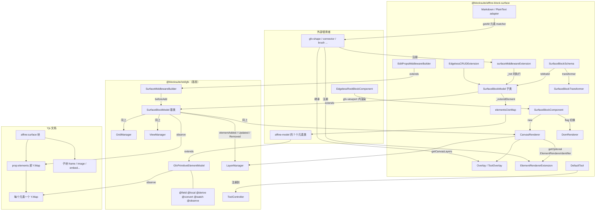
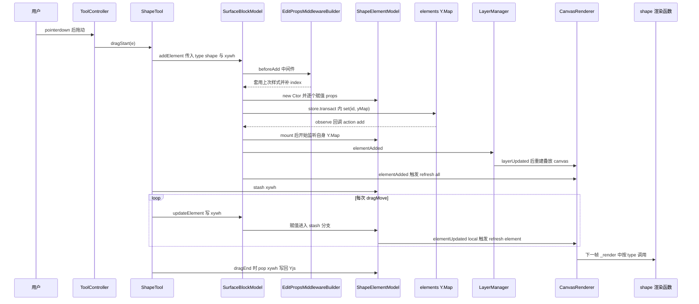
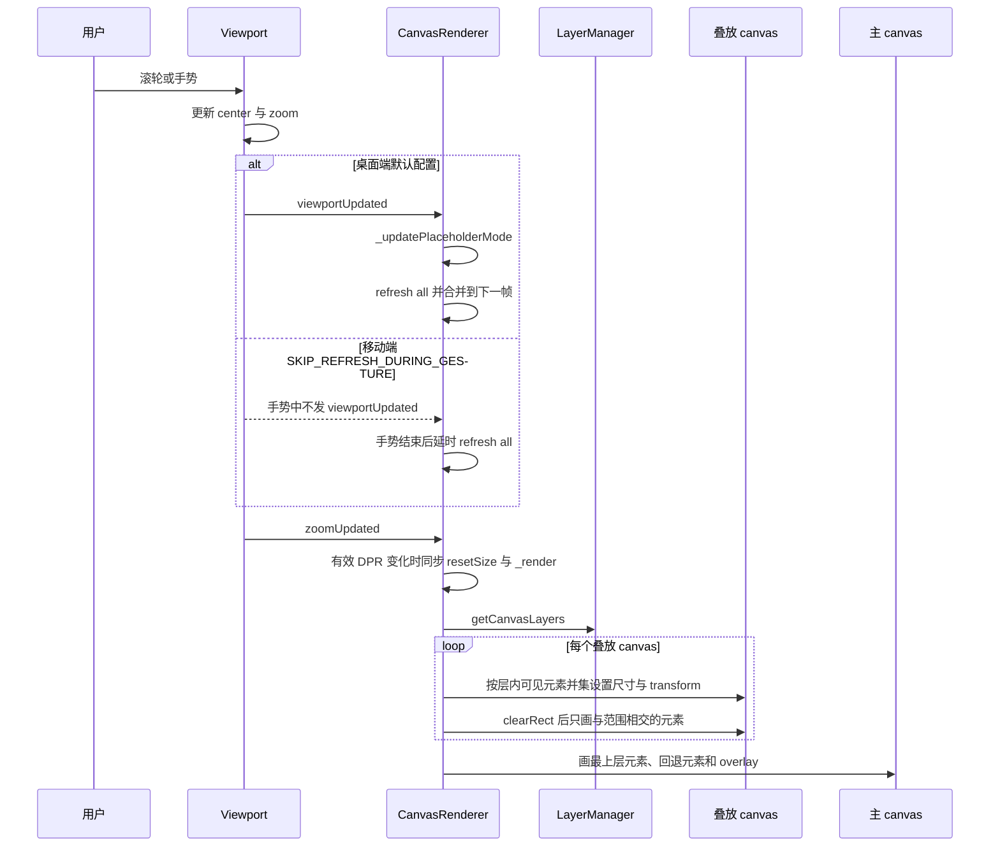
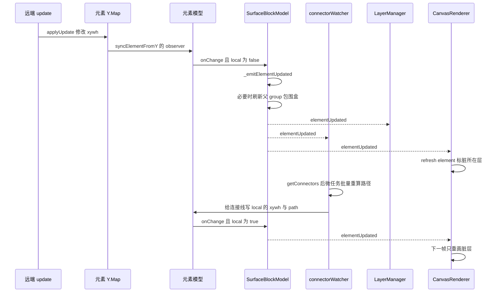

# `@blocksuite/affine-block-surface` 精讲

> 一句话：`@blocksuite/affine-block-surface` 是白板（edgeless）模式的**数据与渲染中枢**——它把 std/gfx 里抽象的 `SurfaceBlockModel` 绑定到 AFFiNE 的 7 种画布元素上，用一个 `Y.Map` 承载所有 shape/connector/brush/text/group/mindmap/highlighter，再用分层 canvas 的 `CanvasRenderer` 把它们画出来；所有 `gfx-*` 包都通过它提供的扩展点（元素渲染器、overlay、surface 中间件、元素 adapter）挂进来。
>
> 对应分层文档：[`@blocksuite/affine-block-surface`](../L3-编辑器业务层/blocksuite-affine-block-surface.md) · 源码：`blocksuite/affine/blocks/surface`

分层文档已经讲清了"目录里有什么、CanvasRenderer 大致怎么分层裁剪、transformer 怎么桥接 Y.Text"。本篇往下挖五件分层文档没讲透的事：**元素模型的装饰器到底在什么时机读写 Yjs**、**新元素从 `addElement` 到第一帧像素的完整链路**、**多 canvas 叠放其实是为了和 DOM 块交错排 z 序**、**视口变化时到底重绘了什么**、以及**哪些扩展点是 DI、哪些是写死的**。gfx 框架本身（`GfxController`、`Viewport`、`ToolController`、`GfxBlockComponent`）已在 [std 精讲 2.6 节](./03-blocksuite-std.md) 讲过，这里只讲 surface 怎么用它们。

## 0. 为什么是重点包

| 指标 | 数值 | 说明 |
| --- | --- | --- |
| 直接被依赖 | 33 个工作区包 | 实测：33 个 `package.json` 声明了它，覆盖 10 个 `blocks/*`、10 个 `gfx/*`、11 个 `widgets/*`、`fragments/frame-panel` 和 `affine/all` |
| 传递被依赖 | 64 个（运行时 55 个），全仓第 10 | 编排方数据。实测复核：按 `dependencies + devDependencies + peerDependencies` 口径为 65 个，按 `dependencies + peerDependencies + optionalDependencies` 口径为 55 个，排名第 10 一致；前 9 名都是 framework 层或 `affine-shared`/`affine-components`/`affine-rich-text` 这类基础包 |
| 源码行数 | 约 9,125 行（编排方口径） | 实测 `src` 下非测试 `.ts` 共 9,095 行。其中约 2,990 行是 vendored 的第三方代码（`utils/rough/` 2,146 行、`utils/path-data-parser/` 550 行、`utils/points-on-curve/` 与 `points-on-path/` 291 行），自研代码约 6,100 行 |
| 所在链路 | 白板数据与渲染中枢 | Yjs 的 `elements` 映射 → 元素模型 → `LayerManager`/`GridManager` → `CanvasRenderer` → 像素 |

自研代码的体量分布（实测，非测试 `.ts`）：

| 子目录 | 行数 | 说明 |
| --- | --- | --- |
| `blocksuite/affine/blocks/surface/src/renderer/` | 2,403 | `canvas-renderer.ts` 1,390 行，`dom-renderer.ts` 843 行（实验性，feature flag 控制） |
| `blocksuite/affine/blocks/surface/src/extensions/` | 1,075 | 其中 `export-manager/` 641 行；CRUD、中间件、渲染器注册都很薄 |
| `utils/` 自研部分 | 约 860 | `a-star.ts`（连接线寻路）、`graph.ts`、`sort.ts`、`font.ts`、`update-xywh.ts` 等 |
| 根目录 `surface-*.ts` 等 | 约 760 | 模型子类、视图组件、transformer、装配 |
| `tool/` `blocksuite/affine/blocks/surface/src/adapters/` `commands/` `element-model/` | 1,011 | 默认工具、两种 adapter 骨架、3 个命令、元素构造器映射 |

还有一个容易忽略的事实：surface 的**数据模型基座不在本包**。`SurfaceBlockModel` 基类、`GfxPrimitiveElementModel`、全部属性装饰器都在 `blocksuite/framework/std/src/gfx/model/surface/`（约 2,350 行）。本包做的是"把基座绑定到 AFFiNE 的具体元素类型 + 提供渲染管线"。读这个包必须把那 2,350 行一起读。

**满足的标准：**

- **A 依赖枢纽**：所有白板相关的包都依赖它。`gfx-shape`、`gfx-connector` 等用它的 `ElementRendererExtension` 注册绘制函数（`blocksuite/affine/gfx/shape/src/element-renderer/shape/index.ts:79-82`）；`gfx-connector`/`gfx-group` 用它的 `surfaceMiddlewareExtension` 注册数据监听（`blocksuite/affine/gfx/connector/src/connector-watcher.ts:93-96`）；10 个 overlay 类继承它的 `Overlay`（其中 `ShapeOverlay`、`NoteOverlay` 经由 `ToolOverlay`）；`blocks/embed`、`blocks/bookmark` 等调用它的 `reassociateConnectorsCommand`。
- **C 关键链路**：白板上每一个非块对象的增删改、每一次平移缩放的重绘都经过它。`SurfaceBlockModel` 决定元素怎么从 Yjs 变成模型，`CanvasRenderer` 决定模型怎么变成像素。
- 它也带一点 **D 范式定义者**的色彩：`gfx-*` 包的"渲染器 + 中间件 + overlay + adapter matcher"四类注册方式都由本包定义，但 gfx 范式的另一半（`GfxElementModelView`、`BaseTool`、`GfxViewInteractionExtension`）定义在 std。

**不懂它会卡在哪：**

1. 读 `blocksuite/affine/gfx/shape/src/shape-tool.ts:288-300`：`dragStart` 里 `addElement` 之后立刻 `stash('xywh')`，`dragMove` 里反复 `gfx.updateElement`，`dragEnd` 里 `pop('xywh')`——拖拽过程中到底有没有写 Yjs？为什么 `addElement` 没传 `index` 元素却有正确的 z 序？——要看 2.3 节的 stash 机制和 `EditPropsMiddlewareBuilder`。
2. 读 `blocksuite/affine/gfx/connector/src/store.ts:19`：连接线的路径重算逻辑为什么注册在 **store** 扩展而不是 view 扩展？——因为它是 `surfaceMiddlewareExtension`，由模型 `_init` 从 `store.provider` 取（`blocksuite/affine/blocks/surface/src/surface-model.ts:183-187`）。
3. 读 `blocksuite/affine/model/src/elements/connector/connector.ts:481-529`：连接线的 `xywh` 和 `path` 为什么是 `@local` 而不是 `@field`？`forceFullRender = true`（`:112`）又是给谁看的？——要看 2.3 节装饰器语义和 3.2 节的占位渲染。
4. 读 `blocksuite/affine/gfx/shape/src/adapter/markdown/index.ts:6-46`：matcher 拿到的 `elementModel` 是 `Record<string, unknown>`，文本要从 `text.delta` 里取——它不是模型实例，而是 `SurfaceBlockTransformer` 产出的快照 JSON（2.6 节）。
5. 读 `blocksuite/affine/blocks/surface/src/extensions/export-manager/export-manager.ts:473-488`：导出图片时块用 `html2canvas` 截、画布元素用 `surfaceRenderer.getCanvasByBound` 重画——两类白板对象连导出路径都不同（2.1 节）。

## 1. 全景架构



逐块解释：

- **Yjs 文档**。一张白板只有一个 `affine:surface` 块（`parent: ['@root']`）。它的唯一 prop `elements` 是一个盒装的 `Y.Map`，key 是元素 id，value 是该元素自己的 `Y.Map`（`blocksuite/affine/blocks/surface/src/surface-model.ts:15-36`）。frame、image、bookmark、attachment、embed、edgeless-text 是 surface 的**子块**，走普通块树；note 则是 root 的子块，不在 surface 下。
- **std/gfx 基座**。`SurfaceBlockModel` 基类负责"`Y.Map` → 元素模型实例"的全部生命周期和四类事件；`GfxPrimitiveElementModel` 加装饰器决定每个属性怎么存。`LayerManager`、`GridManager`、`ViewManager` 都是 `GfxExtension`，各自订阅 surface 的事件维护 z 序分层、空间索引、元素视图对象。
- **本包**。`SurfaceBlockModel` 子类只做三件事：注入 7 种元素构造器、维护连接线端点反向索引、执行 store 级 surface 中间件（`blocksuite/affine/blocks/surface/src/surface-model.ts:145-188`）。`SurfaceBlockComponent` 只负责创建渲染器、挂 canvas、接 overlay（`blocksuite/affine/blocks/surface/src/surface-block.ts:134-237`）。`CanvasRenderer` 是本包真正的技术核心。其余是一组扩展点和装配。
- **外部使用者**。7 个元素类定义在 `affine-model`，但构造器映射写死在本包的 `elementsCtorMap`（`blocksuite/affine/blocks/surface/src/element-model/index.ts:13-21`）；绘制函数、中间件、overlay、adapter matcher 则由各 `gfx-*` 包注册。`EdgelessRootBlockComponent` 在 `gfx-viewport` 里先渲染 root 的子块，再渲染 surface 的子块（`blocksuite/affine/blocks/root/src/edgeless/edgeless-root-block.ts:486-504`），`affine-surface` 自己也是 root 的子块之一，所以它的 canvas 和所有 DOM 块共处同一个层叠上下文。

## 2. 核心抽象与数据模型

### 2.1 两类白板对象：画布元素与块级 gfx 对象

白板上能被选中、拖动、编组的东西分两类。它们在 std 层被统一成 `type GfxModel = GfxBlockElementModel | GfxPrimitiveElementModel`（`blocksuite/framework/std/src/gfx/model/model.ts:8`），共同实现 `GfxCompatibleInterface`（`xywh`、`index`、`elementBound`、`includesPoint` 等，`blocksuite/framework/std/src/gfx/model/base.ts:34-69`），但底层几乎每一处都不同：

| 维度 | 画布元素（shape、connector、brush、text、group、mindmap、highlighter） | 块级 gfx 对象（note、frame、image、embed 等） |
| --- | --- | --- |
| 存储位置 | surface 块的 `prop:elements` 里，每个元素一个 `Y.Map` | 文档的块映射里，每块一个 `YBlock`，靠 `sys:children` 挂树 |
| 模型基类 | `GfxPrimitiveElementModel`，**不是** `BlockModel`（`blocksuite/framework/std/src/gfx/model/surface/element-model.ts:67-69`） | `GfxBlockElementModel extends BlockModel`（`blocksuite/framework/std/src/gfx/model/gfx-block-model.ts:52-56`） |
| 属性读写 | 装饰器 `@field`/`@local` 直接读写 `Y.Map` 或本地 `Map`，没有 Signal | `props` 走 store 的 `SyncController`，每个 prop 有 `xxx$` Signal |
| 类型注册 | `elementsCtorMap` 写死在本包 | `BlockSchemaExtension` 按 flavour 注册 |
| 变更事件 | `surface.elementAdded/elementUpdated/elementRemoved`（`blocksuite/framework/std/src/gfx/model/surface/surface-model.ts:94-103`） | `store.slots.blockUpdated` |
| 视图对象 | `GfxElementModelView`，纯 JS 对象，无 DOM，由 `ViewManager` 创建（`blocksuite/framework/std/src/gfx/view/view-manager.ts:58-113`） | `GfxBlockComponent`，Lit 组件，有 DOM |
| 渲染 | `CanvasRenderer` 按 `type` 取绘制函数画到 canvas | 浏览器渲染 DOM，CSS transform 跟随视口（见 std 精讲 2.6） |
| 层叠 | 同一 canvas 层内按数组顺序绘制 | 每块一个 CSS `z-index` |
| 命中测试 | 都经 `GridManager` 粗筛 + `includesPoint` 精判 | 同左 |
| 序列化 | `SurfaceBlockTransformer` 把整个 `elements` 拍成一个 JSON 对象 | 每块一个 `BlockSnapshot` 节点 |
| 导出图片 | `CanvasRenderer.getCanvasByBound` 重画 | `html2canvas` 截 DOM |

统一点有三处，正是它们让两类对象能"看起来一样"：

1. **同一套 `index` 排序**。两者都有一个分数索引字符串 `index`，`LayerManager` 把所有块和所有画布元素按 `index` 合并排序，再切成交替的 `block` 层和 `canvas` 层（`blocksuite/framework/std/src/gfx/layer.ts:190-260`）。
2. **编组可跨类**。`GfxGroupLikeElementModel.childElements` 先查 surface 再查 store（`blocksuite/framework/std/src/gfx/model/surface/element-model.ts:398-410`），所以一个 group 元素可以同时装 shape 和 note。
3. **统一操作入口**。`GfxController.updateElement`/`deleteElement`/`getElementById` 和 `EdgelessCRUDExtension` 都先查 surface、查不到再查 store（`blocksuite/framework/std/src/gfx/controller.ts:247-259`，`blocksuite/affine/blocks/surface/src/extensions/crud-extension.ts:114-150`）。

### 2.2 `SurfaceBlockModel`：两层继承，一个 Y.Map

**数据结构**。`elements` 的形状如下（`id`、`type` 由 `_createElementFromProps` 写入，其余 key 来自 `@field` 属性名）：

```text
prop:elements : Y.Map
├── "k3Jd..." : Y.Map
│   ├── id: "k3Jd..."          type: "shape"
│   ├── index: "a1"            seed: 123456
│   ├── xywh: "[0,0,100,100]"  rotate: 0
│   ├── shapeType: "rect"      fillColor: {...}
│   └── text: Y.Text           // 文本是嵌套的 Y.Text
└── "p9Qa..." : Y.Map          // group 的 children 是嵌套 Y.Map
```

**基类的内部状态**（`blocksuite/framework/std/src/gfx/model/surface/surface-model.ts:61-115`）：

- `_elementCtorMap`：`type → 构造器`，由子类 `_extendElement` 填充（`blocksuite/framework/std/src/gfx/model/surface/surface-model.ts:622-632`）。
- `_elementModels: Map<id, { model, mount, unmount }>`：模型实例与其挂载函数。**注意模型先于挂载存在**——创建时不订阅 Yjs、不派发事件，`mount()` 之后才开始。
- `_elementTypeMap`、`_groupLikeModels`、`_parentGroupMap`、`_groupChildIdsMap`：按类型索引和编组反向索引。
- `_decoratorState = { creating, deriving, skipField }`：装饰器的全局开关，见 2.3。
- `localElements`：不进 Yjs 的本地元素（`GfxLocalElementModel`，如拖线预览），有自己的三个事件。

**生命周期**。构造函数里订阅 `created`，在块模型创建完成后调用一次 `_init`（`blocksuite/framework/std/src/gfx/model/surface/surface-model.ts:139-145`）。本包子类覆写 `_init`：先 `_extendElement(elementsCtorMap)`，再 `super._init()`（加载已有元素并开始 observe），再重建连接线索引并订阅事件维护它，最后从 `store.provider` 取所有 `surfaceMiddlewareIdentifier` 执行（`blocksuite/affine/blocks/surface/src/surface-model.ts:145-188`）。顺序很关键：必须先注册构造器再加载元素，否则 `_createElementFromYMap` 会抛 `Invalid element type`（`blocksuite/framework/std/src/gfx/model/surface/surface-model.ts:244-248`）。

**连接线反向索引**。`_connectorIdsByEndpoint: Map<元素id, Set<连接线id>>` 加 `_connectorEndpoints` 记录每条线的旧端点，`elementUpdated` 时只在 `source`/`target` 变化时重算（`blocksuite/affine/blocks/surface/src/surface-model.ts:158-170`）；`getConnectors(id)` 顺手清理已失效的 id（`:190-216`）。它的头号用户是 `connectorWatcher`：任何元素 `xywh`/`rotate` 变了，就 `surface.getConnectors(id)` 找出要重算的线（`blocksuite/affine/gfx/connector/src/connector-watcher.ts:55-60`）。

**两种 surface 中间件**，名字几乎一样，作用完全不同：

| | `surfaceMiddlewareExtension`（本包） | `SurfaceMiddlewareBuilder`（std） |
| --- | --- | --- |
| 定义 | `blocksuite/affine/blocks/surface/src/extensions/surface-middleware.ts:6-23` | `blocksuite/framework/std/src/gfx/surface-middleware.ts:12-41` |
| 签名 | `(surface) => dispose`，拿到整个模型，自己订阅事件 | `(ctx) => void`，只处理 `beforeAdd` 一种上下文 |
| 注册层级 | **store** 扩展（模型 `_init` 从 `store.provider` 取） | **view** 扩展（`SurfaceMiddlewareExtension` 在 std mounted 后调 `applyMiddlewares`，`blocksuite/framework/std/src/gfx/surface-middleware.ts:46-61`） |
| 使用者 | `connectorWatcher`、`groupRelationWatcher` | `EditPropsMiddlewareBuilder`：套用"上次使用的样式"并补 `index`（`blocksuite/affine/blocks/surface/src/extensions/edit-props-middleware-builder.ts:12-25`） |
| 无 std 时 | 照常运行（离屏 store 也会算连接线路径） | 不存在，`addElement` 不会自动补 `index` |

### 2.3 `GfxPrimitiveElementModel` 与属性装饰器

元素模型是"包着一个 `Y.Map` 的普通对象"。构造参数只有 `{ id, yMap, model, stashedStore, onChange }`（`blocksuite/framework/std/src/gfx/model/surface/element-model.ts:181-202`），`onChange` 是模型把属性变化报告给 surface 的唯一通道。所有属性行为都由装饰器在原型上登记元数据实现（`blocksuite/framework/std/src/gfx/model/surface/decorators/common.ts:10-41`）：

| 装饰器 | 存储 | 本地赋值时 | 远端更新时 | 典型用法 |
| --- | --- | --- | --- | --- |
| `@field(fallback?)` | 元素的 `Y.Map`（未挂进文档前同时写 `_preserved`） | `convert` → 写 `Y.Map`（包在 `store.transact` 里）→ 重新 `observe` → 应用 `derive` | Y 事件触发 `onChange`，`local: false` | 所有需要协同的属性 |
| `@local()` | 模型私有 `_local` Map | `convert` → 写 `_local` → 应用 `derive` → 直接 `onChange({ local: true })` | 不存在 | `display`、`opacity`、连接线的 `path`/`xywh` |
| `@derive(fn)` | 无 | **赋值前**用新值算出其他属性，赋值后批量写入 | **不触发** | brush 的 `points` 改变时推导 `xywh` |
| `@convert(fn)` | 无 | 写入前变换值 | 不触发 | brush 把绝对坐标点转成相对坐标 |
| `@watch(fn)` | 无 | 订阅 `elementUpdated`，该属性出现在 `props` 里就回调 | **会触发**（因为走 `elementUpdated`） | 属性变了清缓存，如 brush 删 `commands` 缓存 |
| `@observe(fn)` | 无 | 对 Y 类型属性调 `.observe`，值被替换时自动重挂 | 会触发 | group/mindmap 监听 `children` 这个 `Y.Map` 内部变化 |

`@field` 的读写路径是理解一切的关键（`blocksuite/framework/std/src/gfx/model/surface/decorators/field.ts:26-85`）：

```ts
init(this: GfxPrimitiveElementModel, v: V) {
  const yProps = getFieldPropsSet(this);
  yProps.add(prop);
  if (getDecoratorState(this.surface ?? Object.getPrototypeOf(this).constructor)?.skipField) {
    return;                               // 从 Yjs 加载的元素：不写默认值
  }
  if (this.yMap) {
    if (this.yMap.doc) {
      this.surface.store.transact(() => { this.yMap.set(prop as string, v); });
    } else {
      this.yMap.set(prop as string, v);   // 新建元素：默认值写进游离的 Y.Map
      this._preserved.set(prop as string, v);
    }
  }
  return v;
},
get(this: GfxPrimitiveElementModel) {
  return (
    (this.yMap.doc ? this.yMap.get(prop as string) : null) ??
    this._preserved.get(prop as string) ??
    fallback                              // 注意：不是 accessor 的初始化值
  );
},
```

由此得出两条行为：

- **新建元素会把所有默认值写进 Yjs**（`skipField` 为 false），远端拿到的是完整属性集。
- **从 Yjs 加载的元素不写默认值**（`_initElementModels` 以 `skipFieldInit: true` 创建，`blocksuite/framework/std/src/gfx/model/surface/surface-model.ts:456-470`），某个 key 缺失时 getter 返回 `@field(fallback)` 的参数，而不是 `accessor x = 4` 里的 4。这就是 `ShapeElementModel` 很多字段写成 `@field(DefaultTheme.shapeTextColor)` 的原因（`blocksuite/affine/model/src/elements/shape/shape.ts:98-182`）。

`_decoratorState.creating` 只在 `new Ctor(...)` 的那一刻为 true（`blocksuite/framework/std/src/gfx/model/surface/surface-model.ts:251-268`），只影响类字段初始化器；`_createElementFromProps` 随后逐个赋值传入的 props 时 `creating` 已是 false（`:218-223`），所以 `addElement` 传入的值**会经过 `@convert` 和 `@derive`**——brush 的绝对坐标点就是在这一步被转成相对坐标、并推导出 `xywh` 的（`blocksuite/affine/model/src/elements/brush/brush.ts:163-188`）。此时 `mounted` 还是 false，`onChange` 被吞掉，不会派发事件（`blocksuite/framework/std/src/gfx/model/surface/surface-model.ts:263`）。

**`stash`/`pop`**（`blocksuite/framework/std/src/gfx/model/surface/element-model.ts:271-339`）：`stash(prop)` 用 `Object.defineProperty` 在实例上盖住原型的 accessor，之后的赋值只写 `_stashed` 并以 `local: true` 调 `onChange`——渲染器照常重画，但 Yjs 没有任何写入；`pop(prop)` 删掉实例属性、恢复原型 accessor，若值与 `Y.Map` 中的不同则写一次。只有 `@field` 属性能被 stash（`:301-303`）。这让一次拖拽在撤销栈和协同流量上都只算一次修改。

### 2.4 `CanvasRenderer`：层到 canvas 的映射

关键字段（`blocksuite/affine/blocks/surface/src/renderer/canvas-renderer.ts:302-381`）：

- `canvas`/`ctx`：**主 canvas**，永远存在，z-index 设为所有层之上（`blocksuite/affine/blocks/surface/src/renderer/canvas-renderer.ts:745-750`）。
- `_stackingCanvas: HTMLCanvasElement[]`：**叠放 canvas**，每个对应一个 canvas 层；`_stackingCanvasPool` 回收多余的 canvas；`_stackingCanvasState: WeakMap` 记每张 canvas 当前的渲染范围。
- `_needsFullRender`、`_mainCanvasDirty`、`_dirtyStackingCanvasIndexes`：三级脏标记。
- `usePlaceholder`：为 true 时元素只画灰色矩形。
- `_refreshRafId`：合并同一帧内的多次刷新。

**层与 canvas 的对应规则**是理解多 canvas 的钥匙。`LayerManager` 把 `[块, 块, shape, shape, 块, shape]` 这样按 `index` 排好的序列切成 `block 层 / canvas 层 / block 层 / canvas 层`，每层有一个起始 `zIndex`（`blocksuite/framework/std/src/gfx/layer.ts:190-208`）。`_initStackingCanvas` 为**除最后一个之外**的每个 canvas 层分配一张叠放 canvas，并把它的 `style.zIndex` 设成该层的 `zIndex`（`blocksuite/affine/blocks/surface/src/renderer/canvas-renderer.ts:736-795`）：

```ts
/**
 * we already have a main canvas, so the last layer should be skipped
 */
const canvasLayers = layer.getCanvasLayers().slice(0, -1);
// …
for (let i = 0; i < canvasLayers.length; ++i) {
  const layer = canvasLayers[i];
  const created = i < currentCanvases.length;
  const canvas = created ? currentCanvases[i] : this._createCanvasForLayer(onCreated);
  canvas.dataset.layerId = `[${layer.indexes[0]}--${layer.indexes[1]}]`;
  canvas.style.zIndex = layer.zIndex.toString();
  canvases.push(canvas);
}
```

于是最上面那个 canvas 层画在主 canvas 上，主 canvas 还负责画 overlay 以及"本该在叠放 canvas 上、但那张 canvas 被隐藏或绕过"的回退元素（`blocksuite/affine/blocks/surface/src/renderer/canvas-renderer.ts:1058-1084`）。这样设计的直接目的是**让 canvas 元素和 DOM 块在同一个层叠上下文里正确交错**：note 夹在两组 shape 中间时，下面那组 shape 必须画在一张 z-index 比 note 低的 canvas 上。脏层只重画也是它的收益，但不是唯一动机（5.3 节）。

**刷新目标**是一个判别联合（`blocksuite/affine/blocks/surface/src/renderer/canvas-renderer.ts:116-123`）：`all`、`main`、`element`、`elements`。`_invalidate` 把它翻译成脏标记（`blocksuite/affine/blocks/surface/src/renderer/canvas-renderer.ts:580-610`）：`element` 会通过 `_findLayerIndexByElement` 找到元素所在 canvas 层，该层有叠放 canvas 就标脏那一张，否则标脏主 canvas；一旦已有 `_needsFullRender`，后续的局部标记全部忽略。

### 2.5 扩展点一览：哪些走 DI，哪些写死

| 扩展点 | 定义位置 | 注册层级 | 消费方式 | 谁在用 |
| --- | --- | --- | --- | --- |
| 元素模型构造器 | `blocksuite/affine/blocks/surface/src/element-model/index.ts:13-21` | **写死**，无 DI | 子类 `_init` 里 `_extendElement` | 7 种元素 |
| `ElementRendererExtension(type, fn)` | `blocksuite/affine/blocks/surface/src/extensions/element-renderer.ts:13-31` | view | `_renderByBound` 里 `std.getOptional(ElementRendererIdentifier(type))`，每个元素每帧查一次 | 各 `gfx-*` 的 `view.ts`，仅 edgeless scope |
| `DomElementRendererExtension(type, fn)` | `blocksuite/affine/blocks/surface/src/extensions/dom-element-renderer.ts:16-30` | view | `DomRenderer` 按类型取 | shape、connector 等 |
| `Overlay`（静态 `overlayName`） | `blocksuite/affine/blocks/surface/src/renderer/overlay.ts:16-57` | view | `SurfaceBlockComponent._initOverlays` 用 `getAll(OverlayIdentifier)` 一次性挂上（`blocksuite/affine/blocks/surface/src/surface-block.ts:134-144`） | `SnapOverlay`、`ConnectionOverlay`、`FrameOverlay` 等 |
| 工具临时 overlay | `ToolOverlay`（`blocksuite/affine/blocks/surface/src/renderer/tool-overlay.ts:9-44`） | 不注册 | 工具自己 `renderer.addOverlay`/`removeOverlay` | `ShapeOverlay`、`NoteOverlay` |
| `surfaceMiddlewareExtension(id, fn)` | 2.2 节 | **store** | 模型 `_init` | connector、group |
| `ElementToMarkdownAdapterExtension` / `ElementToPlainTextAdapterExtension` | `blocksuite/affine/blocks/surface/src/adapters/markdown/element-adapter/type.ts:17-29` 等 | store | surface 块的 adapter 在 `fromBlockSnapshot.enter` 里 `provider.getAll` | 6 种元素 |
| `EdgelessClipboardConfig` | `blocksuite/affine/blocks/surface/src/extensions/clipboard-config.ts:28-80` | view | 按块 flavour 的 `key` 取，处理粘贴块 | 各块包 |
| `GfxElementModelView`、`BaseTool`、`GfxViewInteractionExtension` | std | view | 见 std 精讲 2.6 | 各 `gfx-*` |

唯一写死的是**模型构造器**。这是有原因的：模型 `_init` 在 store 层运行，那时可能根本没有 std（离屏 store、服务端渲染、导入导出），而且元素一加载就必须知道构造器。代价是新增元素类型必须改本包（7.1 节）。

### 2.6 序列化：transformer 与元素 adapter

`SurfaceBlockTransformer`（`blocksuite/affine/blocks/surface/src/surface-transformer.ts:14-115`）只处理两种嵌套 Y 类型：`Y.Text` 转成 `{ "affine:surface:text": true, delta }`，`Y.Map` 转成 `{ "affine:surface:ymap": true, json }`（`:42-55`）。几点源码细节：

- 只递归**一层**：`_elementToJSON` 对元素 `Y.Map` 的每个值调 `_toJSON`，而 `Y.Map` 分支直接 `value.toJSON()`，嵌套更深的 Y 类型会被拍成普通 JSON。`_fromJSON` 还原 `Y.Map` 时也是逐 key `set` 原值（`blocksuite/affine/blocks/surface/src/surface-transformer.ts:30-36`）。现有元素只有 group/mindmap 的 `children` 用到 `Y.Map`，且其值是普通对象，所以够用。
- `toSnapshot` 读 `transformerConfigs.get('selectedElements')`，存在时只序列化选中的元素（`blocksuite/affine/blocks/surface/src/surface-transformer.ts:95-107`），复制部分白板就靠它。
- 同样的标记还会在 `addElement`/`updateElement` 的 `_propsToY` 里被识别（`blocksuite/framework/std/src/gfx/model/surface/surface-model.ts:550-579`），所以粘贴时可以把快照 JSON 直接喂给 `addElement`。

**元素 adapter** 消费的是上面这份快照 JSON，而不是模型。`edgelessSurfaceBlockMarkdownAdapterMatcher` 在 surface 节点的 `enter` 钩子里取出所有 `ElementToMarkdownAdapterMatcherIdentifier`，先把 mindmap 的节点表放进 `walkerContext` 的全局上下文（避免 mindmap 里的 shape 被重复导出），再逐个元素找第一个 `match` 的 matcher 调 `toAST`（`blocksuite/affine/blocks/surface/src/adapters/markdown/markdown.ts:25-73`）。plain-text 版本结构相同，只是把结果追加到 `textBuffer`（`blocksuite/affine/blocks/surface/src/adapters/plain-text/plain-text.ts:26-74`）。`SurfaceStoreExtension` 注册的是 `Edgeless*` 版本（`blocksuite/affine/blocks/surface/src/store.ts:12-16`）；不带 `Edgeless` 前缀的 `SurfaceBlockAdapterExtensions` 和 `SurfaceBlockHtmlAdapterExtension` 直接跳过整个 surface，在仓库内没有找到使用方。

## 3. 关键流程走读

### 3.1 用户画一个矩形：从拖拽到第一帧像素



1. **工具分发**。`ToolController` 在 mounted 时向 `std.event` 注册全局 `dragStart` 等 handler 再转给当前工具（std 精讲 2.6）。`ShapeTool.dragStart` 先 `doc.captureSync()` 切断撤销合并，再调 `_addNewShape(e, 0, 0)`（`blocksuite/affine/gfx/shape/src/shape-tool.ts:288-300`）。
2. **坐标换算并加元素**。`viewport.toModelCoord` 把屏幕坐标换成模型坐标，然后**直接调 `gfx.surface!.addElement`**，不经过 `EdgelessCRUDExtension`（`blocksuite/affine/gfx/shape/src/shape-tool.ts:75-83`）。这里没有传 `index`。
3. **中间件**。`addElement` 先检查只读，再依次执行 `_middlewares`（`blocksuite/framework/std/src/gfx/model/surface/surface-model.ts:709-726`）。`EditPropsMiddlewareBuilder` 用 `EditPropsStore.applyLastProps` 套上用户上次选的颜色、线宽等，并在缺省时补 `index: this.gfx.layer.generateIndex()`（`blocksuite/affine/blocks/surface/src/extensions/edit-props-middleware-builder.ts:12-25`）。这就是第 0 段问题 1 的答案。
4. **生成 id、创建模型**。`nanoid()` 生成 id（`blocksuite/framework/std/src/gfx/model/surface/surface-model.ts:728-731`），`_createElementFromProps` 新建一个**游离**的 `Y.Map`，调 `_createElementFromYMap`（`:185-226`）：置 `creating = true`、`skipField = false`，`new ShapeElementModel(...)`，所有 `@field` 的默认值写进游离 `Y.Map` 和 `_preserved`；再经 `_propsToY`（`ShapeElementModel.propsToY` 会把字符串 `text` 转成 `Y.Text`，`blocksuite/affine/model/src/elements/shape/shape.ts:67-73`），写入 `type`、`id`，逐个赋值其余 props。
5. **先登记、后入文档**。`_elementModels.set(id, elementModel)` 在 `store.transact(() => elements.set(id, yMap))` **之前**执行（`blocksuite/framework/std/src/gfx/model/surface/surface-model.ts:742-746`）。
6. **Yjs 回调并挂载**。事务结束时 `elements` 的 observer 收到 `add`，发现 `_elementModels` 已有该 id，就复用它：加入类型索引，调 `mount()`——初始化 `@observe`、`@watch`，开始 `syncElementFromY` 监听自身 `Y.Map`，置 `mounted = true`，调 `onCreated()`——然后派发 `elementAdded`（`blocksuite/framework/std/src/gfx/model/surface/surface-model.ts:400-444`）。远端加元素也走这条 observer，只是那时 `_elementModels` 里没有，会以 `skipFieldInit: true` 新建。所以 `addElement` 返回时，模型已挂载、事件已派发。
7. **订阅方响应**。`LayerManager` 把元素插进 canvas 层（`blocksuite/framework/std/src/gfx/layer.ts:964-968`），若层结构变化则发 `layerUpdated`，`CanvasRenderer` 重算叠放 canvas 并 `refresh({ type: 'all' })`（`blocksuite/affine/blocks/surface/src/renderer/canvas-renderer.ts:797-801`）；`GridManager` 加空间索引；`ViewManager` 用 `ShapeElementView` 建视图对象；`CanvasRenderer._watchSurface` 自己也对 `elementAdded` 做全量刷新（`:1224-1226`）。
8. **拖拽期间只改本地**。`dragStart` 末尾 `stash('xywh')`；`dragMove` → `_resize` → `gfx.updateElement(..., { xywh })` → `surface.updateElement` 在 `transact` 里给模型赋值（`blocksuite/framework/std/src/gfx/model/surface/surface-model.ts:915-939`），但赋值落进 `stash` 定义的实例 setter，只写 `_stashed` 并发 `elementUpdated({ local: true })`，Yjs 没有写入（`blocksuite/framework/std/src/gfx/model/surface/element-model.ts:309-337`）。渲染器收到后按 `element` 粒度标脏。
9. **绘制**。下一帧 `_render` → `_renderByBound` 取到 `std.getOptional(ElementRendererIdentifier('shape'))`，设 `globalAlpha`，把 `matrix` 平移到元素左上角后调用（`blocksuite/affine/blocks/surface/src/renderer/canvas-renderer.ts:1182-1196`）。`shape` 函数解析主题色后按 `shapeType` 分派到 `rect`，`rect` 自己做 `translate → rotate` 并用 `RoughCanvas` 或普通路径绘制（`blocksuite/affine/gfx/shape/src/element-renderer/shape/rect.ts:46-80`）。
10. **提交**。`dragEnd` 里 `pop('xywh')` 把最终值一次写进 `Y.Map`；面积太小（`w < 20 && h < 20`）则删除元素；否则 `captureSync()`、切回 `DefaultTool` 并选中新元素（`blocksuite/affine/gfx/shape/src/shape-tool.ts:248-277`）。

### 3.2 平移/缩放视口：到底重绘了什么



1. **视口事件**。`Viewport.setCenter` 等方法在 `SKIP_REFRESH_DURING_GESTURE && 手势进行中` 时**不发** `viewportUpdated`，由 `gfx-viewport` 给容器加轻量 CSS transform 维持视觉同步（`blocksuite/framework/std/src/gfx/viewport.ts:624-634`）。这个开关桌面默认是 false（`blocksuite/framework/std/src/gfx/viewport.ts:43`），iOS 和 Android 在启动时设为 true（`packages/frontend/apps/ios/src/setup.ts:41`、`packages/frontend/apps/android/src/setup.ts:13`）。
2. **桌面端：每次视口变化都是全量刷新**。`_initViewport` 订阅 `viewportUpdated`，先更新占位模式，然后 `refresh({ type: 'all' })`（`blocksuite/affine/blocks/surface/src/renderer/canvas-renderer.ts:819-830`）。`refresh` 用 `_refreshRafId` 把一帧内的多次调用合并成一次 `_render`（`:1367-1379`）。也就是说，**平移时没有位图缓存和整体平移**，每帧所有叠放 canvas 都清空重画；"只画必要部分"靠的是下面两步裁剪。
3. **每层 canvas 只覆盖可见内容**。`_render` 对每个要画的叠放 canvas 调 `_getLayerRenderBound`：遍历层内元素，只取与 `overscanViewportBounds` 相交的元素包围盒求并集，外扩 32 像素后再裁到视口内（`blocksuite/affine/blocks/surface/src/renderer/canvas-renderer.ts:535-565`、`blocksuite/affine/blocks/surface/src/renderer/canvas-renderer.ts:1021-1030`）。canvas 的像素尺寸按这个范围乘 `zoom * dpr` 设定，CSS `transform` 把它平移到屏幕对应位置（`getCanvasViewportLayout`，`blocksuite/affine/blocks/surface/src/renderer/canvas-renderer.ts:223-243`）。层内没有可见元素时，canvas 被设成 `display: none` 且宽高为 0（`blocksuite/affine/blocks/surface/src/renderer/canvas-renderer.ts:464-477`），基本不占内存。
4. **逐元素可见性判断**。`_renderByBound` 对传入的元素逐个判断 `display && !hidden && intersects(getBoundWithRotation(element), cullBound)`，不相交的跳过（`blocksuite/affine/blocks/surface/src/renderer/canvas-renderer.ts:1167-1169`）。注意正常渲染路径传入的是 `layer.elements` 或回退元素数组，**不会**走 `grid.search`；只有 `getCanvasByBound` 不传元素时才用 `GridManager` 空间索引（`blocksuite/affine/blocks/surface/src/renderer/canvas-renderer.ts:1161-1165`）。
5. **拖拽中的稳定化**。`_gfx.tool.dragging$` 为 true 时，叠放 canvas 的范围取"上次范围 ∪ 本次范围"（`blocksuite/affine/blocks/surface/src/renderer/canvas-renderer.ts:567-578`），避免拖动元素时 canvas 每帧变尺寸。根据源码推断，这是为了减少 canvas 重新分配像素缓冲的开销和画面抖动。拖拽结束后再全量刷新一次（`blocksuite/affine/blocks/surface/src/renderer/canvas-renderer.ts:923-938`）。
6. **缩放时的 DPR 预算**。`zoomUpdated` 触发 `_syncCanvasBudgetForViewportZoom`：只有当 `getEffectiveDpr` 在新旧 zoom 下结果不同（即跨过了 `CANVAS_DPR_CAP_BY_ZOOM` 的某个阈值）时才同步 `_resetSize` + `_render`（`blocksuite/affine/blocks/surface/src/renderer/canvas-renderer.ts:661-677`）。桌面端这张表为空，DPR 恒等于 `window.devicePixelRatio`（`blocksuite/framework/std/src/gfx/viewport.ts:127-138`）。
7. **占位降级**。`shouldRenderCanvasPlaceholders` 只在两种情况下为 true：iOS 上缩放手势中且 `zoom <= 0.5`；或者开启了 `enable_turbo_renderer`、正在缩放而非平移、且没有开 `SKIP_REFRESH_DURING_GESTURE`（`blocksuite/affine/blocks/surface/src/renderer/canvas-renderer.ts:278-300`）。占位模式下元素画成灰色矩形，但 `forceFullRender` 为 true 的元素（连接线）照常绘制（`:1171-1181`），因为连接线变成矩形会严重失真。
8. **iOS 绕过叠放 canvas**。iOS 横屏、低缩放、手势中或恢复窗口内，`getStackingCanvasBypassState` 返回 true，所有叠放 canvas 被摘下，全部元素画在主 canvas 上（`blocksuite/affine/blocks/surface/src/renderer/canvas-renderer.ts:150-173`、`blocksuite/affine/blocks/surface/src/renderer/canvas-renderer.ts:991-1011`），用更少的合成层换取 WKWebView 不崩溃。
9. **DOM 块各走各的**。note、frame 等块的位置更新由 `GfxBlockComponent` 订阅 `viewportUpdated` 改 CSS transform（`blocksuite/framework/std/src/view/element/gfx-block-component.ts:66`），与 `CanvasRenderer` 无关；turbo-renderer 处理的也是 DOM 块的位图替身，二者关系见 5.5 节。

### 3.3 远端协作者改了一个属性



1. **Yjs 到模型**。`syncElementFromY` 给每个元素 `Y.Map` 挂的 observer 收集 `keysChanged`，更新 `_preserved`，若新值是 `Y.Text` 还会为它单独挂 observer；最后以 `transaction.local`（远端为 false）调回调（`blocksuite/framework/std/src/gfx/model/surface/element-model.ts:536-573`）。注意：**这里不经过 setter，`@convert` 和 `@derive` 都不会执行**。
2. **统一出口**。回调经 `mounted &&` 门控进入 `_emitElementUpdated`：若是 group 且 `childIds` 变了，先同步编组反向索引；然后 `elementUpdated.next(payload)`，再按每个 key 发 `model.propsUpdated`；最后若 `xywh`/`rotate`/`hidden` 变了，刷新父 group 的包围盒（`blocksuite/framework/std/src/gfx/model/surface/surface-model.ts:299-353`）。group 的 `xywh` 是从子元素算出来的本地缓存，`refreshXYWH` 会再发一次 `elementUpdated`（`blocksuite/framework/std/src/gfx/model/surface/element-model.ts:456-481`）。
3. **各订阅方**。`LayerManager` 只关心 `index`/`childIds`（`blocksuite/framework/std/src/gfx/layer.ts:969-978`）；`GridManager` 关心 `xywh` 等几何属性；`@watch` 装饰器的回调在这里触发（`blocksuite/framework/std/src/gfx/model/surface/decorators/watch.ts:35-48`）；`CanvasRenderer` 忽略只含 `externalXYWH` 的更新（那是渲染器自己写回的），其余按 `element` 刷新（`blocksuite/affine/blocks/surface/src/renderer/canvas-renderer.ts:1246-1253`）。
4. **连接线跟随**。`connectorWatcher` 发现 `xywh`/`rotate` 变化，用 `surface.getConnectors(id)` 取出相关连接线放进待更新集合，在一个微任务里批量调用 `ConnectorPathGenerator.updatePath`（`blocksuite/affine/gfx/connector/src/connector-watcher.ts:28-60`）。`updatePath` 给连接线赋 `xywh` 和 `path`（`blocksuite/affine/gfx/connector/src/connector-manager.ts:1202-1205`），这两个都是 `@local`（`blocksuite/affine/model/src/elements/connector/connector.ts:481-490`、`:528-529`），所以**每个客户端各自算路径，不产生 Yjs 写入**，也就不会出现两端互相覆盖的回环。
5. **局部重绘**。两次 `refresh({ type: 'element' })` 在同一帧内被合并；`_invalidate` 找到 shape 和连接线各自所在的 canvas 层，只把那几张叠放 canvas 标脏；若它们在最上层，则标脏主 canvas（`blocksuite/affine/blocks/surface/src/renderer/canvas-renderer.ts:597-609`）。下一帧 `_render` 只重画脏层（`:991-995`）。
6. **反例：层结构变化会退化为全量**。若远端改的是 `index`，`LayerManager.update` 可能重新切层并发 `layerUpdated`，`updateStackingCanvas` 末尾无条件 `refresh({ type: 'all' })`（`blocksuite/affine/blocks/surface/src/renderer/canvas-renderer.ts:794`）。远端增删元素同理（`elementAdded`/`elementRemoved` 直接全量，`blocksuite/affine/blocks/surface/src/renderer/canvas-renderer.ts:1224-1229`）。

## 4. 源码阅读路线

下面的路径都相对仓库根。

1. **`blocksuite/framework/std/src/gfx/model/surface/surface-model.ts:54-145`**：字段和四组事件。搞懂 `_elementModels` 里为什么存 `mount`/`unmount` 而不只存模型。
2. **`blocksuite/framework/std/src/gfx/model/surface/surface-model.ts:185-297` 与 `blocksuite/framework/std/src/gfx/model/surface/surface-model.ts:355-548`**：`_createElementFromProps`、`_createElementFromYMap`、`_initElementModels`。读到能说清"本地新建"和"远端/加载"两条路径在 `skipFieldInit` 与"是否已有模型"上的区别。
3. **`blocksuite/framework/std/src/gfx/model/surface/surface-model.ts:709-939`**：`addElement`、`deleteElement`（会级联删除 group 子元素和子块，`blocksuite/framework/std/src/gfx/model/surface/surface-model.ts:760-812`）、`updateElement`。
4. **`blocksuite/framework/std/src/gfx/model/surface/element-model.ts:67-380` 与 `:527-617`**：基类字段（哪些是 `@field`、哪些是 `@local`）、`stash`/`pop`、`syncElementFromY`。
5. **`blocksuite/framework/std/src/gfx/model/surface/decorators/` 下 7 个实现文件**（连同 `index.ts` 共 538 行）：按 `common` → `field` → `local` → `convert` → `derive` → `watch` → `observer` 的顺序读，对照 2.3 节的表。
6. **`blocksuite/affine/model/src/elements/brush/brush.ts:126-215`**：装饰器组合最复杂的样例，验证你对执行顺序的理解。
7. **`blocksuite/affine/blocks/surface/src/surface-model.ts` 全文**（223 行）：子类的三件事。
8. **`blocksuite/affine/blocks/surface/src/surface-block.ts:134-237`**：渲染器创建、叠放 canvas 挂载、overlay 注入。
9. **`blocksuite/affine/blocks/surface/src/renderer/canvas-renderer.ts`**，按这个顺序：`refresh`（`:1367`）→ `_invalidate`（`:580`）→ `_watchSurface`（`:1223`）→ `_initStackingCanvas`（`:736`）→ `_render`（`:966`）→ `_renderByBound`（`:1147`）→ `_initViewport` 与 `_updatePlaceholderMode`（`:806`、`:679`）。文件头部 `:128-300` 的导出函数都是纯函数，可以对着单测读。
10. **`blocksuite/framework/std/src/gfx/layer.ts:190-260` 与 `:935-1000`**：层是怎么切出来的、它订阅了 surface 的哪些事件。
11. **`blocksuite/affine/blocks/surface/src/extensions/element-renderer.ts` + `blocksuite/affine/gfx/shape/src/view.ts` + `blocksuite/affine/gfx/shape/src/element-renderer/shape/index.ts`**：一种元素的渲染器从定义到注册的全过程。
12. **`blocksuite/affine/blocks/surface/src/extensions/crud-extension.ts`、`blocksuite/affine/blocks/surface/src/extensions/edit-props-middleware-builder.ts`、`blocksuite/framework/std/src/gfx/surface-middleware.ts`、`blocksuite/affine/blocks/surface/src/surface-transformer.ts`、`blocksuite/affine/blocks/surface/src/adapters/markdown/markdown.ts`**：写入入口、中间件和序列化。

**可以先跳过的部分**：`utils/rough/`、`utils/path-data-parser/`、`utils/points-on-*`（vendored 的 RoughJS，只需知道 `RoughCanvas` 提供手绘风格路径）；`utils/a-star.ts`、`utils/graph.ts`（读 connector 时再看）；`blocksuite/affine/blocks/surface/src/renderer/dom-renderer.ts`（实验性，`enable_dom_renderer` 默认 false）；`blocksuite/affine/blocks/surface/src/extensions/export-manager/`（导出图片/PDF，独立功能）；`blocksuite/affine/blocks/surface/src/extensions/legacy-slot-extension.ts`（一组历史遗留的 `Subject`）。

## 5. 设计取舍

### 5.1 画布元素存进一个 Y.Map，而不是做成块

- **选择**：几千个 shape/connector 不进块树，统一存在 surface 块的 `elements` 里，用轻量的 `GfxPrimitiveElementModel` 包装。
- **原因**：块意味着 `BlockModel`、每 prop 一个 Signal、一个 Lit 组件和 DOM 节点；对大量纯图形对象来说太重。一个 `Y.Map` 的 key 增删天然支持协同，属性也能逐 key 合并。
- **代价**：块系统的能力全部要另做一套——自己的构造器映射、事件（`elementAdded` 等）、transformer、adapter 体系、编组索引；元素属性没有 Signal，UI 要订阅 `elementUpdated` 或 `propsUpdated` 而不能直接用 `computed`；store 的 schema 不校验元素类型和属性。
- **替代方案**：把图元做成"无视图的块"——仍要承担 `YBlock` 的 `sys:*` 开销和块树操作的成本，且无法绕开 `BlockModel` 的 Signal 化。没有选择它是可以理解的（根据源码推断，源码中没有直接说明）。

### 5.2 用装饰器描述属性，而不是 schema + SyncController

- **选择**：属性的存储位置（`@field`/`@local`）和联动规则（`@derive`/`@convert`/`@watch`/`@observe`）写在 accessor 上，元数据挂在原型的 symbol 下。
- **原因**：元素属性天然分成"要协同"和"本地派生"两类（连接线的 `path` 每端自己算），装饰器把这个区分写在声明处，一眼可见；`@derive` 让"改 points 自动更新 xywh"不必散落在每个调用方。
- **代价**：行为隐式，且有几处反直觉的语义——`@derive` 只在本地赋值时生效、在赋值前计算（读到的是旧值）；`fallback` 和 accessor 初始化值是两回事；`_decoratorState` 是 surface 级别的全局可变状态。这些都在第 6 段展开。
- **替代方案**：复用 store 的 `SyncController`——它为每个 prop 建 Signal，对成千上万个元素来说内存和订阅开销都偏高。

### 5.3 多张 canvas 按层叠放，而不是一张 canvas

| 方案 | z 序与 DOM 块交错 | 局部重绘 | 内存 |
| --- | --- | --- | --- |
| 一张 canvas | 做不到：note 要么全在 shape 上面，要么全在下面 | 只能整张重画 | 最省 |
| 每元素一张 canvas | 能 | 最细 | 不可接受 |
| **每个 canvas 层一张（当前）** | 能：canvas 的 z-index 取所在层的起始 z-index | 按层 | canvas 数等于 canvas 层数，且每张只覆盖可见内容 |

- **代价**：层数随"块与图元交错次数"增长；iOS 上合成层过多会被系统杀进程，所以有 bypass 模式（3.2 节第 8 步）和 DPR 上限。最上层复用主 canvas 节省一张。
- **把它说清楚的价值**：很多人以为叠放 canvas 只是性能优化，其实首要目的是**层叠正确性**——这点在源码注释里没有直说，是根据 `zIndex` 赋值和 `LayerManager` 交替切层的逻辑推断的。

### 5.4 渲染器、overlay、adapter 走 DI，构造器写死

- **选择**：`ElementRendererIdentifier(type)` 等全部用 DI 注册；`elementsCtorMap` 是一个普通对象常量。
- **原因**：渲染器只在 edgeless 视图需要，按 scope 注册正好；模型构造器在 store 层、`created` 时就要用，那时 view 扩展还没有装配，甚至不会有。
- **代价**：新增元素类型必须修改本包的 `elementsCtorMap` 与 `ElementModelMap` 类型（adapter matcher 的 `name` 类型就是 `keyof ElementModelMap`，`blocksuite/affine/blocks/surface/src/adapters/type.ts:10-17`），第三方无法只靠扩展包加元素；std 测试里另写了一个 `SurfaceBlockModel` 子类来注入测试元素（`blocksuite/framework/std/src/__tests__/test-schema.ts:90-97`），是目前唯一的另一种用法。
- **替代方案**：改成 store 级 DI 标识符，在 `_init` 里 `store.provider.getAll`——surface 中间件已经这样做了，技术上可行，源码里没有说明为何没做。

### 5.5 每次视口变化矢量重画，位图加速只给 DOM 块

- **选择**：canvas 元素每帧按当前 zoom 重画矢量；turbo-renderer 只为 DOM 块生成位图替身。
- **原因**：矢量重画在任意缩放下都清晰，且画布元素的绘制本身足够便宜；真正昂贵的是 DOM 块在缩放时的重排重绘。
- **两者的交集**：`CanvasRenderer` 读 `enable_turbo_renderer` 开关，开启时缩放手势中把画布元素也降级成占位矩形（`blocksuite/affine/blocks/surface/src/renderer/canvas-renderer.ts:404-407`、`:299`），让整张白板在缩放时保持一致的"低保真"状态；二者还共享 std 的 `getEffectiveDpr` 与 `viewportRuntimeConfig`。turbo-renderer 包并不依赖本包。
- **代价**：元素非常多时，平移的每一帧都要遍历所有层的所有元素做相交判断（层内没有空间索引）；移动端只能靠"手势中不刷新"兜底。

## 6. 易错点与调试

1. **新增 `@field` 后老数据读出 `undefined`**
   - 现象：给某元素加了 `@field() accessor foo = 1`，新建的元素正常，打开旧文档时 `element.foo` 是 `undefined`。
   - 原因：加载路径 `skipFieldInit: true`，初始化器的值不写入也不返回；getter 在 `Y.Map` 和 `_preserved` 都没有时返回 `fallback`（`blocksuite/framework/std/src/gfx/model/surface/decorators/field.ts:31-37`、`:52-57`）。
   - 避免：凡是可能缺失的字段都写成 `@field(默认值)`，参照 `ShapeElementModel`。

2. **`@derive` 在协作端不生效、读到旧值**
   - 现象：本地改 `lineWidth` 时 `points` 和 `xywh` 同步变了，协作者那边只看到 `lineWidth` 变化。
   - 原因：`@derive` 只在 setter 里执行，远端更新走 `syncElementFromY`，不经 setter；而且 `getDerivedProps` 在写入前调用，`instance.lineWidth` 还是旧值（`blocksuite/framework/std/src/gfx/model/surface/decorators/field.ts:66-84`、`blocksuite/framework/std/src/gfx/model/surface/decorators/derive.ts:66-78` 的注释）。
   - 避免：派生结果本身要么是 `@field`（本地派生后一起同步，brush 就是这样），要么是 `@local` 并用 `@watch` 或 surface 中间件在每端重算（连接线就是这样）。

3. **元素出现在最底层，z 序错乱**
   - 现象：在页面模式、离屏 store 或测试里调用 `surface.addElement`，新元素总是压在最下面。
   - 原因：`index` 由 view 级的 `EditPropsMiddlewareBuilder` 补齐，没有 edgeless std 时中间件不存在，模型构造函数里的默认值是 `'a0'`（`blocksuite/framework/std/src/gfx/model/surface/element-model.ts:200`）。根据源码推断。
   - 避免：自己传 `index`（如 `gfx.layer.generateIndex()`），或走 `EdgelessCRUDExtension.addElement`（它显式补 `index`，`blocksuite/affine/blocks/surface/src/extensions/crud-extension.ts:105-111`）。

4. **`stash` 了忘记 `pop`**
   - 现象：拖完元素位置看起来对，刷新或协作者那边却回到原位；撤销也撤不掉。
   - 原因：stash 期间所有赋值只进 `_stashed`；`stash` 对非 `@field` 属性静默返回，`pop` 对不存在的 stash 也静默返回（`blocksuite/framework/std/src/gfx/model/surface/element-model.ts:271-275`、`:301-303`）。
   - 避免：stash/pop 成对写在 `dragStart`/`dragEnd` 里，并处理中途切换工具（`deactivate`）的情况。

5. **surface 中间件注册了却不执行**
   - 现象：写了一个 `surfaceMiddlewareExtension`，放进某个 `ViewExtensionProvider` 里，回调从未被调用。
   - 原因：模型 `_init` 只看 `this.store.provider.getAll(surfaceMiddlewareIdentifier)`（`blocksuite/affine/blocks/surface/src/surface-model.ts:183-187`），且只在模型创建时执行一次。
   - 避免：放进 `StoreExtensionProvider`（参照 `blocksuite/affine/gfx/connector/src/store.ts:19`）。反过来，`SurfaceMiddlewareBuilder` 必须放在 view 扩展。

6. **渲染函数画错位置或旋转失效**
   - 现象：自定义元素全画在 canvas 左上角，或旋转不生效。
   - 原因：`_renderByBound` 只做了 `ctx.setTransform(matrix)`（仅缩放），把"平移到元素左上角"的矩阵作为参数 `matrix` 传给渲染函数（`blocksuite/affine/blocks/surface/src/renderer/canvas-renderer.ts:1192-1194`）；旋转也不由框架处理。
   - 避免：在渲染函数里自己 `ctx.setTransform(matrix.translateSelf(...).rotateSelf(model.rotate)...)`，参照 `blocksuite/affine/gfx/shape/src/element-renderer/shape/rect.ts:46-52`。框架已在外层 `save`/`restore`，不用担心状态泄漏。

7. **渲染器"卡住"不再刷新**（根据源码推断，未运行验证）
   - 现象：surface 容器被移出 DOM 又插回后，元素变化不再重画。
   - 原因：`refresh` 在 `_refreshRafId !== null` 时直接返回；`requestConnectedFrame` 在元素未连接时**不调用回调**（`blocksuite/affine/shared/src/utils/event.ts:163-177`），于是 `_refreshRafId` 永远不会被清空。
   - 排查：在 devtools 里看 `renderer._refreshRafId` 是否长期非空、`getDebugMetrics().coalescedRefreshCount` 是否持续增长而 `renderCount` 不变。

8. **overlay 刷新代价被低估**
   - 现象：一个跟随鼠标的 overlay 让大白板变卡。
   - 原因：`Overlay.refresh()` 调的是 `renderer.refresh()`，默认 `{ type: 'all' }`，会重画所有叠放 canvas（`blocksuite/affine/blocks/surface/src/renderer/overlay.ts:44-48`）；而 overlay 只画在主 canvas 上。
   - 避免：自己持有 renderer 时调用 `refresh({ type: 'main' })`；`addOverlay`/`removeOverlay` 内部已经是这样做的（`blocksuite/affine/blocks/surface/src/renderer/canvas-renderer.ts:1256-1260`）。

**调试手段：**

- **渲染指标**：控制台执行 `document.querySelector('affine-surface').renderer.getDebugMetrics()`，可看到刷新次数、被合并的刷新次数、每帧耗时、脏层数、回退元素数、各 canvas 的像素尺寸与内存（`blocksuite/affine/blocks/surface/src/renderer/canvas-renderer.ts:75-94`、`:1334-1341`），`resetDebugMetrics()` 清零。
- **看分层**：Elements 面板里 `affine-surface` 下的 `canvas.indexable-canvas` 就是叠放 canvas，`data-layer-id` 是该层的 `index` 区间，`style.zIndex` 可与 note 的 z-index 对照。
- **开关**：`FeatureFlagService` 的 `enable_dom_renderer`（切 `DomRenderer`）、`enable_turbo_renderer`（缩放时占位），定义在 `blocksuite/affine/shared/src/services/feature-flag-service.ts:21-22`；`viewportRuntimeConfig` 的各项可在控制台改动以复现移动端行为。
- **性能面板**：删除元素包在 `measureOperation('edgeless:delete-element', ...)` 里，会在 Performance 的 User Timing 留下 measure（`blocksuite/framework/std/src/gfx/perf.ts:9-31`）。
- **测试入口**：模型与装饰器 `blocksuite/framework/std/src/__tests__/gfx/surface.unit.spec.ts`（配合 `test-gfx-element.ts` 的 `TestShapeElement`）；渲染预算与占位逻辑 `blocksuite/affine/all/src/__tests__/gfx/canvas-budget.unit.spec.ts`；集成测试 `blocksuite/integration-test/src/__tests__/edgeless/surface-model.spec.ts`、`layer.spec.ts`；本包的 `src/__tests__/` 只覆盖 A* 寻路、几何与排序工具。

**与分层文档不一致之处**（以源码为准）：

> 以下各条已于 2026-11-01 同步更正到分层文档，保留在此作为勘误记录。

- 分层文档 3.4 节说 `_renderByBound` 的"元素来源是 `grid.search(cullBound, ...)`"。实际正常渲染时传入的是 `layer.elements` 或回退元素数组，`grid.search` 只在 `getCanvasByBound` 未传元素时使用（`blocksuite/affine/blocks/surface/src/renderer/canvas-renderer.ts:1047-1055`、`:1074-1083`、`:1161-1165`）。
- 分层文档说 `usePlaceholder` 用于"低缩放/性能模式"。实际只在 iOS 低缩放手势中，或开启 turbo renderer 且正在缩放时启用（`blocksuite/affine/blocks/surface/src/renderer/canvas-renderer.ts:278-300`）。
- 分层文档说"canvas `pointer-events:none`，交互走元素块/overlay 层"。overlay 也是画在主 canvas 上的，同样不接收指针事件；画布元素的交互由 `ToolController` 的全局事件加 `GridManager` 命中测试完成。
- 分层文档给出的 `_render` 范围是 `blocksuite/affine/blocks/surface/src/renderer/canvas-renderer.ts:966-1086`，实际函数到 `blocksuite/affine/blocks/surface/src/renderer/canvas-renderer.ts:1124` 结束（后半段是调试指标统计）。
- 分层文档未提及：叠放 canvas 只分配给"除最上层外"的 canvas 层，最上层元素画在主 canvas 上（`blocksuite/affine/blocks/surface/src/renderer/canvas-renderer.ts:742`）。

## 7. 扩展实践

### 7.1 新增一种画布元素类型：最小骨架

以一个只画五角星的 `star` 元素为例。由于构造器映射写死（5.4 节），步骤分成"必须改 surface 及 model"和"放在自己的 gfx 包里"两部分。

1. **定义模型**（新建文件 `blocksuite/affine/model/src/elements/star/star.ts`，并在 `elements/index.ts` 导出、加进 `SurfaceElementModelMap`）：

```ts
import type { SerializedXYWH } from '@blocksuite/global/gfx';
import type { BaseElementProps } from '@blocksuite/std/gfx';
import { field, GfxPrimitiveElementModel, local } from '@blocksuite/std/gfx';

import { type Color, DefaultTheme } from '../../themes/index.js';

export type StarProps = BaseElementProps & {
  xywh: SerializedXYWH;
  rotate: number;
  fillColor: Color;
};

export class StarElementModel extends GfxPrimitiveElementModel<StarProps> {
  get type() {
    return 'star';
  }

  @field('[0,0,100,100]' as SerializedXYWH)
  accessor xywh: SerializedXYWH = '[0,0,100,100]';

  @field(0)
  accessor rotate: number = 0;

  // 给 fallback，避免旧文档缺字段时读到 undefined
  @field(DefaultTheme.shapeFillColor)
  accessor fillColor: Color = DefaultTheme.shapeFillColor;

  // 本地状态：不同步
  @local()
  accessor highlighted: boolean = false;
}
```

2. **注册构造器**（改 `blocksuite/affine/blocks/surface/src/element-model/index.ts`）：在 `elementsCtorMap` 加 `star: StarElementModel`，在 `CanvasElementType` 加 `STAR = 'star'`，在 `ElementModelMap` 加 `['star']: StarElementModel`。少了第一项，加载含 `star` 的文档会抛 `Invalid element type`。

3. **渲染函数与视图扩展**（放在新包 `blocksuite/affine/gfx/star/src/`）：

```ts
import {
  type ElementRenderer,
  ElementRendererExtension,
} from '@blocksuite/affine-block-surface';
import type { StarElementModel } from '@blocksuite/affine-model';
import { DefaultTheme } from '@blocksuite/affine-model';

export const star: ElementRenderer<StarElementModel> = (
  model,
  ctx,
  matrix,
  renderer
) => {
  const [, , w, h] = model.deserializedXYWH;
  const cx = w / 2;
  const cy = h / 2;
  // matrix 已平移到元素左上角，旋转需自己处理
  ctx.setTransform(
    matrix.translateSelf(cx, cy).rotateSelf(model.rotate).translateSelf(-cx, -cy)
  );
  ctx.fillStyle = renderer.getColorValue(
    model.fillColor,
    DefaultTheme.shapeFillColor,
    true
  );
  ctx.beginPath();
  for (let i = 0; i < 10; i++) {
    const r = i % 2 === 0 ? Math.min(cx, cy) : Math.min(cx, cy) / 2;
    const a = (Math.PI / 5) * i - Math.PI / 2;
    ctx.lineTo(cx + r * Math.cos(a), cy + r * Math.sin(a));
  }
  ctx.closePath();
  ctx.fill();
};

export const StarElementRendererExtension = ElementRendererExtension(
  'star',
  star
);
```

```ts
import {
  type ViewExtensionContext,
  ViewExtensionProvider,
} from '@blocksuite/affine-ext-loader';

import { StarElementRendererExtension } from './element-renderer';
import { StarTool } from './star-tool';

export class StarViewExtension extends ViewExtensionProvider {
  override name = 'affine-star-gfx';

  override setup(context: ViewExtensionContext) {
    super.setup(context);
    if (this.isEdgeless(context.scope)) {
      context.register(StarElementRendererExtension);
      context.register(StarTool);
    }
  }
}
```

4. **工具**（可选，参照 `ShapeTool` 的 stash/pop 模式）：

```ts
import { DefaultTool } from '@blocksuite/affine-block-surface';
import type { StarElementModel } from '@blocksuite/affine-model';
import { Bound } from '@blocksuite/global/gfx';
import type { PointerEventState } from '@blocksuite/std';
import { BaseTool } from '@blocksuite/std/gfx';

export class StarTool extends BaseTool {
  static override toolName = 'star';

  private _id: string | null = null;

  override dragStart(e: PointerEventState) {
    this.doc.captureSync();
    const [x, y] = this.gfx.viewport.toModelCoord(e.point.x, e.point.y);
    // index 由 EditPropsMiddlewareBuilder 补齐
    this._id = this.gfx.surface!.addElement({
      type: 'star',
      xywh: new Bound(x, y, 0, 0).serialize(),
    });
    (this.gfx.getElementById(this._id) as StarElementModel).stash('xywh');
  }

  override dragMove() {
    if (!this._id) return;
    const { x, y, w, h } = this.controller.draggingArea$.peek();
    this.gfx.updateElement(this._id, {
      xywh: new Bound(x, y, w, h).serialize(),
    });
  }

  override dragEnd() {
    if (!this._id) return;
    (this.gfx.getElementById(this._id) as StarElementModel).pop('xywh');
    this.doc.captureSync();
    this.gfx.selection.set({ elements: [this._id] });
    this._id = null;
    this.controller.setTool(DefaultTool);
  }
}
```

5. **导出为 Markdown**（store 扩展）：

```ts
import { ElementToMarkdownAdapterExtension } from '@blocksuite/affine-block-surface';

export const starToMarkdownAdapterMatcher = ElementToMarkdownAdapterExtension({
  name: 'star', // 类型是 keyof ElementModelMap，所以第 2 步必须先做
  match: element => element.type === 'star',
  toAST: () => ({
    type: 'paragraph',
    children: [{ type: 'text', value: 'Star' }],
  }),
});
```

6. **装配**：把 `StarViewExtension` 加进 `blocksuite/affine/all/src/extensions/view.ts`，把含 matcher 的 `StarStoreExtension` 加进 `blocksuite/affine/all/src/extensions/store.ts`。需要命中测试精度、缩放手柄、双击编辑时，再补 `includesPoint` 覆写、`GfxElementModelView` 子类和 `GfxViewInteractionExtension`（参照 `blocksuite/affine/gfx/shape/src/element-view.ts:10-45`）。

**验证清单**：新建后 `surface.elements.getValue().get(id).toJSON()` 含全部默认字段；刷新页面后 `fillColor` 不为 `undefined`；撤销一次即可撤掉整次拖拽；在 note 上方和下方各画一个星，确认它们分别落在不同 z-index 的 canvas 上。

### 7.2 让某类元素的变化驱动另一类元素：写一个 surface 中间件

需求：一个 `text` 元素改了内容时，把所有连到它的连接线标成虚线（只是示例）。

```ts
import {
  type SurfaceBlockModel,
  surfaceMiddlewareExtension,
} from '@blocksuite/affine-block-surface';

const textConnectorStyleWatcher = (surface: SurfaceBlockModel) => {
  const sub = surface.elementUpdated.subscribe(({ id, props, local }) => {
    // 只在本端发起的修改上写 Yjs，避免每个协作者各写一遍
    if (!local || !props['text']) return;
    if (surface.getElementById(id)?.type !== 'text') return;
    surface.getConnectors(id).forEach(connector => {
      surface.updateElement(connector.id, { strokeStyle: 'dash' });
    });
  });
  return () => sub.unsubscribe();
};

export const textConnectorStyleWatcherExtension = surfaceMiddlewareExtension(
  'text-connector-style-watcher',
  textConnectorStyleWatcher
);
```

要点：注册在 `StoreExtensionProvider` 的 `setup` 里；用 `local` 判断写入方，否则两端都会写同一个值；写 `@field` 属性会产生协同流量并进撤销栈，若只是视觉派生就改成写 `@local` 属性（像 `connectorWatcher` 那样每端各算一遍）。

## 8. 与其他重点包的协作

| 重点包 | 关系方向 | 接口 / 数据流 | 精讲 |
| --- | --- | --- | --- |
| `@blocksuite/std` | surface 依赖 std 的 gfx | 模型基座 `SurfaceBlockModel`/`GfxPrimitiveElementModel`/全部装饰器在 `blocksuite/framework/std/src/gfx/model/surface/`；`GfxController.surface$` 通过 `onSurfaceAdded` 发现 surface 块（`blocksuite/framework/std/src/gfx/controller.ts:86-87`）；`LayerManager`/`GridManager`/`ViewManager` 订阅 surface 事件；`ToolController` 承载 `DefaultTool`；`SurfaceMiddlewareExtension` 作为 std 内建扩展调用 `applyMiddlewares`（`blocksuite/framework/std/src/scope/std-scope.ts:45`） | [03-blocksuite-std](./03-blocksuite-std.md) |
| `@blocksuite/store` | surface 依赖 store | `defineBlockSchema`/`BlockSchemaExtension` 定义 `affine:surface`；`internalPrimitives.Boxed` 包装 `Y.Map`；`BaseBlockTransformer` 被 `SurfaceBlockTransformer` 继承；所有写入包在 `store.transact` 里，撤销靠 store 的 `UndoManager` 与 `captureSync`；store 级 `provider` 提供 surface 中间件与元素 adapter matcher | [02-blocksuite-store](./02-blocksuite-store.md) |
| `@blocksuite/affine-shared` | surface 依赖 shared | `ThemeProvider` 供色（`blocksuite/affine/blocks/surface/src/surface-block.ts:146-180`）、`FeatureFlagService` 决定渲染器与占位、`EditPropsStore` 记住上次样式、`requestConnectedFrame` 调度刷新、`BlockMarkdownAdapterExtension` 等 adapter 基础设施 | [07-blocksuite-affine-shared](./07-blocksuite-affine-shared.md) |
| `@blocksuite/affine-ext-loader` + `@blocksuite/affine` | ext-loader 装配 surface | `SurfaceStoreExtension`/`SurfaceViewExtension` 继承 `StoreExtensionProvider`/`ViewExtensionProvider`，按 `isEdgeless(scope)` 二分注册；`affine/all` 汇总注册（`blocksuite/affine/all/src/extensions/view.ts:95`、`blocksuite/affine/all/src/extensions/store.ts:56`） | [12-扩展装配](./12-扩展装配.md) |
| `@affine/core` | core 间接使用 | 通过 `@blocksuite/affine` 使用白板；AI 迷你思维导图自己 `new CanvasRenderer` 渲染预览（`packages/frontend/core/src/blocksuite/ai/mini-mindmap/surface-block.ts:99`）；iOS/Android 应用在启动时改写 `viewportRuntimeConfig` 以改变本包的刷新策略 | [05-affine-core](./05-affine-core.md) |
| `@affine/nbstore` | 间接 | 远端更新经 nbstore 同步进 Y.Doc 后，由元素 `Y.Map` 的 observer 进入 surface（3.3 节第 1 步）；surface 不感知传输层 | [04-affine-nbstore](./04-affine-nbstore.md) |
| `@blocksuite/data-view` | 无直接关系 | 两者都是 L3 的大型子系统，互不依赖 | [09-blocksuite-data-view](./09-blocksuite-data-view.md) |
