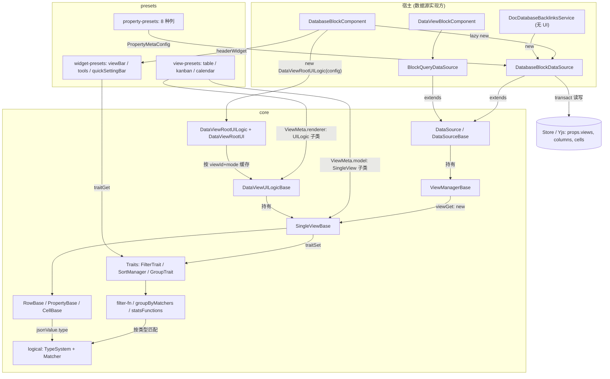
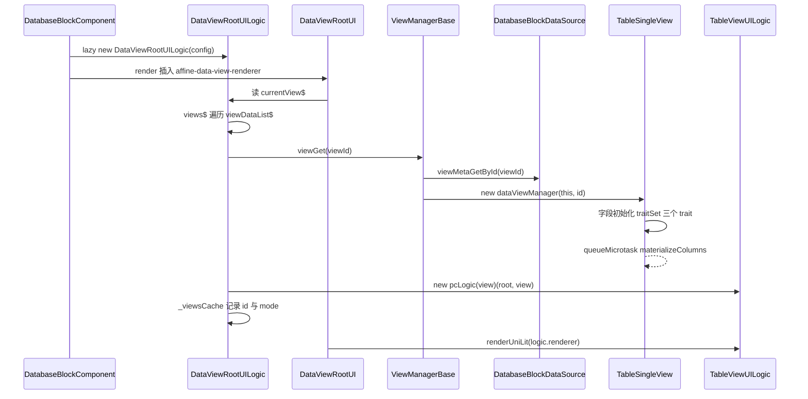
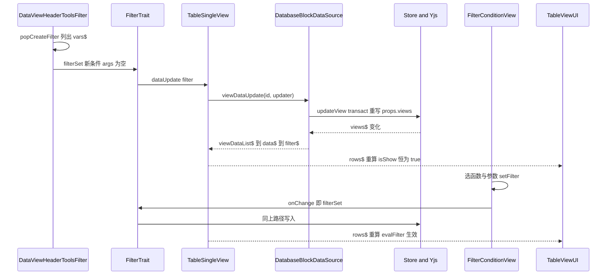
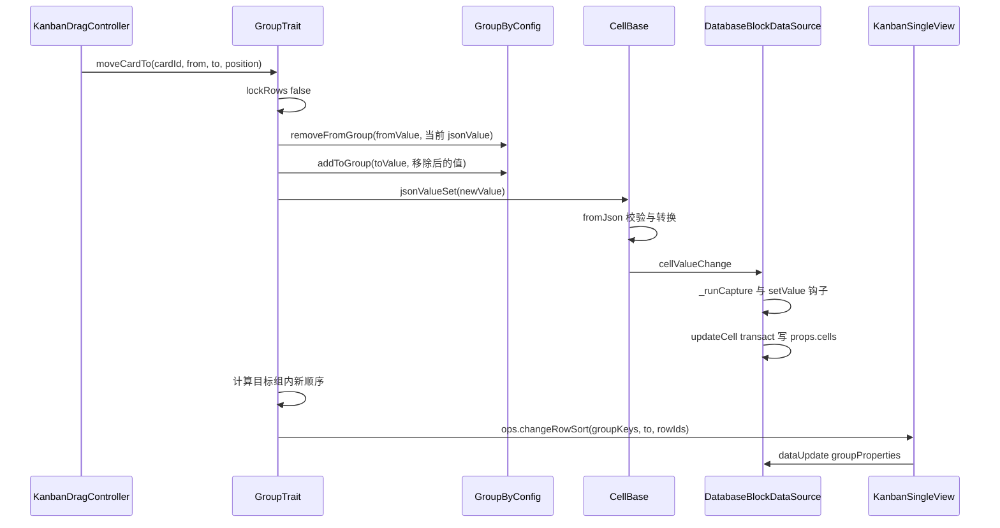
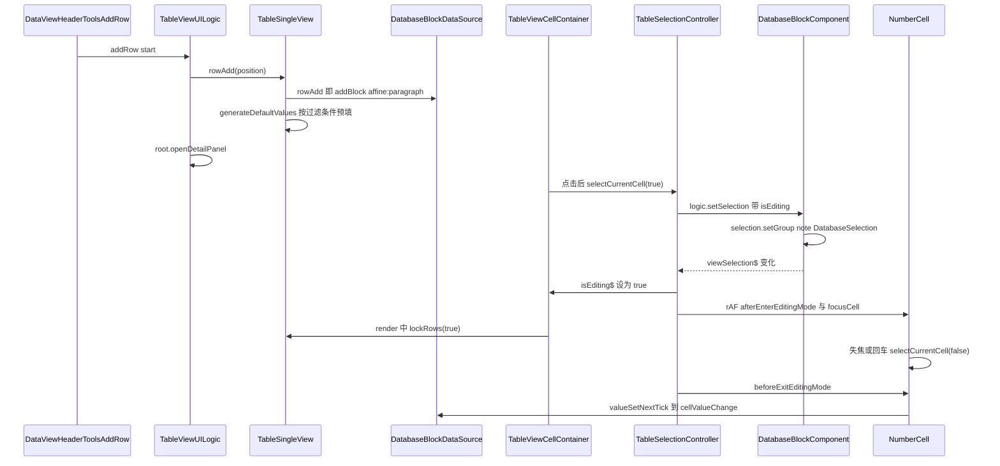

# @blocksuite/data-view 精讲

> 一句话：一套"数据从哪来"与"怎么看"分离的数据视图引擎。使用方提供 `DataSource`，它负责视图状态（列、过滤、排序、分组）、类型驱动的操作匹配、表格/看板/日历三种 UI 和配套工具栏；数据库块、内嵌视图块、文档信息面板都架在它上面。
>
> 对应分层文档：[`@blocksuite/data-view`](../L3-编辑器业务层/blocksuite-data-view.md) · 源码：`blocksuite/affine/data-view`

分层文档已经讲清目录、`viewType()`/`propertyType()` 链式工厂、`DataSourceBase` 的"命令式 + `$` 版"模板方法，本文不复述。本文回答三个问题：一次交互从 UI 到 Yjs 再回到 UI 走了哪些代码；哪些对象是缓存的、哪些每次新建；改它、扩它时要守住什么。

数据源实现方的细节见 [`affine-block-database`](../L3-编辑器业务层/blocksuite-affine-block-database.md) 和 [`affine-block-data-view`](../L3-编辑器业务层/blocksuite-affine-block-data-view.md)。下文标"根据源码推断"的结论只读过代码，没有实际运行验证。

## 0. 为什么是重点包

| 指标 | 编排方数据 | 核实结果 |
|---|---|---|
| 源码行数 | 约 38,118 行，BlockSuite 最大 | `src` 下非测试 `.ts` 共 38,089 行，加 `vitest.config.ts` 的 29 行正好 38,118。测试另有 2,507 行（6 个 spec）。BlockSuite 第二大是 `@blocksuite/std`（21,586 行），确实是最大的包 |
| 直接被依赖 | 8 个 | 一致：`affine-block-database`、`affine-block-data-view`、`affine-block-root`、`affine-foundation`、`affine-widget-keyboard-toolbar`、`@blocksuite/affine`、`@blocksuite/playground`、`@affine/core` |
| 传递被依赖 | 34 个（运行时 25），全仓第 31 | 扫描全部工作区 `package.json`：算上 `devDependencies` 得 35，只算 `dependencies` 与 `peerDependencies` 得 25，在 124 个包中排第 31。35 和 34 差 1，应是统计口径不同 |
| 所在链路 | 通用数据视图引擎 | 成立。视图实际有三种：table（PC 普通、PC 虚拟滚动、移动端三套 UI）、kanban（PC、移动端）、calendar（只有 PC 实现，移动端回退到 PC 逻辑，`blocksuite/affine/data-view/src/core/data-view.ts:75`） |

体量分布能说明这个包难在哪：`view-presets` 占 21,337 行，其中 table 的 `pc`（5,137 行）和 `pc-virtual`（6,413 行）是两套并行实现，由 `enable_table_virtual_scroll` 开关切换（`blocksuite/affine/data-view/src/view-presets/table/renderer.ts:12-16`），默认关闭（`packages/frontend/core/src/modules/feature-flag/constant.ts:241-249`）。`core` 共 11,609 行，最大的是 `group-by`（2,186 行），`logical` 类型系统只有 705 行。

关于"所有文档列表是否复用它"：核实结果是没有。`packages/frontend/core` 对本包及数据库块的引用集中在三处：`blocksuite/database-block/`（扩展列类型、分组配置、日历外部源）、`blocksuite/view-extensions/database/`（装配）、`modules/doc-info/`（文档信息面板，不带 UI 地直接 `new DatabaseBlockDataSource`，`packages/frontend/core/src/modules/doc-info/services/doc-database-backlinks.ts:36`）。

满足的标准：

- **B 体量复杂度**：BlockSuite 最大的包。复杂度不在行数，而在一份视图状态要同时驱动行过滤、排序、分组、统计，再落成三种交互模型完全不同的 UI，而且全部是 Signal 派生链。
- **D 范式定义者**：`DataSource`（数据契约）、`ViewMeta`（视图类型 = 数据模型 + UI 逻辑）、`PropertyMetaConfig`（列类型 = 值的 schema/转换 + 逻辑类型 + 渲染器）三份契约，决定了"在 AFFiNE 里做一个数据视图"的写法。AFFiNE 应用层的 member/file/created-by 列（`packages/frontend/core/src/blocksuite/database-block/properties/`）就是照这套契约写的 React 单元格。

不懂它会卡在哪：

1. `blocksuite/affine/blocks/database/src/data-source.ts:238-266` 的 `cellValueChange` 为什么不直接写 cell，而是先找列类型的 `rawValue.setValue` 钩子，再用 rAF 合并 `captureSync`？答案在 `PropertyConfig` 的值生命周期（2.4）。
2. `packages/frontend/core/src/blocksuite/view-extensions/database/database-block-config-service.ts:17-24`：往类静态 Signal 里塞列、往 DI 里塞 `ExternalGroupByConfigProvider`，看板就能按"成员"分组。不懂类型系统与 matcher（2.5）就看不出这条链路。
3. `blocksuite/affine/blocks/data-view/src/data-source.ts:317-323` 的 `rowAdd`/`rowDelete` 直接 `throw`，可工具栏上的"新建"按钮从哪调到它？要看 widget 的装配（3.4）。
4. `blocksuite/affine/blocks/database/src/database-block.ts:164` 用 `viewManager.viewGet(id)` 判断视图是否存在。这一行会构造完整的 `SingleView`，挂上不会释放的 `effect`，table 视图还会排一次写入（6.1）。
5. `packages/frontend/core/src/modules/doc-info/services/doc-database-backlinks.ts:36-63` 在没有编辑器、没有 Lit 组件的情况下直接读单元格：靠的是 `DataSource` 只依赖 Store 的 DI 和 Signal（5.1）。

## 1. 全景架构



逐块说明：

- **宿主层**不属于本包，但决定了它怎么被用。数据库块在 `lazy()` 里构造 `DatabaseBlockDataSource`，把 `EditorHost`、外部分组配置、日历外部源 `serviceSet` 进数据源的 DI 子容器（`blocksuite/affine/blocks/database/src/database-block.ts:143-168`），再把数据源、选区读写、热键、事件、剪贴板、详情面板等十几个宿主能力装进 `DataViewRootUILogic` 的 config（`blocksuite/affine/data-view/src/core/data-view.ts:31-55`）。引擎自己不碰 `EditorHost`，宿主能力全部经这份 config 注入。
- **模型层**（`DataSource` → `ViewManagerBase` → `SingleViewBase` → Row/Property/Cell）全是 Signal 派生，不依赖 DOM，可以无 UI 使用。视图状态（列宽、隐藏、过滤、排序、分组顺序）全部存在数据源的 `viewDataList$` 里，引擎对象本身几乎不持有状态。
- **Traits** 是视图能力的混入点：视图在构造时 `traitSet(key, 实例)`，工具栏用 `traitGet(key)` 探测能力。calendar 只注册了 sort 和 filter，没有 group（`blocksuite/affine/data-view/src/view-presets/calendar/calendar-view-manager.ts:197-218`）。
- **logical** 是全包共用的运行时类型系统。列类型声明自己的值是什么逻辑类型，过滤函数、分组方式、统计函数、过滤参数编辑器都按类型匹配。
- **UI 层**：`DataViewRootUILogic` 按 `viewId` 和 `mode` 缓存每个视图的 UI 逻辑对象，UI 逻辑对象持有 `SingleView`，于是同一视图的 `SingleView` 在 UI 存活期间是稳定的。
- **presets** 是对三份契约的官方实现。core 里有几处反向依赖 presets（`blocksuite/affine/data-view/src/core/types.ts:1-8`、`blocksuite/affine/data-view/src/core/group-by/setting.ts:15-17`、`blocksuite/affine/data-view/src/core/detail/selection.ts:1-3`），core 和 presets 实际上不能拆开单独使用，见 5.4。

## 2. 核心抽象与数据模型

### 2.1 `DataSource`：数据契约与服务作用域

接口全文在 `blocksuite/affine/data-view/src/core/data-source/base.ts:18-102`，分层文档已列过方法。这里补三点分层文档没讲的：

- **`$` 版不缓存**。`DataSourceBase` 的 `cellValueGet$` 等每次调用都 `return computed(...)`（`blocksuite/affine/data-view/src/core/data-source/base.ts:154-159`），调用方要自己持有返回值。引擎内部也不用这些 `$` 方法，而是在 `CellBase.value$` 这类自己的 computed 里调命令式 `cellValueGet`（`blocksuite/affine/data-view/src/core/view-manager/cell.ts:41-46`），依赖追踪靠实现方的 getter 内部读了哪些 Signal。所以**实现方的命令式 getter 必须读 Signal**（如 `this._model.props.views$.value`），否则整条派生链不会更新。
- **服务作用域**。`provider` getter 每次 `this.container.provider(DataSourceScope, this.parentProvider)`（`blocksuite/affine/data-view/src/core/data-source/base.ts:161-163`）。`DatabaseBlockDataSource` 的 `parentProvider` 是 `this._model.store.provider`（`blocksuite/affine/blocks/database/src/data-source.ts:61-63`），即 Store 的 DI，不是 std 的。所以 std 层注册的外部分组配置不会自动可见，数据库块要在构造时手动从 `std.provider.getAll(...)` 拷进来（`blocksuite/affine/blocks/database/src/database-block.ts:146-161`）。这类"每个数据源一份"的运行期服务（`GroupByService`、快速设置栏显隐状态）都用 `serviceGetOrCreate` 懒建。
- **"固定列"的判定**依赖一个受保护的抽象方法 `getNormalPropertyAndIndex`（`blocksuite/affine/data-view/src/core/data-source/base.ts:288-304`），它的签名里用了 `@blocksuite/affine-model` 的 `ColumnDataType`（`blocksuite/affine/data-view/src/core/data-source/base.ts:1`）。本包 `package.json` 并没有声明 `affine-model` 依赖，只是类型导入，编译期依赖 workspace 的路径解析。

### 2.2 `ViewMeta` 与视图生命周期：谁新建、谁缓存

`ViewMeta = { type, model: { defaultName, dataViewManager, defaultData }, renderer: { icon, pcLogic, mobileLogic? } }`（`blocksuite/affine/data-view/src/core/view/data-view.ts:25-63`）。`dataViewManager` 是 `SingleView` 子类的构造函数，`pcLogic` 是"给定 view 返回 UI 逻辑类"的函数，table 用它按开关选普通版或虚拟滚动版。

几类对象的生命周期差别很大，是这个包最容易误判的地方：

| 对象 | 何时创建 | 是否缓存 | 源码 |
|---|---|---|---|
| `ViewManagerBase` | 数据源字段初始化时 | 一个数据源一个 | `blocksuite/affine/blocks/database/src/data-source.ts:180` |
| `SingleView` | 每次 `viewManager.viewGet(id)` | **不缓存**，名字叫 get 实际是 new | `blocksuite/affine/data-view/src/core/view-manager/view-manager.ts:125-129` |
| `ViewManagerBase.currentView$` 的值 | `currentViewId$` 或 `viewDataList$` 任一变化 | 每次重算都新建 | `blocksuite/affine/data-view/src/core/view-manager/view-manager.ts:51-55`，依赖经 `viewMetaGetById` → `viewDataGet` → `viewDataList$` |
| UI 逻辑对象（含它持有的 `SingleView`） | `DataViewRootUILogic.views$` 首次见到某 viewId | 按 `viewId + mode` 缓存，mode 变了才重建 | `blocksuite/affine/data-view/src/core/data-view.ts:79-106` |
| `Row` / `Property` / `Cell` | `rowGetOrCreate`/`propertyGetOrCreate`/`cellGetOrCreate` | **都不缓存**，每次 new | `blocksuite/affine/data-view/src/core/view-manager/single-view.ts:205-207,266-268`，`blocksuite/affine/data-view/src/view-presets/table/table-view-manager.ts:282-288` |

结论：UI 里拿到的 `logic.view` 是稳定的，可以把 computed 挂在它上面；但通过 `viewManager.viewGet()` 或 `viewManager.currentView$` 拿到的视图每次都是新对象。`Row/Property/Cell` 的稳定性来自上一级 computed：`propertiesRaw$` 不重算，里面的 `Property` 实例就不变（`blocksuite/affine/data-view/src/view-presets/table/table-view-manager.ts:76-87`）。`blocksuite/affine/data-view/src/core/utils/cache.ts:3-32` 里有个 `cacheComputed` 工具，但全仓没有调用方，而且它的淘汰逻辑先把缓存键全部放进 `keys`，又逐个删掉，结果 `keys` 永远为空（`blocksuite/affine/data-view/src/core/utils/cache.ts:22-28`），什么都不会淘汰。

### 2.3 `SingleViewBase`：一条行管道

`rows$` 的定义（`blocksuite/affine/data-view/src/core/view-manager/single-view.ts:119-128`）就是整个数据流的骨架：

```ts
rowsRaw$ = computed(() => {
  return this.dataSource.rows$.value.map(id => this.rowGetOrCreate(id));
});

rows$ = computedLock(
  computed(() => {
    return this.rowsMapping(this.rowsRaw$.value);
  }),
  this.isLocked$
);
```

`rowsMapping` 是模板方法：基类做"搜索 + `isShow` 过滤"（`blocksuite/affine/data-view/src/core/view-manager/single-view.ts:187-203,270-272`），table/kanban 子类再包一层 `sortManager.sort(...)`（`blocksuite/affine/data-view/src/view-presets/table/table-view-manager.ts:319-321`），分组则在 `GroupTrait.groupDataMap$` 里消费 `view.rows$`（`blocksuite/affine/data-view/src/core/group-by/trait.ts:230-250`）。所以顺序固定是：**搜索 → 过滤 → 排序 → 分组 → 组内手动排序**。

`computedLock`（`blocksuite/affine/data-view/src/core/utils/lock.ts:3-15`）在 `lock$` 为真时返回上一次的值。单元格容器每次渲染都执行 `this.view.lockRows(this.isEditing$.value)`（`blocksuite/affine/data-view/src/view-presets/table/pc/cell.ts:136`），于是**编辑某格期间，行集合与顺序被冻结**：改完值后这一行不再满足过滤条件，也不会在你打字时消失或跳位。`rowAdd`、`rowsDelete` 和 `GroupTrait` 的各种写操作会先 `lockRows(false)` 解冻（`blocksuite/affine/data-view/src/core/view-manager/single-view.ts:131,262`，`blocksuite/affine/data-view/src/core/group-by/trait.ts:356,452,495,512,531`）。`GroupTrait` 的 `groupsDataList$` 也套了同一个锁（`blocksuite/affine/data-view/src/core/group-by/trait.ts:252-276`）。

搜索和过滤看的列不同：搜索只匹配可见列 `propertyIds$`（`blocksuite/affine/data-view/src/core/view-manager/single-view.ts:190`），过滤用 `propertiesRaw$`，隐藏列也参与（`blocksuite/affine/data-view/src/view-presets/table/table-view-manager.ts:269-280`），`blocksuite/affine/data-view/src/__tests__/table.unit.spec.ts:100-188` 专门测了这一点。

`vars$`（`blocksuite/affine/data-view/src/core/view-manager/single-view.ts:139-158`）把每一列映射成表达式变量 `{ id, name, type, propertyType, icon }`，`type` 来自列类型的 `jsonValue.type({ data })`。过滤和排序的 UI 都只认 `vars$`，不直接认列。

### 2.4 `PropertyMetaConfig`：一种列类型由哪几部分组成

`propertyType('number').modelConfig({...})` 产出 `PropertyModel`，再 `.createPropertyMeta({ icon, cellRenderer })` 得到 `PropertyMetaConfig`（`blocksuite/affine/data-view/src/core/property/property-config.ts:4-81`）。`modelConfig` 的参数类型 `PropertyConfig`（`blocksuite/affine/data-view/src/core/property/types.ts:16-93`）可以拆成五组：

| 组 | 字段 | 作用 | 谁消费 |
|---|---|---|---|
| 列配置 | `propertyData.schema/default` | 列级数据（如 select 的 options、number 的格式） | `create()` 建列时取默认值 |
| 原始值 | `rawValue.schema/default/toString/fromString/toJson/fromJson/setValue/onUpdate` | 存储层的值形态与转换 | 数据源读时 `schema.safeParse`；粘贴走 `fromString`；写入走 `setValue` 钩子 |
| JSON 值 | `jsonValue.schema/type/isEmpty` | 计算层的值形态与**逻辑类型** | 过滤、排序、分组、统计全部用 JSON 值和 `type` |
| 能力声明 | `kanbanGroup`、`fixed`、`hide`、`minWidth`、`addGroup` | 能否作看板分组列、是否固定列、是否在新增列菜单隐藏 | `group-by-utils.ts`、`DataSourceBase.fixedProperties$`、`propertyMetas$` |
| 渲染 | `renderer.icon`、`renderer.cellRenderer.view` | 一个 `UniComponent`，可以是 Lit 也可以是 React | `PropertyBase.renderer$` → 单元格容器 |

"原始值"和"JSON 值"分两层，是为了让存储格式和计算格式解耦。数据库的富文本列原始值是 `Text`（Yjs），JSON 值是字符串；select 两层都是 option id。`CellBase` 把这层转换做成 Signal：`value$`（原始）→ `jsonValue$`（`rawValue.toJson`）→ `isEmpty$` / `stringValue$`（`blocksuite/affine/data-view/src/core/view-manager/cell.ts:41-88`）。写入也有两个入口：`valueSet(raw)` 直接交给数据源，`jsonValueSet(json)` 先过 `jsonValue.schema` 校验再 `fromJson`（`blocksuite/affine/data-view/src/core/view-manager/cell.ts:104-123`，`blocksuite/affine/data-view/src/core/property/utils.ts:4-30`）。`fromJson` 是可选的，没有它的列类型 `jsonValueSet` 会静默返回 `undefined` 并写入。

单元格渲染器继承 `BaseCellRenderer`（`blocksuite/affine/data-view/src/core/property/base-cell.ts:10-134`），要点：

- `shouldUpdate` 只在 `cell.property.type$` 等于挂载时记下的 `type` 才更新（`blocksuite/affine/data-view/src/core/property/base-cell.ts:63-65`）。列类型切换的瞬间，旧渲染器不会拿着新类型的数据重渲染。
- 编辑生命周期是 `DataViewCellLifeCycle` 的五个钩子（`blocksuite/affine/data-view/src/core/property/manager.ts:16-27`），由选区控制器调用（3.4）。
- `valueSetNextTick` 用 rAF 延迟写入（`blocksuite/affine/data-view/src/core/property/base-cell.ts:109-113`）。number 列在退出编辑时用它（`blocksuite/affine/data-view/src/property-presets/number/cell-renderer.ts:49-69,93-95`），避免在选区切换的同一帧里写数据导致重渲染打断。

### 2.5 `logical`：类型如何驱动可用操作

`t` 是全部类型构造器的合集（`blocksuite/affine/data-view/src/core/logical/type-presets.ts:25-41`）：

```ts
export const dt = {
  number: defineDataType('Number', zod.number(), zod.number()),
  string: defineDataType('String', zod.string(), zod.string()),
  // ...
  tag: defineDataType('Tag', zod.array(SelectTagSchema), zod.string()),
  user: defineDataType('User', UserInfoSchema, zod.string()),
};
export const t = { unknown, ...dt, ...tv, ...ct };
```

- **基础类型** `DTInstance` 可以带 `data`：select 列的 `jsonValue.type` 是 `t.tag.instance(data.options)`，把选项列表装进类型（`blocksuite/affine/data-view/src/property-presets/select/define.ts:27`）。`unify` 时模板不带 data 就匹配任何同名类型，模板带 data 则要求实参也带（`blocksuite/affine/data-view/src/core/logical/data-type.ts:30-38`）。
- **复合类型** `ct.array`、`ct.fn`（`blocksuite/affine/data-view/src/core/logical/composite-type.ts:110-136`），**类型变量** `tVar`/`tRef`（`blocksuite/affine/data-view/src/core/logical/type-variable.ts:47-76`）。
- **`TypeSystem.unify(实际, 模板)`** 判断"实际类型能否当作模板类型用"。名字不同时查转换表：所有基础类型都能转成 `unknown`，`richText`、`url`、`user` 能转成 `string`（`blocksuite/affine/data-view/src/core/logical/type-presets.ts:53-67`），`registerConvert` 递归登记传递闭包（`blocksuite/affine/data-view/src/core/logical/type-system.ts:90-113`）。
- **`instanceFn`** 把函数模板和实参对齐，解出类型变量并代入（`blocksuite/affine/data-view/src/core/logical/type-system.ts:163-192`）。

这套系统在三个地方被消费：

1. **可用过滤函数**：`filterMatcher.filterListBySelfType(列类型)` 把每个过滤函数拼成 `fn(self, ...args) => boolean`，先把类型变量代成它的约束，再看列类型能否 unify 到第一个参数（`blocksuite/affine/data-view/src/core/filter/filter-fn/matcher.ts:24-61`）。所以 `isEmpty`（`self: t.unknown`）对所有列可用，`isOneOf`（`self: tRef('options')`，约束 `t.tag`）只对 select 可用。
2. **参数的类型与编辑器**：选定函数后，条件视图用 `typeSystem.instanceFn(模板, [列类型], boolean)` 得到具体签名（`blocksuite/affine/data-view/src/widget-presets/quick-setting-bar/filter/condition-view.ts:188-209`）。`isOneOf` 的参数被代成"带本列 options 的 tag 数组"，`literalItemsMatcher` 据此挑出标签选择器（`blocksuite/affine/data-view/src/core/filter/literal/matcher.ts:7-20`），选项就是这一列的 options。
3. **分组、排序、统计**：`createGroupByMatcher` 用 `Matcher_` 按 `matchType` 匹配（`blocksuite/affine/data-view/src/core/group-by/matcher.ts:8-10`）；`compare` 依次尝试 unify 到 richText/string/number/date/boolean/tag（`blocksuite/affine/data-view/src/core/sort/eval.ts:137-160`）；统计列按 `func.dataType` 过滤可用统计项（`blocksuite/affine/data-view/src/view-presets/table/stats/column-stats-column.ts:87-110`）。

新增列类型时，**`jsonValue.type` 返回什么类型，决定了它免费获得哪些过滤、排序、分组、统计能力**。AFFiNE 的 member 列返回 `t.array.instance(t.user.instance(...))`（`packages/frontend/core/src/blocksuite/database-block/properties/member/define.ts:46-60`），user 能转成 string，所以字符串类过滤对它可用，但分组要另行注册（`packages/frontend/core/src/blocksuite/database-block/group-by/index.tsx`）。

### 2.6 Traits：视图能力混入

`TraitKey` 只是 `{ key: Symbol(name) }` 加一个幻影类型字段（`blocksuite/affine/data-view/src/core/traits/key.ts:1-10`），`SingleViewBase` 用一个 `Map` 存（`blocksuite/affine/data-view/src/core/view-manager/single-view.ts:85,278-285`）。三个官方 trait：

| Trait | 状态来源 | 写回 | 注册它的视图 |
|---|---|---|---|
| `FilterTrait`（`blocksuite/affine/data-view/src/core/filter/trait.ts:7-25`） | `data$.filter` | `config.filterSet` | table、kanban、calendar |
| `SortManager`（`blocksuite/affine/data-view/src/core/sort/manager.ts:8-43`） | `data$.sort` | `ops.setSortList` | table、kanban、calendar |
| `GroupTrait`（`blocksuite/affine/data-view/src/core/group-by/trait.ts:144-540`） | `data$.groupBy` + `groupProperties` | `ops.groupBySet/changeRowSort/...` | table、kanban |

trait 自身不知道视图数据结构，所有"读哪段、写哪段"都由视图在构造时以回调注入（如 `blocksuite/affine/data-view/src/view-presets/table/table-view-manager.ts:105-240`）。table 和 kanban 的注入代码几乎相同，但有一处差别：kanban 的 `sortRow` 在有排序规则时直接返回原顺序，不再套组内手动顺序（`blocksuite/affine/data-view/src/view-presets/kanban/kanban-view-manager.ts:157-158`），table 没有这一行。

## 3. 关键流程走读

### 3.1 打开一个视图：从块渲染到 `SingleView` 构造



1. 数据库块用 `lazy()` 构造根逻辑，config 里带上 `dataSource: this.dataSource.value`（`blocksuite/affine/blocks/database/src/database-block.ts:421-445`）。
2. `DataViewRootUI.render` 读 `logic.currentView$`（`blocksuite/affine/data-view/src/core/data-view.ts:214-231`），它取 `viewsMap$[currentViewId]`（`blocksuite/affine/data-view/src/core/data-view.ts:133-139`）。
3. `views$` 在 computed 里遍历 `viewDataList$`，先清掉已删除视图的缓存，再按 `id + mode` 命中缓存，未命中才 `createDataViewUILogic`（`blocksuite/affine/data-view/src/core/data-view.ts:84-106`）。
4. `createDataViewUILogic` 调 `viewManager.viewGet`，选 `pcLogic` 或 `mobileLogic`，`new (logic(view))(this, view)`（`blocksuite/affine/data-view/src/core/data-view.ts:64-78`）。
5. `TableSingleView` 构造：字段初始化阶段 `traitSet` 注册 sort/filter/group 三个 trait（`blocksuite/affine/data-view/src/view-presets/table/table-view-manager.ts:105-240`），`GroupTrait` 构造时开两个 `effect` 同步 `sortAsc$`、`hideEmpty$`（`blocksuite/affine/data-view/src/core/group-by/trait.ts:179-194`）；构造函数末尾用 `queueMicrotask` 把"数据源有、视图 `columns` 里没有"的列补进视图数据（`blocksuite/affine/data-view/src/view-presets/table/table-view-manager.ts:354-361`）。kanban 的同名逻辑是同步调用（`blocksuite/affine/data-view/src/view-presets/kanban/kanban-view-manager.ts:386-391`）。
6. `TableViewUILogic` 构造时建 clipboard/drag/hotkeys/selection 四个控制器（`blocksuite/affine/data-view/src/view-presets/table/pc/table-view-ui-logic.ts:48-51`），`renderer` 是 `createUniComponentFromWebComponent(TableViewUI)`（`blocksuite/affine/data-view/src/view-presets/table/pc/table-view-ui-logic.ts:142`）。
7. `renderUniLit` 用 `new component()` 实例化 Lit 元素（`blocksuite/affine/data-view/src/core/utils/uni-component/uni-component.ts:95-117`）。这要求元素已经 `customElements.define`，这就是必须先调 `effects()`（`blocksuite/affine/data-view/src/effects.ts:6-11`）的原因。

### 3.2 给表格加一个过滤条件



1. 点过滤按钮：已有条件时只切换快速设置栏显隐，否则弹出"New filter"菜单，选项来自 `view.vars$`（`blocksuite/affine/data-view/src/widget-presets/tools/presets/filter/filter.ts:63-83`，`blocksuite/affine/data-view/src/core/filter/add-filter.ts:15-68`）。
2. 选中某列，`firstFilterByRef` 用 `filterMatcher.firstMatchedBySelfType` 取该类型第一个可用函数，生成 `{ type: 'filter', left: { type: 'ref', name: 列id }, function, args: [] }`（`blocksuite/affine/data-view/src/core/filter/utils.ts:8-28`）。
3. `_filter` setter 调 `filterTrait.filterSet`，它是 `TableSingleView` 注入的回调：`this.dataUpdate(() => ({ filter }))`（`blocksuite/affine/data-view/src/view-presets/table/table-view-manager.ts:127-138`），再到 `dataSource.viewDataUpdate`（`blocksuite/affine/data-view/src/core/view-manager/single-view.ts:217-219`）。
4. 数据库块的实现是 `updateView`：在 `transact` 里用 `map` 生成新的 `views` 数组，浅合并 updater 结果（`blocksuite/affine/blocks/database/src/utils/block-utils.ts:226-239`）。这一步**没有** `captureSync`，过滤改动会并入下一个撤销点（根据源码推断）。
5. 回流：`views$` → `viewDataList$`（`blocksuite/affine/blocks/database/src/data-source.ts:176-178`）→ `data$`（`blocksuite/affine/data-view/src/core/view-manager/single-view.ts:87-89`）→ `filter$`（`blocksuite/affine/data-view/src/view-presets/table/table-view-manager.ts:93-95`）→ `rows$`。新条件 `args` 为空，`evalFilter` 对缺参数的条件返回 `true`（`blocksuite/affine/data-view/src/core/filter/eval.ts:25-30`），所以此时所有行仍然显示。
6. 快速设置栏渲染 `filter-bar`，`.onChange` 直接绑到 `filterTrait.filterSet`（`blocksuite/affine/data-view/src/widget-presets/quick-setting-bar/filter/index.ts:15-20`）。用户在条件视图里换函数（`blocksuite/affine/data-view/src/widget-presets/quick-setting-bar/filter/condition-view.ts:211-235`）或填参数（`blocksuite/affine/data-view/src/widget-presets/quick-setting-bar/filter/condition-view.ts:268-285`），都经 `setFilter` → `onChange(list)` 写回（`blocksuite/affine/data-view/src/widget-presets/quick-setting-bar/filter/condition-view.ts:241-245`）。
7. `isShow` 对每一行构造 `{ 列id: jsonValue }`，交给 `evalFilter`（`blocksuite/affine/data-view/src/view-presets/table/table-view-manager.ts:269-280`）。`evalFilter` 递归处理 and/or 组；函数名找不到、参数不通过 `valueValidate`、`impl` 抛异常，一律返回 `true`（`blocksuite/affine/data-view/src/core/filter/eval.ts:12-53`）。过滤是 **fail-open** 的：配置坏了宁可多显示，不会把行藏起来。
8. 计算放在模型层的 `rows$` computed 里，缓存粒度是"整个行列表"。任何一个单元格的 `jsonValue$` 变化都会让 `rows$` 整体重算（每行每列都在 `isShow` 里被读过）。重算时还会为每行每列 new 一个 `CellBase`（`PropertyBase.cellGetOrCreate` 不缓存），开销与"行数 × 列数"成正比（根据源码推断）。

### 3.3 看板里拖动卡片换组



1. 拖放结束时 `onDrop` 区分"拖出看板"（交给宿主的 `onDrag` 回调）和"组间移动"，后者调 `group.manager.moveCardTo(cardId, 原组 key, 目标组 key, position)`（`blocksuite/affine/data-view/src/view-presets/kanban/pc/controller/drag.ts:69-85`）。
2. `moveCardTo` 先解冻行（`blocksuite/affine/data-view/src/core/group-by/trait.ts:452`）。跨组时，用分组配置的 `removeFromGroup`（没有就当 `null`）从当前值里去掉原组，再用 `addToGroup` 加上目标组（`blocksuite/affine/data-view/src/core/group-by/trait.ts:457-478`）。
3. 不同分组方式的"写回"语义差别很大（`blocksuite/affine/data-view/src/core/group-by/define.ts:168-267`）：
   - select：直接写目标 option id。
   - multi-select：从数组里删掉原 id、追加目标 id，保留其他标签。
   - checkbox：写 `true`/`false`。
   - number：分组键是 `Math.floor(v / 10)`，写回却是 `组值 * 10`（`blocksuite/affine/data-view/src/core/group-by/define.ts:231-243`）。比如 25.7 从"20 组"拖进"30 组"会变成 30，原值丢失；同组内移动不写值（已实测，见[附录](./99-附录-源码缺陷验证.md) E2）。
   - date 系列：写组的起始时间戳，原来的时分会丢。
   - 配置里 `addToGroup: false` 的分组方式不可拖入。
4. 写入走 `jsonValueSet`（`blocksuite/affine/data-view/src/core/view-manager/cell.ts:112-123`），经 `fromJson` 转成原始值后进 `cellValueChange`。数据库块先 `_runCapture()` 用 rAF 合并撤销点，再调列类型的 `setValue` 钩子或默认写入，最终 `updateCell` 写 `props.cells[rowId][columnId]`（`blocksuite/affine/blocks/database/src/data-source.ts:207-216,238-266`，`blocksuite/affine/blocks/database/src/utils/block-utils.ts:143-177`）。
5. 不管是否跨组，都要更新组内手动顺序：从 `groupDataMap$[toGroupKey].rows` 去掉本卡，按 `position` 插回，调 `ops.changeRowSort`（`blocksuite/affine/data-view/src/core/group-by/trait.ts:479-491`）。kanban 的实现把它写进视图数据的 `groupProperties[].manuallyCardSort`（`blocksuite/affine/data-view/src/view-presets/kanban/kanban-view-manager.ts:184-213`）。
6. 结果是**一次拖动两次写入**：单元格写 `props.cells`，顺序写 `props.views`。回流时 `groupDataMap$` 每次重算都新建全部 `Group` 实例（`blocksuite/affine/data-view/src/core/group-by/trait.ts:230-250`），组内顺序由 `sortByManually` 按 `manuallyCardSort` 重排，不在名单里的行排在后面（`blocksuite/affine/data-view/src/core/group-by/trait.ts:544-560`）。
7. `blocksuite/affine/data-view/src/__tests__/kanban.unit.spec.ts:395-430` 覆盖了这条路径：断言 `lockRows(false)` 被调用、目标组顺序、`changeRowSort` 参数和 `jsonValueSet(true)`。

### 3.4 新增一行并编辑一个单元格



1. 工具栏"新建"调 `dataViewLogic.addRow?.('start')`（`blocksuite/affine/data-view/src/widget-presets/tools/presets/table-add-row/add-row.ts:22-25`）。PC 表格的 `addRow` 在只读时直接返回，否则 `view.rowAdd(position)` 后打开详情面板（`blocksuite/affine/data-view/src/view-presets/table/pc/table-view-ui-logic.ts:61-71`）。表格内"在下方插入"走的是另一条路径：选区控制器的 `insertTo`，插完后在 rAF 里选中标题列并直接进入编辑（`blocksuite/affine/data-view/src/view-presets/table/pc/controller/selection.ts:227-255`）。
2. `SingleViewBase.rowAdd` 先解冻（`blocksuite/affine/data-view/src/core/view-manager/single-view.ts:261-264`），数据库块的 `rowAdd` 是 `captureSync` 后 `addBlock('affine:paragraph', {}, 库块id, index)`（`blocksuite/affine/blocks/database/src/data-source.ts:539-546`）。行就是子块。
3. `TableSingleView.rowAdd` 接着按当前过滤条件预填默认值：`generateDefaultValues` 只看顶层条件，同一列有多个条件就不填，有 `defaultValue` 的过滤函数才产出值（`blocksuite/affine/data-view/src/core/filter/generate-default-values.ts:10-44`），然后 `fromJson` 后 `valueSet`（`blocksuite/affine/data-view/src/view-presets/table/table-view-manager.ts:290-317`）。目的是让"在过滤视图里新建的行"不会一出生就被过滤掉。带 `groupKey` 时再 `addToGroup`。
4. 编辑单元格：点击容器，非编辑态时调 `selectCurrentCell(!readonly)`（`blocksuite/affine/data-view/src/view-presets/table/pc/cell.ts:108-115`）。已选中且 `beforeEnterEditMode()` 不为 false 时，生成 `isEditing: true` 的区域选区（`blocksuite/affine/data-view/src/view-presets/table/pc/cell.ts:65-94`）。
5. 选区不存在引擎里。控制器的 setter 补上 `viewId`、`type: 'table'` 后交给 `logic.setSelection`（`blocksuite/affine/data-view/src/view-presets/table/pc/controller/selection.ts:71-97`），一路到宿主：数据库块把它包成 `DatabaseSelection` 放进 BlockSuite 选区的 `note` 组（`blocksuite/affine/blocks/database/src/database-block.ts:271-288`），再经 `viewSelection$` 读回（`blocksuite/affine/blocks/database/src/database-block.ts:313-323`）。`DataViewUILogicBase.selection$` 只认 `viewId` 相同的选区（`blocksuite/affine/data-view/src/core/view/data-view-base.ts:72-78`）。所以选区能参与协同和撤销，也能被 BlockSuite 其他选区挤掉。
6. 控制器订阅 `logic.selection$`：对旧选区调 `beforeExitEditingMode()`、`blurCell()` 并置 `isEditing$ = false`；对新选区置 `isEditing$ = true`，在 rAF 里调 `afterEnterEditingMode()` 和 `focusCell()`（`blocksuite/affine/data-view/src/view-presets/table/pc/controller/selection.ts:156-223`）。
7. 容器重渲染时执行 `this.view.lockRows(this.isEditing$.value)`（`blocksuite/affine/data-view/src/view-presets/table/pc/cell.ts:136`），行管道冻结。
8. 退出编辑时 number 单元格在 `beforeExitEditingMode` 里 `_setValue()`，解析失败恢复原显示，成功则 `valueSetNextTick(value)`（`blocksuite/affine/data-view/src/property-presets/number/cell-renderer.ts:49-69,93-95`）。rAF 后进 `cellValueChange`，路径同 3.3 第 4 步。值回流后 `CellBase.value$` 更新，渲染器重渲染；`isEditing$` 已经是 false，下一次渲染解冻行管道，这时过滤和排序才生效。

## 4. 源码阅读路线

同一步里，紧跟在完整路径后面的短文件名与前一个文件同目录。

1. `blocksuite/affine/data-view/src/core/data-source/base.ts`（全读）：接口与基类。搞懂哪些方法是抽象的、哪些 `$` 版是基类派生的、服务作用域怎么回退。
2. `blocksuite/affine/blocks/database/src/data-source.ts:60-300,536-621`：一个真实实现。重点看 `rows$`、`viewDataList$`、`cellValueGet` 的 zod 校验和 `cellValueChange` 的 `setValue` 钩子。读完能回答"数据存在哪"。
3. `blocksuite/affine/data-view/src/core/view-manager/view-manager.ts` 和 `single-view.ts`（全读）：盯住 `rows$` 管道、`vars$`、`traitGet/traitSet`、`lockRows`。
4. `blocksuite/affine/data-view/src/core/view-manager/cell.ts`、`property.ts`、`row.ts`：值的三种形态（raw/json/string）怎么从列类型配置派生。
5. `blocksuite/affine/data-view/src/core/property/types.ts` 和 `property-config.ts`，再对照 `blocksuite/affine/data-view/src/property-presets/select/define.ts`、`number/define.ts`、`number/cell-renderer.ts`：一种列类型的完整样子。
6. `blocksuite/affine/data-view/src/core/logical/` 全部（705 行）：先 `type.ts`、`data-type.ts`、`type-presets.ts`，再 `type-system.ts` 的 `unify` 和 `instanceFn`。读到能解释"为什么 `isEmpty` 对所有列可用"即可。
7. `blocksuite/affine/data-view/src/core/filter/filter-fn/matcher.ts`、`blocksuite/affine/data-view/src/core/filter/eval.ts`、`blocksuite/affine/data-view/src/core/filter/filter-fn/tag.ts`：类型系统的第一个消费者。
8. `blocksuite/affine/data-view/src/view-presets/table/define.ts` 和 `table-view-manager.ts`（全读）：视图怎么组合 traits、怎么实现 `isShow`、列宽/隐藏存在哪。
9. `blocksuite/affine/data-view/src/core/group-by/define.ts` 和 `trait.ts`：分组键怎么算、拖动怎么写回。再看 `blocksuite/affine/data-view/src/view-presets/kanban/kanban-view-manager.ts` 与 `group-by-utils.ts`，对比 kanban 与 table 的差异。
10. `blocksuite/affine/data-view/src/core/data-view.ts` 和 `blocksuite/affine/data-view/src/core/view/data-view-base.ts`：UI 逻辑缓存、选区与事件的注入。
11. `blocksuite/affine/data-view/src/view-presets/table/pc/cell.ts` 与 `blocksuite/affine/data-view/src/view-presets/table/pc/controller/selection.ts:60-260`：编辑态的完整状态机。
12. `blocksuite/affine/data-view/src/widget-presets/index.ts`、`blocksuite/affine/data-view/src/widget-presets/tools/index.ts`、`blocksuite/affine/data-view/src/widget-presets/tools/presets/filter/filter.ts`：工具栏怎么按视图类型装配、怎么探测 trait。

可以先跳过：

- `blocksuite/affine/data-view/src/core/utils/wc-dnd/`（自带的拖拽库，约 1,500 行）、`blocksuite/affine/data-view/src/core/component/`（标签选择器等通用组件）。
- `blocksuite/affine/data-view/src/view-presets/table/pc-virtual/`：虚拟滚动版表格，默认关闭；结构与 `pc/` 平行，需要时对照着读。
- `blocksuite/affine/data-view/src/view-presets/calendar/pc/view.ts`（1,138 行）和 `layout.ts`：日历布局与交互，和引擎核心关系不大。
- 各种 `*-css.ts`、`styles.ts`。

## 5. 设计取舍

### 5.1 引擎与块解耦，数据源是唯一接缝

- **选择**：引擎只认 `DataSource`，不认 `BlockModel`、Yjs 或 `EditorHost`；宿主能力（选区、热键、事件、剪贴板、拖拽、遥测、详情面板）全部通过 `DataViewRootUILogic` 的 config 注入（`blocksuite/affine/data-view/src/core/data-view.ts:31-55`）。
- **为什么**：仓库里已经有三种形态差别很大的数据来源：数据库块自有数据、内嵌视图块查询工作区里的 todo、文档信息面板无 UI 读数据库行。解耦后三者共享同一套过滤/排序/分组/列类型。`packages/frontend/core/src/modules/doc-info/services/doc-database-backlinks.ts:35-63` 证明模型层确实能脱离 UI 使用。
- **代价**：
  - 契约很宽。`DataSource` 接口有 50 个成员，`DataSourceBase` 留给子类的抽象成员有 35 个（其中 `cellValueChange` 被重复声明了两次，`blocksuite/affine/data-view/src/core/data-source/base.ts:140-150`）。查询型数据源有些操作天然不支持，只能 `throw`（`blocksuite/affine/blocks/data-view/src/data-source.ts:317-323`），而 UI 并不知道哪些操作不可用，只能靠宿主不装配对应 widget 来规避。
  - 解耦并不彻底：`DataSourceBase` 类型依赖 `affine-model` 的 `ColumnDataType`；统计列直接 `instanceof Text` 并订阅 `yText`（`blocksuite/affine/data-view/src/view-presets/table/stats/column-stats-column.ts:180-216`）；`drag-to-fill.ts` 和日历直接 `import 'yjs'`（`blocksuite/affine/data-view/src/view-presets/table/pc/controller/drag-to-fill.ts:7`、`blocksuite/affine/data-view/src/view-presets/calendar/calendar-view-manager.ts:6,70-79`）；大量 UI 继承 `@blocksuite/std` 的 `ShadowlessElement`。它是"与块解耦"，不是"与 BlockSuite 解耦"。
  - 选区存在宿主的选区系统里，引擎每次读写都要绕宿主一圈（3.4 第 5 步）。
- **替代方案**：把视图逻辑写进数据库块内部，代码少一层，但内嵌视图块和文档信息面板就得各写一遍。

### 5.2 视图状态全部持久化在数据源，对象可随时重建

- **选择**：列宽、隐藏、顺序、过滤、排序、分组顺序、组隐藏全部写进 `viewDataList$`（数据库块里是 `props.views`），`SingleView` 等对象不持有状态（搜索词 `searchString` 和行锁除外）。
- **为什么**：视图配置随文档协同、可撤销、跨设备一致；对象层不存在"内存状态和持久状态不一致"的问题。
- **代价**：
  - 写放大：改一个列宽也要整个 `views` 数组重写（`blocksuite/affine/blocks/database/src/utils/block-utils.ts:226-239`），而且会让**所有**视图的 `data$` 失效。
  - 协同粒度粗：两人同时改两个不同视图的配置，都是整体替换 `views` 这个 prop，可能只保留一方（根据源码推断，取决于 store 对数组 prop 的 Yjs 映射，见 [@blocksuite/store 精讲](./02-blocksuite-store.md)）。
  - "看一眼也写"：table/kanban 构造时会把缺失的列补写进视图数据（3.1 第 5 步）。
- **替代方案**：视图状态存本地或用户维度（像"当前视图"那样存 `currentViewStorage`，`blocksuite/affine/blocks/database/src/database-block.ts:163`）。AFFiNE 只对"当前视图"这样做，其余视图配置都选择了协同语义。

### 5.3 类型系统驱动能力匹配，而不是按列类型名硬编码

- **选择**：列类型只声明 `jsonValue.type`，过滤/分组/排序/统计都按 unify 匹配；外部还能经 DI 注入分组配置（`ExternalGroupByConfigProvider`，`blocksuite/affine/data-view/src/core/group-by/matcher.ts:51-53`）和列类型（`DatabaseBlockDataSource.externalProperties`）。
- **为什么**：新列类型不改引擎就能获得一整套能力，应用层的 member、file、created-by 列就是这样接进来的（`packages/frontend/core/src/blocksuite/view-extensions/database/database-block-config-service.ts:13-27`）。
- **代价**：
  - 过滤函数是全局扁平列表，按 `name` 查找，取第一个同名项（`blocksuite/affine/data-view/src/core/filter/filter-fn/matcher.ts:55-60`）。现在 24 个名字没有重复，但新增时重名会静默遮蔽。
  - 过滤函数列表 `allFilter` 是模块常量，没有像分组那样的外部注入点，扩展过滤函数只能改本包。
  - 类型错误在运行期才暴露，而且被 fail-open 吞掉（3.2 第 7 步），调试时很难发现"条件根本没生效"。
- **替代方案**：每种列类型自带过滤/排序实现。更直观，但跨类型复用（如 `isEmpty`、richText 当 string 用）要靠继承或复制。

### 5.4 预设与核心同包，核心有反向依赖

- **选择**：core、view-presets、property-presets、widget-presets 同在一个包，用子路径导出区分。
- **为什么**：推断是为了迭代方便。选区联合类型 `DataViewSelection` 直接写成 table 与 kanban 两种（`blocksuite/affine/data-view/src/core/types.ts:1-8`），分组设置面板直接 `instanceof KanbanSingleView/TableSingleView`（`blocksuite/affine/data-view/src/core/group-by/setting.ts:270,298,568`），详情面板选区直接引用 `KanbanCell`（`blocksuite/affine/data-view/src/core/detail/selection.ts:1-3,127`）。
- **代价**：core 无法脱离 presets；第三方新增视图类型时，选区类型要改 core。calendar 自己就不在 `DataViewSelection` 里。`package.json` 声明了 `"sideEffects": false`，但 `blocksuite/affine/data-view/src/view-presets/table/renderer.ts:1-2` 和 `blocksuite/affine/data-view/src/view-presets/calendar/renderer.ts:1` 有副作用式 import，摇树效果依赖这些模块确实无副作用（它们只导出函数，目前成立）。
- **替代方案**：core 定义开放的选区注册表、视图能力接口，presets 拆独立包。成本是多一层抽象和更多包。

### 5.5 两套表格实现并存

- **选择**：`pc` 与 `pc-virtual` 平行实现，按 `featureFlags$.value.enable_table_virtual_scroll` 在创建 UI 逻辑时二选一（`blocksuite/affine/data-view/src/view-presets/table/renderer.ts:12-16`）。
- **为什么**：虚拟滚动改动了行、分组、统计、选区的几乎所有 DOM 结构，平行实现可以灰度，不影响默认路径。
- **代价**：约 11,500 行里大部分是重复结构（selection 1,180 对 1,110 行、hotkeys 418 对 420 行、两份 `column-stats-column.ts`）。修 bug 要改两处。另外开关是在 `views$` 首次为该视图建 UI 逻辑时读取的，之后按 `id + mode` 缓存，切换开关不会让已打开的视图换实现（根据源码推断）。

## 6. 易错点与调试

### 6.1 把 `viewGet()` 当成取值器

- **现象**：内存缓慢增长；打开文档后出现视图数据写入；`currentView$` 的订阅方拿到的对象每次都不一样。
- **原因**：`viewGet` 每次 new 一个 `SingleView`（`blocksuite/affine/data-view/src/core/view-manager/view-manager.ts:125-129`）。table/kanban 的构造会：注册 `GroupTrait`，后者开两个从不释放的 `effect`（`blocksuite/affine/data-view/src/core/group-by/trait.ts:180-193`）；排一个 `materializeColumns`，列不全时写 `props.views`（`blocksuite/affine/data-view/src/view-presets/table/table-view-manager.ts:336-361`）。`ViewManagerBase.currentView$` 还会在任何视图数据变化时重算并新建（`blocksuite/affine/data-view/src/core/view-manager/view-manager.ts:51-55`）。数据库块在初始化时就为存在性检查调了一次（`blocksuite/affine/blocks/database/src/database-block.ts:164`），视图栏也调（`blocksuite/affine/data-view/src/widget-presets/views-bar/views-view.ts:114,164`）。
- **避免**：判断存在用 `dataSource.viewDataGet(id)`；要拿稳定的视图用 UI 逻辑的 `logic.view`。确实要 new 时，接受它带来的 effect 和写入。

### 6.2 实现方 getter 不读 Signal，视图不刷新

- **现象**：数据确实变了，表格不动；或者只有切换视图后才更新。
- **原因**：引擎的 computed 调用的是命令式 `cellValueGet`、`propertyDataGet`、`viewDataGet`（2.1），依赖收集完全取决于这些方法内部是否读了 `.value`。读了 `peek()` 或普通字段就断链。
- **避免**：实现 `DataSource` 时，命令式 getter 也要读 Signal（`DatabaseBlockDataSource` 全部基于 `props.xxx$`/`children`）。排查时在 getter 里打断点，看是否处于 computed 求值栈中。

### 6.3 编辑期间过滤、排序"失效"

- **现象**：单元格改成不满足过滤条件的值，行还在；改了排序列的值，行不动。退出编辑后才跳。
- **原因**：设计如此，`lockRows` 冻结了 `rows$` 和 `groupsDataList$`（2.3）。但锁是在单元格容器的 `render` 里设置的（`blocksuite/affine/data-view/src/view-presets/table/pc/cell.ts:136`），如果自定义单元格在非编辑态写值（如 checkbox 点击直接写），不会触发锁。
- **避免**：写自定义视图时，进入编辑态要 `lockRows(true)`，任何结构性操作前 `lockRows(false)`。排查"行突然消失或不刷新"时先看 `view.isLocked$.value`。

### 6.4 分组拖动改坏了数据

- **现象**：number 列按数值分组后拖动，值变成 10 的倍数；date 分组拖动后时间被清成 0 点；multi-select 拖进新组后可能多出重复标签。
- **原因**：number 与 date 见 3.3 第 3 步。multi-select：`GroupTrait.addToGroup` 有两段几乎相同的写逻辑（`blocksuite/affine/data-view/src/core/group-by/trait.ts:366-375` 与 `376-392`），先 `addToGroup(v, old)` 写一次，再重新读值后又 `addFn(current, ...)` 写一次。multi-select 的 `addToGroup` 是追加（`blocksuite/affine/data-view/src/core/group-by/define.ts:208-214`），而 `addCard` 正是走这里（`blocksuite/affine/data-view/src/view-presets/kanban/kanban-view-manager.ts:296-298`），如果数据源同步回读到第一次写入的值，第二次会再追加一个相同 id（根据源码推断，未运行验证）。另外 `addToGroup` 用的是 `valueSet`（原始值），`moveCardTo` 用的是 `jsonValueSet`（会走 `fromJson`），两条路径对"原始值与 JSON 值不同"的列类型行为不一致。
- **避免**：自定义分组配置时，`addToGroup` 要幂等；数值、日期类分组慎用拖拽，或者把 `addToGroup` 设为 `false`。

### 6.5 排序的边角行为

- **现象**：降序时空值仍在最后；某些数据下排序卡死。
- **原因**：比较函数对空值返回 `Compare.GT/LT` 字符串常量，`evalSort` 只对数字结果取反，常量不取反（`blocksuite/affine/data-view/src/core/sort/eval.ts:177-190`），所以空值永远垫底，这是有意为之。另一个问题是 `compareList` 遇到 `null` 元素时 `continue` 但没有 `i++`（`blocksuite/affine/data-view/src/core/sort/eval.ts:36-47`），数组里出现 `null`/`undefined` 元素会死循环（根据源码推断）。字符串按 `.` 分段做"数字段按数值、其余按 `localeCompare`"比较（`blocksuite/affine/data-view/src/core/sort/eval.ts:50-87`），版本号能排对，但 `1.5` 和 `1.10` 会按 5 小于 10 排。
- **避免**：列类型的 `toJson` 不要产出含空洞的数组；需要严格的数值排序时 JSON 类型用 `t.number`，不要用 string。

### 6.6 `effects()` 和 `customElements` 的时序

- **现象**：`Illegal constructor` 或 `has already been used with this registry`；单测里渲染器不出现。
- **原因**：`createUniComponentFromWebComponent` 直接 `new component()`（`blocksuite/affine/data-view/src/core/utils/uni-component/uni-component.ts:101`），元素必须先注册；`effects()` 内部是裸的 `customElements.define`（`blocksuite/affine/data-view/src/core/effect.ts:17-30`、`blocksuite/affine/data-view/src/property-presets/effect.ts:10-19`），重复调用会抛错。生产环境由 `affine-foundation` 统一调一次（`blocksuite/affine/foundation/src/effects.ts:31,37`）。
- **避免**：新增 Lit 单元格时把 `customElements.define` 加进对应的 `effect.ts`；不要在业务代码里再调 `effects()`。React 单元格走 `uniReactRoot.createUniComponent`，不受此限（`packages/frontend/core/src/blocksuite/database-block/properties/member/view.tsx` 末尾）。

### 6.7 列数据被就地修改

- **现象**：粘贴文本到 select 列，新选项出现了，但撤销行为异常，或者其他持有旧 `data` 的地方也看到了新选项。
- **原因**：select 与 multi-select 的 `fromString` 直接 `data.options.push(newOption)`（`blocksuite/affine/data-view/src/property-presets/select/define.ts:50-56`、`blocksuite/affine/data-view/src/property-presets/multi-select/define.ts:44-51`），修改的是 `propertyDataGet` 返回的对象，随后 `valueSetFromString` 才 `dataUpdate`（`blocksuite/affine/data-view/src/core/view-manager/property.ts:259-268`）。如果数据源返回的是 store 的响应式对象，这次就地修改本身可能已经触发写入（根据源码推断）。
- **避免**：自定义列类型的 `fromString` 返回新的 `data` 对象，不要修改入参。

### 6.8 其他值得记住的细节

- 新建过滤条件时参数为空，条件不生效（3.2 第 5 步）。用户以为加了过滤，结果数据没变，这是预期行为。
- number 单元格编辑态显示用 `this.value ? 格式化 : ''`（`blocksuite/affine/data-view/src/property-presets/number/cell-renderer.ts:99`），值为 0 时进入编辑框是空的。
- table 转 kanban 的转换器只带 `filter` 和 `header`，不带 `sort`；kanban 转 table 才带 `groupBy`（`blocksuite/affine/data-view/src/view-presets/convert.ts:15-24`）。kanban 的 `defaultData` 在没有可分组列时会自动 `propertyAdd` 一个 "Status" 单选列（`blocksuite/affine/data-view/src/view-presets/kanban/group-by-utils.ts:91-116`），切换视图类型可能新增一列。
- kanban 的 `groupBySet` 总是经 `resolveKanbanGroupBy` 用 `defaultGroupBy` 重新生成分组，`current.name` 不会保留（`blocksuite/affine/data-view/src/view-presets/kanban/group-by-utils.ts:118-142`），分组模式会被重置为默认模式。实测机制确实存在，但看板只允许 select、multi-select、checkbox 等列分组，每类只有一种分组模式，日期列不能用于看板分组，所以用户目前感知不到；以后某类列有了多种模式才会暴露（见[附录](./99-附录-源码缺陷验证.md) E6）。
- 统计在分组模式下取 `column.valueGet`（原始值），不分组时取 `jsonValue$`（`blocksuite/affine/data-view/src/view-presets/table/stats/column-stats-column.ts:78-85`），对原始值与 JSON 值不同的列（如富文本），两种模式喂给统计函数的数据形态不同。

### 调试手段

| 想看什么 | 怎么做 |
|---|---|
| 当前视图对象与数据 | devtools 选中 `affine-data-view-renderer` 元素，`$0.logic.currentView$.value.view`，再看 `.data$.value` |
| 视图持久化内容 | `$0.logic.config.dataSource.viewDataList$.value`；数据库块可直接看 `model.props.views` |
| 行管道各阶段 | `view.rowsRaw$.value.length`、`view.rows$.value.length`、`view.isLocked$.value` |
| 某列逻辑类型与可用过滤 | `view.propertyGetOrCreate(id).dataType$.value`，再用 `filterMatcher.filterListBySelfType(type)` |
| 单元格三种值 | `view.cellGetOrCreate(rowId, colId)` 的 `value$`、`jsonValue$`、`stringValue$` |
| 已注册的 trait | `view.traitGet(filterTraitKey)` 等，返回 `undefined` 说明该视图没有该能力 |
| 单测 | `blocksuite/affine/data-view/src/__tests__/*.unit.spec.ts`，`happy-dom` 环境，`testTimeout: 1000`，除 lit dev-mode 提示外的任何 console 输出都判失败（`blocksuite/affine/data-view/vitest.config.ts`）。根 `vitest.config.ts` 以 `./blocksuite/**/*/vitest.config.ts` 收录为 project。`kanban.unit.spec.ts` 里的 `createMockDataSource` 可以作为最小 mock 的参考 |
| 端到端 | `tests/blocksuite/e2e/database/`（filter/sort/statistics/calendar 等），`tests/blocksuite/e2e/database/calendar.spec.ts:136` 演示了在页面里拿 `datasource.viewManager.viewGet` |

### 与分层文档不一致之处

> 以下各条已于 2026-11-01 同步更正到分层文档，保留在此作为勘误记录。

以下以源码为准：

- "被谁依赖"只列了 `affine-block-database` 和 `affine-foundation`，实际直接依赖方有 8 个（见第 0 段）。
- "SingleView 是轻量包装，状态都在数据源，所以可随取随建"：状态确实在数据源，但构造并不轻量，会注册带 `effect` 的 trait，并可能排一次写入（6.1）。UI 层也没有随取随建，而是按 `id + mode` 缓存（2.2）。
- "引擎零感知 Yjs/数据库"：`data-view` 在 `package.json` 里声明了 `yjs` 依赖，有三处直接使用 Yjs（5.1），并且类型依赖 `affine-model`。
- "`viewChangeType` …（如 table 转 kanban 保留分组）"：table 转 kanban 不带 `groupBy`，分组由 kanban 的 `defaultData` 重新推导；带 `groupBy` 的是 kanban 转 table（`blocksuite/affine/data-view/src/view-presets/convert.ts:15-24`）。
- `property-presets` 实际有 8 种：checkbox、date、image、multi-select、number、progress、select、text（`blocksuite/affine/data-view/src/property-presets/index.ts:13-22`），分层文档的列举漏了 image 和 multi-select。

## 7. 扩展实践

### 7.1 新增一种列类型：评分（rating）

任务：加一个 1 到 5 星的评分列，能按数值过滤、排序、统计，能在看板里分组。

步骤：

先做一个类型决策。如果 `jsonValue.type` 直接返回 `t.number.instance()`，过滤、排序、统计都能直接用，但分组会匹配到内置的 number 分组：按 10 分桶，1 到 5 星全落进同一组，拖动还会改值（6.4）。所以这里定义一个专属逻辑类型 `Rating`，再登记它能转成 `Number`。这样数值类能力照样能用（unify 时会走转换），分组可以单独匹配。

步骤：

1. 在 `blocksuite/affine/data-view/src/core/logical/type-presets.ts` 的 `dt` 里加 `rating`，在 `converts` 里加 Rating 转 Number。`dt` 里的每个类型会自动登记到 `unknown` 的转换（`blocksuite/affine/data-view/src/core/logical/type-presets.ts:54-58`），`isEmpty` 等通用过滤也就自动可用。`TypeSystem` 的 `registerConvert` 是私有方法，模块外不能追加转换，只能改这个数组。
2. 在 `blocksuite/affine/data-view/src/property-presets/rating/define.ts` 写模型配置，`jsonValue.type` 返回 `t.rating.instance()`。
3. 写 `cell-renderer.ts`：继承 `BaseCellRenderer`，用 `createPropertyMeta` 绑定渲染器。
4. 在 `blocksuite/affine/data-view/src/property-presets/effect.ts` 里 `customElements.define`，在 `index.ts` 的 `propertyPresets`、`pure-index.ts` 的 `propertyModelPresets` 里登记。
5. 分组：在 `blocksuite/affine/data-view/src/core/group-by/define.ts` 的 `groupByMatchers` 里，**在 number 配置之前**插入 rating 配置。`Matcher_.match` 返回第一个匹配项（`blocksuite/affine/data-view/src/core/logical/matcher.ts:104-112`），Rating 能转成 Number，放在后面会被 number 配置先命中。
6. 让数据源认识它：数据库块的列表是 `databaseBlockProperties`（`blocksuite/affine/blocks/database/src/properties/index.ts`），或者在应用层赋值给 `DatabaseBlockDataSource.externalProperties`（参照 `packages/frontend/core/src/blocksuite/view-extensions/database/database-block-config-service.ts:17`）。
7. 要支持与 number 互转，在 `blocksuite/affine/data-view/src/property-presets/converts.ts` 加 `createPropertyConvert`，并确认数据库块的转换表包含它。

```ts
// core/logical/type-presets.ts 中的改动
export const dt = {
  // ...原有类型
  rating: defineDataType('Rating', zod.never(), zod.number()),
};
export const converts: TypeConvertConfig[] = [
  // ...原有转换
  createTypeConvert(t.rating.instance(), t.number.instance(), value => value),
];
```

```ts
// property-presets/rating/define.ts
import zod from 'zod';

import { t } from '../../core/logical/type-presets.js';
import { propertyType } from '../../core/property/property-config.js';

export const ratingPropertyType = propertyType('rating');

export const ratingPropertyModelConfig = ratingPropertyType.modelConfig({
  name: 'Rating',
  kanbanGroup: { enabled: true, mutable: true },
  propertyData: {
    schema: zod.object({ max: zod.number() }),
    default: () => ({ max: 5 }),
  },
  jsonValue: {
    schema: zod.number().nullable(),
    isEmpty: ({ value }) => value == null,
    type: () => t.rating.instance(),
  },
  rawValue: {
    schema: zod.number().nullable(),
    default: () => null,
    toString: ({ value }) => (value == null ? '' : '★'.repeat(value)),
    fromString: ({ value, data }) => {
      const n = Number.parseInt(value, 10);
      return { value: Number.isNaN(n) ? null : Math.min(Math.max(n, 0), data.max) };
    },
    toJson: ({ value }) => value ?? null,
    fromJson: ({ value }) => (typeof value === 'number' ? value : null),
  },
});
```

```ts
// property-presets/rating/cell-renderer.ts
import { html } from 'lit';

import { BaseCellRenderer } from '../../core/property/index.js';
import { createFromBaseCellRenderer } from '../../core/property/renderer.js';
import { createIcon } from '../../core/utils/uni-icon.js';
import { ratingPropertyModelConfig } from './define.js';

export class RatingCell extends BaseCellRenderer<number, number, { max: number }> {
  private readonly setStar = (n: number) => {
    if (this.readonly) return;
    this.valueSetImmediate(n === this.value ? undefined : n);
  };

  override render() {
    const max = this.property.data$.value.max;
    const value = this.value ?? 0;
    return html`${Array.from({ length: max }, (_, i) =>
      html`<span @click="${() => this.setStar(i + 1)}">${i < value ? '★' : '☆'}</span>`
    )}`;
  }
}

export const ratingPropertyConfig = ratingPropertyModelConfig.createPropertyMeta({
  icon: createIcon('NumberIcon'),
  cellRenderer: { view: createFromBaseCellRenderer(RatingCell) },
});
```

```ts
// core/group-by/define.ts 的 groupByMatchers 中，放在 name: 'number' 之前
createGroupByConfig({
  name: 'rating',
  matchType: t.rating.instance(),
  groupName: (_type, value: number | null) => (value == null ? '' : `${value} 星`),
  defaultKeys: () => [ungroups, ...[1, 2, 3, 4, 5].map(v => ({ key: `${v}`, value: v }))],
  valuesGroup: (value: number | null) =>
    value == null ? [ungroups] : [{ key: `${value}`, value }],
  addToGroup: (value: number | null) => value,
  view: createUniComponentFromWebComponent(NumberGroupView),
}),
```

说明：

- `addToGroup` 直接返回组值，拖动不会丢精度，也是幂等的，不受 6.4 里 `addToGroup` 写两次的影响。
- `kanbanGroup.enabled` 为真且有分组配置能匹配，`canGroupable` 才成立（`blocksuite/affine/data-view/src/view-presets/kanban/group-by-utils.ts:64-69`）。
- 不想改本包时，分组配置也可以由宿主经 DI 注入：`di.addValue(ExternalGroupByConfigProvider(config.name), config)`，写法见 `packages/frontend/core/src/blocksuite/database-block/group-by/index.tsx` 与 `packages/frontend/core/src/blocksuite/view-extensions/database/database-block-config-service.ts:20-22`。外部配置排在内置配置之前（`blocksuite/affine/data-view/src/core/group-by/matcher.ts:33-38`），所以外部注入的 `matchType` 如果写成 `t.number`，会抢走所有 number 列的默认分组。`NumberGroupView` 没有从 `blocksuite/affine/data-view/src/core/group-by/index.ts` 导出，包外使用要自己写分组标题组件。

### 7.2 实现一个最小 DataSource：内存表

任务：脱离 Store，用内存 Signal 做数据源，用于单测或独立页面。

```ts
import {
  DataSourceBase,
  type DataViewDataType,
  type PropertyMetaConfig,
  ViewManagerBase,
  type ViewMeta,
} from '@blocksuite/data-view';
import { propertyPresets } from '@blocksuite/data-view/property-presets';
import { viewConverts, viewPresets } from '@blocksuite/data-view/view-presets';
import { Container, type ServiceProvider } from '@blocksuite/global/di';
import {
  insertPositionToIndex,
  type InsertToPosition,
} from '@blocksuite/affine-shared/utils';
import { nanoid } from '@blocksuite/store';
import { computed, signal } from '@preact/signals-core';

type Col = { id: string; type: string; name: string; data: Record<string, unknown> };

export class MemoryDataSource extends DataSourceBase {
  private readonly cols$ = signal<Col[]>([]);
  private readonly cells$ = signal<Record<string, Record<string, unknown>>>({});
  private readonly views$ = signal<DataViewDataType[]>([]);
  private readonly metas: PropertyMetaConfig<any, any, any, any>[] =
    Object.values(propertyPresets);

  private readonly rootProvider = new Container().provider();

  override get parentProvider(): ServiceProvider {
    return this.rootProvider;
  }
  featureFlags$ = signal({ enable_table_virtual_scroll: false });
  readonly$ = signal(false);
  rows$ = signal<string[]>([]);
  properties$ = computed(() => this.cols$.value.map(c => c.id));
  allPropertyMetas$ = computed(() => this.metas);
  propertyMetas$ = computed(() => this.metas.filter(m => !m.config.hide));
  viewMetas: ViewMeta[] = [viewPresets.tableViewMeta, viewPresets.kanbanViewMeta];
  viewConverts = viewConverts;
  viewDataList$ = computed(() => this.views$.value);
  viewManager = new ViewManagerBase(this);

  private col(id: string) {
    return this.cols$.value.find(c => c.id === id);
  }
  protected getNormalPropertyAndIndex(id: string) {
    const index = this.cols$.value.findIndex(c => c.id === id);
    const column = this.cols$.value[index];
    return column ? { column, index } : undefined;
  }

  cellValueGet(rowId: string, propertyId: string) {
    const meta = this.propertyMetaGet(this.propertyTypeGet(propertyId) ?? '');
    const raw = this.cells$.value[rowId]?.[propertyId] ?? meta?.config.rawValue.default();
    return meta?.config.rawValue.schema.safeParse(raw).data;
  }
  cellValueChange(rowId: string, propertyId: string, value: unknown) {
    const cells = this.cells$.value;
    this.cells$.value = { ...cells, [rowId]: { ...cells[rowId], [propertyId]: value } };
  }
  rowAdd(pos: InsertToPosition | number) {
    const id = nanoid();
    const rows = [...this.rows$.value];
    const index = typeof pos === 'number' ? pos : insertPositionToIndex(pos, rows, v => v);
    rows.splice(index, 0, id);
    this.rows$.value = rows;
    return id;
  }
  rowDelete(ids: string[]) {
    this.rows$.value = this.rows$.value.filter(id => !ids.includes(id));
  }
  rowMove(rowId: string, pos: InsertToPosition) {
    const rows = this.rows$.value.filter(id => id !== rowId);
    rows.splice(insertPositionToIndex(pos, rows, v => v), 0, rowId);
    this.rows$.value = rows;
  }

  propertyAdd(_pos: InsertToPosition, ops?: { type?: string; name?: string }) {
    const meta = this.propertyMetaGet(ops?.type ?? 'text');
    if (!meta) return;
    const { type, name, data } = meta.create(ops?.name ?? 'Column');
    const id = nanoid();
    this.cols$.value = [...this.cols$.value, { id, type, name, data }];
    return id;
  }
  propertyMetaGet(type: string) { return this.metas.find(m => m.type === type); }
  propertyTypeGet(id: string) { return this.col(id)?.type; }
  propertyNameGet(id: string) { return this.col(id)?.name ?? ''; }
  propertyDataGet(id: string) { return this.col(id)?.data ?? {}; }
  propertyDataTypeGet(id: string) {
    const col = this.col(id);
    const meta = col && this.propertyMetaGet(col.type);
    return meta?.config.jsonValue.type({ data: col.data, dataSource: this });
  }
  private patchCol(id: string, patch: Partial<Col>) {
    this.cols$.value = this.cols$.value.map(c => (c.id === id ? { ...c, ...patch } : c));
  }
  propertyNameSet(id: string, name: string) { this.patchCol(id, { name }); }
  propertyDataSet(id: string, data: Record<string, unknown>) { this.patchCol(id, { data }); }
  propertyTypeSet(id: string, type: string) { this.patchCol(id, { type }); }
  propertyDelete(id: string) { this.cols$.value = this.cols$.value.filter(c => c.id !== id); }
  propertyDuplicate(_id: string) { return undefined; }

  viewDataGet(id: string) { return this.views$.value.find(v => v.id === id); }
  viewDataAdd(data: DataViewDataType) { this.views$.value = [...this.views$.value, data]; return data.id; }
  viewDataDelete(id: string) { this.views$.value = this.views$.value.filter(v => v.id !== id); }
  viewDataDuplicate(id: string) { return id; }
  viewDataMoveTo(_id: string, _pos: InsertToPosition) {}
  viewDataUpdate<T extends DataViewDataType>(id: string, updater: (data: T) => Partial<T>) {
    this.views$.value = this.views$.value.map(v => (v.id === id ? { ...v, ...updater(v as T) } : v));
  }
  viewMetaGet(type: string) {
    const meta = this.viewMetas.find(m => m.type === type);
    if (!meta) throw new Error(`Unknown view type: ${type}`);
    return meta;
  }
  viewMetaGetById(id: string) {
    const view = this.viewDataGet(id);
    return view && this.viewMetaGet(view.mode);
  }
}
```

要点：

1. 所有命令式 getter 都读 Signal（`this.cols$.value` 等），这是 6.2 的要求。
2. `cellValueGet` 照数据库块的做法用 `rawValue.schema.safeParse` 兜底，`cellValueChange` 这里省略了 `setValue` 钩子；如果要支持 `rawValue.setValue`，参照 `blocksuite/affine/blocks/database/src/data-source.ts:238-266`。
3. 新建后先 `ds.propertyAdd('end', { type: 'text', name: 'Title' })`，再 `ds.viewManager.viewAdd('table')`。kanban 的 `defaultData` 要求有可分组列，没有就自动建 Status 列（6.8）。
4. 要渲染，还得构造 `DataViewRootUILogic`，提供选区存取、热键、事件、剪贴板等宿主能力（`blocksuite/affine/data-view/src/core/data-view.ts:31-55`）。这部分离不开 BlockSuite 的 `EditorHost`，可以参照 `blocksuite/affine/blocks/database/src/database-block.ts:421-470`。纯模型层使用（如单测）到第 3 步就够了。
5. `viewDataDuplicate`、`propertyDuplicate`、`viewDataMoveTo` 这里是占位实现，UI 上对应的菜单会失效但不报错。`parentProvider` 用一个空的根容器即可；需要让外部分组配置、日历源生效时，往这个根容器里 `addValue`，或者像数据库块那样 `serviceSet` 进数据源自己的容器。

## 8. 与其他重点包的协作

| 重点包 | 关系 | 接口 | 数据怎么流 |
|---|---|---|---|
| [@blocksuite/store](./02-blocksuite-store.md) | 本包依赖它；数据库块的数据源建在 Store 之上 | `BlockModel.props.xxx$`、`store.transact`、`captureSync`、`store.provider`、`nanoid`、`Text` | 写：`cellValueChange`/`viewDataUpdate` → `transact` 写 props → Yjs；读：Yjs 事件 → props Signal → 数据源 getter → 引擎 computed。撤销点由数据源决定（rAF 合并的 `_runCapture`），本包不直接调用 |
| [@blocksuite/std](./03-blocksuite-std.md) | 本包依赖它的 UI 基类与事件 | `ShadowlessElement`、`UIEventHandler`、`EventName`、`Clipboard`、`DndController`、`EditorHost`（经 `EditorHostKey` 放进数据源服务） | 宿主把 `host.event.bindHotkey/add`、`std.clipboard`、`std.dnd`、BlockSuite 选区包成 `DataViewRootUILogic` 的 config；本包不直接拿 `EditorHost` |
| [@blocksuite/affine-shared](./07-blocksuite-affine-shared.md) | 本包依赖 | `InsertToPosition`/`insertPositionToIndex`、`UniComponent` 类型、`TelemetryEventMap` 中的数据库事件、`FeatureFlagService` 的 `enable_table_virtual_scroll` | 位置描述、遥测事件名、跨框架组件协议都来自这里 |
| [@toeverything/infra](./01-toeverything-infra.md) | 间接 | `LiveData.fromSignal` | 文档信息面板把数据源的 `$` Signal 转成 `LiveData` 给 React 用（`packages/frontend/core/src/modules/doc-info/services/doc-database-backlinks.ts:50-58`） |
| [@affine/core](./05-affine-core.md) | 依赖本包的应用层 | `propertyType`、`createGroupByConfig`、`ExternalGroupByConfigProvider`、`CalendarExternalSourceProvider`、`DatabaseBlockDataSource.externalProperties` | 应用层注入 member/file/created-by 列、成员分组、工作区日历源；`doc-info` 无 UI 地读数据库行 |
| [扩展装配](./12-扩展装配.md) | 装配本包的 effects 与预设 | `@blocksuite/data-view/effects`（经 `affine-foundation`）、`DatabaseViewExtension` | 启动时一次性注册所有自定义元素；数据库块与内嵌视图块的 `ViewExtension` 把引擎种进块 |
| [@blocksuite/affine-block-surface](./08-blocksuite-affine-block-surface.md) | 无直接依赖 | — | 数据库块的 schema 规定父块只能是 `affine:note`（`blocksuite/affine/model/src/blocks/database/database-model.ts:36`），白板模式下它随 note 渲染，不进入 surface 的元素体系 |
