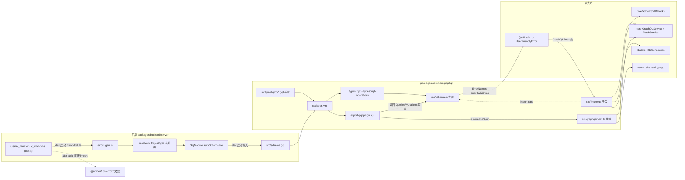
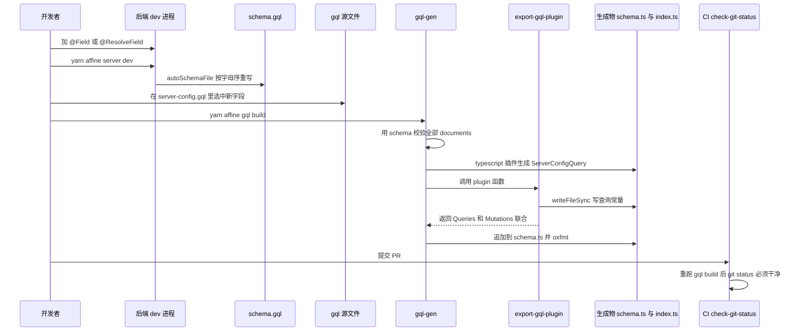
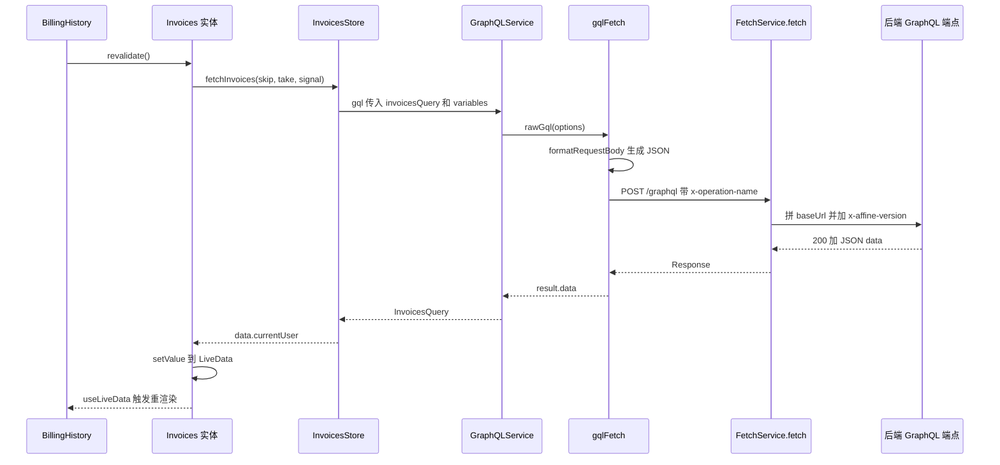
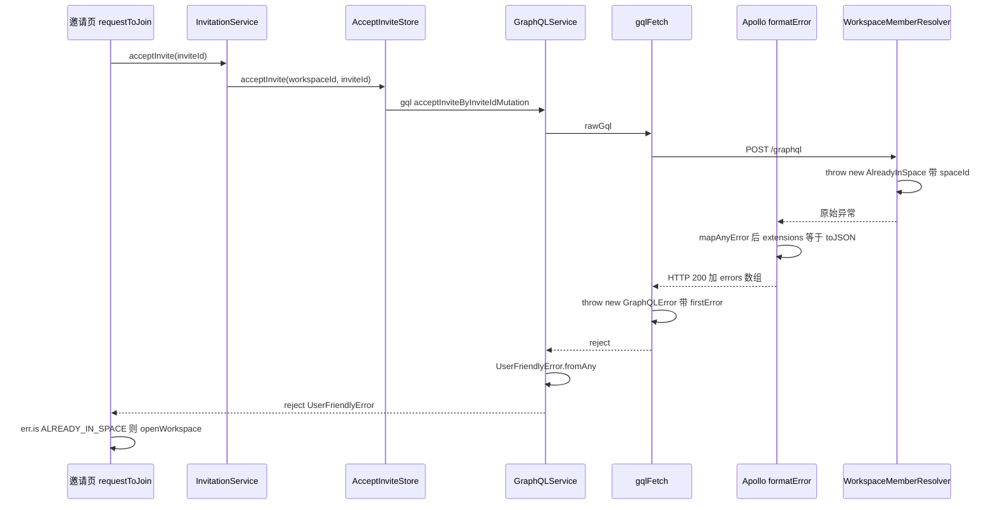
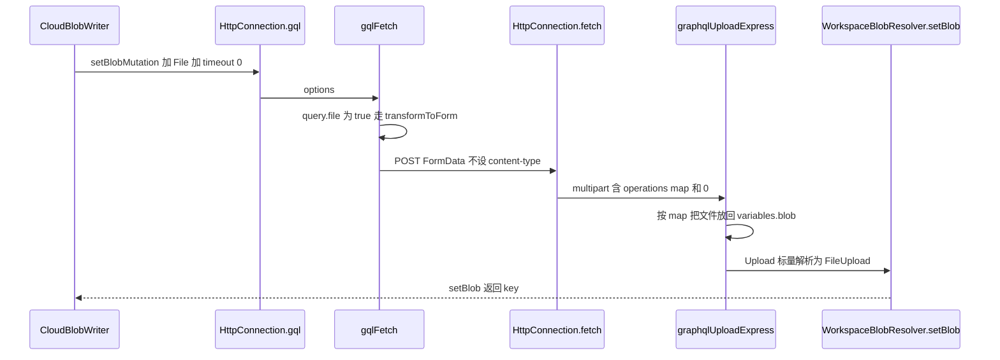

# @affine/graphql 精讲

> 一句话：前后端 GraphQL 契约的前端落点。它以后端 code-first 生成的 `schema.gql` 为输入，把 182 个手写 `.gql` 文件编译成"运行时查询常量 + 编译期类型表"，再配一个约 60 行、可注入传输层的 `gqlFetcherFactory`。前端所有 GraphQL 调用的写法由它规定，后端错误码也沿这条链进入前端类型。
>
> 对应分层文档：[`@affine/graphql`](../L1-通用基础设施/affine-graphql.md) · 源码：`packages/common/graphql`

分层文档已经讲清了 codegen 配置的大意、插件的五个功能、`id` 查表的类型技巧和 multipart 规范，本文不再复述。本文要回答的是：契约从后端哪一行代码出发，经过哪几个生成器、哪几层封装，最后在哪一行变成 `err.is('ALREADY_IN_SPACE')`；哪些环节没有任何检查；三种传输实现的行为差异在哪里。后端 resolver 与错误表的生成细节见 [06 精讲 5.5 节](./06-affine-server.md)，前端 `FetchService`、`GraphQLService` 的注册与鉴权环见 [05 精讲 2.5 节](./05-affine-core.md)，这里只在链路上点到。

所有结论都来自读码，没有运行生成命令或服务验证。标了"根据源码推断"的，是由多处代码拼起来的推论。

## 0. 为什么是重点包

| 指标 | 给定值 | 实测与口径 |
|---|---|---|
| 直接被依赖 | 8 个（运行时 7） | 一致。`@affine/core`、`@affine/component`、`@affine/admin`、`@affine/ios`、`@affine/realtime` 是 `dependencies`；`@affine/error` 是 `peerDependencies`；`@affine/nbstore` 同时写在 `devDependencies` 和 `peerDependencies`；`@affine/server` 只在 `devDependencies`（`packages/backend/server/package.json:118`），所以运行时是 7 |
| 传递被依赖 | 25 个（运行时 14），全仓第 74 | 全量 25、排名第 74 一致。运行时闭包实测 14 个，但其中包含 `@affine/graphql` 自己：它依赖 `@affine/error`，`@affine/error` 又 peer 依赖它，形成环。去掉自身是 13 个。`@toeverything/infra` 也在闭包里，因为它依赖 `@affine/error` |
| 源码行数 | 约 11,970 行 | 一致，口径是 `src` 下 `.ts`，不含 `__tests__`：`schema.ts` 8,648 + `graphql/index.ts` 3,077 + `fetcher.ts` 242 + `index.ts` 3。**生成代码 11,725 行（98.0%），手写 TS 仅 245 行（2.0%）**。不在统计内的手写部分：182 个 `.gql` 共 2,325 行、`export-gql-plugin.cjs` 305 行、`codegen.yml` 34 行、测试 107 行 |
| 所在链路 | 前后端契约 | 成立。后端装饰器 → `schema.gql`（3,026 行）→ 本包 codegen → 前端调用点；错误码走同一条链 |

生成物规模：181 个操作常量（74 个 query、107 个 mutation）、5 个 fragment 字符串、8 个带 `file: true` 的上传操作、12 个带 `deprecations` 的操作；`ErrorNames` 枚举 158 项；`schema.ts` 里 848 个导出的类型/枚举/接口。

满足的标准：

- **C 关键链路**：前端访问后端业务数据的两条路之一（另一条是 nbstore 的 socket 同步与 `realtime` 请求）。工作区列表、成员邀请、订阅计费、Copilot 会话、Blob 上传兜底、索引搜索都走这里。契约断了，构建期类型报错或者运行时 400。
- **D 范式定义者**：前端没有第二种写 GraphQL 的方式。仓库里没有任何包依赖 `@apollo/client`、`urql`、`graphql-tag` 或 `graphql-request`（实测全仓 `package.json`）。core 里 176 个文件 `from '@affine/graphql'`，写法统一是"Store 调 `GraphQLService.gql({ query: xxxQuery, variables })`"，React 侧的 SWR hook 也是包这一个函数。
- 不满足 A：直接依赖 8 个，在全仓中等；不满足 B：手写逻辑只有两百多行。

不懂它会卡在哪：

1. `packages/frontend/core/src/modules/cloud/stores/server-config.ts:13-14` 的 `ServerConfigType` 是 `ServerConfigQuery['serverConfig'] & OauthProvidersQuery['serverConfig']`。去后端搜这个类型搜不到，它是由 `.gql` 文件里**选了哪些字段**决定的，不是由后端类定义决定的。
2. `packages/frontend/core/src/desktop/pages/invite/index.tsx:77` 的 `err.is('ALREADY_IN_SPACE')`：字符串能通过类型检查，是因为 `ErrorName` 来自本包生成的 `ErrorNames` 枚举（`packages/common/error/src/index.ts:4-9`）。
3. `packages/common/nbstore/src/impls/cloud/blob-writer.ts:197-209` 往 `variables` 里塞一个 `File` 就变成了 multipart 上传，开关是生成物里的 `file: true`，不在调用点上。
4. `packages/frontend/core/src/modules/cloud/stores/server-config.ts:31-34` 用正则匹配 `Cannot query field "version"` 判断服务器太老。原因是查询文本在构建期固定，老服务器不认识新字段时整条查询被拒（见 5.2）。
5. 手改了 `packages/common/graphql/src/graphql/index.ts`，CI 的 `check-git-status` 任务失败（`.github/workflows/build-test.yml:445-475`）。

## 1. 全景架构



逐块说明：

- **后端是唯一真值源**。`GqlModule` 在非生产环境把 SDL 写到 `src/schema.gql`，开了 `sortSchema: true`，所以 SDL 按字母序输出、diff 稳定（`packages/backend/server/src/base/graphql/index.ts:35-43`）。错误表要先由 `ErrorModule.onModuleInit` 生成 `errors.gen.ts`，再通过一个只为注册类型存在的 `error` 查询进入 SDL（`packages/backend/server/src/base/error/index.ts:11-37`）。这两步都只在 dev 启动时发生，细节见 06 精讲 5.5 节。
- **codegen 只有一个 `generates` 目标** `./src/schema.ts`，挂三个插件（`packages/common/graphql/codegen.yml:28-34`）。前两个是社区插件，产出 schema 类型和每个操作的 `XxxQuery`/`XxxQueryVariables`。第三个是自定义插件，它有两种输出：返回值（`Queries`、`Mutations` 两个联合类型）被 codegen 追加到 `schema.ts` 末尾；运行时常量则由插件自己 `fs.writeFileSync` 写到 `src/graphql/index.ts`（`packages/common/graphql/export-gql-plugin.cjs:261-264`）。后一种写法绕开了 codegen 的输出管线，所以 `afterOneFileWrite: oxfmt --write` 钩子不会格式化它，仓库只好在 `.prettierignore:36` 和 `.oxlintrc.json:67` 把它排除。
- **`fetcher.ts` 只在类型上依赖生成物**（`import type { Mutations, Queries }`，`packages/common/graphql/src/fetcher.ts:6-7`），运行时只依赖 `@affine/error` 的 `GraphQLError`、`@affine/debug` 和 `lodash-es`。
- **消费方分四类**：`@affine/error` 只拿类型；core 通过 `GraphQLService` 统一调用；core 和 admin 各有一套 SWR hook；nbstore 在 worker 里自建一个 fetcher；后端 e2e 测试拿生成的操作常量打真实 resolver。
- **一条旁路**：前端错误文案不走 GraphQL。`@affine/i18n` 的构建脚本直接 `import` 后端的 `def.ts`，把每个 `USER_FRIENDLY_ERRORS` 的 message 写成 `en.json` 里的 `error.XXX` 键（`packages/frontend/i18n/build.ts:184-232`）。所以错误码在前端有两个生成来源：类型来自本包，文案来自 i18n。

## 2. 核心抽象与数据模型

### 2.1 `GraphQLQuery`：操作常量

接口由插件写在生成文件开头（`packages/common/graphql/export-gql-plugin.cjs:227-236`，产物在 `packages/common/graphql/src/graphql/index.ts:2-8`）：

```ts
export interface GraphQLQuery {
  id: string;            // 导出名，如 'invoicesQuery'，带 as const
  op: string;            // GraphQL 操作名，如 'invoices'
  query: string;         // print 后的操作文本，末尾拼接 #import 的 fragment
  file?: boolean;        // 变量里含 Upload 时为 true
  deprecations?: string[]; // 用到的弃用字段说明
}
```

真实产物（`packages/common/graphql/src/graphql/index.ts:2547-2566`）：

```ts
export const serverConfigQuery = {
  id: 'serverConfigQuery' as const,
  op: 'serverConfig',
  query: `query serverConfig {
  serverConfig {
    // …
    credentialsRequirement {
      ...CredentialsRequirements
    }
  }
}
${passwordLimitsFragment}
${credentialsRequirementsFragment}`,
};
```

要点：

- `id` 和 `op` 是两回事。`id` 由 `getExportedName` 算出（`packages/common/graphql/export-gql-plugin.cjs:13-20`）：操作名首字母小写，再补上 `Query`/`Mutation`/`Fragment` 后缀，已带后缀则不重复补。`op` 保留原名，例如 `mutation ImportUsers` 的 `op` 是 `'ImportUsers'`、`id` 是 `'importUsersMutation'`（`packages/common/graphql/src/graphql/index.ts:479-481`）。**类型查表用 `id`，网络上的 `operationName` 和 `x-operation-name` 用 `op`。**
- fragment 不是对象，是字符串常量（`packages/common/graphql/export-gql-plugin.cjs:241-242`），通过模板插值拼进引用它的操作。
- 一个 `.gql` 可以有多个操作。实测 3 个文件如此，例如 `packages/common/graphql/src/graphql/workspace-byok-config-upsert.gql` 有 3 个 mutation。
- 生命周期：纯常量，模块加载即确定，没有运行时解析。

### 2.2 `Queries` / `Mutations`：编译期类型表

插件把所有操作汇成两个判别联合（`packages/common/graphql/export-gql-plugin.cjs:266-298`，产物在 `packages/common/graphql/src/schema.ts:7741` 与 `:8113`）：

```ts
export type Queries =
  | { name: 'adminAllSharedLinksQuery'; variables: AdminAllSharedLinksQueryVariables; response: AdminAllSharedLinksQuery }
  | // … 共 74 项
```

`variables`/`response` 的类型名是插件按 `upperFirst(id) + 'Variables'` 和 `upperFirst(id)` **拼字符串**得到的，它假设 `typescript-operations` 用同样的规则命名。这个假设是隐式耦合，见 6.7。

`codegen.yml` 的几个开关决定了这些类型长什么样（`packages/common/graphql/codegen.yml:4-24`）：

| 配置 | 效果 | 生成物里的样子 |
|---|---|---|
| `avoidOptionals.field: true` | 输出字段必填、可空用 `T \| null` | `avatarUrl: string \| null`（`packages/common/graphql/src/schema.ts:7291`） |
| `avoidOptionals.inputValue: false` | 可空变量与输入字段保持可选 | `cancelSubscription` 的 `$workspaceId: String` 生成 `workspaceId?: InputMaybe<Scalars['String']['input']>`（`packages/common/graphql/src/schema.ts:4702-4705`） |
| `preResolveTypes: true` | 操作类型里内联原始类型 | `ServerConfigQuery` 里直接是 `version: string`（`packages/common/graphql/src/schema.ts:7134-7154`） |
| `namingConvention.enumValues: keep` | 枚举键沿用 GraphQL 名 | `ServerFeature.Captcha = 'Captcha'`（`packages/common/graphql/src/schema.ts:2961-2970`） |
| `scalars` | 标量映射 | `Upload` 映射为 `File`；`JSONObject` 没配，落成 `any`（`packages/common/graphql/src/schema.ts:22-36`） |

### 2.3 类型桥：`QueryOptions` 与 `QueryResponse`

分层文档 3.3、3.5 节已讲 `Extract` 查表和 `RecursiveMaybeFields`。这里补三个读码时容易误判的边界（`packages/common/graphql/src/fetcher.ts:13-96`）：

- `QueryVariables` 用 `extends never | Record<string, never>` 识别"无变量"。无变量操作生成的是 `Exact<{ [key: string]: never }>`（如 `packages/common/graphql/src/schema.ts:7132`），命中后 `QueryVariablesOption` 把 `variables` 变成可省略。
- 当 `Q` 只是宽泛的 `GraphQLQuery`（`id: string`）时，查表落空，`variables` 被推成 `undefined`。所以 `packages/common/graphql/src/__tests__/fetcher.spec.ts:35` 和 `:48` 要用 `@ts-expect-error`。写泛型封装时要保留 `Query extends GraphQLQuery` 这个类型参数，不能退化成 `GraphQLQuery`。
- `MutationOptions` 用 `mutation` 字段而不是 `query`，但 `gqlFetch` 只接收 `QueryOptions`。它只被两套 `useMutation` hook 使用，hook 内部再把 `mutation` 改名成 `query`（`packages/frontend/core/src/components/hooks/use-mutation.ts:57-63`）。直接调 `gql` 时 mutation 也写 `query:`，见 `packages/frontend/core/src/modules/cloud/stores/accept-invite.ts:16-24`。
- `NotArray` 导出了，全仓没有使用；`keepNilVariables` 只有单测在用。

### 2.4 `gqlFetcherFactory` 与可注入的 fetcher

签名（`packages/common/graphql/src/fetcher.ts:181-184`）：

```ts
export const gqlFetcherFactory = (
  endpoint: string,
  fetcher: (input: string, init?: FetchInit) => Promise<Response> = fetch
) => { /* 返回 gqlFetch */ };
```

`gqlFetch` 自己**不做超时、不做重试、不加鉴权头**。它把 `timeout` 和 `signal` 原样放进 `init` 交给注入的 `fetcher`（`packages/common/graphql/src/fetcher.ts:207-215`）。所以同一个 `gqlFetch` 的行为取决于注入了谁。全仓有四个注入点：

| 创建位置 | 注入的 fetcher | 超时 | 非 2xx 处理 | 抛出的错误 |
|---|---|---|---|---|
| `GraphQLService`（`packages/frontend/core/src/modules/cloud/services/graphql.ts:19`） | `FetchService.fetch` | 默认 15 秒，可传 0 关闭（`packages/frontend/core/src/modules/cloud/services/fetch.ts:43-49`） | 在 `FetchService` 里就抛，`gqlFetch` 看不到响应体（`packages/frontend/core/src/modules/cloud/services/fetch.ts:88-107`） | `GraphQLService.gql` 统一转成 `UserFriendlyError` |
| `HttpConnection.gql`（`packages/common/nbstore/src/impls/cloud/http.ts:87-90`） | `HttpConnection.fetch` | 默认 15 秒，可传 0 关闭（`packages/common/nbstore/src/impls/cloud/http.ts:21-27`） | 除 404 外抛，413 特判（`packages/common/nbstore/src/impls/cloud/http.ts:51-67`） | 原始 `GraphQLError` 或 `UserFriendlyError` |
| `ServerConfigStore.fetchServerConfig`（`packages/frontend/core/src/modules/cloud/stores/server-config.ts:118-121`） | `globalThis.fetch` | 无，`timeout` 被忽略 | 进入 `gqlFetch` 的 `status >= 400` 分支 | `GraphQLError`，再由 `mapServerConfigError` 归一 |
| admin `gqlFetcher`（`packages/frontend/admin/src/use-query.ts:72`） | `window.fetch` | 无 | 同上 | `GraphQLError` |

`ServerConfigStore` 故意不用 `FetchService`：此时服务器还没加进列表，没有 `ServerScope`（根据源码推断）。也正因为用的是裸 `fetch`，老服务器返回的 400 校验错误才能以 `GraphQLError` 的形式到达 `mapServerConfigError`，被 `MISSING_SERVER_VERSION_PATTERNS` 识别（`packages/frontend/core/src/modules/cloud/stores/server-config.ts:31-34`、`:77-100`）。

### 2.5 错误类型：`ErrorNames`、`ErrorDataUnion` 与 `UserFriendlyError`

- `ErrorNames`（`packages/common/graphql/src/schema.ts:1135-1294`，158 项）和 `ErrorDataUnion`（`packages/common/graphql/src/schema.ts:1072` 起）是本包生成的，源头是后端 `packages/backend/server/src/schema.gql:932-934`。
- `@affine/error` 只 `import type` 它们（`packages/common/error/src/index.ts:1`），在其上加 4 个纯客户端错误名 `NETWORK_ERROR`、`CONTENT_TOO_LARGE`、`REQUEST_ABORTED`、`UNSUPPORTED_SERVER_VERSION`，组成 `ErrorName`（`packages/common/error/src/index.ts:4-9`）。`UNSUPPORTED_SERVER_VERSION` 现在后端也有了（`UnsupportedServerVersionDataType` 在 `packages/backend/server/src/schema.gql:932` 的联合里），这一项是重复的。
- `GraphQLError`（`packages/common/error/src/index.ts:42-45`）只是把 `extensions` 的类型收窄成 `UserFriendlyErrorResponse`，没有运行时逻辑。`packages/common/graphql/src/fetcher.ts:223` 抛的就是它。
- `UserFriendlyError.fromAny`（`packages/common/error/src/index.ts:59-81`）先判 `instanceof GraphQLError`，命中就**无条件**用 `extensions` 构造。这是 6.3 那个坑的根源。
- `ErrorData` 类型（`packages/common/error/src/index.ts:35-40`）用 `ToPascalCase` 把错误名映射到 `XxxDataType`，设计上可以给 `data` 加类型，但全仓没有任何地方使用它，`UserFriendlyError.data` 仍是 `any`。

## 3. 关键流程走读

### 3.1 后端新增一个字段，到前端能类型安全地调用

以 `ServerConfigType` 为例。它的字段一部分在 `packages/backend/server/src/core/config/types.ts:24-44` 用 `@Field` 声明，一部分由别的插件用 `@ResolveField` 挂上去，例如日历插件的 `calendarProviders`（`packages/backend/server/src/plugins/calendar/resolver.ts:37-56`）。



1. **后端声明字段**：装饰器即 schema。启动 dev 进程时 `GqlModule` 根据装饰器构建 schema 并写 `src/schema.gql`（`packages/backend/server/src/base/graphql/index.ts:35-43`）。测试环境写到 `node_modules/.cache/schema.gql`，生产环境只在内存，所以**只有 dev 启动会更新仓库里的 SDL**。
2. **前端选字段**：在 `packages/common/graphql/src/graphql/server-config.gql` 里加上字段名。前端能拿到什么完全由这里决定。后端加了字段而 `.gql` 没选，前端类型里不会出现。
3. **触发生成**：`yarn affine gql build`。`gql` 是 `@affine/graphql` 的别名（`tools/utils/src/distribution.ts:26`），实际执行包内脚本 `gql-gen --errors-only`（`packages/common/graphql/package.json:22-24`）。codegen 先用 `schema.gql` 校验所有 documents，字段不存在或参数类型不对在这一步就失败。
4. **两个社区插件**生成 `ServerConfigQuery`（`packages/common/graphql/src/schema.ts:7134-7154`）。由于 `preResolveTypes`，标量直接内联成 `string`、`boolean`。
5. **自定义插件**遍历 documents（`packages/common/graphql/export-gql-plugin.cjs:147-225`）：对每个具名操作算 `id`、查重、探测 `Upload`、收集弃用字段、解析 `#import`，最后写 `graphql/index.ts`，并把联合类型作为返回值交回 codegen。
6. **前端自动跟随**：`ServerConfigType = ServerConfigQuery['serverConfig'] & …`（`packages/frontend/core/src/modules/cloud/stores/server-config.ts:13-14`）不用改，`Server.config$` 立刻带上新字段。
7. **CI 兜底**：`check-git-status` 任务重跑 `yarn affine init`、`gql build`、`i18n build`、`server genconfig`，工作区有任何变更就失败（`.github/workflows/build-test.yml:445-475`）。它保证 `schema.ts`/`index.ts` 和**已提交的** `schema.gql` 一致，但不会重新生成 `schema.gql`。后端改了装饰器却没 dev 启动一次，CI 发现不了（根据源码推断：仓库里除 `GqlModule` 外没有任何代码引用 `schema.gql` 路径）。

### 3.2 一次 query：从组件到类型化结果

以账单历史为例，这是 core 里最典型的"Entity + Store + GraphQLService"三层写法。



1. **组件触发**：`useEffect` 里调 `invoicesService.invoices.revalidate()`，翻页时先 `setPageNum` 再 `revalidate`（`packages/frontend/core/src/desktop/dialogs/setting/general-setting/billing/billing-history.tsx:21-37`）。
2. **实体负责并发和重试**：`revalidate` 是 `effect(map(...), exhaustMapSwitchUntilChanged(...))`，内部 `fromPromise(signal => store.fetchInvoices(...))`，再接 `smartRetry()` 和 `catchErrorInto(this.error$)`（`packages/frontend/core/src/modules/cloud/entities/invoices.ts:35-61`）。`smartRetry` 对网络错误无限退避重试，对其他错误重试 3 次（`packages/common/infra/src/livedata/ops.ts:148-172`）。**重试不在本包，在 infra。**
3. **Store 只做一次调用**：`graphqlService.gql({ query: invoicesQuery, variables: { skip, take }, context: { signal } })`（`packages/frontend/core/src/modules/cloud/stores/invoices.ts:11-23`）。`variables` 被约束为 `InvoicesQueryVariables`（`packages/common/graphql/src/schema.ts:6683-6686`），返回值推断为 `InvoicesQuery`（`packages/common/graphql/src/schema.ts:6688`）。实体里的 `Invoice` 类型也直接从它派生（`packages/frontend/core/src/modules/cloud/entities/invoices.ts:17-19`）。
4. **注册**：`.store(InvoicesStore, [GraphQLService])`、`.entity(Invoices, [InvoicesStore])`，都在服务器作用域（`packages/frontend/core/src/modules/cloud/index.ts:185-187`）。
5. **`GraphQLService.gql`**：调 `rawGql`，失败时 `UserFriendlyError.fromAny`，401 时惰性取 `AuthService` 触发会话重校验（`packages/frontend/core/src/modules/cloud/services/graphql.ts:35-49`）。为什么惰性取见 05 精讲 2.5 节。
6. **`gqlFetch` 拼请求**（`packages/common/graphql/src/fetcher.ts:186-215`）：canary 构建打印弃用告警；`formatRequestBody` 产出 `{ query, variables, operationName }`；头部固定 `x-operation-name: op`，非表单时加 `content-type: application/json`；然后 `merge(options.context, { method, headers, body, timeout, signal })` 交给 fetcher。
7. **`FetchService.fetch`**：用 `new URL(input, baseUrl)` 拼出完整地址，挂超时，追加 `x-affine-version` 与 `x-affine-client-kind`（`packages/frontend/core/src/modules/cloud/services/fetch.ts:32-65`）。后端 `GQLLoggerPlugin` 用 `operationName ?? x-operation-name` 做指标标签，两者都没有时打 warn（`packages/backend/server/src/base/graphql/logger-plugin.ts:29-44`）。
8. **解析响应**：`content-type` 以 `application/json` 开头才解析；无 `errors` 且有 `data` 则返回 `data`（`packages/common/graphql/src/fetcher.ts:216-231`）。返回值在实现里是 `as any`，类型完全由 `QueryResponse<Query>` 声明保证，**运行时不做任何校验**。

React 侧的另一种写法：core 有 `useQuery`/`useQueryImmutable`/`useQueryInfinite`/`useMutation`（`packages/frontend/core/src/components/hooks/use-query.ts:53-74`、`packages/frontend/core/src/components/hooks/use-mutation.ts:51-66`），内部也是 `graphqlService.gql`，SWR key 为 `['cloud', query.id, variables]`，默认开 `suspense`。core 里只有 9 个文件用这些 hook，主流仍是 Store。admin 有一套几乎相同的 hook，但直接用 `window.fetch`（`packages/frontend/admin/src/use-query.ts:50-72`）。

### 3.3 后端抛业务错误，前端按错误码分支

场景：用户点邀请链接，但已经是该工作区成员。



1. **错误定义**：`already_in_space` 在错误表里声明类型 `action_forbidden`、参数 `spaceId: 'string'`（`packages/backend/server/src/base/error/def.ts:501-505`）。dev 启动生成 `AlreadyInSpace` 类和 `AlreadyInSpaceDataType`（`packages/backend/server/src/base/error/errors.gen.ts:377-385`），再进入 SDL（`packages/backend/server/src/schema.gql:250-252`、`:934` 起的 `enum ErrorNames`），最后被本包生成为 `ErrorNames.ALREADY_IN_SPACE` 和 `AlreadyInSpaceDataType`（`packages/common/graphql/src/schema.ts:306-309`）。
2. **抛出**：`acceptInviteById` 发现用户已是正式成员时 `throw new AlreadyInSpace({ spaceId: invitation.workspaceId })`（`packages/backend/server/src/core/workspaces/resolvers/member.ts:608`）。
3. **序列化**：Apollo 的 `formatError` 把任意异常经 `mapAnyError` 转成 `UserFriendlyError`，用 `toJSON()` **整个替换** `extensions`（`packages/backend/server/src/base/graphql/index.ts:60-69`）。`toJSON` 输出 `{ status: 403, code, type: 'ACTION_FORBIDDEN', name: 'ALREADY_IN_SPACE', message, data: { spaceId } }`，名字和类型转成大写，`requestId` 只在 5xx 时带上（`packages/backend/server/src/base/error/def.ts:124-135`）。`status: 403` 来自 `BaseTypeToHttpStatusMap`（`packages/backend/server/src/base/error/def.ts:29-42`）。
4. **HTTP 状态仍是 200**：resolver 执行期的错误，Apollo 默认返回 200 加 `errors`，仓库里没有插件改写 HTTP 状态（根据源码推断：全仓只有 `packages/backend/server/src/base/graphql/logger-plugin.ts:52` 一处 `willSendResponse`，且不改状态）。所以 `FetchService` 放行，响应到达 `gqlFetch`。
5. **`gqlFetch` 抛第一个错误**：`throw new GraphQLError(firstError.message, firstError)`（`packages/common/graphql/src/fetcher.ts:219-223`）。graphql 16 的构造函数在第二个参数不含 `kind`/`length` 时把它当 options 对象（`node_modules/graphql/error/GraphQLError.js:16-31`），于是 `extensions` 和 `path` 被保留，`locations` 丢弃。其余错误丢弃，部分 `data` 也丢弃。
6. **归一**：`GraphQLService.gql` 调 `UserFriendlyError.fromAny`，命中 `instanceof GraphQLError` 分支，用 `extensions` 构造（`packages/common/error/src/index.ts:69-70`）。`status` 是 403 不是 401，不触发会话重校验。
7. **分支处理**：`AcceptInviteStore` → `InvitationService.acceptInvite`（`packages/frontend/core/src/modules/cloud/services/invitation.ts:59-72`）原样抛出。页面 `catch` 里再 `fromAny` 一次（幂等，`packages/common/error/src/index.ts:60-62` 直接返回原对象），`is('ALREADY_IN_SPACE')` 就打开工作区，`is('INVITATION_ACCOUNT_MISMATCH')` 就只记录状态，其他错误 `notify.error`（`packages/frontend/core/src/desktop/pages/invite/index.tsx:67-87`）。
8. **文案**：需要展示时用 `` t[`error.${err.name}`](err.data) ``，例如 `packages/frontend/core/src/components/sign-in/sign-in-with-email.tsx:100`。`{{spaceId}}` 占位符由 i18n 构建脚本从 message 函数反推（`packages/frontend/i18n/build.ts:212-228`）。

### 3.4 一次文件上传 mutation

nbstore 上传 blob 时先尝试预签名或分片直传，失败才回退到 GraphQL 的 `setBlob`（`packages/common/nbstore/src/impls/cloud/blob-writer.ts:64-143`）。



1. **生成期探测**：`blob-set.gql` 的 `$blob: Upload!` 让插件给 `setBlobMutation` 标上 `file: true`（`packages/common/graphql/src/graphql/index.ts:615-622`）。探测逻辑只看两层：变量本身的命名类型是不是 `Upload`，或者输入类型的直接字段（剥掉 List/NonNull 后）是不是 `Upload`（`packages/common/graphql/export-gql-plugin.cjs:164-187`）。`createCopilotMessageMutation` 就是靠第二层命中的。
2. **调用**：`uploadViaGraphql` 把 `Uint8Array` 包成 `File` 放进 `variables.blob`，`timeout: UPLOAD_REQUEST_TIMEOUT`（值为 0，`packages/common/nbstore/src/impls/cloud/blob-writer.ts:23`）关闭超时（`packages/common/nbstore/src/impls/cloud/blob-writer.ts:197-209`）。
3. **编码**：`formatRequestBody` 见到 `query.file` 就调 `transformToForm`（`packages/common/graphql/src/fetcher.ts:160-179`）。`buildMap` 递归遍历 `variables`，每遇到一个 `File` 记一条 `map['0'] = ['variables.blob']`，然后表单写三类字段：`operations`、`map`、按序号命名的文件（`packages/common/graphql/src/fetcher.ts:114-158`）。
4. **两个与规范不同的细节**（根据源码推断）：`operations` 里操作名写在 `name` 字段而不是 `operationName`（`packages/common/graphql/src/fetcher.ts:127-129`），后端靠 `x-operation-name` 头补上；`File` 没有被替换成 `null`，`JSON.stringify` 会把它写成 `{}`，依赖 `graphql-upload` 按 `map` 覆盖。`operations` 里还多带了一个空的 `map: {}`。
5. **请求头**：`isFormData` 时不设 `content-type`，交给运行时生成带 boundary 的 multipart 头（`packages/common/graphql/src/fetcher.ts:200-206`）。后端 `csrfPrevention.requestHeaders` 配成 `['content-type']`（`packages/backend/server/src/base/graphql/index.ts:45-47`），只要有 `content-type` 头就放行，multipart 也能通过（根据 Apollo 的 CSRF 规则推断）。
6. **服务端**：`graphqlUploadExpress({ maxFileSize: 100 * OneMB, maxFiles: 32 })` 中间件解析表单（`packages/backend/server/src/server.ts:118-123`），resolver 用 `GraphQLUpload` 标量接收（`packages/backend/server/src/core/workspaces/resolvers/blob.ts:88`）。
7. **错误映射**：`set` 外层把 `STORAGE_QUOTA_EXCEEDED`、`BLOB_QUOTA_EXCEEDED`、`CONTENT_TOO_LARGE` 分别转成 nbstore 自己的 `OverCapacityError`/`OverSizeError`（`packages/common/nbstore/src/impls/cloud/blob-writer.ts:144-158`）。`CONTENT_TOO_LARGE` 是 `HttpConnection.fetch` 对 413 的特判（`packages/common/nbstore/src/impls/cloud/http.ts:52-59`），通常来自反向代理。

后端 e2e 测试复用同一个 `transformToForm`，把表单逐项转成 supertest 的 `attach`/`field`（`packages/backend/server/src/__tests__/utils/testing-app.ts:245-264`），前后端的 multipart 编码因此是同一份代码。

## 4. 源码阅读路线

1. `packages/common/graphql/codegen.yml`（34 行）：记住只有一个生成目标、三个插件，以及 2.2 节表里的开关。
2. `packages/common/graphql/src/graphql/` 下挑三个文件对照读：`invoices.gql`（普通 query）、`server-config.gql`（`#import`）、`blob-set.gql`（`Upload`）。再在 `src/graphql/index.ts` 里找到它们的产物，确认 `id`/`op`/`file` 的来历。
3. `packages/common/graphql/export-gql-plugin.cjs` 全文：重点是 `getExportedName`、`parseImports`、`containsFile`、两个联合类型的拼接。读完应能回答"一个 fragment 被谁、以什么顺序拼进查询文本"。
4. `packages/common/graphql/src/schema.ts`：不必通读。看 `:1-36`（`Maybe`/`Exact`/`Scalars`）、`:1072` 与 `:1135`（错误类型）、`:7741` 与 `:8113`（两张类型表），再随便挑一个操作的 `Variables`/响应类型。
5. `packages/common/graphql/src/fetcher.ts` 全文 242 行：先读 `:181-242` 的运行时，再读 `:13-96` 的类型。配合 `src/__tests__/fetcher.spec.ts` 理解请求体格式。
6. `packages/common/error/src/index.ts`：`fromAny` 的分支顺序决定了各种失败最后长什么样。
7. `packages/frontend/core/src/modules/cloud/services/fetch.ts` 与 `services/graphql.ts`：注入的 fetcher 做了什么、哪些响应根本到不了 `gqlFetch`。
8. 挑一个 Store + Entity 组合：`packages/frontend/core/src/modules/cloud/stores/invoices.ts`、`entities/invoices.ts`，看前端的标准写法。
9. `packages/frontend/core/src/components/hooks/use-query.ts`、`use-mutation.ts`：React 侧的薄封装。
10. 后端源头：`packages/backend/server/src/base/graphql/index.ts`、`packages/backend/server/src/base/error/index.ts`、`def.ts` 的 `toJSON`。
11. `packages/common/nbstore/src/impls/cloud/http.ts` 与 `blob-writer.ts`：worker 里的另一个 fetcher 与上传回退。
12. `packages/backend/server/src/__tests__/utils/testing-app.ts:226-293`：后端测试如何用生成物做契约测试。

可以先跳过：`schema.ts` 里 8,000 多行 schema 类型本体（用时按名字搜即可）；`src/graphql/admin/` 下 25 个后台专用操作；`RecursiveMaybeFields` 的递归细节（分层文档已讲）；`@affine/realtime` 的依赖声明（它声明依赖本包，但实测源码里没有任何导入）。

## 5. 设计取舍

### 5.1 后端 code-first，SDL 入库，前端 codegen

- **选择**：后端用 NestJS 装饰器描述 schema，dev 启动时导出 SDL 并提交到仓库；前端以这个文件为输入做 codegen，生成物也提交到仓库。
- **原因**：后端的类型、校验、resolver 写在一处，不会有"SDL 写了、实现没写"的漂移。SDL 入库后，前端构建不需要启动后端，也不需要连网做 introspection。生成物入库让 IDE 跳转、`typecheck` 和 Electron/iOS 打包都不依赖生成步骤。动机在代码里没有写明，以上是推断。
- **代价**：SDL 的更新依赖"有人用 dev 模式启动过一次"。CI 校验的是"`.gql` + 已提交的 SDL → 生成物"这一段，校验不到"装饰器 → SDL"这一段（3.1 第 7 步）。后端 e2e 测试会把生成的操作打到真实 resolver 上（`packages/backend/server/src/__tests__/e2e/workspace/member.spec.ts:108` 等 23 个文件），能部分弥补：前端用到的字段在后端被删了，测试会报 400。
- **替代方案**：schema-first（手写 SDL 再生成 resolver 类型），需要人工保证 SDL 与实现一致；或者 tRPC 一类直接共享 TS 类型的方案，但它要求前后端在同一构建图里，而 iOS/Android 外壳和自托管老版本服务器都需要一个语言无关的稳定协议（推断）。

### 5.2 构建期生成查询常量，而不是运行时解析 `gql` 模板

- **选择**：`.gql` 在生成期被 `print` 成字符串，运行时只做字符串拼接。`fetcher.ts` 对 `graphql` 包只有 `import type`（`packages/common/graphql/src/fetcher.ts:3`）。
- **原因**：没有运行时解析成本；查询文本在构建期已用 schema 校验；`id` 可以作为字面量类型参与查表。
- **代价**：查询是静态的，不能按服务器能力动态增删字段。新客户端连老服务器时，只要选了一个老服务器不认识的字段，整条查询在验证阶段就被拒，拿不到任何数据。`ServerConfigStore` 用正则识别 `Cannot query field "version"` 并转成 `UNSUPPORTED_SERVER_VERSION`（`packages/frontend/core/src/modules/cloud/stores/server-config.ts:31-34`、`:87-91`），再配合 `MIN_SUPPORTED_SERVER_VERSION`（`:16-17`）拒绝过老的服务器，就是在补这个代价。后端的对策是用 `@deprecated` 而不是直接删字段，`schema.gql` 里有 24 处弃用标记。
- **另一个限制**：bundle 里仍然有 `graphql` 包，因为 `@affine/error` 运行时 `import { GraphQLError } from 'graphql'`（`packages/common/error/src/index.ts:2`）。"运行时零 graphql 依赖"只对 `fetcher.ts` 本身成立。

### 5.3 不用 Apollo Client 或 urql

- **选择**：没有规范化缓存，没有 link 链，客户端只有一个 `gqlFetch`。实测全仓 `package.json` 没有引入 `@apollo/client`、`urql`、`graphql-tag`、`graphql-request`；服务端用的是 Apollo Server（`@apollo/server` 5.5.1）。
- **原因**（推断）：前端状态管理已经统一在 `@toeverything/infra` 的 `LiveData` + `effect` 上，重试也有 `smartRetry`。再引入一个自带缓存和响应式的客户端，会出现两套缓存、两套失效逻辑。多服务器场景下，每台服务器各有一个 `GraphQLService`，作用域隔离天然解决了"缓存按服务器分区"的问题。
- **代价**：没有跨查询的实体去重和自动更新。mutation 之后要手动 `revalidate` 相关实体，或者用 `useMutateQueryResource` 按 `query.id` 让 SWR 重新拉取（`packages/frontend/core/src/components/hooks/use-mutation.ts:68` 起）。

| 能力 | Apollo Client | 本仓库 |
|---|---|---|
| 规范化缓存 | 内置 | 无；按实体用 `LiveData` 保存，或 SWR 按 key 缓存 |
| 重试 | `RetryLink` | `smartRetry`（infra） |
| 超时 | 需自写 link | 注入的 fetcher（`FetchService`/`HttpConnection`） |
| 文件上传 | 需 `apollo-upload-client` | 内置 `transformToForm` |
| 错误 | `ApolloError` 带全部错误 | 只抛第一个，转 `UserFriendlyError` |
| 订阅 | 支持 | 不支持；实时数据走 socket.io 的 `realtime` 请求与主题 |

### 5.4 只抛第一个错误，丢弃部分数据

- **选择**：`errors` 非空时一律抛 `errors[0]`（`packages/common/graphql/src/fetcher.ts:219-226`），即使 `data` 里有部分结果。
- **原因**：代码注释是 `// throw the first error is enough`。业务错误基本都由 resolver 顶层抛出，一个请求一般只有一个错误，按错误码分支只需要一个（推断）。
- **代价**：一个查询选了多个根字段，其中一个因权限失败，其余成功的数据也拿不到。需要容错的场景只能拆成多个操作。

### 5.5 fetcher 可注入

- **选择**：`gqlFetcherFactory(endpoint, fetcher)` 不绑定任何环境。
- **收益**：同一份生成物可以跑在主线程（`FetchService`）、nbstore worker（`HttpConnection`，可附带 `requestHeaders`）、添加服务器前的裸 `fetch`、admin 应用和后端测试里。
- **代价**：超时、鉴权头、非 2xx 处理全由注入方决定，行为不统一（2.4 节表格）。同一个 `timeout` 参数，换了 fetcher 就可能被忽略。

## 6. 易错点与调试

### 6.1 `#import` 不传递，codegen 通过不代表运行时完整

- **现象**：新写的查询在生成和类型检查时都正常，运行时报 400，提示 `Unknown fragment "PasswordLimits"`。
- **原因**：codegen 校验时把所有 documents 放在一起，fragment 全局可见（根据 codegen 行为推断）；但运行时的查询文本只拼接**本文件** `#import` 的 fragment（`packages/common/graphql/export-gql-plugin.cjs:115-145`）。fragment 自己的 `#import` 只在该 fragment 的字符串里生效。例如 `credential-requirement.gql` 没有 `#import` `PasswordLimits`，所以 `server-config.gql` 必须把两个都导入（`packages/common/graphql/src/graphql/server-config.gql:1-2`）；而 `paginated-copilot-chats.gql` 自己导入了 `CopilotChatHistory`，生成物把它拼在了 fragment 字符串末尾（`packages/common/graphql/src/graphql/index.ts:42-55`）。
- **避免**：每个 `.gql` 显式导入它用到的全部 fragment，但不要重复导入已被别的 fragment 内嵌过的，否则同名 fragment 出现两次，同样是 400。生成后检查 `index.ts` 里对应常量的末尾插值。
- **另一个隐患**：fragment 常量按 documents 的加载顺序声明。若 fragment A 内嵌 fragment B，而 A 先声明，模块求值时会因为暂时性死区抛 `ReferenceError`（根据源码推断）。目前靠文件名字母序恰好避开。

### 6.2 走 `FetchService` 时，400 响应的 GraphQL 错误信息丢失

- **现象**：变量类型错误或查询校验失败时，前端只拿到 `INTERNAL_SERVER_ERROR`，message 是 `Unhandled error raised. Please contact us for help.`。
- **原因**：Apollo Server 对解析、校验、变量强制转换错误返回 HTTP 400。`FetchService.fetch` 对非 2xx 直接 `UserFriendlyError.fromAny(await res.json())`（`packages/frontend/core/src/modules/cloud/services/fetch.ts:100-102`），而响应体是 `{ errors: [...] }`，顶层没有 `type`/`name`/`message`，落到兜底分支（`packages/common/error/src/index.ts:71-80`）。后端 `formatError` 已经把它转成了 `GRAPHQL_BAD_REQUEST` 放在 `errors[0].extensions` 里，但没人读。`gqlFetch` 的 `status >= 400` 分支只对裸 `fetch` 生效。`HttpConnection.fetch` 同理（`packages/common/nbstore/src/impls/cloud/http.ts:60-63`）。
- **排查**：看 Network 面板里 `/graphql` 请求的原始响应体。手写变量时尽量不要 `as any`。

### 6.3 200 但不是预期 JSON，得到一个"空"的错误

- **现象**：错误对象的 `name`、`message`、`status` 都是 `undefined`，toast 显示空白或 `error.undefined`。
- **原因**：响应不是 JSON（例如代理或静态服务器返回 200 的 HTML），或 `errors` 是空数组时，`gqlFetch` 抛的是不带 `extensions` 的 `GraphQLError`（`packages/common/graphql/src/fetcher.ts:225`、`:233-235`）。graphql 16 会把 `extensions` 设为空对象，`fromAny` 命中 `instanceof GraphQLError` 后直接 `new UserFriendlyError({})`（`packages/common/error/src/index.ts:69-70`），原始 message 被丢弃（根据源码推断）。
- **排查**：自托管部署时先确认 `/graphql` 没有被反代到前端静态资源；打开 `?debug` 看 `affine:fetch` 日志里的请求地址。

### 6.4 复用 `context` 对象会被污染

- **现象**：复用同一个 `context` 常量发请求，普通请求之后的文件上传失败，后端说不是 multipart。
- **原因**：`merge(options.context, {...})` 以调用方的 `context` 为目标对象**原地修改**（`packages/common/graphql/src/fetcher.ts:207-215`），写入 `method`、`body`，并把 `content-type: application/json` 深合并进 `headers`。下一次用同一个对象发 FormData 时，旧的 `content-type` 还在（根据 lodash `merge` 语义推断）。
- **避免**：每次调用都写新的 `context` 对象字面量，仓库里的现有调用都是这么写的，例如 `context: { signal }`。

### 6.5 hook 声明的错误类型和实际不符

- **现象**：在 core 的 `useQuery` 里按 `GraphQLError` 的字段（如 `extensions`）读错误，拿到 `undefined`。
- **原因**：core 的 hook 把错误类型声明为 `GraphQLError`（`packages/frontend/core/src/components/hooks/use-query.ts:15-22`），但 fetcher 是 `graphqlService.gql`，它抛的是 `UserFriendlyError`。admin 的 hook 用裸 `window.fetch`，抛的确实是 `GraphQLError`。两套 hook 签名一样、错误形态不同。
- **避免**：core 里统一 `UserFriendlyError.fromAny(error)` 后再判断。

### 6.6 超时只在部分 fetcher 上生效

- **现象**：给 `ServerConfigStore` 或 admin 的请求传 `timeout`，没有效果；或者大文件上传 15 秒后被中止。
- **原因**：`gqlFetch` 只是转交 `timeout`，`globalThis.fetch` 不认识这个字段。反过来，`FetchService` 和 `HttpConnection` 默认 15 秒，上传必须显式传 `timeout: 0`，nbstore 就是这么做的（`packages/common/nbstore/src/impls/cloud/blob-writer.ts:23`、`:207`）。
- **避免**：长耗时操作（上传、Copilot、导入）显式设置 `timeout`；需要超时又只能用裸 `fetch` 时，用 `signal` 配 `AbortSignal.timeout`。

### 6.7 生成器的几处隐式约定

- **操作名不要以 `Query`/`Mutation` 结尾**：`getExportedName` 会去重后缀，而 `typescript-operations` 默认不去重（推断），插件拼出的 `XxxQuery` 类型名就会和实际生成的 `XxxQueryQuery` 对不上，`schema.ts` 类型检查失败。现有操作没有这样命名的。
- **只含 `[Upload!]` 列表变量的操作探测不到文件**：`containsFile` 取变量类型名时只剥一层（`packages/common/graphql/export-gql-plugin.cjs:166-169`），`[Upload!]` 或 `[Upload!]!` 都取不到名字，不会标 `file: true`，文件会被序列化成 `{}`。`submitTranscriptTask` 有 `$blobs: [Upload!]`，但同时有 `$blob: Upload`，所以碰巧被标记了（`packages/common/graphql/src/graphql/index.ts:1458-1473`）。
- **多操作文件共享导入和弃用列表**：`parseDeprecations` 和 `parseImports` 都以整个文件为单位（`packages/common/graphql/export-gql-plugin.cjs:190-192`），同文件的每个操作拿到相同的 `deprecations` 和 fragment 插值。
- **枚举值是 GraphQL 名**：前端 `ServerFeature.Captcha === 'Captcha'`，后端 TS 枚举的值却是 `'captcha'`（`packages/backend/server/src/core/config/types.ts:5-14`）。GraphQL 传输用名字，所以契约内没问题；但要和 REST 接口或后端日志里的值比较时会对不上。
- **`JSON` 标量被映射为 `Record<string, string>`**（`packages/common/graphql/codegen.yml:22`），实际可以是任意 JSON，数字、嵌套对象都要自己断言。

### 6.8 `schema.gql` 过期

- **现象**：后端已经加了字段，前端 `.gql` 选上后 `gql build` 报 `Cannot query field`。
- **原因**：仓库里的 `schema.gql` 只在 dev 启动时重写（3.1 第 1 步）。
- **处理**：先 `yarn affine server dev` 跑起来一次，确认 `packages/backend/server/src/schema.gql` 有 diff，再跑 `yarn affine gql build`。两个文件和生成物一起提交。

### 调试手段

- **前端日志**：URL 带 `?debug` 会在当前会话打开全部 `debug` 命名空间（`packages/common/debug/src/index.ts:24-35`），可以看到 `affine:fetch` 的请求地址和 `GraphQL` 命名空间的弃用告警。弃用告警只在 `BUILD_CONFIG.appBuildType === 'canary'` 时输出（`packages/common/graphql/src/fetcher.ts:189-196`）。
- **Network 面板**：所有请求都是 `POST /graphql`，用请求头 `x-operation-name` 区分。
- **后端**：dev 环境的 `/graphql` 开着 GraphiQL（`packages/backend/server/src/base/graphql/index.ts:34`），可以直接粘贴 `index.ts` 里的 `query` 文本调试。缺操作名的请求会在后端日志里打 `GraphQL operation name is not provided`。canary 环境的错误 `extensions` 带 `stacktrace`。
- **单测**：`packages/common/graphql/src/__tests__/fetcher.spec.ts` 覆盖请求体格式、`keepNilVariables`、错误抛出。改 `fetcher.ts` 先跑它。
- **契约测试**：后端 e2e 的 `app.gql({ query: xxxMutation, variables })`（`packages/backend/server/src/__tests__/utils/testing-app.ts:226-293`）直接执行生成的操作，是验证 `.gql` 与真实 resolver 一致的最快方式。

### 与分层文档不一致之处

> 以下各条已于 2026-11-01 同步更正到分层文档，保留在此作为勘误记录。

- 分层文档 3.1 节说标量映射"把 `DateTime`/`UUID` 等后端标量统一映射"。当前 `schema.gql` 只有 `DateTime`、`JSON`、`JSONObject`、`SafeInt`、`Upload` 五个自定义标量（`packages/backend/server/src/schema.gql:771`、`:1386`、`:1391`、`:2127`、`:2568`），`codegen.yml` 里的 `Date`、`Decimal`、`UUID` 没有用上；`JSONObject` 反而没配映射，生成为 `any`。
- 分层文档 3.2 节说 `containsFile` "递归检查操作变量类型里是否出现 `Upload`"。实际只剥一层类型：`Upload`、`Upload!`、`[Upload]` 能识别，`[Upload!]`、`[Upload!]!` 识别不到（6.7，已实测）。
- 分层文档 3.4 节说"任何非 2xx、或带 `errors` 的响应都抛第一个错误包成 `GraphQLError`"。这只在注入裸 `fetch` 时成立；core 和 nbstore 注入的 fetcher 会在 `gqlFetch` 之前把非 2xx 响应转成别的错误（6.2）。
- 分层文档开头表格的"关键依赖"漏了 `lodash`：`packages/common/graphql/export-gql-plugin.cjs:5` 用的是 CJS 版 `lodash`，`package.json` 里与 `lodash-es` 并列声明。

## 7. 扩展实践

### 7.1 新增一个 query 并在前端服务里封装

任务：在设置页显示当前用户的发票总数。后端已有 `UserType.invoiceCount` 字段，只做前端。

步骤：

1. 新建 `packages/common/graphql/src/graphql/invoice-count.gql`。操作必须具名，名字不要带 `Query` 后缀：

```graphql
query invoiceCount {
  currentUser {
    invoiceCount
  }
}
```

2. 运行 `yarn affine gql build`。检查 diff：`src/graphql/index.ts` 新增 `invoiceCountQuery`；`src/schema.ts` 新增 `InvoiceCountQueryVariables`、`InvoiceCountQuery`，`Queries` 联合多一项。
3. 在 `packages/frontend/core/src/modules/cloud/stores/` 下新建 Store，写法照 `stores/invoices.ts`：

```ts
import { invoiceCountQuery } from '@affine/graphql';
import { Store } from '@toeverything/infra';

import type { GraphQLService } from '../services/graphql';

export class InvoiceCountStore extends Store {
  constructor(private readonly graphqlService: GraphQLService) {
    super();
  }

  async fetchInvoiceCount(signal?: AbortSignal) {
    const data = await this.graphqlService.gql({
      query: invoiceCountQuery, // 无变量，variables 可省略
      context: { signal },      // 每次新建对象，见 6.4
    });
    return data.currentUser?.invoiceCount ?? null; // currentUser 可空
  }
}
```

4. 实体用 `effect` + `fromPromise` + `smartRetry` + `catchErrorInto`，照 `packages/frontend/core/src/modules/cloud/entities/invoices.ts:35-61` 写，把结果放进 `LiveData`。
5. 在 `packages/frontend/core/src/modules/cloud/index.ts` 的服务器作用域里注册，位置参照 `:185-187`：

```ts
    .store(InvoiceCountStore, [GraphQLService])
    .entity(InvoiceCount, [InvoiceCountStore])
```

6. 如果只是一个组件里用、不需要跨组件共享，也可以直接用 hook：

```ts
import { useQuery } from '@affine/core/components/hooks/use-query';
import { invoiceCountQuery } from '@affine/graphql';

const { data } = useQuery({ query: invoiceCountQuery }); // 默认 suspense
```

7. 提交时带上 `.gql` 和两个生成文件，否则 CI 的 `check-git-status` 失败。

### 7.2 新增一个后端错误码并在前端分支处理

任务：后端在某个 mutation 里拒绝超限请求，前端提示上限值。

1. 在 `packages/backend/server/src/base/error/def.ts` 的 `USER_FRIENDLY_ERRORS`（`:246` 起）里加一项。`type` 决定 HTTP 状态（`packages/backend/server/src/base/error/def.ts:29-42`），`args` 只能是 `'string' | 'number' | 'boolean'`（`packages/backend/server/src/base/error/def.ts:20`）：

```ts
  reading_list_full: {
    type: 'quota_exceeded',
    args: { limit: 'number' },
    message: ({ limit }) => `Reading list is full, the limit is ${limit}.`,
  },
```

2. `yarn affine server dev` 启动一次。`ErrorModule` 重写 `errors.gen.ts`，生成 `ReadingListFull` 类、`ReadingListFullDataType`，并在 `ErrorNames` 里加 `READING_LIST_FULL`；`GqlModule` 随后把它们写进 `schema.gql`。
3. 在 resolver 里抛出：`throw new ReadingListFull({ limit: 50 });`
4. `yarn affine gql build`：`packages/common/graphql/src/schema.ts` 的 `ErrorNames` 和 `ErrorDataUnion` 更新。此后 `UserFriendlyError#is('READING_LIST_FULL')` 才能通过类型检查，拼错的错误码会编译失败。
5. `yarn affine i18n build`：`en.json` 生成 `error.READING_LIST_FULL`，占位符是 `{{limit}}`（`packages/frontend/i18n/build.ts:212-228`）。其他语言由翻译平台补。
6. 前端处理：

```ts
import { UserFriendlyError } from '@affine/error';

try {
  await store.addToReadingList(docId);
} catch (e) {
  const err = UserFriendlyError.fromAny(e);
  if (err.is('READING_LIST_FULL')) {
    toast(t['error.READING_LIST_FULL'](err.data)); // data 为 { limit }，类型是 any
    return;
  }
  throw err;
}
```

7. 一并提交 `def.ts`、`errors.gen.ts`、`schema.gql`、`schema.ts`、`en.json`。CI 的 `check-git-status` 会重跑 `gql build` 和 `i18n build` 校验后两者。

## 8. 与其他重点包的协作

| 重点包 | 关系 | 接口 | 数据流 |
|---|---|---|---|
| [`@affine/server`](./06-affine-server.md) | 契约上游 | `packages/backend/server/src/schema.gql`；错误表经 `errors.gen.ts` 进 SDL；后端 e2e 反向使用本包的操作常量和 `transformToForm` | 装饰器 → SDL → 本包 codegen；运行时 `formatError` 把 `UserFriendlyError#toJSON` 放进 `extensions` |
| [`@affine/core`](./05-affine-core.md) | 主要消费方 | `GraphQLService.gql` 包装 `gqlFetcherFactory('/graphql', FetchService.fetch)`；各 `XxxStore` 调用生成的操作；`useQuery`/`useMutation` hook | 组件 → Entity → Store → `GraphQLService` → 本包 → `FetchService` → 后端；错误经 `UserFriendlyError.fromAny` 回到组件 |
| [`@affine/nbstore`](./04-affine-nbstore.md) | worker 内消费方 | `HttpConnection.gql`；`CloudBlobWriter` 用 `setBlobMutation`、`createBlobUploadMutation` 等，`CloudIndexer` 用 `indexerSearchQuery`、`indexerAggregateQuery` | blob 上传优先直传，回退时走本包的 multipart；搜索在服务端索引时走 GraphQL |
| [`@toeverything/infra`](./01-toeverything-infra.md) | 间接协作 | `fromPromise`、`effect`、`smartRetry`、`Store`/`Entity` 基类 | infra 不直接依赖本包，经 `@affine/error` 进入本包的传递闭包；`smartRetry` 按 `UserFriendlyError.isNetworkError` 区分重试策略，而错误名的类型来自本包 |
| `@affine/error`（非重点包，见 [分层文档](../L1-通用基础设施/affine-error.md)） | 互相依赖 | 本包运行时用它的 `GraphQLError`；它 `import type` 本包的 `ErrorNames`、`ErrorDataUnion` | 用 `peerDependencies` 打破安装环；`instanceof GraphQLError` 要求两边是同一个模块实例 |

其余消费方：`@affine/component` 只用类型和枚举（如 `ErrorNames`、`GetInviteInfoQuery`，14 个文件）；`@affine/admin` 用自己的 SWR hook 和裸 `window.fetch`（25 个文件）；`@affine/ios` 在 `packages/frontend/apps/ios/src/app.tsx:673-693` 通过 `Server.gql` 调订阅相关 mutation；`@affine/realtime` 声明了依赖但源码未导入。Electron、Android、Web 外壳不直接导入本包，经由 core 间接使用。
